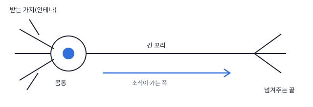
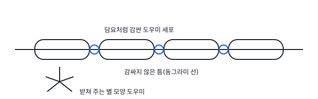
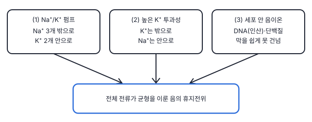
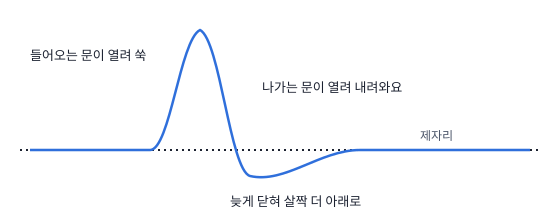
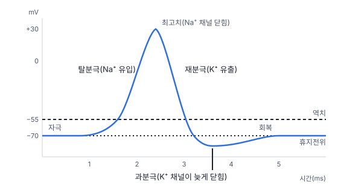
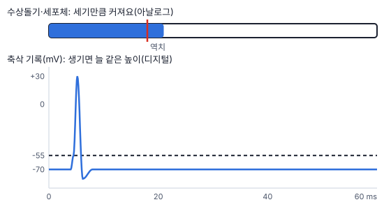
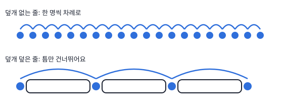
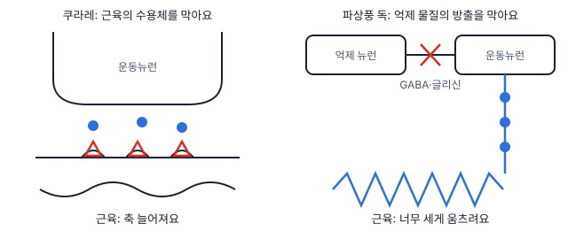

# 뉴런과 시냅스 — 5살도 이해하는 정리노트

이영만 교수님 생명과학 · 1112 수업 (12장 p1–3, 12.1 정보의 흐름과 뉴런)

> `정리노트_1112_Nervous_and_Sensory_Systems.html`를 마크다운으로 옮겼어요. 그림은 `figures_1112/` 폴더의 SVG, 위젯은 대표 설정의 정적 그림으로 바꿨어요. 수식은 `$…$` / `$$…$$`라서 GitHub, Obsidian, Typora에서 보여요.

**목차**

- [1. 뉴런과 신경아교세포](#s0)
  - [뉴런의 세 부분과 신호의 방향](#s0-neuron)
  - [신경아교세포와 미엘린 수초](#s0-glia)
- [2. 휴지전위](#s1)
  - [채널과 Na⁺/K⁺ 펌프](#s1-channel-pump)
  - [휴지전위가 생기는 이유](#s1-resting)
- [3. 활동전위와 전도](#s2)
  - [활동전위: 탈분극·재분극·과분극](#s2-action)
  - [실무율과 자극의 세기](#s2-all-or-none)
  - [전도 속도: 축삭의 지름과 도약전도](#s2-conduction)
- [4. 시냅스 전달](#s3)
  - [시냅스: 화학적 시냅스와 전기적 시냅스](#s3-synapse-types)
  - [화학 시냅스의 전달 순서](#s3-release)
  - [흥분성 신호와 억제성 신호](#s3-excite-inhibit)
- [5. 신경전달물질과 약물](#s4)
  - [여러 가지 신경전달물질](#s4-transmitters)
  - [신경전달물질의 제거와 약물](#s4-removal)
- [6. 요약 · 예고](#s5)
  - [시험 직전 한눈에](#s5-cheatsheet)
  - [다음 시간 연결](#s5-next)
  - [함께 보면 좋은 자료](#s5-links)

## 1. 뉴런과 신경아교세포

### 뉴런의 세 부분과 신호의 방향

*1112 수업 · 12장 p1*

**쉽게 말하면**

몸속 소식을 나르는 세포는 안테나 같은 가지로 소식을 받고, 몸통을 거쳐, 긴 꼬리 끝으로 다음 세포에 넘겨줘요.

*화살표를 따라 소식이 어디로 가는지 보세요.*

**정확히 말하면**

**뉴런(neuron)의 세 부분**

| 비교 기준 | 수상돌기(dendrite) | 세포체(cell body) | 축삭(axon) |
|---|---|---|---|
| 모양·구조 | 가지돌기 | 핵·미토콘드리아 등 세포소기관 | 세포체에서 이어지는 긴 돌기 |
| 신호에서 하는 일 | 시냅스 입력을 받음 | 여러 입력을 합침 | 활동전위를 말단까지 전도 |

*테두리 원이 세포체, 그 안의 색칠된 점이 핵이에요.*

흥분성 입력에서 수상돌기 막의 채널로 Na⁺가 들어오면 그 자리의 막전위가 올라가요. 이 국소 변화는 다른 수상돌기와 세포체의 입력과 합쳐질 수 있어요.

1. 수상돌기 입력
2. 세포체를 거친 신호
3. 역치 도달 시 축삭 초기분절 발화
4. 축삭 전도
5. 축삭말단에서 다음 세포로 전달

**축삭둔덕(axon hillock)** = 세포체가 축삭으로 좁아지는 부위

**축삭말단(axon terminal)** = 다음 세포로 신호를 넘기는 축삭 끝

**기능에 따른 세 뉴런**

| 비교 기준 | 구심성 뉴런(afferent neuron) | 연합뉴런(interneuron) | 원심성 뉴런(efferent neuron) |
|---|---|---|---|
| 수업 용어 | 감각뉴런(sensory neuron) | 연합뉴런 | 운동뉴런(motor neuron) |
| 방향과 역할 | 감각 입력을 중심으로 | 두 뉴런 사이에서 정보 통합 | 중심에서 근육세포로 |

*테두리 상자 하나가 뉴런의 한 종류를 나타내요.*

암기법(교수님). 구심력의 “구심”은 중심으로 들어가는 방향이에요.

더 자세히

관련 개념은 [활동전위: 탈분극·재분극·과분극](#s2-action)과 [시냅스: 화학적 시냅스와 전기적 시냅스](#s3-synapse-types)에서 이어져요.

신호를 받는 수상돌기와 활동전위가 시작되는 축삭 시작부를 구별하려면 [학습만화](../%ED%95%99%EC%8A%B5%EB%A7%8C%ED%99%94_1112_Nervous_and_Sensory_Systems.html#s0-neuron)를 펼쳐 보세요.

교수님 말씀

> 구심력이 들어가는 쪽이잖아. 그래서 감각뉴런을 구심성 뉴런.

**꼭 기억해요**

| 묻는 것 | 틀리기 쉬운 답 | 맞는 답 |
|---|---|---|
| 감각을 중심으로 들여보내는 뉴런 | ~~원심성 뉴런~~ | 구심성 뉴런 |
| 시냅스 입력을 받는 가지 | ~~축삭 또는 세포체~~ | 수상돌기 |
| 핵은 어떤 부분인가요? | ~~입력 신호를 받는 돌기~~ | 세포체 안의 소기관 |
| 대표적인 활동전위 시작점 | ~~축삭둔덕 또는 축삭말단~~ | 둔덕에 바로 이어지는 축삭 초기분절(axon initial segment) |
| 수상돌기의 영어 표기 | ~~dentrite~~ | dendrite |

**페이지 요약**

뉴런 안에서 신호는 수상돌기로 들어와 세포체를 지나 축삭으로 나가고, 기능으로는 신호를 들여보내는 구심성, 내보내는 원심성, 그 사이의 연합뉴런으로 나눠요.

*용어*

- **수상돌기(dendrite)** — 신호를 받는 돌기(가지돌기). 시냅스 입력을 받아 그 자리의 막전위가 달라질 수 있어요.
- **세포체(cell body)** — 핵·미토콘드리아 같은 세포소기관이 있는 부분이에요. 핵은 받는 부위가 아니에요.
- **축삭(axon)** — 신호가 빠져나가는 돌기예요. 축삭둔덕에 이어지는 축삭 초기분절이 대표적인 발화 시작점이고, 축삭말단이 다음 세포로 넘기는 끝이에요.
- **구심성 뉴런(afferent neuron)** — 감각뉴런. 구심력처럼 안쪽으로 들어가는 쪽이에요.
- **원심성 뉴런(efferent neuron)** — 운동뉴런. 중심에서 멀어져 근육세포로 신호를 내보내는 쪽이에요.
- **연합뉴런(interneuron)** — 구심성 뉴런과 원심성 뉴런 사이에서 정보를 통합해요.

---

### 신경아교세포와 미엘린 수초

*1112 수업 · 12장 p1*

**쉽게 말하면**

소식을 나르는 세포 곁에는 그 세포를 먹이고 받쳐 주는 도우미 세포가 있어요. 어떤 도우미는 긴 꼬리를 감싸 소식이 더 빨리 가도록 도와요.

*덮개 사이에서 긴 꼬리가 드러난 곳을 살펴보세요.*

**정확히 말하면**

**신경아교세포(glial cell)** = 영양 공급·물리적 지지·수초 형성 등으로 뉴런을 돕는 세포

| 비교 기준 | 성상세포(astrocyte) | 희소돌기아교세포(oligodendrocyte) | 슈반세포(Schwann cell) |
|---|---|---|---|
| 역할 | 물리적 지지·뉴런 환경 유지 | 미엘린 수초 형성 | 미엘린 수초 형성 |
| 수초를 만드는 곳 | 수초를 만들지 않음 | 중추신경계 | 말초신경계 |

**미엘린 수초(myelin sheath)** = 아교세포 자체의 막이 축삭을 여러 겹 감싸 이룬 지질성 절연막

**랑비에 결절(node of Ranvier)** = 수초 사이에 축삭이 드러난 틈

수초가 있으면 유수신경, 없으면 무수신경이에요. 지름이 비슷하면 유수신경이 더 빨라요. 그 이유는 [전도 속도: 축삭의 지름과 도약전도](#s2-conduction)에서 확인해요.

더 자세히

성상세포는 별(星) 모양에서 붙은 이름이에요.

수초와 랑비에 결절의 위치, 수초를 만드는 세포를 구별하려면 [학습만화](../%ED%95%99%EC%8A%B5%EB%A7%8C%ED%99%94_1112_Nervous_and_Sensory_Systems.html#s0-glia)를 펼쳐 보세요.

모형을 돌려 수초 사이에 드러난 결절을 [수초와 도약전도 모형](../%EC%9D%B8%ED%84%B0%EB%A0%89%ED%8B%B0%EB%B8%8C_03_%EC%88%98%EC%B4%88%EC%99%80_%EB%8F%84%EC%95%BD%EC%A0%84%EB%8F%84.html)의 구조 모드에서 찾아보세요.

교수님 말씀

> 담요처럼 이렇게 덮고 있는데요.

> 이 지질 막 자체가 세포예요.

**꼭 기억해요**

| 묻는 것 | 틀리기 쉬운 답 | 맞는 답 |
|---|---|---|
| 중추에서 슈반세포와 같은 일을 하는 세포 | ~~미엘린 수초~~ | 희소돌기아교세포 |
| 축삭을 따라 활동전위를 전도하는 세포 | ~~아교세포~~ | 뉴런 |
| 수초는 어디에서 오나요? | ~~축삭 자체 또는 세포 밖 물질~~ | 축삭을 감싸는 아교세포의 막 |
| 랑비에 결절의 위치 | ~~수초가 덮은 구간~~ | 수초 사이 노출 구간 |
| 성상세포의 역할 | ~~수초 형성~~ | 뉴런 지지 |

교수님은 아교세포가 뉴런보다 훨씬 많다고 설명했어요. 실제 비율은 뇌 부위·동물 종에 따라 달라요. 성인 남성의 뇌 전체를 센 연구에서는 뉴런과 비뉴런 세포 수가 비슷했고, 비뉴런에는 아교세포와 혈관 세포 등이 포함돼요. [Azevedo 외, 2009](https://pubmed.ncbi.nlm.nih.gov/19226510/)

**보충 · 수업에서 다루지 않았어요**

교재는 두 수초 형성 세포가 있는 장소를 나눠 적어요. 희소돌기아교세포는 중추신경계(뇌와 척수)에 있고, 슈반세포는 말초신경계(뇌·척수 바깥의 신경)에 있어요. 즉 슈반세포는 말초신경계에서 수초를 만드는 신경아교세포예요. 교재 그림에서는 슈반세포의 세포막이 축삭을 젤리 롤처럼 300번 이상 감고 있어, 수초가 아교세포의 세포막에서 만들어진다는 점을 보여 줘요.

출처: 교재 12장 p.263

**페이지 요약**

신경아교세포는 뉴런의 활동을 돕고, 그중 희소돌기아교세포와 슈반세포는 축삭을 감싸 전도를 빠르게 하는 미엘린 수초를 만들어요.

*용어*

- **신경아교세포(glial cell)** — 영양 공급·물리적 지지·수초 형성 등으로 뉴런을 보조해요. 뉴런과 아교세포의 비율은 뇌 부위와 종에 따라 달라요. 성인 남성의 뇌 전체를 센 연구에서는 뉴런과 비뉴런 세포의 수가 비슷했고, 비뉴런에는 아교세포와 혈관 세포 등이 포함돼요.
- **성상세포(astrocyte)** — 별 모양 아교세포로 뉴런을 물리적으로 지지해요. 수초는 만들지 않아요.
- **희소돌기아교세포·슈반세포** — 희소돌기아교세포는 중추신경계에서, 슈반세포는 말초신경계에서 수초를 만들어요.
- **미엘린 수초(myelin sheath)** — 아교세포 자체가 축삭을 감싼 지질 막으로, 전기적 절연체로 작용해요.
- **랑비에 결절(node of Ranvier)** — 수초 사이사이에 축삭이 드러난 틈이에요.
- **유수신경·무수신경** — 수초가 있으면 유수신경, 없으면 무수신경이에요. 지름이 비슷하면 유수신경이 더 빨라요.

- **(보충) 수초 세포의 장소** — 교재 기준으로 희소돌기아교세포는 중추신경계(뇌·척수), 슈반세포는 말초신경계(뇌·척수 바깥)에 있고, 슈반세포 막은 축삭을 여러 겹 감아요.

---

## 2. 휴지전위

### 채널과 Na⁺/K⁺ 펌프

*1112 수업 · 12장 p2*

**쉽게 말하면**

세포막에는 이온이 저절로 흐르는 통로와, 에너지를 써서 이온을 옮기는 펌프가 있어요.

*왼쪽은 전압 차가 없는 예라 농도 차가 이온이 흐르는 방향을 정해요. 실제 세포막에서는 전압 차도 작용해요. 오른쪽 펌프는 에너지를 써서 이온을 옮겨요.*

**정확히 말하면**

| 비교 기준 | 채널(channel, 통로) | Na⁺/K⁺ 펌프(pump) |
|---|---|---|
| 이온 이동 방향 | 열린 통로에서 전기화학 기울기를 따른 수동 이동 | 전기화학 기울기를 거스르는 능동수송(active transport) |
| ATP | 이온 통과에 직접 쓰지 않음 | ATP 가수분해로 에너지 공급 |
| 이동 대상·결과 | 종류에 따라 특정 이온을 더 잘 통과시킴(선택성) | Na⁺는 바깥, K⁺는 안쪽 농도가 높은 상태 유지 |

**전기화학 기울기(electrochemical gradient)** = 농도 차와 전압 차가 이온 이동에 미치는 효과의 합

농도 차는 농도가 낮은 쪽으로 이온을 움직이게 하고, 전압 차는 이온의 전하에 따라 끌리거나 밀리는 방향을 정해요. 순이동 방향은 두 효과를 함께 봐요.

*화살표는 한 번 작동할 때 펌프가 이온을 옮기는 방향을 보여 줘요.*

암기법(교수님). “나트륨은 나간다.”

펌프가 유지하는 농도 차는 [휴지전위가 생기는 이유](#s1-resting)의 바탕이에요.

더 자세히

강의노트에서는 “Na⁺/K⁺ 능동수송펌프”로 표기해요. ATP가 수송에 쓰이는 원리는 [세포 호흡 단원의 ATP를 쓰는 곳](../../0910/정리노트_0910_Cells_and_Cellular_Respiration.html#s2-atp-use)에서 이어져요.

채널이 따르는 방향과 펌프가 옮기는 Na⁺·K⁺의 방향과 개수를 구별하려면 [학습만화](../%ED%95%99%EC%8A%B5%EB%A7%8C%ED%99%94_1112_Nervous_and_Sensory_Systems.html#s1-channel-pump)를 펼쳐 보세요.

Na⁺ 3개가 밖으로 나가고 K⁺ 2개가 안으로 들어오는 순서를 [펌프와 휴지전위 모형](../%EC%9D%B8%ED%84%B0%EB%A0%89%ED%8B%B0%EB%B8%8C_04_%ED%8E%8C%ED%94%84%EC%99%80_%ED%9C%B4%EC%A7%80%EC%A0%84%EC%9C%84.html)의 펌프 모드에서 재생해 보세요.

교수님 말씀

> “펌프는 전기를 꽂아야 작동이 되잖아.”

**꼭 기억해요**

| 묻는 것 | 틀리기 쉬운 답 | 맞는 답 |
|---|---|---|
| 펌프가 들여보내는 이온 | ~~칼슘(Ca²⁺)~~ | 칼륨(K⁺) |
| 한 번에 옮기는 수와 방향 | ~~Na⁺ 2개 밖, K⁺ 3개 안~~ | Na⁺ 3개 밖, K⁺ 2개 안 |
| 이온을 옮기는 데 ATP를 직접 쓰는 쪽 | ~~열린 채널~~ | Na⁺/K⁺ 펌프 |
| 활동전위의 급상승과 과분극을 만드는 변화 | ~~펌프의 빠른 작동~~ | 채널의 개폐 |

**페이지 요약**

열린 채널에서는 이온이 전기화학 기울기를 따라 수동으로 흐르고, Na⁺/K⁺ 펌프는 ATP를 써서 Na⁺는 바깥, K⁺는 안쪽에 많은 상태를 유지해요.

*용어*

- **채널(channel)** — 특정 이온을 더 잘 통과시키는 통로예요. 이온의 순이동 방향은 농도 차와 전압 차를 합친 전기화학 기울기가 정해요.
- **펌프(pump)·능동수송** — 에너지를 써서 이온을 전기화학 기울기에 거슬러 옮겨요. Na⁺/K⁺ 펌프의 에너지원은 ATP예요.
- **Na⁺/K⁺ 펌프** — ATP를 써서 Na⁺ 3개를 밖으로, K⁺ 2개를 안으로 옮겨요. 칼슘이 아니라 칼륨이고, 이름대로 나트륨이 나가요.
- **펌프 vs 채널의 일** — 펌프가 안팎의 농도 차를 유지하고, 이온 채널의 투과성이 변하면서 활동전위의 급상승과 과분극이 생겨요.

---

### 휴지전위가 생기는 이유

*1112 수업 · 12장 p2*

**쉽게 말하면**

가만히 쉬고 있는 신호 세포는 안쪽이 바깥보다 살짝 마이너스(−)예요.

*화살표는 쉬는 동안의 이온 이동 방향을 나타내요.*

**정확히 말하면**

휴지 상태에서 K⁺ 누출 통로가 더 열리면 막전위는 K⁺ 평형전위에 가까워져요. [활동전위가 내려오는 동안의 K⁺ 전류 변화](#s2-action)는 하강 속도에 영향을 줘요.

**막전위(membrane potential)** = 세포 밖을 기준으로 잰 세포 안쪽 전압

**휴지전위(resting potential)** = 자극받지 않은 뉴런에서 안정적으로 유지되는 막전위

**분극(polarized) 상태** = 막 안팎에 전위 차가 있는 상태

**누설 채널(leaky channel)** = 휴지 상태에도 열린 통로

막 안팎에 이온이 불균등하게 분포하고 막이 이온마다 다른 정도로 통과시키면 전압 차가 생겨요.

1. **농도 차 유지.** 세포 호흡이 공급한 ATP로 [Na⁺/K⁺ 펌프](#s1-channel-pump)가 Na⁺ 3개를 밖으로, K⁺ 2개를 안으로 옮겨요. 한 번에 순양전하 1개가 밖으로 가고, Na⁺는 밖에, K⁺는 안에 많이 유지돼요.
2. **높은 K⁺ 투과성.** 대표적인 뉴런의 휴지 막은 K⁺를 Na⁺보다 잘 통과시켜요. K⁺는 주로 밖으로, Na⁺는 주로 안으로 이동해요.
3. **안쪽 전위 하강.** K⁺가 빠져나갈수록 더 음성이 된 안쪽이 K⁺를 끌어당겨 추가 유출을 줄여요. K⁺ 투과성이 높아서 휴지전위는 K⁺의 순이동이 없는 K⁺ 평형전위에 가까워져요.
4. **세포 안에 남는 음이온.** 인산을 가진 DNA와 일부 음전하 단백질처럼 큰 분자는 막을 자유롭게 넘지 못해요. 강의노트의 음전하 분자 예에는 단백질·아미노산·핵산이 있어요.
5. **전류 균형.** 각 이온의 순이동은 투과성과 전기화학 기울기에 따라 달라요. 펌프·누설 채널 등을 통한 전체 막전류의 합이 0이면, 이온이 움직이는 동안에도 전위가 안정돼요.

*통로 옆 화살표를 펌프가 옮기는 방향과 비교해 보세요.*

[활동전위: 탈분극·재분극·과분극](#s2-action)에서는 채널 개폐로 막전위가 빠르게 바뀌며 상승 중 0을 지나 양수가 될 수 있어요.

농도 차를 유지하는 펌프와 휴지전위에 영향을 주는 누설 채널을 구별하려면 [학습만화](../%ED%95%99%EC%8A%B5%EB%A7%8C%ED%99%94_1112_Nervous_and_Sensory_Systems.html#s1-resting)를 펼쳐 보세요.

ATP 공급을 끊은 직후와 시간이 지난 뒤의 이온 농도 차를 [펌프와 휴지전위 모형](../%EC%9D%B8%ED%84%B0%EB%A0%89%ED%8B%B0%EB%B8%8C_04_%ED%8E%8C%ED%94%84%EC%99%80_%ED%9C%B4%EC%A7%80%EC%A0%84%EC%9C%84.html)의 휴지전위 모드에서 비교해 보세요.

교수님 말씀

> “단순히 이것 때문에 세포 내부가 음, 바깥이 양인 게 아닙니다.”

교수님은 누설 채널을 문을 떼어 낸 통로에 비유했어요. 문이 없으니 “질질 새잖아”라고 했어요.

**꼭 기억해요**

| 묻는 것 | 틀리기 쉬운 답 | 맞는 답 |
|---|---|---|
| 휴지전위의 수치 | ~~항상 −70 mV~~ | 강의노트 −50 ~ −60 mV, [활동전위 그래프](#s2-action) 예시 −70 mV |
| 휴지 상태에서 막전위의 부호 | ~~세포 밖 기준 양수~~ | 세포 밖 기준 음수 |
| 휴지 상태의 전체 막전류 | ~~모든 이온의 이동이 정지~~ | 막전류의 합이 0 |
| 각 이온의 순이동량 | ~~누설 채널 수만으로 결정~~ | 막 투과성과 농도·전압 차로 결정 |
| 휴지전위를 K⁺ 평형전위에 가깝게 하는 성질 | ~~펌프의 전하 이동만~~ | 휴지 막의 높은 K⁺ 투과성 |
| 활동전위 중 막전위의 빠른 변화 | ~~Na⁺/K⁺ 펌프~~ | 이온 채널의 개폐 |

교수님은 “−70 mV 정도”와 “대략 −60 mV”를 예로 들었어요. 펌프가 옮기는 전하만으로 안쪽이 음수가 된다고 판단하면, 막 투과성의 역할을 놓쳐요.

**페이지 요약**

펌프가 유지하는 이온 농도 차와 높은 K⁺ 투과성 때문에 휴지전위는 음수예요. 막을 지나는 전체 전류가 균형을 이루면 이 값이 유지돼요.

*용어*

- **막전위(membrane potential)** — 세포 밖을 기준으로 잰 안쪽 전위예요. 이온 농도 차와 이온마다 다른 막 투과성에 좌우돼요.
- **휴지전위(resting potential)·분극** — 자극받지 않은 뉴런에서 유지되는 음의 막전위예요. 강의노트 값은 −50 ~ −60 mV이고, 활동전위 그래프에는 −70 mV를 예로 썼어요.
- **누설 채널(leaky channel)** — 휴지 상태에서도 열려 있는 채널이에요. 휴지 상태의 막은 대체로 Na⁺보다 K⁺를 더 잘 통과시켜요.
- **세포 안 음이온** — DNA와 일부 단백질처럼 음전하를 띤 큰 분자는 막을 쉽게 건너지 못해 세포 안에 남아요.
- **Na⁺/K⁺ 펌프의 역할** — ATP를 써서 Na⁺ 3개를 밖으로, K⁺ 2개를 안으로 옮겨 이온 농도 차를 장기적으로 유지해요.
- **막전위의 방향** — 휴지 상태에서 안쪽 전위는 바깥보다 낮아요. 예시 파형에서는 상승 구간에 막전위가 양수까지 올랐다가 다시 낮아져요.

---

## 3. 활동전위와 전도

### 활동전위: 탈분극·재분극·과분극

*1112 수업 · 12장 p2*

**쉽게 말하면**

Na⁺가 들어오면 막전위가 쑥 올라가요. 곧 Na⁺ 유입이 줄고 K⁺가 나가면서 다시 내려와요.

*K⁺가 나가는 문이 느릿느릿 닫혀서, 막전위가 처음 자리보다 살짝 더 내려갔다가 돌아와요.*

**정확히 말하면**

**K⁺ 통로의 효과는 출발 상태부터 확인해요.** 재분극이 시작될 때 바깥으로 향하는 전압개폐 K⁺ 전류가 줄면 하강이 완만해져요. [휴지 상태](#s1-resting)에서 K⁺ 누출 투과성이 커지면 막전위가 K⁺ 평형전위 쪽으로 더 음성이 돼요.

**활동전위(action potential)** = 막전위가 짧은 시간에 급히 오르내리며 축삭을 따라 전파되는 전기적 충격

**역치** = Na⁺ 유입의 증폭으로 활동전위가 시작되는 기준 전위

활동전위가 처음 생기는 곳에는 전압 개폐성 Na⁺ 채널이 밀집해 있어요. 수상돌기·세포체의 여러 입력이 합쳐져 그곳이 역치에 닿으면 Na⁺ 유입이 탈분극을 스스로 증폭해요.

1. 흥분성 전달물질 결합
2. 수상돌기의 리간드 개폐성 채널 열림·Na⁺ 유입
3. 국소 전류로 수동 전달
4. 축삭 초기분절(axon initial segment, AIS)이 역치에 도달
5. 활동전위 발생

*원은 축삭둔덕 바로 다음의 축삭 초기분절이에요.*

*교재 그림 12.5처럼 위 점선은 예시 역치 −55 mV, 아래 점선은 예시 휴지전위를 표시해요.*

1. **휴지 상태.** 안쪽이 음수로 분극되어 있고 전압 개폐성 Na⁺ 채널은 닫혀 있어요.
2. **역치까지.** 국소 입력으로 막전위가 기준값까지 올라가요.
3. **탈분극.** Na⁺ 유입이 우세해 막전위가 덜 음수가 되고 예시에서는 0을 넘어가요. Na⁺가 밖에 많은 까닭은 [채널과 Na⁺/K⁺ 펌프](#s1-channel-pump)에서 봐요.
4. **정점 부근.** 많은 Na⁺ 채널이 불활성화돼 유입이 줄어요. 같은 탈분극에 늦게 반응한 지연성 K⁺ 채널의 작동 시기는 이 과정과 겹쳐요.
5. **재분극.** K⁺ 유출이 우세해 막전위가 휴지전위 쪽으로 내려가요.
6. **과분극.** 지연성 K⁺ 채널이 천천히 닫혀 유출이 이어지면 잠시 휴지전위 아래로 내려가요.
7. **회복.** K⁺ 채널이 닫히면 휴지전위로 돌아와요. 불활성화된 Na⁺ 채널도 재분극과 함께 다시 열릴 수 있게 회복해요.

이온이 막을 드나들며 그 자리의 전위가 바뀌고, 이 변화가 다음 자리로 이어져요. 전파 방식은 [전도 속도: 축삭의 지름과 도약전도](#s2-conduction)에서 봐요.

더 자세히

개폐성은 “개(開) = 열다, 폐(閉) = 닫다”라는 뜻이에요.

Na⁺ 채널의 불활성화와 K⁺ 채널의 느린 닫힘을 구별하려면 [학습만화](../%ED%95%99%EC%8A%B5%EB%A7%8C%ED%99%94_1112_Nervous_and_Sensory_Systems.html#s2-action)를 펼쳐 보세요.

막전위가 오르고 내려갈 때 Na⁺ 유입과 K⁺ 유출이 파형의 어느 구간에서 두드러지는지 [활동전위와 실무율 모형](../%EC%9D%B8%ED%84%B0%EB%A0%89%ED%8B%B0%EB%B8%8C_01_%ED%99%9C%EB%8F%99%EC%A0%84%EC%9C%84%EC%99%80_%EC%8B%A4%EB%AC%B4%EC%9C%A8.html)의 파형 모드에서 확인해 보세요.

교수님 말씀

> "나트륨 채널 열리고 닫히고, 칼륨 채널 열리고 닫히고. 닫히는데 좀 천천히 닫힌다."

교수님은 Na⁺ 채널이 불활성화되는 때를 “어, 너무 많이 됐다”, K⁺ 채널의 느린 닫힘을 “아이고, 이제 닫혀야지”라고 비유했어요.

**꼭 기억해요**

| 묻는 것 | 틀리기 쉬운 답 | 맞는 답 |
|---|---|---|
| 활동전위가 이동하는 대상 | ~~시냅스라는 장소 또는 휴지전위 값~~ | 막전위가 변하는 사건 |
| 활동전위가 보통 처음 생기는 곳 | ~~수상돌기~~ | 축삭둔덕 바로 다음 초기분절 |
| 상승을 일으키는 채널 | ~~휴지 때도 열린 누설 채널~~ | 전압 개폐성 Na⁺ 채널 |
| 탈분극과 활동전위의 관계 | ~~동일한 이름~~ | 상승 구간과 전체 파형 |
| 휴지전위보다 낮은 구간 | ~~재분극~~ | 과분극 |
| 정점 부근의 두 채널 | ~~Na⁺ 채널이 모두 닫힌 뒤 K⁺ 채널 작동~~ | Na⁺ 불활성화와 K⁺ 채널 작동이 겹침 |

교수님은 “탈분극이 됐죠”를 “활동전위가 생겼죠”로 바로잡았어요.

**페이지 요약**

축삭 초기분절이 역치에 이르면 Na⁺ 유입으로 막전위가 솟아요. Na⁺ 채널이 불활성화되고 K⁺ 유출이 우세해져 재분극이 일어나며, K⁺ 채널이 느리게 닫혀 과분극이 생길 수 있어요.

*용어*

- **활동전위(action potential)** — 막전위가 빠르게 올라갔다가 내려오는 변화가 축삭을 따라 전파되는 신호예요.
- **시작 위치** — 수상돌기의 국소 막전위 변화가 수동으로 퍼져요. 보통 축삭둔덕 바로 다음의 축삭 초기분절이 역치에 이르면 활동전위가 시작돼요.
- **전압 개폐성 Na⁺ 채널** — 막전위에 따라 열릴 가능성이 달라지는 채널로 축삭 초기분절에 밀집해 있어요. 불활성화된 채널은 재분극이 진행되면서 다시 열릴 수 있는 상태로 돌아와요.
- **탈분극** — 막전위가 덜 음수가 되는 변화예요. 활동전위의 상승 구간에서는 Na⁺ 채널이 열리며 Na⁺가 빠르게 들어와요.
- **재분극** — 정점 부근의 Na⁺ 채널 불활성화와 지연성 K⁺ 채널의 작동이 겹쳐요. K⁺ 유출이 우세해져 막전위가 휴지전위 쪽으로 내려와요.
- **과분극** — K⁺ 채널이 천천히 닫혀 K⁺가 더 나가, 막전위가 휴지전위보다 낮아진 상태. K⁺ 채널이 닫히면 휴지전위로 돌아와요.
- **역치** — Na⁺ 유입이 더 많은 Na⁺ 채널을 열 만큼 커져 활동전위가 시작되는 기준 전위예요.
- **탈분극과 활동전위** — 탈분극은 막전위가 올라가는 한 구간이고, 활동전위는 탈분극부터 재분극·과분극·회복까지의 전체 변화예요. 교수님도 "탈분극이 됐죠"를 "활동전위가 생겼죠"로 고쳐 말했어요.

---

### 실무율과 자극의 세기

*1112 수업 · 12장 p2*

**쉽게 말하면**

활동전위 하나가 생기려면 막전위가 문턱에 닿아야 해요. 시험에 합격하는 것처럼, 문턱에 닿으면 활동전위가 생겨요.

*같은 뉴런에 자극을 준 두 경우에서 봉우리의 높이와 간격을 비교해 보세요.*

**정확히 말하면**

**실무율(all-or-nothing)** = 발화 가능한 뉴런의 축삭 초기분절이 역치에 닿으면 활동전위 발생

| 비교 기준 | 국소 막전위 변화 | 활동전위 |
|---|---|---|
| 대표적인 자리 | 수상돌기·세포체 | 축삭 초기분절에서 시작해 축삭으로 전파 |
| 크기 | 입력에 따라 연속적으로 달라짐(아날로그) | 같은 뉴런·같은 조건에서 한 번의 크기는 대체로 일정 |
| 역치 아래 | 크기가 작은 변화도 가능 | 발생하지 않음(발생 여부는 0 또는 1로 비유) |

역치에 닿으면 Na⁺ 유입이 더 많은 전압 개폐성 Na⁺ 채널을 열고, 이후 Na⁺ 채널의 불활성화와 K⁺ 유출이 전위를 되돌려요. 축삭을 따라 같은 과정이 이어져 크기가 유지돼요.

| 비교 기준 | 절대 불응기 | 상대 불응기 |
|---|---|---|
| 채널 상태 | Na⁺ 채널 불활성화 | Na⁺ 채널 회복 중·일부 K⁺ 채널 열림 |
| 재발화 | 다시 발화할 수 없음 | 평소보다 강한 자극 필요 |

겨우 역치에 닿는 입력은 한 번 발화시키거나 지속될 때 낮은 빈도로 발화시킬 수 있어요. 자극이 강하고 오래 이어지면 회복 뒤 더 빨리 역치에 닿아서 같은 시간에 더 자주 발화할 수 있어요.

#### 직접 해 보기: 자극 세기와 활동전위 *(정적 스냅샷 — 직접 조작은 HTML 버전)*

같은 뉴런에 60 ms 동안 자극을 주는 모형이에요. 위의 막대는 국소 막전위 변화의 크기를 나타내요. 아래 축삭 기록에서 활동전위가 생기는 조건과 횟수를 확인해 보세요. 이 모형의 휴지전위는 −70 mV, 활동전위의 최고치는 +30 mV로 설정했어요.

60 ms 동안 활동전위 수와 활동전위의 최고치: **3개 · 활동전위의 최고치 +30 mV(모형값)**

범례: 축삭 막전위(활동전위) · 점선: 모형의 역치(−55 mV)

*역치 미만(세기 2)*

*역치를 약간 넘음(세기 3.5)*

*강한 자극(세기 8)*

| 설정 | 활동전위 수(60 ms) | 활동전위의 최고치 | 판정 |
|---|---|---|---|
| 역치 미만(세기 2) | 0개 | 없음 | 불합격: 활동전위 없음 |
| 역치를 약간 넘음(세기 3.5) | 1개 | +30 mV | 합격: 한 번 |
| 강한 자극(세기 8) | 5개 | +30 mV | 합격: 모형의 최고치는 같고 횟수 증가 |

세 가지 자극에서 봉우리 높이와 같은 시간 동안의 횟수를 [활동전위와 실무율 모형](../%EC%9D%B8%ED%84%B0%EB%A0%89%ED%8B%B0%EB%B8%8C_01_%ED%99%9C%EB%8F%99%EC%A0%84%EC%9C%84%EC%99%80_%EC%8B%A4%EB%AC%B4%EC%9C%A8.html)의 실무율 모드에서 비교해 보세요.

자극에 따라 변하는 활동전위의 개수와 한 번의 높이를 구별하려면 [학습만화](../%ED%95%99%EC%8A%B5%EB%A7%8C%ED%99%94_1112_Nervous_and_Sensory_Systems.html#s2-all-or-none)를 펼쳐 보세요.

교수님 말씀

교수님은 활동전위가 생기는지를 시험 결과에 빗댔어요. “기면 기고 아니면 아니다”는 채널 하나보다 축삭에서의 발화 여부에 해당해요.

> "1점 차이가 아니고 합격, 불합격"

속삭이는 소리와 크게 말하는 소리의 차이를 자극 세기의 예로 들었어요.

**꼭 기억해요**

| 묻는 것 | 틀리기 쉬운 답 | 맞는 답 |
|---|---|---|
| 입력에 따라 크기가 연속적으로 바뀌는 신호 | ~~한 번의 활동전위~~ | 국소 막전위 변화 |
| 지속 자극이 강해질 때 주로 변하는 값 | ~~활동전위 한 번의 높이~~ | 발화 빈도 |
| 역치에 못 미친 입력의 결과 | ~~막전위 변화도 없음~~ | 활동전위 없이 국소 변화 가능 |

**페이지 요약**

발화할 수 있는 뉴런이 역치에 이르면 활동전위가 생겨요. 같은 뉴런의 같은 조건에서는 한 번의 크기가 대체로 일정하고, 지속 자극의 세기는 발화 빈도에 반영될 수 있어요.

*용어*

- **실무율(all-or-nothing)** — 역치에 이르면 Na⁺ 유입이 더 많은 Na⁺ 채널을 열어 활동전위를 일으켜요. 역치 아래에서는 국소 막전위만 변해요.
- **활동전위의 크기** — 같은 뉴런의 같은 조건에서는 Na⁺ 유입과 K⁺ 유출이 비슷한 시간 흐름을 보여, 활동전위 한 번의 크기가 대체로 일정해요.
- **빈도** — 같은 시간 동안 활동전위가 발생한 횟수예요. 강한 자극이 이어지면 회복 뒤 역치에 더 빨리 도달해 빈도가 높아질 수 있어요.
- **불응기** — 발화 직후 Na⁺ 채널이 불활성화되어 다시 발화할 수 없는 절대 불응기와, 평소보다 강한 자극이 있어야 발화할 수 있는 상대 불응기가 이어져요.
- **아날로그와 디지털** — 수상돌기·세포체의 국소 막전위 변화는 입력에 따라 연속적으로 달라져요. 활동전위는 역치에 도달했을 때의 발생 여부로 구별할 수 있어요.

---

### 전도 속도: 축삭의 지름과 도약전도

*1112 수업 · 12장 p2*

**쉽게 말하면**

파도타기 응원처럼 한 곳의 신호가 다음 곳을 깨워요. 덮개가 있으면 사이에서 신호가 덜 새어 더 먼 곳을 깨울 수 있어요.

*동그라미는 신호가 다시 생기는 곳이에요. 아래 줄에서는 덮개 아래를 따라 신호가 이어져 더 멀리 떨어진 다음 틈을 깨워요.*

**정확히 말하면**

**전도** = 한 자리의 막전위 변화가 다음 자리의 활동전위를 일으키며 이어지는 과정

1. 먼저 열린 Na⁺ 채널과 탈분극
2. 축삭 내부의 국소 전류
3. 다음 막이 역치에 도달
4. 다음 자리에서 활동전위 재생

지나온 자리는 재분극을 거쳐 휴지전위로 돌아오고, 다음 자리에서 새로 발화하므로 전파되는 활동전위의 크기는 유지돼요. 축삭말단에 닿으면 [화학 시냅스의 전달 순서](#s3-release)가 시작될 수 있어요.

다른 조건이 같다면 지름이 큰 축삭은 내부 전류에 대한 저항이 작아 전도가 빨라요. 축삭을 계속 굵게 하지 않고도 전도를 빠르게 하는 방식이 도약전도예요.

**도약전도(saltatory conduction)** = 유수 축삭에서 활동전위가 랑비에 결절마다 재생되는 전도

| 비교 기준 | 유수 축삭 | 무수 축삭 |
|---|---|---|
| 전압 개폐성 Na⁺ 채널 | 랑비에 결절에 집중 | 축삭막을 따라 분포 |
| 국소 전류가 이어지는 범위 | 수초 아래 축삭 내부를 따라 다음 결절까지 수동 전달 | 가까운 이웃 막까지 수동 전달 |
| 재생·속도 | 다음 결절이 역치에 닿을 때마다 재생, 비슷한 지름에서 빠름 | 이웃한 구간에서 연속 재생 |

*짧은 세로선은 전도에 관여하는 Na⁺ 채널, 화살표는 축삭 내부의 국소 전류예요.*

[신경아교세포와 미엘린 수초](#s0-glia)에서 본 지질성 수초는 축삭막을 가로지르는 전류 누출을 줄여요. 수초가 덮인 부분에도 이온 채널이 있어요.

**다발성 경화증(multiple sclerosis)** = 면역계가 중추신경계 수초를 손상시키는 자가면역질환

1. 수초 손상
2. 전류 누출 증가
3. 다음 결절의 탈분극 감소
4. 역치 도달 지연 또는 실패
5. 전도 지연 또는 차단

운동 경로의 전도가 차단되면 근력 저하나 마비가 생길 수 있어요. 다발성 경화증에서는 탈수초에 축삭 자체의 손상이 동반되기도 해요.

축삭을 전도하는 [활동전위: 탈분극·재분극·과분극](#s2-action)의 시작점은 보통 축삭 초기분절이에요. 역치에서 Na⁺ 유입이 증가하고 정점 부근에는 Na⁺ 채널의 불활성화가 진행돼요. Ca²⁺는 활동전위가 말단에 도착한 뒤 말단으로 들어와 전달물질 분비를 도와요.

더 자세히

교수님은 면역은 14장에서 배운다고 했어요.

전류가 퍼지는 구간과 활동전위가 재생되는 결절을 구별하려면 [학습만화](../%ED%95%99%EC%8A%B5%EB%A7%8C%ED%99%94_1112_Nervous_and_Sensory_Systems.html#s2-conduction)를 펼쳐 보세요.

같은 거리를 가는 두 축삭에서 활동전위가 어디서 다시 생기고 어느 쪽이 먼저 도착하는지 [수초와 도약전도 모형](../%EC%9D%B8%ED%84%B0%EB%A0%89%ED%8B%B0%EB%B8%8C_03_%EC%88%98%EC%B4%88%EC%99%80_%EB%8F%84%EC%95%BD%EC%A0%84%EB%8F%84.html)의 전도 모드에서 비교해 보세요.

교수님 말씀

교수님은 전도를 파도타기에 비유했어요. 무수 축삭에서는 옆 학생이 차례로 일어나고, 유수 축삭에서는 1번·10번·20번처럼 떨어진 학생이 일어나요.

수초는 전선의 피복, 수초가 손상될 때 새는 전류는 피복이 벗겨진 전선의 누전에 빗댔어요.

**꼭 기억해요**

| 묻는 것 | 틀리기 쉬운 답 | 맞는 답 |
|---|---|---|
| 가느다란 축삭에서 전도를 빠르게 하는 방식 | ~~굵은 축삭에서만 전도 속도 증가~~ | 수초가 있는 축삭의 도약전도 |
| 탈수초의 뜻 | ~~축삭 자체가 끊어짐~~ | 축삭을 감싼 수초의 손상 |
| 유수 축삭에서 활동전위가 재생되는 곳 | ~~수초 아래 전 구간~~ | 랑비에 결절 |
| 수초를 갖는 축삭 | ~~모든 뉴런의 축삭~~ | 유수 축삭 |

강의노트는 “도약전도는 지름이 작은 축삭에서 전도 속도를 증가”라고 짚어요. 축삭 자체가 이어져 있어도 탈수초로 전도가 늦어지거나 막힐 수 있어요.

**페이지 요약**

굵은 축삭은 내부 저항이 작아 전도가 빨라요. 가는 축삭도 수초가 있으면 결절 사이로 전류가 수동적으로 퍼지고 활동전위가 결절마다 재생되는 도약전도로 빨라져요.

*용어*

- **전도** — 한 곳의 탈분극이 국소 전류를 통해 다음 곳의 막을 역치에 올려요. 다음 곳에서 활동전위가 새로 생기므로 크기가 유지되고, 지나온 자리는 휴지전위로 돌아가요.
- **축삭의 지름** — 클수록 저항이 줄어 빨라요. 다만 한없이 굵게 할 수는 없어요.
- **도약전도(saltatory conduction)** — 수초 아래로 흐르는 국소 전류가 다음 결절을 역치에 올리면 집중된 Na⁺ 채널이 활동전위를 재생해요. 수초에 덮인 막에도 이온 채널이 있어요. 무수 축삭에서는 활동전위가 가까운 막을 따라 연속해서 재생돼요.
- **미엘린 수초** — 유수 축삭을 감싸는 지질 막이에요. 막을 가로지르는 전류 누출을 줄여 결절 사이의 신호 전달을 빠르게 해요.
- **다발성 경화증(multiple sclerosis)** — 면역계가 중추신경계 수초를 손상시켜요. 탈수초로 전류 누출이 늘면 전도가 느려지거나 차단될 수 있어요. 축삭 자체의 손상이 동반되기도 해요.
- **활동전위 판별 기준** — 역치에서 전압 개폐성 Na⁺ 채널이 열려 Na⁺가 유입되며 시작해요. 보통 축삭 초기 분절에서 시작해 말단 방향으로 전해지고, 정점 부근에서는 Na⁺ 채널의 불활성화가 진행돼요.

---

## 4. 시냅스 전달

### 시냅스: 화학적 시냅스와 전기적 시냅스

*1112 수업 · 12장 p1*

**쉽게 말하면**

신경세포끼리 신호를 건네는 길은 두 가지예요: 틈 너머로 작은 알갱이를 던지거나, 터널로 바로 이어지거나.

*왼쪽은 알갱이가 틈을 건너가고, 오른쪽은 알갱이가 터널 속을 곧장 지나가요.*

**정확히 말하면**

**시냅스(synapse)** = 뉴런이 다음 세포에 신호를 넘기는 접점

**시냅스 전 뉴런(presynaptic neuron)** = 신호를 보내는 쪽

**시냅스 후 뉴런(postsynaptic neuron)** = 신호를 받는 쪽

| 비교 기준 | 화학적 시냅스(chemical synapse) | 전기적 시냅스(electrical synapse) |
|---|---|---|
| 건너가는 것 | 신경전달물질(neurotransmitter) | 이온(수업 예: Na⁺) |
| 두 세포 사이 | 시냅스 틈(synaptic cleft) | 두 세포를 잇는 통로 |
| 넘기는 방식 | 보내는 축삭말단에서 방출, 받는 쪽의 수용체(주로 수상돌기)에 결합 | 통로를 통한 이온의 직접 이동 |

시냅스 전·후는 신호의 방향으로 정해요. 수업에서 자세히 다루는 것은 화학적 시냅스예요. [화학 시냅스의 전달 순서](#s3-release)로 이어져요.

교수님은 소리와 시각 신호가 어떻게 뇌에 닿는지, 생각과 감정은 어떻게 생기는지 이해하기 위해 이 단원을 공부한다고 설명했어요.

더 자세히

강의노트의 “시냅스전세포·시냅스후세포”는 같은 뜻이에요.

전달물질이 틈을 건너는 경우와 이온이 직접 이동하는 경우를 구별하려면 [학습만화](../%ED%95%99%EC%8A%B5%EB%A7%8C%ED%99%94_1112_Nervous_and_Sensory_Systems.html#s3-synapse-types)를 펼쳐 보세요.

교수님 말씀

> "터널처럼 통로가 있어 가지고 … 나트륨 이온이 직접 이동하는 경우"

**페이지 요약**

신호를 넘기는 두 방식은 건너가는 것이 달라요: 화학적 시냅스는 틈을 건너는 신경전달물질, 전기적 시냅스는 통로로 직접 옮겨 가는 이온이에요.

*용어*

- **시냅스(synapse)** — 뉴런과 뉴런이 맞붙어 신호를 넘기는 곳이에요.
- **시냅스 전 뉴런 / 시냅스 후 뉴런** — 신호 방향으로 이름을 정해요. 신경전달물질을 내보내는 축삭말단 쪽이 전, 받는 쪽(주로 수상돌기)이 후예요.
- **화학적 시냅스(chemical synapse)** — 두 세포가 시냅스 틈으로 떨어져 있고, 신경전달물질이 그 틈을 건너가 신호를 넘겨요. 수업에서 자세히 배운 쪽이에요.
- **전기적 시냅스(electrical synapse)** — 두 세포 사이 터널 같은 통로로 이온(예: 나트륨 이온)이 직접 이동해요. 신경전달물질이 틈을 건너는 단계가 없어요.

---

### 화학 시냅스의 전달 순서

*1112 수업 · 12장 p2–3*

**쉽게 말하면**

보내는 쪽 끝에 신호가 닿으면 작은 주머니가 벽에 붙어 열리면서 알갱이를 틈으로 쏟아내요.

*그림 속 받는 자리는 이온이 지나는 문이에요. 알갱이가 틈을 건너 이 자리에 붙으면 문이 열려요.*

**정확히 말하면**

**방출 전 준비**

| 비교 기준 | 소분자 신경전달물질 | 신경펩타이드 |
|---|---|---|
| 예 | 아세틸콜린 | 엔도르핀 |
| 합성·포장 장소 | 대개 축삭말단에서 합성해 작은 시냅스 소포(synaptic vesicle)에 포장 | 세포체에서 합성·포장 |
| 말단에서 방출될 준비 | 그 자리에서 대기 | 운동단백질이 미세소관을 따라 포장된 소포를 운반 |

**화학적 시냅스에서 신호를 넘기는 순서**

1. **도착.** 축삭 초기분절에서 시작한 활동전위가 축삭을 지나 시냅스 전 뉴런의 축삭말단에 닿아요.
2. **Ca²⁺ 유입.** 말단 막의 전압개폐성 Ca²⁺ 채널이 막전위 변화로 열려 칼슘 이온이 들어와요.
3. **융합과 방출.** 유입된 Ca²⁺가 소포와 시냅스 전 막의 융합을 일으켜 전달물질이 틈으로 나와요.
4. **확산과 결합.** 전달물질이 틈을 건너 시냅스 후 막의 수용체에 결합해요. 호르몬과 수용체처럼 맞는 상대와 결합하지만 신경전달물질은 시냅스에서 작용하는 신호물질이에요.
5. **채널 조절.** 그림처럼 수용체 자체가 리간드 개폐성 이온 채널(ligand-gated ion channel)이면 결합으로 채널이 직접 열려요. 수용체가 세포 안 신호를 거쳐 채널을 간접 조절하는 경우도 있어요.
6. **시냅스 후 효과.** 열린 통로로 Na⁺가 들어와 탈분극되고 초기분절이 역치에 이르면 다음 활동전위가 생길 수 있어요. 열린 채널과 당시 전위에 따라 [흥분성 신호와 억제성 신호](#s3-excite-inhibit)가 갈려요.

*교재 그림 12.7(p.267)과 같은 이름을 썼어요. 테두리 원은 시냅스 소포, 색칠된 점은 신경전달물질, 작은 테두리 고리는 Ca²⁺예요.*

| 비교 기준 | 전압개폐성 Na⁺ 채널 | 전압개폐성 Ca²⁺ 채널 | 리간드 개폐성 이온 채널 |
|---|---|---|---|
| 예시 위치 | 축삭 초기분절과 축삭 | 시냅스 전 뉴런의 축삭말단 | 시냅스 후 막(예: 수상돌기) |
| 여는 조건 | 막전위 변화(역치 도달) | 막전위 변화(활동전위 도착) | 신경전달물질(리간드)의 결합 |

축삭과 랑비에 결절은 활동전위의 전도 구간이에요. 신호를 다음 세포에 넘기는 단계에 직접 참여하는 구조는 말단의 Ca²⁺ 채널과 소포, 시냅스 후 막의 수용체예요.

[여러 가지 신경전달물질](#s4-transmitters)에는 아세틸콜린·글루탐산·도파민·세로토닌이 있어요. 산화질소처럼 필요한 곳에서 만들어져 소포 없이 확산하는 신호물질도 있어요.

Ca²⁺ 유입부터 시냅스 후 수용체 결합까지의 순서와 위치를 보려면 [학습만화](../%ED%95%99%EC%8A%B5%EB%A7%8C%ED%99%94_1112_Nervous_and_Sensory_Systems.html#s3-release)를 펼쳐 보세요.

Ca²⁺가 들어온 뒤 소포가 어느 막과 융합하는지 [화학 시냅스 모형](../%EC%9D%B8%ED%84%B0%EB%A0%89%ED%8B%B0%EB%B8%8C_02_%ED%99%94%ED%95%99_%EC%8B%9C%EB%83%85%EC%8A%A4%EC%9D%98_%EC%8B%A0%ED%98%B8_%EC%A0%84%EB%8B%AC.html)에서 단계별로 재생해 보세요.

교수님 말씀

교수님은 리간드 개폐성 채널을 카드키 문으로 비유하고 소포 운반에서는 “미세소관 기억나요?”라고 물었어요.

> "카드키를 딱 대면은 얘가 탁 열려 … 카드키가 리간드인 거죠."

**꼭 기억해요**

| 묻는 것 | 틀리기 쉬운 답 | 맞는 답 |
|---|---|---|
| 말단의 Ca²⁺ 채널을 여는 자극 | ~~신경전달물질 결합~~ | 활동전위 도착에 따른 막전위 변화 |
| 시냅스 후 수용체의 종류 | ~~모두 이온 채널~~ | 이온 채널인 수용체와 채널을 간접 조절하는 수용체 |
| 방출 때 막과 융합하는 구조 | ~~소포체(ER)~~ | 시냅스 소포 |
| 소포가 융합하는 쪽 | ~~시냅스 후 막~~ | 말단의 시냅스 전 막 |
| 시냅스 틈을 건너가는 것 | ~~소포 자체~~ | 방출된 신경전달물질 |
| 전달물질이 방출되는 곳 | ~~시냅스 후 뉴런~~ | 시냅스 전 축삭말단 |
| 활동전위의 대표적 시작점 | ~~축삭말단~~ | 축삭 초기분절 |
| 미세소관을 따라 소포를 나르는 주체 | ~~미세소관 자체~~ | 운동단백질 |
| 랑비에 결절이 속한 구간 | ~~시냅스 전달·방출 구간~~ | 축삭의 전도 구간 |

교수님은 “소포체의 막”을 “소포의 막”으로 바로 고쳤고, Ca²⁺가 있어야 막이 융합한다고 강조했어요.

**페이지 요약**

활동전위가 축삭말단에 오면 전압개폐성 Ca²⁺ 채널이 열려 Ca²⁺가 들어와요. 소포가 시냅스 전 막과 융합하고, 방출된 전달물질이 틈을 건너 시냅스 후 수용체에 결합해요.

*용어*

- **준비 단계** — 소분자 전달물질은 대개 축삭말단에서 합성해 그 자리에서 소포에 담아요. 신경펩타이드는 세포체에서 합성·포장해 소포째 말단으로 옮겨요.
- **전압개폐성 Ca²⁺ 채널** — 시냅스 전 뉴런의 축삭말단 막에 있어요. 활동전위가 도착한 막전위 변화로 열리고, Ca²⁺가 쏟아져 들어와요.
- **소포(synaptic vesicle)의 융합** — Ca²⁺가 있어야 소포 막이 시냅스 전 뉴런(축삭말단)의 세포막과 융합해 신경전달물질을 시냅스 틈으로 내보내요. 소포체가 아니고, 시냅스 후 막과 융합하지도 않아요.
- **수용체** — 시냅스 후 뉴런(주로 수상돌기) 세포막에서 신경전달물질과 열쇠-자물쇠처럼 결합해요. 이온 통로를 겸하는 수용체와 세포 안의 신호 전달을 거쳐 작용하는 수용체가 있어요.
- **리간드 개폐성 이온 채널(ligand-gated ion channel)** — 물질(리간드)이 결합해야 열리는 채널이에요. 막전위 변화로 열리는 전압개폐성(축삭 초기분절 Na⁺, 축삭말단 Ca²⁺)과 여는 방식이 달라요.
- **전도 구간과 전달 단계** — 축삭(랑비에 결절 포함)은 활동전위가 전도되는 구간이고, 신경전달물질 방출은 축삭말단에서 일어나요. 전달 단계의 구성 요소는 Ca²⁺ 채널·소포·수용체예요.

---

### 흥분성 신호와 억제성 신호

*1112 수업 · 12장 p3*

**쉽게 말하면**

같은 알갱이가 와도 받는 쪽에서 어떤 문이 열리고 이온이 어떻게 움직이느냐에 따라, 다음 신호가 더 잘 생기거나 덜 생겨요.

*오른쪽 Cl⁻ 화살표는 Cl⁻가 유입되는 조건의 예예요.*

**정확히 말하면**

**흥분성 신호** = 활동전위가 생길 가능성을 높이는 신호

**억제성 신호** = 활동전위가 생길 가능성을 낮추는 신호

**이온의 평형전위** = 그 이온의 안팎 이동이 균형을 이뤄 순이동이 없는 막전위

같은 전달물질도 시냅스 후 막의 수용체와 현재 막전위에 따라 효과가 달라요. 수용체가 채널을 여는 방식은 [화학 시냅스의 전달 순서](#s3-release)에서 이어져요.

| 비교 기준 | Na⁺가 통과하는 채널 | K⁺ 채널 | Cl⁻ 채널 |
|---|---|---|---|
| 이온의 순이동 | Na⁺ 유입이 우세한 경우 | K⁺ 유출이 우세한 경우 | Cl⁻ 평형전위보다 막전위가 높으면 유입, 낮으면 유출, 같으면 순이동 없음 |
| 막전위 변화 | 상승(탈분극) | 하강(과분극) | Cl⁻ 평형전위 쪽으로 이동 |
| 발화 효과 | 역치에 가까워져 흥분 | 역치에서 멀어져 억제 | 과분극 또는 동시 흥분성 입력의 약화로 억제 가능 |

1. 열린 채널이 통과시키는 이온
2. 막전위와 평형전위로 이동 방향 확인
3. 역치에 더 잘 닿는지 판단

[활동전위](#s2-action)는 역치에 도달해야 생겨요. Cl⁻ 평형전위가 휴지전위와 비슷하고 역치보다 낮으면, Cl⁻ 채널만 열릴 때 막전위가 거의 그대로일 수 있어요. 이때 흥분 입력이 막전위를 올리면 Cl⁻ 이동이 그 상승을 줄여요.

강의노트의 “자극적인 효과 / 억제효과”가 이 구분이에요. 수업의 Cl⁻ 채널 사례는 GABA가 GABAA 수용체에 결합하는 경우예요([여러 가지 신경전달물질](#s4-transmitters)).

Cl⁻ 채널이 열려도 과분극 없이 억제될 수 있는 조건을 보려면 [학습만화](../%ED%95%99%EC%8A%B5%EB%A7%8C%ED%99%94_1112_Nervous_and_Sensory_Systems.html#s3-excite-inhibit)를 펼쳐 보세요.

흥분성과 억제성을 바꿔 시냅스 후 뉴런에서 이온이 들어오는 예를 [화학 시냅스 모형](../%EC%9D%B8%ED%84%B0%EB%A0%89%ED%8B%B0%EB%B8%8C_02_%ED%99%94%ED%95%99_%EC%8B%9C%EB%83%85%EC%8A%A4%EC%9D%98_%EC%8B%A0%ED%98%B8_%EC%A0%84%EB%8B%AC.html)의 5단계에서 비교해 보세요.

**꼭 기억해요**

| 묻는 것 | 틀리기 쉬운 답 | 맞는 답 |
|---|---|---|
| 전달물질이 결합한 결과 | ~~언제나 흥분~~ | 수용체·이온·막전위에 따라 흥분 또는 억제 |
| Cl⁻가 순유입하는 조건 | ~~막전위가 Cl⁻ 평형전위보다 낮음~~ | 막전위가 Cl⁻ 평형전위보다 높음 |
| 억제성 신호가 생기는 방식 | ~~수용체에 전달물질이 결합하지 않음~~ | 결합한 뒤 발화가 어려워짐 |
| 과분극 없이 가능한 변화 | ~~억제 불가능~~ | 동시 흥분성 입력 약화 |

**페이지 요약**

흥분은 활동전위를 더 쉽게, 억제는 더 어렵게 만들어요. Cl⁻의 순이동은 막전위와 Cl⁻ 평형전위의 차이에 따라 달라지고, 과분극 없이도 억제될 수 있어요.

*용어*

- **흥분** — 예를 들어 Na⁺ 유입이 우세하면 탈분극되고, 역치에 이르면 시냅스 후 뉴런에서 활동전위가 생겨요.
- **억제** — K⁺ 유출이나 Cl⁻ 유입으로 막전위가 낮아지면 활동전위가 덜 생겨요. 열린 Cl⁻ 채널이 다른 흥분성 입력의 효과를 줄이는 경우도 있어요.
- **과분극** — 막전위가 더 음의 값으로 변하는 것이에요.
- **판단 기준** — 채널을 통과하는 이온, 막전위와 평형전위, 활동전위 역치를 함께 봐요. 수업에서 본 Cl⁻ 채널 사례는 GABAA 수용체에 해당해요.

---

## 5. 신경전달물질과 약물

### 여러 가지 신경전달물질

*1112 수업 · 12장 p3*

**쉽게 말하면**

근육을 움직이는 쪽지와 그 신호를 줄이는 쪽지는 서로 다른 곳에서 작용해요.

*왼쪽은 쿠라레가 근육에서 아세틸콜린(색칠된 동그라미)을 받는 자리를 막아 근육이 축 늘어져요. 오른쪽은 파상풍 독이 운동뉴런을 억제하는 GABA와 글리신의 방출을 막아 근육이 지나치게 수축해요.*

**정확히 말하면**

**아세틸콜린(acetylcholine)** = 운동뉴런과 골격근 사이에서 쓰이는 대표 전달물질

신경근접합부의 니코틴성 수용체는 아세틸콜린이 결합하면 열리는 양이온 채널이에요. 근육의 휴지전위 부근에서는 Na⁺가 들어오고 K⁺가 나가며 순양전하 유입으로 탈분극돼요. 역치에 이르면 전압개폐성 Na⁺ 채널이 열려 근육의 활동전위와 수축이 이어져요.

**글루탐산·아스파르트산** = 기억·학습에 중요한 아미노산 신경전달물질

**GABA(감마 아미노부티르산)** = 글루탐산에서 만들어지는 대표 억제성 전달물질

| 비교 기준 | GABAA 수용체 | GABAB 수용체 |
|---|---|---|
| 작동 방식 | Cl⁻를 주로 통과시키는 채널 | 세포 안 신호를 거쳐 간접 조절 |
| 이온 통로 예 | Cl⁻ 채널 자체가 열림 | K⁺ 채널 열림 등 |

열린 Cl⁻ 채널은 과분극 또는 흥분성 입력 약화를 일으킬 수 있어요([흥분성 신호와 억제성 신호](#s3-excite-inhibit)). 평소 척수 억제 뉴런의 GABA와 글리신은 운동뉴런의 발화를 억제해 근육 수축 신호가 지나치지 않게 해요.

| 비교 기준 | 쿠라레(curare) | 파상풍 독 |
|---|---|---|
| 작용하는 곳 | 골격근의 니코틴성 아세틸콜린 수용체 | 척수에서 운동뉴런을 억제하는 뉴런의 말단 |
| 막는 것 | 튜보쿠라린이 아세틸콜린과 수용체 자리를 경쟁해 충분한 탈분극 차단 | 소포 융합을 막아 GABA·글리신 방출 감소 |
| 결과 | 근육이 받는 흥분 감소, 이완성 마비 가능 | 운동뉴런이 받는 억제 감소, 과도한 발화로 경직·경련 |

아세틸콜린은 뇌에서도 쓰여요. 알츠하이머병에서 아세틸콜린을 쓰는 일부 뇌 뉴런이 퇴화하면 관련 신호가 약해질 수 있어요.

- **노르에피네프린·에피네프린.** 위급할 때 근육에 혈액을 보내 힘을 쓸 수 있게 해요.
- **도파민.** 의식·기억·기분·감각·근육 움직임·수면과 기분 좋은 느낌에 관련돼요.
- **세로토닌.** 식욕·생식·근육 움직임·수면·불안에 관여해요.

우울증에는 유전·생물학적 요인과 심리·환경 요인이 함께 관여해요. 일부 항우울제의 세로토닌 신호 조절은 [신경전달물질의 제거와 약물](#s4-removal)에서 다뤄요.

더 자세히

수업에서는 신경전달물질이 100가지 넘게 알려졌다고 소개했어요.

근육에 가는 흥분을 막았을 때와 운동뉴런의 억제를 풀었을 때를 구별하려면 [학습만화](../%ED%95%99%EC%8A%B5%EB%A7%8C%ED%99%94_1112_Nervous_and_Sensory_Systems.html#s4-transmitters)를 펼쳐 보세요.

교수님 말씀

교수님은 원주민이 화살촉에 발랐던 식물 독 쿠라레로 마비 이야기를 시작했어요.

> 아파서 쓰러지나? 쪽팔려서 쓰러지나?

> 억제를 억제하니까 어떻게 된다?

**꼭 기억해요**

| 묻는 것 | 틀리기 쉬운 답 | 맞는 답 |
|---|---|---|
| 쿠라레와 파상풍 독의 운동 결과 | ~~둘 다 이완성 마비~~ | 쿠라레는 이완성 마비, 파상풍 독은 경직·경련 |
| “억제를 억제”한 결과 | ~~운동뉴런이 더 억제됨~~ | 운동뉴런의 억제가 풀려 과수축 |
| 쿠라레가 차단하는 것 | ~~운동뉴런의 아세틸콜린 분비~~ | 근육 수용체에서 아세틸콜린의 작용 |
| 수업에서 알츠하이머병과 연결한 전달물질 | ~~도파민~~ | 아세틸콜린 |
| 우울증의 원인 | ~~세로토닌 부족 하나로 설명~~ | 생물학·심리·환경 요인이 함께 관여 |

강의노트의 도파민 관련 질환은 이번 수업에서 말하지 않았어요. 교수님은 파상풍에서 억제 신호가 줄면 수축이 지나쳐진다고 강조했어요.

**페이지 요약**

쿠라레는 근육에서 아세틸콜린의 작용을 막아 이완성 마비를 일으켜요. 파상풍 독은 GABA와 글리신의 방출을 막아 운동뉴런의 억제를 풀고 경직과 경련을 일으켜요.

*용어*

- **아세틸콜린(acetylcholine)** — 운동뉴런이 방출하면 근육의 니코틴성 수용체가 열려요. 휴지전위 부근에서 Na⁺ 유입이 K⁺ 유출보다 커 근육이 탈분극해요. 뇌에서도 아세틸콜린 신호를 사용해요.
- **쿠라레(curare)** — 독화살에 바르는 식물 독이에요. 대표 성분이 근육의 니코틴성 수용체에 아세틸콜린과 경쟁해 결합해요.
- **글루탐산·아스파르트산** — 아미노산인 신경전달물질로 기억·학습에 중요해요.
- **GABA** — 글루탐산에서 만들어지는 억제성 전달물질이에요. GABAA는 Cl⁻를 주로 통과시키는 채널이고, GABAB는 세포 내 신호를 거쳐 K⁺ 채널 등을 조절해요.
- **파상풍 독** — GABA·글리신 방출을 막아 운동뉴런의 억제를 약하게 해요. 근육이 지나치게 수축해 경직과 경련이 생겨요.
- **노르에피네프린·에피네프린** — 위급할 때 근육에 혈액을 보내 힘을 쓰게 해요.
- **도파민** — 의식·기억·기분·감각·근육 움직임·수면에 관여하고 기분 좋은 느낌과 관련돼요.
- **세로토닌** — 식욕·수면·불안 등의 조절에 관여해요. 일부 항우울제는 세로토닌 신호에 작용하고, 우울증에는 다양한 요인이 관여해요.

---

### 신경전달물질의 제거와 약물

*1112 수업 · 교재 12장 p.268*

**쉽게 말하면**

택배 기사님이 물건만 주고 떠나듯, 신호 물질도 할 일을 마치면 사라져야 해요.

*왼쪽처럼 쪽지(색칠된 동그라미)는 흩어지거나 잘리거나 다시 들어가 사라지는데, 오른쪽처럼 돌아가는 문을 막으면 쪽지가 틈에 오래 남아 신호가 계속 가요.*

**정확히 말하면**

신경전달물질과 호르몬은 신호를 보낸 뒤 제거돼야 해요. 수용체 곁에 남으면 결합과 신호가 계속되기 때문이에요.

| 비교 기준 | 확산 | 분해 | 재흡수(reuptake) |
|---|---|---|---|
| 제거 방식 | 시냅스 틈 밖으로 퍼짐 | 효소가 분자를 자름 | 운반단백질이 분비한 뉴런으로 회수 |
| 예나 결과 | 틈의 전달물질 감소 | 아세틸콜린 분해 효소의 작용 | 도파민·세로토닌 회수 뒤 재사용 가능 |

시냅스 틈에 있는 양은 분비량과 제거량에 좌우돼요. 재흡수 억제는 나가는 길을 줄여 이미 분비된 물질이 틈에 더 오래 머물고 수용체에 더 오래 작용하게 해요.

| 비교 기준 | 세로토닌 재흡수 억제제 | 코카인 | 모르핀 |
|---|---|---|---|
| 작용 | 세로토닌 회수 억제 | 수업 예: 도파민 회수 억제 | 엔도르핀 수용체에 직접 결합해 작용 모방 |
| 효과 | 시냅스 틈에 세로토닌이 오래 남음, 우울증 치료에 사용 | 이미 분비된 도파민의 작용이 이어짐 | 극심한 통증 완화에 사용 |

도파민의 작용이 길어지면 기분 좋은 느낌이 이어질 수 있고, 코카인 남용은 내성과 중독으로 이어질 수 있어요. 엔도르핀은 심한 고통을 줄이는 신경전달물질이고, 모르핀은 양귀비에서 얻는 성분이에요.

기체 전달물질에는 일산화탄소와 산화질소(NO)가 있어요. NO는 혈관을 팽창시켜요. 수업에서는 비아그라가 “산화질소를 없애는 효소”를 막아 이 효과가 오래간다고 단순화했어요.

전달물질의 효과는 수용체 결합에 달려 있어요. 재흡수나 분해 효소를 막으면 제거가 늦어지고, 합성·분비량이나 시냅스 후 수용체 수가 늘어도 결합과 효과가 커질 수 있어요. 교수님은 세로토닌을 더 합성하는 방법도 언급했어요.

더 자세히

수업에서는 비아그라가 원래 순환계의 혈압에 작용하는 약으로 개발됐다고 소개했어요.

전달물질이 틈 밖으로 퍼지면서 수용체 채널이 닫히는 모습을 [화학 시냅스 모형](../%EC%9D%B8%ED%84%B0%EB%A0%89%ED%8B%B0%EB%B8%8C_02_%ED%99%94%ED%95%99_%EC%8B%9C%EB%83%85%EC%8A%A4%EC%9D%98_%EC%8B%A0%ED%98%B8_%EC%A0%84%EB%8B%AC.html)의 마지막 단계에서 확인해 보세요.

신경전달물질의 세 제거 경로와 재흡수 차단의 효과를 구별하려면 [학습만화](../%ED%95%99%EC%8A%B5%EB%A7%8C%ED%99%94_1112_Nervous_and_Sensory_Systems.html#s4-removal)를 펼쳐 보세요.

교수님 말씀

> 택배 아저씨가 택배 전달해주고 같이 살아? 택배만 전달해주고 가죠.

교수님은 재흡수 억제를 배송을 마치고 돌아가려는 기사를 붙잡는 일에 빗댔어요. 벽에 머리를 부딪힌 뒤 처음보다 덜 아픈 경우로 엔도르핀의 효과를 설명하고, 양귀비 이야기로 모르핀을 소개했어요.

**꼭 기억해요**

| 묻는 것 | 틀리기 쉬운 답 | 맞는 답 |
|---|---|---|
| 재흡수 억제를 통한 전달물질 증가 | ~~새 물질의 합성 증가~~ | 이미 분비된 물질이 틈에 오래 남음 |
| 수업에서 엔도르핀을 분류한 말 | ~~호르몬만~~ | 신경전달물질 |
| 수업의 비아그라 설명 수준 | ~~정확한 분자 기작~~ | 혈관 팽창 효과를 설명한 단순화 |
| 코카인의 역할 | ~~엔도르핀·아세틸콜린·도파민·GABA처럼 전달물질 자체~~ | 재흡수를 막는 약물 |
| 모르핀의 작용 | ~~재흡수 차단~~ | 엔도르핀 수용체에 직접 결합 |
| 재흡수 억제가 작용하는 장소 | ~~전도 중인 축삭~~ | 신호를 주고받는 시냅스 |
| 신호물질이 제거되지 않으면 | ~~수용체 신호가 그대로 끝남~~ | 결합과 신호가 이어짐 |

교수님은 엔도르핀을 소개하며 “호르몬도, 아 신경전달물질도”라고 고쳐 말했어요. 재흡수 억제에 대해서는 “굳이 세로토닌을 더 만들 필요가 없죠”라고 강조했어요.

**보충 · 수업에서 다루지 않았어요**

교재는 코카인이 시냅스 틈에서 재흡수하는 운반단백질에 결합해, 노르에피네프린·도파민·세로토닌이 분비되었던 뉴런으로 재흡수되는 것을 막는다고 설명해요. 그 결과 시냅스의 신경전달물질 농도가 높아져 원래 작용이 커지고, 노르에피네프린에 의한 높은 에너지, 도파민에 의한 도취감, 세로토닌에 의한 자신감을 느낀다고 해요. 수업에서는 도파민 재흡수만 말했어요.

출처: 교재 12장 p.268

**보충 · 수업에서 다루지 않았어요**

교재는 일부 뉴런이 용해된 일산화탄소나 산화질소를 신경전달물질로 합성해 분비하며, 산화질소가 혈관벽의 민무늬근을 이완시켜 혈관을 팽창시키고 혈류를 증가시킨다고 설명해요. 수업의 "혈관 팽창"은 이 민무늬근 이완의 결과예요. 비슷한 보기로 나오는 니코틴은 교재에서 아세틸콜린 수용체에 붙어 자극하는 흥분제로 소개돼, 혈관 민무늬근을 이완하는 물질과는 다른 설명이에요.

출처: 교재 12장 p.267–268

**보충 · 수업에서 다루지 않았어요**

교재도 비아그라를 "산화질소의 농도를 줄여주는 효소를 억제"한다고 수업과 같은 수준으로 설명해요. 외부 자료에 따르면 실제로는 산화질소가 만든 하위 신호 물질 cGMP를 분해하는 효소 PDE5를 비아그라(실데나필)가 억제해요. 그래서 cGMP가 남아 민무늬근 이완과 혈류 증가가 오래 가요. 산화질소 자체를 없애는 효소를 막는 것은 아니에요.

출처: 교재 12장 p.268, 외부 자료 Wikipedia(영문) "Sildenafil" 항목

**페이지 요약**

신경전달물질은 확산·분해·재흡수로 사라져야 신호가 끝나므로, 이 제거를 막는 약물은 새로 만들지 않아도 이미 분비된 물질을 시냅스 틈에 오래 남겨 효과를 키워요.

*용어*

- **제거 경로** — 확산(퍼져 나감), 분해(효소가 자름, 예: 아세틸콜린 분해 효소), 재흡수(시냅스 전 뉴런이 회수해 재사용)의 세 가지예요. 사라지지 않으면 결합이 이어져 신호가 계속돼요.
- **재흡수(reuptake)** — 붙잡아 안으로 넣는 단백질이 도파민·세로토닌 등을 시냅스 전 뉴런으로 회수해요. 막히면 물질이 시냅스 틈에 오래 남아요.
- **세로토닌 재흡수 억제제** — 우울증 치료제예요. 합성을 늘리지 않고 재흡수를 막아 세로토닌이 많아진 효과를 내요.
- **코카인** — 도파민 재흡수를 막는 약물이에요(신경전달물질 아님). 기분 좋은 느낌이 이어지고 남용하면 중독돼요. 시냅스 틈의 전달물질 양에 작용하므로 효과가 나타나는 곳은 시냅스예요.
- **엔도르핀과 모르핀** — 엔도르핀은 극심한 고통을 줄이는 신경전달물질이에요(교수님이 호르몬이라 했다가 신경전달물질로 정정). 모르핀은 모양이 비슷해 엔도르핀 수용체에 직접 붙어 진통 작용을 해요.
- **산화질소(NO)** — 기체 신경전달물질로 혈관을 팽창시켜요. 수업 설명으로는 비아그라가 NO를 없애는 효소를 막아 팽창이 오래 가요.
- **효과를 키우는 방법** — 결합해야 효과가 나고 틈에 많이·오래 있을수록 결합이 늘어나요. 재흡수·분해 억제(수업)뿐 아니라 이 원리에서 추론하면 합성 증가나 수용체 수 증가도 효과를 키울 수 있어요.

- **(보충) 코카인의 재흡수 차단** — 교재: 코카인은 재흡수 운반단백질에 붙어 노르에피네프린·도파민·세로토닌의 재흡수를 막고, 각각 높은 에너지·도취감·자신감을 일으켜요. 수업은 도파민만 다뤘어요.

- **(보충) 산화질소와 민무늬근** — 교재: 산화질소는 혈관벽 민무늬근을 이완시켜 혈관을 팽창시키고 혈류를 늘려요. 니코틴은 아세틸콜린 수용체를 자극하는 흥분제로 다른 물질이에요.

- **(보충) 비아그라의 실제 대상** — 교재는 수업처럼 단순화하지만, 외부 자료(Wikipedia "Sildenafil")에 따르면 비아그라는 NO의 하위 신호 물질 cGMP를 분해하는 PDE5를 억제해 이완을 오래 가게 해요.

---

## 6. 요약 · 예고

### 시험 직전 한눈에

입력·전도·시냅스 전달·제거 순서를 한 번에 복습하려면 [학습만화](../%ED%95%99%EC%8A%B5%EB%A7%8C%ED%99%94_1112_Nervous_and_Sensory_Systems.html#s5-cheatsheet)를 펼쳐 보세요.

*1112 수업 · 12장 p1–p3*

| 주제 | 시험 직전 한 줄 |
|---|---|
| 뉴런의 세 부분 | 수상돌기(dendrite)는 신호를 받고, 세포체(cell body)에는 핵·미토콘드리아 같은 세포소기관이 있고, 축삭(axon)으로 신호가 나가요. 세포체와 축삭 사이가 축삭둔덕, 이어지는 시작 구간이 축삭 초기분절, 끝이 축삭말단이에요. |
| 구심성·원심성·연합뉴런 | 구심성 뉴런 = 감각뉴런(들어오는 쪽), 원심성 뉴런 = 운동뉴런(근육 쪽으로 멀어지는 쪽), 연합뉴런은 그 사이를 이어요. 구심력·원심력으로 방향을 떠올려요. |
| 신경아교세포 | 영양 공급·지지·수초 형성 등으로 뉴런의 활동을 도와요. 성상세포(astrocyte)는 지지를 맡아요. 뉴런과 아교세포의 비율은 뇌 부위와 종에 따라 달라요. 성인 남성의 뇌 전체를 센 연구에서는 뉴런과 비뉴런 세포의 수가 비슷했고, 비뉴런에는 아교세포 외에 혈관 세포 등도 포함돼요. |
| 수초·랑비에 결절 | 희소돌기아교세포는 중추, 슈반세포는 말초에서 축삭을 감싸 미엘린 수초를 만들어요. 수초는 전류 누출을 줄이는 지질 막이며, 수초 사이의 드러난 축삭이 랑비에 결절이에요. 수초가 있으면 유수신경, 없으면 무수신경이에요. |
| 화학적·전기적 시냅스 | 화학적 시냅스는 신경전달물질로 신호를 넘기고(수업에서 다룬 것), 전기적 시냅스는 두 세포 사이 터널 같은 통로로 이온이 직접 이동해요. |
| 채널 vs 펌프 | 채널은 통과할 수 있는 이온을 전기화학 기울기(농도 차와 막전위가 함께 정하는 방향)를 따라 수동적으로 이동시켜요. 선택성에 따라 여러 종류의 이온이 통과하는 채널도 있어요. 펌프는 에너지를 써 이온을 전기화학 기울기에 거슬러 옮겨요. |
| Na⁺/K⁺ 펌프 | ATP 에너지로 Na⁺ 3개를 밖으로, K⁺ 2개를 안으로 보내요("나트륨은 나감"). 바깥에 Na⁺가 많아도 ATP를 쓰니 계속 퍼낼 수 있어요. |
| 휴지전위의 원인 | Na⁺/K⁺ 펌프는 안팎의 이온 농도 차를 유지해요. 휴지 상태에서는 K⁺ 투과성이 커서 막전위가 K⁺ 평형전위에 가까워요. 각 이온의 흐름은 투과성과 전기화학적 구동력에 따라 달라지며, 안정된 휴지 상태에서는 막을 가로지르는 전체 전류의 합이 0이에요. |
| 휴지전위 값 | 강의노트 값은 −50 ~ −60 mV예요. 수업 중에는 −70 mV, −60 mV로도 말했으니 수치를 물으면 강의노트 값을 기준으로 해요. |
| 활동전위가 처음 생기는 곳 | 수상돌기와 세포체에 들어온 신호가 합쳐져 막전위가 역치에 이르면, 많은 뉴런에서 축삭둔덕에 인접한 축삭 초기 분절(AIS)의 전압 개폐성 Na⁺ 채널이 열려 활동전위가 시작돼요. |
| 활동전위 순서 | (1) 역치에서 전압 개폐성 Na⁺ 채널이 빠르게 열려 Na⁺ 유입으로 탈분극해요. (2) 정점 부근에서 Na⁺ 채널이 불활성화되고, 조금 늦게 열리기 시작한 K⁺ 채널로 K⁺가 나가 재분극해요. 두 채널의 작동 시점은 겹쳐요. (3) K⁺ 채널이 늦게 닫혀 과분극이 나타날 수 있고, 채널이 닫히면서 휴지전위로 돌아와요. |
| 재분극 vs 과분극 | 재분극은 탈분극 뒤 휴지전위 쪽으로 내려오는 과정이에요. K⁺ 채널이 한동안 더 열려 막전위가 휴지전위보다 낮아지면 과분극이에요. |
| 전압 개폐성 vs 리간드 개폐성 | 전압 개폐성 채널은 막전위 변화에 반응해 열려요(축삭 초기 분절·축삭의 Na⁺ 채널, 축삭말단의 Ca²⁺ 채널). 리간드 개폐성 채널은 신경전달물질 같은 리간드가 결합하면 열려요. 리간드에 결합해 세포 안에 신호를 전달하는 수용체도 있어요. |
| 실무율과 빈도 | 역치에 도달하면 활동전위가 생겨요. 같은 뉴런의 비슷한 조건에서는 한 번의 크기가 대체로 일정해요. 수상돌기와 세포체의 전압 변화는 입력 세기에 따라 달라지고, 강한 지속 입력은 보통 발화 빈도를 높여요. 절대 불응기에는 새 활동전위가 생길 수 없고, 상대 불응기에는 더 강한 입력이 필요해요. |
| 전도 | 탈분극한 곳에서 축삭 내부로 퍼지는 국소 전류가 다음 자리의 막을 역치까지 올려요. 그 자리에서 활동전위가 재생되므로 크기가 유지돼요. |
| 전도 속도: 지름과 도약전도 | 다른 조건이 비슷하면 지름이 큰 축삭은 내부 저항이 작아 전도가 빨라요. 수초는 전류 누출을 줄이고, 축삭 안의 국소 전류가 다음 랑비에 결절까지 수동적으로 이어져 결절에 집중된 Na⁺ 채널이 활동전위를 재생해요. 무수 축삭에서는 활동전위가 가까운 막을 따라 연속해서 재생돼요. |
| 다발성 경화증 | 중추신경계에서 면역에 의한 수초 손상으로 전류 누출이 늘어 전도가 느려지거나 막힐 수 있어요. 다발성 경화증에서는 탈수초와 함께 축삭 자체의 손상도 생길 수 있어요. |
| 화학 시냅스 순서 | 아세틸콜린 같은 소분자 전달물질은 대개 축삭말단에서 합성해 소포에 담고, 신경펩타이드는 세포체에서 합성·포장해 말단으로 운반해요. 말단에 활동전위가 닿으면 Ca²⁺가 유입돼 소포가 막과 융합해요. 전달물질은 틈을 건너 시냅스 후 세포의 수용체에 결합해요. |
| 흥분 vs 억제 | Na⁺ 유입은 막을 탈분극시켜 흥분을, K⁺ 유출은 과분극을 통한 억제를 일으킬 수 있어요. Cl⁻는 막전위가 Cl⁻ 평형전위보다 높으면 들어오고 낮으면 나가요. Cl⁻ 평형전위가 역치보다 낮으면 채널이 열려 흥분 입력에 의한 전압 상승을 줄일 수 있고, 이때 과분극 없이도 억제가 가능해요. |
| 아세틸콜린·쿠라레 | 운동뉴런이 분비한 아세틸콜린은 근육의 니코틴성 수용체(리간드 개폐성 양이온 채널)에 결합해요. Na⁺가 들어오고 K⁺가 나가지만, 휴지 상태 부근에서는 양전하가 순유입되어 탈분극하고 근수축으로 이어질 수 있어요. 쿠라레는 수용체에서 아세틸콜린의 결합을 방해해 수축을 막아요. 아세틸콜린은 알츠하이머병과도 관련돼요. |
| GABA·파상풍 독 | GABA가 GABAA 수용체의 Cl⁻ 통로를 열면 발화가 억제될 수 있어요. 파상풍 독은 억제성 뉴런의 GABA와 글리신 방출을 막아 운동뉴런의 억제를 약화시켜요. 그 결과 근육 경직과 경련이 생길 수 있어요. |
| 그 밖의 신경전달물질 | 글루탐산·아스파르트산은 아미노산으로 기억·학습에 중요해요. 노르에피네프린·에피네프린은 위급할 때 근육이 힘을 쓰게 해요. 도파민은 기분·근육 움직임·수면 등과 쾌락, 세로토닌은 식욕·수면·불안 등과 우울증에 관련돼요. |
| 신경전달물질 제거 | 전달한 뒤에는 사라져야 해요. 확산해서 사라지거나, 효소가 분해하거나(예: 아세틸콜린 분해 효소), 시냅스 전 뉴런이 재흡수해 다시 써요. |
| 재흡수 억제 약물 | 재흡수를 막으면 새로 더 만드는 것이 아니라 이미 분비된 것이 시냅스 틈에 오래 남아 작용이 길어져요. 세로토닌 재흡수 억제제는 우울증 치료제, 코카인은 도파민 재흡수를 막아 기분 좋은 느낌이 지속되고 중독으로 이어져요. |
| 모르핀·산화질소 | 모르핀은 엔도르핀이 작용하는 오피오이드 수용체에 붙어 통증을 줄여요. 산화질소(NO)·일산화탄소는 기체 신경전달물질이며, NO는 cGMP를 늘려 혈관의 민무늬근을 이완시켜요. 비아그라(실데나필)는 cGMP를 분해하는 PDE5를 억제해 이완 효과를 오래 가게 해요. |

---

### 다음 시간 연결

*1112 수업 · 12장 p3–p6*

교수님은 신호 전달 과정, 신경전달물질 분비 과정, 신경전달물질 종류까지 정리하고 "신경계는 이번 시간에 여기까지"라며 마치셨어요. 다음 수업은 강의노트의 이어지는 항목부터예요.

- 12.2 신경계

  - 12.2.1 말초신경계: 체성신경계, 자율신경계(교감신경계, 부교감신경계)
  - 12.2.2 중추신경계와 기능: 척수, 뇌, 대뇌겉질, 혈액뇌장벽, 뇌척수액
  - 12.2.3 기억, 학습 그리고 의식
- 12.3 감각계

  - 12.3.1 감각수용기
  - 12.3.2 기계수용기와 청각
  - 12.3.3 광수용기와 시각

---

### 함께 보면 좋은 자료

*1112 수업*

- [1112 복습문제: 뉴런, 활동전위, 시냅스 전달](복습문제_1112_Nervous_and_Sensory_Systems.md)
- [0910 정리노트: ATP를 쓰는 능동수송(Na⁺/K⁺ 펌프가 에너지를 쓰는 이유)](../../0910/정리노트_0910_Cells_and_Cellular_Respiration.html#s2-atp-use)

---

출처: 이영만 교수님 강의노트(12장 p1–3) · 수업 녹음 전사(1112) · 『생명과학: 기초와 응용』 2판 12장.
