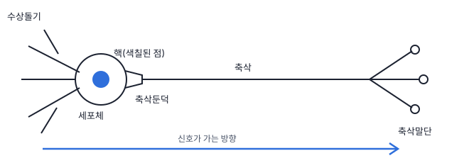
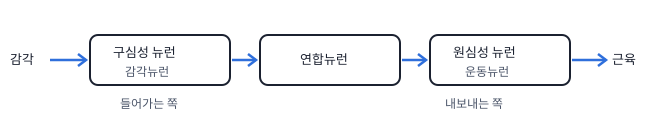
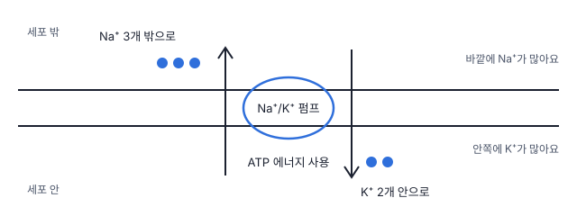
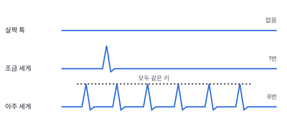
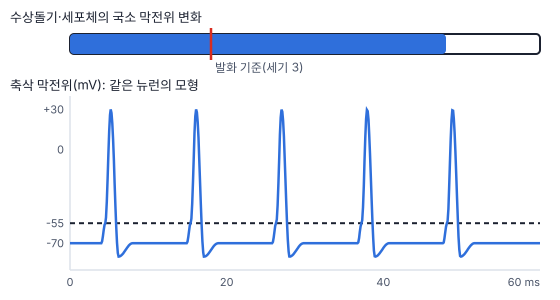
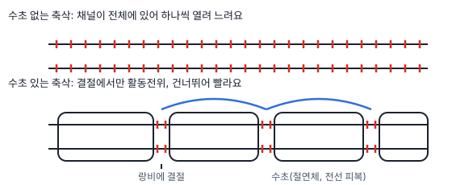
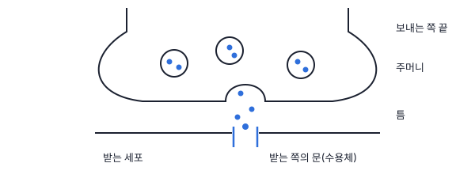
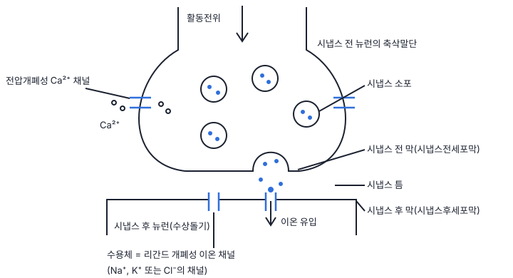
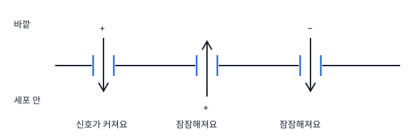

# 뉴런과 시냅스 — 5살도 이해하는 정리노트

이영만 교수님 생명과학 · 1112 수업 (12장 p1–3, 12.1 정보의 흐름과 뉴런)

> `정리노트_1112_Nervous_and_Sensory_Systems.html`를 마크다운으로 옮겼어요. 그림은 `figures_1112/` 폴더의 SVG, 위젯은 대표 설정의 정적 그림으로 바꿨어요. 수식은 `$…$` / `$$…$$`라서 GitHub, Obsidian, Typora에서 보여요.

**목차**

- [1. 뉴런과 신경아교세포](#s0)
  - [뉴런의 세 부분과 신호의 방향](#s0-neuron)
  - [신경아교세포와 미엘린 수초](#s0-glia)
- [2. 휴지전위](#s1)
  - [채널과 Na⁺/K⁺ 펌프](#s1-channel-pump)
  - [휴지전위가 생기는 이유](#s1-resting)
- [3. 활동전위와 전도](#s2)
  - [활동전위: 탈분극·재분극·과분극](#s2-action)
  - [실무율과 자극의 세기](#s2-all-or-none)
  - [전도 속도: 축삭의 지름과 도약전도](#s2-conduction)
- [4. 시냅스 전달](#s3)
  - [시냅스: 화학적 시냅스와 전기적 시냅스](#s3-synapse-types)
  - [화학 시냅스의 전달 순서](#s3-release)
  - [흥분성 신호와 억제성 신호](#s3-excite-inhibit)
- [5. 신경전달물질과 약물](#s4)
  - [여러 가지 신경전달물질](#s4-transmitters)
  - [신경전달물질의 제거와 약물](#s4-removal)
- [6. 요약 · 예고](#s5)
  - [시험 직전 한눈에](#s5-cheatsheet)
  - [다음 시간 연결](#s5-next)
  - [함께 보면 좋은 자료](#s5-links)

## 1. 뉴런과 신경아교세포

### 뉴런의 세 부분과 신호의 방향

*1112 수업 · 12장 p1*

**쉽게 말하면**

몸속 소식을 나르는 세포는 안테나 같은 가지로 소식을 받고, 몸통을 거쳐, 긴 꼬리 끝으로 다음 세포에 넘겨줘요.

*소식은 받는 가지에서 들어와 꼬리 끝으로 나가요.*

**정확히 말하면**

뉴런(neuron)은 크게 세 부분으로 나뉘어요.

- **수상돌기(dendrite)**: 신호를 받아들이는 돌기예요. 고등학교 용어로는 가지돌기예요. 앞 뉴런이 보낸 신호를 받으면 수상돌기 세포막의 통로(채널)가 열려 이온(Na⁺)이 흘러 들어오고, 이 이온의 흐름이 전기신호가 돼요. 그래서 수상돌기는 이온 흐름으로 생긴 전기신호를 받는 안테나 역할을 해요(이온이 들어오는 과정은 [활동전위: 탈분극·재분극·과분극](#s2-action)).
- **세포체(cell body)**: 핵과 미토콘드리아 같은 세포소기관이 있는 부분이에요. 핵은 세포체 안의 소기관이지, 신호를 받는 돌기가 아니에요.
- **축삭(axon)**: 신호가 빠져나가는 긴 돌기예요. 축삭이 시작되는 부위가 **축삭둔덕**(축삭 언덕, axon hillock)이고, 축삭의 끝부분이 **축삭말단**(axon terminal)이에요. 축삭둔덕은 활동전위가 처음 생기는 자리로 다시 나와요.

*테두리 원이 세포체, 그 안의 색칠된 점이 핵이에요. 신호는 수상돌기에서 축삭말단 쪽으로 가요.*

한 뉴런 안에서 신호가 가는 순서는 이렇게 정해져 있어요.

1. 수상돌기가 신호를 받아요.
2. 신호가 세포체를 거쳐요.
3. 축삭이 시작되는 축삭둔덕에서 활동전위가 처음 생겨요.
4. 활동전위가 축삭을 따라 이동해요.
5. 축삭말단에서 다음 세포로 신호를 넘겨요([시냅스: 화학적 시냅스와 전기적 시냅스](#s3-synapse-types)).

뉴런은 기능에 따라 세 가지로 나뉘어요.

- **구심성 뉴런**(afferent neuron) = 감각뉴런(sensory neuron): 감각을 받아들여 신호를 안쪽(중심)으로 들여보내는 뉴런이에요.
- **원심성 뉴런**(efferent neuron) = 운동뉴런(motor neuron): 근육세포로 신호를 내보내는, 중심에서 멀어지는 쪽 뉴런이에요.
- **연합뉴런**(interneuron): 구심성 뉴런과 원심성 뉴런 사이에서 정보를 통합해요.

그래서 정보는 감각을 받아들인 구심성 뉴런에서 그 사이의 연합뉴런을 거쳐, 근육으로 내보내는 원심성 뉴런 순서로 흘러요.

*테두리 상자 세 개가 기능에 따른 세 종류예요. 감각 신호는 구심성 뉴런으로 들어가 연합뉴런을 거쳐 원심성 뉴런으로 근육에 나가요.*

영어 이름도 같은 방향으로 읽어요. 구심성 뉴런(afferent neuron)은 중심으로 들어가는 쪽, 원심성 뉴런(efferent neuron)은 중심에서 멀어지는 쪽이에요.

**교수님 말씀**

교수님은 구심성과 원심성을 물리의 구심력·원심력에 빗대어 정리했어요. 구심력은 중심으로 들어가는 쪽이라 감각뉴런이 구심성이고, 멀어지는 쪽이 원심성이에요.

> 구심력이 들어가는 쪽이잖아. 그래서 감각뉴런을 구심성 뉴런.

수상돌기는 고등학교에서 배운 가지돌기와 같은 부위라고 짚었어요.

**꼭 기억해요**

- 구심성과 원심성 중 어느 쪽이 감각인지 뒤바꾸기 쉬워요. 구심력처럼 들어가는 쪽이 구심성 뉴런 = 감각뉴런이고, 멀어지는 쪽이 원심성 뉴런 = 운동뉴런(근육으로 내보냄)이에요. 연합뉴런은 그 둘 사이에 있어요.
- 신호를 받는 부위를 축삭이나 세포체로 착각하기 쉬워요. 이온 흐름으로 생긴 전기신호를 받는 안테나는 수상돌기이고, 축삭은 신호를 내보내는 길이에요.
- 핵을 신호 받는 부위로 고르지 마세요. 핵은 세포체 안에 있는 세포소기관이에요.
- 강의노트의 영어 표기 "dentrite"는 철자 오류이고, 바른 표기는 dendrite예요.
- 축삭둔덕과 축삭말단을 섞지 마세요. 축삭둔덕은 축삭이 시작되는 곳(활동전위가 처음 생기는 곳)이고, 축삭말단은 축삭의 끝(다음 세포로 넘기는 곳)이에요.

**페이지 요약**

뉴런 안에서 신호는 수상돌기로 들어와 세포체를 지나 축삭으로 나가고, 기능으로는 신호를 들여보내는 구심성, 내보내는 원심성, 그 사이의 연합뉴런으로 나눠요.

*용어*

- **수상돌기(dendrite)** — 신호를 받는 돌기(가지돌기). 통로로 흘러든 이온이 만든 전기신호를 받는 안테나예요.
- **세포체(cell body)** — 핵·미토콘드리아 같은 세포소기관이 있는 부분이에요. 핵은 받는 부위가 아니에요.
- **축삭(axon)** — 신호가 빠져나가는 돌기예요. 시작 부위는 축삭둔덕(활동전위가 처음 생김), 끝은 축삭말단(다음 세포로 넘김)이에요.
- **구심성 뉴런(afferent neuron)** — 감각뉴런. 구심력처럼 안쪽으로 들어가는 쪽이에요.
- **원심성 뉴런(efferent neuron)** — 운동뉴런. 중심에서 멀어져 근육세포로 신호를 내보내는 쪽이에요.
- **연합뉴런(interneuron)** — 구심성 뉴런과 원심성 뉴런 사이에서 정보를 통합해요.

---

### 신경아교세포와 미엘린 수초

*1112 수업 · 12장 p1*

**쉽게 말하면**

소식 나르는 세포 곁에는 소식은 나르지 않고 그 세포를 먹이고 받쳐 주는 도우미 세포가 훨씬 많아요.

*어떤 도우미는 긴 꼬리를 담요처럼 감싸고, 감싸지 않은 틈이 군데군데 남아요.*

**정확히 말하면**

**신경아교세포(glial cell)**는 신경계에서 뉴런을 보조하는 세포예요. 강의노트는 이를 뉴런에 영양소를 제공하고 뉴런을 지지하는 **비신경성** 세포라고 정리해요. 자극(전기적 신호)을 전달하는 것은 뉴런이고, 신경아교세포는 신호를 직접 전달하지 않아요. 숫자로는 뉴런보다 훨씬 많아요.

신경아교세포가 하는 일은 세 가지예요.

- 뉴런에 영양분을 제공해요.
- 뉴런을 물리적으로 지지해요.
- 미엘린 수초를 만들어요.

종류마다 맡은 일이 달라요.

- **성상세포(astrocyte)**: 별(星) 모양이라 붙은 이름이에요. 뉴런을 물리적으로 지지해요. 수초를 만드는 세포가 아니에요.
- **희소돌기아교세포**(oligodendrocyte)와 **슈반세포**(Schwann cell): 미엘린 수초를 만들어요. 있는 장소만 다르고 하는 일은 같아요.

**미엘린 수초(myelin sheath)**는 축삭을 감싸고 있는 지질 막이에요. 이 막은 따로 만들어 붙인 물질이 아니라, 희소돌기아교세포나 슈반세포라는 세포 자체가 축삭을 여러 겹 감싼 것이에요. 지질 함량이 높아 전기적 절연체로 작용해요.

수초는 축삭 전체를 끊김 없이 덮지 않아요. 수초와 수초 사이사이에 축삭이 노출된 틈이 있는데, 이것이 **랑비에 결절(node of Ranvier)**이에요.

수초가 있는 신경을 **유수신경**, 수초가 없는 신경을 무수신경이라고 해요. 유수신경이 신호를 훨씬 빠르게 전달해요. 왜 빠른지는 [전도 속도: 축삭의 지름과 도약전도](#s2-conduction)에서 랑비에 결절과 함께 이어져요.

정리하면, 신경아교세포인지를 가르는 기준은 신호를 직접 전달하지 않고(전달은 뉴런의 일) 영양 공급·지지·수초 형성으로 뉴런을 보조하는 비신경성 세포라는 점이에요. 수초 형성은 희소돌기아교세포·슈반세포의 일이고, 성상세포는 지지를 맡아요.

**교수님 말씀**

교수님은 미엘린 수초가 축삭을 덮은 모습을 담요에 빗댔어요.

> 담요처럼 이렇게 덮고 있는데요.

그리고 그 막이 바로 세포라는 점을 짚었어요.

> 이 지질 막 자체가 세포예요.

신경아교세포가 숫자로는 뉴런보다 훨씬 많다는 말을 두 번 되풀이했어요.

**꼭 기억해요**

- 교수님이 "슈반세포, 미엘린 수초는 장소만 다르고 똑같은 기능"이라고 말했지만 말실수예요. 장소만 다르고 같은 기능(수초 형성)을 하는 짝은 **슈반세포와 희소돌기아교세포**예요. 미엘린 수초는 이 세포들이 축삭을 감싸 만든 막이지, 슈반세포와 나란히 비교하는 세포 종류가 아니에요.
- 신경아교세포도 신호를 나른다고 착각하기 쉬워요. 신호(전기적 메시지)는 뉴런이 전달하고, 신경아교세포는 영양 공급·지지·수초 형성으로 보조만 해요.
- 수초를 축삭의 일부나 세포 밖 물질로 생각하기 쉬워요. 수초는 다른 세포(아교세포)가 축삭을 감싼 지질 막이에요.
- 랑비에 결절을 수초가 덮인 부분으로 착각하지 마세요. 랑비에 결절은 수초 사이에 축삭이 드러난 틈이에요.
- 성상세포가 수초를 만든다고 고르지 마세요. 성상세포는 뉴런을 물리적으로 지지해요.

**보충 · 수업에서 다루지 않았어요**

교재는 두 수초 형성 세포가 있는 장소를 나눠 적어요. 희소돌기아교세포는 중추신경계(뇌와 척수)에 있고, 슈반세포는 말초신경계(뇌·척수 바깥의 신경)에 있어요. 즉 슈반세포는 말초신경계에서 수초를 만드는 신경아교세포예요. 교재 그림에서는 슈반세포의 세포막이 축삭을 젤리 롤처럼 300번 이상 감고 있어, 수초가 세포 자체라는 수업 내용과 이어져요.

출처: 교재 12장 p.263

**페이지 요약**

신경아교세포는 신호를 직접 전달하지 않고 뉴런을 먹이고 받치는 비신경성 세포이며, 그중 희소돌기아교세포와 슈반세포가 축삭을 감싸는 미엘린 수초를 만들어요.

*용어*

- **신경아교세포(glial cell)** — 뉴런보다 훨씬 많은 보조 세포예요. 영양분 제공·물리적 지지·수초 형성을 하고, 신호는 전달하지 않아요.
- **성상세포(astrocyte)** — 별 모양 아교세포로 뉴런을 물리적으로 지지해요. 수초는 만들지 않아요.
- **희소돌기아교세포·슈반세포** — 장소만 다르고 둘 다 미엘린 수초를 만들어요. 말실수와 달리 이 둘이 같은 기능의 짝이에요.
- **미엘린 수초(myelin sheath)** — 아교세포 자체가 축삭을 감싼 지질 막으로, 전기적 절연체로 작용해요.
- **랑비에 결절(node of Ranvier)** — 수초 사이사이에 축삭이 드러난 틈이에요.
- **유수신경·무수신경** — 수초가 있으면 유수신경, 없으면 무수신경이고, 유수신경이 훨씬 빨라요.

- **(보충) 수초 세포의 장소** — 교재 기준으로 희소돌기아교세포는 중추신경계(뇌·척수), 슈반세포는 말초신경계(뇌·척수 바깥)에 있고, 슈반세포 막은 축삭을 여러 겹 감아요.

---

## 2. 휴지전위

### 채널과 Na⁺/K⁺ 펌프

*1112 수업 · 12장 p2*

**쉽게 말하면**

세포 껍질에는 저절로 흐르는 통로와, 힘을 써서 거꾸로 밀어 올리는 펌프가 함께 있어요.

*통로로는 많은 쪽에서 적은 쪽으로 저절로 흐르고, 펌프는 힘을 들여 적은 쪽에서 많은 쪽으로 보내요.*

**정확히 말하면**

뉴런의 세포막에는 이온이 지나가는 단백질이 두 종류 있어요.

- **채널(channel, 통로)**: 이온이 농도가 높은 곳에서 낮은 곳으로만 지나가요. 농도 기울기(concentration gradient)를 따라 내려가는 이동이라 에너지를 쓰지 않아요. 한 채널은 한 종류의 이온만 통과시켜요(특이적).
- **펌프(pump)**: 에너지를 써서 농도 기울기를 거슬러, 농도가 낮은 곳에서 높은 곳으로 이온을 억지로 보내요. 이렇게 에너지를 들여 거꾸로 옮기는 것이 능동수송(active transport)이에요. 낮은 쪽에서 높은 쪽으로 옮길 때 ATP가 필요하다는 원리는 [세포 호흡 단원의 ATP를 쓰는 곳](../../0910/정리노트_0910_Cells_and_Cellular_Respiration.html#s2-atp-use)에서 배운 용질 수송과 같아요.

**Na⁺/K⁺ 펌프**(강의노트 표기: Na⁺/K⁺ 능동수송펌프)는 ATP를 가수분해해 얻은 에너지로 Na⁺ 3개를 세포 밖으로 내보내고, 동시에 K⁺ 2개를 세포 안으로 들여보내요. 그 결과 Na⁺는 세포 바깥에, K⁺는 세포 안쪽에 더 많은 상태가 만들어지고 유지돼요. 바깥에 Na⁺가 이미 많이 쌓여 있어도 ATP를 쓰기 때문에 계속 내보낼 수 있어요. K⁺도 안쪽에 이미 많지만 계속 들여보내요.

*Na⁺ 3개는 밖으로, K⁺ 2개는 안으로 옮기며 ATP를 써요.*

정리하면 펌프는 ATP를 써야 농도 기울기를 거슬러 이온을 옮길 수 있고, 채널은 에너지 없이 농도가 높은 곳에서 낮은 곳으로만 이온을 흘려보내요. 펌프가 만드는 Na⁺·K⁺ 농도 차는 [휴지전위가 생기는 이유](#s1-resting)의 바탕이에요.

**교수님 말씀**

> “펌프는 전기를 꽂아야 작동이 되잖아.”

펌프는 에너지가 있어야 일한다는 비유예요. 채널은 그냥 농도가 높은 곳에서 낮은 곳으로만 이온이 지나가고 에너지를 안 쓴다고 대비했어요.

펌프 방향은 이름으로 외우라고 했어요. 나트륨은 나간다, 나트륨이니까 밖으로 나가고 칼륨은 들어와요. 세 개를 내보내고 두 개를 들여보낸다고 숫자도 짚었어요.

**꼭 기억해요**

**펌프가 안으로 들이는 이온**: 칼슘으로 착각하기 쉬워요. 수업 중에 교수님도 “칼슘”이라고 했다가 바로 칼륨으로 고쳤어요. 안으로 들어가는 것은 칼륨(K⁺)이에요.

**방향과 비율**: Na⁺ 2개 밖, K⁺ 3개 안처럼 숫자를 뒤바꾸기 쉬워요. Na⁺ 3개가 밖으로, K⁺ 2개가 안으로 가요. 그래서 펌프가 돌면 Na⁺는 바깥, K⁺는 안쪽 농도가 높아져요.

**채널과 펌프의 에너지**: 이온이 막을 지나가면 늘 ATP가 든다고 착각하기 쉬워요. 채널은 농도 기울기를 따라 높은 곳에서 낮은 곳으로만 이동시키고 에너지를 쓰지 않아요. 농도 기울기를 거스르는 펌프만 ATP를 써요.

**펌프의 일과 채널의 일**: 펌프는 안팎의 농도 차를 꾸준히 유지해 휴지전위를 일정한 음전하로 지켜요. 활동전위 때 막전위가 갑자기 치솟거나 휴지전위 아래로 내려가는(과분극) 빠른 변화는 채널이 열리고 닫혀서 생겨요.

**페이지 요약**

채널은 에너지 없이 이온을 농도가 높은 쪽에서 낮은 쪽으로 흘려보내고, Na⁺/K⁺ 펌프는 ATP를 써서 거꾸로 옮겨 Na⁺는 바깥, K⁺는 안쪽에 많은 상태를 지켜요.

*용어*

- **채널(channel)** — 농도 기울기를 따라 높은 곳에서 낮은 곳으로만 이온을 통과시켜요. 에너지를 쓰지 않고, 한 채널은 한 종류 이온만 통과시켜요.
- **펌프(pump)·능동수송** — 에너지(ATP)를 써서 농도 기울기를 거슬러 낮은 곳에서 높은 곳으로 옮겨요.
- **Na⁺/K⁺ 펌프** — ATP를 써서 Na⁺ 3개를 밖으로, K⁺ 2개를 안으로 옮겨요. 칼슘이 아니라 칼륨이고, 이름대로 나트륨이 나가요.
- **펌프 vs 채널의 일** — 펌프는 농도 차를 유지해 휴지전위를 일정한 음전하로 지키고, 활동전위의 급상승·과분극 같은 빠른 변화는 채널이 열리고 닫혀 생겨요.

---

### 휴지전위가 생기는 이유

*1112 수업 · 12장 p2*

**쉽게 말하면**

가만히 쉬고 있는 신호 세포는 안쪽이 바깥보다 살짝 마이너스(−)예요.

*밖으로 빠져나가는 알갱이가 더 많고 안에는 원래 마이너스 알갱이가 많아서, 안쪽이 마이너스로 남아요.*

**정확히 말하면**

**막전위(membrane potential)**는 세포막을 사이에 둔 세포 안과 밖의 전압 차이예요. 세포 안과 밖에서 Na⁺와 K⁺가 **불균등**하게 분포하기 때문에 생겨요. 안팎에 똑같이(균등하게) 퍼져 있다면 전압 차가 생기지 않아요.

**휴지전위(resting potential)**는 자극받지 않은 뉴런의 변하지 않는 막전위예요. 강의노트 값은 −50 ~ −60 mV이고, 음수는 세포 안쪽이 바깥보다 음전하라는 뜻이에요. 바깥이 +, 안쪽이 −로 나뉜 이 상태를 **분극**(polarized) 상태라고 해요. 이때 Na⁺는 바깥 농도가, K⁺는 안쪽 농도가 높아요.

**펌프만으로 안쪽이 음전하가 될까?** 아니에요. 세 가지가 이어져서 생겨요.

1. **농도 기울기 만들기**: [Na⁺/K⁺ 펌프](#s1-channel-pump)가 ATP를 써서 Na⁺ 3개를 밖으로, K⁺ 2개를 안으로 옮겨요. 그래서 Na⁺는 바깥에, K⁺는 안쪽에 많아져요.
2. **문 없는 채널로 새기**: 막의 채널은 한 종류 이온만 통과시켜요. 채널에는 문이 달린 것(개폐성)과 문이 없는 것이 있어요. 문이 없는 채널은 non-gated 채널, 늘 새기 때문에 **누설 채널(leaky channel)**이라고 불러요. 누설 채널은 전체 채널 가운데 비율이 적지만, 그중 **K⁺ 누설 채널**이 Na⁺ 누설 채널보다 많아요.
3. **K⁺가 더 많이 나감**: 누설 채널로 밖에 많던 Na⁺는 조금 다시 들어오고, 안에 많던 K⁺는 조금 새 나가요. K⁺ 누설 채널이 더 많으므로 나가는 K⁺가 들어오는 Na⁺보다 많아요. 양전하가 바깥에 조금 더 쌓여 바깥이 +가 돼요.
4. **세포 안의 음이온**: 세포 안에는 원래 음전하를 띤 분자, 곧 음이온이 많아요. DNA는 인산 때문에 음전하를 띠고, 단백질도 음전하를 띤 것이 많아요. 강의노트에는 단백질, 아미노산, 핵산으로 적혀 있어요.
5. **결과**: 이런 이유가 합쳐져 세포 안쪽은 −, 바깥쪽은 +인 휴지전위가 유지돼요.

*펌프가 만든 농도 차, K⁺ 누설, 세포 안 음이온이 합쳐져 휴지전위가 돼요.*

**Na⁺/K⁺ 펌프의 주요 역할**은 휴지전위를 일정한 음전하로 유지하는 것이에요. 휴지전위를 0으로 만드는 것이 아니에요. 활동전위 때 막전위가 갑자기 치솟는 일과 과분극은 채널이 열리고 닫혀 생겨요. 활동전위 동안 막전위는 음전하에서 양전하로 바뀌어요([활동전위: 탈분극·재분극·과분극](#s2-action)).

**내부를 음전하로 유지하는 데 직접 작용하는 것**은 이온을 직접 옮겨 안팎 농도 차를 지키는 Na⁺/K⁺ 능동수송펌프예요. 세포 호흡의 단계들은 펌프가 쓸 ATP를 만드는 과정일 뿐, 이온 분포를 직접 만들지 않아요.

**교수님 말씀**

> “단순히 이것 때문에 세포 내부가 음, 바깥이 양인 게 아닙니다.”

펌프를 설명한 직후 이렇게 짚고, 채널을 사람이 지나가는 문에 비유했어요. 문이 달린 통로에서 문을 떼어 내면 문이 없는 통로가 되고, 문이 없으니 “질질 새잖아”, 그래서 누설 채널이라고 했어요.

두 번째 이유로 앞 단원의 DNA를 다시 불러왔어요. DNA는 염기, 당, 인산으로 되어 있고 인산 때문에 음전하를 띤다고 했던 것을 떠올리게 했어요. 세포 안에 음이온이 많고, 나가는 칼륨이 들어오는 나트륨보다 많아서 바깥이 플러스라는 결론을 여러 번 되풀이했어요.

**꼭 기억해요**

**휴지전위 수치**: 수업에서는 “−70 mV 정도”, “대략 −60 mV”라고 말할 때마다 달랐어요. 강의노트는 −50 ~ −60 mV예요. 숫자를 묻는 문제는 강의노트 값을 기준으로 삼아요.

**펌프만으로 생기는가**: 펌프 하나 때문에 안쪽이 음전하가 된다고 착각하기 쉬워요. 펌프가 만든 농도 차에 K⁺ 누설과 세포 안 음이온이 더해져야 휴지전위가 돼요. 다만 내부 음전하 유지에 직접 작용하는 것을 고르라면, 이온을 직접 옮기는 Na⁺/K⁺ 펌프예요. 펌프가 ATP를 쓰는 것과 ATP를 만드는 세포 호흡을 섞지 않아요.

**누설 채널 수**: Na⁺ 누설 채널이 더 많다고 뒤바꾸기 쉬워요. K⁺ 누설 채널이 더 많아서 K⁺가 더 많이 새 나가요. “누설 채널이 많다”는 K⁺와 Na⁺를 비교한 말이고, 문 없는 채널 자체는 전체에서 비율이 적어요.

**균등과 불균등**: 막전위는 Na⁺·K⁺가 안팎에 고르게 퍼져서가 아니라 불균등하게 분포해서 생겨요.

**안팎의 부호**: 휴지전위에서 바깥이 +, 안쪽이 −예요. Na⁺는 바깥, K⁺는 안쪽 농도가 높아요. 활동전위 동안에는 막전위가 음전하에서 양전하로 바뀌어요. 양전하에서 음전하로 바뀐다는 진술은 방향이 거꾸로예요.

**펌프의 주요 역할**: 휴지전위를 0으로 만들거나 활동전위의 급상승·과분극을 일으키는 것이 아니에요. 휴지전위를 일정한 음전하로 유지하는 것이고, 급상승·과분극은 채널이 하는 일이에요.

**페이지 요약**

펌프가 만든 Na⁺·K⁺ 농도 차 위에서 K⁺가 누설 채널로 더 많이 새 나가고 세포 안에 음이온이 많아, 자극 없는 뉴런은 안쪽이 바깥보다 음전하로 유지돼요.

*용어*

- **막전위(membrane potential)** — 세포막 안팎의 전압 차예요. Na⁺와 K⁺의 불균등 분포 때문에 생겨요(균등이면 생기지 않아요).
- **휴지전위(resting potential)·분극** — 자극받지 않은 뉴런의 변하지 않는 막전위로, 바깥 +·안쪽 −인 분극 상태예요. Na⁺는 바깥, K⁺는 안쪽 농도가 높고 바깥쪽이 양전하예요. 강의노트 값은 −50 ~ −60 mV(수업에서는 −70, −60 mV라고도 말함)예요.
- **누설 채널(leaky channel)** — 문이 없어 늘 새는 채널(non-gated)이에요. 전체 채널 중 비율은 적지만 K⁺ 누설 채널이 Na⁺ 누설 채널보다 많아, 나가는 K⁺가 들어오는 Na⁺보다 많아요.
- **세포 안 음이온** — 인산 때문에 음전하인 DNA와 음전하 단백질이 안에 많아요(강의노트: 단백질·아미노산·핵산).
- **Na⁺/K⁺ 펌프의 역할** — 농도 차를 유지해 휴지전위를 일정한 음전하로 지켜요. 0으로 만들지 않고, 활동전위의 급상승·과분극은 채널이 하는 일이에요. 단, 펌프 하나만으로 음전하가 생기는 것은 아니에요.
- **막전위의 방향** — 휴지 때 안쪽 −, 활동전위 동안에는 음전하에서 양전하로 바뀌어요.

---

## 3. 활동전위와 전도

### 활동전위: 탈분극·재분극·과분극

*1112 수업 · 12장 p2*

**쉽게 말하면**

신호를 받으면 들어오는 문이 열려 쑥 올라갔다가, 나가는 문이 열려 다시 내려와요.

*나가는 문은 느릿느릿 닫혀서, 처음 자리보다 살짝 더 내려갔다가 돌아와요.*

**정확히 말하면**

**활동전위(action potential)**는 뉴런의 축삭을 따라 이동하는 전기적 충격이에요. 막 안쪽의 음(−)이 잠깐 양(+)으로 뒤집혔다가 돌아오는 막전위의 변화예요.

그래서 신경신호를 가장 정확히 표현하면 **막을 사이에 둔 전위차(막전위)의 변화**예요. 이온이 막을 드나들며 그 자리의 막전위가 바뀌고, 그 변화가 옆 자리로 전파돼요([전도 속도: 축삭의 지름과 도약전도](#s2-conduction)).

판별 기준: 축삭을 따라 이동하는 것은 막전위가 바뀌는 "사건"이에요. 뉴런이 맞붙은 자리(시냅스)나 자극이 없을 때의 값(휴지전위)은 장소나 상태이지 이동하는 충격이 아니에요.

**어디서 처음 생기나요?** 시작 신호와 활동전위가 생기는 자리는 달라요.

1. 시냅스 전 뉴런이 신경전달물질을 분비해요.
2. 시냅스 후 뉴런 수상돌기의 채널이 열려 Na⁺가 들어와요. 이것은 시작 신호이고, 아직 활동전위가 아니에요.
3. 들어온 Na⁺가 확산해서 축삭이 시작되는 **축삭둔덕**에 닿아요.
4. 축삭둔덕에는 문 없는 누설 채널도 있지만, 문이 달린 개폐성 채널이 더 많아요. 그중 **전압 개폐성 Na⁺ 채널**은 막전위 변화를 스스로 알아채고 일정 값에서만 열려요.
5. 막전위가 **역치**에 이르면 전압 개폐성 Na⁺ 채널이 열려 활동전위가 생겨요. 그래서 활동전위가 처음 생기는 곳은 축삭둔덕이고, 여기서 축삭말단 쪽으로 전해져요.

*Na⁺는 수상돌기로 들어오지만, 활동전위는 테두리 원으로 표시한 축삭둔덕에서 처음 생겨 축삭말단 쪽으로 가요.*

**시간–막전위 그래프로 보는 과정**

*숫자는 교재 그림 12.5처럼 잡은 예시예요. 점선 위쪽이 역치, 그 아래 점선이 휴지전위예요.*

1. **휴지 상태**: 안쪽이 −로 분극되어 있고, 전압 개폐성 Na⁺ 채널은 닫혀 있어요.
2. **역치까지**: 들어온 Na⁺ 때문에 막전위가 휴지전위에서 + 쪽으로 서서히 움직여요.
3. **탈분극**: 역치에서 전압 개폐성 Na⁺ 채널이 열리고, 바깥에 많던 Na⁺가 쏟아져 들어와 막전위가 0을 넘어 +로 솟아요. 바깥 Na⁺가 많은 까닭은 Na⁺/K⁺ 펌프가 계속 밖으로 퍼내기 때문이에요([채널과 Na⁺/K⁺ 펌프](#s1-channel-pump)).
4. **최고치**: Na⁺ 채널이 닫혀 더 오르지 않아요.
5. **재분극**: K⁺ 채널이 열리고, 안쪽에 많은 K⁺가 빠져나가 막전위가 다시 − 쪽으로 내려가요.
6. **과분극**: K⁺ 채널은 반응이 느려서 천천히 닫힌다는 것이 핵심이에요. 휴지전위를 지나서도 열려 있어 K⁺가 더 빠져나가므로, 막전위가 휴지전위보다 낮아져요.
7. **회복**: K⁺ 채널이 닫히면 휴지전위로 돌아와요. 이 전체 변화가 활동전위예요.

| 그래프 구간 | 막전위 | 이온과 채널 | 이름 |
|---|---|---|---|
| 올라가는 선 | −에서 +로 솟음 | Na⁺ 채널 열림, Na⁺ 유입 | 탈분극 |
| 내려가는 선 | +에서 −로 돌아감 | Na⁺ 채널 닫힘, K⁺ 채널 열림, K⁺ 유출 | 재분극 |
| 휴지전위 아래로 처진 곳 | 휴지전위보다 더 − | K⁺ 채널이 늦게 닫혀 K⁺가 더 나감 | 과분극 |
| 다시 평평해진 곳 | 휴지전위 | K⁺ 채널 닫힘 | 회복(휴지 상태) |

**상태 이름 구별하기**: 막전위의 음전하가 줄어들면(안쪽이 덜 −가 되면), 휴지 상태에서 분극되어 있던 막은 **탈분극**돼요. 분극은 휴지 상태 자체, 재분극은 +에서 다시 −로 돌아가는 것, 과분극은 휴지전위보다 더 −가 된 상태예요. 역치는 상태 이름이 아니라 전압 개폐성 Na⁺ 채널이 열리는 기준 값이에요.

**교수님 말씀**

> "나트륨 채널 열리고 닫히고, 칼륨 채널 열리고 닫히고. 닫히는데 좀 천천히 닫힌다."

교수님은 이 순서가 문제로 나올 것이 뻔하다고 짚었어요. 핵심은 K⁺ 채널이 늦게 닫혀서 과분극이 생긴다는 점이에요.

채널을 사람처럼 표현했어요. Na⁺ 채널은 최고치에서 "어, 너무 많이 됐다" 하고 바로 닫히고, K⁺ 채널은 "아이고, 이제 닫혀야지" 하며 한발 늦게 닫혀요.

개폐성의 개(開)는 열다, 폐(閉)는 닫다라는 뜻이에요. 문이 달려 열리고 닫히는 채널이라는 말이에요.

**꼭 기억해요**

- **시작 신호와 활동전위의 자리**: 수상돌기로 Na⁺가 들어오는 것을 활동전위의 시작으로 착각하기 쉬워요. 그것은 시작 신호이고, 활동전위가 처음 생기는 곳은 축삭둔덕이에요. "축삭말단에서 활동전위가 생긴다"도 틀린 말이에요. 축삭둔덕에서 생겨 축삭말단까지 전해져요.
- **문 있는 채널과 문 없는 채널**: 축삭둔덕에는 누설 채널만 있다고 생각하기 쉬워요. 둘 다 있지만 개폐성 채널이 더 많고, 활동전위를 만드는 것은 전압 개폐성 Na⁺ 채널이에요.
- **탈분극과 활동전위**: 두 말을 같은 것으로 쓰기 쉬워요. 교수님도 "탈분극이 됐죠"를 "활동전위가 생겼죠"로 고쳐 말했어요. 탈분극은 막전위가 올라가는 한 구간이고, 활동전위는 탈분극부터 회복까지의 전체 변화예요.
- **재분극과 과분극**: 둘 다 "내려가는 것"이라 섞이기 쉬워요. 재분극은 +에서 휴지전위 쪽으로 내려오는 것이고, 과분극은 휴지전위보다 더 내려간 상태예요.
- **채널이 열리고 닫히는 순서**: "Na⁺ 채널이 열리고 K⁺ 채널이 열리면서 재분극"으로 외우기 쉬워요. 바른 순서는 Na⁺ 채널 열림, Na⁺ 채널 닫힘, K⁺ 채널 열림, K⁺ 채널이 늦게 닫힘이에요. 재분극은 Na⁺ 채널이 닫히고 K⁺ 채널이 열리면서 일어나요.
- **음전하가 줄어든 막**: 안쪽 음전하가 줄어든 상태를 역치나 과분극으로 고르기 쉬워요. 음전하가 줄어 분극에서 벗어나는 것이 탈분극이고, 과분극은 반대로 더 −가 된 상태예요.

**페이지 요약**

활동전위는 축삭둔덕에서 막전위가 역치에 이를 때 시작해, Na⁺가 들어와 솟고 K⁺가 나가 내려오며, 느린 K⁺ 채널 탓에 잠깐 휴지전위 아래로 처지는 막전위 변화예요.

*용어*

- **활동전위(action potential)** — 축삭을 따라 이동하는 전기적 충격. 막전위가 −에서 +로 잠깐 뒤집혔다 돌아오는 변화예요. 신경신호를 가장 정확히 표현하면 막을 사이에 둔 전위차(막전위)의 변화예요.
- **시작 위치** — 수상돌기로 Na⁺가 들어오는 것은 시작 신호예요. 확산한 Na⁺로 축삭둔덕이 역치에 이르면 그곳에서 활동전위가 처음 생겨 축삭말단 쪽으로 가요.
- **전압 개폐성 Na⁺ 채널** — 막전위 변화를 스스로 알아채 역치에서 열리는 채널. 축삭둔덕에는 누설 채널보다 개폐성 채널이 더 많아요.
- **탈분극** — 막전위의 음전하가 줄어 분극에서 벗어나는 것. 역치에서 Na⁺ 채널이 열려 Na⁺가 쏟아져 들어오면 0을 넘어 +로 솟아요.
- **재분극** — 최고치에서 Na⁺ 채널이 닫히고 K⁺ 채널이 열려, K⁺가 빠져나가며 다시 −로 내려오는 것.
- **과분극** — K⁺ 채널이 천천히 닫혀 K⁺가 더 나가, 막전위가 휴지전위보다 낮아진 상태. K⁺ 채널이 닫히면 휴지전위로 돌아와요.
- **역치** — 전압 개폐성 Na⁺ 채널이 열리는 기준 값. 막의 상태 이름이 아니에요.
- **탈분극과 활동전위** — 탈분극은 막전위가 올라가는 한 구간이고, 활동전위는 탈분극부터 재분극·과분극·회복까지의 전체 변화예요. 교수님도 "탈분극이 됐죠"를 "활동전위가 생겼죠"로 고쳐 말했어요.

---

### 실무율과 자극의 세기

*1112 수업 · 12장 p2*

**쉽게 말하면**

문턱을 넘으면 합격, 못 넘으면 불합격이에요. 중간 점수는 없어요.

*세게 누를수록 키가 같은 뾰족이가 더 자주 나와요.*

**정확히 말하면**

**실무율(all-or-nothing)**: 막전위가 **역치**에 이르면 전압 개폐성 Na⁺ 채널이 열려 활동전위가 생기고, 역치에 못 미치면 열리지 않아 활동전위가 아예 생기지 않아요. 크게 열리거나 작게 열리는 중간은 없어서, "작은 활동전위"는 없어요.

**왜 크기가 늘 같을까요?** 전압 개폐성 Na⁺ 채널은 모두 똑같고, 한 번 열릴 때 들어오는 Na⁺ 양도 일정해요. 그래서 어디서 생긴 활동전위든 높이가 같고, 축삭을 따라 이동해도 크기가 일정하게 유지돼요. 0 아니면 1이므로 활동전위는 **디지털** 신호예요.

**그럼 자극의 세기는 어떻게 전할까요?** 활동전위의 크기가 아니라 **빈도**로 전해요.

1. **약한 자극**: 신경전달물질이 조금 나와 수상돌기 채널이 조금 열리고, Na⁺가 조금 들어와요. 축삭둔덕의 채널이 한두 번 열리고 끝나요.
2. **강한 자극**: 신경전달물질이 많이 나와 Na⁺가 많이 들어와요. 축삭둔덕의 채널이 닫히자마자 또 열려 활동전위가 높은 빈도로 생겨요.

**아날로그와 디지털이 바뀌는 곳**: 수상돌기와 세포체 쪽은 **아날로그**예요. 자극이 셀수록 Na⁺가 많이 들어와 막전위 변화가 커져요. 축삭둔덕부터는 역치를 넘느냐 못 넘느냐만 따지는 디지털로 바뀌어요.

#### 직접 해 보기: 자극 세기와 활동전위 *(정적 스냅샷 — 직접 조작은 HTML 버전)*

자극 세기를 올리면 수상돌기 쪽 막대는 계속 길어지지만, 축삭 기록의 활동전위는 높이는 그대로이고 개수(빈도)만 늘어나요.

60 ms 동안 활동전위 수와 한 개의 최고 높이: **3개 · 한 개의 최고 높이 +30 mV(모두 같아요)**

범례: 축삭 막전위(활동전위) · 점선: 역치(−55 mV)

*역치 미만(세기 2)*

*역치를 약간 넘음(세기 3.5)*

*강한 자극(세기 8)*

| 설정 | 활동전위 수(60 ms) | 한 개의 최고 높이 | 판정 |
|---|---|---|---|
| 역치 미만(세기 2) | 0개 | 없음 | 불합격: 활동전위 없음 |
| 역치를 약간 넘음(세기 3.5) | 1개 | +30 mV | 합격: 한 번 |
| 강한 자극(세기 8) | 5개 | +30 mV | 합격: 높이는 같고 빈도가 커짐 |

**교수님 말씀**

교수님이 먼저 물었어요. "활동전위는 디지털 신호일까요, 아날로그 신호일까요?" 기준은 자극이 세지면 활동전위 크기도 커지느냐였어요.

> "1점 차이가 아니고 합격, 불합격"

실무율을 시험의 합격·불합격에 비유했어요. "기면 기고 아니면 아니다", 열리면 열리고 아니면 안 열린다는 말을 거듭했어요.

그런데 속삭이는 소리와 크게 말하는 소리의 차이는 느낄 수 있잖아요. 크기가 늘 같은 활동전위로 어떻게 세기를 구별하느냐는 물음에 대한 답이 빈도예요.

**꼭 기억해요**

- **디지털과 아날로그**: 뉴런 전체가 디지털이라고 착각하기 쉬워요. 수상돌기·세포체 쪽 막전위 변화는 세기에 따라 커지는 아날로그이고, 축삭둔덕부터의 활동전위가 디지털이에요.
- **세기는 크기가 아니라 빈도**: 자극이 세면 활동전위가 더 높아진다고 생각하기 쉬워요. 높이는 그대로이고, 활동전위가 더 자주 생겨요.
- **역치 미만**: 약한 자극이면 작은 활동전위가 생긴다고 착각하기 쉬워요. 역치에 못 미치면 활동전위는 아예 생기지 않아요.

**페이지 요약**

축삭의 활동전위는 역치를 넘으면 늘 같은 높이로 생기고 못 넘으면 전혀 생기지 않으며, 자극의 세기는 높이가 아니라 활동전위가 생기는 빈도로 전해져요.

*용어*

- **실무율(all-or-nothing)** — 역치에 이르면 전압 개폐성 Na⁺ 채널이 열려 활동전위가 생기고, 못 이르면 생기지 않아요. 작은 활동전위는 없어요.
- **크기가 같은 이유** — 채널이 모두 같고 한 번에 들어오는 Na⁺ 양이 일정해서, 어디서 생기든 축삭을 따라 이동하든 높이가 같아요.
- **빈도** — 강한 자극은 Na⁺를 많이 들여 축삭둔덕 채널이 닫히자마자 다시 열리게 해, 활동전위가 더 자주 생겨요. 약하면 한두 번으로 끝나요.
- **아날로그와 디지털** — 수상돌기·세포체는 세기만큼 막전위가 커지는 아날로그, 축삭둔덕부터는 0 아니면 1인 디지털이에요.

---

### 전도 속도: 축삭의 지름과 도약전도

*1112 수업 · 12장 p2*

**쉽게 말하면**

파도타기 응원처럼 신호가 옆으로, 옆으로 전해져요.

*테두리 상자 덮개를 덮은 줄은 틈에 있는 사람만 일어나서, 징검다리처럼 건너뛰어 훨씬 빨라요.*

**정확히 말하면**

**전도**: 첫 자리의 Na⁺ 채널로 들어온 Na⁺가 옆으로 확산해요. 옆 채널이 막전위 상승(역치)을 알아채고 열리고, 같은 일이 되풀이돼요. 각 자리에서는 활동전위가 생겼다가 재분극을 거쳐 휴지전위로 돌아가고, 신호는 다음 자리로 넘어가요. 그래서 활동전위는 뉴런을 따라 이동하는 **탈분극의 파동**으로 전파되고, 크기는 일정하게 유지돼요. 축삭말단에 닿으면 신경전달물질이 분비돼요([화학 시냅스의 전달 순서](#s3-release)).

**속도의 문제**: **축삭의 지름**이 클수록 저항이 줄어 빠르게 전달돼요. 하지만 축삭을 한없이 굵게 할 수는 없어요. 가는 축삭에서도 전달을 빠르게 만드는 방식이 도약전도예요.

**도약전도(saltatory conduction)**가 빠른 이유를 차례로 보면 이래요.

1. 미엘린 수초는 지질 막이라 전기가 새지 않는 **절연체**예요([신경아교세포와 미엘린 수초](#s0-glia)).
2. 수초가 있는 축삭에서는 채널이 수초 사이에 드러난 틈인 **랑비에 결절**에만 있어요.
3. 한 결절에서 들어온 Na⁺는 수초에 덮인 구간에서 새지 않고 다음 결절의 채널까지 이동해요.
4. 그래서 활동전위는 결절에서만 생기고, 결절에서 결절로 건너뛰듯 빠르게 전해져요.
5. 수초가 없는 축삭은 채널이 축삭 전체에 있어서, 하나하나 열렸다 닫혀야 하니 시간이 걸려요.

영어 이름 saltatory conduction을 보면, 결절에서 결절로 건너뛰는 이 현상을 떠올리면 돼요.

*짧은 세로선이 채널 자리예요. 수초가 있으면 채널이 랑비에 결절에만 있어서, 활동전위가 결절에서 결절로 건너뛰어요.*

**미엘린 수초의 성질**: 지질이 많은 막이라 절연체로 작용하고, 랑비에 결절과 함께 전도 속도를 높여요. 수초가 없는 무수신경도 있어서, 수초는 모든 뉴런이 아니라 유수신경만 덮어요.

**다발성 경화증(multiple sclerosis)**: 자기 면역계가 자기 몸을 공격하는 **자가면역질환**으로, 공격 대상은 미엘린 수초예요.

1. 수초가 벗겨지면 이동하던 Na⁺가 막 밖으로 새어 나가요.
2. 옆으로 가는 Na⁺가 점점 줄어, 다음 자리가 역치에 늦게 닿거나 아예 닿지 못해요.
3. 그래서 활동전위의 이동 속도는 감소하고(증가하거나 그대로가 아니에요), 심하면 전달이 끊겨요.
4. 운동신경이 근육을 움직이려 해도 활동전위가 전해지지 않아 근육이 마비돼요.

**활동전위를 판별하는 기준**(자세한 과정은 [활동전위: 탈분극·재분극·과분극](#s2-action)): 막전위가 잠깐 뒤집히는 전기적 변화이고, 탈분극의 파동으로 전파돼요. 역치에서 Na⁺ 채널이 열리며 시작되고(닫히는 때는 최고치), 개시 이온은 Na⁺ 유입이에요. 방향은 축삭둔덕에서 축삭말단 쪽이에요. Ca²⁺는 활동전위가 말단에 닿은 뒤에 말단으로 들어와 신경전달물질 분비를 돕는 이온이에요.

**교수님 말씀**

전도를 **파도타기** 응원에 비유했어요. 일어섰다 앉고, 일어섰다 앉고 하며 옆으로 전해져요.

도약전도에서도 같은 비유를 썼어요. 수초가 없으면 학생이 모두 한 명씩 일어나야 하고, 수초가 있으면 1번 다음에 바로 10번, 20번 학생이 일어나요. 징검다리 건너듯 띄엄띄엄 건너뛰어서 도약전도예요.

수초는 **전선 피복**과 같아요. 다발성 경화증은 전선 껍데기를 벗긴 것과 같아서, 누전되듯 Na⁺가 새어 나가요.

면역은 14장에서 배운다고 했어요.

**꼭 기억해요**

- **지름과 도약전도**: 빨라지는 방법이 하나뿐이라고 생각하기 쉬워요. 축삭의 지름이 클수록 빠르고, 따로 도약전도는 지름이 작은 축삭에서도 전도 속도를 높여요. 강의노트 소제목도 "도약전도는 지름이 작은 축삭에서 전도 속도를 증가"예요.
- **다발성 경화증에서 사라지는 것**: 축삭이 사라지는 병으로 착각하기 쉬워요. 사라지는 것은 축삭을 감싼 미엘린 수초이고, 그 결과 전도 속도가 느려지거나 전달이 막혀요.
- **수초와 활동전위의 자리**: 수초 밑에서도 활동전위가 생긴다고 생각하기 쉬워요. 채널은 랑비에 결절에만 있어서, 활동전위도 결절에서만 생겨요.
- **모든 뉴런에 수초?**: 수초를 모든 뉴런의 보호층으로 고르기 쉬워요. 수초가 없는 무수신경도 있어서, 수초는 일부 뉴런만 덮어요.

**페이지 요약**

활동전위는 옆 자리를 차례로 역치에 올리며 파동처럼 전해지는데, 축삭이 굵을수록 빠르고, 가는 축삭이라도 절연체인 수초가 있으면 랑비에 결절만 건너뛰는 도약전도로 빨라져요.

*용어*

- **전도** — 들어온 Na⁺가 옆으로 확산해 옆 채널을 역치에 올려 여는 일이 되풀이되는 것. 각 자리는 활동전위 뒤 휴지전위로 돌아가고, 크기는 일정하게 유지돼요.
- **축삭의 지름** — 클수록 저항이 줄어 빨라요. 다만 한없이 굵게 할 수는 없어요.
- **도약전도(saltatory conduction)** — 수초가 절연체라 채널이 랑비에 결절에만 있고, Na⁺가 새지 않고 다음 결절로 가서 결절에서만 활동전위가 생겨 건너뛰듯 빨라요. 수초가 없으면 채널이 전체에 있어 하나씩 열려 느려요.
- **미엘린 수초** — 지질이 많은 절연체로, 전도 속도를 높여요. 모든 뉴런이 아니라 유수신경만 덮어요.
- **다발성 경화증(multiple sclerosis)** — 면역계가 수초를 공격하는 자가면역질환. 수초가 벗겨져 Na⁺가 새면 전도 속도가 줄거나 전달이 끊겨 근육이 마비돼요. 사라지는 것은 축삭이 아니라 수초예요.
- **활동전위 판별 기준** — 막전위의 일시적 역전이 탈분극의 파동으로 전파돼요. 역치에서 Na⁺ 채널이 열리며 시작하고(개시는 Na⁺ 유입), 축삭둔덕에서 축삭말단 쪽으로 가요.

---

## 4. 시냅스 전달

### 시냅스: 화학적 시냅스와 전기적 시냅스

*1112 수업 · 12장 p1*

**쉽게 말하면**

신경세포끼리 신호를 건네는 길은 두 가지예요: 틈 너머로 작은 알갱이를 던지거나, 터널로 바로 이어지거나.

*왼쪽은 알갱이가 틈을 건너가고, 오른쪽은 알갱이가 터널 속을 곧장 지나가요.*

**정확히 말하면**

시냅스(synapse)는 뉴런과 뉴런이 맞붙어 신호를 넘겨주는 곳이에요. 신호를 넘겨주는 앞쪽 세포를 시냅스 전 뉴런(presynaptic neuron), 신호를 받는 뒤쪽 세포를 시냅스 후 뉴런(postsynaptic neuron)이라고 해요. 강의노트의 "시냅스전세포·시냅스후세포"도 같은 뜻이에요.

이름은 놓인 위치가 아니라 신호가 가는 방향으로 정해요. 신경전달물질을 내보내는 축삭말단을 가진 쪽이 시냅스 전 뉴런이고, 그 물질을 받는 쪽(주로 수상돌기)이 시냅스 후 뉴런이에요.

시냅스는 신호를 넘기는 방식에 따라 둘로 나뉘어요.

| 구분 | 무엇으로 넘기나 | 두 세포 사이 |
|---|---|---|
| 화학적 시냅스(chemical synapse) | 신경전달물질(neurotransmitter)이라는 화학물질 | 시냅스 틈(synaptic cleft)으로 떨어져 있어요. 물질이 이 틈을 건너가야 신호가 넘어가요. |
| 전기적 시냅스(electrical synapse) | 이온이 직접 이동해요(수업에서는 나트륨 이온을 예로 들었어요) | 두 세포 사이에 터널 같은 통로가 뚫려 있어, 그 통로로 이온이 곧장 옮겨 가요. |

판별 기준은 "무엇이 건너가는가"예요. 화학물질(신경전달물질)이 틈을 건너가면 화학적 시냅스, 통로를 지나 이온이 바로 옮겨 가면 전기적 시냅스예요. 전기적 시냅스에는 신경전달물질이 건너가는 시냅스 틈 단계가 없어요.

수업에서 자세히 배운 것은 화학적 시냅스예요. 신경전달물질이 어떻게 나와서 어떻게 작용하는지는 [화학 시냅스의 전달 순서](#s3-release)에서 이어져요.

**교수님 말씀**

전기적 시냅스의 통로를 터널에 비유하셨어요.

> "터널처럼 통로가 있어 가지고 … 나트륨 이온이 직접 이동하는 경우"

그리고 범위를 정해 주셨어요. "일단 우리가 배우는 거는 화학적 시냅스입니다." 이 단원을 배우는 이유로는 소리와 시각 신호가 어떻게 뇌까지 가는지, 생각과 감정은 어떻게 생기는지를 드셨어요.

**페이지 요약**

신호를 넘기는 두 방식은 건너가는 것이 달라요: 화학적 시냅스는 틈을 건너는 신경전달물질, 전기적 시냅스는 통로로 직접 옮겨 가는 이온이에요.

*용어*

- **시냅스(synapse)** — 뉴런과 뉴런이 맞붙어 신호를 넘기는 곳이에요.
- **시냅스 전 뉴런 / 시냅스 후 뉴런** — 신호 방향으로 이름을 정해요. 신경전달물질을 내보내는 축삭말단 쪽이 전, 받는 쪽(주로 수상돌기)이 후예요.
- **화학적 시냅스(chemical synapse)** — 두 세포가 시냅스 틈으로 떨어져 있고, 신경전달물질이 그 틈을 건너가 신호를 넘겨요. 수업에서 자세히 배운 쪽이에요.
- **전기적 시냅스(electrical synapse)** — 두 세포 사이 터널 같은 통로로 이온(예: 나트륨 이온)이 직접 이동해요. 신경전달물질이 틈을 건너는 단계가 없어요.

---

### 화학 시냅스의 전달 순서

*1112 수업 · 12장 p2–3*

**쉽게 말하면**

보내는 쪽 끝에 신호가 닿으면 작은 주머니가 벽에 붙어 열리면서 알갱이를 틈으로 쏟아내요.

*알갱이가 틈을 건너 받는 쪽 문에 꼭 맞게 끼워지면 그 문이 열려요.*

**정확히 말하면**

**먼저 준비된 것.** 신경전달물질은 세포체에서 만들어져요. 만들어진 물질은 작은 막 주머니인 소포(시냅스 소포, synaptic vesicle)에 담기고, 운동단백질이 이 소포를 싣고 미세소관 위를 걸어 축삭말단까지 옮겨요. 그래서 축삭말단에는 신경전달물질이 든 소포가 미리 대기하고 있어요. 축삭말단에서 처음 만들어지는 것이 아니에요.

**전달 순서.** 활동전위는 축삭둔덕에서 생겨 축삭을 따라 시냅스 전 뉴런의 축삭말단까지 전도돼요. 그다음 일은 이렇게 이어져요.

1. 활동전위가 시냅스 전 뉴런의 축삭말단에 도착해요.
2. 축삭말단 막의 전압개폐성 Ca²⁺ 채널이 열려요. 이 채널을 여는 것은 **막전위 변화**예요. 채널이 전압 차이를 스스로 인식해 열려요.
3. Ca²⁺가 축삭말단 안으로 쏟아져 들어와요. 전기 신호(활동전위)가 Ca²⁺ 유입이라는 화학적 변화를 일으킨 거예요.
4. Ca²⁺가 있어야 소포의 막이 **시냅스 전 뉴런(축삭말단)의 세포막**과 융합해요. 융합하면서 신경전달물질이 바깥, 곧 시냅스 틈으로 쏟아져 나가요.
5. 신경전달물질은 시냅스 틈을 확산해 건너가요.
6. 시냅스 후 뉴런(주로 수상돌기)의 세포막에 있는 수용체에 결합해요. 호르몬과 호르몬 수용체처럼 열쇠와 자물쇠로 꼭 맞아요.
7. 이 그림처럼 수용체 자체가 채널이면, 결합하는 순간 채널이 열려요. 이 채널을 여는 것은 **물질(리간드)의 결합**이에요. 이런 채널이 리간드 개폐성 이온 채널(ligand-gated ion channel)이에요.
8. 열린 채널로 이온이 이동해요. Na⁺ 채널이면 Na⁺가 들어와 시냅스 후 뉴런에서 활동전위가 생길 수 있어요. 채널이 다른 이온용이면 결과가 달라져요([흥분성 신호와 억제성 신호](#s3-excite-inhibit)).

*교재 그림 12.7(p.267)과 같은 이름으로 그렸어요. 테두리 원이 시냅스 소포, 색칠된 점이 신경전달물질, 작은 테두리 고리가 Ca²⁺예요. 소포는 시냅스 전 막과 이어져 열리고, 신경전달물질은 시냅스 틈을 건너 시냅스 후 막의 수용체에 붙어요.*

**위치 관계.** 소포는 시냅스 전 뉴런의 축삭말단 안에 있고, 그 축삭말단의 세포막(시냅스 전 막)과 융합해요. 전압개폐성 Ca²⁺ 채널도 이 축삭말단 막에 있어요. 시냅스 틈 건너편의 시냅스 후 막에 수용체(리간드 개폐성 이온 채널)가 있어요. 틈을 건너가는 것은 방출된 신경전달물질이고, 소포 자체는 건너가지 않아요.

**두 개폐성 채널의 구별.** 무엇이 채널을 여는지로 나눠요.

| 채널 | 있는 곳 | 여는 것 |
|---|---|---|
| 전압개폐성 Na⁺ 채널 | 축삭둔덕(과 축삭) | 막전위 변화(역치 도달) |
| 전압개폐성 Ca²⁺ 채널 | 시냅스 전 뉴런의 축삭말단 | 막전위 변화(활동전위 도착) |
| 리간드 개폐성 이온 채널 | 시냅스 후 뉴런의 세포막(수상돌기) | 신경전달물질(리간드)의 결합 |

수업 그림에서는 수용체 자체가 채널이었어요. 하지만 수용체가 채널이 아닌 경우도 있다고 하셨어요.

**전달 단계와 전도 구간.** 신경전달물질은 축삭말단의 소포에 저장되었다가 방출되어, 시냅스 틈을 확산해 건너 시냅스 후 막의 수용체에 결합하는 화학물질이에요. 이 전달 단계에 직접 들어가는 구조는 축삭말단의 전압개폐성 Ca²⁺ 채널, 시냅스 소포, 시냅스 후 막의 수용체(리간드 개폐성 이온 채널)예요. 축삭은 랑비에 결절을 포함해 활동전위가 축삭말단까지 전도되는 구간이에요. 이 구간을 지나는 것은 전기 신호이고, 신경전달물질이 방출되는 곳도 아니에요.

수용체에 결합한다는 점은 호르몬과 호르몬 수용체와 닮았지만, 신경전달물질은 시냅스에서 작용하는 신호물질로 호르몬과 따로 불러요. 수업에서 본 신경전달물질은 아세틸콜린, 글루탐산 같은 아미노산, 도파민·세로토닌, 기체인 산화질소처럼 여러 가지예요([여러 가지 신경전달물질](#s4-transmitters)).

**교수님 말씀**

리간드 개폐성 이온 채널을 카드키 문에 비유하셨어요. 전압개폐성은 벽의 전압차를 스스로 인식해 열리는 문이고, 리간드 개폐성은 카드키를 대야 열리는 문이에요.

> "카드키를 딱 대면은 얘가 탁 열려 … 카드키가 리간드인 거죠."

Ca²⁺의 역할도 짚으셨어요. "칼슘이 있어야 이게 융합이 돼요."

소포 운반은 세포 단원과 이으셨어요. "미세소관 기억나요?" 소포를 짊어지고 걸어가던 그 장면이 바로 신경전달물질을 말단으로 나르는 과정이라고 하셨어요. 정확히는 운동단백질이 소포를 싣고 미세소관 위를 걸어가요.

**꼭 기억해요**

- **전압개폐성과 리간드 개폐성을 같은 채널로 착각하기 쉬워요.** 축삭둔덕의 Na⁺ 채널과 축삭말단의 Ca²⁺ 채널은 막전위 변화로 열리는 전압개폐성이에요. 시냅스 후 막의 수용체 채널만 신경전달물질이 결합해야 열리는 리간드 개폐성이에요. 축삭말단의 Ca²⁺ 채널은 시냅스에 있어도 신경전달물질이 아니라 활동전위로 열려요.
- **수용체가 언제나 채널이라고 착각하기 쉬워요.** 수업 그림에서는 수용체 자체가 채널이었지만, 채널이 아닌 수용체도 있다고 하셨어요.
- **소포와 소포체를 헷갈리기 쉬워요.** 세포막과 융합하는 것은 신경전달물질을 담은 소포(vesicle)예요. 소포체(ER)가 아니에요. 교수님도 "소포체의 막이, 소포의 막이"라고 바로 고쳐 말하셨어요.
- **소포가 시냅스 후 뉴런의 막과 융합한다고 착각하기 쉬워요.** 소포는 시냅스 전 뉴런(축삭말단)의 세포막과 융합해요. 시냅스 틈을 건너가는 것은 소포가 아니라 방출된 신경전달물질이에요.
- **방출이 시냅스 후 뉴런 쪽에서 일어난다고 착각하기 쉬워요.** 활동전위가 도착해 방출이 일어나는 곳은 시냅스 전 뉴런의 축삭말단이에요.
- **활동전위가 축삭말단에서 생긴다고 착각하기 쉬워요.** 활동전위는 축삭둔덕에서 생겨 축삭말단까지 전도돼요.
- **미세소관이 스스로 걷는다고 착각하기 쉬워요.** 미세소관은 길이고, 그 위를 걸으며 소포를 나르는 것은 운동단백질이에요.
- **축삭말단과 축삭을 같은 단계로 묶기 쉬워요.** 축삭말단(Ca²⁺ 채널, 소포)은 전달 단계에 직접 참여하지만, 축삭은 활동전위를 말단까지 전도하는 구간이에요.

**페이지 요약**

활동전위가 축삭말단에 오면 막전위 변화가 연 Ca²⁺ 채널로 Ca²⁺가 들어와 소포가 시냅스 전 막과 융합하고, 방출된 신경전달물질이 틈을 건너 시냅스 후 수용체에 결합하면 그 결합이 채널을 열어요.

*용어*

- **준비 단계** — 신경전달물질은 세포체에서 만들어져 소포에 담기고, 운동단백질이 미세소관 위로 축삭말단까지 날라 대기시켜요.
- **전압개폐성 Ca²⁺ 채널** — 시냅스 전 뉴런의 축삭말단 막에 있어요. 활동전위가 도착한 막전위 변화로 열리고, Ca²⁺가 쏟아져 들어와요.
- **소포(synaptic vesicle)의 융합** — Ca²⁺가 있어야 소포 막이 시냅스 전 뉴런(축삭말단)의 세포막과 융합해 신경전달물질을 시냅스 틈으로 내보내요. 소포체가 아니고, 시냅스 후 막과 융합하지도 않아요.
- **수용체** — 시냅스 후 뉴런(주로 수상돌기) 세포막에서 신경전달물질과 열쇠-자물쇠처럼 결합해요. 수업 그림에서는 수용체 자체가 채널이었지만 아닌 경우도 있어요.
- **리간드 개폐성 이온 채널(ligand-gated ion channel)** — 물질(리간드)이 결합해야 열리는 채널이에요. 막전위 변화로 열리는 전압개폐성(축삭둔덕 Na⁺, 축삭말단 Ca²⁺)과 여는 방식이 달라요.
- **전도 구간과 전달 단계** — 축삭(랑비에 결절 포함)은 활동전위가 전도되는 구간이고, 신경전달물질 방출은 축삭말단에서 일어나요. 전달 단계의 구성 요소는 Ca²⁺ 채널·소포·수용체예요.

---

### 흥분성 신호와 억제성 신호

*1112 수업 · 12장 p3*

**쉽게 말하면**

같은 알갱이가 와도 받는 쪽에서 어떤 문이 열리느냐에 따라, 신호가 커지기도 하고 오히려 잠잠해지기도 해요.

*플러스 알갱이가 들어오면 신호가 커지고, 플러스가 빠져나가거나 마이너스가 들어오면 안쪽이 더 마이너스가 되어 잠잠해져요.*

**정확히 말하면**

신경전달물질이 시냅스 후 막의 리간드 개폐성 이온 채널에 결합하면 채널이 열려요([화학 시냅스의 전달 순서](#s3-release)). 이때 열리는 채널이 꼭 Na⁺ 채널인 것은 아니에요. K⁺ 채널이나 Cl⁻ 채널(염소 채널)일 수도 있어요. 어떤 이온의 채널이 열리느냐에 따라 시냅스 후 뉴런이 흥분할지 억제될지가 갈려요.

| 열리는 채널 | 이온의 움직임 | 세포 안의 변화 | 신호 |
|---|---|---|---|
| Na⁺ 채널 | Na⁺(양이온)가 들어와요 | 안쪽이 + 쪽으로 가요(탈분극). 역치에 이르면 활동전위가 생겨요. | 흥분 |
| K⁺ 채널 | K⁺(양이온)가 빠져나가요 | 안쪽이 더 음전하가 돼요(과분극). | 억제 |
| Cl⁻ 채널 | Cl⁻(음이온)가 들어와요 | 음이온이 들어오니 안쪽이 더 음전하가 돼요(과분극). | 억제 |

**과분극이 왜 억제인가.** 활동전위는 막전위가 역치까지 올라가야 생겨요([활동전위](#s2-action)). 과분극은 막전위를 휴지전위보다 더 아래로 끌어내려 역치에서 더 멀어지게 해요. 그래서 같은 자극이 와도 활동전위가 덜 생기고, 신호가 억제돼요. 억제는 "신경전달물질이 결합하지 않았다"는 뜻이 아니에요. 결합해서 채널은 열렸지만, 그 결과가 활동전위를 덜 생기게 하는 쪽이라는 뜻이에요.

**따지는 순서.** 흥분인지 억제인지는 이 순서로 정해져요.

1. 시냅스 후 막에서 어떤 이온의 채널이 열리는지 확인해요.
2. 그 이온이 들어오는지 나가는지, 양이온인지 음이온인지 확인해요. Na⁺와 Cl⁻는 들어오고, K⁺는 빠져나가요.
3. 세포 안이 + 쪽으로 가면 탈분극이라 흥분, 더 음전하가 되면 과분극이라 억제예요.

그래서 어떤 신경전달물질이냐, 어떤 뉴런(그 뉴런에 어떤 채널이 있느냐)이냐에 따라 흥분시킬 수도 억제시킬 수도 있어요. 강의노트의 "자극적인 효과 / 억제효과"가 이 뜻이에요. 수업에서 본 예로, GABA는 Cl⁻ 채널을 열어 억제하는 신경전달물질이에요([여러 가지 신경전달물질](#s4-transmitters)).

**꼭 기억해요**

- **신경전달물질이 결합하면 언제나 흥분한다고 착각하기 쉬워요.** 같은 결합이라도 열리는 채널이 Na⁺ 채널이면 흥분, K⁺ 채널이나 Cl⁻ 채널이면 과분극이 일어나 억제예요. 결과를 가르는 것은 채널이 통과시키는 이온의 종류예요.
- **이온의 이동 방향을 거꾸로 쓰기 쉬워요.** K⁺는 빠져나가고, Cl⁻는 들어와요. 둘 다 안쪽을 더 음전하로 만들어요. "Cl⁻가 나가서 탈분극"은 방향이 틀린 진술이에요.
- **억제를 "신경전달물질이 결합하지 않음"으로 착각하기 쉬워요.** 억제는 시냅스 후 막에서 결합으로 채널이 열린 결과, 안쪽이 더 음전하가 되어 활동전위가 덜 생기는 것이에요.

**페이지 요약**

흥분과 억제를 가르는 것은 시냅스 후 막에서 열리는 채널의 이온이에요: Na⁺가 들어오면 흥분, K⁺가 나가거나 Cl⁻가 들어오면 과분극이 되어 억제예요.

*용어*

- **흥분** — 리간드 개폐성 Na⁺ 채널이 열려 Na⁺가 들어오면 탈분극되고, 역치에 이르면 시냅스 후 뉴런에서 활동전위가 생겨요.
- **억제** — K⁺ 채널(K⁺ 유출)이나 Cl⁻ 채널(Cl⁻ 유입)이 열려 안쪽이 더 음전하가 되면, 역치에서 멀어져 활동전위가 덜 생겨요. 결합은 일어났고 결과만 다른 거예요.
- **과분극** — 막전위가 휴지전위보다 더 음전하 쪽으로 내려가는 것이에요.
- **판단 기준** — 열리는 채널의 이온과 그 이동 방향·전하가 안쪽을 + 쪽으로 보내는지 더 음전하로 만드는지를 정하고, 그것이 흥분과 억제를 가려요. 수업 예: GABA는 Cl⁻ 채널을 열어 억제해요.

---

## 5. 신경전달물질과 약물

### 여러 가지 신경전달물질

*1112 수업 · 12장 p3*

**쉽게 말하면**

몸속 전달자가 보내는 쪽지에는 '움직여'도 있고 '멈춰'도 있어요.

*왼쪽은 세모 테두리 독이 근육의 쪽지(색칠된 동그라미) 받는 자리를 막아 근육이 축 늘어지고, 오른쪽은 '움직여' 전달자에게 가던 '멈춰' 쪽지가 막혀 '움직여' 쪽지가 쉬지 않고 나가 근육이 너무 세게 움츠러들어요.*

**정확히 말하면**

신경전달물질은 100가지 넘게 알려져 있어요. 어떤 물질이 어떤 수용체(채널)에 붙느냐에 따라 받는 뉴런이나 근육을 흥분시키기도, 억제하기도 해요([흥분성 신호와 억제성 신호](#s3-excite-inhibit)).

**아세틸콜린(acetylcholine)**은 가장 유명한 신경전달물질이에요.

- 운동뉴런이 근육을 자극할 때 분비돼요. 근육세포에는 아세틸콜린 수용체가 있고, 이 수용체가 Na⁺ 채널(리간드 개폐성)이에요.
- 아세틸콜린이 수용체에 **결합해야** 채널이 열려 Na⁺가 들어가고, 근육에 활동전위가 생겨 근육이 수축해요.
- 뇌에서도 신경전달물질로 쓰여요. **알츠하이머** 환자는 아세틸콜린을 잘 분비하지 못해요(강의노트 표현: 아세틸콜린을 분비하는 뉴런이 퇴화).

**쿠라레(curare)**는 원주민이 **독화살** 촉에 바르는 식물 독이에요. 아세틸콜린이 붙어야 할 수용체 자리에 대신 붙어(아세틸콜린과 직접 경쟁) 아세틸콜린의 작용을 막아요. 운동뉴런이 아세틸콜린을 분비해도 채널이 열리지 않으니 근육이 수축하지 못하고, 마비되어 쓰러져요.

**글루탐산·아스파르트산**은 아미노산인 신경전달물질로, 기억과 학습에 중요해요.

**GABA**(감마 아미노부티르산)는 글루탐산의 변형체예요. Na⁺ 채널이 아니라 Cl⁻(염소) 채널을 열어요. 음이온이 들어가 과분극이 되므로 **억제성** 신경전달물질이에요.

**파상풍** 독은 GABA 분비를 막아요. "억제를 억제"하는 이중 부정이라 순서대로 따라가야 해요.

1. 평소: GABA가 근육을 자극하는 운동뉴런을 억제해, 근육 수축 신호가 지나치게 나가지 않아요(브레이크). GABA가 작용하는 대상은 근육이 아니라 운동뉴런이에요.
2. 파상풍 독: GABA가 분비되지 않아 이 억제가 사라져요(브레이크가 풀림).
3. 결과: 운동뉴런이 억제 없이 근육에 신호를 계속 보내 근육이 지나치게 수축해요(근육 경련).

| 독 | 막는 대상 | 근육 상태 |
|---|---|---|
| 쿠라레(독화살) | 근육의 아세틸콜린 수용체(흥분 신호를 받는 자리) | 수축하지 못함, 마비 |
| 파상풍 독 | 억제성 GABA의 분비(억제 신호) | 지나치게 수축, 경련 |

판정 기준: 독이 **흥분 쪽**(아세틸콜린 작용)을 막으면 수축이 안 되고, **억제 쪽**(GABA)을 막으면 수축이 지나쳐요.

**노르에피네프린**, 에피네프린, **도파민**, **세로토닌**도 모두 신경전달물질이에요.

- 노르에피네프린·에피네프린: 위급한 상황에서 근육에 혈액을 보내 힘을 쓰게 해요.
- 도파민: 의식, 기억, 기분, 감각, 근육 움직임, 수면에 관여하고, 기분 좋은 느낌과 관련돼요.
- 세로토닌: 식욕, 생식, 근육 움직임, 수면, 불안에 관여해요. 우울증과 관련되며, 우울증 환자는 세로토닌이 부족해요. 세로토닌 양을 되살리는 방법은 [신경전달물질의 제거와 약물](#s4-removal)에서 이어져요.

**교수님 말씀**

독화살 이야기로 쿠라레를 시작하셨어요. 화살을 맞으면 왜 쓰러지느냐고 물으신 뒤, 아파서도 창피해서도 아니라 근육이 마비돼서라고 답하셨어요.

> 아파서 쓰러지나? 쪽팔려서 쓰러지나?

파상풍 독에서는 학생들에게 결과를 되물으셨어요.

> 억제를 억제하니까 어떻게 된다?

답은 근육이 너무 지나치게 수축해 버린다는 것이었어요. 글루탐산·아스파르트산은 아미노산이고 기억이나 학습에 중요하다고 짚으셨어요.

**꼭 기억해요**

- **쿠라레와 파상풍 독을 같은 결과로 착각하기 쉬워요.** 쿠라레는 아세틸콜린 수용체를 막아 근육이 수축하지 못하는 마비, 파상풍 독은 억제성 GABA 분비를 막아 근육이 지나치게 수축하는 경련이에요. 둘 다 근육 문제지만 결과는 반대예요.
- **"억제를 억제"를 "더 억제됨"으로 읽기 쉬워요.** 억제가 사라지는 것이므로 결과는 흥분(과수축) 쪽이에요. 브레이크를 막으면 차가 멈추지 않는 것과 같아요.
- **쿠라레가 아세틸콜린 분비를 막는다고 착각하기 쉬워요.** 아세틸콜린은 분비되지만, 붙을 자리(수용체)를 쿠라레가 차지해 작용하지 못해요.
- **알츠하이머와 짝지어지는 물질을 도파민으로 착각하기 쉬워요.** 수업에서 알츠하이머와 연결한 물질은 아세틸콜린이에요. 강의노트에 있는 도파민 관련 질환은 수업에서 말하지 않았어요.

**페이지 요약**

흥분을 전하는 아세틸콜린의 작용을 막으면 근육이 마비되고, 억제성 GABA의 분비를 막으면 억제가 풀려 근육이 지나치게 수축하듯, 신경전달물질은 종류와 수용체에 따라 흥분 또는 억제를 맡아요.

*용어*

- **아세틸콜린(acetylcholine)** — 운동뉴런이 근육에 분비하는 물질이에요. 근육의 아세틸콜린 수용체(Na⁺ 채널)에 결합해야 채널이 열려 근육이 수축해요. 뇌에서도 쓰이고, 알츠하이머 환자는 잘 분비하지 못해요.
- **쿠라레(curare)** — 독화살에 바르는 식물 독이에요. 아세틸콜린 대신 수용체에 붙어(경쟁) 근육이 수축하지 못하고 마비돼요. 분비가 아니라 결합을 막아요.
- **글루탐산·아스파르트산** — 아미노산인 신경전달물질로 기억·학습에 중요해요.
- **GABA** — 글루탐산의 변형체예요. Cl⁻ 채널을 열어 과분극을 일으키는 억제성 신경전달물질이에요.
- **파상풍 독** — GABA 분비를 막아 운동뉴런에 대한 억제를 없애요(억제의 억제). 그래서 근육이 지나치게 수축하는 경련이 생겨요.
- **노르에피네프린·에피네프린** — 위급할 때 근육에 혈액을 보내 힘을 쓰게 해요.
- **도파민** — 의식·기억·기분·감각·근육 움직임·수면에 관여하고 기분 좋은 느낌과 관련돼요.
- **세로토닌** — 식욕·생식·근육 움직임·수면·불안에 관여해요. 우울증 환자는 세로토닌이 부족해요.

---

### 신경전달물질의 제거와 약물

*1112 수업 · 교재 12장 p.268*

**쉽게 말하면**

택배 기사님이 물건만 주고 떠나듯, 신호 물질도 할 일을 마치면 사라져야 해요.

*왼쪽처럼 쪽지(색칠된 동그라미)는 흩어지거나 잘리거나 다시 들어가 사라지는데, 오른쪽처럼 돌아가는 문을 막으면 쪽지가 틈에 오래 남아 신호가 계속 가요.*

**정확히 말하면**

신호물질(신경전달물질과 호르몬)은 전달한 뒤 사라져야 해요. 수용체 근처에 계속 남아 있으면 결합이 이어져 신호가 계속되기 때문이에요. 시냅스 틈의 신경전달물질은 세 가지 길로 사라져요.

1. **확산**: 시냅스 틈 밖으로 퍼져 나가 사라져요.
2. **분해**: 효소가 잘라 없애요. 예: 아세틸콜린 분해 효소가 아세틸콜린을 잘라요.
3. **재흡수(reuptake)**: 시냅스 전 뉴런이 회수해 다시 써요. 도파민·세로토닌도 분비된 뒤 시냅스 전 뉴런으로 돌아가 필요할 때 다시 분비돼요. 회수도 아무렇게나 일어나지 않고, 물질을 붙잡아 안으로 넣어 주는 단백질이 맡아요.

**재흡수를 막으면 왜 양이 늘어날까요?** 새로 더 만드는 것이 아니에요. 시냅스 틈에 있는 양은 들어오는 양(분비)과 빠져나가는 양(제거)으로 정해지는데, 빠져나가는 길 하나를 막으면 이미 분비된 물질이 갈 데가 없어 시냅스 틈에 오래 남아요. 그래서 한 번 분비된 물질이 수용체에 계속 작용해, 양이 많아진 것과 같은 효과가 나요.

- **세로토닌 재흡수 억제제**: 우울증 치료제예요. 세로토닌 합성을 늘리는 것이 아니라 재흡수를 막아, 분비된 세로토닌이 시냅스 틈에 남아 양이 많아지는 효과를 내요.
- **코카인**: 도파민 재흡수를 억제해요. 한 번 분비된 도파민이 남아 기분 좋은 느낌이 계속돼요. 남용하면 점점 더 많은 양을 요구하게 되어 중독돼요. 코카인은 신경전달물질 자체가 아니라 재흡수를 막는 약물이에요.

판별 기준: 이런 약물은 활동전위가 전도되는 길이 아니라 **시냅스**, 곧 시냅스 틈에 있는 신경전달물질의 양과 수용체 결합에 작용해요. 재흡수는 시냅스 전 뉴런 말단이 시냅스 틈의 물질을 회수하는 일이기 때문이에요.

**엔도르핀**은 극심한 고통을 줄여 주는 신경전달물질이에요. **모르핀**은 양귀비가 만드는 마약 성분인데, 우연히 엔도르핀과 모양이 비슷해 엔도르핀 수용체에 붙어 같은 작용을 해요. 그래서 고통이 심한 환자의 진통제로 써요. 모르핀은 재흡수를 막는 것이 아니라 수용체에 직접 붙어 흉내 내는 방식이에요.

기체도 신경전달물질이 될 수 있어요. 일산화탄소와 **산화질소(NO)**가 예예요. 산화질소는 혈관을 팽창시켜요. 수업 설명에 따르면 산화질소를 없애는 효소가 있고, 비아그라가 그 효소를 방해해 혈관 팽창이 오래 가요. 비아그라는 원래 순환계(혈압) 약으로 만들어졌어요.

**효과의 크기를 판단하는 원리.** 신경전달물질은 수용체에 결합해야 효과가 나고, 시냅스 틈에 많이·오래 있을수록 결합이 늘어나요. 수업에서 다룬 재흡수 억제와 분해 효소(예: 아세틸콜린 분해 효소) 억제는 제거를 늦춰 효과를 키워요. 같은 원리로 추론하면, 합성을 늘려 더 많이 분비하거나(수업에서도 세로토닌을 "많이 합성하는 방법도 있겠지만"이라고 언급) 시냅스 후 뉴런의 수용체 수를 늘려 결합할 자리를 늘려도 효과가 커질 수 있어요.

**교수님 말씀**

신호물질이 전달 후 사라져야 한다는 것을 일상 비유로 설명하셨어요. 수업 중 무언가를 건네주러 온 사람은 건네주고 가지, 같이 수업을 듣지 않아요.

> 택배 아저씨가 택배 전달해주고 같이 살아? 택배만 전달해주고 가죠.

재흡수를 방해하는 것은 택배를 주고 가려는 사람을 "못 간다" 하고 붙잡는 것과 같다고 하셨어요. 붙잡는다고 택배가 새로 나오는 건 아니라는 말도 덧붙이셨어요. 새로 만들지 않아도 양이 늘어나는 효과를 이렇게 강조하셨어요.

> 굳이 세로토닌을 더 만들 필요가 없죠.

벽에 머리를 부딪히면 처음엔 아프다가 조금 지나면 덜 아픈 것이 엔도르핀 덕분이라고 하셨어요. 양귀비를 함부로 키우면 안 되는 이유로 모르핀을 소개하셨어요.

**꼭 기억해요**

- **재흡수 억제제가 신경전달물질을 더 만들게 한다고 착각하기 쉬워요.** 합성은 그대로이고, 이미 분비된 것이 시냅스 틈에 오래 남아 양이 많아진 효과를 내요.
- **엔도르핀을 호르몬으로만 기억하기 쉬워요.** 교수님이 "호르몬도, 아 신경전달물질도"라고 고쳐 말씀하셨고, 이 수업에서는 신경전달물질로 다뤘어요.
- **비아그라 설명을 정확한 기작으로 착각하기 쉬워요.** 수업에서는 "산화질소를 없애는 효소"를 막는다고 단순화한 설명이었어요.
- **코카인을 신경전달물질로 착각하기 쉬워요.** 엔도르핀·아세틸콜린·도파민·GABA는 신경전달물질 자체이고, 코카인은 도파민 같은 물질의 재흡수를 막는 약물이에요.
- **모르핀도 재흡수를 막는다고 착각하기 쉬워요.** 모르핀은 엔도르핀과 모양이 비슷해 엔도르핀 수용체에 직접 붙어요.
- **약물이 작용하는 장소를 활동전위가 전도되는 축삭 쪽으로 착각하기 쉬워요.** 재흡수 억제 약물은 시냅스 틈의 전달물질 양에 작용하므로 장소는 시냅스예요.
- **신경전달물질이 사라지지 않아도 괜찮다고 생각하기 쉬워요.** 사라지지 않으면 수용체 결합이 이어져 신호가 계속돼요.

**보충 · 수업에서 다루지 않았어요**

교재는 코카인이 시냅스 틈에서 재흡수하는 운반단백질에 결합해, 노르에피네프린·도파민·세로토닌이 분비되었던 뉴런으로 재흡수되는 것을 막는다고 설명해요. 그 결과 시냅스의 신경전달물질 농도가 높아져 원래 작용이 커지고, 노르에피네프린에 의한 높은 에너지, 도파민에 의한 도취감, 세로토닌에 의한 자신감을 느낀다고 해요. 수업에서는 도파민 재흡수만 말했어요.

출처: 교재 12장 p.268

**보충 · 수업에서 다루지 않았어요**

교재는 일부 뉴런이 용해된 일산화탄소나 산화질소를 신경전달물질로 합성해 분비하며, 산화질소가 혈관벽의 민무늬근을 이완시켜 혈관을 팽창시키고 혈류를 증가시킨다고 설명해요. 수업의 "혈관 팽창"은 이 민무늬근 이완의 결과예요. 비슷한 보기로 나오는 니코틴은 교재에서 아세틸콜린 수용체에 붙어 자극하는 흥분제로 소개돼, 혈관 민무늬근을 이완하는 물질과는 다른 설명이에요.

출처: 교재 12장 p.267–268

**보충 · 수업에서 다루지 않았어요**

교재도 비아그라를 "산화질소의 농도를 줄여주는 효소를 억제"한다고 수업과 같은 수준으로 설명해요. 외부 자료에 따르면 실제로는 산화질소가 만든 하위 신호 물질 cGMP를 분해하는 효소 PDE5를 비아그라(실데나필)가 억제해요. 그래서 cGMP가 남아 민무늬근 이완과 혈류 증가가 오래 가요. 산화질소 자체를 없애는 효소를 막는 것은 아니에요.

출처: 교재 12장 p.268, 외부 자료 Wikipedia(영문) "Sildenafil" 항목

**페이지 요약**

신경전달물질은 확산·분해·재흡수로 사라져야 신호가 끝나므로, 이 제거를 막는 약물은 새로 만들지 않아도 이미 분비된 물질을 시냅스 틈에 오래 남겨 효과를 키워요.

*용어*

- **제거 경로** — 확산(퍼져 나감), 분해(효소가 자름, 예: 아세틸콜린 분해 효소), 재흡수(시냅스 전 뉴런이 회수해 재사용)의 세 가지예요. 사라지지 않으면 결합이 이어져 신호가 계속돼요.
- **재흡수(reuptake)** — 붙잡아 안으로 넣는 단백질이 도파민·세로토닌 등을 시냅스 전 뉴런으로 회수해요. 막히면 물질이 시냅스 틈에 오래 남아요.
- **세로토닌 재흡수 억제제** — 우울증 치료제예요. 합성을 늘리지 않고 재흡수를 막아 세로토닌이 많아진 효과를 내요.
- **코카인** — 도파민 재흡수를 막는 약물이에요(신경전달물질 아님). 기분 좋은 느낌이 이어지고 남용하면 중독돼요. 시냅스 틈의 전달물질 양에 작용하므로 효과가 나타나는 곳은 시냅스예요.
- **엔도르핀과 모르핀** — 엔도르핀은 극심한 고통을 줄이는 신경전달물질이에요(교수님이 호르몬이라 했다가 신경전달물질로 정정). 모르핀은 모양이 비슷해 엔도르핀 수용체에 직접 붙어 진통 작용을 해요.
- **산화질소(NO)** — 기체 신경전달물질로 혈관을 팽창시켜요. 수업 설명으로는 비아그라가 NO를 없애는 효소를 막아 팽창이 오래 가요.
- **효과를 키우는 방법** — 결합해야 효과가 나고 틈에 많이·오래 있을수록 결합이 늘어나요. 재흡수·분해 억제(수업)뿐 아니라 이 원리에서 추론하면 합성 증가나 수용체 수 증가도 효과를 키울 수 있어요.

- **(보충) 코카인의 재흡수 차단** — 교재: 코카인은 재흡수 운반단백질에 붙어 노르에피네프린·도파민·세로토닌의 재흡수를 막고, 각각 높은 에너지·도취감·자신감을 일으켜요. 수업은 도파민만 다뤘어요.

- **(보충) 산화질소와 민무늬근** — 교재: 산화질소는 혈관벽 민무늬근을 이완시켜 혈관을 팽창시키고 혈류를 늘려요. 니코틴은 아세틸콜린 수용체를 자극하는 흥분제로 다른 물질이에요.

- **(보충) 비아그라의 실제 대상** — 교재는 수업처럼 단순화하지만, 외부 자료(Wikipedia "Sildenafil")에 따르면 비아그라는 NO의 하위 신호 물질 cGMP를 분해하는 PDE5를 억제해 이완을 오래 가게 해요.

---

## 6. 요약 · 예고

### 시험 직전 한눈에

*1112 수업 · 12장 p1–p3*

| 주제 | 시험 직전 한 줄 |
|---|---|
| 뉴런의 세 부분 | 수상돌기(dendrite)는 신호를 받고, 세포체(cell body)에는 핵·미토콘드리아 같은 세포소기관이 있고, 축삭(axon)으로 신호가 나가요. 축삭이 시작되는 곳이 축삭둔덕, 끝이 축삭말단이에요. |
| 구심성·원심성·연합뉴런 | 구심성 뉴런 = 감각뉴런(들어오는 쪽), 원심성 뉴런 = 운동뉴런(근육 쪽으로 멀어지는 쪽), 연합뉴런은 그 사이를 이어요. 구심력·원심력으로 방향을 떠올려요. |
| 신경아교세포 | 자극을 전달하지 않고 뉴런을 보조해요(영양 공급, 물리적 지지, 수초 형성). 수는 뉴런보다 훨씬 많아요. 성상세포(astrocyte)는 지지 담당이에요. |
| 수초·랑비에 결절 | 희소돌기아교세포와 슈반세포는 있는 장소만 다르고 둘 다 미엘린 수초를 만들어요(슈반세포 = 수초가 아니라 수초를 만드는 세포). 수초는 축삭을 감싼 지질 막(절연체)이고, 수초 사이 노출된 부분이 랑비에 결절이에요. 수초가 있으면 유수신경, 없으면 무수신경이에요. |
| 화학적·전기적 시냅스 | 화학적 시냅스는 신경전달물질로 신호를 넘기고(수업에서 다룬 것), 전기적 시냅스는 두 세포 사이 터널 같은 통로로 이온이 직접 이동해요. |
| 채널 vs 펌프 | 채널은 농도가 높은 곳에서 낮은 곳으로만 이온을 통과시키고 에너지를 쓰지 않아요(한 종류 이온만 통과). 펌프는 에너지를 써서 농도 기울기를 거슬러 낮은 곳에서 높은 곳으로 보내요. |
| Na⁺/K⁺ 펌프 | ATP 에너지로 Na⁺ 3개를 밖으로, K⁺ 2개를 안으로 보내요("나트륨은 나감"). 바깥에 Na⁺가 많아도 ATP를 쓰니 계속 퍼낼 수 있어요. |
| 휴지전위의 원인 | 펌프만으로 안쪽이 음전하가 되는 것은 아니에요. 펌프에 더해 (1) 문 없는 누설 채널이 Na⁺보다 K⁺ 쪽이 더 많아 K⁺가 더 새 나가고 (2) 세포 안에 단백질·핵산 같은 음이온이 원래 많아서 생겨요. 이 상태(밖 +, 안 −)가 분극이에요. |
| 휴지전위 값 | 강의노트 값은 −50 ~ −60 mV예요. 수업 중에는 −70 mV, −60 mV로도 말했으니 수치를 물으면 강의노트 값을 기준으로 해요. |
| 활동전위가 처음 생기는 곳 | 수상돌기로 Na⁺가 들어오는 것은 시작 신호이고, 활동전위가 처음 생기는 곳은 전압 개폐성 Na⁺ 채널이 많은 축삭둔덕이에요. |
| 활동전위 순서 | (1) 막전위가 역치에 이르면 전압 개폐성 Na⁺ 채널이 열려 Na⁺가 쏟아져 들어와요(탈분극). (2) 최고치에서 Na⁺ 채널이 닫히고 K⁺ 채널이 열려 K⁺가 나가요(재분극). (3) K⁺ 채널이 늦게 닫혀 휴지전위보다 더 내려가요(과분극). (4) K⁺ 채널이 닫히면 휴지전위로 돌아와요. |
| 재분극 vs 과분극 | 재분극은 + 쪽에서 휴지전위 쪽으로 내려오는 것, 과분극은 휴지전위보다 더 아래로 내려간 상태예요. 과분극의 원인은 K⁺ 채널이 천천히 닫히기 때문이에요. |
| 전압 개폐성 vs 리간드 개폐성 | 전압 개폐성 채널은 막전위 변화를 스스로 인식해 열려요(축삭둔덕·축삭의 Na⁺ 채널, 축삭말단의 Ca²⁺ 채널). 리간드 개폐성 채널은 신경전달물질(리간드)이 결합해야 열려요(시냅스 후 수용체, 카드키 문). 수업 그림에서는 수용체가 곧 채널이지만, 수용체가 늘 채널인 것은 아니에요. |
| 실무율과 빈도 | 역치에 이르면 활동전위가 생기고 못 이르면 안 생겨요(디지털). 활동전위 크기는 일정하고, 자극 세기는 크기가 아니라 빈도(얼마나 자주 생기나)로 나타나요. 수상돌기·세포체 쪽 막전위 변화는 자극이 셀수록 커지는 아날로그이고, 축삭둔덕부터 디지털이에요. |
| 전도 | Na⁺가 옆으로 확산해 옆 채널을 역치까지 올리면 그 자리에서 활동전위가 생겼다 끝나기를 되풀이하며 축삭말단까지 가요(파도타기). 이동하는 동안 활동전위 크기는 일정해요. |
| 전도 속도: 지름과 도약전도 | 축삭 지름이 클수록 빨라요. 지름이 작은 축삭도 수초가 있으면 채널이 랑비에 결절에만 있어 결절에서 결절로 건너뛰는 도약전도로 빨라져요. 수초가 없으면 채널이 축삭 전체에서 하나하나 열려 느려요. |
| 다발성 경화증 | 자가면역으로 수초가 상실돼 Na⁺가 막 밖으로 새면서 전도가 느려지거나 끊겨 근육이 마비돼요(사라지는 것은 축삭이 아니라 수초). |
| 화학 시냅스 순서 | (1) 활동전위가 축삭말단에 닿으면 전압 개폐성 Ca²⁺ 채널이 열려 Ca²⁺가 들어와요. (2) Ca²⁺가 있어야 신경전달물질을 담은 소포가 시냅스 전 막과 융합해 내보내요(소포체가 아니라 소포). (3) 신경전달물질이 시냅스 틈을 확산해요. (4) 시냅스 후 뉴런의 리간드 개폐성 수용체(채널)에 결합해 채널이 열려요. |
| 흥분 vs 억제 | 결합으로 열리는 채널이 Na⁺ 채널이면 Na⁺ 유입으로 흥분, K⁺ 채널이면 K⁺ 유출로 과분극(억제), Cl⁻ 채널이면 Cl⁻ 유입으로 과분극(억제)이에요. 같은 신경전달물질도 채널·뉴런에 따라 흥분 또는 억제가 될 수 있어요. |
| 아세틸콜린·쿠라레 | 아세틸콜린은 운동뉴런이 근육에 분비하고, 근육의 수용체(Na⁺ 채널)에 결합해야 근육이 수축해요. 알츠하이머와 관련돼요. 쿠라레(큐라레)는 아세틸콜린 자리에 대신 붙어 수축을 막아 마비시켜요. |
| GABA·파상풍 독 | GABA는 염소 채널을 열어 Cl⁻ 유입, 과분극을 일으키는 억제성 신경전달물질이에요. 파상풍 독은 GABA 분비를 막아 억제가 풀리므로 근육이 지나치게 수축해요(쿠라레의 마비와 반대 결과). |
| 그 밖의 신경전달물질 | 글루탐산·아스파르트산은 아미노산으로 기억·학습에 중요해요. 노르에피네프린·에피네프린은 위급할 때 근육이 힘을 쓰게 해요. 도파민은 기분·근육 움직임·수면 등과 쾌락, 세로토닌은 식욕·수면·불안 등과 우울증에 관련돼요. |
| 신경전달물질 제거 | 전달한 뒤에는 사라져야 해요. 확산해서 사라지거나, 효소가 분해하거나(예: 아세틸콜린 분해 효소), 시냅스 전 뉴런이 재흡수해 다시 써요. |
| 재흡수 억제 약물 | 재흡수를 막으면 새로 더 만드는 것이 아니라 이미 분비된 것이 시냅스 틈에 오래 남아 작용이 길어져요. 세로토닌 재흡수 억제제는 우울증 치료제, 코카인은 도파민 재흡수를 막아 기분 좋은 느낌이 지속되고 중독으로 이어져요. |
| 모르핀·산화질소 | 모르핀은 엔도르핀과 모양이 비슷해 엔도르핀 수용체에 붙어 통증을 줄여요(진통제). 산화질소(NO)·일산화탄소는 기체 신경전달물질이고, NO는 혈관을 팽창시켜요. 비아그라는 이 효과를 오래 가게 해요(수업에서는 "NO를 없애는 효소를 막는다"로 단순화). |

---

### 다음 시간 연결

*1112 수업 · 12장 p3–p6*

교수님은 신호 전달 과정, 신경전달물질 분비 과정, 신경전달물질 종류까지 정리하고 "신경계는 이번 시간에 여기까지"라며 마치셨어요. 다음 수업은 강의노트의 이어지는 항목부터예요.

- 12.2 신경계

  - 12.2.1 말초신경계: 체성신경계, 자율신경계(교감신경계, 부교감신경계)
  - 12.2.2 중추신경계와 기능: 척수, 뇌, 대뇌겉질, 혈액뇌장벽, 뇌척수액
  - 12.2.3 기억, 학습 그리고 의식
- 12.3 감각계

  - 12.3.1 감각수용기
  - 12.3.2 기계수용기와 청각
  - 12.3.3 광수용기와 시각

---

### 함께 보면 좋은 자료

*1112 수업*

- [1112 복습문제: 뉴런, 활동전위, 시냅스 전달](복습문제_1112_Nervous_and_Sensory_Systems.md)
- [0910 정리노트: ATP를 쓰는 능동수송(Na⁺/K⁺ 펌프가 에너지를 쓰는 이유)](../../0910/정리노트_0910_Cells_and_Cellular_Respiration.html#s2-atp-use)

---

출처: 이영만 교수님 강의노트(12장 p1–3) · 수업 녹음 전사(1112) · 『생명과학: 기초와 응용』 2판 12장.
