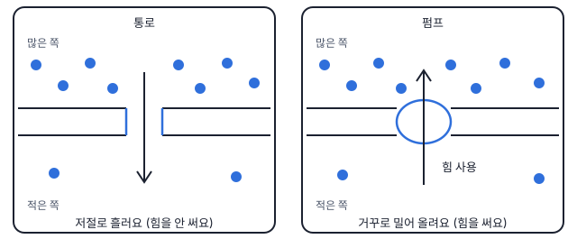
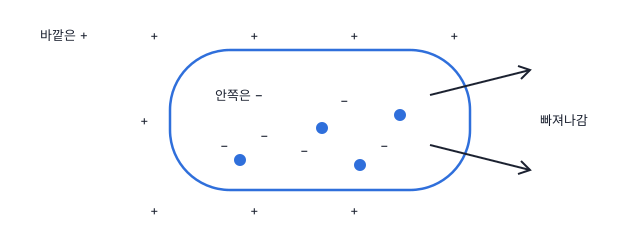
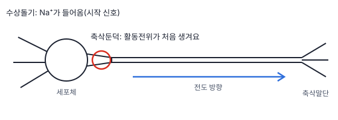
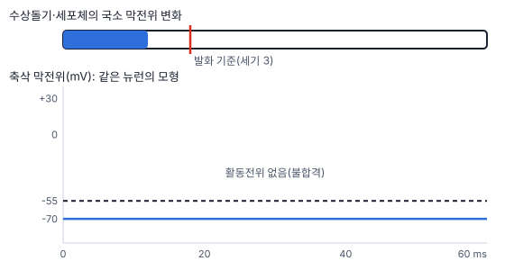
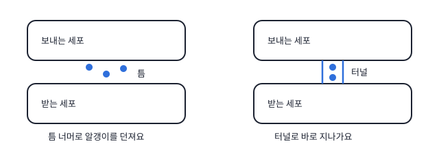
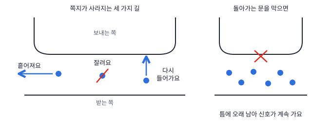

# 뉴런과 시냅스 — 5살도 이해하는 정리노트

이영만 교수님 생명과학 · 1112 수업 (12장 p1–3, 12.1 정보의 흐름과 뉴런)

> `정리노트_1112_Nervous_and_Sensory_Systems.html`를 마크다운으로 옮겼어요. 그림은 `figures_1112/` 폴더의 SVG, 위젯은 대표 설정의 정적 그림으로 바꿨어요. 수식은 `$…$` / `$$…$$`라서 GitHub, Obsidian, Typora에서 보여요.

**목차**

- [1. 뉴런과 신경아교세포](#s0)
  - [뉴런의 세 부분과 신호의 방향](#s0-neuron)
  - [신경아교세포와 미엘린 수초](#s0-glia)
- [2. 휴지전위](#s1)
  - [채널과 Na⁺/K⁺ 펌프](#s1-channel-pump)
  - [휴지전위가 생기는 이유](#s1-resting)
- [3. 활동전위와 전도](#s2)
  - [활동전위: 탈분극·재분극·과분극](#s2-action)
  - [실무율과 자극의 세기](#s2-all-or-none)
  - [전도 속도: 축삭의 지름과 도약전도](#s2-conduction)
- [4. 시냅스 전달](#s3)
  - [시냅스: 화학적 시냅스와 전기적 시냅스](#s3-synapse-types)
  - [화학 시냅스의 전달 순서](#s3-release)
  - [흥분성 신호와 억제성 신호](#s3-excite-inhibit)
- [5. 신경전달물질과 약물](#s4)
  - [여러 가지 신경전달물질](#s4-transmitters)
  - [신경전달물질의 제거와 약물](#s4-removal)
- [6. 요약 · 예고](#s5)
  - [시험 직전 한눈에](#s5-cheatsheet)
  - [다음 시간 연결](#s5-next)
  - [함께 보면 좋은 자료](#s5-links)

## 1. 뉴런과 신경아교세포

### 뉴런의 세 부분과 신호의 방향

*1112 수업 · 12장 p1*

**쉽게 말하면**

몸속 소식을 나르는 세포는 안테나 같은 가지로 소식을 받고, 몸통을 거쳐, 긴 꼬리 끝으로 다음 세포에 넘겨줘요.

*소식은 받는 가지에서 들어와 꼬리 끝으로 나가요.*

**정확히 말하면**

뉴런(neuron)은 크게 세 부분으로 나뉘어요.

- **수상돌기(dendrite)**: 신호를 받아들이는 돌기예요. 고등학교 용어로는 가지돌기예요. 흥분성 입력의 한 예에서는 수상돌기 막의 채널을 통해 Na⁺가 들어와 국소 막전위가 바뀌어요. 그 변화가 세포체와 축삭 시작부에 영향을 줘요(자세한 과정은 [활동전위: 탈분극·재분극·과분극](#s2-action)).
- **세포체(cell body)**: 핵과 미토콘드리아 같은 세포소기관이 있는 부분이에요. 핵은 세포체 안의 소기관이지, 신호를 받는 돌기가 아니에요.
- **축삭(axon)**: 신호가 빠져나가는 긴 돌기예요. 세포체가 축삭으로 좁아지는 곳이 **축삭둔덕**(axon hillock)이에요. 바로 이어지는 **축삭 초기분절**(axon initial segment)이 대표적인 활동전위 시작점이에요. 축삭 끝은 **축삭말단**(axon terminal)이에요.

*테두리 원이 세포체, 그 안의 색칠된 점이 핵이에요. 신호는 수상돌기에서 축삭말단 쪽으로 가요.*

한 뉴런 안에서 신호가 가는 순서는 이렇게 정해져 있어요.

1. 수상돌기가 신호를 받아요.
2. 신호가 세포체를 거쳐요.
3. 수상돌기와 세포체의 입력이 합쳐져 축삭 초기분절이 역치에 닿으면 활동전위가 생겨요.
4. 활동전위가 축삭을 따라 이동해요.
5. 축삭말단에서 다음 세포로 신호를 넘겨요([시냅스: 화학적 시냅스와 전기적 시냅스](#s3-synapse-types)).

뉴런은 기능에 따라 세 가지로 나뉘어요.

- **구심성 뉴런**(afferent neuron) = 감각뉴런(sensory neuron): 감각을 받아들여 신호를 안쪽(중심)으로 들여보내는 뉴런이에요.
- **원심성 뉴런**(efferent neuron) = 운동뉴런(motor neuron): 근육세포로 신호를 내보내는, 중심에서 멀어지는 쪽 뉴런이에요.
- **연합뉴런**(interneuron): 구심성 뉴런과 원심성 뉴런 사이에서 정보를 통합해요.

그래서 정보는 감각을 받아들인 구심성 뉴런에서 그 사이의 연합뉴런을 거쳐, 근육으로 내보내는 원심성 뉴런 순서로 흘러요.

*테두리 상자 세 개가 기능에 따른 세 종류예요. 감각 신호는 구심성 뉴런으로 들어가 연합뉴런을 거쳐 원심성 뉴런으로 근육에 나가요.*

영어 이름도 같은 방향으로 읽어요. 구심성 뉴런(afferent neuron)은 중심으로 들어가는 쪽, 원심성 뉴런(efferent neuron)은 중심에서 멀어지는 쪽이에요.

신호를 받는 수상돌기와 활동전위가 시작되는 축삭 시작부를 구별하려면 [학습만화](../%ED%95%99%EC%8A%B5%EB%A7%8C%ED%99%94_1112_Nervous_and_Sensory_Systems.html#s0-neuron)를 펼쳐 보세요.

**교수님 말씀**

교수님은 구심성과 원심성을 물리의 구심력·원심력에 빗대어 정리했어요. 구심력은 중심으로 들어가는 쪽이라 감각뉴런이 구심성이고, 멀어지는 쪽이 원심성이에요.

> 구심력이 들어가는 쪽이잖아. 그래서 감각뉴런을 구심성 뉴런.

수상돌기는 고등학교에서 배운 가지돌기와 같은 부위라고 짚었어요.

**꼭 기억해요**

- 구심성과 원심성 중 어느 쪽이 감각인지 뒤바꾸기 쉬워요. 구심력처럼 들어가는 쪽이 구심성 뉴런 = 감각뉴런이고, 멀어지는 쪽이 원심성 뉴런 = 운동뉴런(근육으로 내보냄)이에요. 연합뉴런은 그 둘 사이에 있어요.
- 신호를 받는 부위를 축삭이나 세포체로 착각하기 쉬워요. 이온 흐름으로 생긴 전기신호를 받는 안테나는 수상돌기이고, 축삭은 신호를 내보내는 길이에요.
- 핵을 신호 받는 부위로 고르지 마세요. 핵은 세포체 안에 있는 세포소기관이에요.
- 강의노트의 영어 표기 "dentrite"는 철자 오류이고, 바른 표기는 dendrite예요.
- 축삭둔덕은 세포체와 축삭이 이어지는 부위예요. 활동전위는 보통 둔덕 바로 다음의 축삭 초기분절에서 시작해요. 축삭말단은 다음 세포로 신호를 넘기는 끝이에요.

**페이지 요약**

뉴런 안에서 신호는 수상돌기로 들어와 세포체를 지나 축삭으로 나가고, 기능으로는 신호를 들여보내는 구심성, 내보내는 원심성, 그 사이의 연합뉴런으로 나눠요.

*용어*

- **수상돌기(dendrite)** — 신호를 받는 돌기(가지돌기). 시냅스 입력을 받아 그 자리의 막전위가 달라질 수 있어요.
- **세포체(cell body)** — 핵·미토콘드리아 같은 세포소기관이 있는 부분이에요. 핵은 받는 부위가 아니에요.
- **축삭(axon)** — 신호가 빠져나가는 돌기예요. 축삭둔덕에 이어지는 축삭 초기분절이 대표적인 발화 시작점이고, 축삭말단이 다음 세포로 넘기는 끝이에요.
- **구심성 뉴런(afferent neuron)** — 감각뉴런. 구심력처럼 안쪽으로 들어가는 쪽이에요.
- **원심성 뉴런(efferent neuron)** — 운동뉴런. 중심에서 멀어져 근육세포로 신호를 내보내는 쪽이에요.
- **연합뉴런(interneuron)** — 구심성 뉴런과 원심성 뉴런 사이에서 정보를 통합해요.

---

### 신경아교세포와 미엘린 수초

*1112 수업 · 12장 p1*

**쉽게 말하면**

소식을 나르는 세포 곁에는 그 세포를 먹이고 받쳐 주는 도우미 세포가 있어요. 어떤 도우미는 긴 꼬리를 감싸 소식이 더 빨리 가도록 도와요.

*어떤 도우미는 긴 꼬리를 담요처럼 감싸고, 감싸지 않은 틈이 군데군데 남아요.*

**정확히 말하면**

**신경아교세포(glial cell)**는 신경계에서 뉴런을 보조하는 세포예요. 뉴런은 축삭을 따라 활동전위를 전달하고, 신경아교세포는 영양 공급·지지·수초 형성 등으로 뉴런의 활동을 도와요.

신경아교세포의 대표적인 역할은 세 가지예요.

- 뉴런에 영양분을 제공해요.
- 뉴런을 물리적으로 지지해요.
- 미엘린 수초를 만들어요.

종류마다 맡은 일이 달라요.

- **성상세포(astrocyte)**: 별(星) 모양이라 붙은 이름이에요. 뉴런을 물리적으로 지지해요. 수초를 만드는 세포가 아니에요.
- **희소돌기아교세포**(oligodendrocyte)와 **슈반세포**(Schwann cell): 각각 중추신경계와 말초신경계에서 미엘린 수초를 만들어요.

**미엘린 수초(myelin sheath)**는 축삭을 감싸고 있는 지질 막이에요. 이 막은 따로 만들어 붙인 물질이 아니라, 희소돌기아교세포나 슈반세포라는 세포 자체가 축삭을 여러 겹 감싼 것이에요. 지질 함량이 높아 전기적 절연체로 작용해요.

수초는 축삭 전체를 끊김 없이 덮지 않아요. 수초와 수초 사이사이에 축삭이 노출된 틈이 있는데, 이것이 **랑비에 결절(node of Ranvier)**이에요.

수초가 있는 신경을 **유수신경**, 수초가 없는 신경을 무수신경이라고 해요. 지름이 비슷하면 유수신경이 신호를 더 빠르게 전달해요. 왜 빠른지는 [전도 속도: 축삭의 지름과 도약전도](#s2-conduction)에서 랑비에 결절과 함께 이어져요.

성상세포는 뉴런의 환경을 유지하고 지지해요. 희소돌기아교세포와 슈반세포는 축삭을 세포막으로 여러 겹 감싸 수초를 만들어요.

수초와 랑비에 결절의 위치, 수초를 만드는 세포를 구별하려면 [학습만화](../%ED%95%99%EC%8A%B5%EB%A7%8C%ED%99%94_1112_Nervous_and_Sensory_Systems.html#s0-glia)를 펼쳐 보세요.

모형을 돌려 수초 사이에 드러난 결절을 [수초와 도약전도 모형](../%EC%9D%B8%ED%84%B0%EB%A0%89%ED%8B%B0%EB%B8%8C_03_%EC%88%98%EC%B4%88%EC%99%80_%EB%8F%84%EC%95%BD%EC%A0%84%EB%8F%84.html)의 구조 모드에서 찾아보세요.

**교수님 말씀**

교수님은 미엘린 수초가 축삭을 덮은 모습을 담요에 빗댔어요.

> 담요처럼 이렇게 덮고 있는데요.

그리고 수초가 아교세포의 세포막에서 만들어진다는 점을 짚었어요.

> 이 지질 막 자체가 세포예요.

아교세포의 세포막이 여러 겹 감겨 수초를 이룬다는 뜻이에요.

수업에서는 신경아교세포가 뉴런보다 훨씬 많다고 설명했어요. 실제로 두 세포의 비율은 뇌 부위와 동물 종에 따라 달라요. 성인 남성의 뇌 전체를 센 연구에서는 뉴런과 비뉴런 세포의 수가 비슷했어요. 비뉴런에는 아교세포 외에 혈관을 이루는 세포 등도 포함돼요. [Azevedo 외, 2009](https://pubmed.ncbi.nlm.nih.gov/19226510/)

**꼭 기억해요**

- 교수님이 "슈반세포, 미엘린 수초는 장소만 다르고 똑같은 기능"이라고 말했지만 말실수예요. 중추에서 수초를 만드는 세포는 **희소돌기아교세포**, 말초에서 수초를 만드는 세포는 **슈반세포**예요. 미엘린 수초는 이 세포들이 축삭을 감싸 만든 막이지, 슈반세포와 나란히 비교하는 세포 종류가 아니에요.
- 축삭을 따라 활동전위를 전도하는 일은 뉴런이 해요. 아교세포가 만든 수초는 그 전도를 빠르게 해 줘요.
- 수초를 축삭의 일부나 세포 밖 물질로 생각하기 쉬워요. 수초는 다른 세포(아교세포)가 축삭을 감싼 지질 막이에요.
- 랑비에 결절을 수초가 덮인 부분으로 착각하지 마세요. 랑비에 결절은 수초 사이에 축삭이 드러난 틈이에요.
- 성상세포가 수초를 만든다고 고르지 마세요. 성상세포는 뉴런을 물리적으로 지지해요.

**보충 · 수업에서 다루지 않았어요**

교재는 두 수초 형성 세포가 있는 장소를 나눠 적어요. 희소돌기아교세포는 중추신경계(뇌와 척수)에 있고, 슈반세포는 말초신경계(뇌·척수 바깥의 신경)에 있어요. 즉 슈반세포는 말초신경계에서 수초를 만드는 신경아교세포예요. 교재 그림에서는 슈반세포의 세포막이 축삭을 젤리 롤처럼 300번 이상 감고 있어, 수초가 아교세포의 세포막에서 만들어진다는 점을 보여 줘요.

출처: 교재 12장 p.263

**페이지 요약**

신경아교세포는 뉴런의 활동을 돕고, 그중 희소돌기아교세포와 슈반세포는 축삭을 감싸 전도를 빠르게 하는 미엘린 수초를 만들어요.

*용어*

- **신경아교세포(glial cell)** — 영양 공급·물리적 지지·수초 형성 등으로 뉴런을 보조해요. 뉴런과 아교세포의 비율은 뇌 부위와 종에 따라 달라요. 성인 남성의 뇌 전체를 센 연구에서는 뉴런과 비뉴런 세포의 수가 비슷했고, 비뉴런에는 아교세포와 혈관 세포 등이 포함돼요.
- **성상세포(astrocyte)** — 별 모양 아교세포로 뉴런을 물리적으로 지지해요. 수초는 만들지 않아요.
- **희소돌기아교세포·슈반세포** — 희소돌기아교세포는 중추신경계에서, 슈반세포는 말초신경계에서 수초를 만들어요.
- **미엘린 수초(myelin sheath)** — 아교세포 자체가 축삭을 감싼 지질 막으로, 전기적 절연체로 작용해요.
- **랑비에 결절(node of Ranvier)** — 수초 사이사이에 축삭이 드러난 틈이에요.
- **유수신경·무수신경** — 수초가 있으면 유수신경, 없으면 무수신경이에요. 지름이 비슷하면 유수신경이 더 빨라요.

- **(보충) 수초 세포의 장소** — 교재 기준으로 희소돌기아교세포는 중추신경계(뇌·척수), 슈반세포는 말초신경계(뇌·척수 바깥)에 있고, 슈반세포 막은 축삭을 여러 겹 감아요.

---

## 2. 휴지전위

### 채널과 Na⁺/K⁺ 펌프

*1112 수업 · 12장 p2*

**쉽게 말하면**

세포막에는 이온이 저절로 흐르는 통로와, 에너지를 써서 이온을 옮기는 펌프가 있어요.

*왼쪽은 전압 차가 없는 예라 농도 차가 이온이 흐르는 방향을 정해요. 실제 세포막에서는 전압 차도 작용해요. 오른쪽 펌프는 에너지를 써서 이온을 옮겨요.*

**정확히 말하면**

뉴런의 세포막에는 이온 이동에 관여하는 채널과 펌프가 있어요.

- **채널(channel, 통로)**: 열린 채널에서는 이온이 **전기화학 기울기(electrochemical gradient)**를 따라 수동으로 이동해요. 농도 차는 이온을 농도가 낮은 쪽으로, 전압 차는 전하에 따라 끌리는 쪽으로 움직이게 해요. 두 효과를 합쳐 순이동 방향을 정하며 이온이 지나가는 데 ATP를 직접 쓰지 않아요. 이온 채널은 종류에 따라 특정 이온을 더 잘 통과시켜요(선택성).
- **펌프(pump)**: 에너지를 써서 이온을 전기화학 기울기에 거슬러 옮길 수 있어요. 이를 능동수송(active transport)이라고 해요. Na⁺/K⁺ 펌프가 ATP를 쓰는 원리는 [세포 호흡 단원의 ATP를 쓰는 곳](../../0910/정리노트_0910_Cells_and_Cellular_Respiration.html#s2-atp-use)에서 배운 용질 수송과 같아요.

**Na⁺/K⁺ 펌프**(강의노트 표기: Na⁺/K⁺ 능동수송펌프)는 ATP를 가수분해해 얻은 에너지로 Na⁺ 3개를 세포 밖으로 내보내고, 동시에 K⁺ 2개를 세포 안으로 들여보내요. 그 결과 Na⁺는 세포 바깥에, K⁺는 세포 안쪽에 더 많은 상태가 만들어지고 유지돼요. 바깥에 Na⁺가 이미 많이 쌓여 있어도 ATP를 쓰기 때문에 계속 내보낼 수 있어요. K⁺도 안쪽에 이미 많지만 계속 들여보내요.

*Na⁺ 3개는 밖으로, K⁺ 2개는 안으로 옮기며 ATP를 써요.*

Na⁺/K⁺ 펌프는 ATP를 써서 이온을 기울기에 거슬러 옮기고, 열린 채널에서는 이온이 전기화학 기울기를 따라 흘러요. 펌프가 만드는 Na⁺·K⁺ 농도 차는 [휴지전위가 생기는 이유](#s1-resting)의 바탕이에요.

채널이 따르는 방향과 펌프가 옮기는 Na⁺·K⁺의 방향과 개수를 구별하려면 [학습만화](../%ED%95%99%EC%8A%B5%EB%A7%8C%ED%99%94_1112_Nervous_and_Sensory_Systems.html#s1-channel-pump)를 펼쳐 보세요.

Na⁺ 3개가 밖으로 나가고 K⁺ 2개가 안으로 들어오는 순서를 [펌프와 휴지전위 모형](../%EC%9D%B8%ED%84%B0%EB%A0%89%ED%8B%B0%EB%B8%8C_04_%ED%8E%8C%ED%94%84%EC%99%80_%ED%9C%B4%EC%A7%80%EC%A0%84%EC%9C%84.html)의 펌프 모드에서 재생해 보세요.

**교수님 말씀**

> “펌프는 전기를 꽂아야 작동이 되잖아.”

펌프는 에너지가 있어야 일한다는 비유예요. 수업에서는 채널의 수동 이동을 농도 차로 설명했어요. 전하를 띤 이온은 막전위의 영향도 받으므로 순이동 방향은 전기화학 기울기로 판단해요.

펌프 방향은 이름으로 외우라고 했어요. 나트륨은 나간다, 나트륨이니까 밖으로 나가고 칼륨은 들어와요. 세 개를 내보내고 두 개를 들여보낸다고 숫자도 짚었어요.

**꼭 기억해요**

**펌프가 안으로 들이는 이온**: 칼슘으로 착각하기 쉬워요. 수업 중에 교수님도 “칼슘”이라고 했다가 바로 칼륨으로 고쳤어요. 안으로 들어가는 것은 칼륨(K⁺)이에요.

**방향과 비율**: Na⁺ 2개 밖, K⁺ 3개 안처럼 숫자를 뒤바꾸기 쉬워요. Na⁺ 3개가 밖으로, K⁺ 2개가 안으로 가요. 그래서 펌프가 돌면 Na⁺는 바깥, K⁺는 안쪽 농도가 높아져요.

**채널과 펌프의 에너지**: 열린 채널을 통한 수동 이동은 농도 차와 전압 차가 함께 정하며, 이온을 통과시킬 때 ATP를 직접 쓰지 않아요. Na⁺/K⁺ 펌프는 ATP를 써서 전기화학 기울기에 거슬러 이온을 옮겨요.

**펌프의 일과 채널의 일**: 펌프는 안팎의 이온 농도 차를 꾸준히 유지해 음의 휴지전위가 유지되도록 도와요. 활동전위 때 막전위가 갑자기 치솟거나 휴지전위 아래로 내려가는(과분극) 빠른 변화는 채널이 열리고 닫혀서 생겨요.

**페이지 요약**

열린 채널에서는 이온이 전기화학 기울기를 따라 수동으로 흐르고, Na⁺/K⁺ 펌프는 ATP를 써서 Na⁺는 바깥, K⁺는 안쪽에 많은 상태를 유지해요.

*용어*

- **채널(channel)** — 특정 이온을 더 잘 통과시키는 통로예요. 이온의 순이동 방향은 농도 차와 전압 차를 합친 전기화학 기울기가 정해요.
- **펌프(pump)·능동수송** — 에너지를 써서 이온을 전기화학 기울기에 거슬러 옮겨요. Na⁺/K⁺ 펌프의 에너지원은 ATP예요.
- **Na⁺/K⁺ 펌프** — ATP를 써서 Na⁺ 3개를 밖으로, K⁺ 2개를 안으로 옮겨요. 칼슘이 아니라 칼륨이고, 이름대로 나트륨이 나가요.
- **펌프 vs 채널의 일** — 펌프가 안팎의 농도 차를 유지하고, 이온 채널의 투과성이 변하면서 활동전위의 급상승과 과분극이 생겨요.

---

### 휴지전위가 생기는 이유

*1112 수업 · 12장 p2*

**쉽게 말하면**

가만히 쉬고 있는 신호 세포는 안쪽이 바깥보다 살짝 마이너스(−)예요.

*쉬는 동안에도 K⁺는 새어 나가고 Na⁺는 들어와요. 안쪽 전위는 바깥을 기준으로 음수예요. 화살표는 이동 방향을 나타내요.*

**정확히 말하면**

**막전위(membrane potential)**는 세포막을 사이에 둔 세포 안과 밖의 전압 차이예요. 이온이 막 안팎에 **불균등**하게 분포하고, 막이 이온마다 다른 정도로 통과시키면 막 안팎에 전압 차가 생겨요.

**휴지전위(resting potential)**는 자극받지 않은 뉴런에서 안정적으로 유지되는 막전위예요. 강의노트는 −50 ~ −60 mV를 제시해요. [활동전위 그래프](#s2-action)와 실무율 모형의 −70 mV는 파형을 설명하는 예시값이에요. 음수는 세포 안쪽 전위가 바깥보다 낮다는 뜻이에요. 막 안팎에 전위 차가 있는 상태를 **분극**(polarized) 상태라고 해요. 이때 Na⁺는 바깥 농도가, K⁺는 안쪽 농도가 높아요.

**휴지전위가 형성되고 유지되는 과정**을 따라가 볼게요.

1. **농도 기울기 만들기**: [Na⁺/K⁺ 펌프](#s1-channel-pump)가 ATP를 써서 Na⁺ 3개를 밖으로, K⁺ 2개를 안으로 옮겨요. 그래서 Na⁺는 바깥에, K⁺는 안쪽에 많아져요.
2. **문 없는 채널로 새기**: 휴지 상태에서도 열려 있는 통로를 **누설 채널(leaky channel)**이라고 해요. 대표적인 뉴런의 휴지 상태에서는 막이 Na⁺보다 K⁺를 더 잘 통과시켜요. 이를 K⁺ 투과성이 더 크다고 해요.
3. **K⁺가 잘 통하는 막**: 누설 채널로 K⁺는 주로 밖으로, Na⁺는 주로 안으로 이동해요. K⁺가 빠져나가 안쪽 전위가 낮아질수록 안쪽의 음의 전위가 K⁺를 안으로 끌어당겨 K⁺가 밖으로 나가려는 힘이 줄어요. 높은 K⁺ 투과성 때문에 휴지전위는 K⁺의 안팎 이동이 균형을 이루는 전압(K⁺ 평형전위)에 가까워요.
4. **세포 안의 음이온**: DNA처럼 음전하를 띤 큰 분자와 일부 음전하 단백질은 막을 자유롭게 건너지 못해 세포 안에 남아요. 강의노트는 음전하 분자의 예로 단백질, 아미노산, 핵산을 들어요.
5. **휴지 상태의 전류 균형**: 여러 이온이 계속 움직여도, 누설 채널과 펌프 등을 통한 안팎의 전체 전류가 균형을 이루면 막전위가 일정하게 유지돼요. 각 이온의 순이동량은 막의 투과성과 전기화학 기울기에 함께 좌우돼요.

*막은 휴지 상태에서 K⁺를 특히 잘 통과시켜요. 펌프가 농도 차를 지키고 전체 막전류가 균형을 이루면 휴지전위가 유지돼요.*

**Na⁺/K⁺ 펌프의 주요 역할**은 Na⁺·K⁺의 농도 차를 장기적으로 유지하는 것이에요. Na⁺ 3개를 내보내고 K⁺ 2개를 들여보내므로 펌프 자체도 한 번 작동할 때 순양전하 1개를 밖으로 보내요. 활동전위에서 막전위가 급상승하고 다시 내려가는 빠른 변화는 채널이 열리고 닫히면서 생겨요([활동전위: 탈분극·재분극·과분극](#s2-action)).

**ATP와 이온 농도 차**: 세포 호흡은 펌프에 필요한 ATP를 공급해요. Na⁺/K⁺ 펌프가 그 ATP를 써서 이온을 직접 옮겨 농도 차를 지켜요.

농도 차를 유지하는 펌프와 휴지전위에 영향을 주는 누설 채널을 구별하려면 [학습만화](../%ED%95%99%EC%8A%B5%EB%A7%8C%ED%99%94_1112_Nervous_and_Sensory_Systems.html#s1-resting)를 펼쳐 보세요.

ATP 공급을 끊은 직후와 시간이 지난 뒤의 이온 농도 차를 [펌프와 휴지전위 모형](../%EC%9D%B8%ED%84%B0%EB%A0%89%ED%8B%B0%EB%B8%8C_04_%ED%8E%8C%ED%94%84%EC%99%80_%ED%9C%B4%EC%A7%80%EC%A0%84%EC%9C%84.html)의 휴지전위 모드에서 비교해 보세요.

**교수님 말씀**

> “단순히 이것 때문에 세포 내부가 음, 바깥이 양인 게 아닙니다.”

펌프를 설명한 직후 이렇게 짚고, 채널을 사람이 지나가는 문에 비유했어요. 문이 달린 통로에서 문을 떼어 내면 문이 없는 통로가 되고, 문이 없으니 “질질 새잖아”, 그래서 누설 채널이라고 했어요.

두 번째 이유로 앞 단원의 DNA를 다시 불러왔어요. DNA는 염기, 당, 인산으로 되어 있고 인산 때문에 음전하를 띤다고 했던 것을 떠올리게 했어요. 수업에서는 누설 채널 수로 K⁺ 유출이 Na⁺ 유입보다 많다고 설명했어요. 실제 순이동량을 판단하려면 각 이온의 투과성과 전기화학 기울기를 함께 봐야 해요.

**꼭 기억해요**

**휴지전위 수치**: 수업에서는 “−70 mV 정도”, “대략 −60 mV”라는 예가 나왔어요. 강의노트에 적힌 범위는 −50 ~ −60 mV이고, 활동전위 그래프에서 휴지전위는 −70 mV로 설정했어요.

**펌프와 막의 투과성**: 펌프는 이온 농도 차를 유지하고, 휴지 상태의 높은 K⁺ 투과성이 막전위를 K⁺ 평형전위 쪽으로 끌어당겨요.

**이온 이동량과 전류 균형**: 각 이온의 순이동량은 투과성에 더해 농도 차와 전압 차를 함께 고려해 판단해요. 휴지전위가 유지될 때는 모든 막전류를 더한 값이 0이에요.

**불균등한 이온 분포**: Na⁺는 바깥에, K⁺는 안쪽에 많아요. 이 농도 차와 이온마다 다른 막 투과성이 휴지전위의 바탕이에요.

**안팎의 부호**: 막전위는 세포 밖 전위를 기준으로 잰 안쪽 전위예요. 휴지 상태에서 음수이고, 활동전위 그래프의 상승 구간에서는 0을 지나 양수가 돼요.

**펌프의 주요 역할**: ATP를 써서 Na⁺와 K⁺의 농도 차를 유지해요. 활동전위의 급상승과 과분극은 채널 투과성의 빠른 변화로 생겨요.

**페이지 요약**

펌프가 유지하는 이온 농도 차와 높은 K⁺ 투과성 때문에 휴지전위는 음수예요. 막을 지나는 전체 전류가 균형을 이루면 이 값이 유지돼요.

*용어*

- **막전위(membrane potential)** — 세포 밖을 기준으로 잰 안쪽 전위예요. 이온 농도 차와 이온마다 다른 막 투과성에 좌우돼요.
- **휴지전위(resting potential)·분극** — 자극받지 않은 뉴런에서 유지되는 음의 막전위예요. 강의노트 값은 −50 ~ −60 mV이고, 활동전위 그래프에는 −70 mV를 예로 썼어요.
- **누설 채널(leaky channel)** — 휴지 상태에서도 열려 있는 채널이에요. 휴지 상태의 막은 대체로 Na⁺보다 K⁺를 더 잘 통과시켜요.
- **세포 안 음이온** — DNA와 일부 단백질처럼 음전하를 띤 큰 분자는 막을 쉽게 건너지 못해 세포 안에 남아요.
- **Na⁺/K⁺ 펌프의 역할** — ATP를 써서 Na⁺ 3개를 밖으로, K⁺ 2개를 안으로 옮겨 이온 농도 차를 장기적으로 유지해요.
- **막전위의 방향** — 휴지 상태에서 안쪽 전위는 바깥보다 낮아요. 예시 파형에서는 상승 구간에 막전위가 양수까지 올랐다가 다시 낮아져요.

---

## 3. 활동전위와 전도

### 활동전위: 탈분극·재분극·과분극

*1112 수업 · 12장 p2*

**쉽게 말하면**

Na⁺가 들어오면 막전위가 쑥 올라가요. 곧 Na⁺ 유입이 줄고 K⁺가 나가면서 다시 내려와요.

*K⁺가 나가는 문이 느릿느릿 닫혀서, 막전위가 처음 자리보다 살짝 더 내려갔다가 돌아와요.*

**정확히 말하면**

**활동전위(action potential)**는 뉴런의 축삭을 따라 이동하는 전기적 충격이에요. 막전위가 짧은 시간 동안 급격히 올랐다가 내려오는 변화예요. 아래 예에서는 막전위가 음수에서 양수로 올라갔다가 돌아와요.

그래서 신경신호를 가장 정확히 표현하면 **막을 사이에 둔 전위차(막전위)의 변화**예요. 이온이 막을 드나들며 그 자리의 막전위가 바뀌고, 그 변화가 옆 자리로 전파돼요([전도 속도: 축삭의 지름과 도약전도](#s2-conduction)).

판별 기준: 축삭을 따라 이동하는 것은 막전위가 바뀌는 "사건"이에요. 뉴런이 맞붙은 자리(시냅스)나 자극이 없을 때의 값(휴지전위)은 장소나 상태이지 이동하는 충격이 아니에요.

**어디서 처음 생기나요?** 시작 신호와 활동전위가 생기는 자리는 달라요.

1. 예를 들어 시냅스 전 뉴런이 흥분성 신호를 보내는 신경전달물질을 분비해요.
2. 시냅스 후 뉴런의 수상돌기에 있는 리간드 개폐성 채널이 열려 Na⁺ 등이 들어오면 그 자리의 막전위가 조금 올라가요.
3. 이 국소 막전위 변화는 세포 안의 국소 전류를 통해 수동으로 퍼져요. 수상돌기와 세포체의 여러 입력이 합쳐져 축삭둔덕 근처의 **축삭 초기분절(axon initial segment, AIS)**에 영향을 줘요.
4. 축삭 초기분절에는 **전압 개폐성 Na⁺ 채널**이 밀집해 있어요. 막전위가 올라갈수록 이 채널이 열릴 가능성이 커져요.
5. 막전위가 **역치**에 이르면 Na⁺ 유입으로 막전위가 더 올라가고, 그 결과 더 많은 Na⁺ 채널이 열려요. 보통 이곳에서 활동전위가 처음 생겨 축삭말단 쪽으로 전해져요.

*수상돌기에서 생긴 국소 막전위 변화가 퍼져 축삭둔덕 근처에 도달해요. 원으로 표시한 축삭 초기분절에서 활동전위가 시작해 축삭말단 쪽으로 전해져요.*

**시간–막전위 그래프로 보는 과정**

*교재 그림 12.5처럼 휴지전위 −70 mV를 예로 들었어요. 이 그래프의 위쪽 점선은 모형의 역치 −55 mV, 아래쪽 점선은 휴지전위예요. 강의노트의 휴지전위 범위는 −50 ~ −60 mV예요.*

1. **휴지 상태**: 안쪽이 −로 분극되어 있고, 전압 개폐성 Na⁺ 채널은 닫혀 있어요.
2. **역치까지**: 국소 입력으로 축삭 초기분절의 막전위가 휴지전위에서 역치 쪽으로 올라가요.
3. **탈분극**: 전압 개폐성 Na⁺ 채널이 열려 Na⁺가 들어오면 막전위가 더 올라가고, 그 결과 더 많은 Na⁺ 채널이 열려요. 예시에서는 막전위가 0을 넘어 양수로 솟아요. 바깥 Na⁺가 많은 까닭은 Na⁺/K⁺ 펌프가 계속 밖으로 퍼내기 때문이에요([채널과 Na⁺/K⁺ 펌프](#s1-channel-pump)).
4. **최고치**: 정점 부근에서는 많은 Na⁺ 채널이 **불활성화**되어 Na⁺ 유입이 줄어요. 같은 탈분극에 반응한 지연성 K⁺ 채널도 이미 열리기 시작해 두 작용의 시기가 겹쳐요.
5. **재분극**: Na⁺ 유입이 줄고 K⁺ 유출이 우세해지면서 막전위가 휴지전위 쪽으로 내려가요.
6. **과분극**: 지연성 K⁺ 채널이 천천히 닫혀 K⁺가 계속 빠져나가면, 막전위가 잠시 휴지전위보다 낮아져요.
7. **회복**: 지연성 K⁺ 채널이 닫히면 휴지전위로 돌아와요. 재분극과 함께 불활성화됐던 Na⁺ 채널도 다시 열릴 수 있는 상태로 회복해요.

| 그래프 구간 | 막전위 | 이온과 채널 | 이름 |
|---|---|---|---|
| 올라가는 선 | −에서 +로 솟음 | Na⁺ 채널 열림, Na⁺ 유입 | 탈분극 |
| 내려가는 선 | +에서 −로 돌아감 | Na⁺ 채널 불활성화로 유입 감소, K⁺ 유출 우세 | 재분극 |
| 휴지전위 아래로 처진 곳 | 휴지전위보다 더 − | K⁺ 채널이 늦게 닫혀 K⁺가 더 나감 | 과분극 |
| 다시 평평해진 곳 | 휴지전위 | 지연성 K⁺ 채널 닫힘 | 회복(휴지 상태) |

**상태 이름 구별하기**: 휴지 상태에서 막전위가 덜 음수가 되는 변화가 **탈분극**이에요. 재분극은 막전위가 휴지전위 쪽으로 돌아가는 변화이고, 과분극은 휴지전위보다 더 낮아진 상태예요. 역치는 충분한 Na⁺ 유입이 더 많은 Na⁺ 채널을 열어 활동전위를 일으키는 기준 전위예요.

Na⁺ 채널의 불활성화와 K⁺ 채널의 느린 닫힘을 구별하려면 [학습만화](../%ED%95%99%EC%8A%B5%EB%A7%8C%ED%99%94_1112_Nervous_and_Sensory_Systems.html#s2-action)를 펼쳐 보세요.

막전위가 오르고 내려갈 때 Na⁺ 유입과 K⁺ 유출이 파형의 어느 구간에서 두드러지는지 [활동전위와 실무율 모형](../%EC%9D%B8%ED%84%B0%EB%A0%89%ED%8B%B0%EB%B8%8C_01_%ED%99%9C%EB%8F%99%EC%A0%84%EC%9C%84%EC%99%80_%EC%8B%A4%EB%AC%B4%EC%9C%A8.html)의 파형 모드에서 확인해 보세요.

**교수님 말씀**

> "나트륨 채널 열리고 닫히고, 칼륨 채널 열리고 닫히고. 닫히는데 좀 천천히 닫힌다."

교수님은 파형의 순서를 짚었어요. 지연성 K⁺ 채널이 늦게 닫혀 과분극이 생긴다는 점을 기억해요. 실제 채널의 작동 시기는 겹쳐요.

채널을 사람처럼 표현했어요. Na⁺ 채널의 불활성화를 "어, 너무 많이 됐다", K⁺ 채널의 느린 닫힘을 "아이고, 이제 닫혀야지"라는 비유로 설명했어요. 불활성화된 Na⁺ 채널은 재분극 뒤에 다시 열릴 수 있는 상태로 돌아와요.

개폐성의 개(開)는 열다, 폐(閉)는 닫다라는 뜻이에요. 문이 달려 열리고 닫히는 채널이라는 말이에요.

**꼭 기억해요**

- **시작 신호와 활동전위의 자리**: 수상돌기에서 생긴 국소 막전위 변화가 수동으로 퍼져요. 강의에서 축삭둔덕이라고 부른 시작 부위는 정확히는 그 바로 다음의 축삭 초기분절이에요. 보통 활동전위는 여기서 시작해 축삭말단까지 전해져요.
- **문 있는 채널과 문 없는 채널**: 누설 채널은 휴지 상태에서도 열려 있어요. 축삭 초기분절에서는 전압 개폐성 Na⁺ 채널이 활동전위의 상승을 일으켜요.
- **탈분극과 활동전위**: 두 말을 같은 것으로 쓰기 쉬워요. 교수님도 "탈분극이 됐죠"를 "활동전위가 생겼죠"로 고쳐 말했어요. 탈분극은 막전위가 올라가는 한 구간이고, 활동전위는 탈분극부터 회복까지의 전체 변화예요.
- **재분극과 과분극**: 둘 다 "내려가는 것"이라 섞이기 쉬워요. 재분극은 휴지전위 쪽으로 내려오는 변화이고, 과분극은 휴지전위보다 더 내려간 상태예요.
- **채널이 작동하는 시기**: Na⁺ 채널이 빠르게 열리고, 지연성 K⁺ 채널은 같은 탈분극에 더 늦게 반응해 열려요. 정점 부근에서 Na⁺ 채널의 불활성화와 K⁺ 채널의 작동이 겹쳐요. Na⁺ 유입이 줄고 K⁺ 유출이 우세해지면 재분극이 시작돼요.
- **막전위의 방향**: 막전위가 덜 음수가 되는 것이 탈분극이에요. 과분극에서는 휴지전위보다 더 음수가 돼요.

**페이지 요약**

축삭 초기분절이 역치에 이르면 Na⁺ 유입으로 막전위가 솟아요. Na⁺ 채널이 불활성화되고 K⁺ 유출이 우세해져 재분극이 일어나며, K⁺ 채널이 느리게 닫혀 과분극이 생길 수 있어요.

*용어*

- **활동전위(action potential)** — 막전위가 빠르게 올라갔다가 내려오는 변화가 축삭을 따라 전파되는 신호예요.
- **시작 위치** — 수상돌기의 국소 막전위 변화가 수동으로 퍼져요. 보통 축삭둔덕 바로 다음의 축삭 초기분절이 역치에 이르면 활동전위가 시작돼요.
- **전압 개폐성 Na⁺ 채널** — 막전위에 따라 열릴 가능성이 달라지는 채널로 축삭 초기분절에 밀집해 있어요. 불활성화된 채널은 재분극이 진행되면서 다시 열릴 수 있는 상태로 돌아와요.
- **탈분극** — 막전위가 덜 음수가 되는 변화예요. 활동전위의 상승 구간에서는 Na⁺ 채널이 열리며 Na⁺가 빠르게 들어와요.
- **재분극** — 정점 부근의 Na⁺ 채널 불활성화와 지연성 K⁺ 채널의 작동이 겹쳐요. K⁺ 유출이 우세해져 막전위가 휴지전위 쪽으로 내려와요.
- **과분극** — K⁺ 채널이 천천히 닫혀 K⁺가 더 나가, 막전위가 휴지전위보다 낮아진 상태. K⁺ 채널이 닫히면 휴지전위로 돌아와요.
- **역치** — Na⁺ 유입이 더 많은 Na⁺ 채널을 열 만큼 커져 활동전위가 시작되는 기준 전위예요.
- **탈분극과 활동전위** — 탈분극은 막전위가 올라가는 한 구간이고, 활동전위는 탈분극부터 재분극·과분극·회복까지의 전체 변화예요. 교수님도 "탈분극이 됐죠"를 "활동전위가 생겼죠"로 고쳐 말했어요.

---

### 실무율과 자극의 세기

*1112 수업 · 12장 p2*

**쉽게 말하면**

활동전위 하나가 생기려면 막전위가 문턱에 닿아야 해요. 시험에 합격하는 것처럼, 문턱에 닿으면 활동전위가 생겨요.

*같은 뉴런에 자극을 계속 주는 예예요. 자극이 더 강하면 비슷한 높이의 활동전위가 더 자주 생길 수 있어요.*

**정확히 말하면**

**실무율(all-or-nothing)**: 발화할 수 있는 뉴런의 축삭 초기분절이 **역치**에 이르면 Na⁺ 유입이 막을 더 탈분극시켜 더 많은 전압 개폐성 Na⁺ 채널을 열어요. 이렇게 활동전위 하나가 생겨요. 역치 아래에서는 자극 세기에 따라 크기가 달라지는 국소 막전위 변화만 일어나요.

**활동전위의 크기**: 같은 뉴런을 같은 조건에서 보면 활동전위 한 번의 크기는 대체로 일정해요. Na⁺ 유입이 탈분극을 증폭하고 Na⁺ 채널의 불활성화와 K⁺ 유출이 막전위를 되돌려요. 축삭에서도 이 과정이 이어져 신호의 크기가 유지돼요. 활동전위의 발생 여부를 0과 1에 비유해 **디지털** 신호라고 설명할 수 있어요.

**자극 세기와 빈도**: 자극이 계속되면 같은 시간 동안 생기는 활동전위의 횟수(**빈도**)로 세기의 차이를 전할 수 있어요.

1. **약한 자극**: 축삭 초기분절이 역치에 이르지 못하면 활동전위가 생기지 않아요. 겨우 역치에 닿는 입력은 한 번 발화시키거나, 지속될 때 낮은 빈도로 발화시킬 수 있어요.
2. **강한 자극이 지속될 때**: 한 번 발화하면 Na⁺ 채널이 불활성화되어 잠시 다시 발화할 수 없어요(**절대 불응기**). 이후 Na⁺ 채널이 회복 중이고 일부 K⁺ 채널이 아직 열려 있으면 평소보다 강한 자극이 필요해요(**상대 불응기**). 강한 자극이 이어지면 발화할 수 있는 상태로 회복된 뒤 역치에 더 빨리 도달해, 활동전위가 더 자주 생길 수 있어요.

**아날로그와 디지털**: 수상돌기·세포체에서 생기는 국소 막전위 변화의 크기는 입력에 따라 연속적으로 달라져요. 축삭 초기분절에서는 그 입력을 합친 결과가 역치에 이르면 활동전위가 발생해요.

#### 직접 해 보기: 자극 세기와 활동전위 *(정적 스냅샷 — 직접 조작은 HTML 버전)*

같은 뉴런에 60 ms 동안 자극을 주는 모형이에요. 위의 막대는 국소 막전위 변화의 크기를 나타내요. 아래 축삭 기록에서 활동전위가 생기는 조건과 횟수를 확인해 보세요. 이 모형의 휴지전위는 −70 mV, 활동전위의 최고치는 +30 mV로 설정했어요.

60 ms 동안 활동전위 수와 활동전위의 최고치: **3개 · 활동전위의 최고치 +30 mV(모형값)**

범례: 축삭 막전위(활동전위) · 점선: 모형의 역치(−55 mV)

*역치 미만(세기 2)*

*역치를 약간 넘음(세기 3.5)*

*강한 자극(세기 8)*

| 설정 | 활동전위 수(60 ms) | 활동전위의 최고치 | 판정 |
|---|---|---|---|
| 역치 미만(세기 2) | 0개 | 없음 | 불합격: 활동전위 없음 |
| 역치를 약간 넘음(세기 3.5) | 1개 | +30 mV | 합격: 한 번 |
| 강한 자극(세기 8) | 5개 | +30 mV | 합격: 모형의 최고치는 같고 횟수 증가 |

세 가지 자극에서 봉우리 높이와 같은 시간 동안의 횟수를 [활동전위와 실무율 모형](../%EC%9D%B8%ED%84%B0%EB%A0%89%ED%8B%B0%EB%B8%8C_01_%ED%99%9C%EB%8F%99%EC%A0%84%EC%9C%84%EC%99%80_%EC%8B%A4%EB%AC%B4%EC%9C%A8.html)의 실무율 모드에서 비교해 보세요.

자극에 따라 변하는 활동전위의 개수와 한 번의 높이를 구별하려면 [학습만화](../%ED%95%99%EC%8A%B5%EB%A7%8C%ED%99%94_1112_Nervous_and_Sensory_Systems.html#s2-all-or-none)를 펼쳐 보세요.

**교수님 말씀**

교수님이 먼저 물었어요. "활동전위는 디지털 신호일까요, 아날로그 신호일까요?" 기준은 자극이 세지면 활동전위 크기도 커지느냐였어요.

> "1점 차이가 아니고 합격, 불합격"

실무율을 시험의 합격·불합격에 비유하며 "기면 기고 아니면 아니다"라고 했어요. 이 비유는 채널 하나의 열림보다, 축삭에서 활동전위가 생기는지를 설명하는 데 알맞아요.

속삭이는 소리와 크게 말하는 소리를 구별하는 예를 들었어요. 같은 뉴런에서 발화 빈도의 차이가 자극 세기를 전달하는 한 방법이에요.

**꼭 기억해요**

- **디지털과 아날로그**: 수상돌기·세포체의 국소 막전위는 입력에 따라 연속적으로 달라져요. 축삭 초기분절에서 역치에 이르면 활동전위가 생겨요.
- **활동전위의 크기와 빈도**: 같은 뉴런의 같은 조건에서 한 번의 활동전위 크기는 대체로 일정해요. 자극이 강하게 이어지면 일정 시간 동안 활동전위가 더 자주 생길 수 있어요.
- **역치 미만**: 역치에 못 미치는 자극은 국소 막전위를 바꿀 수 있어요. 활동전위는 역치에 닿을 때 생겨요.

**페이지 요약**

발화할 수 있는 뉴런이 역치에 이르면 활동전위가 생겨요. 같은 뉴런의 같은 조건에서는 한 번의 크기가 대체로 일정하고, 지속 자극의 세기는 발화 빈도에 반영될 수 있어요.

*용어*

- **실무율(all-or-nothing)** — 역치에 이르면 Na⁺ 유입이 더 많은 Na⁺ 채널을 열어 활동전위를 일으켜요. 역치 아래에서는 국소 막전위만 변해요.
- **활동전위의 크기** — 같은 뉴런의 같은 조건에서는 Na⁺ 유입과 K⁺ 유출이 비슷한 시간 흐름을 보여, 활동전위 한 번의 크기가 대체로 일정해요.
- **빈도** — 같은 시간 동안 활동전위가 발생한 횟수예요. 강한 자극이 이어지면 회복 뒤 역치에 더 빨리 도달해 빈도가 높아질 수 있어요.
- **불응기** — 발화 직후 Na⁺ 채널이 불활성화되어 다시 발화할 수 없는 절대 불응기와, 평소보다 강한 자극이 있어야 발화할 수 있는 상대 불응기가 이어져요.
- **아날로그와 디지털** — 수상돌기·세포체의 국소 막전위 변화는 입력에 따라 연속적으로 달라져요. 활동전위는 역치에 도달했을 때의 발생 여부로 구별할 수 있어요.

---

### 전도 속도: 축삭의 지름과 도약전도

*1112 수업 · 12장 p2*

**쉽게 말하면**

파도타기 응원처럼 한 곳의 신호가 다음 곳을 깨워요. 덮개가 있으면 사이에서 신호가 덜 새어 더 먼 곳을 깨울 수 있어요.

*동그라미는 신호가 다시 생기는 곳이에요. 아래 줄에서는 덮개 아래를 따라 신호가 이어져 더 멀리 떨어진 다음 틈을 깨워요.*

**정확히 말하면**

**전도**: 한 자리에서 Na⁺가 들어와 막이 탈분극하면, 전위 차로 인해 축삭 내부에 국소 전류가 흘러 다음 자리를 탈분극시켜요. 그 자리의 막전위가 역치에 이르면 전압 개폐성 Na⁺ 채널이 열려 새 활동전위가 생기고, 같은 일이 반복돼요. 지나온 자리는 재분극을 거쳐 휴지전위로 돌아가요. 그래서 활동전위는 뉴런을 따라 이동하는 **탈분극의 파동**으로 전파되고, 크기는 일정하게 유지돼요. 축삭말단에 닿으면 신경전달물질이 분비돼요([화학 시냅스의 전달 순서](#s3-release)).

**속도의 문제**: **축삭의 지름**이 클수록 축삭 내부의 전류 흐름에 대한 저항이 줄어, 다른 조건이 같으면 빠르게 전달돼요. 하지만 축삭을 한없이 굵게 할 수는 없어요. 가는 축삭에서도 전달을 빠르게 만드는 방식이 도약전도예요.

**도약전도(saltatory conduction)**가 빠른 이유를 차례로 보면 이래요.

1. 미엘린 수초는 막을 가로질러 새는 전류를 줄이는 **절연체**예요([신경아교세포와 미엘린 수초](#s0-glia)).
2. 수초 사이에 드러난 **랑비에 결절**에는 전압 개폐성 Na⁺ 채널이 집중돼요. 수초에 덮인 구간의 축삭막에도 이온 채널이 있어요.
3. 한 결절에서 활동전위가 생기면 국소 전류가 수초 아래의 축삭 내부를 따라 수동적으로 흘러 다음 결절의 막을 탈분극시켜요.
4. 다음 결절이 역치에 이르면 활동전위가 다시 생겨요. 결절마다 활동전위가 재생되어 건너뛰는 것처럼 보여요.
5. 수초가 없는 축삭에서는 전압 개폐성 Na⁺ 채널이 막을 따라 분포해요. 국소 전류가 가까운 막을 탈분극시키고 활동전위가 연속해서 재생돼요. 비슷한 지름의 수초 있는 축삭보다 전도가 느려요.

영어 이름 saltatory conduction을 보면, 결절에서 결절로 건너뛰듯 활동전위가 재생되는 모습을 떠올리면 돼요.

*짧은 세로선은 전도에 관여하는 Na⁺ 채널의 분포를 나타내요. 유수 축삭에서는 이 채널이 결절에 집중돼요. 화살표는 수초 아래 축삭 내부를 흐르는 국소 전류예요.*

**미엘린 수초의 성질**: 지질이 많은 막이라 전류 누출을 줄이고, 결절 사이의 전압 변화를 빠르게 전달해요. 수초가 없는 무수 축삭도 있어요.

**다발성 경화증(multiple sclerosis)**: 면역계가 중추신경계의 미엘린 수초를 손상시키는 **자가면역질환**이에요.

1. 수초가 손상되면 막을 가로질러 새는 전류가 늘어요.
2. 다음 결절을 탈분극시키는 전류가 줄어 역치에 늦게 닿거나 아예 닿지 못할 수 있어요.
3. 그래서 전도가 느려지거나 차단될 수 있어요.
4. 운동 경로에서 전도가 막히면 근력 저하나 마비가 생길 수 있어요. 다발성 경화증에서는 수초 손상과 함께 축삭 자체가 손상되는 경우도 있어요.

**활동전위를 판별하는 기준**(자세한 과정은 [활동전위: 탈분극·재분극·과분극](#s2-action)): 막전위가 빠르게 탈분극했다 재분극하는 변화이며 축삭을 따라 전파돼요. 역치에서 전압 개폐성 Na⁺ 채널이 열려 Na⁺가 유입되며 시작하고, 정점 부근에서 Na⁺ 채널의 불활성화가 진행돼요. 많은 뉴런에서 활동전위는 축삭둔덕에 인접한 축삭 초기 분절에서 시작해 축삭말단 쪽으로 전해져요. Ca²⁺는 활동전위가 말단에 닿은 뒤에 말단으로 들어와 신경전달물질 분비를 돕는 이온이에요.

전류가 퍼지는 구간과 활동전위가 재생되는 결절을 구별하려면 [학습만화](../%ED%95%99%EC%8A%B5%EB%A7%8C%ED%99%94_1112_Nervous_and_Sensory_Systems.html#s2-conduction)를 펼쳐 보세요.

같은 거리를 가는 두 축삭에서 활동전위가 어디서 다시 생기고 어느 쪽이 먼저 도착하는지 [수초와 도약전도 모형](../%EC%9D%B8%ED%84%B0%EB%A0%89%ED%8B%B0%EB%B8%8C_03_%EC%88%98%EC%B4%88%EC%99%80_%EB%8F%84%EC%95%BD%EC%A0%84%EB%8F%84.html)의 전도 모드에서 비교해 보세요.

**교수님 말씀**

전도를 **파도타기** 응원에 비유했어요. 일어섰다 앉고, 일어섰다 앉고 하며 옆으로 전해져요.

도약전도에서도 같은 비유를 썼어요. 수초가 없으면 이웃한 학생이 차례로 일어나고, 수초가 있으면 1번, 10번, 20번처럼 떨어진 자리에서 일어난다는 비유예요. 학생이 일어나는 자리가 활동전위를 재생하는 곳이고, 그 사이에서는 전류가 축삭 내부를 따라 이어져요.

수초를 **전선 피복**에 비유했어요. 피복을 벗긴 전선에서 누전이 생기듯, 수초가 손상되면 축삭막을 가로질러 새는 전류가 늘어요.

면역은 14장에서 배운다고 했어요.

**꼭 기억해요**

- **지름과 도약전도**: 빨라지는 방법이 하나뿐이라고 생각하기 쉬워요. 축삭의 지름이 클수록 빠르고, 따로 도약전도는 지름이 작은 축삭에서도 전도 속도를 높여요. 강의노트 소제목도 "도약전도는 지름이 작은 축삭에서 전도 속도를 증가"예요.
- **탈수초와 축삭 손상**: 탈수초는 축삭을 감싼 미엘린 수초의 손상이에요. 축삭이 이어져 있어도 탈수초 때문에 전도가 느려지거나 막힐 수 있어요. 다발성 경화증에서는 축삭 손상도 동반될 수 있어요.
- **수초와 활동전위의 자리**: 정상 유수 축삭에서 활동전위는 Na⁺ 채널이 집중된 결절에서 재생돼요. 수초로 덮인 막에도 이온 채널이 있으며, 결절 사이는 국소 전류의 수동 전달로 이어져요.
- **모든 뉴런에 수초?**: 수초를 모든 뉴런의 보호층으로 고르기 쉬워요. 수초가 없는 무수신경도 있어서, 수초는 일부 뉴런만 덮어요.

**페이지 요약**

굵은 축삭은 내부 저항이 작아 전도가 빨라요. 가는 축삭도 수초가 있으면 결절 사이로 전류가 수동적으로 퍼지고 활동전위가 결절마다 재생되는 도약전도로 빨라져요.

*용어*

- **전도** — 한 곳의 탈분극이 국소 전류를 통해 다음 곳의 막을 역치에 올려요. 다음 곳에서 활동전위가 새로 생기므로 크기가 유지되고, 지나온 자리는 휴지전위로 돌아가요.
- **축삭의 지름** — 클수록 저항이 줄어 빨라요. 다만 한없이 굵게 할 수는 없어요.
- **도약전도(saltatory conduction)** — 수초 아래로 흐르는 국소 전류가 다음 결절을 역치에 올리면 집중된 Na⁺ 채널이 활동전위를 재생해요. 수초에 덮인 막에도 이온 채널이 있어요. 무수 축삭에서는 활동전위가 가까운 막을 따라 연속해서 재생돼요.
- **미엘린 수초** — 유수 축삭을 감싸는 지질 막이에요. 막을 가로지르는 전류 누출을 줄여 결절 사이의 신호 전달을 빠르게 해요.
- **다발성 경화증(multiple sclerosis)** — 면역계가 중추신경계 수초를 손상시켜요. 탈수초로 전류 누출이 늘면 전도가 느려지거나 차단될 수 있어요. 축삭 자체의 손상이 동반되기도 해요.
- **활동전위 판별 기준** — 역치에서 전압 개폐성 Na⁺ 채널이 열려 Na⁺가 유입되며 시작해요. 보통 축삭 초기 분절에서 시작해 말단 방향으로 전해지고, 정점 부근에서는 Na⁺ 채널의 불활성화가 진행돼요.

---

## 4. 시냅스 전달

### 시냅스: 화학적 시냅스와 전기적 시냅스

*1112 수업 · 12장 p1*

**쉽게 말하면**

신경세포끼리 신호를 건네는 길은 두 가지예요: 틈 너머로 작은 알갱이를 던지거나, 터널로 바로 이어지거나.

*왼쪽은 알갱이가 틈을 건너가고, 오른쪽은 알갱이가 터널 속을 곧장 지나가요.*

**정확히 말하면**

시냅스(synapse)는 뉴런과 뉴런이 맞붙어 신호를 넘겨주는 곳이에요. 신호를 넘겨주는 앞쪽 세포를 시냅스 전 뉴런(presynaptic neuron), 신호를 받는 뒤쪽 세포를 시냅스 후 뉴런(postsynaptic neuron)이라고 해요. 강의노트의 "시냅스전세포·시냅스후세포"도 같은 뜻이에요.

이름은 놓인 위치가 아니라 신호가 가는 방향으로 정해요. 신경전달물질을 내보내는 축삭말단을 가진 쪽이 시냅스 전 뉴런이고, 그 물질을 받는 쪽(주로 수상돌기)이 시냅스 후 뉴런이에요.

시냅스는 신호를 넘기는 방식에 따라 둘로 나뉘어요.

| 구분 | 무엇으로 넘기나 | 두 세포 사이 |
|---|---|---|
| 화학적 시냅스(chemical synapse) | 신경전달물질(neurotransmitter)이라는 화학물질 | 시냅스 틈(synaptic cleft)으로 떨어져 있어요. 물질이 이 틈을 건너가야 신호가 넘어가요. |
| 전기적 시냅스(electrical synapse) | 이온이 직접 이동해요(수업에서는 나트륨 이온을 예로 들었어요) | 두 세포 사이에 터널 같은 통로가 뚫려 있어, 그 통로로 이온이 곧장 옮겨 가요. |

판별 기준은 "무엇이 건너가는가"예요. 화학물질(신경전달물질)이 틈을 건너가면 화학적 시냅스, 통로를 지나 이온이 바로 옮겨 가면 전기적 시냅스예요. 전기적 시냅스에는 신경전달물질이 건너가는 시냅스 틈 단계가 없어요.

수업에서 자세히 배운 것은 화학적 시냅스예요. 신경전달물질이 어떻게 나와서 어떻게 작용하는지는 [화학 시냅스의 전달 순서](#s3-release)에서 이어져요.

전달물질이 틈을 건너는 경우와 이온이 직접 이동하는 경우를 구별하려면 [학습만화](../%ED%95%99%EC%8A%B5%EB%A7%8C%ED%99%94_1112_Nervous_and_Sensory_Systems.html#s3-synapse-types)를 펼쳐 보세요.

**교수님 말씀**

전기적 시냅스의 통로를 터널에 비유하셨어요.

> "터널처럼 통로가 있어 가지고 … 나트륨 이온이 직접 이동하는 경우"

그리고 범위를 정해 주셨어요. "일단 우리가 배우는 거는 화학적 시냅스입니다." 이 단원을 배우는 이유로는 소리와 시각 신호가 어떻게 뇌까지 가는지, 생각과 감정은 어떻게 생기는지를 드셨어요.

**페이지 요약**

신호를 넘기는 두 방식은 건너가는 것이 달라요: 화학적 시냅스는 틈을 건너는 신경전달물질, 전기적 시냅스는 통로로 직접 옮겨 가는 이온이에요.

*용어*

- **시냅스(synapse)** — 뉴런과 뉴런이 맞붙어 신호를 넘기는 곳이에요.
- **시냅스 전 뉴런 / 시냅스 후 뉴런** — 신호 방향으로 이름을 정해요. 신경전달물질을 내보내는 축삭말단 쪽이 전, 받는 쪽(주로 수상돌기)이 후예요.
- **화학적 시냅스(chemical synapse)** — 두 세포가 시냅스 틈으로 떨어져 있고, 신경전달물질이 그 틈을 건너가 신호를 넘겨요. 수업에서 자세히 배운 쪽이에요.
- **전기적 시냅스(electrical synapse)** — 두 세포 사이 터널 같은 통로로 이온(예: 나트륨 이온)이 직접 이동해요. 신경전달물질이 틈을 건너는 단계가 없어요.

---

### 화학 시냅스의 전달 순서

*1112 수업 · 12장 p2–3*

**쉽게 말하면**

보내는 쪽 끝에 신호가 닿으면 작은 주머니가 벽에 붙어 열리면서 알갱이를 틈으로 쏟아내요.

*그림 속 받는 자리는 이온이 지나는 문이에요. 알갱이가 틈을 건너 이 자리에 붙으면 문이 열려요.*

**정확히 말하면**

**먼저 준비된 것.** 아세틸콜린 같은 소분자 신경전달물질은 대개 축삭말단에서 만들어져 그 자리에서 작은 시냅스 소포(synaptic vesicle)에 담겨요. 엔도르핀 같은 신경펩타이드는 세포체에서 합성·포장되어, 운동단백질이 미세소관을 따라 소포를 축삭말단으로 옮겨요. 두 경우 모두 전달물질이 든 소포가 말단에서 방출을 기다려요.

**전달 순서.** 활동전위는 보통 축삭 초기분절에서 생겨 축삭을 따라 시냅스 전 뉴런의 축삭말단까지 전도돼요. 그다음 일은 이렇게 이어져요.

1. 활동전위가 시냅스 전 뉴런의 축삭말단에 도착해요.
2. 축삭말단 막의 전압개폐성 Ca²⁺ 채널이 열려요. 이 채널을 여는 것은 **막전위 변화**예요. 채널이 전압 차이를 스스로 인식해 열려요.
3. Ca²⁺가 축삭말단 안으로 쏟아져 들어와요. 전기 신호(활동전위)가 Ca²⁺ 유입이라는 화학적 변화를 일으킨 거예요.
4. Ca²⁺가 있어야 소포의 막이 **시냅스 전 뉴런(축삭말단)의 세포막**과 융합해요. 융합하면서 신경전달물질이 바깥, 곧 시냅스 틈으로 쏟아져 나가요.
5. 신경전달물질은 시냅스 틈을 확산해 건너가요.
6. 시냅스 후 뉴런(주로 수상돌기)의 세포막에 있는 수용체에 결합해요. 호르몬과 호르몬 수용체처럼 열쇠와 자물쇠로 꼭 맞아요.
7. 이 그림처럼 수용체 자체가 채널인 경우에는 전달물질이 결합하면 채널이 열려요. 이 채널을 여는 것은 **물질(리간드)의 결합**이에요. 이런 채널이 리간드 개폐성 이온 채널(ligand-gated ion channel)이에요.
8. 열린 채널로 이온이 이동해요. Na⁺가 들어와 막이 탈분극되고 축삭 초기분절에서 역치에 이르면 활동전위가 생길 수 있어요. 열린 채널과 막전위에 따라 다른 효과가 나타날 수 있어요([흥분성 신호와 억제성 신호](#s3-excite-inhibit)).

*교재 그림 12.7(p.267)과 같은 이름으로 그렸어요. 테두리 원이 시냅스 소포, 색칠된 점이 신경전달물질, 작은 테두리 고리가 Ca²⁺예요. 소포는 시냅스 전 막과 이어져 열리고, 신경전달물질은 시냅스 틈을 건너 시냅스 후 막의 수용체에 붙어요. 이 그림은 수용체 자체가 이온 채널인 경우를 보여 줘요.*

**위치 관계.** 소포는 시냅스 전 뉴런의 축삭말단 안에 있고, 그 축삭말단의 세포막(시냅스 전 막)과 융합해요. 전압개폐성 Ca²⁺ 채널도 이 축삭말단 막에 있어요. 시냅스 틈 건너편의 시냅스 후 막에 수용체가 있어요. 그림에 그린 수용체는 리간드 개폐성 이온 채널이에요. 틈을 건너가는 것은 방출된 신경전달물질이고, 소포 자체는 건너가지 않아요.

**두 개폐성 채널의 구별.** 무엇이 채널을 여는지로 나눠요.

| 채널 | 있는 곳 | 여는 것 |
|---|---|---|
| 전압개폐성 Na⁺ 채널 | 축삭 초기분절과 축삭 | 막전위 변화(역치 도달) |
| 전압개폐성 Ca²⁺ 채널 | 시냅스 전 뉴런의 축삭말단 | 막전위 변화(활동전위 도착) |
| 리간드 개폐성 이온 채널 | 시냅스 후 뉴런의 세포막(수상돌기) | 신경전달물질(리간드)의 결합 |

수업 그림에서는 수용체 자체가 채널이었어요. 세포 안의 신호 전달을 거쳐 이온 채널의 작동을 바꾸는 수용체도 있어요.

**전달 단계와 전도 구간.** 그림 속 전달물질은 축삭말단의 소포에 저장되었다가 방출되어, 시냅스 틈을 확산해 건너 시냅스 후 막의 수용체에 결합하는 화학물질이에요. 이 전달 단계에 직접 들어가는 구조는 축삭말단의 전압개폐성 Ca²⁺ 채널, 시냅스 소포, 시냅스 후 막의 수용체예요. 축삭은 랑비에 결절을 포함해 활동전위가 축삭말단까지 전도되는 구간이에요. 이 구간을 지나는 것은 전기 신호이고, 신경전달물질이 방출되는 곳도 아니에요.

수용체에 결합한다는 점은 호르몬과 호르몬 수용체와 닮았지만, 신경전달물질은 시냅스에서 작용하는 신호물질로 호르몬과 따로 불러요. 수업에서 본 신경전달물질은 아세틸콜린, 글루탐산 같은 아미노산, 도파민·세로토닌, 기체인 산화질소처럼 여러 가지예요([여러 가지 신경전달물질](#s4-transmitters)). 산화질소처럼 필요한 곳에서 만들어져 소포 없이 확산하는 신호물질도 있어요.

Ca²⁺ 유입부터 시냅스 후 수용체 결합까지의 순서와 위치를 보려면 [학습만화](../%ED%95%99%EC%8A%B5%EB%A7%8C%ED%99%94_1112_Nervous_and_Sensory_Systems.html#s3-release)를 펼쳐 보세요.

Ca²⁺가 들어온 뒤 소포가 어느 막과 융합하는지 [화학 시냅스 모형](../%EC%9D%B8%ED%84%B0%EB%A0%89%ED%8B%B0%EB%B8%8C_02_%ED%99%94%ED%95%99_%EC%8B%9C%EB%83%85%EC%8A%A4%EC%9D%98_%EC%8B%A0%ED%98%B8_%EC%A0%84%EB%8B%AC.html)에서 단계별로 재생해 보세요.

**교수님 말씀**

리간드 개폐성 이온 채널을 카드키 문에 비유하셨어요. 전압개폐성은 벽의 전압차를 스스로 인식해 열리는 문이고, 리간드 개폐성은 카드키를 대야 열리는 문이에요.

> "카드키를 딱 대면은 얘가 탁 열려 … 카드키가 리간드인 거죠."

Ca²⁺의 역할도 짚으셨어요. "칼슘이 있어야 이게 융합이 돼요."

소포 운반은 세포 단원과 이으셨어요. "미세소관 기억나요?" 수업에서 설명한 소포의 장거리 운반은 신경펩타이드에 해당해요. 운동단백질이 소포를 싣고 미세소관 위를 걸어가요.

**꼭 기억해요**

- **전압개폐성과 리간드 개폐성을 같은 채널로 착각하기 쉬워요.** 축삭 초기분절의 Na⁺ 채널과 축삭말단의 Ca²⁺ 채널은 막전위 변화로 열리는 전압개폐성이에요. 그림의 시냅스 후 막에는 신경전달물질이 결합하면 열리는 리간드 개폐성 채널이 있어요. 축삭말단의 Ca²⁺ 채널은 시냅스에 있어도 신경전달물질이 아니라 활동전위로 열려요.
- **수용체가 언제나 채널이라고 착각하기 쉬워요.** 수업 그림은 수용체 자체가 채널인 경우예요. 세포 내 신호를 거쳐 채널을 간접 조절하는 수용체도 있어요.
- **소포와 소포체를 헷갈리기 쉬워요.** 세포막과 융합하는 것은 신경전달물질을 담은 소포(vesicle)예요. 소포체(ER)가 아니에요. 교수님도 "소포체의 막이, 소포의 막이"라고 바로 고쳐 말하셨어요.
- **소포가 시냅스 후 뉴런의 막과 융합한다고 착각하기 쉬워요.** 소포는 시냅스 전 뉴런(축삭말단)의 세포막과 융합해요. 시냅스 틈을 건너가는 것은 소포가 아니라 방출된 신경전달물질이에요.
- **방출이 시냅스 후 뉴런 쪽에서 일어난다고 착각하기 쉬워요.** 활동전위가 도착해 방출이 일어나는 곳은 시냅스 전 뉴런의 축삭말단이에요.
- **활동전위가 축삭말단에서 생긴다고 착각하기 쉬워요.** 활동전위는 보통 축삭 초기분절에서 생겨 축삭말단까지 전도돼요.
- **미세소관이 스스로 걷는다고 착각하기 쉬워요.** 신경펩타이드를 담은 소포를 나르는 운동단백질은 미세소관을 길로 써요.
- **축삭말단과 축삭을 같은 단계로 묶기 쉬워요.** 축삭말단(Ca²⁺ 채널, 소포)은 전달 단계에 직접 참여하지만, 축삭은 활동전위를 말단까지 전도하는 구간이에요.

**페이지 요약**

활동전위가 축삭말단에 오면 전압개폐성 Ca²⁺ 채널이 열려 Ca²⁺가 들어와요. 소포가 시냅스 전 막과 융합하고, 방출된 전달물질이 틈을 건너 시냅스 후 수용체에 결합해요.

*용어*

- **준비 단계** — 소분자 전달물질은 대개 축삭말단에서 합성해 그 자리에서 소포에 담아요. 신경펩타이드는 세포체에서 합성·포장해 소포째 말단으로 옮겨요.
- **전압개폐성 Ca²⁺ 채널** — 시냅스 전 뉴런의 축삭말단 막에 있어요. 활동전위가 도착한 막전위 변화로 열리고, Ca²⁺가 쏟아져 들어와요.
- **소포(synaptic vesicle)의 융합** — Ca²⁺가 있어야 소포 막이 시냅스 전 뉴런(축삭말단)의 세포막과 융합해 신경전달물질을 시냅스 틈으로 내보내요. 소포체가 아니고, 시냅스 후 막과 융합하지도 않아요.
- **수용체** — 시냅스 후 뉴런(주로 수상돌기) 세포막에서 신경전달물질과 열쇠-자물쇠처럼 결합해요. 이온 통로를 겸하는 수용체와 세포 안의 신호 전달을 거쳐 작용하는 수용체가 있어요.
- **리간드 개폐성 이온 채널(ligand-gated ion channel)** — 물질(리간드)이 결합해야 열리는 채널이에요. 막전위 변화로 열리는 전압개폐성(축삭둔덕 Na⁺, 축삭말단 Ca²⁺)과 여는 방식이 달라요.
- **전도 구간과 전달 단계** — 축삭(랑비에 결절 포함)은 활동전위가 전도되는 구간이고, 신경전달물질 방출은 축삭말단에서 일어나요. 전달 단계의 구성 요소는 Ca²⁺ 채널·소포·수용체예요.

---

### 흥분성 신호와 억제성 신호

*1112 수업 · 12장 p3*

**쉽게 말하면**

같은 알갱이가 와도 받는 쪽에서 어떤 문이 열리고 이온이 어떻게 움직이느냐에 따라, 다음 신호가 더 잘 생기거나 덜 생겨요.

*Na⁺가 들어와 흥분하는 예와, K⁺가 나가거나 Cl⁻가 들어와 억제되는 예예요. 오른쪽 화살표는 Cl⁻가 들어오는 조건을 보여 줘요. Cl⁻의 이동 방향은 막전위와 Cl⁻ 평형전위에 따라 달라져요.*

**정확히 말하면**

신경전달물질은 시냅스 후 수용체에 결합해 이온 채널을 직접 열거나 세포 안의 신호 전달을 거쳐 조절할 수 있어요([화학 시냅스의 전달 순서](#s3-release)). 활동전위가 생길 가능성을 높이면 흥분, 낮추면 억제예요. 효과는 열린 채널이 통과시키는 이온과 당시 막전위에 따라 달라져요.

| 열리는 채널 | 이온의 순이동 | 막전위 변화 | 가능한 효과 |
|---|---|---|---|
| Na⁺가 통과하는 채널 | Na⁺ 유입이 우세한 경우 | 막전위가 올라가요(탈분극). | 역치에 가까워져 흥분해요. |
| K⁺ 채널 | K⁺ 유출이 우세한 경우 | 막전위가 더 음의 값으로 가요(과분극). | 역치에서 멀어져 억제돼요. |
| Cl⁻ 채널 | 막전위가 Cl⁻ 평형전위보다 높으면 유입, 낮으면 유출, 같으면 순이동이 없어요. | 막전위를 Cl⁻ 평형전위 쪽으로 끌어요. | 과분극되거나, 흥분 입력이 만드는 전압 상승이 작아져 억제될 수 있어요. |

**채널이 열렸을 때의 억제.** 활동전위는 막전위가 역치까지 올라가야 생겨요([활동전위](#s2-action)). 과분극이 일어나면 막전위가 역치에서 멀어져요. Cl⁻ 평형전위가 휴지전위와 비슷하고 역치보다 낮으면, Cl⁻ 채널이 열릴 때 막전위가 거의 그대로일 수도 있어요. 이때 흥분성 신호가 동시에 와서 막전위를 올리면 열린 Cl⁻ 채널을 통한 이온 이동이 그 상승을 줄여요. 이렇게 과분극 없이도 억제될 수 있어요.

**따지는 순서.** 채널이 열렸을 때 활동전위가 더 잘 생기는지 살펴봐요.

1. 시냅스 후 막에서 어떤 이온이 통과하는 채널이 열리는지 확인해요.
2. 막전위와 이온의 평형전위로 순이동 방향을 확인해요. 평형전위는 그 이온이 양쪽으로 같은 양만큼 이동해 순이동이 없는 막전위예요.
3. 막전위가 역치에 더 쉽게 도달하는지 판단해요. 채널이 열린 상태에서 다른 흥분성 입력으로 막전위를 올리기 어려워질 수도 있어요.

같은 전달물질도 받는 뉴런의 수용체와 막전위에 따라 효과가 달라져요. 강의노트의 "자극적인 효과 / 억제효과"가 이 뜻이에요. 수업의 Cl⁻ 채널 사례에서는 GABA가 Cl⁻를 주로 통과시키는 GABAA 수용체에 결합해요([여러 가지 신경전달물질](#s4-transmitters)).

Cl⁻ 채널이 열려도 과분극 없이 억제될 수 있는 조건을 보려면 [학습만화](../%ED%95%99%EC%8A%B5%EB%A7%8C%ED%99%94_1112_Nervous_and_Sensory_Systems.html#s3-excite-inhibit)를 펼쳐 보세요.

흥분성과 억제성을 바꿔 시냅스 후 뉴런에서 이온이 들어오는 예를 [화학 시냅스 모형](../%EC%9D%B8%ED%84%B0%EB%A0%89%ED%8B%B0%EB%B8%8C_02_%ED%99%94%ED%95%99_%EC%8B%9C%EB%83%85%EC%8A%A4%EC%9D%98_%EC%8B%A0%ED%98%B8_%EC%A0%84%EB%8B%AC.html)의 5단계에서 비교해 보세요.

**꼭 기억해요**

- **신경전달물질이 결합하면 언제나 흥분한다고 착각하기 쉬워요.** 전달물질이 결합한 뒤 활동전위가 더 쉽게 생기면 흥분, 더 어렵게 생기면 억제예요. 열린 채널과 막전위를 함께 봐요.
- **이온의 이동 방향을 거꾸로 쓰기 쉬워요.** Cl⁻는 막전위가 Cl⁻ 평형전위보다 높으면 들어와 막전위를 낮춰요. 막전위가 평형전위보다 낮으면 Cl⁻가 나가 막전위를 올려요.
- **억제를 "신경전달물질이 결합하지 않음"으로 착각하기 쉬워요.** 수용체에 결합한 결과 활동전위가 덜 생길 수 있어요. 과분극이 일어나거나, 막전위가 거의 그대로인 상태에서 함께 들어온 흥분성 신호가 약해지는 경우가 있어요.

**페이지 요약**

흥분은 활동전위를 더 쉽게, 억제는 더 어렵게 만들어요. Cl⁻의 순이동은 막전위와 Cl⁻ 평형전위의 차이에 따라 달라지고, 과분극 없이도 억제될 수 있어요.

*용어*

- **흥분** — 예를 들어 Na⁺ 유입이 우세하면 탈분극되고, 역치에 이르면 시냅스 후 뉴런에서 활동전위가 생겨요.
- **억제** — K⁺ 유출이나 Cl⁻ 유입으로 막전위가 낮아지면 활동전위가 덜 생겨요. 열린 Cl⁻ 채널이 다른 흥분성 입력의 효과를 줄이는 경우도 있어요.
- **과분극** — 막전위가 더 음의 값으로 변하는 것이에요.
- **판단 기준** — 채널을 통과하는 이온, 막전위와 평형전위, 활동전위 역치를 함께 봐요. 수업에서 본 Cl⁻ 채널 사례는 GABAA 수용체에 해당해요.

---

## 5. 신경전달물질과 약물

### 여러 가지 신경전달물질

*1112 수업 · 12장 p3*

**쉽게 말하면**

근육을 움직이는 쪽지와 그 신호를 줄이는 쪽지는 서로 다른 곳에서 작용해요.

*왼쪽은 쿠라레가 근육에서 아세틸콜린(색칠된 동그라미)을 받는 자리를 막아 근육이 축 늘어져요. 오른쪽은 파상풍 독이 운동뉴런을 억제하는 GABA와 글리신의 방출을 막아 근육이 지나치게 수축해요.*

**정확히 말하면**

수업에서는 신경전달물질이 100가지 넘게 알려졌다고 소개했어요. 전달물질과 받는 세포의 수용체 종류에 따라 흥분하거나 억제될 수 있어요([흥분성 신호와 억제성 신호](#s3-excite-inhibit)).

**아세틸콜린(acetylcholine)**은 운동뉴런과 근육 사이에서 쓰이는 대표적인 신경전달물질이에요.

- 운동뉴런이 골격근을 자극할 때 분비돼요. 신경근접합부에서 근육의 니코틴성 아세틸콜린 수용체에 결합해요. 이 수용체는 Na⁺와 K⁺를 통과시키는 리간드 개폐성 양이온 채널이에요.
- 아세틸콜린이 수용체에 **결합하면** 채널이 열려요. 근육의 휴지전위 부근에서는 Na⁺가 들어오고 K⁺가 나가며, 들어오는 양전하가 더 많아 탈분극돼요. 역치에 이르면 전압개폐성 Na⁺ 채널이 열려 근육에 활동전위가 생기고 근육이 수축해요.
- 뇌에서도 신경전달물질로 쓰여요. **알츠하이머병**에서는 아세틸콜린을 사용하는 일부 뇌 뉴런이 퇴화해 관련 신호가 약해질 수 있어요.

**쿠라레(curare)**는 원주민이 **독화살** 촉에 바르는 식물 독이에요. 대표 성분인 튜보쿠라린은 근육의 니코틴성 아세틸콜린 수용체에 아세틸콜린과 경쟁해 결합해요. 운동뉴런에서 아세틸콜린이 분비되어도 근육이 충분히 탈분극하지 못해 이완성 마비가 일어날 수 있어요.

**글루탐산·아스파르트산**은 아미노산인 신경전달물질로, 기억과 학습에 중요해요.

**GABA**(감마 아미노부티르산)는 글루탐산에서 만들어지는 대표적인 **억제성** 신경전달물질이에요. 수업의 Cl⁻ 사례는 GABAA 수용체에 해당해요. 이 수용체는 Cl⁻를 주로 통과시키는 채널이고, 열린 채널은 과분극이나 흥분성 입력 약화를 일으킬 수 있어요. GABAB는 세포 안의 신호 전달을 거쳐 K⁺ 채널을 여는 등 간접적으로 작용해요.

**파상풍** 독은 척수의 억제 뉴런에서 GABA와 글리신의 방출을 막아요. "억제를 억제"하는 이중 부정이라 순서대로 따라가야 해요.

1. 평소에는 GABA와 글리신이 운동뉴런의 발화를 억제해 근육으로 가는 수축 신호가 지나치지 않게 해요.
2. 파상풍 독이 억제 뉴런에서 소포 융합을 막아 GABA와 글리신의 방출을 줄여요. 운동뉴런에 걸리던 브레이크가 풀려요.
3. 운동뉴런이 과도하게 발화해 근육 경직과 경련이 생겨요.

| 독 | 막는 대상 | 근육 상태 |
|---|---|---|
| 쿠라레(독화살) | 근육의 니코틴성 아세틸콜린 수용체 | 힘이 빠지는 이완성 마비 |
| 파상풍 독 | 억제 뉴런의 GABA·글리신 방출 | 경직·경련 |

쿠라레는 **근육이 받는 흥분 신호**를 차단해 수축을 줄이고, 파상풍 독은 **운동뉴런이 받는 억제 신호**를 차단해 수축을 늘려요.

**노르에피네프린**, 에피네프린, **도파민**, **세로토닌**도 모두 신경전달물질이에요.

- 노르에피네프린·에피네프린: 위급한 상황에서 근육에 혈액을 보내 힘을 쓰게 해요.
- 도파민: 의식, 기억, 기분, 감각, 근육 움직임, 수면에 관여하고, 기분 좋은 느낌과 관련돼요.
- 세로토닌: 식욕, 생식, 근육 움직임, 수면, 불안에 관여해요. 우울증에는 유전·생물학적 요인과 심리·환경 요인이 함께 관여해요. 세로토닌의 단순한 부족만으로 우울증을 설명할 수 없어요. 일부 항우울제가 세로토닌 신호에 작용하는 방식은 [신경전달물질의 제거와 약물](#s4-removal)에서 이어져요.

근육에 가는 흥분을 막았을 때와 운동뉴런의 억제를 풀었을 때를 구별하려면 [학습만화](../%ED%95%99%EC%8A%B5%EB%A7%8C%ED%99%94_1112_Nervous_and_Sensory_Systems.html#s4-transmitters)를 펼쳐 보세요.

**교수님 말씀**

독화살 이야기로 쿠라레를 시작하셨어요. 화살을 맞으면 왜 쓰러지느냐고 물으신 뒤, 아파서도 창피해서도 아니라 근육이 마비돼서라고 답하셨어요.

> 아파서 쓰러지나? 쪽팔려서 쓰러지나?

파상풍 독에서는 학생들에게 결과를 되물으셨어요.

> 억제를 억제하니까 어떻게 된다?

답은 근육이 너무 지나치게 수축해 버린다는 것이었어요. 수업에서 예로 든 GABA와 함께 글리신의 방출도 영향을 받아요. 글루탐산·아스파르트산은 아미노산이고 기억이나 학습에 중요하다고 짚으셨어요.

**꼭 기억해요**

- **쿠라레와 파상풍 독을 같은 결과로 착각하기 쉬워요.** 쿠라레는 근육의 아세틸콜린 수용체에 작용해 이완성 마비를 일으켜요. 파상풍 독은 GABA와 글리신의 방출을 막아 운동뉴런의 억제를 줄이고 경직과 경련을 일으켜요.
- **"억제를 억제"를 "더 억제됨"으로 읽기 쉬워요.** 억제가 사라지는 것이므로 결과는 흥분(과수축) 쪽이에요. 브레이크를 막으면 차가 멈추지 않는 것과 같아요.
- **쿠라레가 아세틸콜린 분비를 막는다고 착각하기 쉬워요.** 아세틸콜린은 분비되지만, 붙을 자리(수용체)를 쿠라레가 차지해 작용하지 못해요.
- **알츠하이머와 짝지어지는 물질을 도파민으로 착각하기 쉬워요.** 수업에서 알츠하이머와 연결한 물질은 아세틸콜린이에요. 강의노트에 있는 도파민 관련 질환은 수업에서 말하지 않았어요.

**페이지 요약**

쿠라레는 근육에서 아세틸콜린의 작용을 막아 이완성 마비를 일으켜요. 파상풍 독은 GABA와 글리신의 방출을 막아 운동뉴런의 억제를 풀고 경직과 경련을 일으켜요.

*용어*

- **아세틸콜린(acetylcholine)** — 운동뉴런이 방출하면 근육의 니코틴성 수용체가 열려요. 휴지전위 부근에서 Na⁺ 유입이 K⁺ 유출보다 커 근육이 탈분극해요. 뇌에서도 아세틸콜린 신호를 사용해요.
- **쿠라레(curare)** — 독화살에 바르는 식물 독이에요. 대표 성분이 근육의 니코틴성 수용체에 아세틸콜린과 경쟁해 결합해요.
- **글루탐산·아스파르트산** — 아미노산인 신경전달물질로 기억·학습에 중요해요.
- **GABA** — 글루탐산에서 만들어지는 억제성 전달물질이에요. GABAA는 Cl⁻를 주로 통과시키는 채널이고, GABAB는 세포 내 신호를 거쳐 K⁺ 채널 등을 조절해요.
- **파상풍 독** — GABA·글리신 방출을 막아 운동뉴런의 억제를 약하게 해요. 근육이 지나치게 수축해 경직과 경련이 생겨요.
- **노르에피네프린·에피네프린** — 위급할 때 근육에 혈액을 보내 힘을 쓰게 해요.
- **도파민** — 의식·기억·기분·감각·근육 움직임·수면에 관여하고 기분 좋은 느낌과 관련돼요.
- **세로토닌** — 식욕·수면·불안 등의 조절에 관여해요. 일부 항우울제는 세로토닌 신호에 작용하고, 우울증에는 다양한 요인이 관여해요.

---

### 신경전달물질의 제거와 약물

*1112 수업 · 교재 12장 p.268*

**쉽게 말하면**

택배 기사님이 물건만 주고 떠나듯, 신호 물질도 할 일을 마치면 사라져야 해요.

*왼쪽처럼 쪽지(색칠된 동그라미)는 흩어지거나 잘리거나 다시 들어가 사라지는데, 오른쪽처럼 돌아가는 문을 막으면 쪽지가 틈에 오래 남아 신호가 계속 가요.*

**정확히 말하면**

신호물질(신경전달물질과 호르몬)은 전달한 뒤 사라져야 해요. 수용체 근처에 계속 남아 있으면 결합이 이어져 신호가 계속되기 때문이에요. 시냅스 틈의 신경전달물질은 세 가지 길로 사라져요.

1. **확산**: 시냅스 틈 밖으로 퍼져 나가 사라져요.
2. **분해**: 효소가 잘라 없애요. 예: 아세틸콜린 분해 효소가 아세틸콜린을 잘라요.
3. **재흡수(reuptake)**: 시냅스 전 뉴런이 회수해 다시 써요. 도파민·세로토닌도 분비된 뒤 시냅스 전 뉴런으로 돌아가 필요할 때 다시 분비돼요. 회수도 아무렇게나 일어나지 않고, 물질을 붙잡아 안으로 넣어 주는 단백질이 맡아요.

**재흡수를 막으면 왜 양이 늘어날까요?** 새로 더 만드는 것이 아니에요. 시냅스 틈에 있는 양은 들어오는 양(분비)과 빠져나가는 양(제거)으로 정해지는데, 빠져나가는 길 하나를 막으면 이미 분비된 물질이 갈 데가 없어 시냅스 틈에 오래 남아요. 그래서 한 번 분비된 물질이 수용체에 계속 작용해, 양이 많아진 것과 같은 효과가 나요.

- **세로토닌 재흡수 억제제**: 우울증 치료제예요. 세로토닌 합성을 늘리는 것이 아니라 재흡수를 막아, 분비된 세로토닌이 시냅스 틈에 남아 양이 많아지는 효과를 내요.
- **코카인**: 도파민 재흡수를 억제해요. 한 번 분비된 도파민이 남아 기분 좋은 느낌이 계속돼요. 남용하면 점점 더 많은 양을 요구하게 되어 중독돼요. 코카인은 신경전달물질 자체가 아니라 재흡수를 막는 약물이에요.

판별 기준: 이런 약물은 활동전위가 전도되는 길이 아니라 **시냅스**, 곧 시냅스 틈에 있는 신경전달물질의 양과 수용체 결합에 작용해요. 재흡수는 시냅스 전 뉴런 말단이 시냅스 틈의 물질을 회수하는 일이기 때문이에요.

**엔도르핀**은 극심한 고통을 줄여 주는 신경전달물질이에요. **모르핀**은 양귀비가 만드는 마약 성분인데, 우연히 엔도르핀과 모양이 비슷해 엔도르핀 수용체에 붙어 같은 작용을 해요. 그래서 고통이 심한 환자의 진통제로 써요. 모르핀은 재흡수를 막는 것이 아니라 수용체에 직접 붙어 흉내 내는 방식이에요.

기체도 신경전달물질이 될 수 있어요. 일산화탄소와 **산화질소(NO)**가 예예요. 산화질소는 혈관을 팽창시켜요. 수업 설명에 따르면 산화질소를 없애는 효소가 있고, 비아그라가 그 효소를 방해해 혈관 팽창이 오래 가요. 비아그라는 원래 순환계(혈압) 약으로 만들어졌어요.

**효과의 크기를 판단하는 원리.** 신경전달물질은 수용체에 결합해야 효과가 나고, 시냅스 틈에 많이·오래 있을수록 결합이 늘어나요. 수업에서 다룬 재흡수 억제와 분해 효소(예: 아세틸콜린 분해 효소) 억제는 제거를 늦춰 효과를 키워요. 같은 원리로 추론하면, 합성을 늘려 더 많이 분비하거나(수업에서도 세로토닌을 "많이 합성하는 방법도 있겠지만"이라고 언급) 시냅스 후 뉴런의 수용체 수를 늘려 결합할 자리를 늘려도 효과가 커질 수 있어요.

전달물질이 틈 밖으로 퍼지면서 수용체 채널이 닫히는 모습을 [화학 시냅스 모형](../%EC%9D%B8%ED%84%B0%EB%A0%89%ED%8B%B0%EB%B8%8C_02_%ED%99%94%ED%95%99_%EC%8B%9C%EB%83%85%EC%8A%A4%EC%9D%98_%EC%8B%A0%ED%98%B8_%EC%A0%84%EB%8B%AC.html)의 마지막 단계에서 확인해 보세요.

신경전달물질의 세 제거 경로와 재흡수 차단의 효과를 구별하려면 [학습만화](../%ED%95%99%EC%8A%B5%EB%A7%8C%ED%99%94_1112_Nervous_and_Sensory_Systems.html#s4-removal)를 펼쳐 보세요.

**교수님 말씀**

신호물질이 전달 후 사라져야 한다는 것을 일상 비유로 설명하셨어요. 수업 중 무언가를 건네주러 온 사람은 건네주고 가지, 같이 수업을 듣지 않아요.

> 택배 아저씨가 택배 전달해주고 같이 살아? 택배만 전달해주고 가죠.

재흡수를 방해하는 것은 택배를 주고 가려는 사람을 "못 간다" 하고 붙잡는 것과 같다고 하셨어요. 붙잡는다고 택배가 새로 나오는 건 아니라는 말도 덧붙이셨어요. 새로 만들지 않아도 양이 늘어나는 효과를 이렇게 강조하셨어요.

> 굳이 세로토닌을 더 만들 필요가 없죠.

벽에 머리를 부딪히면 처음엔 아프다가 조금 지나면 덜 아픈 것이 엔도르핀 덕분이라고 하셨어요. 양귀비를 함부로 키우면 안 되는 이유로 모르핀을 소개하셨어요.

**꼭 기억해요**

- **재흡수 억제제가 신경전달물질을 더 만들게 한다고 착각하기 쉬워요.** 합성은 그대로이고, 이미 분비된 것이 시냅스 틈에 오래 남아 양이 많아진 효과를 내요.
- **엔도르핀을 호르몬으로만 기억하기 쉬워요.** 교수님이 "호르몬도, 아 신경전달물질도"라고 고쳐 말씀하셨고, 이 수업에서는 신경전달물질로 다뤘어요.
- **비아그라 설명을 정확한 기작으로 착각하기 쉬워요.** 수업에서는 "산화질소를 없애는 효소"를 막는다고 단순화한 설명이었어요.
- **코카인을 신경전달물질로 착각하기 쉬워요.** 엔도르핀·아세틸콜린·도파민·GABA는 신경전달물질 자체이고, 코카인은 도파민 같은 물질의 재흡수를 막는 약물이에요.
- **모르핀도 재흡수를 막는다고 착각하기 쉬워요.** 모르핀은 엔도르핀과 모양이 비슷해 엔도르핀 수용체에 직접 붙어요.
- **약물이 작용하는 장소를 활동전위가 전도되는 축삭 쪽으로 착각하기 쉬워요.** 재흡수 억제 약물은 시냅스 틈의 전달물질 양에 작용하므로 장소는 시냅스예요.
- **신경전달물질이 사라지지 않아도 괜찮다고 생각하기 쉬워요.** 사라지지 않으면 수용체 결합이 이어져 신호가 계속돼요.

**보충 · 수업에서 다루지 않았어요**

교재는 코카인이 시냅스 틈에서 재흡수하는 운반단백질에 결합해, 노르에피네프린·도파민·세로토닌이 분비되었던 뉴런으로 재흡수되는 것을 막는다고 설명해요. 그 결과 시냅스의 신경전달물질 농도가 높아져 원래 작용이 커지고, 노르에피네프린에 의한 높은 에너지, 도파민에 의한 도취감, 세로토닌에 의한 자신감을 느낀다고 해요. 수업에서는 도파민 재흡수만 말했어요.

출처: 교재 12장 p.268

**보충 · 수업에서 다루지 않았어요**

교재는 일부 뉴런이 용해된 일산화탄소나 산화질소를 신경전달물질로 합성해 분비하며, 산화질소가 혈관벽의 민무늬근을 이완시켜 혈관을 팽창시키고 혈류를 증가시킨다고 설명해요. 수업의 "혈관 팽창"은 이 민무늬근 이완의 결과예요. 비슷한 보기로 나오는 니코틴은 교재에서 아세틸콜린 수용체에 붙어 자극하는 흥분제로 소개돼, 혈관 민무늬근을 이완하는 물질과는 다른 설명이에요.

출처: 교재 12장 p.267–268

**보충 · 수업에서 다루지 않았어요**

교재도 비아그라를 "산화질소의 농도를 줄여주는 효소를 억제"한다고 수업과 같은 수준으로 설명해요. 외부 자료에 따르면 실제로는 산화질소가 만든 하위 신호 물질 cGMP를 분해하는 효소 PDE5를 비아그라(실데나필)가 억제해요. 그래서 cGMP가 남아 민무늬근 이완과 혈류 증가가 오래 가요. 산화질소 자체를 없애는 효소를 막는 것은 아니에요.

출처: 교재 12장 p.268, 외부 자료 Wikipedia(영문) "Sildenafil" 항목

**페이지 요약**

신경전달물질은 확산·분해·재흡수로 사라져야 신호가 끝나므로, 이 제거를 막는 약물은 새로 만들지 않아도 이미 분비된 물질을 시냅스 틈에 오래 남겨 효과를 키워요.

*용어*

- **제거 경로** — 확산(퍼져 나감), 분해(효소가 자름, 예: 아세틸콜린 분해 효소), 재흡수(시냅스 전 뉴런이 회수해 재사용)의 세 가지예요. 사라지지 않으면 결합이 이어져 신호가 계속돼요.
- **재흡수(reuptake)** — 붙잡아 안으로 넣는 단백질이 도파민·세로토닌 등을 시냅스 전 뉴런으로 회수해요. 막히면 물질이 시냅스 틈에 오래 남아요.
- **세로토닌 재흡수 억제제** — 우울증 치료제예요. 합성을 늘리지 않고 재흡수를 막아 세로토닌이 많아진 효과를 내요.
- **코카인** — 도파민 재흡수를 막는 약물이에요(신경전달물질 아님). 기분 좋은 느낌이 이어지고 남용하면 중독돼요. 시냅스 틈의 전달물질 양에 작용하므로 효과가 나타나는 곳은 시냅스예요.
- **엔도르핀과 모르핀** — 엔도르핀은 극심한 고통을 줄이는 신경전달물질이에요(교수님이 호르몬이라 했다가 신경전달물질로 정정). 모르핀은 모양이 비슷해 엔도르핀 수용체에 직접 붙어 진통 작용을 해요.
- **산화질소(NO)** — 기체 신경전달물질로 혈관을 팽창시켜요. 수업 설명으로는 비아그라가 NO를 없애는 효소를 막아 팽창이 오래 가요.
- **효과를 키우는 방법** — 결합해야 효과가 나고 틈에 많이·오래 있을수록 결합이 늘어나요. 재흡수·분해 억제(수업)뿐 아니라 이 원리에서 추론하면 합성 증가나 수용체 수 증가도 효과를 키울 수 있어요.

- **(보충) 코카인의 재흡수 차단** — 교재: 코카인은 재흡수 운반단백질에 붙어 노르에피네프린·도파민·세로토닌의 재흡수를 막고, 각각 높은 에너지·도취감·자신감을 일으켜요. 수업은 도파민만 다뤘어요.

- **(보충) 산화질소와 민무늬근** — 교재: 산화질소는 혈관벽 민무늬근을 이완시켜 혈관을 팽창시키고 혈류를 늘려요. 니코틴은 아세틸콜린 수용체를 자극하는 흥분제로 다른 물질이에요.

- **(보충) 비아그라의 실제 대상** — 교재는 수업처럼 단순화하지만, 외부 자료(Wikipedia "Sildenafil")에 따르면 비아그라는 NO의 하위 신호 물질 cGMP를 분해하는 PDE5를 억제해 이완을 오래 가게 해요.

---

## 6. 요약 · 예고

### 시험 직전 한눈에

입력·전도·시냅스 전달·제거 순서를 한 번에 복습하려면 [학습만화](../%ED%95%99%EC%8A%B5%EB%A7%8C%ED%99%94_1112_Nervous_and_Sensory_Systems.html#s5-cheatsheet)를 펼쳐 보세요.

*1112 수업 · 12장 p1–p3*

| 주제 | 시험 직전 한 줄 |
|---|---|
| 뉴런의 세 부분 | 수상돌기(dendrite)는 신호를 받고, 세포체(cell body)에는 핵·미토콘드리아 같은 세포소기관이 있고, 축삭(axon)으로 신호가 나가요. 세포체와 축삭 사이가 축삭둔덕, 이어지는 시작 구간이 축삭 초기분절, 끝이 축삭말단이에요. |
| 구심성·원심성·연합뉴런 | 구심성 뉴런 = 감각뉴런(들어오는 쪽), 원심성 뉴런 = 운동뉴런(근육 쪽으로 멀어지는 쪽), 연합뉴런은 그 사이를 이어요. 구심력·원심력으로 방향을 떠올려요. |
| 신경아교세포 | 영양 공급·지지·수초 형성 등으로 뉴런의 활동을 도와요. 성상세포(astrocyte)는 지지를 맡아요. 뉴런과 아교세포의 비율은 뇌 부위와 종에 따라 달라요. 성인 남성의 뇌 전체를 센 연구에서는 뉴런과 비뉴런 세포의 수가 비슷했고, 비뉴런에는 아교세포 외에 혈관 세포 등도 포함돼요. |
| 수초·랑비에 결절 | 희소돌기아교세포는 중추, 슈반세포는 말초에서 축삭을 감싸 미엘린 수초를 만들어요. 수초는 전류 누출을 줄이는 지질 막이며, 수초 사이의 드러난 축삭이 랑비에 결절이에요. 수초가 있으면 유수신경, 없으면 무수신경이에요. |
| 화학적·전기적 시냅스 | 화학적 시냅스는 신경전달물질로 신호를 넘기고(수업에서 다룬 것), 전기적 시냅스는 두 세포 사이 터널 같은 통로로 이온이 직접 이동해요. |
| 채널 vs 펌프 | 채널은 통과할 수 있는 이온을 전기화학 기울기(농도 차와 막전위가 함께 정하는 방향)를 따라 수동적으로 이동시켜요. 선택성에 따라 여러 종류의 이온이 통과하는 채널도 있어요. 펌프는 에너지를 써 이온을 전기화학 기울기에 거슬러 옮겨요. |
| Na⁺/K⁺ 펌프 | ATP 에너지로 Na⁺ 3개를 밖으로, K⁺ 2개를 안으로 보내요("나트륨은 나감"). 바깥에 Na⁺가 많아도 ATP를 쓰니 계속 퍼낼 수 있어요. |
| 휴지전위의 원인 | Na⁺/K⁺ 펌프는 안팎의 이온 농도 차를 유지해요. 휴지 상태에서는 K⁺ 투과성이 커서 막전위가 K⁺ 평형전위에 가까워요. 각 이온의 흐름은 투과성과 전기화학적 구동력에 따라 달라지며, 안정된 휴지 상태에서는 막을 가로지르는 전체 전류의 합이 0이에요. |
| 휴지전위 값 | 강의노트 값은 −50 ~ −60 mV예요. 수업 중에는 −70 mV, −60 mV로도 말했으니 수치를 물으면 강의노트 값을 기준으로 해요. |
| 활동전위가 처음 생기는 곳 | 수상돌기와 세포체에 들어온 신호가 합쳐져 막전위가 역치에 이르면, 많은 뉴런에서 축삭둔덕에 인접한 축삭 초기 분절(AIS)의 전압 개폐성 Na⁺ 채널이 열려 활동전위가 시작돼요. |
| 활동전위 순서 | (1) 역치에서 전압 개폐성 Na⁺ 채널이 빠르게 열려 Na⁺ 유입으로 탈분극해요. (2) 정점 부근에서 Na⁺ 채널이 불활성화되고, 조금 늦게 열리기 시작한 K⁺ 채널로 K⁺가 나가 재분극해요. 두 채널의 작동 시점은 겹쳐요. (3) K⁺ 채널이 늦게 닫혀 과분극이 나타날 수 있고, 채널이 닫히면서 휴지전위로 돌아와요. |
| 재분극 vs 과분극 | 재분극은 탈분극 뒤 휴지전위 쪽으로 내려오는 과정이에요. K⁺ 채널이 한동안 더 열려 막전위가 휴지전위보다 낮아지면 과분극이에요. |
| 전압 개폐성 vs 리간드 개폐성 | 전압 개폐성 채널은 막전위 변화에 반응해 열려요(축삭 초기 분절·축삭의 Na⁺ 채널, 축삭말단의 Ca²⁺ 채널). 리간드 개폐성 채널은 신경전달물질 같은 리간드가 결합하면 열려요. 리간드에 결합해 세포 안에 신호를 전달하는 수용체도 있어요. |
| 실무율과 빈도 | 역치에 도달하면 활동전위가 생겨요. 같은 뉴런의 비슷한 조건에서는 한 번의 크기가 대체로 일정해요. 수상돌기와 세포체의 전압 변화는 입력 세기에 따라 달라지고, 강한 지속 입력은 보통 발화 빈도를 높여요. 절대 불응기에는 새 활동전위가 생길 수 없고, 상대 불응기에는 더 강한 입력이 필요해요. |
| 전도 | 탈분극한 곳에서 축삭 내부로 퍼지는 국소 전류가 다음 자리의 막을 역치까지 올려요. 그 자리에서 활동전위가 재생되므로 크기가 유지돼요. |
| 전도 속도: 지름과 도약전도 | 다른 조건이 비슷하면 지름이 큰 축삭은 내부 저항이 작아 전도가 빨라요. 수초는 전류 누출을 줄이고, 축삭 안의 국소 전류가 다음 랑비에 결절까지 수동적으로 이어져 결절에 집중된 Na⁺ 채널이 활동전위를 재생해요. 무수 축삭에서는 활동전위가 가까운 막을 따라 연속해서 재생돼요. |
| 다발성 경화증 | 중추신경계에서 면역에 의한 수초 손상으로 전류 누출이 늘어 전도가 느려지거나 막힐 수 있어요. 다발성 경화증에서는 탈수초와 함께 축삭 자체의 손상도 생길 수 있어요. |
| 화학 시냅스 순서 | 아세틸콜린 같은 소분자 전달물질은 대개 축삭말단에서 합성해 소포에 담고, 신경펩타이드는 세포체에서 합성·포장해 말단으로 운반해요. 말단에 활동전위가 닿으면 Ca²⁺가 유입돼 소포가 막과 융합해요. 전달물질은 틈을 건너 시냅스 후 세포의 수용체에 결합해요. |
| 흥분 vs 억제 | Na⁺ 유입은 막을 탈분극시켜 흥분을, K⁺ 유출은 과분극을 통한 억제를 일으킬 수 있어요. Cl⁻는 막전위가 Cl⁻ 평형전위보다 높으면 들어오고 낮으면 나가요. Cl⁻ 평형전위가 역치보다 낮으면 채널이 열려 흥분 입력에 의한 전압 상승을 줄일 수 있고, 이때 과분극 없이도 억제가 가능해요. |
| 아세틸콜린·쿠라레 | 운동뉴런이 분비한 아세틸콜린은 근육의 니코틴성 수용체(리간드 개폐성 양이온 채널)에 결합해요. Na⁺가 들어오고 K⁺가 나가지만, 휴지 상태 부근에서는 양전하가 순유입되어 탈분극하고 근수축으로 이어질 수 있어요. 쿠라레는 수용체에서 아세틸콜린의 결합을 방해해 수축을 막아요. 아세틸콜린은 알츠하이머병과도 관련돼요. |
| GABA·파상풍 독 | GABA가 GABAA 수용체의 Cl⁻ 통로를 열면 발화가 억제될 수 있어요. 파상풍 독은 억제성 뉴런의 GABA와 글리신 방출을 막아 운동뉴런의 억제를 약화시켜요. 그 결과 근육 경직과 경련이 생길 수 있어요. |
| 그 밖의 신경전달물질 | 글루탐산·아스파르트산은 아미노산으로 기억·학습에 중요해요. 노르에피네프린·에피네프린은 위급할 때 근육이 힘을 쓰게 해요. 도파민은 기분·근육 움직임·수면 등과 쾌락, 세로토닌은 식욕·수면·불안 등과 우울증에 관련돼요. |
| 신경전달물질 제거 | 전달한 뒤에는 사라져야 해요. 확산해서 사라지거나, 효소가 분해하거나(예: 아세틸콜린 분해 효소), 시냅스 전 뉴런이 재흡수해 다시 써요. |
| 재흡수 억제 약물 | 재흡수를 막으면 새로 더 만드는 것이 아니라 이미 분비된 것이 시냅스 틈에 오래 남아 작용이 길어져요. 세로토닌 재흡수 억제제는 우울증 치료제, 코카인은 도파민 재흡수를 막아 기분 좋은 느낌이 지속되고 중독으로 이어져요. |
| 모르핀·산화질소 | 모르핀은 엔도르핀이 작용하는 오피오이드 수용체에 붙어 통증을 줄여요. 산화질소(NO)·일산화탄소는 기체 신경전달물질이며, NO는 cGMP를 늘려 혈관의 민무늬근을 이완시켜요. 비아그라(실데나필)는 cGMP를 분해하는 PDE5를 억제해 이완 효과를 오래 가게 해요. |

---

### 다음 시간 연결

*1112 수업 · 12장 p3–p6*

교수님은 신호 전달 과정, 신경전달물질 분비 과정, 신경전달물질 종류까지 정리하고 "신경계는 이번 시간에 여기까지"라며 마치셨어요. 다음 수업은 강의노트의 이어지는 항목부터예요.

- 12.2 신경계

  - 12.2.1 말초신경계: 체성신경계, 자율신경계(교감신경계, 부교감신경계)
  - 12.2.2 중추신경계와 기능: 척수, 뇌, 대뇌겉질, 혈액뇌장벽, 뇌척수액
  - 12.2.3 기억, 학습 그리고 의식
- 12.3 감각계

  - 12.3.1 감각수용기
  - 12.3.2 기계수용기와 청각
  - 12.3.3 광수용기와 시각

---

### 함께 보면 좋은 자료

*1112 수업*

- [1112 복습문제: 뉴런, 활동전위, 시냅스 전달](복습문제_1112_Nervous_and_Sensory_Systems.md)
- [0910 정리노트: ATP를 쓰는 능동수송(Na⁺/K⁺ 펌프가 에너지를 쓰는 이유)](../../0910/정리노트_0910_Cells_and_Cellular_Respiration.html#s2-atp-use)

---

출처: 이영만 교수님 강의노트(12장 p1–3) · 수업 녹음 전사(1112) · 『생명과학: 기초와 응용』 2판 12장.
