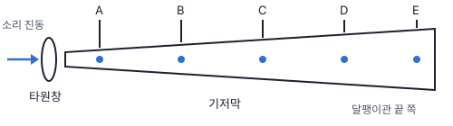
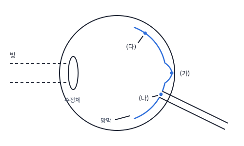
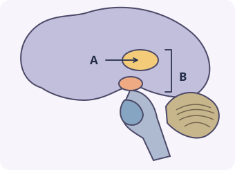
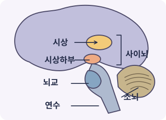

# 생명과학 복습 1117 문제설명

왼쪽 목차로 문항을 고르고, 오른쪽 문제를 보며 해설을 따라가요.

문제의 첫 줄부터 검산까지 설명해요.

**목차**

- [문항별 설명](#problems)
  - [P1. 시각중추가 있는 엽](#p1)
  - [P2. 감각수용기의 정의와 유형](#p2)
  - [P3. 밀착연접으로 막힌 뇌의 모세혈관](#p3)
  - [P4. 좌반구가 맡지 않는 능력](#p4)
  - [P5. 소리가 지나가는 귀 구조의 순서](#p5)
  - [P6. 청각 모세포가 있는 곳](#p6)
  - [P7. 뇌량이 잇는 것](#p7)
  - [P8. 뇌 구조와 기능 짝짓기](#p8)
  - [P9. 뇌와 말초를 잇고 반사를 조절하는 곳](#p9)
  - [P10. 자율신경계의 두 갈래](#p10)
  - [P11. 뇌 영상에서 (A) 행동 찾기](#p11)
  - [P12. 청각수용기는 어느 유형일까](#p12)
  - [P13. 기억과 관련된 회색질 부위](#p13)
  - [P14. 말초에서 중추로 들어오는 뉴런](#p14)
  - [P15. 간상세포의 광색소 이름](#p15)
  - [P16. 반사를 생물학적으로 설명하기](#p16)
  - [P17. 사람 눈에 없는 구조](#p17)
  - [P18. 몸의 위치를 느끼는 수용기](#p18)
  - [P19. 척수와 뇌가 이루는 것](#p19)
  - [P20. 광수용기 설명에서 틀린 것](#p20)
  - [P21. 말초신경계 설명 중 잘못된 것](#p21)
  - [P22. 색깔을 직접 만드는 것](#p22)
  - [P23. 가지를 치는 공기통로 D](#p23)
  - [P24. 공기가 마지막에 닿는 구조](#p24)
  - [P25. 기체 교환이 일어나는 혈관벽](#p25)
  - [P26. 호흡을 조절하는 중추의 위치](#p26)
  - [P27. 폐에서 산소가 혈액으로 가는 방식](#p27)
  - [P28. 공기가 지나가는 경로](#p28)
  - [P29. 산소를 혈액으로 옮기는 구조](#p29)
  - [P30. [변형] 말초신경계 진술 다시 가르기](#p30)
  - [P31. [변형] 중심오목에 몰린 세포](#p31)
  - [P32. [변형] 높은 음이 흔드는 기저막 위치](#p32)
  - [P33. [변형] 소리를 키우면 달라지는 것](#p33)
  - [P34. [변형] 희미한 별은 망막의 어디에](#p34)
  - [P35. [변형] 분리뇌 환자가 본 열쇠](#p35)
  - [P36. [변형] 해마가 손상되면 잃는 것](#p36)
  - [P37. [변형] medulla oblongata가 하는 일](#p37)
  - [P38. [변형] 식물인간과 뇌사의 차이](#p38)
  - [P39. [변형] 감각과 수용기의 짝](#p39)
  - [P40. [변형] 숨쉬기가 힘든 두 가지 이유](#p40)
  - [P41. [변형] 폐포로 들어온 산소는 어디에 쓰일까](#p41)
  - [P42. [변형] 압정을 밟았을 때 다리의 두 근육이 받는 신호](#p42)
  - [P43. [변형] 약물이 뇌로 들어가지 못하는 이유](#p43)
  - [P44. [변형] 정서와 기억이 함께 떠오르는 사례](#p44)
  - [P45. [변형] 뇌 단면에서 화살표와 괄호 읽기](#p45)

## 문항별 설명

### P1. 시각중추가 있는 엽

기출 12강 1 · [원 문제 보기](../%EB%B3%B5%EC%8A%B5%EB%AC%B8%EC%A0%9C_1117_Nervous_and_Sensory_Systems_and_Respiratory_and_Circulatory_Systems.html#p1)

시각중추는 어디에 위치하는가?

- (1) 시상하부
- (2) 두정엽
- (3) 전두엽
- (4) 후두엽
- (5) 측두엽

기출 원문 보기

기출 12강 합본 1번 (PDF 1쪽)

#### 문제가 묻는 것

눈으로 들어온 시각 정보를 받아 처리하는 중추(시각중추)가 뇌의 어느 부위에 있는지 골라요. 보기에는 대뇌의 네 엽과, 엽이 아닌 시상하부가 섞여 있어요.

#### 이 문제를 봤을 때 떠올릴 개념과 공식

‘시각중추’라는 말에서 대뇌 피질(cerebral cortex)의 자리별 역할을 떠올려요. 대뇌 피질은 위치에 따라 네 엽으로 나뉘고, 엽 이름의 한 글자가 위치를 알려 줘요. 전두엽(frontal, 이마 쪽)은 운동 영역과 계획성, 두정엽(parietal, 정수리 쪽)은 체성 감각 영역, 측두엽(temporal, 옆쪽)은 청각과 언어, 후두엽(occipital, 뒤통수 쪽)은 시각 정보가 들어오는 곳이에요.

판단 기준은 **그 부위에 시각 정보가 들어와 처리되는지**예요. 각 보기가 대뇌의 엽인지, 엽이라면 어떤 감각·기능을 맡는지 확인해요.

관련 정리노트: [대뇌의 네 엽과 언어 영역](../%EC%A0%95%EB%A6%AC%EB%85%B8%ED%8A%B8_1117_Nervous_and_Sensory_Systems_and_Respiratory_and_Circulatory_Systems.html#s3-lobes), [뇌 영상으로 본 활성 부위](../%EC%A0%95%EB%A6%AC%EB%85%B8%ED%8A%B8_1117_Nervous_and_Sensory_Systems_and_Respiratory_and_Circulatory_Systems.html#s3-imaging)

#### 왜 이렇게 푸는지 함께 따라가요

(1) 부적합해요. 시상하부는 대뇌의 엽이 아니라 시상 아래에 있는 구조로, 체온·나트륨 농도·식욕을 맞추는 항상성 조절 중추예요. 시각 정보가 들어오는 곳이 아니에요.

(2) 부적합해요. 두정엽은 정수리 쪽 엽으로, 몸의 촉각·압력 같은 체성 감각 정보가 들어오는 영역이 있어요. 시각이 아니에요.

(3) 부적합해요. 전두엽은 이마 쪽 엽으로, 운동 영역과 계획성·자아의식을 맡아요. 게이지 사례에서 전두엽이 손상되자 시력이 아니라 성격과 계획성이 바뀌었어요.

(4) 적합해요. 후두엽은 뒤통수 쪽 엽이고, 눈에서 온 시각 정보가 들어오는 곳이에요. 기준인 ‘시각 정보가 들어와 처리되는 부위’에 해당해요.

(5) 부적합해요. 측두엽은 옆쪽 엽으로, 귀에서 온 청각 정보와 언어를 맡아요. 감각을 처리하는 엽이지만 시각이 아니라 청각이에요.

따라서 답은 (4), 후두엽이에요.

#### 완성 답과 검산

답 (4). 다른 경로로 확인하면, 사람이 무언가를 볼 때 PET로 찍은 뇌 영상에서 가장 강하게 활성화되는 곳은 뇌의 뒤쪽이에요. 감각과 엽을 짝지으면 체성 감각–두정엽, 청각–측두엽, 시각–후두엽이 하나씩 대응하므로 시각에 남는 엽은 후두엽 하나뿐이에요.

**페이지 요약**

#### 판단 기준

어느 엽에 시각 정보가 들어오는지: 전두엽 운동·계획, 두정엽 체성 감각, 측두엽 청각·언어, 후두엽 시각.

#### 결론

시각중추는 뒤통수 쪽 후두엽. 시상하부는 엽이 아닌 항상성 중추. 답 (4).

---

### P2. 감각수용기의 정의와 유형

기출 12강 2 · [원 문제 보기](../%EB%B3%B5%EC%8A%B5%EB%AC%B8%EC%A0%9C_1117_Nervous_and_Sensory_Systems_and_Respiratory_and_Circulatory_Systems.html#p2)

감각수용기에 대한 설명으로 옳은 것은?

- (1) 보기 모두 잘못된 설명이다
- (2) 활동전위와 역치를 만드는 세포이다
- (3) 대부분의 동물에 공통적인 5가지 유형이 존재한다
- (4) 두 신경세포 사이의 시냅스를 넘어가는 화학물질이다
- (5) 중추신경계에 위치한다

기출 원문 보기

기출 12강 합본 2번 (PDF 1쪽)

#### 문제가 묻는 것

감각수용기를 바르게 설명한 진술 하나를 골라요. 보기 (1)은 ‘보기 모두 잘못’이라는 형태라서, 나머지 네 진술을 먼저 판정한 뒤 그 결과로 판단해요.

#### 이 문제를 봤을 때 떠올릴 개념과 공식

‘감각수용기’라는 말에서 감각의 첫 단계를 떠올려요. 감각수용기(sensory receptor)는 빛·소리·화학 물질·온도·통증 같은 몸 안팎의 자극을 받아들이는 세포·구조예요. 받아들이는 자극의 종류로 나누며, 대부분의 동물에 공통인 기본 유형이 다섯 가지예요. 기계 수용기(mechanoreceptor), 광수용기(photoreceptor), 화학 수용기(chemoreceptor), 온도 수용기(thermoreceptor), 통각 수용기(nociceptor)예요.

판단 기준은 두 가지예요. 첫째, 진술이 **자극을 받아들인다는 수용기의 정의와 분류**에 맞는지 봐요. 둘째, 진술이 수용기가 아닌 다른 개념(역치, 신경전달물질, 중추신경계)의 설명을 수용기에 붙였는지 확인해요. 위치는 수용기를 정의하는 기준이 아니에요.

관련 정리노트: [감각수용기의 다섯 종류](../%EC%A0%95%EB%A6%AC%EB%85%B8%ED%8A%B8_1117_Nervous_and_Sensory_Systems_and_Respiratory_and_Circulatory_Systems.html#s4-receptors)

#### 왜 이렇게 푸는지 함께 따라가요

(1) 틀린 진술이에요. 아래에서 (3)이 맞는 진술로 판정되므로 ‘보기 모두 잘못된 설명’이 성립하지 않아요.

(2) 틀린 진술이에요. 수용기를 정의하는 성질은 자극을 받아들이는 것이에요. 역치는 활동전위가 생기려면 막전위가 넘어야 하는 값이지, 어떤 세포가 만들어 내는 물질이나 구조가 아니에요. 그래서 ‘활동전위와 역치를 만드는 세포’는 수용기의 정의로 맞지 않아요.

(3) 맞는 진술이에요. 수용기를 받아들이는 자극으로 나누면 기계·광·화학·온도·통각 수용기의 다섯 가지가 되고, 이 다섯 유형이 대부분의 동물에 공통이에요. 기준인 분류와 정확히 일치해요.

(4) 틀린 진술이에요. 두 신경세포 사이의 시냅스를 건너가는 화학물질은 신경전달물질(neurotransmitter)이에요. 수용기는 자극을 받는 쪽이고, 시냅스를 건너는 물질이 아니에요.

(5) 틀린 진술이에요. 수용기는 대부분 눈의 망막, 귀, 혀, 피부 같은 감각기관에 있어요. 체온 조절 중추인 시상하부에 온도 수용기가 있기는 하지만, 그 예외 하나로 감각수용기 전체를 ‘중추신경계에 위치한다’고 설명할 수는 없어요.

맞는 진술은 (3) 하나예요. 따라서 답은 (3)이에요.

#### 완성 답과 검산

답 (3). 소거로 확인하면 (2)는 역치, (4)는 신경전달물질, (5)는 중추신경계의 위치를 수용기에 잘못 붙인 진술이고, (1)은 (3)이 맞아서 성립하지 않아요. 남는 것은 (3)뿐이에요. 다섯 유형을 하나씩 세면 청각 수용기는 기계, 망막은 광, 미뢰는 화학, 피부의 온도 감지는 온도, 조직 손상의 통증은 통각 수용기로 빠짐없이 배정돼요.

**페이지 요약**

#### 판단 기준

수용기 = 자극을 받아들이는 세포·구조. 자극 종류로 다섯 유형(기계·광·화학·온도·통각)으로 나눠요.

#### 결론

틀린 진술: (2) 역치, (4) 신경전달물질, (5) 중추신경계는 다른 개념. (3)이 맞으니 (1)도 틀려요. 답 (3).

---

### P3. 밀착연접으로 막힌 뇌의 모세혈관

기출 12강 6 · [원 문제 보기](../%EB%B3%B5%EC%8A%B5%EB%AC%B8%EC%A0%9C_1117_Nervous_and_Sensory_Systems_and_Respiratory_and_Circulatory_Systems.html#p3)

일반적인 상피세포와는 달리 뇌의 상피세포는 밀착연접에 의해 단단하게 붙어 있다. 따라서 혈액에 녹아 있는 대부분의 물질들은 뇌로 들어갈 수 없다. 이 구조를 무엇이라 하는가?

- (1) 대뇌겉질
- (2) 망상체
- (3) 혈액뇌장벽 (BBB)
- (4) 회색질
- (5) 대뇌변연계

기출 원문 보기

기출 12강 합본 6번 (PDF 1쪽)

#### 문제가 묻는 것

뇌 모세혈관의 상피세포가 밀착연접으로 단단히 붙어 혈액 속 물질 대부분이 뇌로 못 들어가게 하는 *구조*의 이름을 골라요. 뇌 조직의 이름이 아니라 혈관 벽이 하는 일을 가리키는 이름이에요.

#### 이 문제를 봤을 때 떠올릴 개념과 공식

‘밀착연접’과 ‘혈액에 녹아 있는 물질이 뇌로 들어갈 수 없다’에서 중추신경계를 지키는 방법을 떠올려요. 밀착연접(tight junction)은 이웃한 상피세포 사이를 단백질로 꿰매듯 이어 틈을 없앤 연결이에요. 일반 모세혈관은 상피세포가 느슨하게 붙어 작은 분자가 틈으로 지나가지만, 뇌 모세혈관은 밀착연접으로 틈이 없어서 세균·바이러스·독성 물질이 뇌로 넘어가지 못해요. 이 혈관 벽 구조를 혈액뇌장벽(blood-brain barrier, BBB)이라고 해요.

판단 기준은 보기가 **혈액과 뇌 사이에서 물질을 막는 혈관 벽 구조인지**, 아니면 뇌 조직·뇌 부위의 이름인지예요.

관련 정리노트: [중추신경계를 지키는 세 가지](../%EC%A0%95%EB%A6%AC%EB%85%B8%ED%8A%B8_1117_Nervous_and_Sensory_Systems_and_Respiratory_and_Circulatory_Systems.html#s1-protection)

#### 왜 이렇게 푸는지 함께 따라가요

(1) 부적합해요. 대뇌겉질(대뇌 피질)은 대뇌 표면에 세포가 늘어선 층으로, 고위 뇌기능을 맡는 뇌 조직이에요. 혈관 벽 구조가 아니에요.

(2) 부적합해요. 망상체는 뇌간 중심부에 뉴런이 그물처럼 얽힌 부위로, 들어오는 감각 신호 중 중요한 것만 골라내는 필터 역할을 해요. 혈액 속 물질을 막는 일과 관계없어요.

(3) 적합해요. 혈액뇌장벽(BBB)은 뇌 모세혈관 상피세포가 밀착연접으로 단단히 붙어 혈액 속 물질 대부분이 뇌로 들어가지 못하게 하는 구조예요. 지문의 세 조건(뇌의 상피세포, 밀착연접, 혈액 속 물질 차단)을 모두 충족해요.

(4) 부적합해요. 회색질은 세포체와 수상돌기가 모인 회색 부분의 이름으로, 축삭이 모인 백질과 구분하는 뇌·척수 조직의 이름이에요.

(5) 부적합해요. 대뇌변연계는 편도체·해마 등으로 이루어진 ‘감정의 뇌’예요. 감정과 기억에 관여하는 뇌 부위이지 혈관 벽이 아니에요.

따라서 답은 (3), 혈액뇌장벽(BBB)이에요.

#### 완성 답과 검산

답 (3). 보기를 ‘뇌 조직·부위인가, 혈관 벽 구조인가’로 다시 나누면 (1)·(2)·(4)·(5)는 모두 뇌 안의 조직이나 부위이고, 혈관 벽에 해당하는 것은 (3) 하나뿐이에요. 이름의 ‘혈액’과 ‘뇌’ 사이의 ‘장벽’이 지문의 ‘혈액 속 물질이 뇌로 못 간다’와 그대로 대응해요.

**페이지 요약**

#### 판단 기준

혈액과 뇌 사이에서 물질을 막는 혈관 벽 구조인지, 뇌 조직·부위의 이름인지.

#### 결론

뇌 모세혈관 상피세포의 밀착연접 = 혈액뇌장벽(BBB). 나머지는 뇌 조직·부위. 답 (3).

---

### P4. 좌반구가 맡지 않는 능력

기출 12강 7 · [원 문제 보기](../%EB%B3%B5%EC%8A%B5%EB%AC%B8%EC%A0%9C_1117_Nervous_and_Sensory_Systems_and_Respiratory_and_Circulatory_Systems.html#p4)

다음 중 대뇌의 좌측반구에서 조절하지 않는 능력은?

- (1) 추론 능력
- (2) 음악적 예술적 능력
- (3) 말하기 능력
- (4) 쓰기 능력
- (5) 수학문제 풀이 능력

기출 원문 보기

기출 12강 합본 7번 (PDF 1쪽)

#### 문제가 묻는 것

다섯 능력 가운데 대뇌의 **좌측 반구가 조절하지 않는 능력**을 골라요. 부정형이므로 각 능력이 좌반구 몫인지 우반구 몫인지 먼저 정한 뒤, 좌반구 몫이 아닌 것을 답으로 골라요.

#### 이 문제를 봤을 때 떠올릴 개념과 공식

‘좌측반구에서 조절’이라는 표현에서 좌우 반구의 기능 분담을 떠올려요. 어떤 기능이 한쪽 반구에 더 많이 분포하는 현상을 측화(lateralization)라고 해요. 좌반구(left hemisphere)에는 언어 중추가 있어 말하기·쓰기 같은 언어, 추론·논리·분석, 수학적 계산을 맡아요. 우반구(right hemisphere)는 음악적·예술적 능력, 직감적 사고, 공간 인지를 맡아요.

판단 기준은 **그 능력이 언어·논리·계산 쪽(좌반구)인지, 예술·공간·직관 쪽(우반구)인지**예요.

관련 정리노트: [좌우 반구와 뇌량](../%EC%A0%95%EB%A6%AC%EB%85%B8%ED%8A%B8_1117_Nervous_and_Sensory_Systems_and_Respiratory_and_Circulatory_Systems.html#s3-hemispheres)

#### 왜 이렇게 푸는지 함께 따라가요

(1) 좌반구가 조절하는 능력이에요. 추론은 논리·분석에 해당하므로 좌반구 몫이에요. 그래서 ‘조절하지 않는 능력’의 답이 아니에요.

(2) 좌반구가 조절하지 않는 능력이에요. 음악적·예술적 능력은 공간 인지, 직감적 사고와 함께 우반구 몫이에요. 질문 방향에 맞으므로 답으로 골라요.

(3) 좌반구가 조절하는 능력이에요. 말하기는 언어 기능이고 언어 중추는 좌반구에 있어요. 분리뇌 환자가 우반구로만 들어간 정보를 말로 하지 못한 것도 이 때문이에요.

(4) 좌반구가 조절하는 능력이에요. 쓰기도 말하기와 함께 언어 기능에 속하므로 좌반구 몫이에요.

(5) 좌반구가 조절하는 능력이에요. 수학문제 풀이는 수학적 계산에 해당하므로 좌반구 몫이에요.

네 능력은 좌반구가 조절하고, 우반구 몫인 것은 (2) 하나예요. 따라서 좌측 반구가 조절하지 않는 능력은 (2), 음악적 예술적 능력이에요.

#### 완성 답과 검산

답 (2). 보기를 두 묶음으로 세면 언어(말하기·쓰기)·논리(추론)·계산(수학)은 네 개가 모두 좌반구 쪽이고, 예술은 한 개로 우반구 쪽이에요. 질문 방향인 ‘좌반구가 아닌 쪽’에 남는 보기는 하나뿐이라 답이 하나로 정해져요.

**페이지 요약**

#### 판단 기준

좌반구: 언어(말하기·쓰기), 추론·논리, 수학 계산. 우반구: 음악·예술, 직관, 공간 인지.

#### 결론

부정형: 좌반구가 조절하지 않는 것 = 우반구 몫인 음악적·예술적 능력. 답 (2).

---

### P5. 소리가 지나가는 귀 구조의 순서

기출 12강 9 · [원 문제 보기](../%EB%B3%B5%EC%8A%B5%EB%AC%B8%EC%A0%9C_1117_Nervous_and_Sensory_Systems_and_Respiratory_and_Circulatory_Systems.html#p5)

척추동물의 귀에서 음파에 의해 활성화되는 구조의 순서는?

- (1) 타원창, 고막, 반규관, 골지힘줄기관, 망치뼈, 모루뼈, 등자뼈
- (2) 귓바퀴, 고막, 망치뼈, 모루뼈, 등자뼈, 타원창, 달팽이관
- (3) 기저막, 피개막, 이석, 통낭, 구형낭, 망치뼈, 달팽이
- (4) 유스타키오관, 타원창, 전정관, 티파니관, 달팽이관, 귓바퀴
- (5) 코르티기관, 망치뼈, 모루뼈, 등자뼈, 청각신경, 고막

기출 원문 보기

기출 12강 합본 9번 (PDF 1쪽)

#### 문제가 묻는 것

음파가 귀에 들어와 차례로 떨게 하는 구조들을 바른 순서로 나열한 보기를 골라요. 순서뿐 아니라 나열된 구조가 실제로 소리 진동이 지나가는 길에 있는지도 함께 봐야 해요.

#### 이 문제를 봤을 때 떠올릴 개념과 공식

‘음파에 의해 활성화되는 구조의 순서’에서 소리 진동이 바깥에서 안으로 전달되는 길을 떠올려요. 소리는 공기의 진동이에요. 바깥귀의 귓바퀴(pinna)가 음파를 모으고, 음파가 고막(eardrum)을 떨게 해요. 가운데귀의 작은 뼈 셋, 곧 망치뼈(malleus)·모루뼈(incus)·등자뼈(stapes)가 지렛대처럼 진동을 키워 타원창(oval window)을 떨게 해요. 그러면 속귀 달팽이관(cochlea) 안의 액체가 진동하고, 그 안의 기저막과 코르티 기관 모세포가 떨려요.

경로: 귓바퀴 → 고막 → 망치뼈 → 모루뼈 → 등자뼈 → 타원창 → 달팽이관

판단 기준은 두 가지예요. **공기에 닿는 바깥 구조에서 시작해 액체가 찬 안쪽으로 들어가는 순서인지**, 그리고 **나열된 구조가 모두 이 진동 경로 위에 있는지**를 확인해요. 모세포가 있는 코르티 기관과 기저막은 타원창보다 안쪽이라 맨 앞에 올 수 없어요.

관련 정리노트: [귀: 진동이 활동전위가 되기까지](../%EC%A0%95%EB%A6%AC%EB%85%B8%ED%8A%B8_1117_Nervous_and_Sensory_Systems_and_Respiratory_and_Circulatory_Systems.html#s4-hearing)

#### 왜 이렇게 푸는지 함께 따라가요

(1) 틀린 순서예요. 타원창은 세 뼈를 지난 뒤에 오는 막인데 고막보다 앞에 있고, 세 뼈 다음에 와야 할 타원창·달팽이관이 없어요. 반규관과 골지힘줄기관은 수업에서 다루지 않은 이름이고, 소리 진동이 고막에서 세 뼈로 넘어가는 경로에 끼어 있는 구조가 아니에요. 골지힘줄기관은 힘줄에 있는 수용기라 귀의 구조도 아니에요(수업 밖 보충).

(2) 맞는 순서예요. 귓바퀴(음파를 모음) → 고막(떨림) → 망치뼈·모루뼈·등자뼈(진동 증폭) → 타원창 → 달팽이관(액체 진동)으로, 바깥에서 안으로 들어가고 나열된 일곱 구조가 모두 진동 경로 위에 있어요.

(3) 틀린 순서예요. 기저막과 피개막(덮개막의 다른 이름)은 달팽이관 안 코르티 기관의 구조라서 망치뼈보다 먼저 떨릴 수 없어요. 이석·통낭·구형낭은 수업에서 다루지 않은 이름이고, 고막–세 뼈–타원창으로 이어지는 소리 전달 경로에 없어요.

(4) 틀린 순서예요. 음파를 처음 모으는 귓바퀴가 맨 끝에 있어 방향이 거꾸로이고, 고막과 세 뼈도 빠져 있어요. 유스타키오관은 수업에서 말하지 않았지만 강의노트에 나오는 관으로, 가운데귀와 목구멍을 이어 바깥 기압 변화로부터 고막을 보호해요. 소리 진동이 지나는 길이 아니에요. 전정관·티파니관도 수업에서 다루지 않은 이름이에요.

(5) 틀린 순서예요. 진동을 마지막에 감지하는 코르티기관이 맨 앞에, 진동을 처음 받는 고막이 맨 끝에 있어 순서가 뒤집혀 있어요. 등자뼈 다음에 와야 할 타원창·달팽이관도 빠졌어요.

바깥에서 안으로 가는 순서를 지키고 경로 밖 구조가 섞이지 않은 보기는 (2) 하나예요. 따라서 답은 (2)예요.

#### 완성 답과 검산

답 (2). 다른 방법으로 각 보기의 첫 구조만 보면, 음파를 처음 맞는 바깥 구조(귓바퀴 또는 고막)로 시작하는 보기는 (2)뿐이에요. (1)은 타원창, (3)은 기저막, (4)는 유스타키오관, (5)는 코르티기관으로 시작하므로 첫 칸에서 이미 탈락해요.

**페이지 요약**

#### 판단 기준

바깥 → 안 순서: 귓바퀴 → 고막 → 망치·모루·등자뼈 → 타원창 → 달팽이관. 경로 밖 구조가 섞이면 탈락.

#### 결론

바깥 구조로 시작해 순서를 지키는 보기는 (2)뿐. 답 (2).

---

### P6. 청각 모세포가 있는 곳

기출 12강 15 · [원 문제 보기](../%EB%B3%B5%EC%8A%B5%EB%AC%B8%EC%A0%9C_1117_Nervous_and_Sensory_Systems_and_Respiratory_and_Circulatory_Systems.html#p6)

청각수용기의 구조 중에서 속귀로 전달된 소리의 진동을 감지하는 모세포가 존재하는 곳은?

- (1) 타원창
- (2) 코르티기관
- (3) 유스타키오관
- (4) 고막
- (5) 반고리관

기출 원문 보기

기출 12강 합본 15번 (PDF 2쪽)

#### 문제가 묻는 것

속귀까지 전달된 소리의 진동을 감지하는 모세포가 들어 있는 구조를 골라요. ‘속귀’와 ‘소리의 진동을 감지’라는 두 조건을 모두 채워야 해요.

#### 이 문제를 봤을 때 떠올릴 개념과 공식

‘모세포’와 ‘소리의 진동’에서 청각 경로의 마지막 단계를 떠올려요. 진동은 고막 → 세 뼈 → 타원창을 거쳐 달팽이관 안의 액체를 떨게 해요. 달팽이관 안에는 기저막(basilar membrane), 모세포(hair cell), 덮개막(tectorial membrane)으로 이루어진 코르티 기관(organ of Corti)이 있어요. 기저막이 떨리면 그 위의 모세포도 떨리고, 모세포의 털이 덮개막에 닿아 구부러지면서 신호가 시작돼요. 모세포의 ‘모’는 털 모(毛) 자예요.

판단 기준은 보기가 **진동을 전달만 하는 구조인지, 진동을 감지하는 모세포를 품은 구조인지**예요. 위치(속귀 안인지)도 함께 확인해요.

관련 정리노트: [귀: 진동이 활동전위가 되기까지](../%EC%A0%95%EB%A6%AC%EB%85%B8%ED%8A%B8_1117_Nervous_and_Sensory_Systems_and_Respiratory_and_Circulatory_Systems.html#s4-hearing)

#### 왜 이렇게 푸는지 함께 따라가요

(1) 부적합해요. 타원창은 등자뼈의 진동을 달팽이관 속 액체로 넘겨주는 막이에요. 진동을 전달하는 구조이고, 모세포는 그보다 안쪽에 있어요.

(2) 적합해요. 코르티기관은 달팽이관 안에서 기저막·모세포·덮개막으로 이루어진 구조라서, 속귀에 있으면서 소리 진동을 감지하는 모세포를 품고 있어요. 두 조건을 모두 채워요.

(3) 부적합해요. 유스타키오관은 수업에서 말하지 않았지만 강의노트에 나오는 관으로, 가운데귀와 목구멍을 이어 바깥 기압 변화로 고막이 손상되지 않게 해요. 진동을 감지하는 곳이 아니에요.

(4) 부적합해요. 고막은 공기의 진동을 처음 받아 세 뼈로 넘기는 막이고, 속귀가 아니라 바깥귀와 가운데귀 사이에 있어요. 진동을 전달하는 쪽이에요.

(5) 부적합해요. 반고리관은 수업에서 다루지 않았어요. 속귀에 있는 구조이지만 소리가 아니라 평형 감각에 관여해요(수업 밖 보충). ‘소리의 진동’을 감지한다는 조건을 채우지 못해요.

따라서 답은 (2), 코르티기관이에요.

#### 완성 답과 검산

답 (2). 진동 경로 순서로 다시 놓으면 고막 → 타원창 → 달팽이관(코르티 기관)이고, 앞의 두 막은 진동을 넘겨주기만 해요. 감지는 경로의 맨 끝에서 일어나므로 끝에 있는 코르티 기관이 답이에요. 경로 밖에 있는 유스타키오관과 반고리관은 처음부터 후보가 아니에요.

**페이지 요약**

#### 판단 기준

진동을 전달만 하는 막(고막·타원창)인지, 속귀에서 진동을 감지하는 모세포를 품은 구조인지.

#### 결론

모세포는 달팽이관 안 코르티 기관(기저막·모세포·덮개막)에 있어요. 답 (2).

---

### P7. 뇌량이 잇는 것

기출 12강 16 · [원 문제 보기](../%EB%B3%B5%EC%8A%B5%EB%AC%B8%EC%A0%9C_1117_Nervous_and_Sensory_Systems_and_Respiratory_and_Circulatory_Systems.html#p7)

뇌량(corpus callosum)이 연결하는 것은?

- (1) 좌우 두 대뇌 반구
- (2) 뇌하수체와 시상하부
- (3) 척수의 회백질과 백질
- (4) 소뇌와 척수
- (5) 전두엽과 후두엽

기출 원문 보기

기출 12강 합본 16번 (PDF 2쪽)

#### 문제가 묻는 것

뇌량(corpus callosum)이 서로 이어 주는 두 대상을 골라요. 보기마다 짝지어진 두 구조가 뇌량으로 연결되는 관계인지 확인해요.

#### 이 문제를 봤을 때 떠올릴 개념과 공식

‘뇌량’에서 대뇌의 좌우 구분을 떠올려요. 대뇌는 좌반구와 우반구로 나뉘고, 두 반구 사이를 두꺼운 축삭 다발인 뇌량이 다리처럼 이어 정보를 주고받게 해요. 뇌량을 자른 분리뇌 환자는 우반구로만 들어간 정보를 언어 중추가 있는 좌반구로 넘기지 못해 말로 하지 못해요.

판단 기준은 짝지어진 두 구조가 **대뇌의 왼쪽 반구와 오른쪽 반구**인지예요. 같은 반구 안의 앞뒤, 대뇌 밖의 구조, 조직의 이름은 뇌량이 잇는 대상이 아니에요.

관련 정리노트: [좌우 반구와 뇌량](../%EC%A0%95%EB%A6%AC%EB%85%B8%ED%8A%B8_1117_Nervous_and_Sensory_Systems_and_Respiratory_and_Circulatory_Systems.html#s3-hemispheres)

#### 왜 이렇게 푸는지 함께 따라가요

(1) 맞아요. 좌우 두 대뇌 반구는 기준 그대로의 짝이에요. 뇌량은 두 반구 사이를 가로지르는 축삭 다발이에요.

(2) 틀려요. 뇌하수체는 시상하부 바로 밑에 툭 튀어나와 붙어 있는 구조예요. 두 구조는 위아래로 직접 붙어 있을 뿐, 좌우 반구가 아니므로 뇌량이 잇는 짝이 아니에요.

(3) 틀려요. 회백질(회색질)과 백질은 세포체 쪽과 축삭 쪽을 나눠 부르는 조직의 이름이에요. 두 반구가 아니라 한 단면 안의 두 조직이라 뇌량과 관계없어요.

(4) 틀려요. 소뇌와 척수는 대뇌 반구가 아니에요. 뇌량은 대뇌 안에서 두 반구를 잇는 구조라 이 짝에 해당하지 않아요.

(5) 틀려요. 전두엽과 후두엽은 한 반구 안의 앞쪽 엽과 뒤쪽 엽이에요. 뇌량은 앞뒤가 아니라 좌우를 이어요.

따라서 답은 (1), 좌우 두 대뇌 반구예요.

#### 완성 답과 검산

답 (1). 분리뇌 실험으로 거꾸로 확인하면, 뇌량을 잘랐을 때 생긴 문제는 오른쪽 반구의 정보가 왼쪽 반구로 넘어가지 못한 것이었어요. 끊긴 연결이 좌반구–우반구 사이였으므로 뇌량이 잇는 것은 두 반구예요.

**페이지 요약**

#### 판단 기준

짝이 대뇌의 왼쪽·오른쪽 반구인지. 같은 반구의 앞뒤, 대뇌 밖 구조, 조직 이름은 제외.

#### 결론

뇌량 = 좌우 두 대뇌 반구를 잇는 두꺼운 축삭 다발. 답 (1).

---

### P8. 뇌 구조와 기능 짝짓기

기출 12강 17 · [원 문제 보기](../%EB%B3%B5%EC%8A%B5%EB%AC%B8%EC%A0%9C_1117_Nervous_and_Sensory_Systems_and_Respiratory_and_Circulatory_Systems.html#p8)

구조와 기능이 올바르게 연결된 것은?

- (1) 후각엽 : 대뇌겉질의 운동중추를 조절
- (2) 시상하부 : 호르몬 분비, 일주기 리듬을 관장
- (3) 시상 : 대뇌변연계를 통한 감정신호의 전달
- (4) 편도체 : 감각정보를 대뇌로 전달
- (5) 기저핵 : 후각수용체로부터 나오는 신호를 대뇌겉질로 전달

기출 원문 보기

기출 12강 합본 17번 (PDF 2쪽)

#### 문제가 묻는 것

뇌 구조와 그 기능이 바르게 짝지어진 보기를 골라요. 보기마다 ‘구조 : 기능’의 짝이므로, 구조 이름을 보고 그 구조의 실제 기능을 떠올린 뒤 오른쪽 설명과 맞는지 비교해요.

#### 이 문제를 봤을 때 떠올릴 개념과 공식

보기에 나온 구조는 모두 뇌간 위쪽과 변연계 주변의 부위예요. 수업에서 정리한 기능은 다음과 같아요.

- 시상(thalamus): 온몸에서 올라온 감각 정보를 받아 대뇌 피질로 넘기는 중계소예요.
- 시상하부(hypothalamus): 체온·나트륨(Na⁺) 농도·식욕을 맞추는 항상성 조절 중추이고, 바로 밑에 뇌하수체가 매달려 있어요.
- 편도체(amygdala): 정서적 요소가 있는 경험 정보를 변연계로 보내는, 공포와 관련된 기억 부위예요.
- 후각엽(olfactory lobe): 후각 수용체에서 온 후각 정보가 들어오는 곳이에요.
- 기저핵(basal ganglia): 수업에서는 변연계에 속하는 부위로 이름만 들었어요.

판단 기준은 **오른쪽 기능이 왼쪽 구조의 기능인지, 다른 구조의 기능을 가져다 붙인 것인지**예요. 틀린 보기는 다른 보기의 기능과 서로 바뀌어 있는지도 확인해요.

관련 정리노트: [시상·시상하부와 망상체](../%EC%A0%95%EB%A6%AC%EB%85%B8%ED%8A%B8_1117_Nervous_and_Sensory_Systems_and_Respiratory_and_Circulatory_Systems.html#s2-thalamus), [변연계: 편도체와 해마](../%EC%A0%95%EB%A6%AC%EB%85%B8%ED%8A%B8_1117_Nervous_and_Sensory_Systems_and_Respiratory_and_Circulatory_Systems.html#s2-limbic)

#### 왜 이렇게 푸는지 함께 따라가요

(1) 틀린 짝이에요. 후각엽은 후각 정보가 들어오는 곳이에요. ‘대뇌겉질의 운동중추를 조절’은 후각과 관계없는 운동 기능이에요. 대뇌겉질이 정한 수의적 움직임을 다듬는 일은 기저핵의 기능으로 설명돼요(수업 밖 보충).

(2) 맞는 짝이에요. 시상하부는 항상성 조절 중추이고, 바로 밑의 뇌하수체와 이어져 호르몬 분비에 기여해요. 호르몬 분비는 수업에서 다루지 않은 보충 내용이고, 하루 단위의 수면 주기 같은 일주기 리듬(circadian rhythm)을 시상하부가 조절한다는 것은 수업·교재 밖 지식이에요. 그래도 두 기능 모두 시상하부의 기능이 맞아서, 다섯 짝 가운데 구조와 기능이 일치하는 것은 이 보기예요.

(3) 틀린 짝이에요. 시상의 기능은 감각 정보를 대뇌 피질로 중계하는 것이에요. 교수님이 시상을 변연계에 속한다고 말했고 시상의 일부를 변연계에 넣는 설명도 있지만, 소속과 기능은 따로 봐야 해요. 정서가 담긴 정보를 변연계로 보내는 일은 편도체의 기능이라, 이 설명은 시상의 기능으로 맞지 않아요.

(4) 틀린 짝이에요. ‘감각정보를 대뇌로 전달’은 시상의 기능이에요. 편도체는 공포와 관련된 정서 기억을 맡아요. (3)과 (4)는 기능이 서로 바뀌어 있어요.

(5) 틀린 짝이에요. ‘후각수용체로부터 나오는 신호를 대뇌겉질로 전달’은 후각엽의 기능이에요. 기저핵은 후각 신호를 받는 곳이 아니에요. (1)과 (5)도 기능이 서로 바뀌어 있어요.

구조와 기능이 바르게 연결된 보기는 (2) 하나예요. 따라서 답은 (2)예요.

#### 완성 답과 검산

답 (2). 기능을 제자리로 옮겨 보면 (3)의 감정 신호는 (4)의 편도체로, (4)의 감각 중계는 (3)의 시상으로, (5)의 후각 신호 전달은 (1)의 후각엽으로 가야 해요. 틀린 네 보기가 두 쌍의 맞바꿈으로 설명되고, 다른 보기와 바뀌지 않은 채 제 기능을 가진 보기는 (2)만 남아요.

#### 헷갈리기 쉬운 점

보기 (3)은 ‘시상은 변연계에 속한다’는 수업 내용 때문에 맞는 짝처럼 보여요. 어떤 무리에 속한다는 것과 그 구조가 맡는 기능은 다른 질문이에요. ‘구조 : 기능’ 문항에서는 그 구조의 대표 기능(시상 = 감각 중계)과 오른쪽 설명을 비교하고, 감정·공포 쪽 설명은 편도체에 붙여요.

**페이지 요약**

#### 판단 기준

시상 = 감각 중계, 시상하부 = 항상성·호르몬, 편도체 = 공포 기억, 후각엽 = 후각 정보 입력.

#### 결론

기능이 맞바뀐 짝: (1)↔(5), (3)↔(4). 시상하부 : 호르몬 분비·일주기 리듬만 맞아요(호르몬 분비·일주기 리듬은 수업 밖 보충). 답 (2).

---

### P9. 뇌와 말초를 잇고 반사를 조절하는 곳

기출 12강 19 · [원 문제 보기](../%EB%B3%B5%EC%8A%B5%EB%AC%B8%EC%A0%9C_1117_Nervous_and_Sensory_Systems_and_Respiratory_and_Circulatory_Systems.html#p9)

뇌와 말초신경계 사이의 신경신호를 전달하며, 운동반사를 조절하는 연합뉴런 신경망을 가지고 있는 중추신경계의 구조는?

- (1) 편도체
- (2) 시상하부
- (3) 척수
- (4) 뇌간
- (5) 망상체

기출 원문 보기

기출 12강 합본 19번 (PDF 2쪽)

#### 문제가 묻는 것

두 조건을 모두 갖춘 중추신경계 구조를 골라요. ① 뇌와 말초신경계 사이의 신호를 전달하고, ② 운동 반사를 조절하는 연합뉴런 신경망을 가져야 해요. 조건 하나만 맞는 보기는 답이 아니에요.

#### 이 문제를 봤을 때 떠올릴 개념과 공식

‘뇌와 말초신경계 사이’와 ‘운동반사’에서 척수(spinal cord)의 두 기능을 떠올려요. 중추신경계는 뇌와 척수예요. 척수는 몸에서 뇌로 올라가는 신호와 뇌에서 몸으로 내려오는 신호가 모두 지나가는 통로이고, 위급할 때는 뇌의 명령 없이 직접 근육에 명령하는 척수 반사(spinal reflex)를 일으켜요. 뜨거운 냄비에 손이 닿으면 감각뉴런 → 척수의 연합뉴런(interneuron) → 운동뉴런 순으로 신호가 가서 손을 떼는 회수 반사(withdrawal reflex)가 대표 예예요.

판단 기준은 **뇌와 말초 사이에 놓인 통로인지**와 **반사를 직접 조절하는 연합뉴런망이 있는지**를 함께 만족하는지예요.

관련 정리노트: [척수와 척수 반사](../%EC%A0%95%EB%A6%AC%EB%85%B8%ED%8A%B8_1117_Nervous_and_Sensory_Systems_and_Respiratory_and_Circulatory_Systems.html#s1-spinal-reflex), [뇌간: 중뇌·뇌교·연수](../%EC%A0%95%EB%A6%AC%EB%85%B8%ED%8A%B8_1117_Nervous_and_Sensory_Systems_and_Respiratory_and_Circulatory_Systems.html#s2-brainstem)

#### 왜 이렇게 푸는지 함께 따라가요

(1) 부적합해요. 편도체는 공포와 관련된 정서 기억을 맡는 변연계 부위예요. 뇌 안에 있어 뇌와 말초 사이의 통로가 아니고, 운동 반사를 조절하지도 않아요.

(2) 부적합해요. 시상하부는 체온·나트륨 농도·식욕을 맞추는 항상성 조절 중추예요. 뇌 안의 부위이고, 신호 통로나 운동 반사의 조절과는 관계없어요.

(3) 적합해요. 척수는 뇌와 말초신경 사이에서 올라가고 내려가는 신호를 모두 전달하고, 연합뉴런으로 회수 반사 같은 척수 반사를 직접 일으켜요. 두 조건을 모두 채워요.

(4) 부적합해요. 뇌간의 연수도 구토·삼키기 같은 반사를 맡아서 ‘반사’라는 조건만 보면 비슷해 보여요. 하지만 뇌간은 뇌의 일부라서 ‘뇌와 말초신경계 사이’에 놓인 통로라는 조건을 채우지 못해요.

(5) 부적합해요. 망상체는 뇌간 중심부에서 들어오는 감각 신호 가운데 중요한 것만 골라내는 필터예요. 운동 반사를 조절하는 연합뉴런망이 아니에요.

두 조건을 모두 만족하는 보기는 (3) 하나예요. 따라서 답은 (3), 척수예요.

#### 완성 답과 검산

답 (3). 위치로 다시 걸러 보면 (1) 편도체, (2) 시상하부, (4) 뇌간, (5) 망상체는 모두 뇌 안에 있어요. 중추신경계 가운데 뇌 밖에서 뇌와 몸 사이를 잇는 구조는 척수뿐이에요. 척수가 손상되면 거기 연결된 몸이 마비된다는 사실도, 척수가 뇌와 말초 사이의 통로라는 점을 뒷받침해요.

**페이지 요약**

#### 판단 기준

뇌와 말초 사이의 통로 + 운동 반사를 조절하는 연합뉴런망, 두 조건을 함께 만족하는지.

#### 결론

척수만 두 조건을 채워요. 연수(뇌간)도 반사를 맡지만 뇌의 일부예요. 답 (3).

---

### P10. 자율신경계의 두 갈래

기출 12강 20 · [원 문제 보기](../%EB%B3%B5%EC%8A%B5%EB%AC%B8%EC%A0%9C_1117_Nervous_and_Sensory_Systems_and_Respiratory_and_Circulatory_Systems.html#p10)

자율신경계는 다시 _________로 나눌 수 있다.

- (1) 교감신경계와 부교감신경계
- (2) 구심성계와 원심성계
- (3) 말초신경계와 중추신경계
- (4) 수의적 조절과 불수의적 조절
- (5) 골격근과 민무늬근의 연결

기출 원문 보기

기출 12강 합본 20번 (PDF 2쪽)

#### 문제가 묻는 것

자율신경계를 한 단계 더 나눈 두 갈래의 이름을 골라요. 보기에는 신경계를 나누는 여러 기준이 섞여 있으므로, 각 기준이 신경계의 어느 단계를 나누는지 구별해야 해요.

#### 이 문제를 봤을 때 떠올릴 개념과 공식

‘자율신경계는 다시 나눌 수 있다’에서 신경계의 단계별 구분을 떠올려요. 신경계는 다음 순서로 나뉘어요.

- 1단계: 신경계 전체 = 중추신경계(뇌·척수) + 말초신경계
- 2단계: 말초신경계 = 구심성(말초 → 중추) + 원심성(중추 → 근육·기관), 신호 방향으로 나눠요.
- 3단계: 원심성 부위 = 체성신경계(골격근, 수의적) + 자율신경계(심장·장 같은 기관, 불수의적), 의식적으로 조절할 수 있는지로 나눠요.
- 4단계: 자율신경계(autonomic) = 교감신경계(sympathetic, 위험할 때 우세) + 부교감신경계(parasympathetic, 휴식할 때 우세)이고, 두 계의 효과는 정반대예요.

판단 기준은 보기의 두 이름이 **자율신경계 안을 나눈 4단계인지, 다른 단계를 나누는 기준인지**예요.

관련 정리노트: [교감신경과 부교감신경](../%EC%A0%95%EB%A6%AC%EB%85%B8%ED%8A%B8_1117_Nervous_and_Sensory_Systems_and_Respiratory_and_Circulatory_Systems.html#s0-autonomic), [중추·말초, 구심·원심, 체성·자율](../%EC%A0%95%EB%A6%AC%EB%85%B8%ED%8A%B8_1117_Nervous_and_Sensory_Systems_and_Respiratory_and_Circulatory_Systems.html#s0-divisions)

#### 왜 이렇게 푸는지 함께 따라가요

(1) 적합해요. 교감신경계와 부교감신경계는 자율신경계를 다시 나눈 4단계의 두 갈래예요. 교감은 싸움 혹은 도망 반응에서 심박수·혈압을 올리고 소화를 억제하며, 부교감은 쉴 때 반대로 작용해요.

(2) 부적합해요. 구심성·원심성은 말초신경계를 신호 방향으로 나눈 2단계 기준이에요. 자율신경계는 그중 원심성 쪽에 들어 있으므로, 자율신경계 안을 나눈 이름이 될 수 없어요.

(3) 부적합해요. 중추·말초는 신경계 전체를 처음 나누는 1단계 기준이에요. 자율신경계는 말초신경계 안에 들어 있어요.

(4) 부적합해요. 수의적·불수의적 조절은 체성신경계(수의적)와 자율신경계(불수의적)를 가르는 3단계 기준이에요. 자율신경계는 전체가 불수의적이라 이 기준으로 다시 나뉘지 않아요.

(5) 부적합해요. 골격근은 체성신경계가 연결되는 근육이고, 자율신경계가 연결되는 쪽은 심장·장 같은 기관이에요. 근육의 종류를 나열한 것이지 자율신경계를 나눈 이름이 아니에요.

따라서 답은 (1), 교감신경계와 부교감신경계예요.

#### 완성 답과 검산

답 (1). 보기를 단계에 배정하면 (3)은 1단계, (2)는 2단계, (4)는 3단계 기준이고, (5)는 체성신경계의 특징(골격근)을 섞은 표현이에요. 4단계, 곧 자율신경계 안을 나눈 이름은 (1)만 남아요. 두 계가 같은 기관에 정반대 효과를 낸다는 점도 자율신경계 안에서 짝을 이루는 두 갈래라는 것을 보여 줘요.

**페이지 요약**

#### 판단 기준

신경계 구분 단계: 중추·말초 → 구심·원심 → 체성·자율 → 교감·부교감.

#### 결론

자율신경계 안을 나눈 이름은 교감·부교감뿐. 나머지는 다른 단계의 기준. 답 (1).

---

### P11. 뇌 영상에서 (A) 행동 찾기

기출 12강 21 · [원 문제 보기](../%EB%B3%B5%EC%8A%B5%EB%AC%B8%EC%A0%9C_1117_Nervous_and_Sensory_Systems_and_Respiratory_and_Circulatory_Systems.html#p11)

위 그림을 참고하였을 때 (A)에 들어갈 행동으로 가장 올바른 것은?

- (1) 냄새 구분
- (2) 일반 운동
- (3) 보기(시각)
- (4) 얼굴 인식
- (5) 맛의 판별

기출 원문 보기

기출 12강 합본 21번 (PDF 2쪽)

#### 무엇을 묻는지 읽어요

뇌 영상 네 장 중 이름이 지워진 (A) 영상이 어떤 행동을 하는 동안 찍은 것인지 골라요. 구할 것은 **(A)에서 가장 강하게 활성화된 위치**와 그 위치의 엽이 맡은 기능이에요.

#### 이 문제를 봤을 때 떠올릴 개념과 공식

‘뇌 영상’과 색 막대(최대~최저)에서 PET·fMRI를 떠올려요. 어떤 활동을 하면 그 활동에 쓰이는 부위의 뉴런이 활성화되어 포도당과 산소를 많이 쓰고, 영상은 소모가 많은 곳을 밝은 색(흰색·빨강)으로 표시해요. 그래서 밝은 곳 = 그 활동을 하는 동안 많이 일한 부위예요. [뇌 영상(PET·fMRI)과 활성 부위 읽기](../%EC%A0%95%EB%A6%AC%EB%85%B8%ED%8A%B8_1117_Nervous_and_Sensory_Systems_and_Respiratory_and_Circulatory_Systems.html#s3-imaging)

다음으로 위치를 엽의 기능에 맞춰요. 전두엽(frontal lobe, 이마 쪽)은 운동 영역·계획성, 두정엽(parietal lobe, 정수리 쪽)은 체성 감각, 측두엽(temporal lobe, 옆)은 청각·언어, 후두엽(occipital lobe, 뒤통수 쪽)은 시각을 맡아요. [대뇌의 네 엽과 기능](../%EC%A0%95%EB%A6%AC%EB%85%B8%ED%8A%B8_1117_Nervous_and_Sensory_Systems_and_Respiratory_and_Circulatory_Systems.html#s3-lobes)

판단 기준은 **(A)의 활성 위치가 어느 엽인지, 그리고 각 보기의 행동이 그 엽의 기능과 맞는지**예요.

#### 종이에 쓸 첫 줄

그림 아래 화살표 ‘뇌의 앞쪽’이 왼쪽을 가리키므로 왼쪽 끝이 이마, 오른쪽 끝이 뒤통수예요. (A) 영상에서 흰색·빨강으로 가장 밝은 점은 오른쪽 끝, 곧 뇌의 맨 뒤쪽에 있어요 → 후두엽.

#### 왜 이렇게 푸는지 함께 따라가요

(1) 냄새 구분은 답으로 부적합해요. 냄새는 화학 수용기가 받는 자극이고, 수업에서 후각 정보가 들어오는 곳으로 짝지은 부위는 변연계의 후각엽이에요. 뒤통수 끝의 후두엽 활성과 이어지는 행동이 아니에요.

(2) 일반 운동은 답으로 부적합해요. 운동 영역은 전두엽에 있으므로 운동을 했다면 뇌의 앞쪽이 밝아져야 해요. (A)는 앞쪽이 아니라 맨 뒤쪽이 밝아요.

(3) 보기(시각)는 답으로 적합해요. (A)의 가장 밝은 곳이 뒤통수 쪽 후두엽이고, 후두엽은 시각 정보가 들어오는 시각 중추예요. ‘활성 위치 = 후두엽 → 기능 = 시각’ 기준을 그대로 충족해요.

(4) 얼굴 인식은 답으로 부적합해요. 얼굴을 알아보려면 먼저 봐야 하지만, 수업에서 후두엽과 짝지은 기능은 ‘보기(시각)’ 그 자체예요. 얼굴 인식은 본 정보를 해석해 누구인지 알아내는 단계라 후두엽 하나의 기능으로 짝짓지 않아요(수업에서 다루지 않았지만, 교과서 그림은 얼굴 인식 영역을 측두엽 안쪽 겉질에 표시해요). 그림도 듣기·말하기·생각하기처럼 기본 행동끼리 비교하고 있어요.

(5) 맛의 판별은 답으로 부적합해요. 맛은 혀의 화학 수용기가 맛 분자를 감지하는 감각이고, 수업에서 후두엽과 짝지은 감각이 아니에요(수업에서 다루지 않았지만, 교과서는 미각 입력을 두정엽의 입·혀 부위가 받는다고 설명해요).

따라서 답은 (3) 보기(시각)예요.

#### 완성 답과 검산

답 (3). 나머지 세 영상과 비교하면, 듣기는 가운데 부분, 말하기는 앞쪽 위, 생각하기는 앞쪽 아래가 가장 밝아요. 네 영상 중 뒤쪽 끝(후두엽)이 가장 밝은 것은 (A)뿐이라, 시각이 남은 행동과 겹치지 않아요. 교과서에 실린 같은 PET 그림에서도 이 자리의 영상 이름이 ‘보기’로 적혀 있어요.

#### 이 문항에서 하기 쉬운 실수

화살표를 보지 않고 오른쪽을 앞이라고 생각하면 (A)의 활성 위치를 전두엽으로 잘못 읽어 (2) 일반 운동을 고르기 쉬워요. 뇌 영상 문제는 먼저 ‘뇌의 앞쪽’ 화살표로 앞뒤를 정하고, 그 반대편 끝이 후두엽이라는 점부터 확인해요.

**페이지 요약**

#### 판단 기준

밝은 곳 = 그 활동 중 포도당·산소를 많이 쓴 부위. 화살표로 앞뒤를 정하고 활성 위치를 엽 기능(전두엽 운동, 측두엽 청각·언어, 후두엽 시각)에 맞춰요.

#### 결론

(A)는 뇌 맨 뒤쪽 후두엽 활성 → 답 (3) 보기(시각).

---

### P12. 청각수용기는 어느 유형일까

기출 12강 22 · [원 문제 보기](../%EB%B3%B5%EC%8A%B5%EB%AC%B8%EC%A0%9C_1117_Nervous_and_Sensory_Systems_and_Respiratory_and_Circulatory_Systems.html#p12)

청각수용기는 5가지 기본적인 수용기 유형 중 어떤 수용기에 속하는가?

- (1) 온도수용기
- (2) 통각수용기
- (3) 광수용기
- (4) 기계수용기
- (5) 화학수용기

기출 원문 보기

기출 12강 합본 22번 (PDF 2쪽, 보기 (4)·(5)는 3쪽)

#### 무엇을 묻는지 읽어요

귀의 청각수용기가 다섯 가지 기본 수용기 유형 중 어디에 속하는지 골라요. 수용기를 나누는 기준은 위치가 아니라 **받아들이는 자극의 종류**이므로, 청각수용기가 실제로 받는 자극이 무엇인지 찾으면 돼요.

#### 이 문제를 봤을 때 떠올릴 개념과 공식

‘5가지 기본적인 수용기 유형’에서 감각수용기의 다섯 분류를 떠올려요. 기계 수용기(mechanoreceptor)는 떨림·누름·위치 같은 물리적 자극, 광수용기(photoreceptor)는 빛, 화학 수용기(chemoreceptor)는 맛·냄새 분자, 온도 수용기(thermoreceptor)는 차가움·뜨거움, 통각 수용기(nociceptor)는 조직 손상·유해 물질에 따른 통증을 받아요. [감각수용기의 다섯 종류](../%EC%A0%95%EB%A6%AC%EB%85%B8%ED%8A%B8_1117_Nervous_and_Sensory_Systems_and_Respiratory_and_Circulatory_Systems.html#s4-receptors)

청각수용기가 받는 자극은 귀의 전달 경로에서 확인해요. 소리 = 공기의 진동이고, 진동이 고막 → 세 개의 뼈 → 타원창 → 달팽이관 액체 → 기저막으로 넘어가 모세포(hair cell)의 털을 물리적으로 구부려요. 구부러짐이 털 속 기계적 개폐성 채널(mechanically gated channel)을 열어 신호가 시작돼요. [귀: 진동이 활동전위가 되기까지](../%EC%A0%95%EB%A6%AC%EB%85%B8%ED%8A%B8_1117_Nervous_and_Sensory_Systems_and_Respiratory_and_Circulatory_Systems.html#s4-hearing)

판단 기준은 **모세포를 직접 자극하는 것이 빛·화학 물질·열·손상이 아니라 물리적 떨림(구부러짐)인지**예요.

#### 왜 이렇게 푸는지 함께 따라가요

(1) 온도수용기는 답으로 부적합해요. 온도수용기는 차가움·뜨거움(열에너지의 흐름)을 받고 피부와 시상하부에 있어요. 모세포를 자극하는 것은 열이 아니라 떨림이에요.

(2) 통각수용기는 답으로 부적합해요. 통각수용기는 조직 손상이나 유해한 화학물질을 통증으로 받아요(예: 고추의 캡사이신). 소리를 듣는 것은 손상 자극이 아니에요.

(3) 광수용기는 답으로 부적합해요. 광수용기는 빛을 받는 망막의 간상세포·원추세포예요. 귀 안의 모세포에는 빛이 자극으로 닿지 않아요.

(4) 기계수용기는 답으로 적합해요. 진동이 기저막을 흔들어 모세포의 털을 구부리고, 그 물리적 변형이 기계적 개폐성 채널을 열어요. ‘물리적 자극(떨림)을 받는다’는 기계 수용기의 기준과 일치해요.

(5) 화학수용기는 답으로 부적합해요. 화학수용기는 맛 분자·냄새 분자 같은 화학 물질을 받아요(미각·후각). 소리는 화학 물질이 아니라 공기의 진동이에요.

따라서 답은 (4) 기계수용기예요.

#### 완성 답과 검산

답 (4). 다섯 유형에 자극 하나씩만 짝지으면 빛·화학 물질·열·손상이 각각 광·화학·온도·통각에 배정되고, 남는 물리적 떨림이 기계 수용기예요. 강의노트도 기계수용기를 압력·몸의 위치·가속 같은 물리적 에너지를 감지하는 수용기로 정리하면서 귀의 청각 수용기를 그 예로 들어 같은 결론이에요.

#### 이 문항에서 하기 쉬운 실수

모세포가 신경전달물질(화학 물질)을 분비한다는 말 때문에 화학수용기로 고르기 쉬워요. 수용기 유형은 ‘무엇을 내보내는지’가 아니라 ‘무엇을 받아들이는지’로 정해요. 모세포가 받아들이는 자극은 떨림이라 기계 수용기예요.

**페이지 요약**

#### 판단 기준

수용기는 받아들이는 자극으로 분류해요. 소리 = 공기 진동 → 기저막 → 모세포 털의 구부러짐(기계적 개폐성 채널).

#### 결론

물리적 떨림을 받으므로 답 (4) 기계수용기.

---

### P13. 기억과 관련된 회색질 부위

기출 12강 23 · [원 문제 보기](../%EB%B3%B5%EC%8A%B5%EB%AC%B8%EC%A0%9C_1117_Nervous_and_Sensory_Systems_and_Respiratory_and_Circulatory_Systems.html#p13)

대뇌겉질의 회색질 부위는 다양한 기능을 조절한다. 그 중, 정보를 전두엽으로 보내는 데 관여하며 특히 “기억”과 관련된 부위는?

- (1) 해마
- (2) 시상
- (3) 시상하부
- (4) 편도체
- (5) 기저핵

기출 원문 보기

기출 12강 합본 23번 (PDF 3쪽)

#### 무엇을 묻는지 읽어요

뇌의 회색질 부위 중 두 조건을 모두 갖춘 곳을 골라요. 조건은 **① 정보를 전두엽으로 보내는 데 관여하고 ② 특히 기억과 관련된** 부위예요.

#### 이 문제를 봤을 때 떠올릴 개념과 공식

‘기억’과 ‘전두엽으로 보냄’이라는 단서에서 변연계(limbic system)의 해마(hippocampus)를 떠올려요. 해마는 단기기억(몇 초~길어야 1시간)을 장기기억(며칠~평생)으로 전환해요. 해마가 손상되면 단기기억과 손상 전 장기기억은 그대로지만 새 장기기억을 만들지 못해요. 강의노트는 해마가 정보를 전두엽으로 보내는 데 관여한다고도 적어요. [변연계: 편도체와 해마](../%EC%A0%95%EB%A6%AC%EB%85%B8%ED%8A%B8_1117_Nervous_and_Sensory_Systems_and_Respiratory_and_Circulatory_Systems.html#s2-limbic)

보기에 함께 나온 부위의 대표 기능도 짝지어 둬요. 시상(thalamus)은 감각 정보를 대뇌로 중계, 시상하부(hypothalamus)는 체온·Na⁺ 농도·식욕 같은 항상성 조절, 편도체(amygdala)는 정서가 담긴 경험 정보, 곧 공포와 관련된 기억이에요. [시상·시상하부와 망상체](../%EC%A0%95%EB%A6%AC%EB%85%B8%ED%8A%B8_1117_Nervous_and_Sensory_Systems_and_Respiratory_and_Circulatory_Systems.html#s2-thalamus)

판단 기준은 **각 부위의 대표 기능이 ‘기억 형성(전환)’이고, ‘전두엽으로 정보를 보냄’이라는 설명까지 맞는지**예요.

#### 왜 이렇게 푸는지 함께 따라가요

(1) 해마는 답으로 적합해요. 단기기억을 장기기억으로 바꾸는 기억 부위이고, 정보를 전두엽으로 보내는 데 관여한다는 설명도 해마의 설명이에요. 두 조건을 모두 충족해요.

(2) 시상은 답으로 부적합해요. 시상의 주 기능은 감각 정보를 받아 대뇌로 전달하는 중계소예요. 기억을 만드는 부위로 배우지 않았어요.

(3) 시상하부는 답으로 부적합해요. 시상하부는 체온·Na⁺ 농도·식욕을 맞추는 항상성 중추이고 밑에 뇌하수체가 매달려 있어요. 기억 형성과는 관계가 멀어요.

(4) 편도체는 답으로 부적합해요. 편도체도 기억과 관련은 있지만 공포처럼 정서가 담긴 경험 정보를 다뤄요(편도체를 없앤 쥐는 고양이를 무서워하지 않았어요). ‘전두엽으로 정보를 보냄’과 ‘기억 전환’이라는 두 조건을 함께 갖춘 것은 해마예요.

(5) 기저핵은 답으로 부적합해요. 수업에서는 변연계를 이루는 부위로 이름만 나왔고, 기억 부위로 배우지 않았어요(수업에서 다루지 않았지만, 교과서는 기저핵이 수의적 움직임을 매끄럽게 다듬는 데 관여한다고 설명해요).

따라서 답은 (1) 해마예요.

#### 완성 답과 검산

답 (1). 조건 ②(기억)만 적용하면 해마와 편도체 두 후보가 남고, 조건 ①(전두엽으로 정보를 보냄)과 ‘기억 저장 자체’를 더하면 편도체(공포·정서 정보)가 빠져 해마 하나가 남아요. 교과서의 회색질 중추 그림도 해마를 ‘주로 기억과 관련’, 편도체를 ‘감정과 싸움-도망 반응’으로 구분해 같은 결과예요.

#### 이 문항에서 하기 쉬운 실수

‘기억’이라는 낱말만 보고 공포 기억의 편도체를 고르기 쉬워요. 편도체는 ‘무서웠던 경험’ 같은 정서 쪽, 해마는 ‘방금 배운 것을 오래 남기는 저장 버튼’ 쪽으로 구별해요.

**페이지 요약**

#### 판단 기준

기억 + 전두엽으로 정보 전달 = 해마(단기→장기 전환). 시상 = 감각 중계, 시상하부 = 항상성, 편도체 = 공포·정서 기억.

#### 결론

두 조건을 모두 갖춘 답 (1) 해마.

---

### P14. 말초에서 중추로 들어오는 뉴런

기출 12강 24 · [원 문제 보기](../%EB%B3%B5%EC%8A%B5%EB%AC%B8%EC%A0%9C_1117_Nervous_and_Sensory_Systems_and_Respiratory_and_Circulatory_Systems.html#p14)

다음 중 말초신경계(PNS)에서 중추신경계(central nervous system, CNS)로 신호를 전달하는 뉴런은 어느 것인가?

- (1) 원심성 뉴런
- (2) 운동뉴런
- (3) 구심성 뉴런
- (4) 억제성 뉴런
- (5) 연합뉴런

기출 원문 보기

기출 12강 합본 24번 (PDF 3쪽)

#### 무엇을 묻는지 읽어요

신호가 **말초신경계(PNS)에서 중추신경계(CNS)로 들어오는 방향**으로 전달하는 뉴런의 이름을 골라요. 비교할 것은 각 이름이 ‘신호 방향’으로 붙은 이름인지, 그렇다면 방향이 말초 → 중추인지예요.

#### 이 문제를 봤을 때 떠올릴 개념과 공식

‘말초에서 중추로’라는 방향 표현에서 구심성·원심성 구분을 떠올려요. 구심성(afferent)은 말초 → 중추로 들어오는 방향이고 감각뉴런(sensory neuron)이 여기에 해당해요. 원심성(efferent)은 중추 → 근육·기관으로 나가는 방향이고 운동뉴런(motor neuron)이 여기에 해당해요. 구심력의 ‘구심’이 중심으로 들어가는 방향이라고 기억해요. [중추·말초, 구심·원심, 체성·자율](../%EC%A0%95%EB%A6%AC%EB%85%B8%ED%8A%B8_1117_Nervous_and_Sensory_Systems_and_Respiratory_and_Circulatory_Systems.html#s0-divisions)

연합뉴런(interneuron)은 척수 같은 중추 안에서 감각뉴런과 운동뉴런을 이어 주는 뉴런이에요. 흥분성·억제성은 방향이 아니라 신호를 받는 세포에 주는 효과(활동전위를 더 잘 또는 덜 생기게 함)로 붙인 이름이에요. [흥분성 신호와 억제성 신호](../../1112/%EC%A0%95%EB%A6%AC%EB%85%B8%ED%8A%B8_1112_Nervous_and_Sensory_Systems.html#s3-excite-inhibit)

판단 기준은 **그 이름이 신호 방향을 뜻하는지, 그리고 그 방향이 말초 → 중추인지**예요.

#### 왜 이렇게 푸는지 함께 따라가요

(1) 원심성 뉴런은 답으로 부적합해요. 방향 이름이지만 중추 → 근육 등 효과기로 나가는 방향이라 묻는 방향과 반대예요.

(2) 운동뉴런은 답으로 부적합해요. 운동뉴런은 척수·뇌의 명령을 근육으로 전달하는 원심성 뉴런이라, 역시 중추에서 말초로 나가요.

(3) 구심성 뉴런은 답으로 적합해요. 감각 정보를 말초에서 중추신경계로 들여보내는 방향이고, 뜨거운 냄비를 만졌을 때 척수로 신호를 보내는 감각뉴런이 바로 구심성 뉴런이에요.

(4) 억제성 뉴런은 답으로 부적합해요. ‘억제성’은 신호를 받은 세포를 흥분시키지 않고 억누르는 효과로 붙인 이름이에요(척수 반사에서 이완할 근육 쪽이 받는 신호). 신호가 흐르는 방향으로 나눈 이름이 아니에요.

(5) 연합뉴런은 답으로 부적합해요. 연합뉴런은 척수·뇌 같은 중추 안에서 들어온 신호를 통합해 운동뉴런으로 넘겨줘요. 말초에서 중추로 신호를 들여오는 뉴런이 아니에요.

따라서 답은 (3) 구심성 뉴런이에요.

#### 완성 답과 검산

답 (3). 회수 반사의 순서 ‘감각뉴런(구심성) → 척수의 연합뉴런 → 운동뉴런(원심성)’에 보기를 놓아 보면, 말초에서 척수(중추)로 들어오는 첫 칸에 해당하는 것은 구심성 뉴런뿐이에요. 연합뉴런은 중추 안의 가운데 칸, 원심성·운동뉴런은 마지막 칸이고, 억제성은 이 순서의 칸 이름이 아니에요.

#### 이 문항에서 하기 쉬운 실수

‘원심’과 ‘구심’을 뒤바꾸기 쉬워요. 원심분리기처럼 바깥으로 나가면 원심성(운동), 구심력처럼 중심으로 들어오면 구심성(감각)이에요.

**페이지 요약**

#### 판단 기준

구심성 = 말초 → 중추(감각뉴런), 원심성 = 중추 → 근육(운동뉴런), 연합뉴런 = 중추 안 연결, 억제성 = 효과 이름.

#### 결론

말초에서 중추로 들어오는 방향 → 답 (3) 구심성 뉴런.

---

### P15. 간상세포의 광색소 이름

기출 12강 25 · [원 문제 보기](../%EB%B3%B5%EC%8A%B5%EB%AC%B8%EC%A0%9C_1117_Nervous_and_Sensory_Systems_and_Respiratory_and_Circulatory_Systems.html#p15)

광수용기에서 간상세포의 레티날-옵신 광색소를 무엇이라고 하는가?

- (1) 로돕신
- (2) 아마크린세포
- (3) 수평세포
- (4) 양극세포
- (5) 포톱신

기출 원문 보기

기출 12강 합본 25번 (PDF 3쪽)

#### 무엇을 묻는지 읽어요

간상세포가 가진 광색소, 곧 레티날과 옵신이 결합한 분자의 이름을 골라요. 보기에는 광색소 이름과 망막 세포 이름이 섞여 있으므로 **‘분자(광색소)인지 세포인지’와 ‘간상세포 것인지 원추세포 것인지’**를 함께 봐요.

#### 이 문제를 봤을 때 떠올릴 개념과 공식

‘레티날-옵신 광색소’에서 광색소(photopigment)를 떠올려요. 광색소는 광수용기의 막대·원뿔 부분 원반 막 속에서 빛을 흡수하는 분자이고, 단백질인 옵신(opsin)에 빛을 흡수하는 색소 레티날(retinal)이 붙어 있어요. 간상세포(rod)의 광색소는 로돕신(rhodopsin), 원추세포(cone)의 광색소는 세 종류의 포톱신(photopsin)이에요(교수님: “포토, 컬러 사진” → 색을 보는 원추세포). [간상세포와 원추세포의 광색소](../%EC%A0%95%EB%A6%AC%EB%85%B8%ED%8A%B8_1117_Nervous_and_Sensory_Systems_and_Respiratory_and_Circulatory_Systems.html#s5-photoreceptors)

수평세포·양극세포·아마크린세포는 광수용기 세포의 신호를 받아 주는 망막 세포예요. 분자가 아니라 세포예요. [망막의 배선](../%EC%A0%95%EB%A6%AC%EB%85%B8%ED%8A%B8_1117_Nervous_and_Sensory_Systems_and_Respiratory_and_Circulatory_Systems.html#s5-retina)

판단 기준은 **보기가 광색소(분자)이면서 간상세포에 있는 것인지**예요.

#### 왜 이렇게 푸는지 함께 따라가요

(1) 로돕신은 답으로 적합해요. 옵신에 레티날이 붙은 광색소이고, 간상세포에 있어요. 두 조건(광색소, 간상세포)을 모두 충족해요.

(2) 아마크린세포는 답으로 부적합해요. 광수용기의 신호를 받아 주는 망막 세포라서 광색소(분자)가 아니에요.

(3) 수평세포는 답으로 부적합해요. 이것도 광수용기의 신호를 받는 망막 세포이고 광색소가 아니에요.

(4) 양극세포는 답으로 부적합해요. 간상세포·원추세포 바로 아래 층에서 신호를 받는 세포이지 광색소가 아니에요.

(5) 포톱신은 답으로 부적합해요. 광색소이긴 하지만 원추세포의 광색소예요(세 종류가 있어 색을 구분해요). ‘간상세포’ 조건을 충족하지 못해요.

따라서 답은 (1) 로돕신이에요.

#### 완성 답과 검산

답 (1). 먼저 ‘분자인가’로 거르면 세포 이름 셋 (2)·(3)·(4)가 빠지고 로돕신과 포톱신이 남아요. 다음으로 ‘간상세포인가’로 거르면 원추세포의 포톱신이 빠져 로돕신 하나가 남아요. 강의노트와 교과서도 간상세포의 레티날-옵신 광색소를 로돕신이라고 불러 같은 결론이에요.

**페이지 요약**

#### 판단 기준

광색소 = 옵신(단백질) + 레티날(빛 흡수). 간상세포 = 로돕신, 원추세포 = 포톱신. 수평·양극·아마크린은 세포 이름.

#### 결론

광색소이면서 간상세포 것 → 답 (1) 로돕신.

---

### P16. 반사를 생물학적으로 설명하기

기출 12강 28 · [원 문제 보기](../%EB%B3%B5%EC%8A%B5%EB%AC%B8%EC%A0%9C_1117_Nervous_and_Sensory_Systems_and_Respiratory_and_Circulatory_Systems.html#p16)

무릎반사는 사람이 생각하지 않고도 자동적으로 무엇을 하는 것을 알 수 있다. 생물학적 용어로 반사를 가장 잘 설명한 것은?

- (1) 오직 어린 아이들만 반사를 수행할 수 있다
- (2) 신경계에서, 척수 반사를 수행하기 전 고위 뇌 부위가 관여한다는 것을 의미한다
- (3) 반사는 연합뉴런의 작용 없이 이루어진다
- (4) 신경계에서, 척수 반사의 수행은 뇌의 참여 없이도 가능하다는 것을 의미한다
- (5) 뇌로부터의 명령이 하달된 후에는 무릎 반사 시간이 더 짧아진다 ‘

기출 원문 보기

기출 12강 합본 28번 (PDF 3쪽)

#### 무엇을 묻는지 읽어요

무릎반사처럼 생각하지 않아도 자동으로 일어나는 반사를 생물학적으로 가장 잘 설명한 진술을 골라요. 각 진술이 **반사가 일어나는 경로(척수에서 처리되는지, 뇌가 먼저 필요한지)**와 맞는지 확인해요.

#### 이 문제를 봤을 때 떠올릴 개념과 공식

‘생각하지 않고도 자동적으로’에서 척수 반사(spinal reflex)를 떠올려요. 척수 반사는 위급할 때 뇌의 명령 없이 척수가 직접 근육에 명령하는 반응이에요. 뜨거운 냄비에서 손을 떼는 회수 반사(withdrawal reflex)는 감각뉴런(구심성) → 척수의 연합뉴런 → 운동뉴런(원심성) 순서로 일어나요. 일부 감각뉴런은 뇌로도 이어져 뇌는 뜨거움을 따로 인식하고, 통증은 손을 뗀 뒤에 느껴요. [척수와 척수 반사](../%EC%A0%95%EB%A6%AC%EB%85%B8%ED%8A%B8_1117_Nervous_and_Sensory_Systems_and_Respiratory_and_Circulatory_Systems.html#s1-spinal-reflex)

판단 기준은 세 가지예요. **① 반사를 수행하는 데 뇌의 참여가 필요한가(필요 없음) ② 반사 경로에 연합뉴런이 있는가(회수 반사는 거침) ③ 뇌의 신호는 반사보다 먼저인가 나중인가(나중에 인식)**.

#### 왜 이렇게 푸는지 함께 따라가요

(1) 틀려요. ‘오직 어린 아이들만’이라는 주장은 반사의 경로와 무관한 나이 조건이에요. 뜨거운 냄비에서 손을 떼는 회수 반사처럼 반사는 어른에게서도 늘 일어나는 신경계의 기본 기능이에요.

(2) 틀려요. ‘척수 반사를 수행하기 전 고위 뇌 부위가 관여’는 기준 ③의 순서를 뒤집었어요. 척수가 먼저 운동뉴런에 직접 명령해 반응이 일어나고, 뇌는 따로 신호를 받아 나중에 인식해요(통증은 손을 뗀 뒤에 느껴요).

(3) 틀려요. ‘연합뉴런의 작용 없이’는 기준 ②와 어긋나요. 회수 반사는 감각뉴런 → 척수의 연합뉴런 → 운동뉴런 순서로 일어나고, 강의노트도 척수 회백질에 반사에 관여하는 연합뉴런이 있다고 적어요. 연합뉴런을 거치는 반사가 있으므로 반사 전체에 대한 이 일반 진술은 틀려요.

(4) 맞아요. ‘척수 반사의 수행은 뇌의 참여 없이도 가능’은 기준 ①과 일치해요. 척수가 직접 근육에 명령하므로 생각하지 않아도 자동적이고 빨라요. 뇌로 가는 신호가 아예 없는 것은 아니고, 반응이 일어난 뒤 뇌가 따로 인식한다는 점과도 충돌하지 않아요.

(5) 틀려요. ‘뇌의 명령이 하달된 후 반사 시간이 짧아진다’는 반사가 뇌의 명령을 기다린다고 가정해요. 반사는 뇌의 명령 없이 척수에서 바로 일어나고, 뇌를 거친다면 경로가 길어질 뿐 더 빨라질 이유가 없어요.

맞는 진술은 (4) 하나이므로 답은 (4)예요.

#### 완성 답과 검산

답 (4). 회수 반사의 실제 순서 ‘감각뉴런 → 척수 연합뉴런 → 운동뉴런 → 손을 뗌 → (나중에) 뇌가 통증 인식’에 각 보기를 대 보면, 뇌가 먼저 오는 (2)·(5)는 순서와 어긋나고, 연합뉴런을 빼는 (3)은 둘째 칸과 어긋나요. 이 순서와 모순 없이 맞는 것은 ‘뇌 없이도 척수에서 수행된다’는 (4)뿐이에요. 교과서도 반사 움직임이 매우 빨라 뇌가 통증을 느끼기 전에 손이 떨어진다고 설명해요.

#### 이 문항에서 하기 쉬운 실수

‘반사여도 뇌로 신호가 간다’는 말을 ‘반사에 뇌가 필요하다’로 바꿔 읽어 (2)를 고르기 쉬워요. 뇌로 신호가 가는 것은 반응이 끝난 뒤 인식하기 위해서이고, 반응을 일으키는 명령은 척수가 내려요.

수업에서 다루지 않았지만, 무릎반사에는 감각뉴런이 다리를 펴는 근육의 운동뉴런에 직접 연결되는 경로가 있다고 알려져 있어요. 그래도 반대쪽 근육을 이완시키는 쪽은 억제성 연합뉴런을 거치므로, 무릎반사를 떠올려도 (3)의 ‘연합뉴런의 작용 없이’는 맞는 설명이 되지 않아요.

**페이지 요약**

#### 판단 기준

척수 반사 = 뇌의 명령 없이 척수가 직접 근육에 명령. 회수 반사는 감각뉴런 → 척수 연합뉴런 → 운동뉴런, 뇌는 나중에 인식.

#### 결론

(2)·(5)는 뇌가 먼저, (3)은 연합뉴런 누락, (1)은 나이 조건이라 틀림 → 답 (4).

---

### P17. 사람 눈에 없는 구조

기출 12강 29 · [원 문제 보기](../%EB%B3%B5%EC%8A%B5%EB%AC%B8%EC%A0%9C_1117_Nervous_and_Sensory_Systems_and_Respiratory_and_Circulatory_Systems.html#p17)

다음 중 인간의 눈에서 발견할 수 없는 구조는 무엇인가?

- (1) 홍채
- (2) 반사판
- (3) 수정체
- (4) 맹점
- (5) 각막

기출 원문 보기

기출 12강 합본 29번 (PDF 3쪽)

#### 무엇을 묻는지 읽어요

다섯 구조 중 **사람의 눈에서 발견할 수 없는 것**을 골라요. 부정형이므로 각 구조가 사람 눈에 있는지부터 판정하고, ‘없음’으로 판정된 보기를 답으로 골라요.

#### 이 문제를 봤을 때 떠올릴 개념과 공식

‘인간의 눈’과 구조 이름에서 수업에서 배운 사람 눈의 구조와 빛의 경로를 떠올려요. 빛은 각막(cornea, 맨 바깥 막) → 동공(pupil, 홍채 가운데 빈 곳) → 수정체(lens, 빛을 꺾는 렌즈) → 망막(retina)으로 가서 상이 맺혀요. 홍채(iris)는 동공 크기를 조절하고, 섬모체근(ciliary muscle)은 수정체 두께를 조절해요. [눈의 구조와 초점 맞추기](../%EC%A0%95%EB%A6%AC%EB%85%B8%ED%8A%B8_1117_Nervous_and_Sensory_Systems_and_Respiratory_and_Circulatory_Systems.html#s5-eye)

망막에는 시신경이 빠져나가는 맹점(blind spot)이 있어요. 사람은 신호를 받는 세포가 광수용기 앞에 있어 신경 다발이 망막을 뚫고 나가야 하므로 맹점이 생기고, 문어·오징어 눈에는 맹점이 없어요. [중심오목·맹점과 망막의 배선](../%EC%A0%95%EB%A6%AC%EB%85%B8%ED%8A%B8_1117_Nervous_and_Sensory_Systems_and_Respiratory_and_Circulatory_Systems.html#s5-retina)

판단 기준은 **그 구조가 수업에서 배운 사람 눈의 구조 목록(각막·홍채·동공·수정체·망막과 망막의 맹점)에 있는지**예요.

#### 왜 이렇게 푸는지 함께 따라가요

(1) 홍채는 사람 눈에 있어요. 눈동자 색을 띠고 동공 크기를 조절해 들어오는 빛의 양을 바꾸는 구조라 목록에 있어요. 그래서 답이 아니에요.

(2) 반사판은 사람 눈에 없어요. 수업에서 배운 사람 눈의 구조 목록에 없고, 나머지 넷이 모두 목록에 있으므로 ‘발견할 수 없는 구조’로 남는 것은 반사판이에요. 수업에서 다루지 않았지만, 반사판은 고양이 같은 일부 동물의 망막 뒤에서 빛을 되돌려 약한 빛에서도 잘 보게 하는 층이고 사람 눈에는 없어요. 그래서 답이에요.

(3) 수정체는 사람 눈에 있어요. 빛을 꺾어 망막에 상을 맺게 하는 렌즈이고, 섬모체근이 두께를 조절해 먼 곳은 얇게, 가까운 곳은 두껍게 만들어요. 답이 아니에요.

(4) 맹점은 사람 눈에 있어요. 시신경이 빠져나가는 자리에는 간상세포·원추세포가 없어 상이 맺혀도 보이지 않아요. 평소엔 두 눈이 있어 모르지만 한쪽 눈을 가리면 드러나요. 맹점이 없는 것은 문어·오징어 눈이에요. 답이 아니에요.

(5) 각막은 사람 눈에 있어요. 빛이 처음 들어오는 맨 바깥 막이에요. 답이 아니에요.

사람 눈에 없는 것은 (2) 하나이므로 답은 (2) 반사판이에요.

#### 완성 답과 검산

답 (2). 빛의 경로를 바깥에서 안으로 따라가며 보기를 지우면 각막 → 홍채(동공) → 수정체 → 망막(맹점)으로 (5)·(1)·(3)·(4)가 모두 한 번씩 지워지고 (2)만 남아요. 교과서의 사람 눈 구조 그림에도 각막·홍채·수정체·맹점은 표시되어 있지만 반사판은 없어요.

#### 이 문항에서 하기 쉬운 실수

‘맹점’이라는 이름이 결함처럼 들려 사람 눈에는 없다고 고르기 쉬워요. 맹점은 사람 눈에 실제로 있는 자리이고, 맹점이 없는 쪽은 문어·오징어예요.

**페이지 요약**

#### 판단 기준

사람 눈 = 각막 → 동공(홍채) → 수정체 → 망막, 망막에는 맹점이 있어요. 부정형이라 ‘없음’ 보기를 골라요.

#### 결론

네 구조는 사람 눈에 있고 반사판만 없음 → 답 (2) 반사판(일부 동물의 구조, 수업 밖).

---

### P18. 몸의 위치를 느끼는 수용기

기출 12강 30 · [원 문제 보기](../%EB%B3%B5%EC%8A%B5%EB%AC%B8%EC%A0%9C_1117_Nervous_and_Sensory_Systems_and_Respiratory_and_Circulatory_Systems.html#p18)

인간의 수용기 중에서 중추신경계가 몸의 균형을 유지하거나 손발의 위치를 감지하기 위해 사용하는 자극을 감지하는 것은?

- (1) 자기수용기
- (2) 고유수용기
- (3) 온도수용기
- (4) 전기수용기
- (5) 미각수용기

기출 원문 보기

기출 12강 합본 30번 (PDF 3쪽)

#### 무엇을 묻는지 읽어요

중추신경계가 **몸의 균형을 유지하고 손발의 위치를 알아내는 데 쓰는 자극**을 감지하는 사람의 수용기를 골라요. 각 수용기가 받는 자극이 ‘내 몸의 위치·자세’인지 확인해요.

#### 이 문제를 봤을 때 떠올릴 개념과 공식

‘균형’과 ‘손발의 위치’에서 고유 수용기(proprioceptor)를 떠올려요. 고유 수용기는 팔·발가락이 어디 있는지, 근육이 얼마나 수축했는지, 물건이 얼마나 무거운지를 느끼고, 이 정보로 몸의 자세와 균형을 잡아요. 다섯 기본 유형으로는 물리적 자극을 받는 기계 수용기에 속해요. [감각수용기의 다섯 종류와 고유 수용기](../%EC%A0%95%EB%A6%AC%EB%85%B8%ED%8A%B8_1117_Nervous_and_Sensory_Systems_and_Respiratory_and_Circulatory_Systems.html#s4-receptors)

수업에서는 이 밖에 동물이 가진 자기 수용기(magnetoreceptor)와 전기 수용기(electroreceptor)의 이름만 들었어요. 무엇을 느끼는지는 수업에서 다루지 않았지만, 이름 그대로 몸 밖 환경의 자기장·전기 신호를 느끼는 수용기예요.

판단 기준은 **그 수용기가 받는 자극이 몸 안의 위치·근육 상태인지**예요.

#### 왜 이렇게 푸는지 함께 따라가요

(1) 자기수용기는 답으로 부적합해요. 수업에서는 이름만 들었고, 교과서는 먼 거리를 이동하는 동물이 지구 자기장을 감지하는 수용기로 설명해요(수업 밖 보충). 받는 자극이 바깥의 자기장이라 손발 위치 감각이 아니에요.

(2) 고유수용기는 답으로 적합해요. 팔다리 위치·근육 수축 정도·무게를 느끼고, 중추신경계가 이 정보로 균형을 잡고 손발 위치를 알아요. 몸 안의 위치·근육 상태라는 기준을 그대로 충족해요.

(3) 온도수용기는 답으로 부적합해요. 차가움·뜨거움을 감지하고 피부와 시상하부에 있어요. 위치나 균형과는 관계없는 자극이에요.

(4) 전기수용기는 답으로 부적합해요. 수업에서는 이름만 들었고, 일부 동물이 주변의 전기 신호를 느끼는 수용기예요(수업 밖 보충). 손발 위치 감각과는 관계없어요.

(5) 미각수용기는 답으로 부적합해요. 맛 분자를 감지하는 화학 수용기예요. 위치·균형 정보를 주지 않아요.

따라서 답은 (2) 고유수용기예요.

#### 완성 답과 검산

답 (2). 받는 자극으로 보기를 나누면 자기장·전기장(바깥 환경, 일부 동물), 온도, 맛 분자로 넷이 지워지고, 몸 자체의 위치·근육 상태를 받는 것은 고유수용기 하나가 남아요. 교과서도 고유수용기를 중추신경계가 몸의 균형을 유지하거나 손발의 위치를 감지하는 데 쓰는 기계수용기로, 자기수용기는 비둘기·바다거북·꿀벌처럼 먼 거리를 이동하는 동물이 지구 자기장을 감지하는 수용기로 따로 설명해요.

#### 이 문항에서 하기 쉬운 실수

‘자기수용기’의 ‘자기’를 ‘자기 몸(自己)’으로 읽으면 위치 감각처럼 보여 헷갈려요. 다른 자료에서는 몸의 위치 감각을 ‘자기(自己) 수용 감각’이라고 부르기도 하지만, 교과서에서 자기수용기는 자기장(磁氣)을 느끼는 수용기로 설명돼요(수업에서는 이름만 나왔어요). 손발 위치·균형은 고유 수용기로 기억해요.

**페이지 요약**

#### 판단 기준

손발 위치·근육 상태·균형 = 고유 수용기(기계 수용기의 한 예). 자기·전기 수용기는 일부 동물이 바깥의 자기장·전기장을 느끼는 수용기예요.

#### 결론

답 (2) 고유수용기. ‘자기수용기’는 자기장(磁氣) 감지라 오답.

---

### P19. 척수와 뇌가 이루는 것

기출 12강 34 · [원 문제 보기](../%EB%B3%B5%EC%8A%B5%EB%AC%B8%EC%A0%9C_1117_Nervous_and_Sensory_Systems_and_Respiratory_and_Circulatory_Systems.html#p19)

다음 괄호 안에 알맞은 말을 고르시오. “척수와 뇌는 ( ) 를 구성한다.”

- (1) 체성신경계
- (2) 중추신경계
- (3) 자율신경계
- (4) 말초신경계
- (5) 교감신경계

기출 원문 보기

기출 12강 합본 34번 (PDF 4쪽)

#### 무엇을 묻는지 읽어요

“척수와 뇌는 ( )를 구성한다”의 빈칸에 들어갈 신경계 이름을 골라요. 보기 다섯 개가 신경계 구분도의 어느 칸인지 놓고, **뇌와 척수를 함께 묶는 칸**을 찾으면 돼요.

#### 이 문제를 봤을 때 떠올릴 개념과 공식

‘척수와 뇌’에서 신경계의 첫 구분을 떠올려요. 중추신경계(central nervous system, CNS) = 뇌 + 척수이고, 등으로 뻗은 척수도 중추에 속해요. 말초신경계(peripheral nervous system, PNS)는 뇌나 척수에서 온몸으로 뻗어 나가는 신경이에요. [중추·말초, 구심·원심, 체성·자율](../%EC%A0%95%EB%A6%AC%EB%85%B8%ED%8A%B8_1117_Nervous_and_Sensory_Systems_and_Respiratory_and_Circulatory_Systems.html#s0-divisions)

구분도는 아래로 내려가요. 말초신경계 → (방향) 구심성·원심성 → 원심성 부위는 (의식적 조절 여부) 체성신경계·자율신경계 → 자율신경계는 교감신경계·부교감신경계로 나뉘어요. [교감신경과 부교감신경](../%EC%A0%95%EB%A6%AC%EB%85%B8%ED%8A%B8_1117_Nervous_and_Sensory_Systems_and_Respiratory_and_Circulatory_Systems.html#s0-autonomic)

판단 기준은 **보기의 신경계가 뇌·척수 자체인지, 아니면 그 바깥으로 뻗은 말초신경계(또는 그 하위 구분)인지**예요.

#### 왜 이렇게 푸는지 함께 따라가요

(1) 체성신경계는 답으로 부적합해요. 말초신경계의 원심성 부분 중 골격근에 연결되어 수의적으로 몸을 움직이는 쪽이라, 뇌·척수 바깥의 말초 쪽 칸이에요.

(2) 중추신경계는 답으로 적합해요. 중추신경계의 정의가 ‘뇌 + 척수’이므로 빈칸에 그대로 들어가요.

(3) 자율신경계는 답으로 부적합해요. 말초신경계의 원심성 부분 중 심장·장처럼 의식적으로 조절할 수 없는 기관을 맡는 쪽이에요. 역시 말초 쪽 칸이에요.

(4) 말초신경계는 답으로 부적합해요. 뇌나 척수에서 온몸으로 뻗어 나가는 신경이라, 뇌와 척수 자체는 말초가 아니에요.

(5) 교감신경계는 답으로 부적합해요. 자율신경계의 한 갈래로 위험한 상황에서 심박수·혈압을 올리는 쪽이고, 말초신경계에 속해요.

따라서 답은 (2) 중추신경계예요.

#### 완성 답과 검산

답 (2). 구분도를 거꾸로 올라가 확인하면 교감신경계 → 자율신경계 → 원심성 부위 → 말초신경계로 (5)·(3)이 말초에 모이고, 체성신경계 (1)도 원심성 부위를 거쳐 말초에 모여요. 말초의 반대쪽 칸은 중추신경계 하나뿐이고, 강의노트도 중추신경계는 뇌와 척수로 구성된다고 적어 같은 결론이에요.

#### 이 문항에서 하기 쉬운 실수

척수가 등을 따라 길게 뻗어 있어 말초신경계로 착각하기 쉬워요. 척수 자체는 뼈(척추뼈) 속에 있는 중추이고, 척수에서 갈라져 몸으로 나가는 신경부터가 말초예요.

**페이지 요약**

#### 판단 기준

중추 = 뇌 + 척수. 말초 → 구심·원심 → 체성·자율 → 교감·부교감은 모두 말초 쪽 구분이에요.

#### 결론

답 (2) 중추신경계.

---

### P20. 광수용기 설명에서 틀린 것

기출 12강 38 · [원 문제 보기](../%EB%B3%B5%EC%8A%B5%EB%AC%B8%EC%A0%9C_1117_Nervous_and_Sensory_Systems_and_Respiratory_and_Circulatory_Systems.html#p20)

다음 광수용기에 대한 설명 중 틀린 것은 ?

- (1) 척추동물의 간상세포는 색깔을 감지하고 원추세포는 낮은 광도의 빛을 감지한다
- (2) 시선경다발이 지나가는 곳에 맹점이 존재한다
- (3) 포유류와 조류의 경우 원추세포가 망막의 좁은 부위에 밀집되어 있다
- (4) 인간 눈에서 수정체는 섬모체(모양체)와 섬모체근에 고정되어 있다
- (5) 섬모체근(모양체근)이 이완 하면 수정체는 멀리 있는 물체의 상을 망막에 맺게 한다

기출 원문 보기

기출 12강 합본 38번 (PDF 4쪽)

#### 무엇을 묻는지 읽어요

광수용기와 눈에 대한 진술 다섯 개 중 **틀린 것**을 골라요. 부정형이므로 각 진술의 참·거짓을 먼저 판정하고, 거짓인 진술을 답으로 골라요.

**문항 결함:** 보기 (2)의 ‘시선경다발’은 ‘시신경다발’의 오타예요. 뜻이 분명해 판정과 답에는 영향이 없어요.

#### 이 문제를 봤을 때 떠올릴 개념과 공식

‘간상세포·원추세포’와 ‘낮은 광도·색깔’에서 두 광수용기의 대비를 떠올려요. 간상세포(rod)는 1종류이고 약한 빛(낮은 광도)에도 반응하지만 색을 구분하지 못해요. 원추세포(cone)는 빨강·초록·파랑 세 종류가 있어 색을 구분하지만 강한 빛에만 반응해요. [간상세포와 원추세포](../%EC%A0%95%EB%A6%AC%EB%85%B8%ED%8A%B8_1117_Nervous_and_Sensory_Systems_and_Respiratory_and_Circulatory_Systems.html#s5-photoreceptors)

‘맹점·좁은 부위’에서 망막의 두 자리를 떠올려요. 중심오목(fovea, 강의노트의 중심와)은 망막의 좁은 부위로 원추세포가 몰려 있고, 맹점(blind spot)은 시신경 다발이 망막을 뚫고 나가는 자리라 광수용기가 없어요. [중심오목·맹점과 망막의 배선](../%EC%A0%95%EB%A6%AC%EB%85%B8%ED%8A%B8_1117_Nervous_and_Sensory_Systems_and_Respiratory_and_Circulatory_Systems.html#s5-retina)

‘수정체·섬모체근’에서 초점 맞추기를 떠올려요. 섬모체근(ciliary muscle, 강의노트의 모양체근)이 수축하면 수정체가 둥글고 두꺼워져 가까운 곳을, 이완하면 얇아져 먼 곳을 망막에 맺어요. [눈의 구조와 초점 맞추기](../%EC%A0%95%EB%A6%AC%EB%85%B8%ED%8A%B8_1117_Nervous_and_Sensory_Systems_and_Respiratory_and_Circulatory_Systems.html#s5-eye)

판단 기준은 **각 진술에서 세포·구조와 그 기능(빛의 세기, 색, 위치, 수축/이완 방향)이 바르게 짝지어졌는지**예요.

#### 왜 이렇게 푸는지 함께 따라가요

(1) 틀린 진술이에요. ‘간상세포는 색깔, 원추세포는 낮은 광도’는 두 세포의 기능을 뒤바꿨어요. 실제로는 간상세포가 낮은 광도(약한 빛)를 감지하고, 원추세포가 세 종류의 포톱신으로 색깔을 감지해요. 그래서 어두운 곳에서는 간상세포만 반응해 흑백으로 보여요.

(2) 맞는 진술이에요. ‘시선경다발’을 시신경다발로 읽으면, 시신경 다발이 망막을 뚫고 나가는 자리에는 간상세포·원추세포가 없어 상이 맺혀도 보이지 않는 맹점이 생겨요. 위치 짝이 바르게 되어 있어요.

(3) 맞는 진술이에요. 원추세포는 망막의 좁은 부위인 중심오목에 몰려 있고, 이곳에 상이 맺히면 밝은 물체가 가장 또렷하게 보여요. 교과서도 대낮 시각에 특화된 포유류와 조류에서 원추세포가 망막의 좁은 부분에 밀집한다고 설명해요.

(4) 맞는 진술이에요. 수업에서 다루지 않았지만, 수정체는 섬모체(모양체)라는 층에 가는 인대로 매달려 제자리에 고정되어 있고, 섬모체 안의 섬모체근이 수축·이완하며 수정체 두께를 바꿔요. 인대를 통해 매달린다는 세부가 생략되었을 뿐, 섬모체·섬모체근에 고정된다는 진술은 맞아요.

(5) 맞는 진술이에요. 섬모체근이 이완하면 인대가 수정체를 양쪽으로 당겨 얇아지고, 먼 곳에 있는 물체의 상이 망막에 맺혀요. 수업의 ‘먼 곳은 얇게, 가까운 곳은 두껍게’와 강의노트의 ‘수축하면 구형이 되어 가까운 곳’을 뒤집어 확인해도 같은 방향이에요.

틀린 진술은 (1) 하나이므로 틀린 것을 묻는 이 문제의 답은 (1)이에요.

#### 완성 답과 검산

답 (1). 판정 결과 틀린 진술은 (1) 하나, 맞는 진술은 (2)~(5) 넷이라 질문 방향에 맞는 보기가 정확히 하나예요. (1)의 두 세포 이름을 서로 바꾸면 ‘간상세포는 낮은 광도의 빛을 감지하고 원추세포는 색깔을 감지한다’가 되어 강의노트 문장과 그대로 일치하므로, (1)은 이름만 뒤바뀐 거짓 진술임이 다시 확인돼요. (2)의 ‘시선경’ 오타는 판정에 영향이 없어요.

#### 이 문항에서 하기 쉬운 실수

시험에서 ‘시선경’처럼 낯선 낱말을 보면 일부러 틀리게 만든 보기로 의심하기 쉬워요. 뜻이 분명한 오타는 바른 낱말(시신경)로 읽고 내용으로 판정한 뒤, 확실히 거짓인 (1)처럼 기능이 뒤바뀐 보기를 골라요. 또 (4)처럼 수업에서 다루지 않은 진술은 확실히 틀린 보기를 먼저 찾은 다음 판단하면 흔들리지 않아요.

**페이지 요약**

#### 판단 기준

간상 = 1종·약한 빛·색 구분 못 함, 원추 = 3종·강한 빛·색 구분. 원추는 중심오목 밀집, 맹점은 시신경이 나가는 자리. 섬모체근 이완 → 수정체 얇음 → 먼 곳.

#### 결론과 유보

간상·원추 기능이 뒤바뀐 (1)이 유일한 거짓 → 답 (1). (2)의 ‘시선경’은 시신경의 오타로 판정에 영향 없음.

---

### P21. 말초신경계 설명 중 잘못된 것

기출 12강 40 · [원 문제 보기](../%EB%B3%B5%EC%8A%B5%EB%AC%B8%EC%A0%9C_1117_Nervous_and_Sensory_Systems_and_Respiratory_and_Circulatory_Systems.html#p21)

말초신경계에 관한 설명으로 잘못된 것은?

- (1) 자율신경계는 서로 대립적으로 작용하는 교감신경계와 부교감신경으로 구성된다.
- (2) 말초신경계는 구심성뉴런과 원심성뉴런으로 구성된다.
- (3) 교감신경계는 심장박동수와 혈압을 증가시키며, 소화작용을 억제한다.
- (4) 체성신경계는 일차적으로 불수의적인 움직임을 조절한다.
- (5) 말초신경의 원심성 부위는 체성신경계와 자율신경계로 나뉜다.

기출 원문 보기

기출 12강 합본 40번 (PDF 4쪽)

#### 문제가 묻는 것

말초신경계(peripheral nervous system, PNS)에 관한 다섯 진술 가운데 **내용이 잘못된 진술** 하나를 골라요. 진술마다 어느 구분(구심·원심, 체성·자율, 교감·부교감)을 말하는지 먼저 찾고, 그 구분의 정의와 맞는지 확인해요.

#### 이 문제를 봤을 때 떠올릴 개념과 공식

‘말초신경계’라는 말에서 신경계를 나누는 나무 모양 구분을 떠올려요. 말초신경계는 신호 방향에 따라 구심성(afferent, 말초 → 중추로 들어옴)과 원심성(efferent, 중추 → 근육·기관으로 나감) 뉴런으로 나뉘어요. 원심성 부위는 **의식적으로 조절할 수 있는지**를 기준으로 다시 나뉘어요. 골격근에 연결되어 마음대로 움직이는 쪽이 체성신경계(somatic, 수의적), 심장·장처럼 마음대로 조절할 수 없는 기관을 맡는 쪽이 자율신경계(autonomic, 불수의적)예요.

자율신경계는 교감신경계(sympathetic)와 부교감신경계(parasympathetic)로 이루어지고 두 계의 효과는 정반대예요. 교감신경계는 위험할 때 심박수·혈압을 올리고 소화를 억제하고, 부교감신경계는 쉴 때 그 반대로 작용해요.

판단 기준은 각 진술이 가리키는 구분의 **나누는 기준과 특징**이 위 정의와 일치하는지예요.

관련 정리노트: [중추·말초, 구심·원심, 체성·자율](../%EC%A0%95%EB%A6%AC%EB%85%B8%ED%8A%B8_1117_Nervous_and_Sensory_Systems_and_Respiratory_and_Circulatory_Systems.html#s0-divisions), [교감신경과 부교감신경](../%EC%A0%95%EB%A6%AC%EB%85%B8%ED%8A%B8_1117_Nervous_and_Sensory_Systems_and_Respiratory_and_Circulatory_Systems.html#s0-autonomic)

#### 왜 이렇게 푸는지 함께 따라가요

(1) 내용이 맞아요. 자율신경계는 교감신경계와 부교감신경계 두 계로 이루어지고, 두 계의 효과가 정반대라는 것이 ‘서로 대립적으로 작용한다’와 일치해요. ‘부교감신경으로’는 원문 표기 그대로이고 부교감신경계를 뜻해요. 옳은 진술이라 답이 아니에요.

(2) 내용이 맞아요. 말초신경계를 신호 방향으로 나누면 중추로 들어오는 구심성 뉴런과 중추에서 나가는 원심성 뉴런이에요. 방향 구분의 정의와 같아요.

(3) 내용이 맞아요. 교감신경계는 싸움 혹은 도망 반응(fight or flight)에서 심박수와 혈압을 올리고, 당장 급하지 않은 소화는 억제해요. 세 효과의 방향이 모두 교감신경계의 특징과 일치해요.

(4) 내용이 틀려요. 체성신경계는 골격근에 연결되어 의식적으로 조절하는 **수의적** 움직임을 맡아요. 진술은 이것을 ‘불수의적’이라고 했는데, 불수의적 조절은 심장·장을 맡는 자율신경계의 특징이에요. 체성과 자율을 가르는 기준이 뒤바뀐 진술이라 잘못된 설명이에요.

(5) 내용이 맞아요. 체성·자율로 다시 나뉘는 것은 말초신경계 중 원심성 부위예요. 구심성 부위나 중추신경계가 나뉘는 것이 아니라는 점까지 정의와 일치해요.

내용이 틀린 진술은 (4) 하나이므로, 따라서 답은 (4)예요.

#### 완성 답과 검산

답 (4). 다섯 진술 중 정의와 어긋나는 것이 (4) 하나뿐이라 ‘잘못된 것’의 답이 하나로 정해져요. 교재도 체성신경계를 ‘일차적으로 의식할 수 있고 수의적인 몸의 움직임을 조절한다’고 설명해요. (4)는 이 문장에서 ‘수의적’만 ‘불수의적’으로 바꾼 꼴이라, ‘일차적으로’라는 말이 붙어 있어도 틀린 진술이에요.

**페이지 요약**

#### 판단 기준

원심성 부위는 의식적 조절 여부로 나뉘어요. 체성 = 골격근·수의적, 자율 = 심장·장·불수의적(교감·부교감, 효과 정반대).

#### 결론

(4)가 체성신경계를 불수의적이라고 해 틀렸고, 나머지는 모두 맞아요. 답 (4).

---

### P22. 색깔을 직접 만드는 것

기출 12강 41 · [원 문제 보기](../%EB%B3%B5%EC%8A%B5%EB%AC%B8%EC%A0%9C_1117_Nervous_and_Sensory_Systems_and_Respiratory_and_Circulatory_Systems.html#p22)

인간에 의해 감지되는 다양한 색깔은 직접적으로 다음 중 어느 것에 의해 일어나는가?

- (1) 원추세포에 있는 세 가지 종류의 포톱신 분자의 활성에 의해
- (2) 간상세포의 신경 충격이 측면슬형핵을 거쳐 전달되므로
- (3) 모든 광수용기가 빛에 의해 똑같이 자극되어
- (4) 시각교차에 의해 다른 대뇌 반구로 상이 전달되어
- (5) 아마크린세포에 의한 측면 억제에 의해

기출 원문 보기

기출 12강 합본 41번 (PDF 4쪽 문제, 5쪽 보기)

#### 문제가 묻는 것

사람이 여러 색깔을 느끼게 되는 **직접적인 원인** 하나를 골라요. ‘직접적으로’가 핵심 조건이라, 빛을 받아 색의 차이를 처음 만들어 내는 단계를 말하는 보기를 찾아요.

#### 이 문제를 봤을 때 떠올릴 개념과 공식

‘색깔’에서 망막의 두 광수용기(photoreceptor)를 비교해요. 간상세포(rod)는 한 종류뿐이고 약한 빛에도 반응하지만 색을 구분하지 못해 흑백으로 보게 해요. 원추세포(cone)는 빨강·초록·파랑 세 종류이고, 각 원추세포에는 광색소 포톱신(photopsin) 세 종류 중 하나가 들어 있어요.

세 종류의 원추세포는 같은 빛에도 서로 다른 정도로 반응해요. 이 반응 정도의 차이를 비교해 색을 구분하므로, 색 인식의 직접 원인은 **세 종류 포톱신의 활성**이에요. 종류가 하나뿐이거나 모두 똑같이 반응하면 비교할 차이가 생기지 않아요.

판단 기준은 보기가 **빛을 흡수해 색의 차이를 만드는 단계**를 말하는지, 아니면 색과 무관한 세포나 이미 만들어진 신호의 전달 경로를 말하는지예요.

관련 정리노트: [간상세포와 원추세포](../%EC%A0%95%EB%A6%AC%EB%85%B8%ED%8A%B8_1117_Nervous_and_Sensory_Systems_and_Respiratory_and_Circulatory_Systems.html#s5-photoreceptors), [망막의 배선과 아마크린세포](../%EC%A0%95%EB%A6%AC%EB%85%B8%ED%8A%B8_1117_Nervous_and_Sensory_Systems_and_Respiratory_and_Circulatory_Systems.html#s5-retina), [시야의 교차](../%EC%A0%95%EB%A6%AC%EB%85%B8%ED%8A%B8_1117_Nervous_and_Sensory_Systems_and_Respiratory_and_Circulatory_Systems.html#s3-hemispheres)

#### 왜 이렇게 푸는지 함께 따라가요

(1) 맞아요. 원추세포에 있는 세 종류 포톱신이 빛을 흡수해 활성화되는 정도가 서로 달라서 색의 차이가 생겨요. 빛을 흡수해 색 정보를 처음 만드는 단계라 ‘직접적인 원인’ 기준에 들어맞아요.

(2) 틀려요. 간상세포는 한 종류뿐이라 반응을 비교할 상대가 없어 색을 구분하지 못해요. 측면슬형핵은 수업에서 다루지 않았지만, 신호를 어느 경로로 보내든 출발한 신호에 색 정보가 없으므로 색의 원인이 될 수 없어요.

(3) 틀려요. 모든 광수용기가 똑같이 자극되면 세포 사이 반응 차이가 0이라 색을 가를 근거가 사라져요. 색은 종류가 다른 원추세포가 **서로 다르게** 반응해야 구분돼요.

(4) 틀려요. 수업에서 본 시야의 교차는 두 눈의 왼쪽 시야 정보를 우반구로, 오른쪽 시야 정보를 좌반구로 보내는 배선이에요(‘시각교차’라는 이름은 수업에서 쓰지 않았어요). 정보가 어느 반구로 가는지를 정할 뿐, 빛을 흡수해 색 차이를 만드는 단계가 아니에요.

(5) 틀려요. 아마크린세포(amacrine cell)는 광수용기 세포의 신호를 받아 주는 망막 세포 중 하나예요. 측면 억제는 수업에서 다루지 않았어요. 어느 쪽이든 원추세포가 만든 신호를 받은 뒤의 처리라서, 빛을 직접 흡수해 색 정보를 만드는 포톱신과 단계가 달라요.

따라서 답은 (1)이에요.

#### 완성 답과 검산

답 (1). 교재도 색깔의 구분이 원추세포 때문에 가능하고, 세 종류의 포톱신이 서로 다른(일부 겹치는) 파장 영역의 빛을 흡수해 최대 흡수 파장이 각각 파랑·초록·빨강 쪽에 있다고 설명해요. 다른 보기는 색이 없는 간상세포(2), 차이가 없는 자극(3), 이미 만들어진 신호의 배선·처리(4)(5)라서 ‘직접 원인’ 조건을 통과하는 보기는 (1) 하나예요.

**페이지 요약**

#### 판단 기준

색은 세 종류 원추세포(포톱신)가 같은 빛에 서로 다르게 반응하는 차이에서 생겨요. 간상세포는 1종이라 색을 모르고, 신호 전달·배선은 그 뒤 단계예요.

#### 결론

빛을 흡수해 색 차이를 만드는 단계는 (1)뿐이에요. 답 (1).

---

### P23. 가지를 치는 공기통로 D

기출 13강 18 · [원 문제 보기](../%EB%B3%B5%EC%8A%B5%EB%AC%B8%EC%A0%9C_1117_Nervous_and_Sensory_Systems_and_Respiratory_and_Circulatory_Systems.html#p23)

폐포에 이를 때까지 점점 더 가지를 치는 공기통로인 D 구조물을 무엇이라고 하는가?

- (1) 횡경막
- (2) 후두
- (3) 늑막근
- (4) 기관
- (5) 기관지

기출 원문 보기

기출 13강 합본 18번 (PDF 2쪽, 그림은 17·18번 공용)

#### 문제가 묻는 것

그림의 D가 가리키는 구조의 이름을 골라요. 발문이 D를 ‘폐포에 이를 때까지 점점 더 가지를 치는 공기통로’라고 설명하므로, 이 두 조건(공기통로, 폐 안에서 가지를 침)을 모두 만족하는 이름을 찾아요.

#### 이 문제를 봤을 때 떠올릴 개념과 공식

‘공기통로’와 ‘폐포’에서 공기가 지나가는 길을 순서대로 떠올려요. 코·입 → 인두(pharynx, 목구멍) → 후두(larynx) → 기관(trachea) → 기관지(bronchus) → 세기관지(bronchiole) → 폐포(alveolus)예요.

기관은 후두에서 가슴으로 내려가는 **한 줄기** 관이에요. 이것이 두 갈래로 나뉜 관이 기관지이고, 좌우 폐로 들어가 폐포에 이를 때까지 계속 가지를 쳐요. 가지(枝)처럼 나뉜다고 해서 기관지라는 이름이 붙었어요. 기관지가 더 갈라진 가는 관이 세기관지예요.

판단 기준은 두 단계예요. 먼저 보기가 **공기통로**인지(근육이면 탈락), 다음으로 그 통로가 **폐 안에서 가지를 치는 부분**인지 확인해요.

관련 정리노트: [공기의 길과 폐포](../%EC%A0%95%EB%A6%AC%EB%85%B8%ED%8A%B8_1117_Nervous_and_Sensory_Systems_and_Respiratory_and_Circulatory_Systems.html#s6-airway)

#### 왜 이렇게 푸는지 함께 따라가요

(1) 틀려요. 횡경막은 수업에서 다루지 않았어요. 교재 기준으로 흉강과 복강을 나누는 근육층이라 첫 단계인 ‘공기통로’ 조건에서 탈락해요.

(2) 틀려요. 후두는 공기통로이지만 인두 아래, 기관 위쪽의 목 부분에 있어요. 폐 안으로 들어가 가지를 치는 부분이 아니라 두 번째 조건에서 탈락해요.

(3) 틀려요. 늑막근은 수업에서 다루지 않았어요. 이름 끝의 ‘근’이 근육을 뜻하므로 공기통로가 아니에요.

(4) 틀려요. 기관은 공기통로이지만 후두에서 내려오는 한 줄기 관이고, 아직 갈라지기 전이에요. 가지를 치기 시작하는 것은 그다음 관이에요.

(5) 맞아요. 기관지는 기관이 두 갈래로 나뉜 뒤 폐 안에서 폐포에 이를 때까지 계속 가지를 치는 공기통로라 두 조건을 모두 만족해요. 그림의 D도 폐 안쪽의 관을 가리켜요.

따라서 답은 (5)예요.

#### 완성 답과 검산

답 (5). 이 그림은 교재의 사람 호흡계 그림과 같은 구성이고, 교재 그림에서 같은 위치를 가리키는 이름표가 ‘기관지: 폐조직의 폐포에 이를 때까지 점점 더 가지를 치는 공기통로’예요. 발문 문장과 그대로 일치해요. 소거로도 보기 중 공기통로는 후두·기관·기관지 셋이고, 그중 폐 안에서 가지를 치는 것은 기관지뿐이에요.

**페이지 요약**

#### 판단 기준

① 공기통로인가(근육 탈락) → ② 폐 안에서 가지를 치는가. 기관은 한 줄기, 기관지는 두 갈래로 나뉜 뒤 계속 가지를 쳐요.

#### 결론

두 조건을 모두 만족하는 것은 기관지예요. 답 (5).

---

### P24. 공기가 마지막에 닿는 구조

기출 13강 28 · [원 문제 보기](../%EB%B3%B5%EC%8A%B5%EB%AC%B8%EC%A0%9C_1117_Nervous_and_Sensory_Systems_and_Respiratory_and_Circulatory_Systems.html#p24)

포유동물이 호흡을 할 때, 공기는 최종적으로 조밀한 모세혈관 네트워크로 둘러싸인 이것에 도달하게 된다. 이것이 뜻하는 구조와 그 특성을 올바르게 짝 지은 것은?

- (1) 기관, 좁은 표면적
- (2) 세기관지, 넓은 표면적
- (3) 폐포, 넓은 표면적
- (4) 후두, 한쪽방향으로만 공기 흐름
- (5) 세기관지, 양압 호흡

기출 원문 보기

기출 13강 합본 28번 (PDF 4쪽)

#### 문제가 묻는 것

공기가 ‘최종적으로’ 도달하고 ‘조밀한 모세혈관 네트워크로 둘러싸인’ 구조와 그 특성을 짝 지은 보기를 골라요. 보기마다 **구조 칸과 특성 칸이 둘 다 맞아야** 정답이에요.

#### 이 문제를 봤을 때 떠올릴 개념과 공식

‘최종적으로 도달’에서 공기 길의 끝을 떠올려요. 공기는 인두 → 후두 → 기관 → 기관지 → 세기관지를 지나 맨 끝의 작은 공기 주머니인 폐포(alveolus)에 닿아요. 폐포는 모세혈관(capillary)이 그물처럼 덮고 있어서 여기서 기체를 주고받아요.

특성 칸은 기체 교환의 원리인 확산(diffusion)으로 판단해요. 확산 속도는 표면적에 비례하고 거리에 반비례하며 농도 차이에 비례해요. 기관지가 아주 여러 번 갈라진 끝마다 폐포가 포도송이처럼 달려 있어 폐포 전체의 표면적이 매우 넓고, 그래서 확산이 빨라요.

판단 기준은 구조 칸이 **폐포**인지, 특성 칸이 **폐포의 성질(넓은 표면적)**인지예요.

관련 정리노트: [공기의 길과 폐포](../%EC%A0%95%EB%A6%AC%EB%85%B8%ED%8A%B8_1117_Nervous_and_Sensory_Systems_and_Respiratory_and_Circulatory_Systems.html#s6-airway), [확산 속도의 세 요인](../%EC%A0%95%EB%A6%AC%EB%85%B8%ED%8A%B8_1117_Nervous_and_Sensory_Systems_and_Respiratory_and_Circulatory_Systems.html#s6-diffusion)

#### 왜 이렇게 푸는지 함께 따라가요

(1) 틀려요. 구조 칸의 기관은 후두 다음의 한 줄기 통로라 공기가 마지막에 닿는 곳이 아니에요. 특성 칸의 ‘좁은 표면적’도 확산을 느리게 하는 성질이라 기체 교환 장소의 특성과 반대예요.

(2) 틀려요. 특성 칸 ‘넓은 표면적’은 맞는 단어지만, 구조 칸의 세기관지는 폐포 바로 앞까지 공기를 나르는 가는 통로예요. 모세혈관에 둘러싸여 공기가 마지막에 닿는 곳은 그 끝의 폐포라서 짝이 맞지 않아요.

(3) 맞아요. 구조 칸의 폐포는 공기 길의 끝이고 모세혈관이 덮고 있어요. 특성 칸의 넓은 표면적도 수많은 폐포가 모여 생긴 폐포의 성질이에요. 두 칸 모두 기준과 일치해요.

(4) 틀려요. 구조 칸의 후두는 공기 길의 앞부분이라 최종 도달 지점이 아니에요. 공기 흐름 방향은 수업에서 다루지 않았어요. 교재는 한쪽 방향 공기 흐름을 조류 폐의 특징으로 소개하지만, 구조 칸에서 이미 탈락해요.

(5) 틀려요. 구조 칸의 세기관지는 (2)에서 본 것처럼 최종 도달 지점이 아니에요. 양압 호흡은 수업에서 다루지 않았어요. 강의노트는 양압 호흡을 양서류, 음압 호흡을 포유류의 방식으로 적어 특성 칸도 맞지 않아요.

따라서 답은 (3)이에요.

#### 완성 답과 검산

답 (3). 구조 칸만 먼저 걸러도 폐포가 들어 있는 보기는 (3) 하나뿐이라 답이 같아요. 교재도 폐포가 조밀한 모세혈관 네트워크로 둘러싸여 있고, 성인의 폐포를 한 층으로 펼치면 테니스장 넓이에 가까운 엄청난 면적을 제공한다고 설명해 특성 칸과도 일치해요.

**페이지 요약**

#### 판단 기준

구조 칸: 공기 길의 끝이고 모세혈관이 덮은 곳 = 폐포. 특성 칸: 확산이 빠르도록 표면적이 넓어요.

#### 결론

두 칸이 모두 맞는 짝은 ‘폐포, 넓은 표면적’이에요. 답 (3).

---

### P25. 기체 교환이 일어나는 혈관벽

기출 13강 30 · [원 문제 보기](../%EB%B3%B5%EC%8A%B5%EB%AC%B8%EC%A0%9C_1117_Nervous_and_Sensory_Systems_and_Respiratory_and_Circulatory_Systems.html#p25)

O2와 CO2 등의 실제 기체 교환은 다음 중 어떤 유형의 혈관벽을 통해 일어나는가?

- (1) 모세혈관
- (2) 세정맥
- (3) 정맥
- (4) 동맥
- (5) 세동맥

기출 원문 보기

기출 13강 합본 30번 (PDF 4쪽)

#### 문제가 묻는 것

O2와 CO2가 **실제로** 오가는 혈관벽이 어떤 혈관의 벽인지 골라요. 혈액을 나르는 길이 아니라, 기체가 벽을 지나 교환되는 자리를 찾는 문제예요.

#### 이 문제를 봤을 때 떠올릴 개념과 공식

‘기체 교환’에서 폐포와 그것을 그물처럼 덮은 모세혈관(capillary)을 떠올려요. O2는 폐포 안 공기 → 폐포 막 → 모세혈관 막 → 혈액으로, CO2는 그 반대로 확산(diffusion)해요. 기체가 실제로 지나가는 혈관벽은 폐포와 맞닿은 모세혈관의 벽이에요.

나머지 혈관 종류는 수업에서 다루지 않았어요. 교재 기준으로 혈액은 동맥 → 세동맥 → 모세혈관 → 세정맥 → 정맥 순서로 흐르고, 모세혈관 벽만 내피세포 한 겹으로 되어 있어 물질 교환 장소가 돼요.

판단 기준은 그 혈관이 **폐포와 맞닿아 기체가 확산해 지나가는 벽**을 가졌는지, 아니면 교환 전후의 혈액을 나르는 길인지예요.

관련 정리노트: [폐포를 덮은 모세혈관](../%EC%A0%95%EB%A6%AC%EB%85%B8%ED%8A%B8_1117_Nervous_and_Sensory_Systems_and_Respiratory_and_Circulatory_Systems.html#s6-airway), [기체 교환은 확산](../%EC%A0%95%EB%A6%AC%EB%85%B8%ED%8A%B8_1117_Nervous_and_Sensory_Systems_and_Respiratory_and_Circulatory_Systems.html#s6-diffusion)

#### 왜 이렇게 푸는지 함께 따라가요

(1) 맞아요. 모세혈관은 폐포를 그물처럼 덮고 있고, O2와 CO2가 모세혈관 막을 지나 확산해요. 교환이 실제로 일어나는 벽이라는 기준에 들어맞아요.

(2) 틀려요. 세정맥은 수업에서 다루지 않았어요. 교재 기준으로 모세혈관 망을 지난 혈액이 모여드는 가는 정맥(교재 이름 소정맥)이라, 교환을 이미 마친 혈액이 지나가는 길이에요.

(3) 틀려요. 정맥은 수업에서 다루지 않았어요. 교재 기준으로 혈액을 심장 쪽으로 되돌려 보내는 혈관이고, 벽이 여러 층이라 교환 장소가 아니에요.

(4) 틀려요. 동맥은 수업에서 다루지 않았어요. 교재 기준으로 심장에서 나온 혈액을 빠르게 나르는 혈관이고, 높은 압력을 견디도록 벽이 세 층으로 되어 있어 기체가 오가는 벽이 아니에요.

(5) 틀려요. 세동맥은 수업에서 다루지 않았어요. 교재 기준으로 동맥에서 갈라져 모세혈관 망으로 혈액을 보내는 가는 동맥(교재 이름 소동맥)이고, 교환은 그다음 모세혈관에서 일어나요.

따라서 답은 (1)이에요.

#### 완성 답과 검산

답 (1). 혈액이 흐르는 순서 동맥 → 세동맥 → 모세혈관 → 세정맥 → 정맥에서 (2)~(5)는 모두 모세혈관 앞이나 뒤의 운반 구간이에요. 교재도 모세혈관을 혈액과 간질액 사이의 교환 장소로 설명하고, 그 벽이 내피세포 한 겹이라고 적어 같은 결론이에요.

**페이지 요약**

#### 판단 기준

폐포를 덮은 모세혈관의 얇은 벽을 지나 O2·CO2가 확산해요. 동맥·세동맥·세정맥·정맥은 교환 전후의 혈액을 나르는 길이에요.

#### 결론

실제 기체 교환이 일어나는 혈관벽은 모세혈관이에요. 답 (1).

---

### P26. 호흡을 조절하는 중추의 위치

기출 13강 33 · [원 문제 보기](../%EB%B3%B5%EC%8A%B5%EB%AC%B8%EC%A0%9C_1117_Nervous_and_Sensory_Systems_and_Respiratory_and_Circulatory_Systems.html#p26)

호흡량과 호흡깊이를 조절하는 중추는 어디에 위치하는가?

- (1) 소뇌
- (2) 정맥
- (3) 뇌간
- (4) 시상
- (5) 대뇌

기출 원문 보기

기출 13강 합본 33번 (PDF 4쪽)

#### 문제가 묻는 것

호흡량과 호흡 깊이를 조절하는 중추가 **어느 부위에 속하는지** 골라요. 보기에는 뇌의 부위 넷과 혈관 하나가 섞여 있어요.

#### 이 문제를 봤을 때 떠올릴 개념과 공식

‘호흡을 조절하는 중추’에서 뇌간(뇌줄기, brain stem)을 떠올려요. 뇌간은 척수 바로 위에서 아래부터 연수(medulla oblongata)–뇌교(pons)–중뇌(midbrain)가 기둥처럼 이어진 부분이에요. 연수가 호흡 리듬을 만들고 호흡을 조절하며, 뇌교는 그 리듬을 부드럽게 다듬어요. 그래서 달리면 우리가 신경 쓰지 않아도 숨이 저절로 가빠져요.

문제는 연수·뇌교 같은 세부 이름이 아니라 ‘어디에 위치하는가’를 물어요. 소속을 물으면 뇌간, 뇌간 안의 부분을 물으면 연수로 답해요.

판단 기준은 보기가 **연수와 뇌교를 포함하는 부위**인지예요.

관련 정리노트: [뇌간: 중뇌·뇌교·연수](../%EC%A0%95%EB%A6%AC%EB%85%B8%ED%8A%B8_1117_Nervous_and_Sensory_Systems_and_Respiratory_and_Circulatory_Systems.html#s2-brainstem), [시상](../%EC%A0%95%EB%A6%AC%EB%85%B8%ED%8A%B8_1117_Nervous_and_Sensory_Systems_and_Respiratory_and_Circulatory_Systems.html#s2-thalamus), [대뇌의 네 엽](../%EC%A0%95%EB%A6%AC%EB%85%B8%ED%8A%B8_1117_Nervous_and_Sensory_Systems_and_Respiratory_and_Circulatory_Systems.html#s3-lobes)

#### 왜 이렇게 푸는지 함께 따라가요

(1) 틀려요. 소뇌는 수업에서 다루지 않았어요. 강의노트 기준으로 감각 입력을 통합해 몸의 움직임을 조절하는 부위이고, 연수·뇌교를 포함하지 않아요.

(2) 틀려요. 정맥은 혈액을 나르는 혈관이라 뇌의 부위가 아니에요. 신호를 받아 호흡을 조절하는 중추가 될 수 없어요.

(3) 맞아요. 뇌간은 연수·뇌교·중뇌로 이루어지므로 호흡 리듬을 만드는 연수와 리듬을 다듬는 뇌교를 모두 포함해요. 기준과 일치해요.

(4) 틀려요. 시상은 뇌간 위의 동그란 부분으로, 감각 정보를 받아 대뇌로 중계하는 곳이에요. 연수·뇌교가 속한 부위가 아니에요.

(5) 틀려요. 대뇌는 전두엽·두정엽·측두엽·후두엽으로 나뉘어 운동, 체성 감각, 언어·청각, 시각 같은 일을 맡아요. 호흡을 저절로 조절하는 연수·뇌교는 대뇌가 아니라 뇌간에 있어요.

따라서 답은 (3)이에요.

#### 완성 답과 검산

답 (3). 뇌사와 식물인간을 비교하면 다른 길로 확인돼요. 뇌간이 살아 있는 식물인간은 스스로 숨을 쉬지만, 뇌간까지 기능을 잃은 뇌사는 인공호흡기가 필요해요. 스스로 숨 쉬는지를 가르는 것이 뇌간이 살아 있느냐이므로 호흡 조절 중추는 뇌간에 있어요. 강의노트의 호흡 조절 부분(아직 수업 전)도 ‘호흡을 조절하는 중추는 뇌간에 위치하며 연수와 뇌교의 중추가 조절한다’고 적어 같은 답이에요.

**페이지 요약**

#### 판단 기준

호흡 리듬은 연수가 만들고 뇌교가 다듬어요. 연수·뇌교·중뇌를 묶은 부위가 뇌간이에요.

#### 결론

호흡량·호흡 깊이 조절 중추의 위치는 뇌간이에요. 답 (3).

---

### P27. 폐에서 산소가 혈액으로 가는 방식

기출 13강 37 · [원 문제 보기](../%EB%B3%B5%EC%8A%B5%EB%AC%B8%EC%A0%9C_1117_Nervous_and_Sensory_Systems_and_Respiratory_and_Circulatory_Systems.html#p27)

폐에서 공기로부터 혈액으로 산소가 전해지는 과정은 무엇을 통해 이루어지는가?

- (1) 단순확산
- (2) 삼투
- (3) 촉진확산
- (4) 능동수송
- (5) 어느 것도 아님

기출 원문 보기

기출 13강 합본 37번 (PDF 4쪽)

#### 문제가 묻는 것

폐에서 산소가 공기에서 혈액으로 옮겨 가는 **이동 방식의 이름**을 골라요. 보기는 막을 지나는 방식 네 가지와 ‘어느 것도 아님’이에요.

#### 이 문제를 봤을 때 떠올릴 개념과 공식

‘폐에서 공기로부터 혈액으로’에서 기체 교환의 원리인 확산(diffusion)을 떠올려요. 확산은 에너지를 쓰지 않고 농도가 높은 곳에서 낮은 곳으로 저절로 이동하는 것이에요. 폐포 안 공기의 O2 농도가 혈액보다 높아서 O2는 폐포 막과 모세혈관 막을 지나 혈액으로 확산해요.

막을 지나는 방식은 세 가지 질문으로 가려요. 농도기울기를 따르는가(따르면 에너지 불필요, 거스르면 능동수송), 수송 단백질이 필요한가(없으면 단순확산, 있으면 촉진확산), 옮겨지는 것이 물인가(물이면 삼투)예요. O2는 작고 비극성인 분자라 수송 단백질 없이 막의 지질 부분을 바로 지나가요. 네 방식의 구분은 수업에서 생략한 부분이라 앞 팩 정리노트의 보충 표 기준이에요.

판단 기준은 각 방식의 정의가 **O2가, 농도기울기를 따라, 단백질 없이** 지나가는 이동과 맞는지예요.

관련 정리노트: [기체 교환은 확산](../%EC%A0%95%EB%A6%AC%EB%85%B8%ED%8A%B8_1117_Nervous_and_Sensory_Systems_and_Respiratory_and_Circulatory_Systems.html#s6-diffusion), [막수송의 종류(보충 표)](../../0910/%EC%A0%95%EB%A6%AC%EB%85%B8%ED%8A%B8_0910_Cells_and_Cellular_Respiration.html#s2-atp-use)

#### 왜 이렇게 푸는지 함께 따라가요

(1) 맞아요. 단순확산은 수송 단백질 없이 막의 지질 부분을 직접 지나며, 농도기울기를 따라 에너지 없이 일어나요. O2가 농도가 높은 폐포 공기에서 낮은 혈액으로 막을 바로 지나는 이동과 세 질문의 답이 모두 일치해요.

(2) 틀려요. 삼투(osmosis)는 물 분자가 선택적 투과막을 지나가는 현상이에요. 여기서 옮겨지는 것은 물이 아니라 O2라서 맞지 않아요.

(3) 틀려요. 촉진확산도 농도기울기를 따르고 에너지가 필요 없지만, 특정 분자만 통과시키는 수송 단백질(채널 단백질, 운반체 단백질)을 거쳐야 해요. O2는 단백질 없이 막을 바로 지나가므로 ‘수송 단백질’ 질문에서 갈려요.

(4) 틀려요. 능동수송은 농도기울기를 거슬러 물질을 옮기며 ATP 같은 에너지가 필요해요. O2는 농도가 높은 쪽에서 낮은 쪽으로 저절로 이동하므로 방향과 에너지 모두 맞지 않아요.

(5) 틀려요. (1)의 단순확산이 이 이동을 정확히 설명하므로 ‘어느 것도 아님’은 성립하지 않아요.

따라서 답은 (1)이에요.

#### 완성 답과 검산

답 (1). 높은 산의 예로 다시 확인할 수 있어요. 대기 산소가 적어 공기와 혈액 사이 농도 차이가 줄면 숨쉬기가 힘들어지는데, 이동 속도가 농도 차이에 달려 있다는 것은 에너지로 밀어 넣는 능동수송이 아니라 확산이라는 표시예요. 강의노트도 호흡 표면의 기체 교환을 ‘농도 차에 의한 단순확산’이라고 적어 같은 답이에요.

**페이지 요약**

#### 판단 기준

농도기울기를 따르나(에너지) · 수송 단백질이 필요하나 · 옮기는 것이 물인가. O2는 기울기를 따라 단백질 없이 지질막을 바로 지나요.

#### 결론

폐에서 O2가 혈액으로 가는 방식은 단순확산이에요. 답 (1).

---

### P28. 공기가 지나가는 경로

기출 13강 40 · [원 문제 보기](../%EB%B3%B5%EC%8A%B5%EB%AC%B8%EC%A0%9C_1117_Nervous_and_Sensory_Systems_and_Respiratory_and_Circulatory_Systems.html#p28)

다음 중 공기가 호흡계를 지나가는 경로로 옳은 것은?

- (1) 인두 – 후두 – 기관 – 기관지 – 세기관지 – 폐포
- (2) 후두 – 인두 – 기관 – 세기관지 – 기관지 – 폐포
- (3) 인두 – 기관 – 후두 – 세기관지 – 기관지 – 폐포
- (4) 기관 – 인두 – 후두 – 세기관지 – 폐포 – 기관지
- (5) 인두 – 후두 – 기관 – 세기관지 – 폐포 – 기관지

기출 원문 보기

기출 13강 합본 40번 (PDF 5쪽)

#### 문제가 묻는 것

같은 여섯 구조(인두, 후두, 기관, 기관지, 세기관지, 폐포)를 서로 다른 순서로 늘어놓은 보기 가운데, 공기가 실제로 지나가는 **순서가 옳은 것**을 골라요.

#### 이 문제를 봤을 때 떠올릴 개념과 공식

‘공기가 호흡계를 지나가는 경로’에서 공기의 길을 떠올려요. 코·입 → 인두(pharynx, 목구멍) → 후두(larynx) → 기관(trachea) → 기관지(bronchus) → 세기관지(bronchiole) → 폐포(alveolus)예요. 굵은 한 줄기 관(기관)이 두 갈래(기관지)로 나뉘고, 더 가는 가지(세기관지)로 갈라진 끝마다 공기 주머니(폐포)가 달려 있어요.

판단 기준은 세 군데예요. ① 목구멍인 인두가 후두보다 먼저, ② 후두 다음이 기관, ③ 기관지 → 세기관지 → 폐포 순서로 가늘어지고 폐포가 맨 끝이어야 해요.

관련 정리노트: [공기의 길과 폐포](../%EC%A0%95%EB%A6%AC%EB%85%B8%ED%8A%B8_1117_Nervous_and_Sensory_Systems_and_Respiratory_and_Circulatory_Systems.html#s6-airway)

#### 왜 이렇게 푸는지 함께 따라가요

(1) 맞아요. 인두 – 후두 – 기관 – 기관지 – 세기관지 – 폐포는 ①, ②, ③을 모두 지켜요. 굵은 관에서 가는 가지로 가다가 끝의 폐포에서 멈춰요.

(2) 틀려요. 후두가 인두보다 앞에 있어 ①을 어기고, 세기관지가 기관지보다 앞에 있어 ③도 어겨요.

(3) 틀려요. 인두 다음에 후두가 아니라 기관이 오고 후두가 기관 뒤로 밀려 ②를 어겨요. 세기관지가 기관지보다 앞에 있어 ③도 어겨요.

(4) 틀려요. 인두가 후두보다 앞이라 ①은 지키지만, 기관이 인두보다 앞인 맨 처음에 오고 후두 다음에 기관이 아니라 세기관지가 와서 ②를 어기고, 폐포 뒤에 기관지가 붙어 폐포가 맨 끝이라는 ③도 어겨요.

(5) 틀려요. 인두 – 후두 – 기관까지는 ①·②를 지키지만, 기관지가 폐포 뒤 맨 끝으로 밀려나 ③을 어겨요. 세기관지는 기관지가 갈라져 생긴 더 가는 관이라 기관지보다 앞에 올 수 없어요.

따라서 답은 (1)이에요.

#### 완성 답과 검산

답 (1). 이름으로 다시 세어 보면, 세기관지는 ‘가는 기관지’라 기관지 뒤에 와야 하고 폐포는 공기가 마지막으로 닿는 주머니라 맨 끝이어야 해요. 이 두 조건만으로도 (2)~(5)가 모두 걸러지고 (1)만 남아요. 강의노트의 공기 경로(코 – 인두 – 후두 – 기관 – 기관지 – 세기관지 – 폐)와도 같은 순서예요.

**페이지 요약**

#### 판단 기준

인두(목구멍) → 후두 → 기관 → 기관지 → 세기관지 → 폐포. 세기관지는 기관지 뒤, 폐포는 맨 끝이에요.

#### 결론

세 기준을 모두 지키는 순서는 (1)뿐이에요. 답 (1).

---

### P29. 산소를 혈액으로 옮기는 구조

기출 13강 44 · [원 문제 보기](../%EB%B3%B5%EC%8A%B5%EB%AC%B8%EC%A0%9C_1117_Nervous_and_Sensory_Systems_and_Respiratory_and_Circulatory_Systems.html#p29)

대기의 O2 중 1/3을 인간의 혈액으로 이동시키게 하는 구조는?

- (1) 폐포
- (2) 기관지
- (3) 세기관지
- (4) 기관
- (5) 인두

기출 원문 보기

기출 13강 합본 44번 (PDF 5쪽)

#### 문제가 묻는 것

대기의 O2를 혈액으로 **넘겨 주는 구조**를 골라요. 발문의 ‘1/3’은 수업과 강의노트에 없는 수치라 판단에 쓰지 않고, ‘공기 속 산소를 혈액으로 옮기는 곳’이라는 조건으로 판단해요.

#### 이 문제를 봤을 때 떠올릴 개념과 공식

‘대기의 O2를 혈액으로’에서 기체 교환이 일어나는 곳을 떠올려요. 공기는 인두 → 후두 → 기관 → 기관지 → 세기관지를 지나 폐포(alveolus)에 닿아요. 폐포는 모세혈관이 그물처럼 덮고 있어서, O2가 폐포 안 공기 → 폐포 막 → 모세혈관 막 → 혈액으로 확산해요. 그 앞의 관들은 공기를 나를 뿐 혈액과 기체를 주고받지 않아요.

판단 기준은 그 구조가 **모세혈관과 맞닿아 기체를 교환하는 곳**인지, **공기만 나르는 통로**인지예요.

관련 정리노트: [공기의 길과 폐포](../%EC%A0%95%EB%A6%AC%EB%85%B8%ED%8A%B8_1117_Nervous_and_Sensory_Systems_and_Respiratory_and_Circulatory_Systems.html#s6-airway)

#### 왜 이렇게 푸는지 함께 따라가요

(1) 맞아요. 폐포는 모세혈관이 덮고 있어 공기 속 O2가 막을 지나 혈액으로 확산하는 곳이에요. 기체를 교환하는 곳이라는 기준에 들어맞아요.

(2) 틀려요. 기관지는 기관에서 두 갈래로 나뉘어 폐 안으로 공기를 나르며 가지를 치는 통로예요. 혈액과 기체를 주고받는 곳이 아니에요.

(3) 틀려요. 세기관지는 폐포 바로 앞까지 공기를 나르는 가는 통로예요. 교환은 그 끝에 달린 폐포에서 일어나요.

(4) 틀려요. 기관은 후두에서 가슴으로 내려가는 한 줄기 통로예요.

(5) 틀려요. 인두는 목구멍으로, 공기 길의 입구 쪽 통로예요.

따라서 답은 (1)이에요.

#### 완성 답과 검산

답 (1). 보기 다섯을 공기 길 순서로 놓으면 인두 → 기관 → 기관지 → 세기관지 → 폐포이고, 앞의 넷은 모두 폐포까지 공기를 나르는 통로예요. 모세혈관과 만나는 끝 지점은 폐포 하나뿐이라, 1/3이라는 수치를 쓰지 않아도 답이 하나로 정해져요.

**페이지 요약**

#### 판단 기준

모세혈관과 맞닿아 O2를 혈액으로 확산시키는 곳은 공기 길의 끝인 폐포예요. 인두·기관·기관지·세기관지는 공기만 나르는 통로예요. 발문의 ‘1/3’은 판단에 쓰지 않아요.

#### 결론

대기 O2를 혈액으로 옮기는 구조는 폐포예요. 답 (1).

---

### P30. [변형] 말초신경계 진술 다시 가르기

생성 변형 s0-autonomic · [원 문제 보기](../%EB%B3%B5%EC%8A%B5%EB%AC%B8%EC%A0%9C_1117_Nervous_and_Sensory_Systems_and_Respiratory_and_Circulatory_Systems.html#p30)

말초신경계에 관한 설명으로 잘못된 것은?

- (1) 체성신경계는 골격근에 연결되어 의식적으로 조절된다.
- (2) 구심성 뉴런은 감각 정보를 중추신경계 쪽으로 들여보낸다.
- (3) 교감신경계가 활성화되면 소화 작용이 촉진된다.
- (4) 부교감신경계는 휴식할 때 심박수와 혈압을 낮춘다.
- (5) 자율신경계는 심장·장처럼 의식적으로 조절할 수 없는 기관을 조절한다.

기출 원문 보기

기출 12강 40번 발문에 정답을 바꾼 생성 변형이에요. 다루는 혼동: 교감·부교감의 효과 방향. 근거 토픽: 교감신경과 부교감신경(s0-autonomic).

#### 문제가 묻는 것

말초신경계에 관한 다섯 진술 가운데 **내용이 잘못된 진술** 하나를 골라요. 특히 교감·부교감 진술은 상황(위험/휴식)과 효과의 방향(증가/감소, 촉진/억제)이 맞게 짝 지어졌는지 확인해요.

#### 이 문제를 봤을 때 떠올릴 개념과 공식

‘말초신경계’에서 신경계의 구분을 떠올려요. 신호 방향으로는 구심성(afferent, 감각 정보를 중추로 들여보냄)과 원심성(efferent)으로 나뉘고, 원심성 부위는 의식적 조절 여부로 체성신경계(골격근, 수의적)와 자율신경계(심장·장, 불수의적)로 나뉘어요.

자율신경계의 교감신경계(sympathetic)와 부교감신경계(parasympathetic)는 효과가 정반대예요. 교감신경계는 위험할 때(싸움 혹은 도망 반응) 심박수·혈압을 올리고 근육에 에너지를 몰아주느라 급하지 않은 소화를 **억제**해요. 부교감신경계는 휴식할 때 심박수·혈압을 낮추고 소화를 **촉진**해요.

판단 기준은 각 진술이 말하는 신경계의 연결 대상·방향·효과가 위 정의와 일치하는지예요.

관련 정리노트: [교감신경과 부교감신경](../%EC%A0%95%EB%A6%AC%EB%85%B8%ED%8A%B8_1117_Nervous_and_Sensory_Systems_and_Respiratory_and_Circulatory_Systems.html#s0-autonomic), [중추·말초, 구심·원심, 체성·자율](../%EC%A0%95%EB%A6%AC%EB%85%B8%ED%8A%B8_1117_Nervous_and_Sensory_Systems_and_Respiratory_and_Circulatory_Systems.html#s0-divisions)

#### 왜 이렇게 푸는지 함께 따라가요

(1) 내용이 맞아요. 체성신경계는 골격근에 연결되어 의식적으로 조절하는 수의적 신경계예요. 연결 대상과 조절 방식이 모두 정의와 같아 답이 아니에요.

(2) 내용이 맞아요. 구심성은 말초에서 중추로 들어오는 방향이고, 감각뉴런이 감각 정보를 중추신경계로 들여보내요. 방향이 정의와 일치해요.

(3) 내용이 틀려요. 교감신경계가 활성화되는 위험 상황에서는 근육에 에너지를 몰아주므로 소화가 **억제**돼요. 진술은 ‘촉진’이라고 해 효과의 방향이 거꾸로예요. 소화를 촉진하는 것은 휴식할 때의 부교감신경계라서 잘못된 진술이에요.

(4) 내용이 맞아요. 부교감신경계는 휴식 상황에서 심박수와 혈압을 낮춰요. 상황(휴식)과 방향(감소)이 모두 정의와 일치해요.

(5) 내용이 맞아요. 자율신경계는 심장·장처럼 의식적으로 조절할 수 없는 기관을 불수의적으로 조절해요.

내용이 틀린 진술은 (3) 하나이므로, 따라서 답은 (3)이에요.

#### 완성 답과 검산

답 (3). ‘정반대’ 규칙으로 다시 확인해요. 맞는 진술 (4)의 부교감 효과(심박수·혈압 감소, 소화 촉진)를 뒤집으면 교감 효과는 심박수·혈압 증가, 소화 억제가 되어야 하는데 (3)은 소화 촉진이라 이 규칙과 충돌해요. 교재도 비상시에 덜 중요한 소화 같은 활동은 교감신경계에 의해 억제된다고 설명해요. 나머지 넷은 정의와 일치하므로 틀린 진술은 하나뿐이에요.

#### 다시 풀어 보기

- (3)에서 낱말 하나만 바꿔 참인 진술로 만드는 방법을 두 가지 써 보세요(신경계 이름을 바꾸는 방법, 효과를 바꾸는 방법).
- ‘교감신경계는 휴식할 때 심박수를 낮춘다’를 보고, 상황과 효과 중 무엇이 어긋났는지 각각 판정해 보세요.

**페이지 요약**

#### 판단 기준

교감(위험): 심박수·혈압 증가, 소화 억제. 부교감(휴식): 심박수·혈압 감소, 소화 촉진. 체성 = 골격근·수의적, 자율 = 심장·장·불수의적.

#### 결론

(3)이 교감신경계의 소화 효과를 촉진으로 뒤집어 틀렸어요. 답 (3).

---

### P31. [변형] 중심오목에 몰린 세포

생성 변형 s5-retina · [원 문제 보기](../%EB%B3%B5%EC%8A%B5%EB%AC%B8%EC%A0%9C_1117_Nervous_and_Sensory_Systems_and_Respiratory_and_Circulatory_Systems.html#p31)

다음 광수용기에 대한 설명 중 틀린 것은 ?

- (1) 간상세포는 약한 빛에도 반응하지만 색깔을 구분하지 못한다.
- (2) 원추세포는 세 종류가 있어 색깔을 구분한다.
- (3) 맹점에는 간상세포와 원추세포가 없다.
- (4) 중심오목에는 간상세포가 가장 빽빽하게 모여 있다.
- (5) 로돕신은 옵신과 레티날로 이루어진다.

기출 원문 보기

기출 12강 38번 발문에 정답을 바꾼 생성 변형이에요. 다루는 혼동: 중심오목에 모인 광수용기의 종류(원추세포와 간상세포). 근거 토픽: [중심오목·맹점과 망막의 배선](../%EC%A0%95%EB%A6%AC%EB%85%B8%ED%8A%B8_1117_Nervous_and_Sensory_Systems_and_Respiratory_and_Circulatory_Systems.html#s5-retina)

#### 무엇을 묻는지 읽어요

광수용기(photoreceptor)인 간상세포·원추세포와 망막의 두 자리(중심오목·맹점), 광색소에 대한 진술 다섯 개 가운데 **내용이 틀린 진술 하나**를 골라요. 보기마다 ‘어떤 세포가, 어떤 빛에, 어디에’가 맞는지 확인해요.

#### 이 문제를 봤을 때 떠올릴 개념과 공식

‘약한 빛·색깔·세 종류’라는 표현에서는 두 광수용기의 기능 차이를 떠올려요. 간상세포(rod)는 한 종류로 약한 빛에도 반응하지만 색을 구분하지 못하고, 원추세포(cone)는 빨강·초록·파랑의 세 종류로 강한 빛에서만 반응하는 대신 색을 구분해요. 간상세포의 광색소 로돕신(rhodopsin)은 단백질 옵신(opsin)과 빛을 흡수하는 레티날(retinal)로 이루어져요. [간상세포와 원추세포](../%EC%A0%95%EB%A6%AC%EB%85%B8%ED%8A%B8_1117_Nervous_and_Sensory_Systems_and_Respiratory_and_Circulatory_Systems.html#s5-photoreceptors)

‘중심오목·맹점’이라는 표현에서는 망막 위치별 세포 분포를 떠올려요. 중심오목(fovea, 강의노트의 중심와)에는 원추세포가 몰려 있고 간상세포는 없어요. 맹점(blind spot)은 시신경 다발이 망막을 뚫고 나가는 자리라 두 광수용기가 모두 없어요. 간상세포는 중심오목 둘레의 주변 망막에 많아요. [중심오목·맹점과 망막의 배선](../%EC%A0%95%EB%A6%AC%EB%85%B8%ED%8A%B8_1117_Nervous_and_Sensory_Systems_and_Respiratory_and_Circulatory_Systems.html#s5-retina)

판단 기준은 두 가지예요. 기능 진술은 **세포 종류 ↔ 반응하는 빛·색 구분**의 짝이, 위치 진술은 **망막 자리 ↔ 그곳에 있는 세포**의 짝이 위 내용과 맞는지 봐요.

#### 왜 이렇게 푸는지 함께 따라가요

(1) 맞는 진술이라 답이 아니에요. 간상세포 ↔ 약한 빛에 반응, 색 구분 못 함이라는 짝이 기준과 그대로 일치해요. 간상세포는 한 종류뿐이라 색을 가를 수 없어요.

(2) 맞는 진술이라 답이 아니에요. 원추세포 ↔ 세 종류, 색 구분이라는 짝이 일치해요. 원추세포는 세 종류의 광색소 포톱신(photopsin) 가운데 하나씩을 가지고, 세 종류가 활성화되는 정도의 차이로 색을 구분해요.

(3) 맞는 진술이라 답이 아니에요. 맹점 ↔ 광수용기 없음이라는 짝이 일치해요. 신경 다발이 빠져나가는 구멍이라 간상세포도 원추세포도 들어서지 못해요.

(4) 틀린 진술이라 답이에요. 중심오목 ↔ 간상세포 밀집이라고 썼지만, 기준에서 중심오목에 몰려 있는 것은 원추세포이고 간상세포는 아예 없어요. 세포 종류를 뒤바꾼 진술이에요.

(5) 맞는 진술이라 답이 아니에요. 로돕신 = 옵신(단백질) + 레티날(빛 흡수 색소)이라는 구성이 일치해요.

따라서 틀린 것은 (4)예요.

#### 완성 답과 검산

답 (4). 소거하면 맞는 진술이 (1)(2)(3)(5) 네 개이고 틀린 진술은 (4) 하나뿐이라 ‘틀린 것 하나’라는 질문 방향과 맞아요. 교과서도 원추세포가 망막의 좁은 부분인 오목(fovea)에 밀집하고 간상세포는 망막의 나머지 부분에 퍼져 있다고 설명해, (4)만 위치가 뒤바뀌었다는 판단과 일치해요.

#### 헷갈리기 쉬운 점

‘중심오목에서 가장 잘 보인다’를 ‘모든 광수용기가 가장 많다’로 넓혀 읽으면 (4)를 맞다고 판단하게 돼요. 가장 잘 보이는 것은 밝은 물체이고 그 이유는 원추세포가 몰려 있어서예요. 간상세포가 없으니 희미한 빛은 오히려 중심오목에서 놓쳐요.

**페이지 요약**

#### 판단 기준

간상세포 = 약한 빛·색 구분 못 함(로돕신 = 옵신 + 레티날), 원추세포 = 세 종류·색 구분. 중심오목 = 원추세포만, 맹점 = 광수용기 없음.

#### 결론

중심오목에 간상세포가 밀집한다는 (4)가 틀린 진술이라 답 (4).

---

### P32. [변형] 높은 음이 흔드는 기저막 위치

생성 변형 s4-hearing · [원 문제 보기](../%EB%B3%B5%EC%8A%B5%EB%AC%B8%EC%A0%9C_1117_Nervous_and_Sensory_Systems_and_Respiratory_and_Circulatory_Systems.html#p32)

그림은 달팽이관을 곧게 펴서 그 안의 기저막을 위치 A~E로 나누어 나타낸 모식도이다. 소리의 진동은 타원창 쪽에서 들어온다. 진동수가 매우 큰 높은 음이 들어올 때 가장 크게 진동하는 기저막 위치는?

- (1) A
- (2) B
- (3) C
- (4) D
- (5) E

기출 원문 보기

원문 기출이 아닌 생성 변형이에요. 다루는 혼동: 음높이에 따라 반응하는 기저막 위치(앞부분과 끝). 근거 토픽: [귀: 진동이 활동전위가 되기까지](../%EC%A0%95%EB%A6%AC%EB%85%B8%ED%8A%B8_1117_Nervous_and_Sensory_Systems_and_Respiratory_and_Circulatory_Systems.html#s4-hearing)

#### 무엇을 묻는지 읽어요

달팽이관을 곧게 편 기저막 그림에서, 진동수가 매우 큰 **높은 음**이 들어올 때 가장 크게 진동하는 위치를 A~E 중에서 골라요. 핵심 조건은 ‘소리의 진동이 타원창 쪽에서 들어온다’는 방향이에요.

#### 이 문제를 봤을 때 떠올릴 개념과 공식

‘진동수가 큰 높은 음’과 ‘기저막의 위치’라는 표현에서 음높이를 구분하는 방식을 떠올려요. 소리의 높이는 진동수(frequency)가 정하고, 귀는 기저막(basilar membrane)의 **어느 위치**가 가장 크게 떨리는지로 음높이를 구분해요. [귀: 진동이 활동전위가 되기까지](../%EC%A0%95%EB%A6%AC%EB%85%B8%ED%8A%B8_1117_Nervous_and_Sensory_Systems_and_Respiratory_and_Circulatory_Systems.html#s4-hearing)

기저막은 타원창(oval window) 가까운 앞부분이 좁고 단단하고, 달팽이관 끝으로 갈수록 넓고 유연해요. 높은 음은 좁고 단단한 앞부분을, 낮은 음일수록 넓은 끝부분을 가장 크게 떨게 해요.

판단 기준은 **각 위치가 타원창에서 얼마나 가까운지**예요. 가장 가까운 자리일수록 가장 높은 음을 맡아요.

#### 종이에 쓸 첫 줄

그림에서 타원창은 왼쪽 끝에 있고, 기저막은 왼쪽이 좁고 오른쪽 ‘달팽이관 끝 쪽’으로 갈수록 넓어져요. 위치를 타원창에서 가까운 순서로 적으면 A → B → C → D → E예요. 그러니 맡는 음도 A가 가장 높고 E로 갈수록 낮아져요.

#### 왜 이렇게 푸는지 함께 따라가요

(1) A는 정답이에요. 타원창에 가장 가깝고 기저막 폭이 가장 좁은 앞부분이라, 진동수가 매우 큰 높은 음에 가장 크게 진동하는 자리라는 기준에 맞아요.

(2) B는 답이 아니에요. A보다 타원창에서 한 칸 멀어 폭이 조금 넓으므로, A가 맡는 음보다 조금 낮은 음에 가장 크게 진동해요.

(3) C는 답이 아니에요. 기저막 가운데쯤이라 중간 높이의 음을 맡아요.

(4) D는 답이 아니에요. 끝 쪽에 가까워 낮은 음에 크게 진동하는 자리예요. 높은 음과 낮은 음의 위치를 뒤바꾸면 이쪽을 고르게 돼요.

(5) E는 답이 아니에요. 달팽이관 끝, 폭이 가장 넓은 자리라 가장 낮은 음에 크게 진동해요.

따라서 답은 (1) A예요.

#### 완성 답과 검산

답 (1). 그림의 폭으로도 다시 확인할 수 있어요. 높은 음은 ‘좁고 단단한’ 부위를 떨게 하는데, 그림에서 기저막 폭이 가장 좁은 자리가 A예요. 교과서도 기저막이 타원창 근처에서 폭이 가장 좁고, 높은 빈도의 소리는 주로 폭이 좁은 부위를 진동시킨다고 설명해 같은 결론이에요.

#### 헷갈리기 쉬운 점

강의노트의 ‘안쪽 좁은 부위’를 말린 달팽이 껍데기의 가운데 꼭지(끝)로 읽으면 E를 고르게 돼요. 판별 기준은 ‘좁은’ 쪽이고, 좁은 부위는 타원창 가까운 앞부분이에요. 나이가 들면 이 앞부분 모세포부터 손상돼 높은 음부터 못 듣게 된다는 수업 내용도 같은 방향이에요.

#### 설명을 닫고 다시 해 봐요

- 같은 그림에서 진동수가 매우 작은 낮은 음이 들어오면 가장 크게 진동하는 위치는 어디이고, 그 이유는 무엇인지 말해 보세요.

**페이지 요약**

#### 판단 기준

높은 음 = 타원창 가까운 좁고 단단한 앞부분, 낮은 음일수록 넓은 끝부분.

#### 결론

타원창에 가장 가깝고 폭이 가장 좁은 A가 답 (1).

---

### P33. [변형] 소리를 키우면 달라지는 것

생성 변형 s4-hearing · [원 문제 보기](../%EB%B3%B5%EC%8A%B5%EB%AC%B8%EC%A0%9C_1117_Nervous_and_Sensory_Systems_and_Respiratory_and_Circulatory_Systems.html#p33)

같은 높이(진동수)의 음을 처음에는 작게 틀었다가 점점 크게 키웠다. 소리가 커지는 동안 귀와 청각 신경에서 일어나는 변화로 옳은 것은?

- (1) 청각 신경에서 생기는 활동전위 하나하나의 크기가 커진다.
- (2) 가장 크게 진동하는 기저막 위치가 달팽이관 끝 쪽으로 옮겨 간다.
- (3) 청각 신경에서 활동전위가 생기는 빈도가 늘어난다.
- (4) 소리가 커질수록 모세포가 덜 흔들려 활동전위가 사라진다.
- (5) 모세포 대신 원추세포가 진동을 받아들인다.

기출 원문 보기

원문 기출이 아닌 생성 변형이에요. 다루는 혼동: 소리의 크기(진폭)와 높이(진동수)를 구분하는 방식. 근거 토픽: [귀: 진동이 활동전위가 되기까지](../%EC%A0%95%EB%A6%AC%EB%85%B8%ED%8A%B8_1117_Nervous_and_Sensory_Systems_and_Respiratory_and_Circulatory_Systems.html#s4-hearing)

#### 무엇을 묻는지 읽어요

음의 **높이(진동수)는 그대로** 두고 **크기만** 점점 키울 때, 귀와 청각 신경에서 실제로 달라지는 것을 골라요. 바뀐 물리량이 하나뿐이라는 조건이 핵심이에요.

#### 이 문제를 봤을 때 떠올릴 개념과 공식

‘같은 높이, 점점 크게’라는 표현에서 소리의 두 성질을 나눠 떠올려요. 소리의 크기는 진폭(amplitude)이 정하고, 귀와 뇌는 이것을 **활동전위의 빈도**로 구분해요. 소리의 높이는 진동수(frequency)가 정하고, **기저막에서 반응하는 위치**로 구분해요. [귀: 진동이 활동전위가 되기까지](../%EC%A0%95%EB%A6%AC%EB%85%B8%ED%8A%B8_1117_Nervous_and_Sensory_Systems_and_Respiratory_and_Circulatory_Systems.html#s4-hearing)

왜 크기를 ‘빈도’로 전할까요? 활동전위는 역치에 닿으면 생기고, 같은 뉴런·같은 조건에서 한 번의 크기는 대체로 일정해요(실무율, all-or-nothing). 그래서 자극이 세지면 활동전위 하나가 커지는 대신 같은 시간에 더 자주 생겨요. [1112 실무율과 자극의 세기](../../1112/%EC%A0%95%EB%A6%AC%EB%85%B8%ED%8A%B8_1112_Nervous_and_Sensory_Systems.html#s2-all-or-none)

판단 기준은 두 가지예요. 진폭만 바뀌었으니 **위치는 그대로, 빈도만 증가**해야 하고, 진동을 받는 세포는 귀의 **모세포(hair cell)**여야 해요.

#### 왜 이렇게 푸는지 함께 따라가요

(1) 틀려요. ‘활동전위 하나하나의 크기가 커진다’는 실무율과 어긋나요. 자극이 세져도 활동전위 한 번의 크기는 대체로 일정하고, 바뀌는 것은 개수예요.

(2) 틀려요. 반응하는 기저막 위치는 진동수가 정해요. 이 상황에서는 높이(진동수)가 그대로이므로 위치도 그대로이고, 끝 쪽으로 옮겨 가지 않아요. 위치가 끝으로 옮겨 가는 것은 음이 낮아질 때예요.

(3) 옳아요. 크기를 키우면 진폭, 곧 자극의 세기가 커지고, 크기가 같은 활동전위가 더 자주 생겨요. ‘빈도 증가’라는 기준에 정확히 맞아요.

(4) 틀려요. 진폭이 커지면 기저막과 그 위의 모세포는 더 크게 흔들려요. 덜 흔들린다는 방향도, 활동전위가 사라진다는 결과도 기준과 반대예요.

(5) 틀려요. 원추세포(cone)는 눈의 망막에서 빛을 받는 광수용기예요. 귀에서 진동을 받아들이는 것은 기저막에 붙은 모세포라서, 받는 세포 자체가 틀렸어요.

따라서 답은 (3)이에요.

#### 완성 답과 검산

답 (3). 반대 상황으로 확인해요. 크기는 그대로 두고 높이만 낮추면 반응 위치가 끝으로 옮겨 가고 활동전위 개수는 같아요. 즉 ‘위치’는 높이, ‘개수(빈도)’는 크기에 대응하므로, 크기만 바꾼 이 문제에서 달라지는 것은 빈도 하나예요. 보기 가운데 빈도 증가를 말한 것은 (3)뿐이에요.

#### 헷갈리기 쉬운 점

‘소리가 커진다’를 ‘신호가 커진다’로 바로 옮기면 (1)을 고르게 돼요. 신경이 세기를 전하는 방법은 한 번의 크기가 아니라 횟수예요. 또 ‘크기’와 ‘높이’를 섞으면 (2)를 고르게 되니, 문제에서 무엇이 바뀌고 무엇이 그대로인지 먼저 표시해요.

**페이지 요약**

#### 판단 기준

크기 = 진폭 → 활동전위 빈도, 높이 = 진동수 → 기저막 위치. 활동전위 한 번의 크기는 일정(실무율).

#### 결론

높이는 그대로 크기만 키우면 위치는 그대로, 빈도만 증가해 답 (3).

---

### P34. [변형] 희미한 별은 망막의 어디에

생성 변형 s5-retina · [원 문제 보기](../%EB%B3%B5%EC%8A%B5%EB%AC%B8%EC%A0%9C_1117_Nervous_and_Sensory_Systems_and_Respiratory_and_Circulatory_Systems.html#p34)

그림은 사람 눈의 단면을 단순하게 나타낸 모식도이고, (가)~(다)는 망막의 세 위치이다. 맑은 밤하늘에서 아주 희미한 별을 가장 잘 감지하려면 별의 상이 어느 위치에 맺혀야 하는지와 그 이유를 옳게 짝지은 것은?

- (1) (가), 원추세포가 몰려 있어 가장 선명하게 보이기 때문
- (2) (나), 신경 다발이 모여 있어 신호가 가장 빨리 전달되기 때문
- (3) (다), 약한 빛에도 반응하는 간상세포가 많이 있기 때문
- (4) (가), 간상세포가 가장 빽빽하게 모여 있기 때문
- (5) (나), 광수용기가 가장 많이 모여 있기 때문

기출 원문 보기

원문 기출이 아닌 생성 변형이에요. 다루는 혼동: 중심오목(원추세포만 있음)과 맹점(광수용기 없음)과 망막 주변(간상세포 있음). 근거 토픽: [중심오목·맹점과 망막의 배선](../%EC%A0%95%EB%A6%AC%EB%85%B8%ED%8A%B8_1117_Nervous_and_Sensory_Systems_and_Respiratory_and_Circulatory_Systems.html#s5-retina)

#### 무엇을 묻는지 읽어요

아주 희미한 별빛을 가장 잘 감지하려면 상이 망막의 (가)~(다) 중 어디에 맺혀야 하는지, 그리고 그 **위치와 이유가 둘 다 맞는** 짝을 골라요. 위치만 맞고 이유가 틀려도 답이 될 수 없어요.

#### 이 문제를 봤을 때 떠올릴 개념과 공식

‘아주 희미한 별’은 약한 빛이라는 단서예요. 약한 빛에도 반응하는 광수용기는 간상세포(rod)이고, 원추세포(cone)는 강한 빛에서만 반응해요. [간상세포와 원추세포](../%EC%A0%95%EB%A6%AC%EB%85%B8%ED%8A%B8_1117_Nervous_and_Sensory_Systems_and_Respiratory_and_Circulatory_Systems.html#s5-photoreceptors)

그다음 망막 위치별로 어떤 세포가 있는지 연결해요. 중심오목(fovea)에는 원추세포가 몰려 있고 간상세포가 없어요. 맹점(blind spot)은 시신경 다발이 망막을 뚫고 나가는 자리라 광수용기가 모두 없어요. 간상세포는 중심오목 둘레의 주변 망막에 많아요. [중심오목·맹점과 망막의 배선](../%EC%A0%95%EB%A6%AC%EB%85%B8%ED%8A%B8_1117_Nervous_and_Sensory_Systems_and_Respiratory_and_Circulatory_Systems.html#s5-retina)

판단 기준은 **그 위치에 간상세포가 있는가**, 그리고 **이유로 든 세포·구조가 그 위치에 실제로 있는가**예요.

#### 종이에 쓸 첫 줄

그림의 세 위치에 이름을 붙여요. (가) 망막이 바깥으로 오목하게 들어간 한가운데 = 중심오목, (나) 망막이 끊기고 신경 다발이 빠져나가는 곳 = 맹점, (다) 한가운데에서 위로 떨어진 곳 = 주변 망막. 이어서 “약한 빛 → 간상세포 → 간상세포가 있는 곳은?”이라고 적어요.

#### 왜 이렇게 푸는지 함께 따라가요

(1) 답이 아니에요. ‘(가)에 원추세포가 몰려 있다’는 이유 자체는 맞고, 밝은 물체는 그래서 (가)에서 가장 선명하게 보여요. 하지만 원추세포는 강한 빛에만 반응하고 (가)에는 간상세포가 없으므로, 희미한 별빛을 감지하는 자리로는 부적합해요.

(2) 답이 아니에요. (나)는 맹점이라 간상세포도 원추세포도 없어 상이 맺혀도 보이지 않아요. 신경 다발이 모여 있다는 사실은 빛을 감지하는 것과 관계가 없어요.

(3) 정답이에요. (다)는 중심오목 둘레의 주변 망막이라 간상세포가 많아요. 간상세포는 약한 빛에도 반응하므로, 위치와 이유가 모두 기준을 충족해요. 희미한 별을 곁눈질로 봐야 잘 보이는 까닭이에요.

(4) 답이 아니에요. (가)는 중심오목이라 간상세포가 아예 없어요. ‘간상세포가 가장 빽빽하다’는 이유가 틀렸고, 그 결과 위치도 틀렸어요.

(5) 답이 아니에요. (나)는 맹점이라 광수용기가 하나도 없어요. ‘광수용기가 가장 많다’는 이유가 사실과 정반대예요.

따라서 답은 (3)이에요.

#### 완성 답과 검산

답 (3). 위치부터 소거하면 (나)는 광수용기가 없어 (2)(5)가 빠지고, (가)는 간상세포가 없어 (1)(4)가 빠져 (다)를 고른 (3)만 남아요. 교과서도 어둠 속에서는 물체의 약간 옆쪽을 볼 때 더 잘 보이며, 이는 오목의 원추세포 대신 망막 주변의 간상세포를 더 이용하기 때문이라고 설명해 같은 결론이에요.

#### 헷갈리기 쉬운 점

‘중심오목에서 가장 잘 보인다’를 모든 빛에 적용하면 (1)을 고르게 돼요. 가장 잘 보이는 것은 밝은 물체이고, 약한 빛에서는 간상세포가 없는 중심오목이 오히려 불리해요. 또 중심오목을 맹점처럼 ‘아무것도 안 보이는 곳’으로 착각하지 않아요. 중심오목은 희미한 빛만 놓치고, 맹점은 모든 상을 놓쳐요.

**페이지 요약**

#### 그림 읽기

(가) 중심오목: 원추세포만, (나) 맹점: 광수용기 없음, (다) 주변 망막: 간상세포 많음.

#### 결론

약한 빛 = 간상세포 → 주변 망막 (다), 답 (3). 곁눈질로 봐야 희미한 별이 보여요.

---

### P35. [변형] 분리뇌 환자가 본 열쇠

생성 변형 s3-hemispheres · [원 문제 보기](../%EB%B3%B5%EC%8A%B5%EB%AC%B8%EC%A0%9C_1117_Nervous_and_Sensory_Systems_and_Respiratory_and_Circulatory_Systems.html#p35)

뇌전증 치료를 위해 뇌량을 자른 환자에게 화면 한가운데의 점을 바라보게 한 뒤, 왼쪽 시야에만 열쇠 그림을 아주 잠깐 보여 주었다. 그다음 가림막 뒤에 놓인 여러 물건을 손으로만 더듬어 방금 본 것을 고르게 했다. 이 환자에게서 예상되는 결과로 옳은 것은?

- (1) 열쇠를 봤다고 바로 말할 수 있다.
- (2) 무엇을 봤는지 말하지 못하지만, 왼손으로는 여러 물건 중 열쇠를 골라낼 수 있다.
- (3) 무엇을 봤는지 말하지 못하지만, 오른손으로는 여러 물건 중 열쇠를 골라낼 수 있다.
- (4) 무엇을 봤는지 말하지도 못하고, 어느 손으로도 열쇠를 골라내지 못한다.
- (5) 왼쪽 눈을 가리고 같은 실험을 하면 열쇠를 봤다고 말할 수 있다.

기출 원문 보기

원문 기출이 아닌 생성 변형이에요. 다루는 혼동: 시야 교차, 언어 중추의 위치, 몸의 교차 지배. 근거 토픽: [좌우 반구와 뇌량](../%EC%A0%95%EB%A6%AC%EB%85%B8%ED%8A%B8_1117_Nervous_and_Sensory_Systems_and_Respiratory_and_Circulatory_Systems.html#s3-hemispheres)

#### 무엇을 묻는지 읽어요

뇌량을 자른 환자가 **왼쪽 시야**로만 열쇠를 잠깐 봤을 때, ‘말할 수 있는지’와 ‘어느 손으로 더듬어 고를 수 있는지’를 함께 예상해요. 정보가 어느 반구로 가고, 그 반구가 무엇을 할 수 있는지 따라가야 해요.

#### 이 문제를 봤을 때 떠올릴 개념과 공식

‘뇌량을 자른 환자’와 ‘왼쪽 시야에만’이라는 단서에서 분리뇌 실험을 떠올려요. 뇌량(corpus callosum)은 좌반구와 우반구를 잇는 두꺼운 축삭 다발이라, 잘리면 두 반구가 정보를 주고받지 못해요. [좌우 반구와 뇌량](../%EC%A0%95%EB%A6%AC%EB%85%B8%ED%8A%B8_1117_Nervous_and_Sensory_Systems_and_Respiratory_and_Circulatory_Systems.html#s3-hemispheres)

이어서 세 가지 규칙을 차례로 적용해요.

- 시야 교차: 기준은 눈이 아니라 시야(visual field)예요. 두 눈의 왼쪽 시야는 모두 우반구로, 오른쪽 시야는 모두 좌반구로 가요.
- 언어 중추(language center)의 위치: 좌반구예요. 본 것을 말하려면 정보가 좌반구에 있어야 해요.
- 교차 지배: 우반구는 몸 왼쪽을, 좌반구는 몸 오른쪽을 맡아요. 손의 움직임과 손에서 올라오는 감각 모두 반대쪽 반구가 담당해요.

판단 기준은 **열쇠 정보가 들어간 반구가 그 일(말하기, 왼손·오른손 조작)을 맡는가**예요.

#### 종이에 쓸 첫 줄

“왼쪽 시야 → 우반구에만 열쇠 정보 / 뇌량 절단 → 좌반구(언어)로 못 넘어감 / 우반구 → 몸 왼쪽 담당.” 이 세 줄로 정보의 길을 먼저 적어요.

#### 왜 이렇게 푸는지 함께 따라가요

(1) 틀려요. 말하려면 열쇠 정보가 언어 중추가 있는 좌반구에 있어야 하는데, 정보는 우반구에만 들어갔고 뇌량이 잘려 좌반구로 넘어가지 못해요. 그래서 바로 말할 수 없어요.

(2) 옳아요. 말하지 못한다는 앞부분은 (1)과 같은 이유로 맞아요. 그리고 열쇠를 본 우반구가 몸 왼쪽을 맡으므로, 왼손으로 더듬은 감각도 우반구로 가고 왼손의 움직임도 우반구가 조절해 열쇠를 골라낼 수 있어요. 두 부분이 모두 기준과 일치해요.

(3) 틀려요. 오른손은 좌반구가 맡는데, 좌반구는 열쇠 정보를 받지 못했어요. 그래서 오른손으로는 방금 본 것이 무엇인지 알고 고를 수 없어요. 교차 지배를 놓치면 이 보기를 고르게 돼요.

(4) 틀려요. 말은 못 하지만 열쇠 정보는 우반구에 분명히 들어가 있어요. 우반구가 맡는 왼손으로는 고를 수 있으므로 ‘어느 손으로도 못 고른다’는 결과는 맞지 않아요.

(5) 틀려요. 시야 교차의 기준은 눈이 아니라 시야예요. 왼쪽 눈을 가려도 오른쪽 눈이 보는 왼쪽 시야 정보는 여전히 우반구로만 가므로, 말할 수 없는 상황은 그대로예요.

따라서 답은 (2)예요.

#### 완성 답과 검산

답 (2). 결과를 ‘말하기’와 ‘손’ 두 칸으로 나눠 확인해요. 말하기 칸은 정보가 좌반구에 없으니 ‘불가’라서 (1)(5)가 빠져요. 손 칸은 정보가 있는 우반구 쪽인 ‘왼손 가능, 오른손 불가’라서 (3)(4)가 빠져요. 두 칸이 모두 맞는 것은 (2)뿐이에요. 수업의 실제 실험에서도 왼쪽 시야로 본 것(“스푼”)은 말하지 못했지만 손으로 쓸 수는 있었어요.

#### 헷갈리기 쉬운 점

‘왼쪽 시야’를 ‘왼쪽 눈’으로 바꿔 읽으면 (5)처럼 눈을 가리는 조작이 결과를 바꾼다고 착각해요. 두 눈 모두 왼쪽 시야를 보고, 그 정보는 모두 우반구로 가요. 또 ‘우반구가 봤으니 오른손’처럼 같은 쪽으로 연결하지 말고, 몸과 반구는 반대쪽으로 짝지어요.

**페이지 요약**

#### 정보의 길

왼쪽 시야 → 우반구만. 뇌량 절단으로 좌반구(언어 중추)에 못 감. 우반구 = 몸 왼쪽 담당.

#### 결론

말은 못 하지만 왼손으로는 열쇠를 골라내요. 답 (2).

---

### P36. [변형] 해마가 손상되면 잃는 것

생성 변형 s2-limbic · [원 문제 보기](../%EB%B3%B5%EC%8A%B5%EB%AC%B8%EC%A0%9C_1117_Nervous_and_Sensory_Systems_and_Respiratory_and_Circulatory_Systems.html#p36)

사고로 해마가 손상된 환자에 대한 설명으로 옳은 것만을 있는 대로 고른 것은?

- ㄱ. 손상되기 전부터 알던 친구의 이름을 기억한다.
- ㄴ. 방금 들은 전화번호를 몇 분 동안은 기억할 수 있다.
- ㄷ. 오늘 처음 배운 내용을 다음 날에도 기억한다.

- (1) ㄱ
- (2) ㄴ
- (3) ㄷ
- (4) ㄱ, ㄴ
- (5) ㄱ, ㄴ, ㄷ

기출 원문 보기

원문 기출이 아닌 생성 변형이에요. 다루는 혼동: 해마 손상을 단기기억 상실이나 장기기억 상실로 착각하는 것(실제로는 단기기억을 장기기억으로 바꾸지 못함). 근거 토픽: [변연계: 편도체와 해마](../%EC%A0%95%EB%A6%AC%EB%85%B8%ED%8A%B8_1117_Nervous_and_Sensory_Systems_and_Respiratory_and_Circulatory_Systems.html#s2-limbic)

#### 무엇을 묻는지 읽어요

해마가 손상된 환자에게 맞는 진술만 모두 골라요. 진술 ㄱ·ㄴ·ㄷ은 각각 **손상 전의 오래된 기억**, **방금 들은 짧은 기억**, **오늘 새로 배운 것을 다음 날까지 남기기**를 묻고 있어요. 진술을 하나씩 맞아요/틀려요로 판정한 뒤 조합 보기를 골라요.

#### 이 문제를 봤을 때 떠올릴 개념과 공식

‘해마 손상’이라는 단서에서 해마(hippocampus)의 역할을 떠올려요. 해마는 단기기억(short-term memory)을 장기기억(long-term memory)으로 **전환**해요. 단기기억은 몇 초·몇 분, 길어야 1시간 정도의 저장이고, 장기기억은 며칠에서 평생에 걸친 저장이에요. [변연계: 편도체와 해마](../%EC%A0%95%EB%A6%AC%EB%85%B8%ED%8A%B8_1117_Nervous_and_Sensory_Systems_and_Respiratory_and_Circulatory_Systems.html#s2-limbic)

그래서 해마가 손상되면 단기기억 자체도, 손상 전에 이미 저장된 장기기억도 그대로 남아요. 끊기는 것은 가운데 고리인 ‘단기 → 장기’ 전환이라, 새 장기기억이 만들어지지 않아요.

판단 기준은 각 진술이 **세 가지 중 어떤 기억**을 말하는지 분류하는 것이에요. 단기기억·손상 전 장기기억이면 ‘가능’, 손상 뒤 새 장기기억이면 ‘불가능’이에요.

#### 왜 이렇게 푸는지 함께 따라가요

ㄱ. 맞아요. 손상되기 전부터 알던 친구의 이름은 이미 저장된 장기기억이에요. 전환이 끊겨도 저장된 것은 남으므로 기억해요.

ㄴ. 맞아요. 방금 들은 전화번호를 몇 분 동안 기억하는 것은 단기기억이에요. 해마 손상 환자의 단기기억 자체는 정상이에요.

ㄷ. 틀려요. 오늘 처음 배운 내용을 다음 날에도 기억하려면 단기기억이 장기기억으로 바뀌어야 해요. 그 전환을 해마가 하므로, 해마가 손상된 환자는 다음 날 기억하지 못해요.

(1) 답이 아니에요. ㄱ만 골랐지만 ㄴ도 맞는 진술이라 빠진 것이 있어요.

(2) 답이 아니에요. ㄴ만 골랐지만 ㄱ도 맞는 진술이에요.

(3) 답이 아니에요. ㄷ은 틀린 진술이라 고를 수 없어요.

(4) 정답이에요. 맞는 진술 ㄱ과 ㄴ을 빠짐없이 고르고 틀린 ㄷ은 뺐어요.

(5) 답이 아니에요. 틀린 ㄷ까지 포함했어요.

따라서 답은 (4) ㄱ, ㄴ이에요.

#### 완성 답과 검산

답 (4). 수업 속 예로 다시 확인해요. 해마가 손상된 사람은 오늘 수업을 10분 뒤 시험 치면 만점(단기기억, ㄴ)이고, 아버지·10년지기 친구를 기억(옛 장기기억, ㄱ)하지만, 오늘 수업을 내일 시험 치면 0점(새 장기기억, ㄷ)이에요. 교과서도 해마가 손상된 사람은 몇 분 넘게 정보를 기억하지 못하고, 장기기억은 손상 전에 저장된 정보에만 국한된다고 설명해 ㄱ·ㄴ 참, ㄷ 거짓과 일치해요.

#### 헷갈리기 쉬운 점

‘해마 = 기억’으로만 외우면 해마가 손상되면 모든 기억을 잃는다고 생각해 ㄱ이나 ㄴ을 지우게 돼요. 해마는 기억을 보관하는 창고가 아니라, 단기기억을 장기기억으로 옮기는 저장 버튼이라고 구별해요.

**페이지 요약**

#### 판단 기준

해마 = 단기 → 장기 전환. 손상되면 단기기억·옛 장기기억은 정상, 새 장기기억만 안 생김.

#### 결론

ㄱ(옛 장기기억) 참, ㄴ(단기기억) 참, ㄷ(새 장기기억) 거짓 → 답 (4) ㄱ, ㄴ.

---

### P37. [변형] medulla oblongata가 하는 일

생성 변형 s2-brainstem · [원 문제 보기](../%EB%B3%B5%EC%8A%B5%EB%AC%B8%EC%A0%9C_1117_Nervous_and_Sensory_Systems_and_Respiratory_and_Circulatory_Systems.html#p37)

medulla oblongata에 대한 설명으로 옳은 것은?

- (1) 몸에서 올라온 감각 정보를 대뇌 피질로 중개한다.
- (2) 뇌간의 맨 아래 부분으로, 호흡 리듬을 만들고 심박수와 구토 반사, 삼키기 반사를 조절한다.
- (3) 눈동자의 움직임을 조절한다.
- (4) 호흡 리듬을 만들지는 않고, 이미 만들어진 리듬을 부드럽게 다듬기만 한다.
- (5) 단기기억을 장기기억으로 전환한다.

기출 원문 보기

원문 기출이 아닌 생성 변형이에요. 다루는 혼동: 영어 이름으로 묻는 뇌간 세 부분(중뇌·뇌교·연수)의 기능 구분. 근거 토픽: [뇌간: 중뇌·뇌교·연수](../%EC%A0%95%EB%A6%AC%EB%85%B8%ED%8A%B8_1117_Nervous_and_Sensory_Systems_and_Respiratory_and_Circulatory_Systems.html#s2-brainstem)

#### 무엇을 묻는지 읽어요

영어 이름 medulla oblongata로 제시된 뇌 부위의 기능을 바르게 설명한 것을 골라요. 먼저 이름을 우리말 부위로 바꾸고, 각 보기가 그 부위의 일인지 다른 부위의 일인지 가려요.

#### 이 문제를 봤을 때 떠올릴 개념과 공식

medulla oblongata는 연수예요. 뇌간(brain stem)은 척수 바로 위에서 아래부터 연수(medulla oblongata) – 뇌교(pons) – 중뇌(midbrain)가 기둥처럼 이어진 부분이에요. [뇌간: 중뇌·뇌교·연수](../%EC%A0%95%EB%A6%AC%EB%85%B8%ED%8A%B8_1117_Nervous_and_Sensory_Systems_and_Respiratory_and_Circulatory_Systems.html#s2-brainstem)

- 연수: 뇌간 맨 아래. 호흡 리듬을 만들고 호흡·심박수를 조절하며, 구토 반사와 삼키기 반사도 맡아요.
- 뇌교: 뇌간 가운데. 연수가 만든 호흡 리듬을 부드럽게 다듬어요.
- 중뇌: 뇌간 맨 위. 눈동자 움직임(안구 운동)을 조절해요.

뇌간 밖의 이웃 부위도 구별해요. 감각 정보를 대뇌 피질로 중계하는 곳은 시상(thalamus)이고, 단기기억을 장기기억으로 바꾸는 곳은 변연계의 해마(hippocampus)예요. [시상·시상하부와 망상체](../%EC%A0%95%EB%A6%AC%EB%85%B8%ED%8A%B8_1117_Nervous_and_Sensory_Systems_and_Respiratory_and_Circulatory_Systems.html#s2-thalamus)

판단 기준은 **보기에 적힌 기능의 주인이 연수인가**예요.

#### 왜 이렇게 푸는지 함께 따라가요

(1) 틀려요. 몸에서 올라온 감각 정보를 대뇌 피질로 중개하는 것은 뇌간 위의 시상이 하는 일이에요. 연수의 기능이 아니에요.

(2) 옳아요. 위치(뇌간 맨 아래), 호흡 리듬 생성, 심박수·구토 반사·삼키기 반사 조절이 모두 연수의 기능과 일치해요.

(3) 틀려요. 눈동자의 움직임을 조절하는 것은 뇌간의 맨 위인 중뇌예요.

(4) 틀려요. ‘이미 만들어진 리듬을 다듬기만 한다’는 뇌교의 설명이에요. 연수는 호흡 리듬을 직접 만들어서, 리듬을 만들지 않는다는 앞부분부터 연수와 반대예요.

(5) 틀려요. 단기기억을 장기기억으로 전환하는 것은 변연계의 해마예요. 뇌간의 기능이 아니에요.

따라서 답은 (2)예요.

#### 완성 답과 검산

답 (2). 오답 보기의 기능을 주인에게 돌려주면 (1) 시상, (3) 중뇌, (4) 뇌교, (5) 해마로 모두 연수가 아닌 다른 부위에 짝지어지고, 연수에 남는 것은 (2) 하나예요. 교과서도 뇌간이 심장 박동률·호흡률·구토 같은 생명 유지 기능을 조절한다고 설명하고, 수업에서 그 가운데 호흡 리듬·심박·구토·삼키기를 연수로 짚어 (2)와 일치해요.

#### 헷갈리기 쉬운 점

연수와 뇌교는 둘 다 호흡과 관련돼 섞이기 쉬워요. 리듬을 ‘만드는’ 곳이 연수, ‘다듬는’ 곳이 뇌교예요. 소속을 물으면 둘 다 뇌간이라고 답하고, 뇌간 안의 어느 부분인지를 물으면 기능으로 갈라요.

**페이지 요약**

#### 이름과 기준

medulla oblongata = 연수(뇌간 맨 아래): 호흡 리듬 생성, 심박수·구토·삼키기 반사. 뇌교 = 리듬 다듬기, 중뇌 = 눈동자 움직임.

#### 결론

연수의 기능을 모두 바르게 쓴 (2)가 답. (1) 시상, (3) 중뇌, (4) 뇌교, (5) 해마.

---

### P38. [변형] 식물인간과 뇌사의 차이

생성 변형 s2-brainstem · [원 문제 보기](../%EB%B3%B5%EC%8A%B5%EB%AC%B8%EC%A0%9C_1117_Nervous_and_Sensory_Systems_and_Respiratory_and_Circulatory_Systems.html#p38)

사고 뒤 식물인간 상태가 된 환자에 대한 설명으로 옳지 않은 것은?

- (1) 뇌간은 기능이 남아 있다.
- (2) 연수가 호흡 리듬을 만들어 스스로 숨을 쉴 수 있다.
- (3) 연수가 맡는 삼키기 반사 같은 반사가 남아 있을 수 있다.
- (4) 뇌사 환자와 구별되는 핵심은 뇌간이 살아 있느냐이다.
- (5) 뇌간까지 기능을 잃어 스스로 숨 쉬지 못하므로 인공호흡기가 꼭 필요하다.

기출 원문 보기

원문 기출이 아닌 생성 변형이에요. 다루는 혼동: 뇌사(뇌간까지 기능 상실)와 식물인간(뇌간 생존). 근거 토픽: [뇌간: 중뇌·뇌교·연수](../%EC%A0%95%EB%A6%AC%EB%85%B8%ED%8A%B8_1117_Nervous_and_Sensory_Systems_and_Respiratory_and_Circulatory_Systems.html#s2-brainstem)

#### 무엇을 묻는지 읽어요

식물인간 상태의 환자에 대한 설명 중 **옳지 않은 것**을 골라요. 각 진술이 식물인간에게 맞는지 먼저 판정하고, 맞지 않는 진술 하나를 답으로 골라요.

#### 이 문제를 봤을 때 떠올릴 개념과 공식

‘식물인간’이라는 단서에서 뇌사(brain death)와의 비교를 떠올려요. 둘을 가르는 기준은 **뇌간이 살아 있느냐**예요. 뇌사는 뇌간을 포함한 뇌 전체가 기능을 잃어 스스로 숨 쉬지 못하고 인공호흡기가 필요해요. 식물인간(persistent vegetative state)은 뇌간이 살아 있어요. [뇌간: 중뇌·뇌교·연수](../%EC%A0%95%EB%A6%AC%EB%85%B8%ED%8A%B8_1117_Nervous_and_Sensory_Systems_and_Respiratory_and_Circulatory_Systems.html#s2-brainstem)

뇌간이 살아 있으면 그 맨 아래 부분인 연수(medulla oblongata)도 일해요. 연수는 호흡 리듬을 만들고 구토·삼키기 반사를 맡으므로, 식물인간은 스스로 숨을 쉬고 이런 반사도 남을 수 있어요. 반사가 남는다는 것은 수업에서 직접 말하지 않았고, ‘뇌간이 살아 있다’에서 이끌어 낸 추론이에요.

판단 기준은 각 진술이 **뇌간이 살아 있는 상태**와 맞는지, 아니면 **뇌간까지 잃은 뇌사**의 특징인지예요.

#### 왜 이렇게 푸는지 함께 따라가요

(1) 옳은 진술이라 답이 아니에요. 식물인간의 정의 자체가 뇌간 기능이 남아 있는 상태예요.

(2) 옳은 진술이라 답이 아니에요. 뇌간이 살아 있으니 연수가 호흡 리듬을 만들고, 그래서 인공호흡기 없이 스스로 숨을 쉬어요.

(3) 옳은 진술이라 답이 아니에요. 삼키기 반사는 연수가 맡는 반사이고 연수가 살아 있으므로 남아 있을 수 있어요. ‘있을 수 있다’는 표현이라 추론의 범위와도 맞아요.

(4) 옳은 진술이라 답이 아니에요. 뇌사는 뇌간까지 기능을 잃은 상태, 식물인간은 뇌간이 살아 있는 상태라서 둘을 가르는 핵심은 뇌간이 살아 있느냐예요.

(5) 옳지 않은 진술이라 답이에요. ‘뇌간까지 기능을 잃어 스스로 숨 쉬지 못하고 인공호흡기가 꼭 필요하다’는 뇌사 환자의 특징이에요. 식물인간은 뇌간이 살아 있어 연수가 호흡을 조절하므로 기준과 반대예요.

따라서 옳지 않은 것은 (5)예요.

#### 완성 답과 검산

답 (5). 진술을 ‘뇌간 생존’과 ‘뇌간까지 기능 상실’ 두 칸으로 나누면 (1)~(4)는 모두 뇌간이 살아 있는 칸에 들어가고, (5)만 뇌간까지 잃은 칸(뇌사)에 들어가요. 질문이 식물인간에 대해 옳지 않은 것이므로 다른 칸에 들어간 (5) 하나가 답이에요.

**페이지 요약**

#### 판단 기준

식물인간 = 뇌간 생존 → 연수가 호흡 리듬 생성, 스스로 숨 쉼. 뇌사 = 뇌간까지 기능 상실 → 인공호흡기 필요.

#### 결론

뇌사의 특징을 식물인간에 붙인 (5)가 옳지 않은 진술이라 답 (5).

---

### P39. [변형] 감각과 수용기의 짝

생성 변형 s4-receptors · [원 문제 보기](../%EB%B3%B5%EC%8A%B5%EB%AC%B8%EC%A0%9C_1117_Nervous_and_Sensory_Systems_and_Respiratory_and_Circulatory_Systems.html#p39)

감각과 그 감각을 받아들이는 수용기의 짝으로 옳지 않은 것은?

- (1) 소리 – 기계 수용기(mechanoreceptor)
- (2) 팔이 어디에 있는지 – 고유 수용기(proprioceptor)
- (3) 고추의 캡사이신이 주는 매운 느낌 – 화학 수용기(chemoreceptor)
- (4) 피부에 닿은 얼음의 차가움 – 온도 수용기(thermoreceptor)
- (5) 사탕의 단맛 – 화학 수용기(chemoreceptor)

기출 원문 보기

원문 기출이 아닌 생성 변형이에요. 다루는 혼동: 매운맛(통각)과 다섯 가지 맛(화학 수용), 자극의 종류로 나누는 수용기 이름. 근거 토픽: [감각수용기의 다섯 종류](../%EC%A0%95%EB%A6%AC%EB%85%B8%ED%8A%B8_1117_Nervous_and_Sensory_Systems_and_Respiratory_and_Circulatory_Systems.html#s4-receptors)

#### 무엇을 묻는지 읽어요

감각과 그것을 받아들이는 수용기의 짝 다섯 개 가운데 **옳지 않은 짝**을 골라요. 각 감각의 자극이 무엇인지 먼저 정하고, 그 자극을 받는 수용기 이름과 맞는지 확인해요.

#### 이 문제를 봤을 때 떠올릴 개념과 공식

‘수용기 이름의 짝’에서 감각수용기(sensory receptor)의 다섯 가지 기본 유형을 떠올려요. 수용기는 위치가 아니라 **받아들이는 자극의 종류**로 나눠요. [감각수용기의 다섯 종류](../%EC%A0%95%EB%A6%AC%EB%85%B8%ED%8A%B8_1117_Nervous_and_Sensory_Systems_and_Respiratory_and_Circulatory_Systems.html#s4-receptors)

- 기계 수용기(mechanoreceptor): 떨림·누름·위치 같은 물리적 자극. 청각의 모세포, 촉감·압력, 고유 수용기(proprioceptor)가 여기에 속해요.
- 광수용기(photoreceptor): 빛.
- 화학 수용기(chemoreceptor): 맛 분자·냄새 분자 같은 화학적 상태. 맛은 짠맛·단맛·쓴맛·신맛·감칠맛의 다섯 가지예요.
- 온도 수용기(thermoreceptor): 차가움·뜨거움.
- 통각 수용기(nociceptor): 조직 손상이나 유해한 화학 물질 같은 통증 자극을 받아 통증으로 인식해요. 고추의 캡사이신(capsaicin)이 주는 매운 느낌은 맛이 아니라 통각이에요.

판단 기준은 **그 감각의 자극 종류 ↔ 수용기 유형**이 맞는 짝인지예요.

#### 왜 이렇게 푸는지 함께 따라가요

(1) 옳은 짝이라 답이 아니에요. 소리는 공기의 진동이라는 기계적 자극이고, 이를 받는 귀의 모세포는 기계 수용기예요.

(2) 옳은 짝이라 답이 아니에요. 팔이 어디에 있는지, 근육이 얼마나 수축했는지를 느끼는 것이 고유 수용기이고, 분류로는 기계 수용기에 속해요.

(3) 옳지 않은 짝이라 답이에요. 캡사이신은 화학 물질이지만 맛·냄새 분자가 아니라 조직을 자극하는 유해 자극이에요. 그래서 매운 느낌은 다섯 가지 맛에 들지 않고, 받아들이는 수용기는 화학 수용기가 아니라 통각 수용기예요.

(4) 옳은 짝이라 답이 아니에요. 얼음의 차가움은 열에너지의 흐름이라는 온도 자극이라 온도 수용기가 받아들여요. 온도 수용기는 피부와 시상하부에 있어요.

(5) 옳은 짝이라 답이 아니에요. 단맛은 맛 분자라는 화학 물질이 자극이라 화학 수용기가 받아들여요.

따라서 옳지 않은 짝은 (3)이에요.

#### 완성 답과 검산

답 (3). 같은 ‘화학 수용기’가 붙은 (3)과 (5)를 비교하면, 단맛은 다섯 가지 맛에 들어 화학 수용이 맞고 매운맛은 들지 않아 통각으로 넘어가요. 나머지 (1)(2)(4)는 자극 종류와 수용기가 그대로 맞아, 옳지 않은 짝은 하나만 남아요. 교과서도 통각 수용기가 조직의 손상이나 유해한 화학 물질을 감지해 통증으로 인식한다고 설명해 (3)의 판정과 일치해요.

#### 헷갈리기 쉬운 점

캡사이신도 화학 물질이니 화학 수용기라고 생각하기 쉬워요. 화학 물질이라는 것만으로는 가를 수 없고, 맛·냄새 분자인지(화학 수용기) 조직을 자극하는 유해 물질인지(통각 수용기)로 갈라요. 캡사이신은 뒤쪽이라 매운맛은 맛이 아니라 통각이에요.

**페이지 요약**

#### 판단 기준

수용기는 자극 종류로 분류: 소리·위치 = 기계, 맛 다섯 가지 = 화학, 온도 = 온도, 조직 손상·유해 화학 물질(캡사이신) = 통각.

#### 결론

매운맛을 화학 수용기로 짝지은 (3)이 옳지 않아 답 (3).

---

### P40. [변형] 숨쉬기가 힘든 두 가지 이유

생성 변형 s6-diffusion · [원 문제 보기](../%EB%B3%B5%EC%8A%B5%EB%AC%B8%EC%A0%9C_1117_Nervous_and_Sensory_Systems_and_Respiratory_and_Circulatory_Systems.html#p40)

다음 두 상황에서는 모두 폐포와 모세혈관 사이의 산소 확산이 느려져 숨쉬기가 힘들어진다. 각 상황에서 확산을 느리게 만드는 요인을 옳게 짝지은 것은?

- (가) 해발 고도가 매우 높은 산에 올랐을 때
- (나) 폐렴으로 염증이 생겨 폐포와 모세혈관 사이에 액체가 찼을 때

- (1) (가) 거리 증가, (나) 농도 차이 감소
- (2) (가) 농도 차이 감소, (나) 거리 증가
- (3) (가) 표면적 증가, (나) 농도 차이 증가
- (4) (가), (나) 모두 능동수송에 쓸 ATP가 부족해짐
- (5) (가) 농도 차이 증가, (나) 거리 감소

기출 원문 보기

원문 기출이 아닌 생성 변형이에요. 다루는 혼동: 높은 산(농도 차이 감소)과 폐렴(거리 증가)이 바꾸는 확산 속도의 서로 다른 변수. 근거 토픽: [기체 교환은 확산](../%EC%A0%95%EB%A6%AC%EB%85%B8%ED%8A%B8_1117_Nervous_and_Sensory_Systems_and_Respiratory_and_Circulatory_Systems.html#s6-diffusion)

#### 무엇을 묻는지 읽어요

(가) 높은 산과 (나) 폐에 액체가 찬 폐렴은 모두 산소 확산을 느리게 해요. 각 상황에서 **확산 속도의 어느 요인이 어느 방향으로** 바뀌었는지를 두 상황 모두 맞게 짝지은 보기를 골라요.

#### 이 문제를 봤을 때 떠올릴 개념과 공식

‘폐포와 모세혈관 사이의 산소 확산’에서 기체 교환의 원리를 떠올려요. 폐의 기체 교환은 에너지를 쓰지 않고 농도가 높은 곳에서 낮은 곳으로 저절로 옮겨 가는 확산(diffusion)이에요. ATP를 쓰는 능동수송이 아니에요. [기체 교환은 확산](../%EC%A0%95%EB%A6%AC%EB%85%B8%ED%8A%B8_1117_Nervous_and_Sensory_Systems_and_Respiratory_and_Circulatory_Systems.html#s6-diffusion)

확산 속도를 정하는 요인은 세 가지예요. 표면적이 넓을수록, 농도 차이가 클수록 빠르고, 거리가 멀수록 느려요(수업에서는 거리에 반비례, 강의노트와 교과서는 거리의 제곱에 반비례라고 적었지만 방향은 같아요).

판단 기준은 두 가지예요. 각 상황이 **어느 요인**을 바꾸는지, 그리고 그 변화가 확산을 **느리게 하는 방향**인지 확인해요.

#### 종이에 쓸 첫 줄

“(가) 대기 산소 적음 → 대기와 혈액의 산소 농도 차이 ↓ / (나) 폐포와 모세혈관 사이에 액체 → 거리 ↑.” 두 상황을 먼저 이렇게 한 줄씩 적은 뒤 보기와 맞춰요.

#### 왜 이렇게 푸는지 함께 따라가요

(1) 답이 아니에요. 두 요인이 각각 확산을 느리게 하는 방향이긴 하지만 상황과의 짝이 뒤바뀌었어요. 높은 산에서 바뀌는 것은 산소 농도 차이이고, 거리가 늘어나는 것은 액체가 찬 폐렴 쪽이에요.

(2) 정답이에요. (가) 높은 산은 대기 중 산소가 적어 대기와 모세혈관 혈액 사이의 농도 차이가 줄고, (나) 액체가 차면 폐포와 모세혈관 사이의 거리가 늘어나요. 두 짝이 모두 맞고, 두 변화 모두 확산을 느리게 하는 방향이에요.

(3) 답이 아니에요. 표면적 증가와 농도 차이 증가는 둘 다 확산을 빠르게 하는 방향이라, 숨쉬기가 힘들어지는 이유가 될 수 없어요.

(4) 답이 아니에요. 기체 교환은 에너지가 필요 없는 확산이라 ATP 부족으로 느려지는 과정이 아니에요. 요인 자체를 잘못 짚었어요.

(5) 답이 아니에요. 농도 차이가 커지고 거리가 줄면 확산은 오히려 빨라져요. 두 변화의 방향을 모두 거꾸로 썼어요.

따라서 답은 (2)예요.

#### 완성 답과 검산

답 (2). 방향부터 소거하면, 확산을 빠르게 하는 변화를 적은 (3)(5)와 확산이 아닌 능동수송을 전제한 (4)가 빠져요. 남은 (1)(2)는 요인 종류가 같고 짝만 다른데, 높은 산은 공기 속 산소의 양이 문제이고 폐렴은 막 사이에 물이 끼는 구조의 문제라 (가)–농도 차이, (나)–거리인 (2)가 맞아요.

**페이지 요약**

#### 판단 기준

기체 교환 = 확산(ATP 불필요). 속도는 표면적·농도 차이에 비례, 거리에 반비례.

#### 결론

(가) 높은 산 = 농도 차이 감소, (나) 액체 찬 폐 = 거리 증가 → 답 (2).

---

### P41. [변형] 폐포로 들어온 산소는 어디에 쓰일까

생성 변형 s6-why-breathe · [원 문제 보기](../%EB%B3%B5%EC%8A%B5%EB%AC%B8%EC%A0%9C_1117_Nervous_and_Sensory_Systems_and_Respiratory_and_Circulatory_Systems.html#p41)

숨을 들이쉬면 폐포로 들어온 산소가 폐포를 둘러싼 모세혈관으로 들어가고, 혈액을 타고 몸 깊은 곳의 세포까지 간다. 이 산소가 몸속 세포에서 하는 일로 옳은 것은?

- (1) 폐포에서 곧바로 ATP를 만들고, 몸속 세포에는 그 ATP를 전해 준다.
- (2) 해당과정에서 포도당을 직접 반으로 쪼갠다.
- (3) 확산으로는 들어갈 수 없어 능동수송으로만 세포 안에 들어간다.
- (4) 세포호흡의 전자전달계 맨 끝에서 전자를 받는 최종 전자수용체가 된다.
- (5) 세포호흡에서 내보내는 이산화탄소를 만드는 재료가 된다.

기출 원문 보기

원문 기출이 아닌 생성 변형이에요. 다루는 혼동: 생리적 호흡(폐의 기체 교환)과 세포호흡(세포 안 ATP 합성)의 구별, 산소와 이산화탄소의 역할. 근거 토픽: [왜 숨을 쉬어야 할까](../%EC%A0%95%EB%A6%AC%EB%85%B8%ED%8A%B8_1117_Nervous_and_Sensory_Systems_and_Respiratory_and_Circulatory_Systems.html#s6-why-breathe), [전자전달계: 전자가 산소까지 층층이](../../0910/%EC%A0%95%EB%A6%AC%EB%85%B8%ED%8A%B8_0910_Cells_and_Cellular_Respiration.html#s5-etc)

#### 문제가 묻는 것

폐포에서 혈액으로 들어간 산소가 **몸속 세포에 도착한 뒤** 하는 일을 골라요. 폐에서 일어나는 일이 아니라 세포 안에서 산소가 맡는 역할을 묻는 문제예요. 옳은 것 하나를 골라요.

#### 이 문제를 봤을 때 떠올릴 개념과 공식

‘폐포 → 모세혈관 → 몸 깊은 곳의 세포’라는 경로에서 두 가지 호흡을 구별해요. 생리적 호흡(physiological respiration)은 숨쉬기로 들인 O₂를 혈액에 실어 세포까지 보내고 CO₂를 몸 밖으로 내보내는 과정이에요. 세포호흡(cellular respiration)은 각 세포 안에서 포도당으로부터 ATP를 만드는 반응이고, 이때 O₂가 최종 전자수용체(final electron acceptor)로 쓰여요. 몸이 커서 깊은 곳의 세포가 바깥 공기에서 O₂를 직접 받지 못하니까 폐와 혈액이 배달을 맡는 거예요.

세포호흡에서 각 물질이 어디서 무엇을 하는지도 떠올려요.

- 해당과정(glycolysis): 세포질에서 포도당(C6)을 피루브산(C3) 2개로 쪼개요. 포도당의 전자를 받는 것은 NAD⁺예요.
- 피루브산 산화·시트르산 회로: 포도당의 탄소가 떨어져 나와 CO₂가 돼요.
- 전자전달계(electron transport chain): 미토콘드리아 내막에서 NADH의 전자가 복합체를 층층이 내려가고, 맨 끝에서 O₂가 전자와 H⁺를 받아 물(H₂O)이 돼요.

판단 기준은 세 가지예요. ① 그 일이 **어디서** 일어나는가(폐포인가, 세포 안인가), ② 세포호흡의 **어느 단계**에서 산소가 쓰이는가, ③ 산소가 받는 것이 **전자**인지, 산소 원자가 무엇이 되는지(물인가, CO₂인가)예요. 막을 지나는 방식을 묻는 보기에는 에너지가 드는지와 농도 차를 따라가는지를 확인해요.

관련 정리노트: [왜 숨을 쉬어야 할까](../%EC%A0%95%EB%A6%AC%EB%85%B8%ED%8A%B8_1117_Nervous_and_Sensory_Systems_and_Respiratory_and_Circulatory_Systems.html#s6-why-breathe), [전자전달계: 전자가 산소까지 층층이](../../0910/%EC%A0%95%EB%A6%AC%EB%85%B8%ED%8A%B8_0910_Cells_and_Cellular_Respiration.html#s5-etc), [해당과정: 세포질에서 포도당을 반으로](../../0910/%EC%A0%95%EB%A6%AC%EB%85%B8%ED%8A%B8_0910_Cells_and_Cellular_Respiration.html#s4-glycolysis), [피루브산 산화와 시트르산 회로](../../0910/%EC%A0%95%EB%A6%AC%EB%85%B8%ED%8A%B8_0910_Cells_and_Cellular_Respiration.html#s4-krebs), [기체 교환은 확산](../%EC%A0%95%EB%A6%AC%EB%85%B8%ED%8A%B8_1117_Nervous_and_Sensory_Systems_and_Respiratory_and_Circulatory_Systems.html#s6-diffusion)

#### 왜 이렇게 푸는지 함께 따라가요

(1) 틀려요. ‘폐포에서 곧바로 ATP를 만든다’는 기준 ①에서 걸려요. 폐포에서 일어나는 일은 O₂를 들이고 CO₂를 내보내는 생리적 호흡(기체 교환)이에요. 포도당으로 ATP를 만드는 세포호흡은 각 세포 안에서 일어나요. 그래서 산소를 몸 깊은 곳의 세포까지 혈액으로 보내는 거예요.

(2) 틀려요. ‘해당과정에서 포도당을 직접 쪼갠다’는 기준 ②에서 걸려요. 해당과정은 세포질에서 포도당을 피루브산 2개로 쪼개는 단계이고, 이때 포도당의 전자를 받는 것은 NAD⁺예요. 산소가 쓰이는 곳은 맨 끝 단계인 전자전달계예요.

(3) 틀려요. ‘확산으로는 못 들어가 능동수송으로만 들어간다’는 막을 지나는 방식이 틀렸어요. 수업에서 “호흡의 원리는 확산”이라고 강조했듯, 산소는 에너지를 쓰지 않고 농도가 높은 쪽에서 낮은 쪽으로 옮겨 가요. 능동수송은 농도 차를 거슬러 옮길 때 에너지를 쓰는 방식이라 산소의 이동과 맞지 않아요. 두 가지 보충이 있어요. 막수송의 종류는 수업에서 생략했지만, 산소처럼 작고 비극성인 분자는 수송 단백질 없이 막의 지질 부분을 직접 지나는 단순확산으로 움직여요. 또 몸 조직에서 산소가 혈액에서 세포로 들어가는 부분은 아직 수업에서 다루지 않았지만, 이것도 산소가 많은 혈액 쪽에서 산소를 계속 써 버리는 세포 쪽으로 가는 확산이에요.

(4) 맞아요. 기준 ①~③을 모두 만족해요. 세포 안 미토콘드리아 내막의 전자전달계(②)에서, 포도당에서 나와 NADH에 실린 전자가 복합체를 층층이 내려오고 맨 끝에서 산소가 전자와 H⁺를 받아(③) 물이 돼요. 산소가 이 최종 전자수용체 역할을 해야 전자가 계속 흘러 세포가 에너지를 얻을 수 있어요.

(5) 틀려요. ‘이산화탄소를 만드는 재료’는 기준 ③에서 걸려요. 내쉬는 CO₂의 탄소는 포도당의 탄소가 피루브산 산화와 시트르산 회로에서 떨어져 나온 것이에요. 들이마신 산소는 전자를 받아 CO₂가 아니라 물이 돼요.

따라서 답은 (4), 산소는 세포호흡 전자전달계의 최종 전자수용체가 돼요.

#### 완성 답과 검산

답 (4). 원자의 행방을 따라 다시 확인해요. 포도당의 탄소 6개는 피루브산 산화(2개)와 시트르산 회로(4개)에서 모두 CO₂로 나가고, 들이마신 O₂는 전자전달계 끝에서 전자와 H⁺를 받아 H₂O가 돼요. 그러니 산소가 CO₂의 재료라는 (5)와, 산소가 포도당을 쪼갠다는 (2)는 성립하지 않아요. 장소로 보면 ATP를 만드는 반응은 세포 안 미토콘드리아에 있어 (1)이 빠지고, 막 통과 방식으로 보면 (3)이 빠져요. 교과서도 흡수된 O₂가 미토콘드리아에서 ATP를 만드는 산화적 반응의 최종 전자수용체로 쓰인다고 설명해요.

**페이지 요약**

#### 판단 기준

어디서(폐포/세포 안), 세포호흡의 어느 단계에서, 산소가 무엇을 받고 무엇이 되는지를 확인해요.

#### 핵심 구별

폐는 기체 교환(생리적 호흡), ATP는 세포 안(세포호흡). 해당과정의 전자는 NAD⁺가 받고, CO₂의 탄소는 포도당에서 나와요. 산소는 단순확산으로 막을 지나요.

#### 결론

답 (4). 산소는 전자전달계 끝의 최종 전자수용체로 전자와 H⁺를 받아 물이 돼요.

---

### P42. [변형] 압정을 밟았을 때 다리의 두 근육이 받는 신호

생성 변형 s1-spinal-reflex · [원 문제 보기](../%EB%B3%B5%EC%8A%B5%EB%AC%B8%EC%A0%9C_1117_Nervous_and_Sensory_Systems_and_Respiratory_and_Circulatory_Systems.html#p42)

맨발로 걷다가 압정을 밟자, 생각하기도 전에 무릎을 굽혀 발을 들어 올렸다. 이 척수 반사에서 척수의 연합뉴런을 거쳐 같은 다리의 두 근육(굽히는 근육과 펴는 근육)의 운동뉴런으로 가는 신호에 대한 설명으로 옳은 것은? (단, 다리를 굽히는 근육이 수축하면 무릎이 굽혀지고, 다리를 펴는 근육이 수축하면 무릎이 펴진다.)

- (1) 다리를 굽히는 근육의 운동뉴런에는 흥분성 신호가, 다리를 펴는 근육의 운동뉴런에는 억제성 신호가 간다.
- (2) 두 근육의 운동뉴런에 모두 흥분성 신호가 가서 두 근육이 함께 수축한다.
- (3) 다리를 굽히는 근육의 운동뉴런에는 억제성 신호가, 다리를 펴는 근육의 운동뉴런에는 흥분성 신호가 간다.
- (4) 뇌가 먼저 통증을 느끼고 운동 명령을 내려야 발을 들어 올릴 수 있다.
- (5) 감각뉴런이 연합뉴런을 거치지 않고 다리 근육에 직접 연결되어 근육을 수축시킨다.

기출 원문 보기

원문 기출이 아닌 생성 변형이에요. 다루는 혼동: 반사에서 수축할 근육과 이완할 근육이 받는 신호(흥분성·억제성)의 짝, 반사 경로의 순서. 근거 토픽: [척수와 척수 반사](../%EC%A0%95%EB%A6%AC%EB%85%B8%ED%8A%B8_1117_Nervous_and_Sensory_Systems_and_Respiratory_and_Circulatory_Systems.html#s1-spinal-reflex)

#### 문제가 묻는 것

압정을 밟고 **무릎을 굽혀** 발을 들어 올린 척수 반사에서, 같은 다리의 굽히는 근육과 펴는 근육의 운동뉴런이 각각 어떤 신호를 받는지 옳은 것을 골라요. 단서 조건(굽히는 근육이 수축하면 굽혀지고, 펴는 근육이 수축하면 펴진다)이 두 근육의 역할을 정해 줘요. 반사 경로의 순서를 묻는 보기도 섞여 있어요.

#### 이 문제를 봤을 때 떠올릴 개념과 공식

‘생각하기도 전에’, ‘척수의 연합뉴런을 거쳐’에서 척수 반사(spinal reflex)를 떠올려요. 수업의 뜨거운 냄비 사례(회수 반사, withdrawal reflex)와 같은 구조예요. 경로는 감각뉴런(구심성) → 척수의 연합뉴런(interneuron) → 운동뉴런(원심성) → 근육이고, 뇌의 명령을 기다리지 않고 척수가 먼저 근육에 명령해요. 일부 감각 신호는 뇌로도 올라가 뇌가 따로 인식하지만, 통증은 이미 몸을 뗀 뒤에 느껴요.

관절 하나에는 서로 반대로 당기는 두 근육이 있어요. 두 근육이 같이 수축하면 관절이 굽혀지지 않으므로, 한쪽은 수축하고 다른 쪽은 이완해야 해요. 그래서 두 근육의 운동뉴런은 반대 신호를 받아요.

- 흥분성 신호(excitatory signal): 운동뉴런을 탈분극시켜 활동전위가 더 잘 생기게 해요 → 그 근육이 수축해요.
- 억제성 신호(inhibitory signal): 활동전위가 덜 생기게 해요 → 그 근육이 이완해요.

판단 기준은 ① 원하는 동작에서 **어느 근육이 수축하고 어느 근육이 이완하는지**, ② 수축 근육 = 흥분성, 이완 근육 = 억제성이라는 짝이 맞는지, ③ 반사 경로의 **순서**(뇌보다 척수가 먼저, 감각뉴런과 근육 사이에 연합뉴런·운동뉴런)가 맞는지예요.

관련 정리노트: [척수와 척수 반사](../%EC%A0%95%EB%A6%AC%EB%85%B8%ED%8A%B8_1117_Nervous_and_Sensory_Systems_and_Respiratory_and_Circulatory_Systems.html#s1-spinal-reflex), [흥분성 신호와 억제성 신호](../../1112/%EC%A0%95%EB%A6%AC%EB%85%B8%ED%8A%B8_1112_Nervous_and_Sensory_Systems.html#s3-excite-inhibit)

#### 종이에 쓸 첫 줄

동작 → 근육 상태 → 신호 순서로 바꿔 적어요. 무릎을 굽힘 → 굽히는 근육 수축, 펴는 근육 이완 → 굽히는 근육의 운동뉴런에 흥분성, 펴는 근육의 운동뉴런에 억제성.

#### 왜 이렇게 푸는지 함께 따라가요

(1) 맞아요. 굽히는 근육 = 흥분성, 펴는 근육 = 억제성이라는 짝이 첫 줄과 일치해요. 굽히는 근육은 흥분성 신호로 수축하고, 펴는 근육은 억제성 신호로 이완하니까 무릎이 굽혀져 발이 들려요.

(2) 틀려요. ‘두 근육 모두 흥분성, 함께 수축’은 기준 ①에서 걸려요. 두 근육이 동시에 수축하면 서로 반대 방향으로 당겨 무릎이 굽혀지지 않아요. 펴는 근육은 억제성 신호를 받아 이완해야 해요.

(3) 틀려요. 굽히는 근육 = 억제성, 펴는 근육 = 흥분성은 짝이 뒤바뀌었어요(기준 ②). 이렇게 신호가 가면 펴는 근육이 수축해 무릎이 펴져요. 다리를 펼 때의 신호 짝이지, 발을 들어 올릴 때의 짝이 아니에요.

(4) 틀려요. ‘뇌가 먼저 통증을 느끼고 명령해야 한다’는 기준 ③의 순서를 뒤집었어요. 척수 반사는 뇌의 명령 없이 척수 연합뉴런이 운동뉴런에 바로 명령해요. 감각 신호가 뇌로도 가긴 하지만, 통증은 발을 든 뒤에 느껴요.

(5) 틀려요. ‘감각뉴런이 연합뉴런 없이 근육에 직접 연결’은 기준 ③의 경로에서 걸려요. 이 반사는 감각뉴런 → 척수 연합뉴런 → 운동뉴런 → 근육 순서이고, 근육에 명령을 전하는 것은 운동뉴런이에요. 감각뉴런은 근육에 직접 붙지 않아요.

따라서 답은 (1)이에요.

#### 완성 답과 검산

답 (1). 거꾸로 신호에서 동작을 예측해 확인해요. (1)의 신호면 굽히는 근육만 수축 → 무릎이 굽혀짐으로 관찰과 맞고, (2)는 두 근육이 맞당겨 굽혀지지 않고, (3)은 펴는 근육만 수축 → 무릎이 펴짐이라 관찰과 반대예요. 수업의 팔 사례(손을 뗄 때 이두근 흥분성·삼두근 억제성, 펼 때는 반대)를 다리에 옮겨도 같은 짝이 나와요. 교과서의 회수 반사 그림도 흥분성 연합뉴런이 굽히는 근육을 수축시키고 억제성 연합뉴런이 펴는 근육을 이완시키며, 뇌가 통증을 느끼기 전에 이미 손이 떨어진다고 설명해요.

**페이지 요약**

#### 종이에 쓸 첫 줄

무릎 굽힘 → 굽히는 근육 수축·펴는 근육 이완 → 흥분성·억제성.

#### 판단 기준

수축할 근육 = 흥분성, 이완할 근육 = 억제성. 경로는 감각뉴런 → 척수 연합뉴런 → 운동뉴런 → 근육, 뇌의 인식(통증)은 나중이에요.

#### 결론

답 (1). (2)는 둘 다 수축이라 안 굽혀지고, (3)은 펼 때의 짝이에요.

---

### P43. [변형] 약물이 뇌로 들어가지 못하는 이유

생성 변형 s1-protection · [원 문제 보기](../%EB%B3%B5%EC%8A%B5%EB%AC%B8%EC%A0%9C_1117_Nervous_and_Sensory_Systems_and_Respiratory_and_Circulatory_Systems.html#p43)

약물 X는 혈액 속 농도가 충분히 높고, 근육 같은 다른 조직에는 모세혈관 벽의 틈을 지나 잘 퍼진다. 그런데 뇌 조직으로는 거의 들어가지 못했다. 그 이유로 가장 타당한 것은?

- (1) 뇌를 감싼 뇌척수액이 약물 X를 분해하기 때문이다.
- (2) 뇌 모세혈관 벽의 상피세포가 밀착연접으로 단단히 붙어 있어 틈이 거의 없기 때문이다.
- (3) 두개골이 혈액 속 약물 X가 뇌로 가는 것을 막기 때문이다.
- (4) 뇌에는 모세혈관이 없어 혈액이 뇌 조직까지 오지 못하기 때문이다.
- (5) 뇌 모세혈관은 일반 모세혈관보다 상피세포가 더 느슨하게 붙어 있기 때문이다.

기출 원문 보기

원문 기출이 아닌 생성 변형이에요. 다루는 혼동: 중추신경계 보호 세 가지(뼈·뇌척수액·혈액뇌장벽)의 역할 구별, 일반 모세혈관과 뇌 모세혈관의 차이, 혈액뇌장벽의 양면성. 근거 토픽: [중추신경계를 지키는 세 가지](../%EC%A0%95%EB%A6%AC%EB%85%B8%ED%8A%B8_1117_Nervous_and_Sensory_Systems_and_Respiratory_and_Circulatory_Systems.html#s1-protection)

#### 문제가 묻는 것

약물 X는 혈액 속에 충분히 있고 근육 같은 다른 조직에는 **모세혈관 벽의 틈**을 지나 잘 퍼지는데, 뇌 조직으로만 거의 못 들어가요. 근육과 뇌의 **차이**를 가장 잘 설명하는 이유 하나를 골라요.

#### 이 문제를 봤을 때 떠올릴 개념과 공식

‘혈액에는 있는데 뇌로만 못 들어간다’에서 중추신경계를 지키는 세 가지를 떠올리고, 각각이 **무엇을** 막는지 구별해요.

- 뼈(두개골·척추뼈): 바깥에서 오는 물리적 충격을 막아요.
- 뇌척수액(cerebrospinal fluid): 뇌가 잠긴 액체로 충격을 흡수하고(두부를 담은 물 비유), 영양분 공급과 노폐물 제거를 도와요.
- 혈액뇌장벽(blood-brain barrier, BBB): 뇌 모세혈관 벽의 상피세포가 밀착연접(tight junction)으로 실로 꿰매듯 단단히 붙어 틈이 없는 구조예요. 혈액 속 세균·바이러스·독성 물질 대부분이 뇌로 넘어오지 못해요.

일반 모세혈관은 상피세포가 약간 느슨하게 붙어 틈이 있어 작은 분자가 빠져나가요. 뇌에도 모세혈관이 있지만 그 벽에 틈이 없다는 점이 달라요. 이 장벽은 보호에는 좋지만 뇌에 작용해야 할 약도 막는 양면성이 있어요.

판단 기준은 두 가지예요. ① 보기가 말하는 구조가 **혈액 속 물질이 뇌로 가는 길목**에서 작용하는가(바깥 충격을 막는 구조가 아닌가), ② 근육에는 들어가고 뇌에는 못 들어가는 **차이의 방향**을 설명하는가예요.

관련 정리노트: [중추신경계를 지키는 세 가지](../%EC%A0%95%EB%A6%AC%EB%85%B8%ED%8A%B8_1117_Nervous_and_Sensory_Systems_and_Respiratory_and_Circulatory_Systems.html#s1-protection)

#### 왜 이렇게 푸는지 함께 따라가요

(1) 틀려요. ‘뇌척수액이 약물을 분해한다’는 뇌척수액의 역할이 아니에요(기준 ①). 뇌척수액은 충격 흡수, 영양분 공급, 노폐물 제거를 맡을 뿐, 혈액 속 물질을 분해해 막는 장벽이 아니에요. 게다가 혈액뇌장벽은 혈액 속 물질이 뇌척수액 쪽으로 넘어가는 것부터 막으므로, 약물 X는 뇌척수액에 닿기 전에 걸러져요.

(2) 맞아요, 이유로 가장 타당해요. 기준 ①과 ②를 모두 만족해요. 뇌 모세혈관 벽의 상피세포가 밀착연접으로 틈 없이 붙어 있어, 혈액에서 뇌로 가는 길목이 막혀요. 근육의 모세혈관은 벽에 틈이 있어 약물 X가 빠져나가지만 뇌 모세혈관은 틈이 없다는 차이가 지문의 관찰과 정확히 맞아요.

(3) 틀려요. ‘두개골이 혈액 속 약물을 막는다’는 기준 ①에서 걸려요. 두개골은 바깥 충격에서 뇌를 지키는 뼈예요. 혈액은 혈관을 타고 두개골 안으로 들어오므로, 뼈가 혈액 속 물질을 걸러 낼 수 없어요.

(4) 틀려요. ‘뇌에는 모세혈관이 없다’는 사실과 달라요. 뇌에도 모세혈관이 있고, 그 모세혈관 벽이 바로 혈액뇌장벽이에요. 수업에서 PET·fMRI가 활동하는 뇌 부위의 포도당·산소 소모를 잰다고 했듯, 뇌는 혈액으로 포도당과 산소를 많이 받아요.

(5) 틀려요. ‘뇌 모세혈관이 일반 모세혈관보다 더 느슨하다’는 차이의 방향을 뒤집었어요(기준 ②). 느슨하게 붙어 틈이 있는 것은 일반 모세혈관이에요. 뇌 모세혈관이 더 느슨했다면 약물 X가 근육보다 뇌에 더 잘 들어갔을 거예요.

따라서 답은 (2)예요.

#### 완성 답과 검산

답 (2). 지문의 비교로 다시 좁혀요. 근육에는 잘 퍼지므로 혈액 속 농도와 혈액의 배달은 문제가 아니고, 차이는 혈액에서 조직으로 넘어가는 모세혈관 벽에 있어야 해요. 벽의 차이를 말하는 보기는 (2)와 (5)뿐인데, (5)는 방향이 반대라 관찰(뇌에 덜 들어감)과 어긋나요. (1)·(3)은 벽이 아닌 다른 보호 구조, (4)는 사실과 다른 전제라 남는 것은 (2)예요. 교과서도 뇌 모세혈관 상피세포의 밀착연접이 혈액 속 대부분의 물질이 뇌 쪽으로 이동하는 것을 막는 혈액뇌장벽을 만든다고 설명해요.

#### 설명을 닫고 다시 해 봐요

- 뼈·뇌척수액·혈액뇌장벽이 각각 무엇을 막는지 한 줄씩 적고, ‘혈액 속 물질’을 막는 것을 골라 보기
- 혈액뇌장벽 때문에 뇌로 못 가는 약을 뇌 안에서 작용하게 하려면 어떤 방법을 쓰는지 설명해 보기

**페이지 요약**

#### 판단 기준

혈액 속 물질이 뇌로 가는 길목에서 작용하는가, 근육과 뇌의 차이 방향이 맞는가.

#### 핵심 구별

뼈 = 바깥 충격, 뇌척수액 = 충격 흡수·영양·노폐물, 혈액뇌장벽 = 틈 없는 뇌 모세혈관 벽. 일반 모세혈관은 느슨해 틈이 있어요.

#### 결론

답 (2). 밀착연접으로 틈이 없는 뇌 모세혈관 벽이 약물도 막아요.

---

### P44. [변형] 정서와 기억이 함께 떠오르는 사례

생성 변형 s2-limbic · [원 문제 보기](../%EB%B3%B5%EC%8A%B5%EB%AC%B8%EC%A0%9C_1117_Nervous_and_Sensory_Systems_and_Respiratory_and_Circulatory_Systems.html#p44)

놀랐던 장소를 다시 찾은 사람이 그때의 정서 반응과 장소에 대한 기억을 함께 떠올렸다. 편도체와 해마처럼 이 과정에 함께 관여하는 여러 뇌 구조의 기능적 신경망은?

- (1) 두정엽
- (2) 해마
- (3) 변연계
- (4) 소뇌
- (5) 시상

기출 원문 보기

12장 웹과제에서 확인된 판단을 연습하기 위해 만든 새 문항입니다. [근거 정리노트](../%EC%A0%95%EB%A6%AC%EB%85%B8%ED%8A%B8_1117_Nervous_and_Sensory_Systems_and_Respiratory_and_Circulatory_Systems.html#s2-limbic)

#### 문제가 묻는 것

발문에서 ‘여러 뇌 구조’를 찾고, 답이 한 엽·개별 구조·기능적 신경망 중 어느 범위인지 먼저 말해 보세요.

#### 떠올릴 개념

편도체는 정서 반응, 해마는 새로운 기억 형성에 관여해요. 이 사례는 두 구조가 함께 관여하는 과정에 이름을 붙이는 문제예요. [관련 정리노트](../%EC%A0%95%EB%A6%AC%EB%85%B8%ED%8A%B8_1117_Nervous_and_Sensory_Systems_and_Respiratory_and_Circulatory_Systems.html#s2-limbic)

#### 보기별 판단

- (1) 두정엽은 대뇌겉질의 한 엽이에요. 체성감각 처리와 관련 있지만, 여기서 묻는 신경망의 이름은 아니에요.
- (2) 해마는 기억 형성에 관여하는 구성 구조 하나예요.
- (3) 변연계는 편도체와 해마 등 여러 구조가 정서와 기억에 관여하는 기능적 신경망이에요.
- (4) 소뇌는 주로 움직임을 조정하고 운동 기술의 학습에 관여해요.
- (5) 시상은 감각 정보를 대뇌겉질에 전달하는 역할을 하는 구조예요. 편도체와 해마를 함께 부르는 기능적 명칭은 아니에요.

#### 검산

정서와 기억이라는 단서를 모두 설명하고 여러 구조를 묶을 수 있는 보기를 다시 찾아요. 그 조건을 만족하는 답은 (3) 변연계예요.

**페이지 요약**

#### 판단 근거

정서와 기억이라는 단서를 모두 설명하고 여러 구조를 묶을 수 있는 보기를 다시 찾아요. 그 조건을 만족하는 답은 (3) 변연계예요.

---

### P45. [변형] 뇌 단면에서 화살표와 괄호 읽기

생성 변형 s2-thalamus · [원 문제 보기](../%EB%B3%B5%EC%8A%B5%EB%AC%B8%EC%A0%9C_1117_Nervous_and_Sensory_Systems_and_Respiratory_and_Circulatory_Systems.html#p45)

뇌 단면 모식도에서 A는 화살표 끝이 닿은 개별 구조, B는 괄호로 두 구조를 묶은 영역이다. A와 B를 차례로 올바르게 짝지은 것은?

*화살표 끝과 두 구조를 묶은 괄호를 확인하세요.*

- (1) 시상하부 — 사이뇌
- (2) 시상 — 사이뇌
- (3) 시상 — 뇌간
- (4) 뇌교 — 사이뇌
- (5) 시상하부 — 뇌간

기출 원문 보기

12장 웹과제에서 확인된 판단을 연습하기 위해 만든 새 문항입니다. [근거 정리노트](../%EC%A0%95%EB%A6%AC%EB%85%B8%ED%8A%B8_1117_Nervous_and_Sensory_Systems_and_Respiratory_and_Circulatory_Systems.html#s2-thalamus)

#### 문제가 묻는 것

A는 화살표 끝에서 멈춰 보고, B는 괄호의 위끝과 아래끝 사이에 포함된 구조를 먼저 세어 보세요.

#### 떠올릴 개념

단면에서 시상 아래에 시상하부가 있고 둘은 사이뇌에 속해요. 뇌교·연수는 아래로 이어지는 뇌간에 있고, 소뇌는 뇌교 뒤쪽에 있어요. [관련 정리노트](../%EC%A0%95%EB%A6%AC%EB%85%B8%ED%8A%B8_1117_Nervous_and_Sensory_Systems_and_Respiratory_and_Circulatory_Systems.html#s2-thalamus)

#### 보기별 판단

*교재 271쪽 그림 12.11·12.12를 바탕으로 재구성한 모식도입니다.*

- (1) B는 맞아요. 시상하부는 아래쪽 타원이고 A는 위쪽 타원 안을 가리켜요.
- (2) A는 위쪽 타원의 시상이에요. B는 시상과 그 아래 시상하부를 묶은 사이뇌예요.
- (3) A는 맞아요. B 괄호는 시상·시상하부를 감싸며, 아래에 이어지는 뇌간은 묶지 않아요.
- (4) B는 맞아요. 뇌교는 시상보다 아래, 소뇌 앞에서 둥글게 돌출된 부분이에요.
- (5) 위쪽 타원의 A는 시상이며 B 괄호는 시상·시상하부가 속한 사이뇌를 묶어요.

#### 검산

A를 위쪽 타원 하나로, B를 위아래 타원 둘을 포함하는 영역으로 읽으면 답은 (2)예요. 뇌교·연수·소뇌는 B 괄호 아래나 뒤에 있어요.

**페이지 요약**

#### 판단 근거

A를 위쪽 타원 하나로, B를 위아래 타원 둘을 포함하는 영역으로 읽으면 답은 (2)예요. 뇌교·연수·소뇌는 B 괄호 아래나 뒤에 있어요.

---

원 문제·정리노트·PDF는 보존해요.
