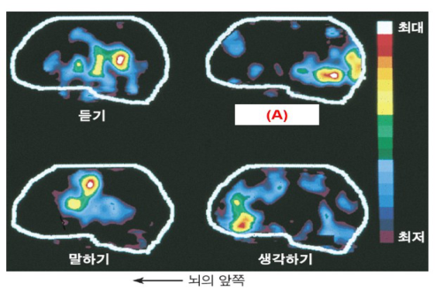
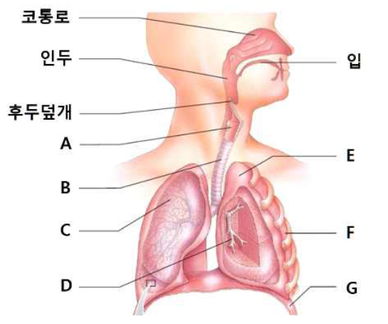
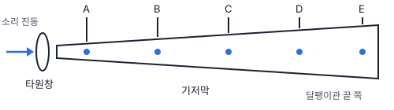
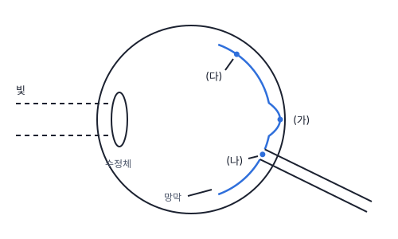

# 복습문제 43선 — 1117 수업 범위

기출 29개와 생성 변형 14개를 풀어 봐요. 변형 연습은 기본 13개·심화 1개예요. 먼저 스스로 풀어 보고, 풀이를 열어 확인해요.

> `복습문제_1117_Nervous_and_Sensory_Systems_and_Respiratory_and_Circulatory_Systems.html`를 마크다운으로 옮겼어요. 원문, 힌트, 풀이는 접혀 있어요. 먼저 풀어 보고 펼쳐 보세요.

**목차**

- [B. 기출](#partB)
  - [P1. 시각중추가 있는 엽](#p1)
  - [P2. 감각수용기의 정의와 유형](#p2)
  - [P3. 밀착연접으로 막힌 뇌의 모세혈관](#p3)
  - [P4. 좌반구가 맡지 않는 능력](#p4)
  - [P5. 소리가 지나가는 귀 구조의 순서](#p5)
  - [P6. 청각 모세포가 있는 곳](#p6)
  - [P7. 뇌량이 잇는 것](#p7)
  - [P8. 뇌 구조와 기능 짝짓기](#p8)
  - [P9. 뇌와 말초를 잇고 반사를 조절하는 곳](#p9)
  - [P10. 자율신경계의 두 갈래](#p10)
  - [P11. 뇌 영상에서 (A) 행동 찾기](#p11)
  - [P12. 청각수용기는 어느 유형일까](#p12)
  - [P13. 기억과 관련된 회색질 부위](#p13)
  - [P14. 말초에서 중추로 들어오는 뉴런](#p14)
  - [P15. 간상세포의 광색소 이름](#p15)
  - [P16. 반사를 생물학적으로 설명하기](#p16)
  - [P17. 사람 눈에 없는 구조](#p17)
  - [P18. 몸의 위치를 느끼는 수용기](#p18)
  - [P19. 척수와 뇌가 이루는 것](#p19)
  - [P20. 광수용기 설명에서 틀린 것](#p20)
  - [P21. 말초신경계 설명 중 잘못된 것](#p21)
  - [P22. 색깔을 직접 만드는 것](#p22)
  - [P23. 가지를 치는 공기통로 D](#p23)
  - [P24. 공기가 마지막에 닿는 구조](#p24)
  - [P25. 기체 교환이 일어나는 혈관벽](#p25)
  - [P26. 호흡을 조절하는 중추의 위치](#p26)
  - [P27. 폐에서 산소가 혈액으로 가는 방식](#p27)
  - [P28. 공기가 지나가는 경로](#p28)
  - [P29. 산소를 혈액으로 옮기는 구조](#p29)
- [C. 변형 연습](#partC)
  - [P30. [변형] 말초신경계 진술 다시 가르기](#p30)
  - [P31. [변형] 중심오목에 몰린 세포](#p31)
  - [P32. [변형] 높은 음이 흔드는 기저막 위치](#p32)
  - [P33. [변형] 소리를 키우면 달라지는 것](#p33)
  - [P34. [변형] 희미한 별은 망막의 어디에](#p34)
  - [P35. [변형] 분리뇌 환자가 본 열쇠](#p35)
  - [P36. [변형] 해마가 손상되면 잃는 것](#p36)
  - [P37. [변형] medulla oblongata가 하는 일](#p37)
  - [P38. [변형] 식물인간과 뇌사의 차이](#p38)
  - [P39. [변형] 감각과 수용기의 짝](#p39)
  - [P40. [변형] 숨쉬기가 힘든 두 가지 이유](#p40)
  - [P41. [변형] 폐포로 들어온 산소는 어디에 쓰일까](#p41)
  - [P42. [변형] 압정을 밟았을 때 다리의 두 근육이 받는 신호](#p42)
  - [P43. [변형] 약물이 뇌로 들어가지 못하는 이유](#p43)

## B. 기출

### P1. 시각중추가 있는 엽

시각중추는 어디에 위치하는가?

- (1) 시상하부
- (2) 두정엽
- (3) 전두엽
- (4) 후두엽
- (5) 측두엽

원문 정보 보기

기출 12강 합본 1번 (PDF 1쪽)

힌트 보기

대뇌 네 엽을 앞(이마)·위(정수리)·옆·뒤로 놓고, 뒤통수를 세게 맞으면 무엇을 잃을 수 있다고 했는지 떠올려요.

풀이 보기

1. (1) 틀려요. 시상하부는 대뇌의 엽이 아니라 시상 아래에 있는 구조로, 체온·나트륨 농도·식욕 같은 항상성을 조절하는 중추예요.
2. (2) 틀려요. 두정엽(정수리 쪽)은 체성 감각 영역이 있는 곳이에요.
3. (3) 틀려요. 전두엽(이마 쪽)은 운동 영역과 계획성을 맡아요. 게이지 사례에서 전두엽이 손상되자 계획 없이 살게 되었어요.
4. (4) 맞아요. 후두엽(뒤통수 쪽)이 시각을 맡아요. 볼 때 PET·fMRI에서 후두엽이 활성화되는 것도 같은 근거예요.
5. (5) 틀려요. 측두엽(옆머리 쪽)은 청각과 언어에 관여해요.
6. 수업과의 연결: 1117 수업에서 "뒤통수 세게 맞으면은 시각을 잃을 수도 있죠"라며 4엽과 기능을 짝지은 내용과 이어져요([대뇌의 네 엽과 언어 영역](정리노트_1117_Nervous_and_Sensory_Systems_and_Respiratory_and_Circulatory_Systems.md#s3-lobes)).

**정답:** (4)

---

### P2. 감각수용기의 정의와 유형

감각수용기에 대한 설명으로 옳은 것은?

- (1) 보기 모두 잘못된 설명이다
- (2) 활동전위와 역치를 만드는 세포이다
- (3) 대부분의 동물에 공통적인 5가지 유형이 존재한다
- (4) 두 신경세포 사이의 시냅스를 넘어가는 화학물질이다
- (5) 중추신경계에 위치한다

원문 정보 보기

기출 12강 합본 2번 (PDF 1쪽)

힌트 보기

수용기는 "무엇을 감지하는 곳"이에요. 기계·광·화학·온도·통각으로 나눈 분류를 떠올려요.

풀이 보기

1. (1) 틀려요. (3)이 옳은 설명이라 "모두 잘못"이 될 수 없어요.
2. (2) 틀려요. 감각수용기는 빛·소리·화학 물질 같은 환경 정보를 감지하는 기관이에요. 역치는 활동전위가 생기기 위해 넘어야 하는 막전위 값이지 세포가 만드는 것이 아니에요.
3. (3) 맞아요. 강의노트대로 대부분의 동물에 공통적인 5가지 기본 수용기 유형(기계 수용기, 광수용기, 화학 수용기, 온도 수용기, 통각 수용기)이 있어요.
4. (4) 틀려요. 시냅스를 넘어가는 화학물질은 신경전달물질이에요.
5. (5) 틀려요. 수용기는 눈의 망막, 귀, 혀, 피부처럼 몸 곳곳의 감각기관에 있어요. 온도 수용기 일부가 시상하부에 있지만, 수용기 전체를 "중추신경계에 위치한다"고 설명할 수는 없어요.
6. 수업과의 연결: 1117 수업에서 강의노트 p5의 수용기 5분류를 짚고, 캡사이신은 화학이 아니라 통각 수용이라고 덧붙인 내용과 이어져요([감각수용기의 다섯 종류](정리노트_1117_Nervous_and_Sensory_Systems_and_Respiratory_and_Circulatory_Systems.md#s4-receptors)).

**정답:** (3)

---

### P3. 밀착연접으로 막힌 뇌의 모세혈관

일반적인 상피세포와는 달리 뇌의 상피세포는 밀착연접에 의해 단단하게 붙어 있다. 따라서 혈액에 녹아 있는 대부분의 물질들은 뇌로 들어갈 수 없다. 이 구조를 무엇이라 하는가?

- (1) 대뇌겉질
- (2) 망상체
- (3) 혈액뇌장벽 (BBB)
- (4) 회색질
- (5) 대뇌변연계

원문 정보 보기

기출 12강 합본 6번 (PDF 1쪽)

힌트 보기

중추신경계를 지키는 세 가지(뼈, 뇌척수액, 그리고 혈관 쪽 장벽) 중 "밀착연접"이 나온 것을 골라요.

풀이 보기

1. (1) 틀려요. 대뇌겉질은 대뇌 표면의 세포층으로 고위 뇌기능을 맡는 곳이지 혈관 구조가 아니에요.
2. (2) 틀려요. 망상체는 뇌간 중심부에 뉴런이 그물처럼 얽힌 곳으로, 중요한 감각 신호를 골라내는 필터 역할을 해요.
3. (3) 맞아요. 뇌 모세혈관의 상피세포가 밀착연접으로 촘촘히 붙어 세균·바이러스·독성 물질이 뇌로 들어가지 못하게 막는 구조가 혈액뇌장벽(BBB)이에요.
4. (4) 틀려요. 회색질은 세포체와 수상돌기가 모인 회색 부분으로, 축삭이 모인 백질과 구분하는 이름이에요.
5. (5) 틀려요. 대뇌변연계는 편도체·해마 등으로 이루어진 "감정의 뇌"예요.
6. 수업과의 연결: 1117 수업에서 일반 모세혈관은 틈이 있지만 뇌 모세혈관은 밀착연접으로 "실로 꿰매듯" 붙어 있다고 비교한 내용과 이어져요([중추신경계를 지키는 세 가지](정리노트_1117_Nervous_and_Sensory_Systems_and_Respiratory_and_Circulatory_Systems.md#s1-protection)).

**정답:** (3)

---

### P4. 좌반구가 맡지 않는 능력

다음 중 대뇌의 좌측반구에서 조절하지 않는 능력은?

- (1) 추론 능력
- (2) 음악적 예술적 능력
- (3) 말하기 능력
- (4) 쓰기 능력
- (5) 수학문제 풀이 능력

원문 정보 보기

기출 12강 합본 7번 (PDF 1쪽)

힌트 보기

좌뇌는 언어·논리·수학, 우뇌는 공간감각·예술·직관이에요. 다섯 개 중 우뇌 쪽에 속하는 하나를 찾아요.

풀이 보기

1. (1) 틀려요. 추론(논리·분석)은 좌측 반구가 맡아요. 강의노트도 좌측 반구가 "말하기와 쓰기, 추론, 수학적 계산"에 관여한다고 써요.
2. (2) 맞아요. 음악적·예술적 능력은 공간인지, 직감적 사고와 함께 우측 반구가 맡아요. 그래서 좌측 반구가 조절하지 않는 능력이에요.
3. (3) 틀려요. 말하기는 언어 기능이라 좌측 반구가 맡아요. 분리뇌 실험에서 오른쪽 뇌로만 간 정보를 말하지 못한 것도 언어 중추가 왼쪽에 있기 때문이에요.
4. (4) 틀려요. 쓰기도 언어 기능이라 좌측 반구가 맡아요.
5. (5) 틀려요. 수학 계산은 좌측 반구의 기능이에요.
6. 수업과의 연결: 1117 수업에서 좌뇌는 언어·과학·논리·분석·수학, 우뇌는 공간감각·예술·직관력·상상력이라고 나눈 내용과 이어져요([좌우 반구와 뇌량](정리노트_1117_Nervous_and_Sensory_Systems_and_Respiratory_and_Circulatory_Systems.md#s3-hemispheres)).

**정답:** (2)

---

### P5. 소리가 지나가는 귀 구조의 순서

척추동물의 귀에서 음파에 의해 활성화되는 구조의 순서는?

- (1) 타원창, 고막, 반규관, 골지힘줄기관, 망치뼈, 모루뼈, 등자뼈
- (2) 귓바퀴, 고막, 망치뼈, 모루뼈, 등자뼈, 타원창, 달팽이관
- (3) 기저막, 피개막, 이석, 통낭, 구형낭, 망치뼈, 달팽이
- (4) 유스타키오관, 타원창, 전정관, 티파니관, 달팽이관, 귓바퀴
- (5) 코르티기관, 망치뼈, 모루뼈, 등자뼈, 청각신경, 고막

원문 정보 보기

기출 12강 합본 9번 (PDF 1쪽)

힌트 보기

소리는 바깥에서 안으로 들어가요. 고막 → 세 개의 뼈 → 타원창 → 달팽이관 순서를 지키는 보기를 찾아요.

풀이 보기

1. (1) 틀려요. 타원창이 고막보다 먼저 올 수 없고, 반규관과 골지힘줄기관은 수업에서 다루지 않았고(강의노트에도 없어요), 수업에서 배운 소리 전달 경로(고막 → 세 뼈 → 타원창 → 달팽이관)에 없는 구조예요. 세 뼈 다음에 와야 할 타원창·달팽이관도 빠져 있어요.
2. (2) 맞아요. 귓바퀴가 음파를 모으고 → 고막이 떨리고 → 가운데귀의 망치뼈·모루뼈·등자뼈가 진동을 증폭해 → 타원창을 떨게 하고 → 달팽이관 속 액체가 진동해요. 바깥에서 안으로 가는 순서가 맞아요.
3. (3) 틀려요. 기저막과 피개막(덮개막)은 달팽이관 안의 코르티 기관에 있는 구조라 망치뼈보다 먼저 활성화될 수 없어요. 이석·통낭·구형낭은 수업에서 다루지 않았고(강의노트에도 없어요), 수업에서 배운 소리 전달 경로에 없는 구조예요.
4. (4) 틀려요. 유스타키오관은 수업에서 다루지 않았어요(강의노트 12장 p6). 가운데귀와 목구멍을 잇는 관으로 압력 변화로부터 고막을 보호하는 통로이지 소리 진동이 지나는 길이 아니에요. 전정관·티파니관도 수업에서 다루지 않은 이름이에요. 소리를 모으는 귓바퀴가 맨 끝에 있는 것도 순서가 거꾸로예요.
5. (5) 틀려요. 소리를 감지하는 코르티기관이 맨 앞에, 처음 진동을 받는 고막이 맨 끝에 있어 순서가 거꾸로예요.
6. 수업과의 연결: 1117 수업에서 "진동이 고막을 떨게 하고, 세 개의 뼈가 지렛대처럼 증폭해 타원창을 떨게 하고, 달팽이관 액체가 진동한다"고 짚은 경로와 이어져요. 수업에서는 귓바퀴와 세 뼈의 이름(망치뼈·모루뼈·등자뼈)을 말하지 않았고, 강의노트 12장 p6에 "바깥귀는 귓바퀴를 이용하여 음파를 모은다", "망치뼈, 모루뼈, 등자뼈 등 3개의 뼈를 거쳐 타원창에 도달"로 나와 있어요([귀: 진동이 활동전위가 되기까지](정리노트_1117_Nervous_and_Sensory_Systems_and_Respiratory_and_Circulatory_Systems.md#s4-hearing)).

**정답:** (2)

---

### P6. 청각 모세포가 있는 곳

청각수용기의 구조 중에서 속귀로 전달된 소리의 진동을 감지하는 모세포가 존재하는 곳은?

- (1) 타원창
- (2) 코르티기관
- (3) 유스타키오관
- (4) 고막
- (5) 반고리관

원문 정보 보기

기출 12강 합본 15번 (PDF 2쪽)

힌트 보기

달팽이관 안에서 기저막·모세포·덮개막을 한데 묶어 부르는 이름을 떠올려요.

풀이 보기

1. (1) 틀려요. 타원창은 등자뼈의 진동을 달팽이관 속 액체로 넘겨주는 막이에요. 모세포는 그 안쪽에 있어요.
2. (2) 맞아요. 달팽이관 안의 코르티 기관이 기저막·모세포·덮개막으로 이루어져 있어요. 기저막이 떨리면 모세포의 털이 덮개막에 닿아 구부러지고 활동전위가 생겨요.
3. (3) 틀려요. 유스타키오관은 수업에서 다루지 않았어요(강의노트 12장 p6). 가운데귀와 목구멍을 잇는 관으로, 바깥 기압 변화로 고막이 손상되지 않게 해요. 진동을 감지하는 곳이 아니에요.
4. (4) 틀려요. 고막은 공기의 진동을 처음 받아 세 개의 뼈로 넘기는 막이에요. 속귀가 아니라 바깥귀와 가운데귀 사이에 있어요.
5. (5) 틀려요. 반고리관은 수업에서 다루지 않았고, 청각이 아니라 평형 감각과 관련된 속귀 구조예요. 소리의 진동을 감지하는 모세포는 코르티 기관에 있어요.
6. 수업과의 연결: 1117 수업에서 "기저막이 떨리면서 모세포가 흔들리면 털이 덮개막을 건드리고 … 활동 전위가 뇌로 전달된다. 그것만 기억하면 됩니다"라고 강조한 내용과 이어져요([귀: 진동이 활동전위가 되기까지](정리노트_1117_Nervous_and_Sensory_Systems_and_Respiratory_and_Circulatory_Systems.md#s4-hearing)).

**정답:** (2)

---

### P7. 뇌량이 잇는 것

뇌량(corpus callosum)이 연결하는 것은?

- (1) 좌우 두 대뇌 반구
- (2) 뇌하수체와 시상하부
- (3) 척수의 회백질과 백질
- (4) 소뇌와 척수
- (5) 전두엽과 후두엽

원문 정보 보기

기출 12강 합본 16번 (PDF 2쪽)

힌트 보기

간질 환자에게서 잘라 분리뇌가 되게 한 다리 같은 구조가 무엇과 무엇 사이에 있었는지 떠올려요.

풀이 보기

1. (1) 맞아요. 뇌량은 두꺼운 축삭 뭉치로, 좌반구와 우반구 사이를 다리처럼 이어 정보를 주고받게 해요.
2. (2) 틀려요. 뇌하수체는 시상하부 바로 아래에 튀어나와 붙어 있는 구조예요. 뇌량이 둘을 잇는 것이 아니에요.
3. (3) 틀려요. 회백질(회색질)과 백질은 척수 단면에서 세포체 쪽과 축삭 쪽을 나누어 부르는 이름이에요. 뇌량과 관계없어요.
4. (4) 틀려요. 뇌량은 대뇌 안에서 좌우 반구를 잇는 구조라 소뇌나 척수와는 관계없어요.
5. (5) 틀려요. 전두엽과 후두엽은 같은 반구 안의 앞쪽과 뒤쪽 엽이에요. 뇌량은 앞뒤가 아니라 좌우를 이어요.
6. 수업과의 연결: 1117 수업에서 "뇌량이라고 합니다, 뇌량"을 반복하며, 뇌량을 자른 분리뇌 환자는 오른쪽 뇌로만 간 정보를 왼쪽 언어 중추로 넘기지 못해 말하지 못한다고 설명한 내용과 이어져요([좌우 반구와 뇌량](정리노트_1117_Nervous_and_Sensory_Systems_and_Respiratory_and_Circulatory_Systems.md#s3-hemispheres)).

**정답:** (1)

---

### P8. 뇌 구조와 기능 짝짓기

구조와 기능이 올바르게 연결된 것은?

- (1) 후각엽 : 대뇌겉질의 운동중추를 조절
- (2) 시상하부 : 호르몬 분비, 일주기 리듬을 관장
- (3) 시상 : 대뇌변연계를 통한 감정신호의 전달
- (4) 편도체 : 감각정보를 대뇌로 전달
- (5) 기저핵 : 후각수용체로부터 나오는 신호를 대뇌겉질로 전달

원문 정보 보기

기출 12강 합본 17번 (PDF 2쪽)

힌트 보기

시상은 감각 정보의 중개소, 편도체는 공포 같은 정서 기억, 후각엽은 후각 정보가 들어오는 곳이에요. 기능이 서로 바뀌어 붙은 짝을 지워 나가요.

풀이 보기

1. (1) 틀려요. 후각엽은 후각 정보가 들어오는 곳이에요. 운동 영역은 전두엽에 있어요.
2. (2) 맞아요. 시상하부는 체온·나트륨 농도·식욕 같은 항상성을 조절하는 중추이고, 바로 아래 뇌하수체와 이어져 호르몬 분비를 조절해요. 다만 호르몬 분비는 수업에서 다루지 않았고(교재 12장 p.271), 하루 주기의 리듬(일주기 리듬)을 맡는다는 것은 교재·강의노트 밖 외부 자료예요.
3. (3) 틀려요. 시상의 주된 기능은 온몸에서 척수·뇌간을 거쳐 올라온 감각 정보를 대뇌로 중계하는 것이에요. 교수님이 시상을 변연계 구성원으로 꼽기는 했지만, 정서가 담긴 경험 정보를 변연계로 보내는 일은 편도체 쪽이에요. 그래서 이 짝은 틀렸다고 판정해요.
4. (4) 틀려요. 감각정보를 대뇌로 전달하는 것은 시상의 기능이에요. 편도체는 공포와 관련된 정서 기억을 맡아요. (3)과 (4)는 기능이 서로 바뀌어 있어요.
5. (5) 틀려요. 후각수용체에서 온 신호를 받는 곳은 후각엽이에요. 기저핵은 수업에서 변연계 구성 요소로 이름만 나왔어요.
6. 수업과의 연결: 1117 수업에서 시상(감각 중개)·시상하부(항상성)·뇌하수체의 위치를 그림으로 두 번 짚고, 편도체를 "공포와 관련된 기억"으로 설명한 내용과 이어져요([시상·시상하부와 망상체](정리노트_1117_Nervous_and_Sensory_Systems_and_Respiratory_and_Circulatory_Systems.md#s2-thalamus)).

**정답:** (2)

인쇄된 답안지와 같은 답이에요. (3)은 교수님이 시상을 변연계에 속한다고 말한 점 때문에 헷갈릴 수 있지만, 시상의 대표 기능은 감각 정보를 대뇌로 중계하는 것이고 감정 신호 전달은 편도체의 몫이라 틀린 짝으로 판정했어요. 시상하부가 호르몬 분비와 일주기 리듬을 관장한다는 부분은 수업에서 직접 말하지 않았어요. 호르몬 분비는 교재 12장 p.271, 일주기 리듬은 교재·강의노트 밖 외부 자료예요. 수업에서 배운 "시상하부 = 항상성 조절 중추"와 다른 보기의 기능 뒤바뀜만으로도 (2)를 고를 수 있어요.

---

### P9. 뇌와 말초를 잇고 반사를 조절하는 곳

뇌와 말초신경계 사이의 신경신호를 전달하며, 운동반사를 조절하는 연합뉴런 신경망을 가지고 있는 중추신경계의 구조는?

- (1) 편도체
- (2) 시상하부
- (3) 척수
- (4) 뇌간
- (5) 망상체

원문 정보 보기

기출 12강 합본 19번 (PDF 2쪽)

힌트 보기

뜨거운 냄비에서 손을 뗄 때 뇌보다 먼저 명령을 내린 곳이자, 손상되면 아래쪽 몸이 마비되는 곳을 떠올려요.

풀이 보기

1. (1) 틀려요. 편도체는 공포와 관련된 정서 기억을 맡는 변연계 구조예요.
2. (2) 틀려요. 시상하부는 체온·식욕 같은 항상성을 조절하는 중추예요.
3. (3) 맞아요. 척수는 뇌와 말초신경 사이에서 올라가고 내려가는 신호를 모두 전달하고, 연합뉴런으로 척수 반사(회수 반사)를 직접 일으켜요. 강의노트의 척수 정의와 문장이 같아요.
4. (4) 틀려요. 뇌간(연수)도 구토·삼키기 반사를 맡지만, 뇌간은 뇌의 일부예요. "뇌와 말초신경계 사이"에서 신호를 전달한다는 조건에 맞는 것은 척수예요.
5. (5) 틀려요. 망상체는 뇌간 중심부에서 중요한 감각 신호를 골라내는 필터 역할을 해요.
6. 수업과의 연결: 1117 수업에서 척수의 기능 두 가지(뇌와 말초 사이 신호 전달, 척수 반사)를 짚고 뜨거운 냄비 예로 연합뉴런을 거치는 회수 반사를 설명한 내용과 이어져요([척수와 척수 반사](정리노트_1117_Nervous_and_Sensory_Systems_and_Respiratory_and_Circulatory_Systems.md#s1-spinal-reflex)).

**정답:** (3)

---

### P10. 자율신경계의 두 갈래

자율신경계는 다시 _________로 나눌 수 있다.

- (1) 교감신경계와 부교감신경계
- (2) 구심성계와 원심성계
- (3) 말초신경계와 중추신경계
- (4) 수의적 조절과 불수의적 조절
- (5) 골격근과 민무늬근의 연결

원문 정보 보기

기출 12강 합본 20번 (PDF 2쪽)

힌트 보기

신경계를 큰 것부터 나눠 내려가요: 중추·말초 → 구심·원심 → 체성·자율 → 그다음 단계예요.

풀이 보기

1. (1) 맞아요. 자율신경계는 위험할 때 우세한 교감신경계(싸움 혹은 도망)와 휴식할 때 우세한 부교감신경계로 나뉘고, 둘의 효과는 정반대예요.
2. (2) 틀려요. 구심성·원심성은 말초신경계를 신호 방향(들어옴·나감)으로 나눈 것이에요. 자율신경계는 그중 원심성 쪽에 속해요.
3. (3) 틀려요. 중추·말초는 신경계 전체를 처음 나누는 기준이에요. 자율신경계는 말초신경계 안에 들어 있어요.
4. (4) 틀려요. 수의적·불수의적 조절은 체성신경계(수의적)와 자율신경계(불수의적)를 가르는 기준이에요. 자율신경계 자체가 불수의적이라 이것으로 다시 나눌 수 없어요.
5. (5) 틀려요. 골격근은 체성신경계가 조절하는 근육이에요. 자율신경계를 나누는 이름이 아니에요.
6. 수업과의 연결: 1117 수업에서 "자율신경계 = 교감 + 부교감, 기능은 정반대"라며 교감선생님 비유로 두 신경을 대비한 내용과 이어져요([교감신경과 부교감신경](정리노트_1117_Nervous_and_Sensory_Systems_and_Respiratory_and_Circulatory_Systems.md#s0-autonomic)).

**정답:** (1)

---

### P11. 뇌 영상에서 (A) 행동 찾기

위 그림을 참고하였을 때 (A)에 들어갈 행동으로 가장 올바른 것은?

- (1) 냄새 구분
- (2) 일반 운동
- (3) 보기(시각)
- (4) 얼굴 인식
- (5) 맛의 판별

원문 정보 보기

기출 12강 합본 21번 (PDF 2쪽)

힌트 보기

그림 아래 화살표가 가리키는 쪽이 뇌의 앞쪽이에요. (A)에서 가장 빨갛게 활성화된 곳이 앞쪽인지 뒤쪽인지 보고, 그 엽이 맡은 일을 떠올려요.

풀이 보기

1. 그림 읽기: 이런 영상(PET·fMRI)은 활성화된 뉴런이 포도당과 산소를 많이 쓰는 곳을 색으로 보여 줘요. 화살표가 왼쪽을 가리키므로 왼쪽이 앞(이마), 오른쪽이 뒤(뒤통수)예요. (A)는 뇌의 맨 뒤쪽, 곧 후두엽이 가장 강하게 활성화되어 있어요.
2. (1) 틀려요. 냄새는 화학 수용기가 받아들이는 자극이고, 수업에서 후각과 짝지은 부위는 변연계의 후각엽이에요. 뒤통수의 후두엽과 이어지는 행동이 아니에요.
3. (2) 틀려요. 몸을 움직이는 운동 영역은 전두엽에 있어요. 운동이라면 뇌의 앞쪽이 활성화되어야 하는데, (A)는 맨 뒤쪽이 활성화되어 있어요.
4. (3) 맞아요. 후두엽은 시각을 맡아요. 수업에서도 "볼 때는 후두엽"이 활성화된다고 예를 들었고, 뒤통수를 세게 맞으면 시각을 잃을 수 있다고 했어요.
5. (4) 틀려요. 얼굴을 알아보려면 먼저 봐야 하지만, 얼굴 인식은 본 정보를 해석해 누구인지 알아내는 단계라 후두엽 하나와 짝지은 기능이 아니에요. 수업에서 후두엽과 짝지은 기능은 '시각' 그 자체이고, 그림도 듣기·말하기·생각하기처럼 기본 행동을 비교하고 있어요.
6. (5) 틀려요. 맛은 혀의 화학 수용기가 맛 분자를 감지하는 감각이에요. 뒤통수의 후두엽이 맡은 감각이 아니에요.
7. 수업과의 연결: 1117 수업의 대뇌 네 엽(후두엽 = 시각)과, PET·fMRI로 "볼 때는 후두엽, 들을 때는 다른 부위"가 활성화된다는 설명과 이어져요([뇌 영상과 디폴트 모드 네트워크](정리노트_1117_Nervous_and_Sensory_Systems_and_Respiratory_and_Circulatory_Systems.md#s3-imaging)).

**정답:** (3)

---

### P12. 청각수용기는 어느 유형일까

청각수용기는 5가지 기본적인 수용기 유형 중 어떤 수용기에 속하는가?

- (1) 온도수용기
- (2) 통각수용기
- (3) 광수용기
- (4) 기계수용기
- (5) 화학수용기

원문 정보 보기

기출 12강 합본 22번 (PDF 2쪽, 보기 (4)·(5)는 3쪽)

힌트 보기

소리는 공기의 진동이에요. 귀 속 모세포가 무엇 때문에 구부러지는지 떠올려 봐요.

풀이 보기

1. (1) 틀려요. 온도수용기는 차가움·뜨거움, 곧 열에너지의 흐름을 감지해요. 피부와 시상하부에 있고 소리와는 관계없어요.
2. (2) 틀려요. 통각수용기는 조직 손상이나 유해한 화학물질을 통증으로 감지해요. 고추의 캡사이신이 여기에 해당해요.
3. (3) 틀려요. 광수용기는 빛 에너지를 감지하는 눈 망막의 간상세포·원추세포예요.
4. (4) 맞아요. 소리는 공기의 진동이고, 이 진동이 고막 → 세 개의 뼈 → 타원창 → 달팽이관의 기저막을 흔들어 모세포의 털을 물리적으로 구부려요. 털 속 기계적 개폐성 채널이 열려 신호가 생기므로, 압력·움직임 같은 물리적 자극을 받는 기계수용기예요.
5. (5) 틀려요. 화학수용기는 맛 분자·냄새 분자 같은 화학 물질을 감지해요(미각·후각).
6. 수업과의 연결: 1117 수업의 수용기 다섯 분류에서 청각과 고유 수용기의 위치 감각을 모두 기계 수용기로 묶은 설명과 이어져요([감각수용기의 다섯 종류](정리노트_1117_Nervous_and_Sensory_Systems_and_Respiratory_and_Circulatory_Systems.md#s4-receptors)).

**정답:** (4)

---

### P13. 기억과 관련된 회색질 부위

대뇌겉질의 회색질 부위는 다양한 기능을 조절한다. 그 중, 정보를 전두엽으로 보내는 데 관여하며 특히 “기억”과 관련된 부위는?

- (1) 해마
- (2) 시상
- (3) 시상하부
- (4) 편도체
- (5) 기저핵

원문 정보 보기

기출 12강 합본 23번 (PDF 3쪽)

힌트 보기

영화 〈메멘토〉 주인공처럼 오늘 본 것을 내일 기억하지 못하게 되는 손상은 어느 부위의 손상이었는지 떠올려 봐요.

풀이 보기

1. (1) 맞아요. 해마는 정보를 전두엽으로 보내는 데 관여하고, 단기기억을 장기기억으로 바꾸는 일을 해요. 해마가 손상되면 단기기억과 손상 전의 장기기억은 남지만 새 장기기억을 만들지 못해요.
2. (2) 틀려요. 시상은 감각 정보를 대뇌로 전달하는 중계소예요. 기억을 만드는 부위가 아니에요.
3. (3) 틀려요. 시상하부는 체온 조절 같은 항상성을 맡고 뇌하수체와 이어져 있어요. 기억 형성과는 관계가 멀어요.
4. (4) 틀려요. 편도체도 기억과 관련이 있지만 공포처럼 정서가 담긴 경험 정보를 다뤄요(편도체를 없앤 쥐는 고양이를 무서워하지 않았어요). 정보를 전두엽으로 보내며 기억 저장 자체에 관여하는 부위는 해마예요.
5. (5) 틀려요. 기저핵은 수업에서 변연계를 이루는 부위로 이름만 나왔고, 기억을 맡는 부위로 배우지 않았어요(수업 밖: 주로 움직임 조절에 관여해요. 출처: 교재 12장 p.272).
6. 수업과의 연결: 1117 수업의 해마 손상 영상(메멘토)과 "단기기억도 장기기억도 문제없고, 단기 → 장기 전환이 안 된다"는 강조와 이어져요([변연계: 편도체와 해마](정리노트_1117_Nervous_and_Sensory_Systems_and_Respiratory_and_Circulatory_Systems.md#s2-limbic)).

**정답:** (1)

---

### P14. 말초에서 중추로 들어오는 뉴런

다음 중 말초신경계(PNS)에서 중추신경계(central nervous system, CNS)로 신호를 전달하는 뉴런은 어느 것인가?

- (1) 원심성 뉴런
- (2) 운동뉴런
- (3) 구심성 뉴런
- (4) 억제성 뉴런
- (5) 연합뉴런

원문 정보 보기

기출 12강 합본 24번 (PDF 3쪽)

힌트 보기

"나가는 것은 원심성, 들어오는 것은 구심성"이에요. 말초에서 중추로 가는 방향은 들어오는 쪽일까요, 나가는 쪽일까요?

풀이 보기

1. (1) 틀려요. 원심성 뉴런은 중추신경계에서 효과기(근육 등)로 신호를 내보내는, 나가는 뉴런이에요. 방향이 반대예요.
2. (2) 틀려요. 운동뉴런은 척수·뇌의 명령을 근육으로 전달하는 원심성 뉴런이에요. 역시 중추에서 말초로 나가요.
3. (3) 맞아요. 구심성 뉴런(감각뉴런)은 감각 정보를 말초에서 중추신경계로 들여보내요. 뜨거운 냄비를 만졌을 때 척수로 신호를 보내는 것도 구심성 뉴런이에요.
4. (4) 틀려요. 억제성은 신호를 받은 쪽을 흥분시키지 않고 억누르는 효과를 말해요(척수 반사에서 이완할 근육이 받는 신호). 신호가 흐르는 방향으로 나눈 이름이 아니에요.
5. (5) 틀려요. 연합뉴런은 중추신경계(척수·뇌) 안에서 들어온 정보를 통합해 원심성 뉴런으로 넘겨줘요. 말초와 중추를 잇는 뉴런이 아니에요.
6. 수업과의 연결: 1117 수업의 신경계 구분(중추·말초, 구심성·원심성)과 이어져요([중추·말초, 구심·원심, 체성·자율](정리노트_1117_Nervous_and_Sensory_Systems_and_Respiratory_and_Circulatory_Systems.md#s0-divisions)).

**정답:** (3)

---

### P15. 간상세포의 광색소 이름

광수용기에서 간상세포의 레티날-옵신 광색소를 무엇이라고 하는가?

- (1) 로돕신
- (2) 아마크린세포
- (3) 수평세포
- (4) 양극세포
- (5) 포톱신

원문 정보 보기

기출 12강 합본 25번 (PDF 3쪽)

힌트 보기

먼저 보기에서 '세포'와 '광색소'를 나눠요. 남은 광색소 둘 중 컬러 사진(포토)이 떠오르는 쪽은 원추세포 것이었어요.

풀이 보기

1. (1) 맞아요. 간상세포의 광색소는 로돕신이고, 단백질인 옵신에 빛을 흡수하는 색소 레티날이 붙어 있어요. 레티날이 빛을 흡수하면 구조가 바뀌어 신호가 시작돼요.
2. (2) 틀려요. 아마크린세포는 광수용기의 신호를 받아 주는 망막 세포 중 하나예요. 광색소가 아니라 세포예요.
3. (3) 틀려요. 수평세포도 광수용기의 신호를 받아 주는 망막 세포예요. 광색소가 아니에요.
4. (4) 틀려요. 양극세포는 간상세포·원추세포 바로 아래 층에서 신호를 받는 세포예요. 광색소가 아니에요.
5. (5) 틀려요. 포톱신은 원추세포의 광색소예요(세 종류가 있어 색을 구분해요). 간상세포의 광색소가 아니에요.
6. 수업과의 연결: 1117 수업의 "간상세포 = 로돕신, 원추세포 = 포톱신(포토, 컬러 사진)" 대비와, 수평·양극·아마크린세포는 "이런 것들이 있다는 것만 알면 된다"는 설명과 이어져요([간상세포와 원추세포](정리노트_1117_Nervous_and_Sensory_Systems_and_Respiratory_and_Circulatory_Systems.md#s5-photoreceptors)).

**정답:** (1)

---

### P16. 반사를 생물학적으로 설명하기

무릎반사는 사람이 생각하지 않고도 자동적으로 무엇을 하는 것을 알 수 있다. 생물학적 용어로 반사를 가장 잘 설명한 것은?

- (1) 오직 어린 아이들만 반사를 수행할 수 있다
- (2) 신경계에서, 척수 반사를 수행하기 전 고위 뇌 부위가 관여한다는 것을 의미한다
- (3) 반사는 연합뉴런의 작용 없이 이루어진다
- (4) 신경계에서, 척수 반사의 수행은 뇌의 참여 없이도 가능하다는 것을 의미한다
- (5) 뇌로부터의 명령이 하달된 후에는 무릎 반사 시간이 더 짧아진다 ‘

원문 정보 보기

기출 12강 합본 28번 (PDF 3쪽)

힌트 보기

뜨거운 냄비에 손을 댔을 때 손을 떼라는 명령을 누가 먼저 내렸는지, 뜨겁다는 느낌은 언제 왔는지 떠올려 봐요.

풀이 보기

1. (1) 틀려요. 뜨거운 냄비에서 손을 떼는 회수 반사처럼 반사는 어른에게서도 늘 일어나요. 나이와 상관없는 신경계의 기본 기능이에요.
2. (2) 틀려요. 순서가 반대예요. 척수가 먼저 운동뉴런에 직접 명령해 반응이 일어나고, 뇌는 따로 신호를 받아 나중에 인지해요(통증은 손을 뗀 뒤에 느껴요).
3. (3) 틀려요. 수업의 회수 반사는 감각뉴런 → 척수의 연합뉴런 → 운동뉴런 순서로 일어나고, 강의노트도 척수 회백질에 반사에 관여하는 연합뉴런이 있다고 해요. 회수 반사처럼 연합뉴런을 거치는 반사가 있으므로 '연합뉴런의 작용 없이 이루어진다'는 일반 진술은 틀려요.
4. (4) 맞아요. 척수 반사는 척수가 직접 근육에 명령하는 것이라 뇌의 참여 없이도 일어나요. 그래서 생각하지 않고도 자동적이고 빨라요. 뇌로 가는 신호가 아예 없는 것은 아니고, 반응이 일어난 뒤 따로 인지해요.
5. (5) 틀려요. 반사는 뇌의 명령을 기다리지 않고 척수에서 바로 일어나요. 뇌의 명령이 하달되는 것은 반사가 일어나는 조건이 아니고, 뇌를 거친다면 경로가 길어질 뿐 반사가 더 빨라지지 않아요.
6. 수업과의 연결: 1117 수업의 척수 기능 두 가지 중 척수 반사(위급할 때 척수가 직접 근육에 명령)와, "반사여도 뇌로 신호가 안 가는 건 아니다"라는 설명과 이어져요([척수와 척수 반사](정리노트_1117_Nervous_and_Sensory_Systems_and_Respiratory_and_Circulatory_Systems.md#s1-spinal-reflex)).

**정답:** (4)

---

### P17. 사람 눈에 없는 구조

다음 중 인간의 눈에서 발견할 수 없는 구조는 무엇인가?

- (1) 홍채
- (2) 반사판
- (3) 수정체
- (4) 맹점
- (5) 각막

원문 정보 보기

기출 12강 합본 29번 (PDF 3쪽)

힌트 보기

빛이 사람 눈에 들어가 망막에 닿기까지 지나는 구조와, 망막에서 상이 보이지 않는 곳을 차례로 떠올려 지워 봐요. 남는 하나가 답이에요.

풀이 보기

1. (1) 틀려요. 홍채는 사람 눈에 있어요. 눈동자 색을 띠고, 동공 크기를 조절해 들어오는 빛의 양을 바꿔요.
2. (2) 맞아요. 반사판은 수업에서 다루지 않았지만, 나머지 넷이 모두 수업에서 배운 사람 눈의 구조이므로 남는 반사판이 답이에요(수업 밖: 반사판은 고양이 같은 일부 동물의 망막 뒤에서 빛을 되돌려 약한 빛에서도 잘 보게 하는 층이고, 사람 눈에는 없어요).
3. (3) 틀려요. 수정체는 사람 눈의 렌즈예요. 섬모체근이 두께를 조절해 먼 곳은 얇게, 가까운 곳은 두껍게 만들어 상을 망막에 맺게 해요.
4. (4) 틀려요. 맹점은 사람 눈에 있어요. 시신경이 빠져나가는 자리에는 간상·원추세포가 없어 상이 맺혀도 보이지 않아요. 한쪽 눈을 가리면 드러나요.
5. (5) 틀려요. 각막은 빛이 처음 들어오는 사람 눈의 맨 바깥 막이에요.
6. 수업과의 연결: 1117 수업의 빛의 경로(각막 → 동공·홍채 → 수정체 → 망막)와, 사람 눈에는 맹점이 있고 문어·오징어 눈에는 없다는 비교와 이어져요([눈의 구조와 초점 맞추기](정리노트_1117_Nervous_and_Sensory_Systems_and_Respiratory_and_Circulatory_Systems.md#s5-eye)).

**정답:** (2)

---

### P18. 몸의 위치를 느끼는 수용기

인간의 수용기 중에서 중추신경계가 몸의 균형을 유지하거나 손발의 위치를 감지하기 위해 사용하는 자극을 감지하는 것은?

- (1) 자기수용기
- (2) 고유수용기
- (3) 온도수용기
- (4) 전기수용기
- (5) 미각수용기

원문 정보 보기

기출 12강 합본 30번 (PDF 3쪽)

힌트 보기

눈을 감아도 내 팔과 발가락이 어디 있는지, 근육이 얼마나 수축했는지 아는 감각을 떠올려 봐요. 수업에서 따로 이름을 붙여 소개했어요.

풀이 보기

1. (1) 틀려요. 수업에서 자기 수용기는 일부 동물이 자기장(자석의 힘)을 느끼는 수용기로 소개됐어요. 손발의 위치를 느끼는 사람의 수용기가 아니에요. 다른 자료에서는 몸의 위치 감각을 '자기(自己) 수용 감각'이라고도 불러 헷갈릴 수 있으니, 수업 용어인 고유 수용기로 기억해요.
2. (2) 맞아요. 고유수용기는 팔이나 발가락이 어디 있는지, 근육이 얼마나 수축했는지, 물건이 얼마나 무거운지를 느껴요. 중추신경계는 이 정보로 균형을 잡고 손발 위치를 알아요. 다섯 유형으로는 기계 수용기에 속해요.
3. (3) 틀려요. 온도수용기는 차가움·뜨거움을 감지해요. 피부와 시상하부에 있어요.
4. (4) 틀려요. 전기수용기는 일부 동물이 전기 신호를 느끼는 수용기로 소개됐어요. 손발 위치 감각과는 관계없어요.
5. (5) 틀려요. 미각수용기는 맛 분자를 감지하는 화학 수용기예요.
6. 수업과의 연결: 1117 수업에서 고유 수용기를 위치·근육 상태를 느끼는 수용기로 소개하고, 다섯 분류에서는 기계 수용기로 묶은 설명과 이어져요([감각수용기의 다섯 종류](정리노트_1117_Nervous_and_Sensory_Systems_and_Respiratory_and_Circulatory_Systems.md#s4-receptors)).

**정답:** (2)

---

### P19. 척수와 뇌가 이루는 것

다음 괄호 안에 알맞은 말을 고르시오. “척수와 뇌는 ( ) 를 구성한다.”

- (1) 체성신경계
- (2) 중추신경계
- (3) 자율신경계
- (4) 말초신경계
- (5) 교감신경계

원문 정보 보기

기출 12강 합본 34번 (PDF 4쪽)

힌트 보기

등으로 길게 뻗은 척수가 뇌와 같은 쪽에 묶이는지, 온몸으로 뻗어 나간 신경 쪽에 묶이는지 생각해 봐요.

풀이 보기

1. (1) 틀려요. 체성신경계는 말초신경계의 원심성 부분 중 골격근에 연결되어 수의적으로 몸을 움직이는 쪽이에요. 뇌와 척수가 아니에요.
2. (2) 맞아요. 중추신경계는 뇌와 척수로 이루어져요. 등으로 뻗은 척수도 중추신경계예요.
3. (3) 틀려요. 자율신경계는 말초신경계의 원심성 부분 중 심장·장처럼 의식적으로 조절할 수 없는 기관을 맡는 쪽이에요.
4. (4) 틀려요. 말초신경계는 뇌나 척수에서 온몸으로 뻗어 나가는 신경이에요. 뇌와 척수 자체는 말초가 아니에요.
5. (5) 틀려요. 교감신경계는 자율신경계의 한 갈래로, 위험한 상황에서 심박수·혈압을 올려요. 말초신경계에 속해요.
6. 수업과의 연결: 1117 수업의 "중추신경계 = 뇌 + 척수", 말초 → 원심성 → 체성·자율 → 교감·부교감으로 이어지는 구분과 이어져요([중추·말초, 구심·원심, 체성·자율](정리노트_1117_Nervous_and_Sensory_Systems_and_Respiratory_and_Circulatory_Systems.md#s0-divisions)).

**정답:** (2)

---

### P20. 광수용기 설명에서 틀린 것

다음 광수용기에 대한 설명 중 틀린 것은 ?

- (1) 척추동물의 간상세포는 색깔을 감지하고 원추세포는 낮은 광도의 빛을 감지한다
- (2) 시선경다발이 지나가는 곳에 맹점이 존재한다
- (3) 포유류와 조류의 경우 원추세포가 망막의 좁은 부위에 밀집되어 있다
- (4) 인간 눈에서 수정체는 섬모체(모양체)와 섬모체근에 고정되어 있다
- (5) 섬모체근(모양체근)이 이완 하면 수정체는 멀리 있는 물체의 상을 망막에 맺게 한다

원문 정보 보기

기출 12강 합본 38번 (PDF 4쪽)

힌트 보기

어두운 곳에서 사물이 흑백으로 보이는 까닭을 떠올리면, 간상세포와 원추세포 중 어느 쪽이 약한 빛을, 어느 쪽이 색을 맡는지 정리돼요.

풀이 보기

1. (1) 틀려요. 그래서 이 보기가 틀린 것의 답이에요. 두 세포의 기능이 뒤바뀌었어요. 간상세포는 색을 구분하지 못하지만 낮은 광도(약한 빛)에 반응하고, 원추세포는 세 종류가 있어 색깔을 구분하지만 강한 빛에만 반응해요. 그래서 어두운 곳에서는 간상세포만 반응해 흑백으로 보여요.
2. (2) 맞아요. 원문의 '시선경'은 시신경을 뜻해요. 시신경이 빠져나가는 자리에는 광수용기가 없어 상이 맺혀도 보이지 않는 맹점이 생겨요.
3. (3) 맞아요. 원추세포는 망막의 좁은 부위인 중심오목(중심와)에 몰려 있어요. 상이 이곳에 맺히면 가장 또렷하게 보여요.
4. (4) 맞아요. 수업 밖이지만 맞는 진술이에요. 수정체는 섬모체에서 뻗은 가는 섬유에 매달려 고정되어 있고, 섬모체근이 수축·이완하며 수정체 두께를 바꿔요. 확실히 틀린 보기 (1)을 먼저 찾으면 돼요.
5. (5) 맞아요. 강의노트는 섬모체근(모양체근)이 수축하면 수정체가 둥글어져 가까운 곳의 상을 맺는다고 해요. 반대로 이완하면 수정체가 얇아져 먼 곳의 상을 망막에 맺어요(수업: 먼 곳은 얇게, 가까운 곳은 두껍게).
6. 수업과의 연결: 1117 수업의 "간상(1종, 약한 빛, 흑백) ↔ 원추(3종, 강한 빛, 색)" 대비, 중심오목·맹점, 섬모체근의 수정체 두께 조절과 이어져요([간상세포와 원추세포](정리노트_1117_Nervous_and_Sensory_Systems_and_Respiratory_and_Circulatory_Systems.md#s5-photoreceptors)).

**정답:** (1)

---

### P21. 말초신경계 설명 중 잘못된 것

말초신경계에 관한 설명으로 잘못된 것은?

- (1) 자율신경계는 서로 대립적으로 작용하는 교감신경계와 부교감신경으로 구성된다.
- (2) 말초신경계는 구심성뉴런과 원심성뉴런으로 구성된다.
- (3) 교감신경계는 심장박동수와 혈압을 증가시키며, 소화작용을 억제한다.
- (4) 체성신경계는 일차적으로 불수의적인 움직임을 조절한다.
- (5) 말초신경의 원심성 부위는 체성신경계와 자율신경계로 나뉜다.

원문 정보 보기

기출 12강 합본 40번 (PDF 4쪽)

힌트 보기

체성신경계와 자율신경계를 나누는 기준이 "의식적으로 조절할 수 있느냐"였다는 점을 떠올려 봐요.

풀이 보기

1. (1) 맞아요. 자율신경계는 교감신경계와 부교감신경계로 이루어지고, 두 계의 효과는 정반대예요. "부교감신경으로"는 원문 표기를 그대로 옮긴 것이고 부교감신경계를 뜻해요.
2. (2) 맞아요. 중추신경계로 들어오는 뉴런이 구심성, 중추신경계에서 나가는 뉴런이 원심성이에요. 말초신경계는 이 두 방향의 뉴런으로 이루어져요.
3. (3) 맞아요. 교감신경계는 싸움 혹은 도망 상황에서 심박수와 혈압을 올리고 소화는 억제해요.
4. (4) 틀려요. 체성신경계는 골격근에 연결되어 의식적으로 조절하는 수의적인 움직임을 맡아요. 불수의적인 조절은 심장·장을 맡는 자율신경계의 특징이에요.
5. (5) 맞아요. 원심성 신경계는 의식적으로 조절할 수 있느냐에 따라 체성신경계와 자율신경계로 나뉘어요.
6. 수업과의 연결: 1117 수업에서 교수님이 체성(골격근, 수의적)과 자율(심장·장, 불수의적)을 "의식적으로 조절할 수 있느냐 없느냐"로 가른 내용과 이어져요([중추·말초, 구심·원심, 체성·자율](정리노트_1117_Nervous_and_Sensory_Systems_and_Respiratory_and_Circulatory_Systems.md#s0-divisions)).

**정답:** (4)

---

### P22. 색깔을 직접 만드는 것

인간에 의해 감지되는 다양한 색깔은 직접적으로 다음 중 어느 것에 의해 일어나는가?

- (1) 원추세포에 있는 세 가지 종류의 포톱신 분자의 활성에 의해
- (2) 간상세포의 신경 충격이 측면슬형핵을 거쳐 전달되므로
- (3) 모든 광수용기가 빛에 의해 똑같이 자극되어
- (4) 시각교차에 의해 다른 대뇌 반구로 상이 전달되어
- (5) 아마크린세포에 의한 측면 억제에 의해

원문 정보 보기

기출 12강 합본 41번 (PDF 4쪽 문제, 5쪽 보기)

힌트 보기

색을 구분하는 광수용기가 간상세포와 원추세포 중 어느 쪽이었는지, 그 세포의 광색소 이름이 무엇이었는지 떠올려 봐요.

풀이 보기

1. (1) 맞아요. 원추세포는 레드·그린·블루 세 종류가 있고, 원반 막 속의 광색소 포톱신이 빛을 흡수해요. 이 세 종류의 원추세포가 빛에 반응해 색깔을 구분해요.
2. (2) 틀려요. 간상세포는 한 종류뿐이라 색을 구분하지 못하고, 약한 빛에 반응해 사물을 흑백으로 보게 해요. 측면슬형핵은 수업에서 다루지 않았지만, 간상세포 신호는 어느 경로를 거쳐도 색을 만들지 못해요.
3. (3) 틀려요. 모든 광수용기가 똑같이 자극되면 색을 서로 가를 차이가 생기지 않아요. 색은 종류가 다른 세 원추세포가 있어야 구분돼요.
4. (4) 틀려요. 시각교차는 각 눈의 왼쪽 시야를 오른쪽 뇌로, 오른쪽 시야를 왼쪽 뇌로 보내는 배선이에요. 정보가 어느 반구로 가는지를 정할 뿐 색을 감지하는 원인이 아니에요.
5. (5) 틀려요. 아마크린세포는 광수용기의 신호를 받아 주는 망막 세포 중 하나예요. 측면 억제는 수업에서 다루지 않았고, 빛을 직접 흡수해 색 정보를 만드는 것은 원추세포의 포톱신이에요.
6. 수업과의 연결: 1117 수업에서 교수님이 간상세포(1종, 약한 빛, 흑백, 로돕신)와 원추세포(3종, 강한 빛, 색, 포톱신)를 대비하고 포톱신을 "포토, 컬러 사진"으로 외우게 한 내용과 이어져요([간상세포와 원추세포](정리노트_1117_Nervous_and_Sensory_Systems_and_Respiratory_and_Circulatory_Systems.md#s5-photoreceptors)).

**정답:** (1)

---

### P23. 가지를 치는 공기통로 D

폐포에 이를 때까지 점점 더 가지를 치는 공기통로인 D 구조물을 무엇이라고 하는가?

- (1) 횡경막
- (2) 후두
- (3) 늑막근
- (4) 기관
- (5) 기관지

원문 정보 보기

기출 13강 합본 18번 (PDF 2쪽, 그림은 17·18번 공용)

힌트 보기

공기의 길(인두 → 후두 → 기관 → … → 폐포)에서 나뭇가지처럼 갈라진다고 해서 붙은 이름을 떠올려 봐요.

풀이 보기

1. (1) 틀려요. 횡경막은 수업에서 다루지 않았어요. 교재 13장 기준으로 흉곽과 복강 사이의 근육층이라 공기가 지나가는 통로가 아니에요.
2. (2) 틀려요. 후두는 인두 다음, 기관 위쪽에 있는 통로예요. 폐 안에서 가지를 치는 구조가 아니에요.
3. (3) 틀려요. 늑막근은 수업에서 다루지 않았어요. 이름 그대로 근육을 가리키는 말이라 공기 통로가 아니에요.
4. (4) 틀려요. 기관은 후두 아래로 이어지는 한 줄기 관이에요. 아직 갈라지기 전 부분이에요.
5. (5) 맞아요. 기관이 두 갈래로 나뉜 뒤 폐 안에서 계속 가지를 치는 관이 기관지예요. 가지처럼 나뉜다고 해서 기관지라는 이름이 붙었고, 그림의 D도 폐 안쪽의 관을 가리켜요.
6. 수업과의 연결: 1117 수업에서 인두(목구멍) → 후두 → 기관 → 기관지 → 세기관지 → 폐포 순서와 기관·기관지·세기관지의 이름 구분을 짚은 내용과 이어져요([공기의 길과 폐포](정리노트_1117_Nervous_and_Sensory_Systems_and_Respiratory_and_Circulatory_Systems.md#s6-airway)).

**정답:** (5)

---

### P24. 공기가 마지막에 닿는 구조

포유동물이 호흡을 할 때, 공기는 최종적으로 조밀한 모세혈관 네트워크로 둘러싸인 이것에 도달하게 된다. 이것이 뜻하는 구조와 그 특성을 올바르게 짝 지은 것은?

- (1) 기관, 좁은 표면적
- (2) 세기관지, 넓은 표면적
- (3) 폐포, 넓은 표면적
- (4) 후두, 한쪽방향으로만 공기 흐름
- (5) 세기관지, 양압 호흡

원문 정보 보기

기출 13강 합본 28번 (PDF 4쪽)

힌트 보기

공기가 마지막에 도착하는 곳은 포도송이처럼 생겼다고 했어요. 그런 모양이 기체 교환에 왜 유리한지도 함께 생각해 봐요.

풀이 보기

1. (1) 틀려요. 기관은 후두 다음의 통로일 뿐 공기가 마지막에 도달하는 곳이 아니에요. 기체를 교환하는 곳은 표면적이 좁은 것이 아니라 넓어야 해요.
2. (2) 틀려요. 세기관지는 폐포 바로 앞까지 공기를 나르는 가는 통로예요. 모세혈관에 둘러싸여 기체를 교환하는 최종 도달 지점은 그 끝에 달린 폐포예요.
3. (3) 맞아요. 기관지가 여러 번 갈라진 끝마다 폐포가 포도송이처럼 달려 있어 전체 표면적이 아주 넓고, 폐포를 모세혈관이 덮고 있어요. 표면적이 넓을수록 확산이 빨라져요.
4. (4) 틀려요. 후두는 공기 통로의 앞부분이라 최종 도달 지점이 아니에요. 공기 흐름 방향은 수업에서 다루지 않았지만, 구조부터 틀렸어요.
5. (5) 틀려요. 세기관지는 최종 도달 지점이 아니에요. 양압 호흡은 수업에서 다루지 않았지만, 구조부터 틀렸어요.
6. 수업과의 연결: 1117 수업에서 교수님이 폐포를 포도송이에 비유하고, 분지가 매우 많아 전체 폐포 표면적이 넓은 이유를 확산 속도로 설명한 내용과 이어져요([공기의 길과 폐포](정리노트_1117_Nervous_and_Sensory_Systems_and_Respiratory_and_Circulatory_Systems.md#s6-airway)).

**정답:** (3)

---

### P25. 기체 교환이 일어나는 혈관벽

O2와 CO2 등의 실제 기체 교환은 다음 중 어떤 유형의 혈관벽을 통해 일어나는가?

- (1) 모세혈관
- (2) 세정맥
- (3) 정맥
- (4) 동맥
- (5) 세동맥

원문 정보 보기

기출 13강 합본 30번 (PDF 4쪽)

힌트 보기

수업에서 폐포를 무엇이 덮고 있어서 기체 교환이 일어난다고 했는지 떠올려 봐요.

풀이 보기

1. (1) 맞아요. 폐포를 모세혈관이 덮고 있고, O2는 폐포 막 → 모세혈관 막 → 혈액으로, CO2는 그 반대로 확산해요. 실제 교환은 가장 가는 혈관인 모세혈관의 벽에서 일어나요.
2. (2) 틀려요. 세정맥은 수업에서 다루지 않았어요. 교재 13장 기준으로 모세혈관을 지난 혈액을 모아 정맥으로 보내는 혈관이라, 교환을 마친 혈액이 지나가는 길이에요.
3. (3) 틀려요. 정맥은 수업에서 다루지 않았어요. 교재 13장 기준으로 온몸의 혈액을 심장 쪽으로 되돌려 보내는 혈관이고, 벽이 여러 층으로 되어 있어(동맥보다는 얇지만 한 층짜리 모세혈관 벽과 달라요) 기체 교환 장소가 아니에요.
4. (4) 틀려요. 동맥은 수업에서 다루지 않았어요. 교재 13장 기준으로 심장에서 나온 혈액을 온몸으로 보내는 굵고 벽이 두꺼운 혈관이라, 혈액을 나르는 통로이지 교환 장소가 아니에요.
5. (5) 틀려요. 세동맥은 수업에서 다루지 않았어요. 교재 13장 기준으로 동맥에서 갈라져 모세혈관으로 혈액을 보내는 혈관이고, 교환은 그다음 모세혈관에서 일어나요.
6. 수업과의 연결: 1117 수업에서 폐포를 덮은 모세혈관과 폐포 안 공기 사이에서 기체가 확산으로 오간다고 설명한 내용과 이어져요([공기의 길과 폐포](정리노트_1117_Nervous_and_Sensory_Systems_and_Respiratory_and_Circulatory_Systems.md#s6-airway)).

**정답:** (1)

---

### P26. 호흡을 조절하는 중추의 위치

호흡량과 호흡깊이를 조절하는 중추는 어디에 위치하는가?

- (1) 소뇌
- (2) 정맥
- (3) 뇌간
- (4) 시상
- (5) 대뇌

원문 정보 보기

기출 13강 합본 33번 (PDF 4쪽)

힌트 보기

달리면 숨이 저절로 가빠지게 하는 부위가 연수였어요. 연수가 뇌의 어느 큰 부분에 속하는지 떠올려 봐요.

풀이 보기

1. (1) 틀려요. 소뇌는 이번 수업에서 다루지 않았어요. 교재에서 소뇌는 몸의 균형과 운동 조정을 맡는 부위로 나오고, 호흡 중추가 아니에요.
2. (2) 틀려요. 정맥은 혈관이에요. 신호를 처리하는 중추가 될 수 없어요.
3. (3) 맞아요. 뇌간은 아래부터 연수·뇌교·중뇌로 이루어져요. 연수가 호흡 리듬을 만들고 조절하며, 뇌교가 그 리듬을 부드럽게 해요.
4. (4) 틀려요. 시상은 뇌간 위에서 온몸의 감각 정보를 대뇌로 중개하는 부위예요.
5. (5) 틀려요. 대뇌는 전두엽·두정엽·측두엽·후두엽으로 나뉘어 운동, 체성 감각, 언어·청각, 시각 같은 기능을 맡아요. 호흡을 저절로 조절하는 중추는 뇌간에 있어요.
6. 수업과의 연결: 1117 수업에서 교수님이 연수를 호흡 리듬 생성·조절, 뇌교를 호흡 리듬을 부드럽게 하는 곳으로 대비하고, 뇌간까지 기능을 잃은 뇌사는 인공호흡기가 필요하지만 뇌간이 살아 있는 식물인간은 스스로 숨을 쉰다고 설명한 내용과 이어져요([뇌간: 중뇌·뇌교·연수](정리노트_1117_Nervous_and_Sensory_Systems_and_Respiratory_and_Circulatory_Systems.md#s2-brainstem)).

**정답:** (3)

---

### P27. 폐에서 산소가 혈액으로 가는 방식

폐에서 공기로부터 혈액으로 산소가 전해지는 과정은 무엇을 통해 이루어지는가?

- (1) 단순확산
- (2) 삼투
- (3) 촉진확산
- (4) 능동수송
- (5) 어느 것도 아님

원문 정보 보기

기출 13강 합본 37번 (PDF 4쪽)

힌트 보기

교수님이 "벽을 뚫는 게 아니고"라며 스스로 고친 기체 교환의 원리를 떠올려 봐요. 그 원리에 에너지나 수송 단백질이 필요한지도 확인해요.

풀이 보기

1. (1) 맞아요. 폐포 안 공기의 산소 농도가 혈액보다 높아서 산소가 농도 차이를 따라 에너지 없이 저절로 옮겨 가요. 산소는 작은 비극성 분자라 수송 단백질 없이 막의 지질 부분을 바로 지나가므로 단순확산이에요.
2. (2) 틀려요. 삼투는 물 분자가 선택적 투과막을 지나가는 현상이에요. 산소의 이동이 아니에요.
3. (3) 틀려요. 촉진확산도 농도기울기를 따르지만, 특정 분자만 통과시키는 수송 단백질(채널 단백질, 운반체 단백질)을 거쳐요. 산소는 단백질 없이 막을 바로 지나가요.
4. (4) 틀려요. 능동수송은 농도기울기와 반대로 물질을 옮기며 ATP가 필요해요. 폐의 기체 교환은 에너지를 쓰지 않는 확산이에요.
5. (5) 틀려요. 보기 (1)의 단순확산이 바로 이 과정이라 "어느 것도 아님"은 성립하지 않아요.
6. 수업과의 연결: 1117 수업에서 교수님이 "기체가 교환되는 원리는 확산"이라고 되풀이하고 확산 속도를 면적·거리·농도 차이로 설명한 내용과 이어져요([기체 교환은 확산](정리노트_1117_Nervous_and_Sensory_Systems_and_Respiratory_and_Circulatory_Systems.md#s6-diffusion)). 단순확산·촉진확산·삼투·능동수송의 구분은 0910 정리노트 보충의 막수송 표에 있어요([ATP를 쓰는 곳](../../0910/정리노트_0910_Cells_and_Cellular_Respiration.html#s2-atp-use)).

**정답:** (1)

---

### P28. 공기가 지나가는 경로

다음 중 공기가 호흡계를 지나가는 경로로 옳은 것은?

- (1) 인두 – 후두 – 기관 – 기관지 – 세기관지 – 폐포
- (2) 후두 – 인두 – 기관 – 세기관지 – 기관지 – 폐포
- (3) 인두 – 기관 – 후두 – 세기관지 – 기관지 – 폐포
- (4) 기관 – 인두 – 후두 – 세기관지 – 폐포 – 기관지
- (5) 인두 – 후두 – 기관 – 세기관지 – 폐포 – 기관지

원문 정보 보기

기출 13강 합본 40번 (PDF 5쪽)

힌트 보기

목구멍(인두) 다음이 후두, 그다음이 한 줄기 기관이에요. 거기서부터 관이 갈라지며 점점 가늘어져요.

풀이 보기

1. (1) 맞아요. 인두 → 후두 → 기관 → 기관지 → 세기관지 → 폐포 순서로, 굵은 관이 갈라져 가늘어진 끝에 폐포가 달려 있어요.
2. (2) 틀려요. 인두와 후두의 순서가 바뀌었고, 기관지와 세기관지의 순서도 바뀌었어요.
3. (3) 틀려요. 후두가 기관 뒤로 갔고, 세기관지가 기관지보다 앞에 왔어요.
4. (4) 틀려요. 기관이 맨 앞에 왔고, 폐포 뒤에 기관지가 붙어 있어요. 폐포는 공기가 마지막에 도달하는 곳이에요.
5. (5) 틀려요. 인두 → 후두 → 기관까지는 맞지만 기관지가 맨 끝으로 밀려났어요. 세기관지는 기관지가 갈라져 생긴 더 작은 관이라 기관지보다 앞에 올 수 없어요.
6. 수업과의 연결: 1117 수업에서 코·입 → 인두 → 후두 → 기관 → 기관지 → 세기관지 → 폐포 순서와 기관·기관지·세기관지의 이름 구분을 짚은 내용과 이어져요([공기의 길과 폐포](정리노트_1117_Nervous_and_Sensory_Systems_and_Respiratory_and_Circulatory_Systems.md#s6-airway)).

**정답:** (1)

---

### P29. 산소를 혈액으로 옮기는 구조

대기의 O2 중 1/3을 인간의 혈액으로 이동시키게 하는 구조는?

- (1) 폐포
- (2) 기관지
- (3) 세기관지
- (4) 기관
- (5) 인두

원문 정보 보기

기출 13강 합본 44번 (PDF 5쪽)

힌트 보기

보기 가운데 공기와 혈액이 실제로 맞닿아 기체를 주고받는 구조를 찾아봐요.

풀이 보기

1. (1) 맞아요. 모세혈관이 덮고 있는 폐포에서 산소가 혈액으로 확산해요. 발문의 "1/3"은 수업과 강의노트에 없는 수치라 판단에 쓰지 않아요. 보기 중 공기 속 산소를 혈액으로 옮기는 구조는 폐포뿐이에요.
2. (2) 틀려요. 기관지는 공기를 폐 안으로 나르며 갈라지는 통로예요. 기체 교환 장소가 아니에요.
3. (3) 틀려요. 세기관지는 폐포 바로 앞까지 공기를 나르는 가는 통로예요. 교환은 그 끝의 폐포에서 일어나요.
4. (4) 틀려요. 기관은 후두 아래로 이어지는 한 줄기 통로예요.
5. (5) 틀려요. 인두는 목구멍으로, 공기 통로의 입구 쪽이에요.
6. 수업과의 연결: 1117 수업에서 O2가 폐포 공간 → 폐포 막 → 모세혈관 막 → 혈액으로 이동한다고 설명한 내용과 이어져요([공기의 길과 폐포](정리노트_1117_Nervous_and_Sensory_Systems_and_Respiratory_and_Circulatory_Systems.md#s6-airway)).

**정답:** (1)

---

## C. 변형 연습

### P30. [변형] 말초신경계 진술 다시 가르기

말초신경계에 관한 설명으로 잘못된 것은?

- (1) 체성신경계는 골격근에 연결되어 의식적으로 조절된다.
- (2) 구심성 뉴런은 감각 정보를 중추신경계 쪽으로 들여보낸다.
- (3) 교감신경계가 활성화되면 소화 작용이 촉진된다.
- (4) 부교감신경계는 휴식할 때 심박수와 혈압을 낮춘다.
- (5) 자율신경계는 심장·장처럼 의식적으로 조절할 수 없는 기관을 조절한다.

원문 정보 보기

기출 12강 40번 발문에 정답을 바꾼 생성 변형이에요. 다루는 혼동: 교감·부교감의 효과 방향. 근거 토픽: 교감신경과 부교감신경(s0-autonomic).

힌트 보기

교감선생님을 만나 도망치는 순간, 몸이 에너지를 근육 쪽으로 몰아줄지 음식 소화 쪽으로 몰아줄지 떠올려 봐요.

풀이 보기

1. (1) 맞아요. 체성신경계는 골격근에 연결되어 있고, 의식적으로 조절할 수 있는 수의적 신경계예요.
2. (2) 맞아요. 들어오는 뉴런이 구심성이에요. 감각뉴런이 구심성 신경으로 중추신경계에 정보를 들여보내요.
3. (3) 틀려요. 교감신경계는 싸움 혹은 도망 상황에서 근육에 에너지를 몰아주므로 소화를 억제해요. 소화를 촉진하는 것은 휴식할 때 작용하는 부교감신경계예요.
4. (4) 맞아요. 부교감신경계는 휴식 상황에서 심박수와 혈압을 내리고 소화를 촉진해요. 교감신경계와 효과가 정반대예요.
5. (5) 맞아요. 자율신경계는 심장·장처럼 의식적으로 조절할 수 없는 기관을 불수의적으로 조절해요.
6. 원문 정답과 달라진 점: 원문(기출 12강 40번)의 정답은 체성신경계를 불수의적이라고 한 진술이었는데, 이 문제에서는 체성신경계를 바르게 고친 진술을 (1)에 참으로 두고, 교감신경계의 소화 효과를 뒤집은 (3)을 정답으로 바꿨어요.
7. 수업과의 연결: 1117 수업에서 교수님이 교감·부교감의 효과가 "정반대"라며 심박수·혈압·소화 방향을 되풀이해 대비하고, 교감선생님 비유로 도망치는 상황(교감)과 집에서 쉬는 상황(부교감)을 나눈 내용과 이어져요([교감신경과 부교감신경](정리노트_1117_Nervous_and_Sensory_Systems_and_Respiratory_and_Circulatory_Systems.md#s0-autonomic)).

**정답:** (3)

---

### P31. [변형] 중심오목에 몰린 세포

다음 광수용기에 대한 설명 중 틀린 것은 ?

- (1) 간상세포는 약한 빛에도 반응하지만 색깔을 구분하지 못한다.
- (2) 원추세포는 세 종류가 있어 색깔을 구분한다.
- (3) 맹점에는 간상세포와 원추세포가 없다.
- (4) 중심오목에는 간상세포가 가장 빽빽하게 모여 있다.
- (5) 로돕신은 옵신과 레티날로 이루어진다.

원문 정보 보기

기출 12강 38번 발문에 정답을 바꾼 생성 변형이에요. 다루는 혼동: 중심오목에 모인 광수용기의 종류(원추세포와 간상세포). 근거 토픽: [중심오목·맹점과 망막의 배선](정리노트_1117_Nervous_and_Sensory_Systems_and_Respiratory_and_Circulatory_Systems.md#s5-retina)

힌트 보기

상이 중심오목에 맺히면 가장 선명하게 보이는데, 희미한 별은 왜 곁눈질로 봐야 보이는지 함께 떠올려요.

풀이 보기

1. (1) 맞아요. 간상세포는 한 종류뿐이라 색은 구분하지 못하지만, 약한 빛에도 반응해서 어두운 곳에서 사물이 흑백으로 보이게 해요.
2. (2) 맞아요. 원추세포는 빨강·초록·파랑에 반응하는 세 종류가 있어서 색깔을 구분해요. 대신 강한 빛에만 반응해요.
3. (3) 맞아요. 맹점은 신경 다발이 망막을 뚫고 나가는 자리라 광수용기가 아예 없어요. 그래서 상이 맺혀도 보이지 않아요.
4. (4) 틀려요. 중심오목에는 원추세포가 몰려 있고 간상세포는 없어요. 간상세포는 중심오목 주위에 있어요. 그래서 중심오목에서는 밝은 것이 가장 선명하게 보이지만 약한 빛은 오히려 잘 보이지 않아요.
5. (5) 맞아요. 간상세포의 광색소인 로돕신은 단백질인 옵신과 빛을 흡수하는 색소인 레티날로 이루어져요.
6. 원문 정답과 달라진 점: 원문은 간상세포와 원추세포의 기능을 뒤바꾼 진술이 정답이었는데, 이 문제에서는 그 기능을 바르게 쓴 (1)이 맞는 진술이고, 중심오목에 모인 세포 종류를 뒤바꾼 (4)가 정답이에요.
7. 수업과의 연결: 1117 수업에서 교수님이 중심오목에는 원추세포가 몰려 있고 간상세포가 없어서, 희미한 별은 곁눈질로 봐야 보인다고 설명한 내용이에요([중심오목·맹점과 망막의 배선](정리노트_1117_Nervous_and_Sensory_Systems_and_Respiratory_and_Circulatory_Systems.md#s5-retina)).

**정답:** (4)

---

### P32. [변형] 높은 음이 흔드는 기저막 위치

그림은 달팽이관을 곧게 펴서 그 안의 기저막을 위치 A~E로 나누어 나타낸 모식도이다. 소리의 진동은 타원창 쪽에서 들어온다. 진동수가 매우 큰 높은 음이 들어올 때 가장 크게 진동하는 기저막 위치는?

- (1) A
- (2) B
- (3) C
- (4) D
- (5) E

원문 정보 보기

원문 기출이 아닌 생성 변형이에요. 다루는 혼동: 음높이에 따라 반응하는 기저막 위치(앞부분과 끝). 근거 토픽: [귀: 진동이 활동전위가 되기까지](정리노트_1117_Nervous_and_Sensory_Systems_and_Respiratory_and_Circulatory_Systems.md#s4-hearing)

힌트 보기

그림에서 타원창이 어느 쪽 끝에 있는지 먼저 찾아요. 나이가 들면 어느 쪽 모세포부터 손상되어 높은 음을 못 듣게 되는지 떠올려요.

풀이 보기

1. 그림 읽기: 타원창이 있는 왼쪽이 기저막의 앞부분이에요. A가 타원창에 가장 가깝고, E로 갈수록 달팽이관 끝에 가까워요.
2. (1) 맞아요. 높은 음(진동수가 큰 소리)은 타원창에 가까운 기저막 앞부분을 가장 크게 흔들어요. 그림에서 그 자리는 A예요.
3. (2) 틀려요. B는 A보다 끝 쪽이라, A가 맡는 음보다 조금 낮은 음에 크게 진동하는 자리예요.
4. (3) 틀려요. C는 기저막의 가운데쯤이라 중간 높이의 음을 맡는 자리예요. 가장 높은 음은 앞부분이 맡아요.
5. (4) 틀려요. D는 끝 쪽에 가까워 낮은 음에 크게 진동하는 자리예요. 높은 음과 낮은 음의 위치를 뒤바꾸면 이 보기를 고르게 돼요.
6. (5) 틀려요. E는 달팽이관 끝이라 가장 낮은 음에 크게 진동하는 자리예요.
7. 수업과의 연결: 1117 수업에서 교수님이 높은 음은 고막·타원창에 가까운 앞부분, 낮은 음일수록 뒷부분(끝)이 반응하고, 나이가 들면 앞부분 모세포부터 손상되어 높은 음을 못 듣게 된다고 설명한 내용이에요([귀: 진동이 활동전위가 되기까지](정리노트_1117_Nervous_and_Sensory_Systems_and_Respiratory_and_Circulatory_Systems.md#s4-hearing)).

**정답:** (1)

---

### P33. [변형] 소리를 키우면 달라지는 것

같은 높이(진동수)의 음을 처음에는 작게 틀었다가 점점 크게 키웠다. 소리가 커지는 동안 귀와 청각 신경에서 일어나는 변화로 옳은 것은?

- (1) 청각 신경에서 생기는 활동전위 하나하나의 크기가 커진다.
- (2) 가장 크게 진동하는 기저막 위치가 달팽이관 끝 쪽으로 옮겨 간다.
- (3) 청각 신경에서 활동전위가 생기는 빈도가 늘어난다.
- (4) 소리가 커질수록 모세포가 덜 흔들려 활동전위가 사라진다.
- (5) 모세포 대신 원추세포가 진동을 받아들인다.

원문 정보 보기

원문 기출이 아닌 생성 변형이에요. 다루는 혼동: 소리의 크기(진폭)와 높이(진동수)를 구분하는 방식. 근거 토픽: [귀: 진동이 활동전위가 되기까지](정리노트_1117_Nervous_and_Sensory_Systems_and_Respiratory_and_Circulatory_Systems.md#s4-hearing)

힌트 보기

높이는 그대로이고 크기만 바뀌었어요. 소리의 크기는 진폭이고, 진폭이 크다는 것은 자극이 세다는 뜻이에요. 지난 수업에서 자극의 세기가 활동전위의 무엇으로 바뀐다고 했는지 떠올려요.

풀이 보기

1. (1) 틀려요. 활동전위는 역치에 닿으면 생기고 그 크기는 대체로 일정해요(실무율). 자극이 세져도 활동전위 하나의 크기가 커지지 않아요.
2. (2) 틀려요. 기저막의 어느 위치가 반응하는지는 음의 높이(진동수)가 정해요. 이 상황에서는 높이가 그대로라 반응하는 위치도 그대로예요.
3. (3) 맞아요. 소리가 커지면 진폭, 곧 자극의 세기가 커져요. 크기가 일정한 활동전위가 더 자주 생겨서, 뇌는 빈도로 소리의 크기를 구분해요.
4. (4) 틀려요. 진폭이 커지면 기저막과 모세포가 더 크게 흔들려요. 자극이 세질수록 활동전위가 사라지는 것이 아니라 더 자주 생겨요.
5. (5) 틀려요. 원추세포는 눈의 망막에 있는 광수용기예요. 귀에서 진동을 받아들이는 것은 기저막에 붙은 모세포예요.
6. 수업과의 연결: 1117 수업에서 교수님이 "큰 소리, 작은 소리는 진폭"이고 빈도로 구분하며, 높은 음·낮은 음은 진동수로 기저막의 다른 부위가 반응한다고 반복해 대비한 내용이에요. 활동전위의 크기는 일정하고 자극이 세면 더 자주 발화한다는 1112 수업 내용과 이어져요([귀: 진동이 활동전위가 되기까지](정리노트_1117_Nervous_and_Sensory_Systems_and_Respiratory_and_Circulatory_Systems.md#s4-hearing), [1112 실무율과 자극의 세기](../../1112/정리노트_1112_Nervous_and_Sensory_Systems.html#s2-all-or-none)).

**정답:** (3)

---

### P34. [변형] 희미한 별은 망막의 어디에

그림은 사람 눈의 단면을 단순하게 나타낸 모식도이고, (가)~(다)는 망막의 세 위치이다. 맑은 밤하늘에서 아주 희미한 별을 가장 잘 감지하려면 별의 상이 어느 위치에 맺혀야 하는지와 그 이유를 옳게 짝지은 것은?

- (1) (가), 원추세포가 몰려 있어 가장 선명하게 보이기 때문
- (2) (나), 신경 다발이 모여 있어 신호가 가장 빨리 전달되기 때문
- (3) (다), 약한 빛에도 반응하는 간상세포가 많이 있기 때문
- (4) (가), 간상세포가 가장 빽빽하게 모여 있기 때문
- (5) (나), 광수용기가 가장 많이 모여 있기 때문

원문 정보 보기

원문 기출이 아닌 생성 변형이에요. 다루는 혼동: 중심오목(원추세포만 있음)과 맹점(광수용기 없음)과 망막 주변(간상세포 있음). 근거 토픽: [중심오목·맹점과 망막의 배선](정리노트_1117_Nervous_and_Sensory_Systems_and_Respiratory_and_Circulatory_Systems.md#s5-retina)

힌트 보기

먼저 그림에서 오목하게 들어간 곳과 신경 다발이 빠져나가는 곳이 각각 무엇인지 정해요. 그다음 약한 빛에 반응하는 광수용기가 어디에 있는지 떠올려요.

풀이 보기

1. 그림 읽기: (가)는 망막이 오목하게 들어간 중심오목, (나)는 신경 다발이 망막을 뚫고 나가 망막이 끊긴 맹점, (다)는 중심에서 떨어진 망막 주변이에요. 희미한 별빛은 약한 빛이라 간상세포가 있는 곳에 상이 맺혀야 해요.
2. (1) 틀려요. (가) 중심오목에 원추세포가 몰려 있어 밝은 것은 가장 선명하게 보이는 것은 맞아요. 하지만 원추세포는 강한 빛에만 반응해서 희미한 별빛은 오히려 잘 보이지 않아요.
3. (2) 틀려요. (나)는 맹점이라 간상세포와 원추세포가 없어요. 상이 맺혀도 보이지 않아요.
4. (3) 맞아요. 간상세포는 중심오목 주위에 있어서 (다) 같은 주변에 상이 맺히면 약한 빛에도 반응해요. 희미한 별을 곁눈질로 봐야 보이는 이유예요.
5. (4) 틀려요. (가) 중심오목에는 원추세포가 몰려 있고 간상세포는 없어요. 위치와 세포 종류가 모두 틀렸어요.
6. (5) 틀려요. (나) 맹점은 광수용기가 하나도 없는 자리예요. 신경 다발이 지나가느라 광수용기가 들어설 자리가 없어요.
7. 수업과의 연결: 1117 수업에서 교수님이 밝은 별은 똑바로 보면 잘 보이고 희미한 별은 곁눈질로 봐야 보인다며, 곁눈질하면 상이 간상세포가 있는 옆자리에 맺히기 때문이라고 설명한 내용이에요([중심오목·맹점과 망막의 배선](정리노트_1117_Nervous_and_Sensory_Systems_and_Respiratory_and_Circulatory_Systems.md#s5-retina)).

**정답:** (3)

---

### P35. [변형] 분리뇌 환자가 본 열쇠

뇌전증 치료를 위해 뇌량을 자른 환자에게 화면 한가운데의 점을 바라보게 한 뒤, 왼쪽 시야에만 열쇠 그림을 아주 잠깐 보여 주었다. 그다음 가림막 뒤에 놓인 여러 물건을 손으로만 더듬어 방금 본 것을 고르게 했다. 이 환자에게서 예상되는 결과로 옳은 것은?

- (1) 열쇠를 봤다고 바로 말할 수 있다.
- (2) 무엇을 봤는지 말하지 못하지만, 왼손으로는 여러 물건 중 열쇠를 골라낼 수 있다.
- (3) 무엇을 봤는지 말하지 못하지만, 오른손으로는 여러 물건 중 열쇠를 골라낼 수 있다.
- (4) 무엇을 봤는지 말하지도 못하고, 어느 손으로도 열쇠를 골라내지 못한다.
- (5) 왼쪽 눈을 가리고 같은 실험을 하면 열쇠를 봤다고 말할 수 있다.

원문 정보 보기

원문 기출이 아닌 생성 변형이에요. 다루는 혼동: 시야 교차, 언어 중추의 위치, 몸의 교차 지배. 근거 토픽: [좌우 반구와 뇌량](정리노트_1117_Nervous_and_Sensory_Systems_and_Respiratory_and_Circulatory_Systems.md#s3-hemispheres)

힌트 보기

세 가지를 차례로 따져요. 왼쪽 시야의 정보는 어느 반구로 가는지, 말을 만드는 언어 중추는 어느 반구에 있는지, 그 반구가 몸의 어느 쪽 손을 움직이는지예요.

풀이 보기

1. 따라가기: 왼쪽 시야의 열쇠 그림은 우반구로 가요. 언어 중추는 좌반구에 있는데 뇌량이 잘려 우반구의 정보가 좌반구로 넘어가지 못해요. 대신 우반구는 몸의 왼쪽을 지배해요.
2. (1) 틀려요. 열쇠 그림은 우반구에만 들어갔고, 말을 만드는 언어 중추는 좌반구에 있어요. 뇌량이 없어 정보가 언어 중추로 가지 못하므로 말할 수 없어요.
3. (2) 맞아요. 언어 중추가 있는 좌반구로 정보가 넘어가지 못해 말은 못 하지만, 열쇠를 본 우반구가 몸의 왼쪽을 지배하므로 왼손으로는 열쇠를 골라낼 수 있어요.
4. (3) 틀려요. 오른손은 좌반구가 지배해요. 좌반구는 열쇠 정보를 받지 못했으니 오른손으로는 골라내지 못해요. 교차 지배를 놓치면 이 보기를 고르게 돼요.
5. (4) 틀려요. 열쇠 정보는 우반구에 들어가 있어요. 말로는 못 하지만 우반구가 움직이는 왼손으로는 고를 수 있어요.
6. (5) 틀려요. 시야 교차는 눈 단위가 아니라 시야 단위예요. 왼쪽 눈을 가려도 오른쪽 눈의 왼쪽 시야 정보는 여전히 우반구로 가므로 말할 수 없어요.
7. 수업과의 연결: 1117 수업에서 교수님이 시야 교차는 "단순히 오른쪽 눈, 왼쪽 눈이 아닙니다"라고 강조하며, 뇌량을 자른 환자는 왼쪽 시야로 본 스푼을 손으로 쓸 수는 있지만 말하지 못한다고 언어 중추가 왼쪽에 있다는 것으로 설명한 내용이에요([좌우 반구와 뇌량](정리노트_1117_Nervous_and_Sensory_Systems_and_Respiratory_and_Circulatory_Systems.md#s3-hemispheres)).

**정답:** (2)

---

### P36. [변형] 해마가 손상되면 잃는 것

사고로 해마가 손상된 환자에 대한 설명으로 옳은 것만을 있는 대로 고른 것은?

- ㄱ. 손상되기 전부터 알던 친구의 이름을 기억한다.
- ㄴ. 방금 들은 전화번호를 몇 분 동안은 기억할 수 있다.
- ㄷ. 오늘 처음 배운 내용을 다음 날에도 기억한다.

- (1) ㄱ
- (2) ㄴ
- (3) ㄷ
- (4) ㄱ, ㄴ
- (5) ㄱ, ㄴ, ㄷ

원문 정보 보기

원문 기출이 아닌 생성 변형이에요. 다루는 혼동: 해마 손상을 단기기억 상실이나 장기기억 상실로 착각하는 것(실제로는 단기기억을 장기기억으로 바꾸지 못함). 근거 토픽: [변연계: 편도체와 해마](정리노트_1117_Nervous_and_Sensory_Systems_and_Respiratory_and_Circulatory_Systems.md#s2-limbic)

힌트 보기

진술마다 손상 전에 저장된 기억인지, 지금 잠깐 붙잡는 기억인지, 새로 오래 저장해야 하는 기억인지 나눠요. 해마는 컴퓨터의 "저장 버튼"에 비유됐어요.

풀이 보기

1. ㄱ. 맞아요. 손상 전에 이미 저장된 장기기억은 그대로 남아 있어서 오래 알던 친구를 기억해요.
2. ㄴ. 맞아요. 단기기억 자체는 정상이라 방금 들은 전화번호를 잠깐 기억할 수 있어요.
3. ㄷ. 틀려요. 해마는 단기기억을 장기기억으로 전환해요. 해마가 손상되면 오늘 배운 내용이 새 장기기억으로 저장되지 않아 다음 날에는 기억하지 못해요.
4. (1) 틀려요. ㄴ도 맞는 진술이에요. 해마 손상 환자의 단기기억은 정상이에요.
5. (2) 틀려요. ㄱ도 맞는 진술이에요. 손상 전의 장기기억은 남아 있어요.
6. (3) 틀려요. ㄷ은 새 장기기억이 만들어진다는 진술이라 해마 손상 환자에게는 맞지 않아요.
7. (4) 맞아요. 맞는 진술은 ㄱ과 ㄴ이에요. 잃는 것은 기억 자체가 아니라 단기기억을 장기기억으로 바꾸는 과정이에요.
8. (5) 틀려요. ㄷ이 틀린 진술이라 셋 다 고를 수 없어요.
9. 수업과의 연결: 1117 수업에서 교수님이 해마가 손상된 사람은 "단기기억 자체는 문제가 없어. 장기기억 자체도 문제가 없죠"라고 반복하며, 10분 뒤 시험은 만점이지만 내일 시험은 0점이라고 설명한 내용이에요([변연계: 편도체와 해마](정리노트_1117_Nervous_and_Sensory_Systems_and_Respiratory_and_Circulatory_Systems.md#s2-limbic)).

**정답:** (4)

---

### P37. [변형] medulla oblongata가 하는 일

medulla oblongata에 대한 설명으로 옳은 것은?

- (1) 몸에서 올라온 감각 정보를 대뇌 피질로 중개한다.
- (2) 뇌간의 맨 아래 부분으로, 호흡 리듬을 만들고 심박수와 구토 반사, 삼키기 반사를 조절한다.
- (3) 눈동자의 움직임을 조절한다.
- (4) 호흡 리듬을 만들지는 않고, 이미 만들어진 리듬을 부드럽게 다듬기만 한다.
- (5) 단기기억을 장기기억으로 전환한다.

원문 정보 보기

원문 기출이 아닌 생성 변형이에요. 다루는 혼동: 영어 이름으로 묻는 뇌간 세 부분(중뇌·뇌교·연수)의 기능 구분. 근거 토픽: [뇌간: 중뇌·뇌교·연수](정리노트_1117_Nervous_and_Sensory_Systems_and_Respiratory_and_Circulatory_Systems.md#s2-brainstem)

힌트 보기

먼저 영어 이름이 뇌간의 세 부분 중 어느 것인지 우리말 이름으로 바꿔요. 달리면 숨이 저절로 가빠지고, 토할 때 감사해야 한다던 부분을 떠올려요.

풀이 보기

1. 이름 바꾸기: medulla oblongata는 연수예요. 뇌간은 아래부터 연수, 뇌교, 중뇌로 이루어져요.
2. (1) 틀려요. 감각 정보를 대뇌 피질로 중개하는 것은 뇌간 위에 있는 시상이에요.
3. (2) 맞아요. 연수는 뇌간의 맨 아래 부분으로, 호흡 리듬을 만들어 호흡을 조절하고 심박수, 구토 반사, 삼키기 반사도 맡아요.
4. (3) 틀려요. 눈동자의 움직임을 조절하는 것은 뇌간의 맨 위 부분인 중뇌예요.
5. (4) 틀려요. 호흡 리듬을 부드럽게 다듬는 것은 뇌교의 일이에요. 연수는 호흡 리듬을 직접 만들어요.
6. (5) 틀려요. 단기기억을 장기기억으로 전환하는 것은 변연계의 해마예요.
7. 수업과의 연결: 1117 수업에서 교수님이 뇌교는 호흡 리듬을 부드럽게 만들고, 연수는 호흡 리듬을 만들며 "호흡률, 심박동률 전부 연수가 조절"한다고 반복해 대비한 내용이에요([뇌간: 중뇌·뇌교·연수](정리노트_1117_Nervous_and_Sensory_Systems_and_Respiratory_and_Circulatory_Systems.md#s2-brainstem)).

**정답:** (2)

---

### P38. [변형] 식물인간과 뇌사의 차이

사고 뒤 식물인간 상태가 된 환자에 대한 설명으로 옳지 않은 것은?

- (1) 뇌간은 기능이 남아 있다.
- (2) 연수가 호흡 리듬을 만들어 스스로 숨을 쉴 수 있다.
- (3) 연수가 맡는 삼키기 반사 같은 반사가 남아 있을 수 있다.
- (4) 뇌사 환자와 구별되는 핵심은 뇌간이 살아 있느냐이다.
- (5) 뇌간까지 기능을 잃어 스스로 숨 쉬지 못하므로 인공호흡기가 꼭 필요하다.

원문 정보 보기

원문 기출이 아닌 생성 변형이에요. 다루는 혼동: 뇌사(뇌간까지 기능 상실)와 식물인간(뇌간 생존). 근거 토픽: [뇌간: 중뇌·뇌교·연수](정리노트_1117_Nervous_and_Sensory_Systems_and_Respiratory_and_Circulatory_Systems.md#s2-brainstem)

힌트 보기

뇌사와 식물인간을 가르는 기준은 한 가지예요. 뇌간이 살아 있는지 정하고, 뇌간의 연수가 하는 일을 이어서 떠올려요.

풀이 보기

1. (1) 맞아요. 식물인간은 뇌간이 살아 있는 상태예요.
2. (2) 맞아요. 뇌간이 살아 있으니 그 아래 부분인 연수가 호흡 리듬을 만들어 호흡을 조절해요. 그래서 인공호흡기 없이도 숨을 쉴 수 있어요.
3. (3) 맞아요. 삼키기 반사는 연수가 맡는 반사라서, 연수가 살아 있는 식물인간에게는 남아 있을 수 있어요.
4. (4) 맞아요. 뇌사는 뇌간까지 기능을 잃은 상태이고 식물인간은 뇌간이 살아 있는 상태라, 둘의 차이는 뇌간이 살아 있느냐예요.
5. (5) 틀려요. 뇌간까지 기능을 잃어 인공호흡기가 꼭 필요한 것은 뇌사 환자의 특징이에요. 식물인간은 연수가 살아 있어 스스로 숨을 쉬어요.
6. 수업과의 연결: 1117 수업에서 교수님이 뇌사와 식물인간의 차이를 "뇌간이 살아 있느냐, 뇌간까지 죽었느냐"로 설명하며, 식물인간은 호흡이 조절되어 인공호흡기가 필요 없다고 한 내용이에요([뇌간: 중뇌·뇌교·연수](정리노트_1117_Nervous_and_Sensory_Systems_and_Respiratory_and_Circulatory_Systems.md#s2-brainstem)).

**정답:** (5)

---

### P39. [변형] 감각과 수용기의 짝

감각과 그 감각을 받아들이는 수용기의 짝으로 옳지 않은 것은?

- (1) 소리 – 기계 수용기(mechanoreceptor)
- (2) 팔이 어디에 있는지 – 고유 수용기(proprioceptor)
- (3) 고추의 캡사이신이 주는 매운 느낌 – 화학 수용기(chemoreceptor)
- (4) 피부에 닿은 얼음의 차가움 – 온도 수용기(thermoreceptor)
- (5) 사탕의 단맛 – 화학 수용기(chemoreceptor)

원문 정보 보기

원문 기출이 아닌 생성 변형이에요. 다루는 혼동: 매운맛(통각)과 다섯 가지 맛(화학 수용), 자극의 종류로 나누는 수용기 이름. 근거 토픽: [감각수용기의 다섯 종류](정리노트_1117_Nervous_and_Sensory_Systems_and_Respiratory_and_Circulatory_Systems.md#s4-receptors)

힌트 보기

짝마다 그 감각을 일으키는 자극이 진동·위치 같은 물리적 자극인지, 맛 분자 같은 화학 물질인지, 온도인지, 통증인지 가려요. 맛이 몇 가지라고 했는지도 떠올려요.

풀이 보기

1. (1) 맞아요. 소리는 공기의 진동이라는 기계적 자극이라, 모세포 같은 기계 수용기가 받아들여요.
2. (2) 맞아요. 팔이나 발가락이 어디 있는지, 근육이 얼마나 수축했는지는 고유 수용기가 느껴요. 고유 수용기는 기계 수용기의 한 종류로 묶여요.
3. (3) 틀려요. 매운맛은 다섯 가지 맛(짠맛, 단맛, 쓴맛, 신맛, 감칠맛)에 들지 않아요. 캡사이신이 주는 매운 느낌은 화학 수용이 아니라 통증을 느끼는 통각 수용기(nociceptor)가 받아들여요.
4. (4) 맞아요. 차가움과 뜨거움은 온도 수용기가 느껴요. 온도 수용기는 피부와 시상하부에 있어요.
5. (5) 맞아요. 단맛은 맛 분자라는 화학 물질이 자극이라 화학 수용기가 받아들여요.
6. 수업과의 연결: 1117 수업에서 교수님이 맛은 짠맛·단맛·쓴맛·신맛·감칠맛 다섯 가지이고, 고추의 캡사이신은 화학 수용이 아니라 통각 수용이라고 짚은 내용이에요([감각수용기의 다섯 종류](정리노트_1117_Nervous_and_Sensory_Systems_and_Respiratory_and_Circulatory_Systems.md#s4-receptors)).

**정답:** (3)

---

### P40. [변형] 숨쉬기가 힘든 두 가지 이유

다음 두 상황에서는 모두 폐포와 모세혈관 사이의 산소 확산이 느려져 숨쉬기가 힘들어진다. 각 상황에서 확산을 느리게 만드는 요인을 옳게 짝지은 것은?

- (가) 해발 고도가 매우 높은 산에 올랐을 때
- (나) 폐렴으로 염증이 생겨 폐포와 모세혈관 사이에 액체가 찼을 때

- (1) (가) 거리 증가, (나) 농도 차이 감소
- (2) (가) 농도 차이 감소, (나) 거리 증가
- (3) (가) 표면적 증가, (나) 농도 차이 증가
- (4) (가), (나) 모두 능동수송에 쓸 ATP가 부족해짐
- (5) (가) 농도 차이 증가, (나) 거리 감소

원문 정보 보기

원문 기출이 아닌 생성 변형이에요. 다루는 혼동: 높은 산(농도 차이 감소)과 폐렴(거리 증가)이 바꾸는 확산 속도의 서로 다른 변수. 근거 토픽: [기체 교환은 확산](정리노트_1117_Nervous_and_Sensory_Systems_and_Respiratory_and_Circulatory_Systems.md#s6-diffusion)

힌트 보기

확산 속도는 표면적과 농도 차이에 비례하고, 거리에 반비례해요. 높은 산에서는 공기의 무엇이 줄어드는지, 액체가 차면 폐포와 모세혈관 사이의 무엇이 늘어나는지 생각해요.

풀이 보기

1. 상황 판정: (가) 높은 산은 대기 중 산소가 적어서 대기와 모세혈관 안의 산소 농도 차이가 줄어요. (나) 액체가 차면 폐포와 모세혈관 사이의 거리가 멀어져요. 둘 다 확산 속도를 느리게 해요.
2. (1) 틀려요. 두 상황의 요인을 서로 뒤바꿨어요. 높은 산에서 줄어드는 것은 산소 농도 차이이고, 거리가 늘어나는 것은 액체가 찬 폐렴 쪽이에요.
3. (2) 맞아요. (가)는 농도 차이 감소, (나)는 거리 증가예요. 농도 차이가 작아져도, 거리가 멀어져도 확산 속도는 느려져요.
4. (3) 틀려요. 표면적이 늘거나 농도 차이가 커지면 확산은 오히려 빨라져요. 숨쉬기가 힘든 이유가 될 수 없어요.
5. (4) 틀려요. 기체 교환은 에너지를 쓰지 않고 농도가 높은 곳에서 낮은 곳으로 저절로 움직이는 확산이에요. ATP를 쓰는 능동수송이 아니에요.
6. (5) 틀려요. 농도 차이가 커지고 거리가 줄면 확산은 빨라져요. 두 요인의 방향을 모두 거꾸로 썼어요.
7. 수업과의 연결: 1117 수업에서 교수님이 "우리 호흡의 원리는 확산입니다"라고 강조하고, 높은 산은 농도 차이가 줄어서, 코로나 폐렴은 폐에 물이 차 거리가 멀어져서 숨쉬기가 힘들다고 서로 다른 변수로 설명한 내용이에요([기체 교환은 확산](정리노트_1117_Nervous_and_Sensory_Systems_and_Respiratory_and_Circulatory_Systems.md#s6-diffusion)).

**정답:** (2)

---

### P41. [변형] 폐포로 들어온 산소는 어디에 쓰일까

숨을 들이쉬면 폐포로 들어온 산소가 폐포를 둘러싼 모세혈관으로 들어가고, 혈액을 타고 몸 깊은 곳의 세포까지 간다. 이 산소가 몸속 세포에서 하는 일로 옳은 것은?

- (1) 폐포에서 곧바로 ATP를 만들고, 몸속 세포에는 그 ATP를 전해 준다.
- (2) 해당과정에서 포도당을 직접 반으로 쪼갠다.
- (3) 확산으로는 들어갈 수 없어 능동수송으로만 세포 안에 들어간다.
- (4) 세포호흡의 전자전달계 맨 끝에서 전자를 받는 최종 전자수용체가 된다.
- (5) 세포호흡에서 내보내는 이산화탄소를 만드는 재료가 된다.

원문 정보 보기

원문 기출이 아닌 생성 변형이에요. 다루는 혼동: 생리적 호흡(폐의 기체 교환)과 세포호흡(세포 안 ATP 합성)의 구별, 산소와 이산화탄소의 역할. 근거 토픽: [왜 숨을 쉬어야 할까](정리노트_1117_Nervous_and_Sensory_Systems_and_Respiratory_and_Circulatory_Systems.md#s6-why-breathe), [전자전달계: 전자가 산소까지 층층이](../../0910/정리노트_0910_Cells_and_Cellular_Respiration.html#s5-etc)

힌트 보기

폐는 산소를 혈액에 넣어 주는 곳이고, ATP는 세포 안에서 만들어져요. 세포호흡에서 산소가 맨 마지막에 무엇을 받아 주는지 떠올려요.

풀이 보기

1. (1) 틀려요. 폐에서 일어나는 것은 산소를 들이고 이산화탄소를 내보내는 생리적 호흡(기체 교환)이에요. 포도당으로 ATP를 만드는 세포호흡은 각 세포 안에서 일어나고, 그래서 산소를 세포까지 보내는 거예요.
2. (2) 틀려요. 해당과정은 산소 없이 세포질에서 효소가 포도당을 피루브산 두 개로 쪼개는 단계예요. 이때 포도당의 전자를 받는 것은 산소가 아니라 NAD⁺예요.
3. (3) 틀려요. 산소는 작고 비극성이라 수송 단백질 없이 막의 지질 부분을 직접 통과하는 단순확산으로 농도가 높은 쪽에서 낮은 쪽으로 들어가요. 에너지가 필요 없어요.
4. (4) 맞아요. 포도당에서 나온 전자는 NADH를 거쳐 미토콘드리아 내막의 전자전달계를 층층이 내려오고, 맨 끝에서 산소가 전자와 H⁺를 받아 물이 돼요. 산소가 이 최종 전자수용체 역할을 해야 세포가 에너지를 얻을 수 있어서 숨을 쉬어야 해요.
5. (5) 틀려요. 이산화탄소는 포도당의 탄소가 피루브산 산화와 시트르산 회로에서 떨어져 나온 것이에요. 들이마신 산소는 전자를 받아 이산화탄소가 아니라 물이 돼요.
6. 수업과의 연결: 1117 수업에서 13장을 시작하며 "에너지를 얻으려면 산소가 최종 전자 수용체로 전자를 받아 줘야 하고, 깊은 곳 세포에 산소를 넣어 줄 혈액에 산소를 넣는 것이 폐"라고 설명한 내용이에요. 산소가 전자를 받아 물이 되는 과정은 0910 수업의 전자전달계에서 배웠어요([전자전달계: 전자가 산소까지 층층이](../../0910/정리노트_0910_Cells_and_Cellular_Respiration.html#s5-etc), [왜 숨을 쉬어야 할까](정리노트_1117_Nervous_and_Sensory_Systems_and_Respiratory_and_Circulatory_Systems.md#s6-why-breathe)).

**정답:** (4)

---

### P42. [변형] 압정을 밟았을 때 다리의 두 근육이 받는 신호

맨발로 걷다가 압정을 밟자, 생각하기도 전에 무릎을 굽혀 발을 들어 올렸다. 이 척수 반사에서 척수의 연합뉴런을 거쳐 같은 다리의 두 근육(굽히는 근육과 펴는 근육)의 운동뉴런으로 가는 신호에 대한 설명으로 옳은 것은? (단, 다리를 굽히는 근육이 수축하면 무릎이 굽혀지고, 다리를 펴는 근육이 수축하면 무릎이 펴진다.)

- (1) 다리를 굽히는 근육의 운동뉴런에는 흥분성 신호가, 다리를 펴는 근육의 운동뉴런에는 억제성 신호가 간다.
- (2) 두 근육의 운동뉴런에 모두 흥분성 신호가 가서 두 근육이 함께 수축한다.
- (3) 다리를 굽히는 근육의 운동뉴런에는 억제성 신호가, 다리를 펴는 근육의 운동뉴런에는 흥분성 신호가 간다.
- (4) 뇌가 먼저 통증을 느끼고 운동 명령을 내려야 발을 들어 올릴 수 있다.
- (5) 감각뉴런이 연합뉴런을 거치지 않고 다리 근육에 직접 연결되어 근육을 수축시킨다.

원문 정보 보기

원문 기출이 아닌 생성 변형이에요. 다루는 혼동: 반사에서 수축할 근육과 이완할 근육이 받는 신호(흥분성·억제성)의 짝, 반사 경로의 순서. 근거 토픽: [척수와 척수 반사](정리노트_1117_Nervous_and_Sensory_Systems_and_Respiratory_and_Circulatory_Systems.md#s1-spinal-reflex)

힌트 보기

무릎을 굽히려면 어느 근육이 수축하고 어느 근육이 이완해야 할지 먼저 정해요. 수축할 근육과 이완할 근육이 받는 신호는 서로 달라요.

풀이 보기

1. (1) 맞아요. 무릎을 굽히려면 굽히는 근육은 수축하고 펴는 근육은 이완해야 해요. 수축할 근육의 운동뉴런에는 흥분성 신호, 이완할 근육의 운동뉴런에는 억제성 신호가 동시에 가요.
2. (2) 틀려요. 두 근육이 같이 수축하면 서로 반대 방향으로 당겨 무릎이 굽혀지지 않아요. 펴는 근육은 억제성 신호를 받아 이완해야 해요.
3. (3) 틀려요. 짝이 뒤바뀌었어요. 이렇게 신호가 가면 펴는 근육이 수축해 무릎이 펴져요. 다리를 펼 때의 신호이지 발을 들어 올릴 때의 신호가 아니에요.
4. (4) 틀려요. 척수 반사는 뇌를 기다리지 않고 척수가 먼저 근육에 명령해요. 감각 신호가 뇌로도 가긴 하지만, 통증은 발을 든 뒤에 느껴요.
5. (5) 틀려요. 반사 경로는 감각뉴런 → 척수의 연합뉴런 → 운동뉴런 → 근육 순서예요. 근육에 명령을 전하는 것은 운동뉴런이고, 감각뉴런은 근육에 직접 붙지 않아요.
6. 수업과의 연결: 1117 수업에서 뜨거운 냄비에 손을 대는 회수 반사로, 수축하는 이두근에는 흥분성, 이완하는 삼두근에는 억제성 신호가 가고 "같이 수축하면 팔이 안 구부러진다", "펼 때는 반대"라고 설명한 내용을 다리에 옮긴 거예요([척수와 척수 반사](정리노트_1117_Nervous_and_Sensory_Systems_and_Respiratory_and_Circulatory_Systems.md#s1-spinal-reflex)).

**정답:** (1)

---

### P43. [변형] 약물이 뇌로 들어가지 못하는 이유

약물 X는 혈액 속 농도가 충분히 높고, 근육 같은 다른 조직에는 모세혈관 벽의 틈을 지나 잘 퍼진다. 그런데 뇌 조직으로는 거의 들어가지 못했다. 그 이유로 가장 타당한 것은?

- (1) 뇌를 감싼 뇌척수액이 약물 X를 분해하기 때문이다.
- (2) 뇌 모세혈관 벽의 상피세포가 밀착연접으로 단단히 붙어 있어 틈이 거의 없기 때문이다.
- (3) 두개골이 혈액 속 약물 X가 뇌로 가는 것을 막기 때문이다.
- (4) 뇌에는 모세혈관이 없어 혈액이 뇌 조직까지 오지 못하기 때문이다.
- (5) 뇌 모세혈관은 일반 모세혈관보다 상피세포가 더 느슨하게 붙어 있기 때문이다.

원문 정보 보기

원문 기출이 아닌 생성 변형이에요. 다루는 혼동: 중추신경계 보호 세 가지(뼈·뇌척수액·혈액뇌장벽)의 역할 구별, 일반 모세혈관과 뇌 모세혈관의 차이, 혈액뇌장벽의 양면성. 근거 토픽: [중추신경계를 지키는 세 가지](정리노트_1117_Nervous_and_Sensory_Systems_and_Respiratory_and_Circulatory_Systems.md#s1-protection)

힌트 보기

다른 조직에서는 통과한 모세혈관 벽을 뇌에서는 왜 통과하지 못하는지, 두 곳 모세혈관 벽의 세포가 어떻게 붙어 있는지 비교해요.

풀이 보기

1. (1) 틀려요. 뇌척수액은 뇌를 물에 담가 충격을 흡수하고(두부 비유), 영양분 공급과 노폐물 제거를 도와요. 혈액 속 약물을 분해해 막는 역할이 아니에요.
2. (2) 맞아요. 일반 모세혈관은 벽의 상피세포가 느슨하게 붙어 틈이 있어 작은 분자가 빠져나가요. 뇌 모세혈관은 상피세포가 밀착연접으로 실로 꿰매듯 단단히 붙어 틈이 없어서, 혈액뇌장벽이 바이러스·독성 물질과 함께 약물도 막아요.
3. (3) 틀려요. 두개골은 바깥 충격에서 뇌를 지키는 뼈예요. 혈액은 혈관을 타고 두개골 안으로 들어오므로, 뼈가 혈액 속 물질을 걸러 내지는 못해요.
4. (4) 틀려요. 뇌에도 모세혈관이 있고, 그 모세혈관 벽이 바로 혈액뇌장벽이에요. 뇌는 포도당과 산소를 많이 쓰므로 혈액 공급이 꼭 필요해요.
5. (5) 틀려요. 거꾸로예요. 상피세포가 느슨하게 붙어 틈이 있는 것은 일반 모세혈관이고, 그랬다면 약물 X가 뇌에도 잘 들어갔을 거예요.
6. 수업과의 연결: 1117 수업에서 중추신경계 보호 기작 세 가지(뼈, 뇌척수액, 혈액뇌장벽)를 배우며, 밀착연접이 세균·바이러스를 막아 주지만 중추신경계에 작용할 약도 막아서 장벽을 통과하는 전구물질로 넣는 방법을 쓴다고 한 양면성이에요([중추신경계를 지키는 세 가지](정리노트_1117_Nervous_and_Sensory_Systems_and_Respiratory_and_Circulatory_Systems.md#s1-protection)).

**정답:** (2)

---

출처: 2023·2024 생명과학 기출(12강·13강 합본). 정답은 인쇄된 답안지와 독립 판단을 대조했고, 어긋난 곳은 풀이에 밝혔습니다. 변형 연습은 수업 내용으로 만든 생성 문제입니다.
