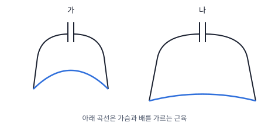
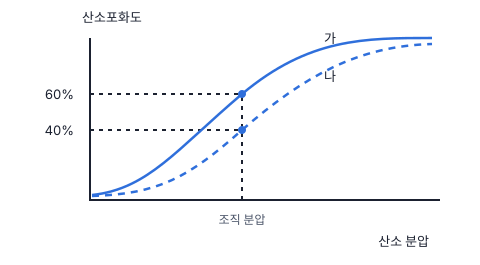

# 생명과학 복습 1119 문제설명

왼쪽 목차로 문항을 고르고, 오른쪽 문제를 보며 해설을 따라가요.

문제의 첫 줄부터 검산까지 설명해요.

**목차**

- [문항별 설명](#problems)
  - [P1. 혈액 세포의 생산 장소](#p1)
  - [P2. 들숨이 시작되는 이유](#p2)
  - [P3. 혈관의 총 단면적](#p3)
  - [P4. 방실판막의 위치](#p4)
  - [P5. 심장박동과 심장주기](#p5)
  - [P6. 혈액 CO₂와 pH](#p6)
  - [P7. 모세혈관 내피 통과](#p7)
  - [P8. 폐를 둘러싼 두 층](#p8)
  - [P9. 폐 모세혈관의 적혈구 반응](#p9)
  - [P10. 음압 들숨의 부피와 압력](#p10)
  - [P11. 동맥벽의 층과 탄성](#p11)
  - [P12. 모세혈관의 물질교환](#p12)
  - [P13. 포유류 심장과 순환 경로](#p13)
  - [P14. 잔기량과 폐활량](#p14)
  - [P15. 그림에서 찾는 들숨 근육](#p15)
  - [P16. 적혈구와 산소 운반 단백질](#p16)
  - [P17. 호흡 조절에 민감한 기체](#p17)
  - [P18. 호흡률을 높이는 변화](#p18)
  - [P19. 날숨 때 흉강 변화](#p19)
  - [P20. 폐순환의 혈액 이동 순서](#p20)
  - [P21. 동맥·정맥·모세혈관 비교](#p21)
  - [P22. 모세혈관의 흐름과 교환](#p22)
  - [P23. 순환계 기능과 혈액 세포 생산](#p23)
  - [P24. 폐에서 돌아오는 첫 심장 방](#p24)
  - [P25. 혈장의 성분](#p25)
  - [P26. 심장에 드나드는 혈관의 방향](#p26)
  - [P27. 뇌중추가 받는 호흡 조절 정보](#p27)
  - [P28. 화학수용체의 위치](#p28)
  - [P29. CO₂ 운반 그림의 공통 물질](#p29)
  - [P30. 혈액의 주된 산소 운반 방식](#p30)
  - [P31. 숨을 참을 때 호흡 욕구](#p31)
  - [P32. pH에 따른 산소 해리곡선](#p32)
  - [P33. 심장주기의 압력과 판막 소리](#p33)
  - [P34. [변형] 기도의 방어와 교환 표면](#p34)
  - [P35. [변형] 두 환기 상태의 전환](#p35)
  - [P36. [변형] 최대로 움직인 양과 남은 양](#p36)
  - [P37. [변형] 두 감지 위치에서 읽을 수 있는 변화](#p37)
  - [P38. [변형] 같은 조직 분압에서 산소 방출량 비교](#p38)
  - [P39. [변형] 폐에서 되돌아가는 탄소 형태](#p39)
  - [P40. [변형] 산소가 적은 혈액도 지나는 동맥](#p40)
  - [P41. [변형] 혈액 성분을 분리해서 보기](#p41)
  - [P42. [변형] 심실의 압력이 떨어지는 순간](#p42)
  - [P43. [변형] 심장의 신호 시작과 박동 측정](#p43)
  - [P44. [변형] 모세혈관 하나와 혈관망 전체](#p44)
  - [P45. [변형] 가는 관 수를 바꾼 교환 장치](#p45)
  - [P46. [변형] 심장의 첫 신호를 만드는 구조](#p46)

## 문항별 설명

### P1. 혈액 세포의 생산 장소

기출 13강 1 · [원 문제 보기](../%EB%B3%B5%EC%8A%B5%EB%AC%B8%EC%A0%9C_1119_Respiratory_and_Circulatory_Systems.html#p1)

사람의 혈액 세포들은 다음 중 어디에서 생산되는가?

- (1) 적색골수
- (2) 간
- (3) 림프절
- (4) 심장
- (5) 신장

기출 원문 보기

기출 13강 합본 1번 (PDF 1쪽)

#### 문제가 묻는 것

정상 성인의 혈액 세포가 만들어지는 곳을 골라요. 이미 만들어진 혈액이 지나거나 작용하는 장소와 생산 장소를 구별해요.

#### 이 문제를 봤을 때 떠올릴 개념과 공식

혈액 세포의 생산을 조혈(hematopoiesis)이라고 해요. 조혈줄기세포는 여러 종류의 혈구로 분화할 수 있어요. 적혈구·백혈구와 혈소판 계열의 출발점이 되는 골수 조직을 기준으로 판단해요.

신장이 보내는 적혈구생성소 신호는 정리노트의 보충 내용이에요.

[혈액의 조성과 기능](../%EC%A0%95%EB%A6%AC%EB%85%B8%ED%8A%B8_1119_Respiratory_and_Circulatory_Systems.html#s2-blood)

#### 왜 이렇게 푸는지 함께 따라가요

(1) 적색골수는 조혈줄기세포가 자라고 분화하는 장소예요. 정상 성인에서 묻는 생산 장소에 해당해요.

(2) 간은 발생기에 조혈에 참여할 수 있지만, 정상 성인에서 혈액 세포를 지속적으로 만들어 내는 주된 장소는 골수예요.

(3) 림프절은 면역 세포가 항원을 만나고 반응하는 곳이에요. 여러 혈액 세포 계열을 한꺼번에 만들어 내는 조혈 조직에 해당하지 않아요.

(4) 심장은 이미 만들어진 혈액을 순환시켜요. 혈구를 분화시키는 골수가 없어요.

(5) 신장은 적혈구생성소라는 신호를 보낼 수 있어요. 이 신호를 받아 적혈구 생산을 늘리는 곳이 골수예요.

정답 (1). 적색골수.

#### 완성 답과 검산

답 (1). 성분의 기원으로 다시 확인해요. 혈소판은 골수에 있는 큰 세포에서 떨어져 나온 조각이고, 적혈구와 여러 백혈구도 골수의 조혈줄기세포에서 유래해요.

**페이지 요약**

#### 판단 기준

적색골수에 있는 조혈줄기세포에서 여러 혈액 세포 계열이 시작돼요. 답 (1).

---

### P2. 들숨이 시작되는 이유

기출 13강 2 · [원 문제 보기](../%EB%B3%B5%EC%8A%B5%EB%AC%B8%EC%A0%9C_1119_Respiratory_and_Circulatory_Systems.html#p2)

사람의 흡기(들숨)동안 공기가 폐로 들어오는 이유는?

- (1) 폐포의 압력이 증가하여
- (2) 외늑간근과 횡격막의 수축으로 흉강의 부피가 증가하여
- (3) 기체가 압력이 낮은 지역에서 높은 지역으로 흐르므로
- (4) 횡경막이 수축할 때 양압(positive pressure)이 발생하므로
- (5) 폐 근육이 수축하여 폐 표면을 잡아당기므로

기출 원문 보기

기출 13강 합본 2번 (PDF 1쪽)

#### 문제가 묻는 것

들숨에서 외부 공기가 폐 안으로 이동하는 원인을 골라요.

#### 이 문제를 봤을 때 떠올릴 개념과 공식

들숨(inhalation)에는 횡격막과 외늑간근이 수축해 가슴 공간을 넓혀요. 폐도 함께 팽창하므로 공기가 들어오기 시작할 때 폐 안 공기압이 대기압보다 낮아져요. 근육의 작동, 부피 변화, 압력 차, 공기의 이동을 차례로 확인해요.

[흉막과 들숨·날숨](../%EC%A0%95%EB%A6%AC%EB%85%B8%ED%8A%B8_1119_Respiratory_and_Circulatory_Systems.html#s0-ventilation)

#### 왜 이렇게 푸는지 함께 따라가요

(1) 폐포의 압력이 증가해 대기압보다 높아지면 공기는 밖으로 나가는 방향으로 움직여요.

(2) 횡격막이 내려가고 외늑간근이 흉곽을 들어 올리면 흉강 부피가 커져요. 폐 안 압력이 내려가 공기가 들어와요.

(3) 압력이 낮은 곳에서 높은 곳으로 흐른다는 방향이 반대예요. 들숨에는 바깥 기압이 더 높아요.

(4) 횡격막이 수축하면 가슴 공간이 커지고 폐 안의 상대 압력이 떨어져요. 양압으로 밀어 넣는 과정에 해당하지 않아요.

(5) 폐 조직은 가슴 공간이 넓어지는 움직임을 따라 퍼져요. 들숨을 시작시키는 수축은 횡격막과 외늑간근에서 일어나요.

정답 (2). 외늑간근과 횡격막의 수축으로 흉강의 부피가 증가해요

#### 완성 답과 검산

답 (2). 공기 이동 방향을 거꾸로 이용해 확인해요. 바깥 공기가 들어오려면 폐 안이 더 낮은 압력이어야 하므로 폐 안 압력 증가나 양압 생성으로 설명할 수 없어요.

**페이지 요약**

#### 판단 기준

들숨 근육이 수축하면 흉강이 넓어져요. 폐 안 압력이 대기압보다 낮아지면 공기가 들어와요. 답 (2).

---

### P3. 혈관의 총 단면적

기출 13강 4 · [원 문제 보기](../%EB%B3%B5%EC%8A%B5%EB%AC%B8%EC%A0%9C_1119_Respiratory_and_Circulatory_Systems.html#p3)

다음 중 총 단면적이 가장 넓은 혈관은 무엇인가?

- (1) 동맥
- (2) 세동맥
- (3) 모세혈관
- (4) 세정맥
- (5) 정맥

기출 원문 보기

기출 13강 합본 4번 (PDF 1쪽)

#### 문제가 묻는 것

혈관 하나의 굵기와 한 구간의 혈관을 모두 합친 넓이를 구분하고, 후자가 가장 큰 구간을 찾아요.

#### 이 문제를 봤을 때 떠올릴 개념과 공식

총 단면적(total cross-sectional area)은 한 구간을 이루는 나란한 혈관의 단면적을 더한 값이에요. 예를 들어 한 가닥의 넓이가 1인 혈관이 100개면 그 구간의 총 단면적은 100이에요. 각 혈관의 단면적과 가지 수를 함께 생각해요.

[혈관의 구조와 모세혈관의 혈류](../%EC%A0%95%EB%A6%AC%EB%85%B8%ED%8A%B8_1119_Respiratory_and_Circulatory_Systems.html#s3-vessels)

#### 왜 이렇게 푸는지 함께 따라가요

(1) 동맥 하나의 단면적은 크지만, 이후 많은 작은 가지로 갈라져 동맥보다 모세혈관의 총 단면적이 커요.

(2) 세동맥도 여러 가닥이지만, 한 세동맥이 다시 여러 모세혈관으로 혈액을 보내요. 각 모세혈관 단면의 합이 더 커요.

(3) 모세혈관은 한 가닥이 매우 좁아도 수많은 혈관이 나란히 퍼져 있어 총 단면적이 가장 커요.

(4) 세정맥은 모세혈관의 혈액이 다시 모이는 구간이에요. 가닥을 합친 단면적은 모세혈관 구간보다 작아요.

(5) 정맥 하나의 단면적이 크더라도 모세혈관만큼 많은 가지를 더하는 구간이 아니에요.

정답 (3). 모세혈관.

#### 완성 답과 검산

답 (3). 혈류 속도로 확인해요. 같은 양의 혈액이 차례로 통과할 때 가장 느리게 흐르는 곳은 혈액이 나뉘어 지날 전체 단면적이 가장 큰 곳이에요. 모세혈관의 느린 흐름과 맞아요.

**페이지 요약**

#### 판단 기준

가닥 하나의 지름과 구간 전체의 단면적을 구분해요. 모세혈관의 총 단면적이 가장 커요. 답 (3).

---

### P4. 방실판막의 위치

기출 13강 5 · [원 문제 보기](../%EB%B3%B5%EC%8A%B5%EB%AC%B8%EC%A0%9C_1119_Respiratory_and_Circulatory_Systems.html#p4)

방실판막(atrioventricular valve, AV valve)은 어디에 위치하는가?

- (1) 좌심방과 좌심실의 사이 그리고 우심방과 우심실의 사이
- (2) 우심방과 우심실의 사이에만
- (3) 좌심방과 좌심실의 사이에만
- (4) 혈액이 대동맥으로 들어가는 부분
- (5) 혈액이 폐동맥으로 들어가는 부분

기출 원문 보기

기출 13강 합본 5번 (PDF 1쪽)

#### 문제가 묻는 것

방실판막이 심장의 어느 두 곳에 있는지 골라요.

#### 이 문제를 봤을 때 떠올릴 개념과 공식

판막(valve)은 한 방향으로 혈액을 보내고 역류를 막아요. 심방(atrium)은 심장으로 들어온 혈액을 받고 심실(ventricle)은 혈액을 동맥으로 내보내요. 방실판막은 심방에서 심실로 넘어가는 문이고 반월판막은 심실에서 동맥으로 나가는 문이에요.

[압력차와 심장 판막](../%EC%A0%95%EB%A6%AC%EB%85%B8%ED%8A%B8_1119_Respiratory_and_Circulatory_Systems.html#s3-cycle)

#### 왜 이렇게 푸는지 함께 따라가요

(1) 좌심방과 좌심실 사이, 우심방과 우심실 사이에 하나씩 있어요. 양쪽 모두 심방에서 심실로 넘어가는 자리예요.

(2) 우심방과 우심실 사이에도 있지만, 오른쪽에만 있다는 조건이 틀려요. 왼쪽 심방과 심실 사이에도 있어요.

(3) 좌심방과 좌심실 사이에도 있지만, 왼쪽에만 있다는 조건이 틀려요. 오른쪽에도 있어요.

(4) 대동맥 입구는 좌심실에서 동맥으로 나가는 곳이에요. 이 자리의 판막은 반월판막이에요.

(5) 폐동맥 입구는 우심실에서 동맥으로 나가는 곳이에요. 이 자리에도 반월판막이 있어요.

정답 (1). 양쪽 심방과 각 심실 사이.

#### 완성 답과 검산

답 (1). 역류 상황으로 확인해요. 두 심실이 수축하면 각각 자기 쪽 심방으로 피가 역류할 수 있으므로 두 심방과 심실 사이에 각각 판막이 필요해요.

**페이지 요약**

#### 판단 기준

방실판막은 같은 쪽 심방과 심실 사이에 하나씩 있어요. 심실의 동맥 출구에는 반월판막이 있어요. 답 (1).

---

### P5. 심장박동과 심장주기

기출 13강 6 · [원 문제 보기](../%EB%B3%B5%EC%8A%B5%EB%AC%B8%EC%A0%9C_1119_Respiratory_and_Circulatory_Systems.html#p5)

다음은 심장박동과 심장주기에 관한 설명이다. 설명 중 잘못된 것은?

- (1) 심근세포의 수축은 굴심방결절에 의해 조절된다
- (2) 심실이 이완을 시작하면 반월판막이 닫히고, 혈액들이 심방과 심실로 재유입된다
- (3) 심장의 수축기는 심장이 혈액을 내보내는 시기이다
- (4) 심장의 수축을 위해서는 외부자극이 필요하다
- (5) 심전도(ECG)는 심장주기를 촉발하는 전기 신호의 패턴을 측정한 것이다

기출 원문 보기

기출 13강 합본 6번 (PDF 1쪽)

#### 문제가 묻는 것

심장주기 설명에서 **잘못된 진술**을 찾아요. 박동을 시작시키는 전기 신호와 그 뒤의 판막·혈액 변화를 구분해요.

**문항 결함:** (2)는 반월판막이 닫히는 시점과 이후 심실에 혈액이 들어오는 시점을 한 문장에 묶어요.

#### 이 문제를 봤을 때 떠올릴 개념과 공식

박동원 세포(pacemaker cell)가 있는 굴심방결절은 동방결절과 같은 구조예요. 여기에서 박동을 시작시키는 신호가 생겨요. 심실이 수축해 내부 압력이 동맥보다 높아지면 혈액을 내보내고, 이완으로 압력이 낮아지면 순서에 따라 판막 상태가 바뀌어요. 심전도(ECG)는 신호를 기록한 결과예요.

[심장 박동의 시작과 심전도](../%EC%A0%95%EB%A6%AC%EB%85%B8%ED%8A%B8_1119_Respiratory_and_Circulatory_Systems.html#s3-pacemaker) · [압력차와 심장 판막](../%EC%A0%95%EB%A6%AC%EB%85%B8%ED%8A%B8_1119_Respiratory_and_Circulatory_Systems.html#s3-cycle)

#### 왜 이렇게 푸는지 함께 따라가요

(1) 굴심방결절에 있는 박동원 세포가 전기 신호를 시작해 심장의 수축 시기를 조절해요. 맞는 설명이에요.

(2) 심실 이완 초기에 동맥의 압력이 심실보다 높아져 반월판막이 닫혀요. 뒤이어 심실 압력이 심방보다 낮아지면 방실판막이 열리고 다시 채워져요. (2)는 이완 과정 전체의 흐름으로는 맞아요.

(3) 심실 수축으로 압력이 동맥 쪽보다 높아지는 동안 혈액이 나가요. 혈액을 내보내는 수축기의 특징에 해당해요.

(4) ‘외부자극이 필요하다’가 틀려요. 정상 박동의 시작 신호가 심장 안에서 생기므로 외부에서 매번 자극을 받아야 뛴다는 조건은 성립하지 않아요.

(5) 심전도는 심장주기를 일으키는 전기 활동을 피부 전극으로 기록해요. 전기 활동을 측정한다는 설명이 맞아요.

틀린 진술은 (4) “심장의 수축을 위해서는 외부자극이 필요하다”예요

#### 완성 답과 검산

답 (4). 정상 박동을 시작하는 곳을 확인하면 외부 신호가 반드시 필요하다는 (4)를 배제할 수 있어요. (2)는 시차가 있는 두 사건을 한 문장에 압축했어요.

#### 주의할 점

시험에서 (2)는 심실 이완기 전체의 사건으로 읽어요. 두 사건이 동시에 일어나는지 묻는다면 반월판막이 닫힌 뒤 잠시 두 종류 판막이 닫혀 있고, 이후에 방실판막이 열린다고 설명해요.

**페이지 요약**

#### 판단 기준

정상 박동의 시작 신호는 굴심방결절에서 생겨요. 반월판막 닫힘과 심실 재충전 사이에는 시차가 있어요. 답 (4).

---

### P6. 혈액 CO₂와 pH

기출 13강 7 · [원 문제 보기](../%EB%B3%B5%EC%8A%B5%EB%AC%B8%EC%A0%9C_1119_Respiratory_and_Circulatory_Systems.html#p6)

혈액 속의 CO₂ 농도가 _________하면 pH ______의 원인이 되어 호흡이 빨라진다.

- (1) 증가, 증가
- (2) 증가, 감소
- (3) 감소, 감소
- (4) 답이 없다
- (5) 감소, 증가

기출 원문 보기

기출 13강 합본 7번 (PDF 1쪽)

#### 문제가 묻는 것

혈액의 CO₂ 변화와 pH 변화 중 호흡을 빠르게 하는 짝을 찾아요.

#### 이 문제를 봤을 때 떠올릴 개념과 공식

CO₂가 물과 반응하면 탄산을 거쳐 수소 이온(H⁺)이 생길 수 있어요. 다른 조건이 같을 때 CO₂가 늘면 수소 이온이 증가하고 pH는 낮아져요. 화학수용체(chemoreceptor)가 이런 변화를 감지하면 호흡이 활발해져요.

[호흡 중추와 화학수용체](../%EC%A0%95%EB%A6%AC%EB%85%B8%ED%8A%B8_1119_Respiratory_and_Circulatory_Systems.html#s1-control)

#### 왜 이렇게 푸는지 함께 따라가요

(1) CO₂가 증가하면 수소 이온도 늘어 pH가 내려가는 방향이에요. pH 증가와 짝지을 수 없어요.

(2) CO₂ 증가가 수소 이온 증가와 pH 감소로 이어져요. 화학수용체가 반응해 호흡을 늘리는 방향에 해당해요.

(3) CO₂가 감소하면 반응은 수소 이온을 줄이는 쪽으로 기울어요. 다른 변화가 없다면 pH가 감소하지 않아요.

(4) CO₂ 증가와 pH 감소라는 짝이 보기에 있으므로 답이 없다는 말은 성립하지 않아요.

(5) CO₂ 감소와 pH 증가는 가능한 짝이에요. 다만 이 경우는 수업에서 다룬 화학적 호흡 자극이 줄어드는 방향이에요.

정답 (2). 증가, 감소.

#### 완성 답과 검산

답 (2). 피드백의 결과로 검산해요. 호흡이 빨라져 CO₂가 더 많이 빠져나가면 증가했던 CO₂가 줄어들고 낮아진 pH는 회복되는 방향으로 가요.

**페이지 요약**

#### 판단 기준

CO₂ 증가로 수소 이온이 늘어 pH가 떨어지면 화학수용체가 호흡을 늘려요. 답 (2).

---

### P7. 모세혈관 내피 통과

기출 13강 8 · [원 문제 보기](../%EB%B3%B5%EC%8A%B5%EB%AC%B8%EC%A0%9C_1119_Respiratory_and_Circulatory_Systems.html#p7)

다음 중 모세혈관 내피세포를 쉽게 빠져나올 수 없는 것을 고르시오.

- (1) 물
- (2) 적혈구
- (3) 산소
- (4) 포도당
- (5) 이산화탄소

기출 원문 보기

기출 13강 합본 8번 (PDF 1쪽)

#### 문제가 묻는 것

보통 모세혈관에서 혈관 벽을 **쉽게 빠져나가지 못하는 것**을 골라요. 혈관 안을 지나가는 것과 벽을 가로질러 나가는 것은 서로 다른 움직임이에요.

#### 이 문제를 봤을 때 떠올릴 개념과 공식

내피(endothelium)는 혈액과 맞닿는 얇은 세포층이에요. 보통 몸조직 모세혈관에서는 기체와 작은 용질, 물이 이동할 수 있어요. 온전한 혈구는 작은 분자보다 훨씬 크기 때문에 대부분 혈관에 머물러요. 구체적인 투과성은 조직에 따라 달라져요.

[혈관의 구조와 모세혈관의 혈류](../%EC%A0%95%EB%A6%AC%EB%85%B8%ED%8A%B8_1119_Respiratory_and_Circulatory_Systems.html#s3-vessels)

#### 왜 이렇게 푸는지 함께 따라가요

(1) 물은 압력 차와 삼투에 따른 물 이동에 참여하므로 혈관과 조직액 사이를 오갈 수 있어요.

(2) 적혈구는 통째로 움직이는 세포예요. 혈관 안을 따라 한 줄로 흐를 수 있지만 정상적인 모세혈관벽은 쉽게 통과하지 못해요.

(3) 산소는 작은 기체 분자예요. 보통 몸조직에서는 혈액에서 조직 쪽으로 분압 차를 따라 확산할 수 있어요.

(4) 포도당은 작은 용질이에요. 보통의 몸조직 모세혈관에서는 조직액 쪽으로 이동해 세포의 에너지원이 될 수 있어요.

(5) 이산화탄소는 작은 기체 분자예요. 보통 몸조직에서 만들어진 CO₂는 분압 차를 따라 혈액으로 들어가기도 해요.

정답 (2). 적혈구.

#### 완성 답과 검산

답 (2). 나머지 네 보기는 물이나 용해된 작은 물질이에요. 적혈구만 그 자체로 혈관 안을 도는 세포여서 보통의 내피를 쉽게 빠져나가지 않는 기준에 맞아요.

**페이지 요약**

#### 판단 기준

물과 작은 분자는 조건에 따라 모세혈관벽을 오갈 수 있어요. 적혈구는 정상적인 벽 안에 머물러요. 답 (2).

---

### P8. 폐를 둘러싼 두 층

기출 13강 9 · [원 문제 보기](../%EB%B3%B5%EC%8A%B5%EB%AC%B8%EC%A0%9C_1119_Respiratory_and_Circulatory_Systems.html#p8)

폐를 덮고 있으며 사이에 미끄러운 액체로 채워져 있어서 폐의 움직임을 돕는 두 층의 상피조직을 무엇이라고 하는가?

- (1) 횡경막
- (2) 폐포
- (3) 내늑각근
- (4) 흉막
- (5) 외늑각근

기출 원문 보기

기출 13강 합본 9번 (PDF 1쪽)

#### 문제가 묻는 것

폐를 덮고 사이에 액체가 있는 두 층의 구조를 찾아요.

#### 이 문제를 봤을 때 떠올릴 개념과 공식

흉막(pleura)은 폐 표면을 덮는 층과 가슴벽 안쪽을 덮는 층으로 이루어져요. 그 사이에 소량의 액체가 있어 호흡 운동 중 서로 잘 미끄러져요. ‘폐 표면을 덮는 두 층’과 ‘사이의 액체’를 단서로 써요.

[흉막과 들숨·날숨](../%EC%A0%95%EB%A6%AC%EB%85%B8%ED%8A%B8_1119_Respiratory_and_Circulatory_Systems.html#s0-ventilation)

#### 왜 이렇게 푸는지 함께 따라가요

(1) 원문의 ‘횡경막’은 횡격막을 가리켜요. 가슴과 배를 나누는 근육으로, 폐를 감싸는 두 층에 해당하지 않아요.

(2) 폐포는 기체교환이 일어나는 작은 공기주머니예요. 폐의 바깥을 덮는 두 겹의 막과 구별돼요.

(3) 원문의 내늑각근은 갈비 사이의 근육을 가리켜요. ‘두 막과 사이의 액체’라는 구조 조건이 맞지 않아요.

(4) 흉막은 폐 표면 쪽과 가슴벽 쪽에 각각 한 층이 있고, 사이의 액체가 움직일 때 마찰을 줄이는 구조예요.

(5) 원문의 외늑각근은 들숨 때 흉곽을 들어 올리는 갈비 사이 근육을 가리켜요. 폐 표면을 덮는 막을 뜻하지 않아요.

정답 (4). 흉막.

#### 완성 답과 검산

답 (4). 장소와 기능을 각각 확인해요. 폐를 직접 둘러싼 막이어야 하고 두 층이 미끄러질 수 있어야 해요. 수축하는 근육과 폐 안쪽 공기주머니는 두 조건을 함께 만족시키지 않아요.

**페이지 요약**

#### 판단 기준

폐 표면과 가슴벽 쪽을 덮는 두 층은 흉막이에요. 층 사이의 액체는 호흡할 때 마찰을 줄여요. 답 (4).

---

### P9. 폐 모세혈관의 적혈구 반응

기출 13강 10 · [원 문제 보기](../%EB%B3%B5%EC%8A%B5%EB%AC%B8%EC%A0%9C_1119_Respiratory_and_Circulatory_Systems.html#p9)

폐의 모세혈관에 있는 적혈구에서 우세하게 일어나는 반응은? (Hb=헤모글로빈)

- (1) Hb + 4 O₂ → Hb(O₂)₄
- (2) H₂CO₃ → H⁺+ HCO₃⁻
- (3) CO₂+ H₂O → H₂CO₃
- (4) Hb + 4 CO₂ → Hb(CO₂)₄
- (5) Hb(O₂)₄ → Hb + 4 O₂

기출 원문 보기

기출 13강 합본 10번 (PDF 1쪽)

#### 문제가 묻는 것

폐의 모세혈관 안에 있는 적혈구에서 기체가 어느 방향으로 결합하거나 풀리는지 판단해요.

#### 이 문제를 봤을 때 떠올릴 개념과 공식

폐포의 산소 분압(partial pressure)은 유입 혈액 쪽보다 높고, 폐포 쪽으로 CO₂가 배출돼요. 따라서 적혈구는 산소를 싣고 CO₂를 내려놓는 쪽으로 움직여요. Hb는 헤모글로빈이에요. 반응식에서 결합의 방향을 먼저 가려요.

[헤모글로빈과 산소 운반](../%EC%A0%95%EB%A6%AC%EB%85%B8%ED%8A%B8_1119_Respiratory_and_Circulatory_Systems.html#s1-oxygen) · [이산화탄소 운반](../%EC%A0%95%EB%A6%AC%EB%85%B8%ED%8A%B8_1119_Respiratory_and_Circulatory_Systems.html#s1-carbon)

#### 왜 이렇게 푸는지 함께 따라가요

(1) Hb와 O₂가 결합해 산소가 결합된 Hb가 되는 식이에요. 폐에서 산소가 적혈구 쪽으로 들어오므로 이 방향이 유리해요.

(2) 탄산이 수소 이온과 중탄산 이온으로 갈라지는 식이에요. 폐에서는 중탄산 이온이 CO₂로 되돌아오는 방향이 전체적으로 우세해요.

(3) CO₂가 물과 만나 탄산을 만드는 방향을 나타내요. 폐에서는 CO₂가 공기 쪽으로 빠져나가므로 반대 방향을 확인해야 해요.

(4) CO₂가 Hb에 붙는 방향이에요. 폐에서는 CO₂를 내보내야 하므로 헤모글로빈에 결합한 일부 CO₂도 떨어져요.

(5) 산소가 Hb에서 풀려나는 방향이에요. 비교적 산소 분압이 낮아 산소가 필요한 몸조직 쪽과 어울려요.

정답 (1). Hb + 4 O₂ → Hb(O₂)₄.

#### 완성 답과 검산

답 (1). 폐포와 적혈구의 분압 차로 다시 확인해요. 폐포에서 온 산소가 적혈구로 계속 공급되므로 Hb 결합 방향인 (1)은 폐의 기체교환 방향과 들어맞아요.

**페이지 요약**

#### 판단 기준

폐 모세혈관에서는 산소가 Hb에 결합해요. CO₂는 중탄산 이온 등에서 다시 생겨나 폐포로 배출돼요. 답 (1).

---

### P10. 음압 들숨의 부피와 압력

기출 13강 11 · [원 문제 보기](../%EB%B3%B5%EC%8A%B5%EB%AC%B8%EC%A0%9C_1119_Respiratory_and_Circulatory_Systems.html#p10)

음압메커니즘에 따르면, 흡기(inhalation, 들숨) 동안 흉강의 부피는 ( )되고 이것은 폐의 공기압을 대기압보다 ( )시킨다. 결과적으로 공기가 폐로 들어간다.

- (1) 증가, 증가
- (2) 감소, 감소
- (3) 증가, 감소
- (4) 감소, 증가
- (5) 유지, 증가

기출 원문 보기

기출 13강 합본 11번 (PDF 1쪽)

#### 문제가 묻는 것

들이쉬는 동안 흉강 부피가 어떻게 바뀌고, 그 때문에 폐 안 공기압은 대기압에 비해 어느 방향으로 바뀌는지 순서대로 골라요.

#### 이 문제를 봤을 때 떠올릴 개념과 공식

음압 호흡(negative-pressure breathing)은 폐 안 공기압을 바깥 기압보다 낮춰 공기를 들이는 방식이에요. 횡격막과 외늑간근이 수축한 직후 흉강과 폐가 넓어지고, 폐 안 공기압이 일시적으로 떨어져요.

[흉막과 들숨·날숨](../%EC%A0%95%EB%A6%AC%EB%85%B8%ED%8A%B8_1119_Respiratory_and_Circulatory_Systems.html#s0-ventilation)

#### 왜 이렇게 푸는지 함께 따라가요

(1) 흉강 부피가 증가하는 첫 칸은 맞아요. 두 번째 칸은 폐 안 공기압이 낮아져야 하므로 틀려요.

(2) 폐 안 공기압이 낮아진다는 두 번째 칸은 맞아요. 흉강 부피는 감소하지 않고 증가해요.

(3) 흉강이 넓어진 뒤 폐의 공기압이 대기압보다 낮아져요. 두 칸을 올바른 순서로 채웠어요.

(4) 흉강이 줄고 폐 안 압력이 높아지는 조합은 평상시 날숨에 어울려요.

(5) 들이쉬는 동안에는 흉강 부피가 늘어요. 폐 안의 압력 역시 공기가 들어오는 구간에서 대기압보다 낮아요.

정답 (3). 증가, 감소.

#### 완성 답과 검산

답 (3). 발문의 마지막 결과로 확인해요. 공기가 폐로 들어오려면 높은 압력인 바깥에서 낮은 압력인 폐로 향해야 하므로 두 번째 칸은 ‘감소’여야 해요. 남은 후보 중 횡격막 수축은 흉강을 넓혀요.

**페이지 요약**

#### 판단 기준

음압의 비교 기준은 대기압이에요. 들숨을 시작하면 흉강 부피가 증가하고 폐 안 압력이 낮아져요. 답 (3).

---

### P11. 동맥벽의 층과 탄성

기출 13강 12 · [원 문제 보기](../%EB%B3%B5%EC%8A%B5%EB%AC%B8%EC%A0%9C_1119_Respiratory_and_Circulatory_Systems.html#p11)

다음과 같은 특징을 지니는 혈관은 무엇인가? “가장 바깥층은 콜라젠섬유와 엘라스틴 단백질 섬유가 섞인 결합조직층으로 혈관에 반발력을 제공하며, 상대적으로 두꺼운 가운데층은 엘라스틴 섬유와 섞인 혈관 민무늬근 세포로 이루어진다.”

- (1) 세정맥
- (2) 동맥
- (3) 모세혈관
- (4) 세동맥
- (5) 정맥

기출 원문 보기

기출 13강 합본 12번 (PDF 1쪽)

#### 문제가 묻는 것

가장 바깥층과 가운데층이 탄성 조직을 갖고 특히 가운데층이 두꺼운 혈관을 찾는 문제예요.

**문항 결함:** 원본 PDF에는 (5)의 ‘정맥’ 뒤에 20번 발문의 일부가 붙어 있어요.

#### 이 문제를 봤을 때 떠올릴 개념과 공식

콜라젠은 조직이 늘어나는 힘을 견디는 단백질이고 엘라스틴은 늘어난 조직이 다시 돌아오는 성질을 제공해요. 큰 동맥은 심실 수축으로 생기는 압력을 받으므로 두꺼운 벽과 탄성 반동이 필요해요. 가운데층의 민무늬근은 지름 조절에 관여해요.

동맥의 구체적인 층별 성분은 정리노트의 보충 내용이에요.

[혈관의 구조와 모세혈관의 혈류](../%EC%A0%95%EB%A6%AC%EB%85%B8%ED%8A%B8_1119_Respiratory_and_Circulatory_Systems.html#s3-vessels)

#### 왜 이렇게 푸는지 함께 따라가요

(1) 세정맥은 여러 모세혈관을 지난 혈액을 모아서 정맥 쪽으로 보내요. 높은 박동 압력을 받는 두꺼운 탄성 벽이 주된 특징이 아니에요.

(2) 동맥은 발달한 가운데층과 콜라젠·엘라스틴이 있는 바깥층으로 압력을 받으면서도 늘어났다 돌아올 수 있어요.

(3) 모세혈관은 물질 교환을 돕는 얇은 내피가 벽의 중심이에요. 보기처럼 두꺼운 민무늬근 층이 없어요.

(4) 세동맥에 민무늬근은 있지만, 지문에서 두꺼운 엘라스틴 조직과 반발력을 함께 설명한 점은 큰 동맥의 특징에 해당해요.

(5) 정맥은 낮은 압력으로 돌아오는 혈액을 담고 같은 크기의 동맥보다 벽이 보통 더 얇아요. 지문의 구조가 전형적인 정맥의 특징은 아니에요.

정답 (2). 동맥.

#### 완성 답과 검산

답 (2). 구조가 쓰이는 상황으로 검산해요. 심실이 한 번 수축해 들어오는 혈액을 받아 벽이 늘어나고 다시 돌아와 흐름을 유지하는 역할을 하는 쪽은 동맥이에요. (5)에 붙은 다른 발문 조각을 제외하고 혈관 이름으로만 판단했어요.

#### 주의할 점

시험에서는 (5)의 혈관 이름인 ‘정맥’까지만 선택지로 읽고, 다른 문항의 발문 조각은 혈관을 판별하는 단서에서 제외해요.

**페이지 요약**

#### 판단 기준

지문의 기준은 민무늬근 하나보다 높은 압력을 견디는 두께와 탄성 반동이에요. 큰 동맥이 해당해요. PDF (5) 뒤에 붙은 20번 발문 조각은 혈관 보기에서 제외해요. 답 (2).

---

### P12. 모세혈관의 물질교환

기출 13강 13 · [원 문제 보기](../%EB%B3%B5%EC%8A%B5%EB%AC%B8%EC%A0%9C_1119_Respiratory_and_Circulatory_Systems.html#p12)

모세혈관에서의 물질교환이 일어날 때 _______________.

- (1) 적혈구는 모세혈관 내부를 두 줄로 서로 겹쳐서 지나갈 수 있다
- (2) 혈액 흐름에 대한 저항이 동맥이나 정맥에서보다 약하다
- (3) 확산은 세정맥 쪽에 가까운 곳에서 가장 강하게 일어난다
- (4) 물, 이온, 포도당 그리고 적혈구들은 혈액과 조직 사이를 자유롭게 통과할 수 있다
- (5) 농도기울기에 따른 확산과 대량이동이 작동한다

기출 원문 보기

기출 13강 합본 13번 (PDF 2쪽)

#### 문제가 묻는 것

모세혈관에서 혈액과 주변 조직액 사이로 물질이 오갈 때 실제로 어떤 과정이 작용하는지 찾아요.

#### 이 문제를 봤을 때 떠올릴 개념과 공식

확산(diffusion)은 물질이 자신의 농도 차를 따라 이동하는 과정이에요. 대량이동(bulk flow)은 압력 차 때문에 물이 움직이면서 일부 용질도 함께 움직이는 과정이에요. 온전한 적혈구가 혈관을 따라 움직이는 일과 벽을 통과하는 교환을 따로 판단해요.

압력에 의한 대량이동의 세부 내용은 정리노트의 모세혈관 보충에 있어요.

[혈관의 구조와 모세혈관의 혈류](../%EC%A0%95%EB%A6%AC%EB%85%B8%ED%8A%B8_1119_Respiratory_and_Circulatory_Systems.html#s3-vessels)

#### 왜 이렇게 푸는지 함께 따라가요

(1) 모세혈관 하나의 지름이 작아 적혈구는 보통 한 줄로 지나가요. ‘두 줄로 겹쳐서’는 그 가느다란 구조와 맞지 않아요.

(2) 가느다란 개별 모세혈관은 흐름에 큰 저항을 줄 수 있고, 머리부터 끝까지의 전체 저항은 가지의 병렬 연결과 다른 혈관 구간의 저항에 따라 달라져요. 단순히 동맥이나 정맥보다 약하다고 일반화할 수 없어요.

(3) 확산의 세기는 각 물질의 농도 차와 투과성에 따라 달라요. 세정맥에 가까운 쪽이라는 위치만으로 가장 강하다고 할 수 없어요.

(4) 물과 작은 용질은 내피를 통해 움직일 수 있어요. 적혈구는 온전한 혈구여서 일반적인 모세혈관 안에 남는다는 점이 이 묶음의 오류예요.

(5) 작은 물질은 농도 차를 따라 확산하고, 물이 압력 차로 이동할 때 일부 용질이 같이 움직여요. 두 과정은 모세혈관과 조직액 사이의 교환에 관여해요.

정답 (5). 농도기울기에 따른 확산과 대량이동이 작동한다.

#### 완성 답과 검산

답 (5). 폐에서 산소가 기체 분압 차를 따라 옮겨 가는 것과 모세혈관에서 물이 압력 차에 따라 여과되는 예를 비교해요. 두 사례는 모두 교환이지만 구동 조건이 달라 두 과정이 필요해요.

**페이지 요약**

#### 판단 기준

농도 차는 확산을, 압력 차는 물과 일부 용질의 대량이동을 일으켜요. 혈구는 보통 벽 안에 남아요. 답 (5).

---

### P13. 포유류 심장과 순환 경로

기출 13강 14 · [원 문제 보기](../%EB%B3%B5%EC%8A%B5%EB%AC%B8%EC%A0%9C_1119_Respiratory_and_Circulatory_Systems.html#p13)

다음 포유동물의 심장에 관한 설명 중 틀린 것은?

- (1) 포유동물은 2개의 심방과 2개의 심실로 이루어진다
- (2) 폐순환의 혈액은 좌심실에서 시작하여 대동맥, 동맥을 거쳐 우심방으로 들어온다
- (3) 심장 자체에도 관상순환이라는 혈액의 순환이 존재한다
- (4) 체순환은 조직세포에 O₂와 영양분을 공급하고 노폐물과 CO₂를 받아온다
- (5) 심방의 경우 심실에 비하여 크기가 작고 근육이 얇다

기출 원문 보기

기출 13강 합본 14번 (PDF 2쪽)

#### 문제가 묻는 것

포유류 심장의 구조와 혈액의 흐름을 읽고 **틀린 설명**을 골라요.

#### 이 문제를 봤을 때 떠올릴 개념과 공식

혈액을 받는 방이 심방, 내보내는 방이 심실이에요. 폐순환은 심장에서 폐를 거쳐 심장으로 돌아오고, 체순환은 몸의 조직으로 갔다 돌아와요. 심장 근육에 혈액을 공급하는 경로는 관상순환이에요. 경로가 섞인 보기에서는 출발한 심실과 목적지를 비교해요.

관상순환의 별도 경로와 심방·심실의 벽 두께는 정리노트의 보충 내용이에요.

[심장의 네 방과 두 순환](../%EC%A0%95%EB%A6%AC%EB%85%B8%ED%8A%B8_1119_Respiratory_and_Circulatory_Systems.html#s2-circuits)

#### 왜 이렇게 푸는지 함께 따라가요

(1) 포유류의 심장은 오른쪽과 왼쪽에 심방과 심실이 한 쌍씩 있어요. 두 심방·두 심실이라는 설명이 맞아요.

(2) 좌심실에서 대동맥을 지나 나가는 혈액은 몸을 돌고 우심방으로 와요. 여기 붙은 ‘폐순환’이라는 이름이 틀렸어요.

(3) 관상순환은 심장근육 자체에 산소와 영양분을 보내요. 심장도 살아 있는 조직이므로 별도 혈액 공급이 필요해요.

(4) 체순환에서는 말초 조직에 산소·영양소를 내어주고, 이산화탄소와 노폐물을 받아 돌아와요.

(5) 심방은 심실보다 크기가 작고 근육벽이 얇아요. 심실은 동맥으로 혈액을 밀어낼 압력을 만들어야 하므로 근육벽이 더 두꺼워요.

틀린 진술은 (2) “폐순환의 혈액은 좌심실에서 시작하여 대동맥, 동맥을 거쳐 우심방으로 들어온다”예요

#### 완성 답과 검산

답 (2). 보기 (2)의 고리를 목적지로 확인해요. 대동맥이 폐로 향하지 않고 온몸으로 이어지므로 경로에 붙인 폐순환이라는 이름과 맞지 않아요. 폐로 떠나는 출구는 우심실에 있어요.

**페이지 요약**

#### 판단 기준

우심실에서 나가면 폐순환, 좌심실에서 나가면 체순환이에요. 관상순환은 심장근육을 공급해요. 답 (2).

---

### P14. 잔기량과 폐활량

기출 13강 15 · [원 문제 보기](../%EB%B3%B5%EC%8A%B5%EB%AC%B8%EC%A0%9C_1119_Respiratory_and_Circulatory_Systems.html#p14)

다음 설명 중 틀린 것을 고르시오.

- (1) 최대한 강제적으로 호기를 하면 폐에 공기를 남기지 않을 수 있다
- (2) 육체적 활동이 증가하면 1회 호흡량은 증가한다
- (3) 폐활량이란 최대 1회 호흡량이다
- (4) 1회 호흡량이란 흡기와 호기 동안 폐로 들어가고 나가는 공기의 부피를 말한다
- (5) 기체교환은 폐로 흐르는 혈액과 폐포 안의 공기 사이에서 항상 일어난다

기출 원문 보기

기출 13강 합본 15번 (PDF 2쪽)

#### 문제가 묻는 것

폐가 드나들게 할 수 있는 공기량과 폐에 남는 공기량을 구분하여 **틀린 설명**을 고르는 문항이에요.

**문항 결함:** (3)의 ‘최대 1회 호흡량’은 강의노트에서 폐활량을 줄여 쓴 표현이에요. (5)의 ‘항상’에는 폐포 환기와 혈류가 유지된다는 조건이 생략돼 있어요.

#### 이 문제를 봤을 때 떠올릴 개념과 공식

1회 호흡량(tidal volume)은 보통 한 번 호흡할 때 이동하는 부피예요. 폐활량(vital capacity)은 최대 들숨부터 최대 날숨까지 내보낼 수 있는 부피예요. 잔기량(residual volume)은 그 뒤에도 폐에 남는 부피예요. 각 보기가 이동 가능한 양과 남아 있는 양 중 무엇을 말하는지 확인해요.

[1회 호흡량·폐활량·잔기량](../%EC%A0%95%EB%A6%AC%EB%85%B8%ED%8A%B8_1119_Respiratory_and_Circulatory_Systems.html#s0-volumes)

#### 왜 이렇게 푸는지 함께 따라가요

(1) ‘강하게 내쉬면 폐에 공기 0’이라는 주장이 틀려요. 최대한 내쉰 뒤에도 잔기량이 남아요.

(2) 신체 활동이 늘어날 때는 호흡량을 늘리기 위해 보통 숨이 더 깊어져요. 한 번 이동하는 부피도 늘 수 있어요.

(3) 강의노트의 ‘최대 1회 호흡량’은 한 번에 최대한 들이쉰 뒤 최대한 내보낼 때 이동한 부피를 뜻해요. 생리학에서 1회 호흡량(tidal volume)은 보통 한 번 숨 쉴 때의 부피이고, 폐활량(vital capacity)은 최대 들숨과 최대 날숨 사이의 부피예요. 두 용어를 엄밀히 구별하면 (3)은 강의의 줄인 표현이에요.

(4) 흡기와 호기 동안 폐로 들어오거나 나가는 부피는 한 번의 호흡에서 교환되는 공기의 양을 뜻하므로 1회 호흡량의 설명이 맞아요.

(5) 폐포의 환기와 혈류가 유지된다는 조건에서는 기체교환이 이어져요. ‘항상’을 조건 없이 읽어 환기나 혈류가 끊긴 때까지 포함하면 틀릴 수 있어요.

정답 (1). 인쇄 의도에서 틀린 설명은 (1)이며, (5)의 ‘항상’에는 정상적으로 환기·혈류가 유지된다는 조건이 필요해요

#### 완성 답과 검산

답 (1). 최대로 날숨 한 뒤 남은 부피를 떠올려요. 폐활량을 전부 내보내도 잔기량이 남으므로 (1)은 정상 조건에서도 틀려요. (3)은 강의에서 최대 들숨과 최대 날숨의 부피 차를 가리킨 표현이고, (5)는 정상 환기·관류 조건에서의 설명이에요.

#### 주의할 점

시험에서 강의노트의 표현과 정상 호흡을 전제한다면 잔기량이 0이라는 (1)을 골라요. 개념을 직접 정의할 때는 1회 호흡량과 폐활량을 각각 써요. ‘항상’이 모든 상태를 뜻한다면, 환기나 혈류가 끊긴 폐포에서는 교환이 지속되지 않는다는 반례를 표시해요.

**페이지 요약**

#### 판단 기준

최대 날숨 뒤에도 잔기량이 남아 인쇄 답은 (1)이에요. (3)의 표현은 평소 1회 호흡량과 구별하고, (5)는 환기와 혈류가 유지되는 경우에 적용해요. 답 (1).

---

### P15. 그림에서 찾는 들숨 근육

기출 13강 17 · [원 문제 보기](../%EB%B3%B5%EC%8A%B5%EB%AC%B8%EC%A0%9C_1119_Respiratory_and_Circulatory_Systems.html#p15)

폐에 공기를 채우게 하기 위하여 수축되는 흉곽과 복강 사이의 근육층은 무엇인가?

- (1) G
- (2) E
- (3) B
- (4) D
- (5) F

기출 원문 보기

기출 13강 합본 17번 (PDF 2쪽)

#### 문제가 묻는 것

그림에서 수축할 때 흉곽을 넓혀 공기가 들어오게 하는 근육을 찾아요. 단서는 흉곽과 복강 사이에 있다는 위치예요.

#### 이 문제를 봤을 때 떠올릴 개념과 공식

횡격막(diaphragm)은 가슴과 배를 가르는 돔 모양의 근육이에요. 수축하면 아래쪽으로 움직여 흉강이 커져요. 그림에서 공기의 길을 따라가는 대신 폐의 아래쪽과 복강의 위쪽을 가르는 경계를 따라가요.

[흉막과 들숨·날숨](../%EC%A0%95%EB%A6%AC%EB%85%B8%ED%8A%B8_1119_Respiratory_and_Circulatory_Systems.html#s0-ventilation)

#### 왜 이렇게 푸는지 함께 따라가요

(1) G는 폐 아래에서 가슴과 배를 가르는 곡선 모양 층을 가리켜요. 횡격막의 위치와 기능에 들어맞아요.

(2) E는 그림에서 폐의 윗부분을 가리켜요. 흉곽과 복강을 나누는 아래쪽 근육층에 있지 않아요.

(3) B는 폐로 공기를 보내는 기관에 연결돼 있어요. 가슴 바닥의 근육층이 아니에요.

(4) D는 폐 안에서 가지로 갈라지는 기관지 쪽을 표시해요. 공기 통로라는 점에서 근육층과 구별돼요.

(5) F는 흉곽 옆쪽 구조를 가리켜요. 늑간근 같은 가슴벽 근육도 들숨에 작용할 수 있지만 문제에서 요구한 가슴과 배의 경계는 아래쪽이에요.

정답 (1). G, 횡격막.

#### 완성 답과 검산

답 (1). 선택한 G가 아래로 움직일 때 어떤 변화가 생기는지 확인해요. 가슴 바닥이 내려가 흉강이 넓어지므로 폐에 공기를 채우는 기능 조건과도 맞아요.

**페이지 요약**

#### 판단 기준

횡격막은 폐 아래에서 가슴과 배를 가르는 층이에요. 그림에서는 G에 해당해요. 답 (1).

---

### P16. 적혈구와 산소 운반 단백질

기출 13강 19 · [원 문제 보기](../%EB%B3%B5%EC%8A%B5%EB%AC%B8%EC%A0%9C_1119_Respiratory_and_Circulatory_Systems.html#p16)

다음 중 적혈구에 대한 설명으로 옳지 않은 것은?

- (1) 적혈구생성소(EPO) 호르몬에 의해 생산이 증가된다
- (2) 폐로부터 조직 곳곳으로 산소를 운반하는데 적당하다
- (3) 혈액의 세포 성분 중 가장 수가 많다
- (4) 수명이 다하면 대식세포에 의해 파괴된다
- (5) 산소를 운반하는 철 원자가 포함된 피브리노겐이 들어있다

기출 원문 보기

기출 13강 합본 19번 (PDF 2쪽)

#### 문제가 묻는 것

적혈구의 생성·역할·제거를 확인하고 **적혈구 설명으로 옳지 않은 것**을 찾아요.

#### 이 문제를 봤을 때 떠올릴 개념과 공식

적혈구는 헤모글로빈에 산소를 실어 나르는 혈구예요. 헤모글로빈의 헴(heme)에 들어 있는 철은 산소와 결합하는 중심이에요. 피브리노겐은 혈장에 녹아 있다가 응고에 관여하는 단백질이에요. 두 단백질을 위치와 기능으로 구분해요.

적혈구생성소와 수명이 끝난 적혈구의 제거는 정리노트의 보충 내용이에요.

[혈액의 조성과 기능](../%EC%A0%95%EB%A6%AC%EB%85%B8%ED%8A%B8_1119_Respiratory_and_Circulatory_Systems.html#s2-blood) · [헤모글로빈과 산소 운반](../%EC%A0%95%EB%A6%AC%EB%85%B8%ED%8A%B8_1119_Respiratory_and_Circulatory_Systems.html#s1-oxygen)

#### 왜 이렇게 푸는지 함께 따라가요

(1) 적혈구생성소(EPO)는 골수에서 적혈구 생성을 촉진하는 신호예요. 적혈구 생산을 조절한다는 설명이 맞아요.

(2) 적혈구는 헤모글로빈이 많아 폐의 산소를 결합해 옮긴 뒤 몸조직에 내놓을 수 있어요.

(3) 정상 혈액에서 세포 성분의 수를 세면 적혈구가 가장 많아요. 수는 원심분리층의 부피에서 직접 읽을 수 없으므로 세포의 개수를 따로 비교해요.

(4) 수명이 끝난 적혈구는 비장이나 간 등의 대식세포에 의해 제거돼요. 생성 기관인 골수와 제거하는 세포의 역할을 구분해요.

(5) 철을 이용해 산소를 운반하는 것은 적혈구의 헤모글로빈이에요. 피브리노겐은 응고에 쓰이는 혈장 단백질이므로 이 설명이 틀려요.

틀린 진술은 (5) “산소를 운반하는 철 원자가 포함된 피브리노겐이 들어있다”예요

#### 완성 답과 검산

답 (5). 혈액을 원심분리한 경우로 확인해요. 적혈구에 들어 있는 헤모글로빈은 적혈구층에 남고, 녹아 있는 피브리노겐은 혈장 쪽에 있어요. 두 물질의 위치가 달라 (5)가 틀려요.

**페이지 요약**

#### 판단 기준

적혈구의 헴 속 철은 산소를 운반해요. 혈장 단백질인 피브리노겐은 혈액 응고에 참여해요. 답 (5).

---

### P17. 호흡 조절에 민감한 기체

기출 13강 21 · [원 문제 보기](../%EB%B3%B5%EC%8A%B5%EB%AC%B8%EC%A0%9C_1119_Respiratory_and_Circulatory_Systems.html#p17)

다음 중 뇌중추에서의 호흡 조절에 가장 크게 영향을 미치는 물질은 무엇인가?

- (1) 헤모글로빈
- (2) N₂
- (3) CO₂
- (4) O₂
- (5) 보기의 모든 물질들은 호흡률에 영향을 주지 않는다

기출 원문 보기

기출 13강 합본 21번 (PDF 3쪽)

#### 문제에서 무엇을 묻나요?

여러 물질 중 평소 호흡중추 반응을 가장 크게 바꾸는 신호의 출발 물질을 찾아요.

#### 이 문제를 봤을 때 떠올릴 개념과 공식

호흡중추는 특정 물질을 운반하는 단백질의 양보다 화학수용체가 감지하는 변화를 따라 반응해요. CO₂가 늘면 H⁺가 늘어 뇌척수액 pH가 낮아지고 연수의 호흡 자극이 커져요. 산소가 크게 떨어질 때는 동맥의 말초 화학수용체도 자극돼요.

[호흡 중추와 화학수용체](../%EC%A0%95%EB%A6%AC%EB%85%B8%ED%8A%B8_1119_Respiratory_and_Circulatory_Systems.html#s1-control)

#### 왜 이렇게 푸는지 함께 따라가요

(1) 틀려요. 헤모글로빈은 기체의 운반에 주로 쓰여요.

(2) 틀려요. 질소는 정상적인 호흡 피드백의 주요 신호가 아니에요.

(3) 맞아요. 이산화탄소 변화는 수소 이온과 pH 변화를 일으켜 호흡 중추에 크게 영향을 줘요.

(4) 틀려요. 산소도 감지되지만 보통 동맥 산소가 크게 떨어질 때 말초 신호가 강해져요.

(5) 틀려요. 이산화탄소 변화에 따라 호흡률이 바뀔 수 있어요.

**답 (3)**

#### 완성 답과 검산

답 (3). CO₂가 증가하는 상황을 가정하면 낮아진 pH로부터 환기가 증가하는 방향을 예측할 수 있어요.

**페이지 요약**

CO₂ 증가 → 뇌척수액 pH 감소 → 연수의 호흡 자극 증가. **답 (3)**

---

### P18. 호흡률을 높이는 변화

기출 13강 23 · [원 문제 보기](../%EB%B3%B5%EC%8A%B5%EB%AC%B8%EC%A0%9C_1119_Respiratory_and_Circulatory_Systems.html#p18)

호흡률은 뇌에 있는 호흡중추에 의해 자동적으로 조절된다. 다음에 나오는 각각의 변화가 호흡률을 상승 혹은 저하 시킨다. 보기 중에서 호흡률을 상승시키는 것만을 고른 것은?

- ㄱ) 혈액의 CO₂ 농도의 증가
- ㄴ) 일부러 CO₂를 배출하는 과호흡
- ㄷ) 혈액의 산소 농도의 심한 감소
- ㄹ) 뇌척수액의 pH 증가
- ㅁ) 혈액 내 탄산의 증가
- ㅂ) 활발한 운동

- (1) ㄱ, ㅂ
- (2) ㄱ, ㄷ, ㅁ, ㅂ
- (3) ㄴ, ㄷ, ㅁ
- (4) ㄷ, ㄹ, ㅁ, ㅂ
- (5) ㄴ, ㅁ, Q

기출 원문 보기

기출 13강 합본 23번 (PDF 3쪽)

#### 문제에서 무엇을 묻나요?

여섯 진술을 먼저 판정하고 **호흡률을 높이는 것만** 모은 보기를 골라요.

**문항 결함:** 보기 (5)의 Q는 위 여섯 진술 가운데 정의되어 있지 않아요.

#### 이 문제를 봤을 때 떠올릴 개념과 공식

화학적 호흡 자극에는 CO₂ 증가에 따른 pH 하강과 뚜렷한 동맥 O₂ 저하가 있어요. 의도적인 과호흡에서는 환기가 원인이고 CO₂가 줄어드는 것이 결과예요. 운동 상황에서는 호흡이 늘어나는 현상을 따로 판정해요.

[호흡 중추와 화학수용체](../%EC%A0%95%EB%A6%AC%EB%85%B8%ED%8A%B8_1119_Respiratory_and_Circulatory_Systems.html#s1-control)

#### 왜 이렇게 푸는지 함께 따라가요

ㄱ. 혈액 CO₂가 증가하면 H⁺가 늘며 pH가 내려가 호흡 자극이 커져요.

ㄴ. 의도적으로 먼저 과호흡하면 CO₂가 빠져나가 화학적인 호흡 자극은 낮아져요.

ㄷ. 동맥 O₂가 심하게 감소하면 말초 화학수용체의 호흡 자극이 커져요.

ㄹ. 뇌척수액 pH 증가는 높은 CO₂를 나타내는 pH 하강과 방향이 반대예요.

ㅁ. 탄산이 늘면 H⁺가 늘어나는 쪽이므로 호흡이 촉진돼요.

ㅂ. 활발한 운동 중에는 호흡률이 높아져요.

(1) 틀려요. ㄱ과 ㅂ은 맞지만, 산소가 크게 감소하는 ㄷ과 산성화하는 ㅁ도 들어가야 해요.

(2) 맞아요. ㄱ과 ㅁ은 pH를 떨어뜨리는 방향, ㄷ은 말초 화학수용체의 자극, ㅂ은 운동으로 인한 환기 증가에 해당해요.

(3) 틀려요. ㄴ의 과호흡은 CO₂를 줄여 화학적 호흡 자극을 낮춰요.

(4) 틀려요. ㄹ의 뇌척수액 pH 상승은 CO₂ 증가에 대한 자극과 반대 방향이에요.

(5) 답으로 고를 수 없어요. ㄴ은 CO₂를 줄이는 변화이며 Q는 원문의 제시 진술에 정의되어 있지 않아요.

**답 (2)**

#### 완성 답과 검산

답 (2). ㄴ을 포함한 (3)과 (5), ㄹ을 포함한 (4)를 먼저 지워요. (5)의 Q를 해석하지 않아도 돼요. (1)은 ㄷ과 ㅁ이 빠져 (2)만 남아요.

#### 오타가 있는 보기에서 출발하지 않아요

제시된 ㄱ부터 ㅂ까지대로 판정해요. Q가 무엇인지 가정할 필요 없이 (5)는 이미 ㄴ을 포함해 제외돼요.

**페이지 요약**

CO₂·탄산 증가, 심한 O₂ 저하, 활발한 운동을 포함한 네 진술의 조합이에요. (5)의 Q는 정의되지 않았어요. **답 (2)**

---

### P19. 날숨 때 흉강 변화

기출 13강 24 · [원 문제 보기](../%EB%B3%B5%EC%8A%B5%EB%AC%B8%EC%A0%9C_1119_Respiratory_and_Circulatory_Systems.html#p19)

사람의 폐로부터 공기를 배출할 때 일어나는 현상으로 옳은 것은?

- (1) 횡경막이 수축한다.
- (2) 외늑각근이 수축한다.
- (3) 흉곽이 확장된다.
- (4) 흉강의 부피가 감소한다.
- (5) 후두덮개가 닫힌다.

기출 원문 보기

기출 13강 합본 24번 (PDF 3쪽)

#### 문제에서 무엇을 묻나요?

평상시 숨을 내쉴 때 흉곽의 크기와 공기 이동을 연결해요.

#### 이 문제를 봤을 때 떠올릴 개념과 공식

날숨이 시작되려면 폐 안 압력이 대기압보다 높아져야 해요. 편안한 날숨에서는 들숨에 쓰인 횡격막과 외늑간근이 이완하고, 폐·흉곽이 되돌아오면서 부피가 줄어요.

[흉막과 들숨·날숨](../%EC%A0%95%EB%A6%AC%EB%85%B8%ED%8A%B8_1119_Respiratory_and_Circulatory_Systems.html#s0-ventilation)

#### 왜 이렇게 푸는지 함께 따라가요

(1) 틀려요. 편한 날숨에는 횡격막이 이완하면서 위로 올라가요.

(2) 틀려요. 외늑간근의 수축은 들숨에 흉곽을 넓히는 작용이에요.

(3) 틀려요. 평상시 날숨 때 흉곽은 줄어들어요.

(4) 맞아요. 흉강과 폐의 부피가 작아지며 폐 안 압력이 대기압보다 높아져 공기가 빠져나가요.

(5) 틀려요. 후두덮개는 삼킬 때 기도 입구를 보호하며 편한 날숨에는 공기 통로가 열려 있어요.

**답 (4)**

#### 완성 답과 검산

답 (4). 배출되는 공기의 방향을 출발점으로 삼아 폐 안 압력이 더 높아야 한다고 역으로 따져도 부피 감소와 맞아요.

**페이지 요약**

편안한 날숨에서는 흉강 부피가 감소하고 폐 안 압력이 높아져 공기가 밖으로 나가요. **답 (4)**

---

### P20. 폐순환의 혈액 이동 순서

기출 13강 25 · [원 문제 보기](../%EB%B3%B5%EC%8A%B5%EB%AC%B8%EC%A0%9C_1119_Respiratory_and_Circulatory_Systems.html#p20)

다음 중 사람의 순환계를 통해 혈액이 흐르는 순서로 옳게 나타낸 것은?

- (1) 우심방-우심실-좌심방-폐모세혈관-우심실
- (2) 좌심실-폐정맥-폐모세혈관-폐동맥-우심방
- (3) 우심실-폐동맥-폐모세혈관-폐정맥-좌심방
- (4) 좌심실-폐동맥-폐정맥-폐모세혈관-우심방
- (5) 우심실-폐정맥-폐모세혈관-폐동맥-우심방

기출 원문 보기

기출 13강 합본 25번 (PDF 3쪽)

#### 문제에서 무엇을 묻나요?

각 경로에서 혈액이 나가는 심실과 돌아오는 심방을 확인해요.

#### 이 문제를 봤을 때 떠올릴 개념과 공식

폐순환의 출발점은 우심실이에요. 동맥은 심장에서 멀어지고 정맥은 심장으로 돌아온다는 방향을 기준으로 폐동맥과 폐정맥을 배치해요. 두 혈관 사이에는 폐 모세혈관이 있어요.

[심장의 네 방과 두 순환](../%EC%A0%95%EB%A6%AC%EB%85%B8%ED%8A%B8_1119_Respiratory_and_Circulatory_Systems.html#s2-circuits)

#### 왜 이렇게 푸는지 함께 따라가요

(1) 틀려요. 우심실에서 혈액은 폐를 거쳐야 좌심방에 도착해요.

(2) 틀려요. 좌심실의 출구는 폐정맥이 아니라 대동맥으로 이어져요.

(3) 맞아요. 우심실에서 폐동맥을 거쳐 폐모세혈관에 도달한 혈액은 폐정맥을 통해 좌심방으로 돌아와요.

(4) 틀려요. 좌심실은 대동맥으로 내보내고 폐정맥은 폐모세혈관 뒤에 와요.

(5) 틀려요. 폐정맥은 폐에서 심장으로 돌아오는 혈관이므로 우심실의 출구에 있지 않아요.

**답 (3)**

#### 완성 답과 검산

답 (3). 출발과 도착에서 거꾸로 점검해요. 좌심방 앞에는 폐정맥이, 우심실 뒤에는 폐동맥이 와야 해요.

**페이지 요약**

우심실 → 폐동맥 → 폐 모세혈관 → 폐정맥 → 좌심방. **답 (3)**

---

### P21. 동맥·정맥·모세혈관 비교

기출 13강 26 · [원 문제 보기](../%EB%B3%B5%EC%8A%B5%EB%AC%B8%EC%A0%9C_1119_Respiratory_and_Circulatory_Systems.html#p21)

순환계의 혈관들에 대한 설명 중 옳은 것은?

- (1) 동맥은 가장 높은 압력이 주어지고, 구조적으로 높은 압력에 견딜 수 있도록 설계되어 있다.
- (2) 동맥의 가장 바깥층은 특수한 상피조직인 내피로 이루어져 있다.
- (3) 정맥은 많은 양의 혈액이 일방적으로 흐르기 때문에 판막이 존재하지 않는다.
- (4) 모세혈관은 원활한 가스교환을 위하여 3겹의 층으로 이루어져 있다.
- (5) 모세혈관은 가늘기 때문에 혈관들 중에서 혈압이 가장 낮다.

기출 원문 보기

기출 13강 합본 26번 (PDF 3쪽)

#### 문제에서 무엇을 묻나요?

동맥·모세혈관·정맥의 벽과 압력에 관한 설명에서 옳은 것을 골라요.

#### 이 문제를 봤을 때 떠올릴 개념과 공식

심실에서 막 혈액을 받는 동맥은 높은 압력을 견뎌야 해요. 모세혈관은 짧은 교환 거리가 중요하고, 정맥은 이미 압력이 낮아진 혈액을 심장으로 돌려보내요. 판막 여부와 외층·내층은 이 기능과 각각 연결해요.

[혈관의 구조와 모세혈관의 혈류](../%EC%A0%95%EB%A6%AC%EB%85%B8%ED%8A%B8_1119_Respiratory_and_Circulatory_Systems.html#s3-vessels)

#### 왜 이렇게 푸는지 함께 따라가요

(1) 맞아요. 동맥은 심실에서 나온 혈액의 높은 압력을 견디는 두꺼운 벽이 있어요.

(2) 틀려요. 내피는 혈액과 맞닿은 가장 안쪽 층이고 바깥층은 결합조직이에요.

(3) 틀려요. 팔다리의 여러 정맥에서 판막이 혈액의 역류를 줄여요.

(4) 틀려요. 일반적인 모세혈관의 벽은 한 겹의 내피세포층을 중심으로 이루어져요.

(5) 틀려요. 혈압은 순환 경로를 따라 낮아져 큰 정맥 쪽에서 모세혈관보다 낮아요.

**답 (1)**

#### 완성 답과 검산

답 (1). 교환을 위한 얇은 벽은 모세혈관, 심실 압력에 대응하는 두껍고 탄력 있는 벽은 동맥에 대응해요.

**페이지 요약**

동맥의 두껍고 탄력 있는 벽은 높은 압력을 견디고 혈류를 이어 줘요. **답 (1)**

---

### P22. 모세혈관의 흐름과 교환

기출 13강 27 · [원 문제 보기](../%EB%B3%B5%EC%8A%B5%EB%AC%B8%EC%A0%9C_1119_Respiratory_and_Circulatory_Systems.html#p22)

다음은 모세혈관에 관한 설명이다. 틀린 것은?

- (1) 세동맥과 모세혈관 괄약근 근육이 완전히 이완되었을 때 혈액이 최대로 흐른다.
- (2) 모세혈관과 간질액 사이의 물질교환은 농도기울기를 통한 확산과 대량이동이 중요하다.
- (3) 모세혈관에서 물과 포도당, 이온과 같은 작은 분자들의 물질교환이 발생한다.
- (4) 모세혈관은 빠른 물질교환을 위하여 혈액의 속도가 증가한다.
- (5) 뇌의 경우에는 서로 단단하게 접착된 내피세포에 의해 물질교환이 제한되어 있다.

기출 원문 보기

기출 13강 합본 27번 (PDF 3쪽)

#### 문제에서 무엇을 묻나요?

모세혈관에 관한 진술 중 **틀린 것**을 찾아요.

#### 이 문제를 봤을 때 떠올릴 개념과 공식

한 가닥은 가늘어도 병렬 가지의 총 단면적은 커요. 같은 부피의 혈액이 단위 시간에 통과하면 총 단면적이 큰 구간에서 평균 속도가 낮아져 교환에 시간이 생겨요. 교환에서는 물질의 크기와 내피의 성질도 확인해요.

[혈관의 구조와 모세혈관의 혈류](../%EC%A0%95%EB%A6%AC%EB%85%B8%ED%8A%B8_1119_Respiratory_and_Circulatory_Systems.html#s3-vessels)

#### 왜 이렇게 푸는지 함께 따라가요

(1) 맞아요. 같은 압력 차를 가정하면 세동맥과 모세혈관 입구의 괄약근이 최대한 이완한 쪽에서는 저항이 작아 그 혈관망의 혈류가 가장 커져요.

(2) 맞아요. 농도 차를 따른 확산과 압력 차에 의한 대량이동이 교환에 관여해요.

(3) 맞아요. 물과 작은 용질은 혈관과 조직액 사이에서 교환될 수 있어요.

(4) 틀려요. 모세혈관은 전체 단면적이 커서 혈액이 느리게 흐르며 교환할 시간을 확보해요.

(5) 맞아요. 뇌 모세혈관 내피의 밀착연접이 물질의 통과를 제한해요.

**답 (4)**

#### 완성 답과 검산

답 (4). 총 단면적을 두 배로 하고 단위 시간당 흐르는 양을 유지하면 평균 속도는 절반이 돼요. 빠르게 흐른다는 진술의 방향이 반대예요.

**페이지 요약**

모세혈관은 총 단면적이 커서 평균 속도가 느리고 교환 시간이 길어요. **답 (4)**

---

### P23. 순환계 기능과 혈액 세포 생산

기출 13강 29 · [원 문제 보기](../%EB%B3%B5%EC%8A%B5%EB%AC%B8%EC%A0%9C_1119_Respiratory_and_Circulatory_Systems.html#p23)

다음 중 순환계의 기능이 아닌 것은?

- (1) 호르몬 수송
- (2) 면역 작용
- (3) 체온조절
- (4) 적혈구와 백혈구 합성
- (5) 산소, 영양소, 노폐물 운반

기출 원문 보기

기출 13강 합본 29번 (PDF 4쪽)

#### 문제에서 무엇을 묻나요?

순환계를 통해 이루어지는 기능 중 하나처럼 보이는 항목에서 **해당하지 않는 것**을 골라요.

#### 이 문제를 봤을 때 떠올릴 개념과 공식

기관계가 운반에 참여하는 것과 운반되는 구성 요소를 처음 만드는 일은 구별해요. 순환계는 산소·영양소·노폐물·호르몬을 옮기고 열 분산과 면역 성분의 이동을 도와요.

[혈액의 조성과 기능](../%EC%A0%95%EB%A6%AC%EB%85%B8%ED%8A%B8_1119_Respiratory_and_Circulatory_Systems.html#s2-blood)

#### 왜 이렇게 푸는지 함께 따라가요

(1) 맞아요. 호르몬은 혈액으로 이동해 다른 조직에 신호를 전달해요.

(2) 맞아요. 순환은 백혈구와 항체를 운반해 몸의 방어를 도와요.

(3) 맞아요. 혈액은 몸의 열을 옮겨 체온 조절에 기여해요.

(4) 틀려요. 적혈구와 백혈구의 출발점인 조혈은 골수에서 일어나요.

(5) 맞아요. 혈액은 산소와 영양소를 조직에 전하고 노폐물을 운반해요.

**답 (4)**

#### 완성 답과 검산

답 (4). 적혈구와 백혈구가 혈관 안에서 발견된다는 사실을 그 세포들이 혈관에서 만들어진다는 뜻으로 해석하면 안 돼요. 조혈의 장소를 확인해요.

**페이지 요약**

적혈구와 백혈구의 주된 생성 장소는 적색골수예요. **답 (4)**

---

### P24. 폐에서 돌아오는 첫 심장 방

기출 13강 31 · [원 문제 보기](../%EB%B3%B5%EC%8A%B5%EB%AC%B8%EC%A0%9C_1119_Respiratory_and_Circulatory_Systems.html#p24)

위 그림을 참고하여 폐순환고리로부터 돌아오는 혈액은 심장의 어디로 처음 들어가게 되는가?

- (1) 좌심방과 우심방에 모두
- (2) 우심방
- (3) 우심실
- (4) 좌심실
- (5) 좌심방

기출 원문 보기

기출 13강 합본 31번 (PDF 4쪽)

#### 문제에서 무엇을 묻나요?

그림의 화살표를 따라 폐를 지난 혈액이 심장에 처음 도착하는 방을 찾아요.

#### 이 문제를 봤을 때 떠올릴 개념과 공식

폐에서 심장으로 향하는 혈관을 폐정맥으로 판별해요. 폐정맥은 좌심방에 먼저 들어가며, 좌심실로 이동하는 것은 그다음이에요. 그림의 왼쪽·오른쪽 모양보다 연결된 혈관의 경로를 먼저 추적해요.

[심장의 네 방과 두 순환](../%EC%A0%95%EB%A6%AC%EB%85%B8%ED%8A%B8_1119_Respiratory_and_Circulatory_Systems.html#s2-circuits)

#### 왜 이렇게 푸는지 함께 따라가요

(1) 틀려요. 폐순환에서 돌아오는 혈액은 좌심방으로 모여요.

(2) 틀려요. 우심방은 체순환을 마친 혈액이 대정맥을 통해 들어오는 곳이에요.

(3) 틀려요. 우심실은 폐순환의 출발점이에요.

(4) 틀려요. 좌심실은 먼저 좌심방을 거친 혈액을 받아요.

(5) 맞아요. 폐모세혈관을 지난 혈액은 폐정맥을 타고 좌심방에 도착해요.

**답 (5)**

#### 완성 답과 검산

답 (5). 좌심방에서 시작해 유입 혈관을 따라 거슬러 가면 폐정맥과 폐 모세혈관으로 연결돼요.

**페이지 요약**

폐정맥의 심장 쪽 종점은 좌심방이에요. **답 (5)**

---

### P25. 혈장의 성분

기출 13강 32 · [원 문제 보기](../%EB%B3%B5%EC%8A%B5%EB%AC%B8%EC%A0%9C_1119_Respiratory_and_Circulatory_Systems.html#p25)

다음 중 혈장에 포함되지 않는 물질은?

- (1) 알부민
- (2) 물
- (3) 글로블린
- (4) B 세포
- (5) 피브리노겐

기출 원문 보기

기출 13강 합본 32번 (PDF 4쪽)

#### 문제에서 무엇을 묻나요?

혈장에 들어 있는 것을 확인하면서 **혈장에 속하지 않는 것**을 골라요.

#### 이 문제를 봤을 때 떠올릴 개념과 공식

혈장은 혈액의 액체 부분이에요. 물, 이온, 당, 단백질처럼 액체에 녹아 있는 성분은 혈장에 속해요. 백혈구의 한 종류인 B세포는 형태가 있는 세포 성분이므로 혈장의 용질로 분류하지 않아요.

[혈액의 조성과 기능](../%EC%A0%95%EB%A6%AC%EB%85%B8%ED%8A%B8_1119_Respiratory_and_Circulatory_Systems.html#s2-blood)

#### 왜 이렇게 푸는지 함께 따라가요

(1) 맞아요. 알부민은 혈장에 녹아 있는 단백질이에요.

(2) 맞아요. 물은 혈장의 가장 큰 부분이에요.

(3) 맞아요. 글로블린으로 표기된 글로불린은 여러 혈장 단백질을 포함하는 분류예요.

(4) 틀려요. B 세포는 백혈구의 일종인 세포 성분이에요.

(5) 맞아요. 피브리노겐은 혈장에 녹아 있다가 응고 과정에 참여하는 단백질이에요.

**답 (4)**

#### 완성 답과 검산

답 (4). 원심분리에서 혈장 아래 얇은 층에 백혈구와 혈소판이 모여요. B세포도 백혈구에 속해 이 층으로 구분돼요.

**페이지 요약**

혈장에 녹은 성분과 혈액 속의 세포 성분을 나눠요. **답 (4)**

---

### P26. 심장에 드나드는 혈관의 방향

기출 13강 34 · [원 문제 보기](../%EB%B3%B5%EC%8A%B5%EB%AC%B8%EC%A0%9C_1119_Respiratory_and_Circulatory_Systems.html#p26)

심장을 통한 혈액순환의 특징으로 올바른 것은?

- (1) 상대정맥이 혈액을 머리로 수송한다.
- (2) 폐동맥이 혈액을 폐로부터 좌심방으로 수송한다
- (3) 하대정맥이 혈액을 우심방으로 수송한다.
- (4) 폐정맥이 혈액을 좌심실로 수송한다.
- (5) 대동맥은 심장근육으로부터 혈액을 수송하는 2개의 관상동맥으로 분지한다.

기출 원문 보기

기출 13강 합본 34번 (PDF 4쪽)

#### 문제에서 무엇을 묻나요?

혈관 이름마다 혈액의 출발점과 도착점을 한 쌍으로 확인해요.

#### 이 문제를 봤을 때 떠올릴 개념과 공식

혈관 이름이 동맥이면 심실에서 바깥쪽으로 나가고 정맥이면 심방으로 돌아와요. 대정맥은 온몸에서 돌아온 혈액을 우심방으로 보내요. 관상동맥은 심장근육 자체로 혈액을 공급하는 쪽이에요.

[심장의 네 방과 두 순환](../%EC%A0%95%EB%A6%AC%EB%85%B8%ED%8A%B8_1119_Respiratory_and_Circulatory_Systems.html#s2-circuits)

#### 왜 이렇게 푸는지 함께 따라가요

(1) 틀려요. 상대정맥은 머리와 상체에서 돌아오는 혈액을 우심방으로 보내요.

(2) 틀려요. 우심실에서 나온 혈액이 폐동맥을 통해 폐로 향해요.

(3) 맞아요. 하대정맥은 몸의 하부에서 돌아오는 혈액을 우심방에 보내요.

(4) 틀려요. 폐정맥은 혈액을 좌심방에 보내고, 다음에 좌심실로 이동해요.

(5) 틀려요. 관상동맥은 대동맥에서 갈라져 심장근육에 혈액을 공급해요.

**답 (3)**

#### 완성 답과 검산

답 (3). 하체에서 온 혈액이 폐로 가기 직전까지 따라가면 하대정맥, 우심방, 우심실, 폐동맥 순서가 돼요.

**페이지 요약**

하대정맥은 몸 아래쪽에서 돌아오는 혈액을 우심방에 보내요. **답 (3)**

---

### P27. 뇌중추가 받는 호흡 조절 정보

기출 13강 35 · [원 문제 보기](../%EB%B3%B5%EC%8A%B5%EB%AC%B8%EC%A0%9C_1119_Respiratory_and_Circulatory_Systems.html#p27)

뇌중추에서 이루어지는 호흡의 조절은 어떤 정보를 인지하여 작동하는가?

- (1) 적혈구 농도
- (2) 헤모글로빈 농도
- (3) CO₂와 O₂농도, pH 변화
- (4) 폐와 후두상태
- (5) 혈액의 적혈구생성소(EPO) 농도

기출 원문 보기

기출 13강 합본 35번 (PDF 4쪽)

#### 문제에서 무엇을 묻나요?

호흡을 조절할 때 사용하는 정보를 그 신호를 감지하는 곳과 연결해요.

#### 이 문제를 봤을 때 떠올릴 개념과 공식

화학수용체의 입력을 구분해요. 연수 부근에서는 CO₂ 변화가 반영된 뇌척수액 pH를, 동맥소체에서는 동맥혈의 CO₂·pH와 크게 달라진 O₂ 상태를 감지해요.

[호흡 중추와 화학수용체](../%EC%A0%95%EB%A6%AC%EB%85%B8%ED%8A%B8_1119_Respiratory_and_Circulatory_Systems.html#s1-control)

#### 왜 이렇게 푸는지 함께 따라가요

(1) 틀려요. 적혈구 수는 이 호흡 피드백에서 수업이 다룬 직접 입력이 아니에요.

(2) 틀려요. 헤모글로빈 농도는 산소 운반에 관여하지만 이 수용체들이 측정하는 값은 아니에요.

(3) 맞아요. CO₂와 관련된 pH 변화 및 동맥 O₂ 변화가 호흡 조절에 쓰여요.

(4) 틀려요. 여기서 묻는 화학 조절 신호는 기체의 양과 산성도예요.

(5) 틀려요. 적혈구생성소는 적혈구 생산 조절에 쓰여요.

**답 (3)**

#### 완성 답과 검산

답 (3). CO₂만 증가해도 pH가 낮아지며 호흡 깊이와 빈도가 바뀔 수 있어요. 이때 적혈구 농도가 변한다는 조건이 필요하지 않아요.

**페이지 요약**

연수와 말초 화학수용체는 CO₂와 관련된 pH 및 동맥혈 산소 변화를 호흡 조절에 사용해요. **답 (3)**

---

### P28. 화학수용체의 위치

기출 13강 36 · [원 문제 보기](../%EB%B3%B5%EC%8A%B5%EB%AC%B8%EC%A0%9C_1119_Respiratory_and_Circulatory_Systems.html#p28)

다음 중 호흡률과 호흡량을 조절하도록 뇌중추에 신호를 보내는 화학수용체가 위치한 곳이 아닌 곳은?

- (1) 대동맥소체
- (2) 보기 모두 화학수용체가 위치한다
- (3) 연수
- (4) 흉막
- (5) 목동맥소체

기출 원문 보기

기출 13강 합본 36번 (PDF 4쪽)

#### 문제에서 무엇을 묻나요?

호흡 조절에 관여하는 화학수용체가 **위치하지 않는 곳**을 골라요.

#### 이 문제를 봤을 때 떠올릴 개념과 공식

수용체의 위치를 감지하는 액체로 확인해요. 뇌척수액 pH는 연수 부근, 동맥혈의 변화는 대동맥소체와 목동맥소체에서 감지해요. 흉막은 폐와 가슴벽의 움직임을 연결하는 구조예요.

[호흡 중추와 화학수용체](../%EC%A0%95%EB%A6%AC%EB%85%B8%ED%8A%B8_1119_Respiratory_and_Circulatory_Systems.html#s1-control)

#### 왜 이렇게 푸는지 함께 따라가요

(1) 맞아요. 대동맥소체에는 말초 화학수용체가 있어요.

(2) 성립하지 않아요. 대동맥소체·연수·목동맥소체는 해당하지만 흉막은 해당하지 않으므로 “보기 모두”로 묶을 수 없어요. (2) 자체는 위치 이름도 아니에요.

(3) 맞아요. 연수 부근의 중추 화학수용체가 뇌척수액 pH 변화에 반응해요.

(4) 답에 해당해요. 흉막은 폐의 움직임을 돕는 막이며 예시의 화학수용체 위치에 들어가지 않아요.

(5) 맞아요. 목동맥소체에는 말초 화학수용체가 있어요.

**답 (4)**

#### 완성 답과 검산

답 (4). 세 감지 위치를 각각 중추 한 곳과 말초 두 곳으로 표시하면 흉막은 남아요.

**페이지 요약**

중추는 연수, 말초는 대동맥소체와 목동맥소체예요. **답 (4)**

---

### P29. CO₂ 운반 그림의 공통 물질

기출 13강 38 · [원 문제 보기](../%EB%B3%B5%EC%8A%B5%EB%AC%B8%EC%A0%9C_1119_Respiratory_and_Circulatory_Systems.html#p29)

위 그림은 몸 조직에서 폐포 공기로의 CO₂ 운반 동안 일어나는 반응들을 표현하고 있다. (A)에 공통적으로 들어가는 물질은?

- (1) CO₂
- (2) HCO₃
- (3) O₂
- (4) HCO₃⁻
- (5) H₂O

기출 원문 보기

기출 13강 합본 38번 (PDF 4쪽)

#### 문제에서 무엇을 묻나요?

그림의 여러 A 자리에 공통으로 들어가는 CO₂ 운반 형태를 찾아요.

#### 이 문제를 봤을 때 떠올릴 개념과 공식

조직에서 CO₂가 적혈구로 들어오면 물과의 가역 반응을 거쳐 H⁺와 HCO₃⁻가 생겨요. 생성된 HCO₃⁻는 혈장을 거쳐 폐로 이동하고, 폐에서 역반응을 거쳐 CO₂를 재생해요. A는 이동 전후에도 같은 물질이어야 해요.

[이산화탄소의 운반](../%EC%A0%95%EB%A6%AC%EB%85%B8%ED%8A%B8_1119_Respiratory_and_Circulatory_Systems.html#s1-carbon)

#### 왜 이렇게 푸는지 함께 따라가요

(1) 틀려요. CO₂는 조직에서 생기는 출발 물질이며 폐로 그대로 이동하는 몫도 있어요. A는 그림에서 CO₂로 바뀌기 전 형태예요.

(2) 틀려요. 식의 전하 기호가 빠졌어요. 그림의 운반형은 음전하를 띠는 이온이에요.

(3) 틀려요. 산소는 이 그림의 이산화탄소 운반형이 아니에요.

(4) 맞아요. 조직에서 CO₂가 중탄산 이온으로 전환되고 폐에서는 중탄산 이온이 다시 CO₂를 만드는 데 쓰여요.

(5) 틀려요. 물은 반응에 참여하지만 조직에서 폐까지 이동하는 주요 CO₂ 운반 형태는 아니에요.

**답 (4)**

#### 완성 답과 검산

답 (4). 조직의 생성물과 폐의 반응물을 비교해요. 두 자리에 공통으로 쓰이는 중탄산 이온은 음전하를 함께 표시해야 해요.

**페이지 요약**

A는 중탄산 이온 HCO₃⁻예요. 조직에서 만들어져 폐에서 CO₂로 돌아가요. **답 (4)**

---

### P30. 혈액의 주된 산소 운반 방식

기출 13강 39 · [원 문제 보기](../%EB%B3%B5%EC%8A%B5%EB%AC%B8%EC%A0%9C_1119_Respiratory_and_Circulatory_Systems.html#p30)

포유동물의 경우 대부분의 O₂는 혈액 내에서 어떻게 운반되는가?

- (1) 혈장 내에 녹아 있는 상태로
- (2) 위의 보기에는 답이 없다
- (3) 중탄산염 이온상태로
- (4) H₂O 형태로 전환되어
- (5) 헤모글로빈에 결합하여

기출 원문 보기

기출 13강 합본 39번 (PDF 4쪽)

#### 문제에서 무엇을 묻나요?

혈액에 실리는 산소에서 **대부분**이 가는 형태를 찾아요.

#### 이 문제를 봤을 때 떠올릴 개념과 공식

폐포에서 혈액에 들어온 산소는 적혈구로 이동해 헤모글로빈의 헴에 가역적으로 결합해요. 산소 일부는 혈장에 그대로 녹아 있으므로 존재 여부보다 두 운반 형태의 비중을 비교해요.

[헤모글로빈과 산소 운반](../%EC%A0%95%EB%A6%AC%EB%85%B8%ED%8A%B8_1119_Respiratory_and_Circulatory_Systems.html#s1-oxygen)

#### 왜 이렇게 푸는지 함께 따라가요

(1) 틀려요. 혈장에 녹는 산소는 일부예요.

(2) 틀려요. 산소 대부분을 싣는 단백질이 보기에 있어요.

(3) 틀려요. 중탄산염은 이산화탄소의 주요 운반 형태예요.

(4) 틀려요. 산소는 혈액 속에서 물로 전환되어 조직으로 운반되는 방식이 아니에요.

(5) 맞아요. 산소 대부분은 적혈구의 헤모글로빈과 가역적으로 결합하여 운반돼요.

**답 (5)**

#### 완성 답과 검산

답 (5). 강의에서 제시한 운반 비중은 헤모글로빈 결합이 약 98.5%, 혈장 용해가 약 1.5%예요. 이 비중의 비교로 ‘대부분’의 조건을 확인해요.

**페이지 요약**

혈액 산소 대부분은 적혈구의 헤모글로빈에 결합한 상태로 이동해요. **답 (5)**

---

### P31. 숨을 참을 때 호흡 욕구

기출 13강 41 · [원 문제 보기](../%EB%B3%B5%EC%8A%B5%EB%AC%B8%EC%A0%9C_1119_Respiratory_and_Circulatory_Systems.html#p31)

잠시 동안 숨을 참는다면, 호흡을 촉진하도록 재촉하는 변화는 무엇인가?

- (1) 혈액 속 O₂ 농도의 증가
- (2) 혈액 속 CO₂ 농도의 상승
- (3) 적혈구의 감소
- (4) 혈액 속 CO₂ 농도의 감소
- (5) 질산의 상승

기출 원문 보기

기출 13강 합본 41번 (PDF 5쪽)

#### 문제에서 무엇을 묻나요?

잠시 숨을 멈췄을 때 호흡을 다시 하고 싶어지는 화학적 변화를 찾아요.

#### 이 문제를 봤을 때 떠올릴 개념과 공식

숨을 멈춰도 세포는 산소를 쓰고 CO₂를 만들어요. 환기가 줄면 CO₂ 배출도 줄어 CO₂가 축적되고 pH가 낮아져 호흡중추를 자극해요.

[호흡 중추와 화학수용체](../%EC%A0%95%EB%A6%AC%EB%85%B8%ED%8A%B8_1119_Respiratory_and_Circulatory_Systems.html#s1-control)

#### 왜 이렇게 푸는지 함께 따라가요

(1) 틀려요. 숨을 참는 동안 산소가 소비되므로 혈액의 산소 양이 늘어나는 것이 아니에요.

(2) 맞아요. 계속 만들어지는 CO₂를 충분히 배출하지 못하면 CO₂가 쌓여 호흡 자극이 강해져요.

(3) 틀려요. 잠깐 숨을 참는 것으로 적혈구 수가 감소하지 않아요.

(4) 틀려요. CO₂를 밖으로 내보내기 어려워 농도가 떨어지기보다 올라가요.

(5) 틀려요. 이 과정의 산성화는 탄산을 거쳐 수소 이온이 늘면서 생겨요.

**답 (2)**

#### 완성 답과 검산

답 (2). 숨을 다시 쉬면 폐에 머문 CO₂를 내보낼 수 있어요. 환기를 회복하는 행동은 숨을 참는 동안 늘어난 CO₂를 줄이는 방향이에요.

**페이지 요약**

숨을 참으면 혈액 CO₂가 증가하고 pH가 내려가 호흡 자극이 커져요. **답 (2)**

---

### P32. pH에 따른 산소 해리곡선

기출 13강 42 · [원 문제 보기](../%EB%B3%B5%EC%8A%B5%EB%AC%B8%EC%A0%9C_1119_Respiratory_and_Circulatory_Systems.html#p32)

헤모글로빈의 O₂ 해리곡선은 ___________________.

- (1) pH가 높으면 헤모글로빈은 O₂와 덜 결합함을 증명한다
- (2) 폐포에서 헤모글로빈의 50% 포화도를 반영한다
- (3) pH가 낮아지면 왼쪽으로 이동한다
- (4) 폐의 높은 pH에서 헤모글로빈이 어떻게 O₂와 결합하고, 조직의 낮은 pH에서 헤모글로빈이 어떻게 O₂를 방출하는지 설명한다
- (5) CO₂ 수준에 의존적이지 않음을 증명한다

기출 원문 보기

기출 13강 합본 42번 (PDF 5쪽)

#### 문제에서 무엇을 묻나요?

산소 분압과 pH 변화가 헤모글로빈의 산소 결합에 어떤 영향을 주는지 판단해요.

#### 이 문제를 봤을 때 떠올릴 개념과 공식

곡선은 가로축 산소 분압에 따른 세로축 산소포화도를 나타내요. pH 차이의 효과를 볼 때는 같은 분압에 수직선을 그어 두 곡선을 비교해요. pH가 낮은 쪽이 같은 분압에서 포화도가 낮아 산소를 더 내놓아요.

[헤모글로빈과 산소 운반](../%EC%A0%95%EB%A6%AC%EB%85%B8%ED%8A%B8_1119_Respiratory_and_Circulatory_Systems.html#s1-oxygen)

#### 왜 이렇게 푸는지 함께 따라가요

(1) 틀려요. 높은 pH에서는 같은 산소 분압에서 헤모글로빈이 산소를 더 잘 붙잡아요.

(2) 틀려요. 폐의 높은 산소 분압에서는 보통 포화도가 50%보다 높아요.

(3) 틀려요. pH가 낮아지면 같은 산소 분압에서 포화도가 낮아져 곡선이 오른쪽으로 이동해요.

(4) 맞아요. 폐의 높은 산소 분압과 비교적 높은 pH는 결합에 유리하고 조직의 낮은 pH는 산소 방출에 유리해요.

(5) 틀려요. CO₂는 pH를 낮춰 같은 산소 분압에서 산소포화도를 떨어뜨릴 수 있어요.

**답 (4)**

#### 완성 답과 검산

답 (4). 같은 포화도에 수평선을 그으면 낮은 pH 쪽이 더 큰 산소 분압을 요구해요. 곡선은 오른쪽으로 이동해요.

**페이지 요약**

폐에서는 산소가 결합하고 조직의 낮은 pH에서는 방출이 촉진돼요. **답 (4)**

---

### P33. 심장주기의 압력과 판막 소리

기출 13강 45 · [원 문제 보기](../%EB%B3%B5%EC%8A%B5%EB%AC%B8%EC%A0%9C_1119_Respiratory_and_Circulatory_Systems.html#p33)

심장박동에 포함되는 것은?

- (1) 심장에 혈액을 채울 때의 수축기
- (2) 심장근육이 수축할 때의 이완기
- (3) 방실판막을 열고 심실에 혈액을 채우는 압력
- (4) 방실판막을 열고 반월판막을 닫는 심실 내의 증가한 압력
- (5) 반월판막이 열릴 때의 ‘쿵’ 소리와 방실판막이 닫힐 때의 ‘닥’ 소리

기출 원문 보기

기출 13강 합본 45번 (PDF 5쪽)

#### 문제에서 무엇을 묻나요?

심장 주기의 압력 변화로 언제 심실이 채워지고 언제 소리가 나는지 판정해요.

#### 이 문제를 봤을 때 떠올릴 개념과 공식

판막 양쪽의 압력을 먼저 비교해요. 심방 압력이 이완 중인 심실 압력보다 높으면 방실판막이 열려 채워져요. 심실이 수축하며 압력이 올라가면 방실판막이 먼저 닫히고, 동맥 압력도 넘으면 반월판막이 열려요.

[압력차와 심장 판막](../%EC%A0%95%EB%A6%AC%EB%85%B8%ED%8A%B8_1119_Respiratory_and_Circulatory_Systems.html#s3-cycle)

#### 왜 이렇게 푸는지 함께 따라가요

(1) 틀려요. 심실은 이완할 때 혈액을 받아들이며, 심방 수축은 심실 채우기를 마무리해요.

(2) 틀려요. 근육이 수축하는 시기를 수축기라고 해요.

(3) 맞아요. 심방의 압력이 심실 압력보다 커지면 방실판막이 열리고 심실에 혈액이 들어와요.

(4) 틀려요. 심실 압력이 심방보다 높아지면 방실판막이 닫히고 동맥보다 높아지면 반월판막이 열려요.

(5) 틀려요. 첫 소리는 방실판막이 닫힐 때, 둘째 소리는 반월판막이 닫힐 때 발생해요.

**답 (3)**

#### 완성 답과 검산

답 (3). 심실을 채우는 혈액의 출발점에서 거슬러 확인해요. 심방에서 심실로 가려면 두 방 사이의 판막이 열려 있어야 하므로 심방 쪽 압력이 더 높은 이완 구간을 찾으면 돼요.

**페이지 요약**

심방 압력이 심실 압력보다 높을 때 방실판막이 열리며 심실이 채워져요. **답 (3)**

---

### P34. [변형] 기도의 방어와 교환 표면

생성 변형 s0-airway · [원 문제 보기](../%EB%B3%B5%EC%8A%B5%EB%AC%B8%EC%A0%9C_1119_Respiratory_and_Circulatory_Systems.html#p34)

사람의 기도와 폐포에 관한 설명으로 옳지 않은 것은?

- (1) 일부 이물질은 코에서 걸러진다.
- (2) 기도의 점액은 들어온 이물질을 붙잡는다.
- (3) 기도의 섬모는 점액을 폐포 쪽으로 보내 기체 교환을 돕는다.
- (4) 좁은 공기길 끝에는 폐포가 모여 있다.
- (5) 얇은 경계를 사이에 둔 폐포 공기와 모세혈관 혈액은 기체를 교환한다.

기출 원문 보기

원문 기출이 아닌 생성 변형이에요. 다루는 혼동: 점액·섬모의 역할과 폐포의 역할. [관련 정리노트](../%EC%A0%95%EB%A6%AC%EB%85%B8%ED%8A%B8_1119_Respiratory_and_Circulatory_Systems.html#s0-airway)

#### 무엇을 묻는지 읽어요

코에서 폐포까지 이어지는 길에서 각 구조가 무엇을 하는지 읽어요. **옳지 않은 설명** 하나를 골라요.

#### 이 문제를 봤을 때 떠올릴 개념과 공식

이물질이 어디에서 걸리고 어디로 이동하는지 나눠 봐요. 코는 일부 이물질을 거르고, 기도의 점액은 이물질을 붙잡으며 섬모(cilia)는 점액을 목 쪽으로 옮겨요. 기체 교환은 폐포(alveoli) 공기와 모세혈관 혈액 사이의 얇은 경계에서 일어나요.

관련 정리노트 · [기도와 폐포](../%EC%A0%95%EB%A6%AC%EB%85%B8%ED%8A%B8_1119_Respiratory_and_Circulatory_Systems.html#s0-airway)

#### 왜 이렇게 푸는지 함께 따라가요

(1) 맞는 설명이에요. 코를 지나는 공기에서 큰 이물질의 일부가 걸러져요.

(2) 맞는 설명이에요. 점액은 끈끈해서 들어온 이물질을 붙잡을 수 있어요.

(3) 틀린 설명이에요. 섬모가 움직이는 대상은 이물질이 붙은 점액이고, 기도를 따라 목 쪽으로 보내요.

(4) 맞는 설명이에요. 여러 번 갈라진 좁은 공기길 끝에는 폐포가 무리를 이루고 있어요.

(5) 맞는 설명이에요. 폐포와 모세혈관 사이의 경계가 얇아 기체가 확산할 거리가 짧아요.

옳지 않은 진술인 (3)을 골라요.

#### 완성 답과 검산

답 (3). 코·점액·섬모의 역할을 공기 중 이물질이 들어오는 순서에 따라 확인하면, 점액의 이동 방향을 뒤집은 (3)만 남아요.

**페이지 요약**

#### 판단 기준과 답

섬모는 이물질이 붙은 점액을 목으로 옮겨요. 옳지 않은 설명은 (3)이에요.

---

### P35. [변형] 두 환기 상태의 전환

생성 변형 s0-ventilation · [원 문제 보기](../%EB%B3%B5%EC%8A%B5%EB%AC%B8%EC%A0%9C_1119_Respiratory_and_Circulatory_Systems.html#p35)

그림의 가 상태에서 나 상태로 변하는 동안 일어나는 일로 옳은 것은?

- (1) 흉강 부피가 감소하고 공기가 들어온다.
- (2) 폐 안 압력이 대기압보다 높아져 공기가 들어온다.
- (3) 횡격막이 이완하고 폐 안 압력이 일시적으로 낮아진다.
- (4) 흉강 부피가 늘고 폐 안 압력이 일시적으로 대기압보다 낮아진다.
- (5) 흉강 부피가 늘지만 공기는 폐에서 바깥으로 흐른다.

기출 원문 보기

원문 기출이 아닌 생성 변형이에요. 다루는 혼동: 들숨·날숨의 부피 및 폐 안 압력. [관련 정리노트](../%EC%A0%95%EB%A6%AC%EB%85%B8%ED%8A%B8_1119_Respiratory_and_Circulatory_Systems.html#s0-ventilation)

#### 무엇을 묻는지 읽어요

같은 사람의 가슴이 가에서 나로 변하는 그림이에요. 변화하는 동안 흉강 부피와 폐 안 압력 중 무엇이 어떻게 달라지는지 찾아요.

#### 이 문제를 봤을 때 떠올릴 개념과 공식

아래 경계는 횡격막(diaphragm)이에요. 횡격막이 수축해 내려가고 흉곽이 넓어지면 흉강과 폐의 부피가 늘어요. 공기는 높은 압력 쪽에서 낮은 압력 쪽으로 흐르므로, 부피가 늘어나는 중에 폐 안 압력이 대기압보다 낮아지는지 높아지는지 살펴요.

관련 정리노트 · [흉막과 음압 호흡](../%EC%A0%95%EB%A6%AC%EB%85%B8%ED%8A%B8_1119_Respiratory_and_Circulatory_Systems.html#s0-ventilation)

#### 왜 이렇게 푸는지 함께 따라가요

(1) 틀린 설명이에요. 나의 가슴 테두리가 더 넓고 아래 경계가 낮으므로 흉강 공간이 늘어요.

(2) 틀린 설명이에요. 폐 안 압력이 더 높으면 공기는 폐에서 바깥으로 나와요.

(3) 틀린 설명이에요. 그림에서 아래 경계가 내려가고 평평해진 것은 횡격막이 수축한 모습이에요.

(4) 맞는 설명이에요. 두 경계가 벌어져 폐도 커지고, 폐 안 압력이 일시적으로 대기압보다 낮아져요.

(5) 틀린 설명이에요. 부피가 늘어 폐 안 압력이 더 낮아졌으므로 공기는 바깥에서 폐로 이동해요.

옳은 것은 (4)예요.

#### 완성 답과 검산

답 (4). 그림을 나에서 가로 거꾸로 따라가면 가슴이 좁아지고 횡격막이 올라가요. 부피가 줄면서 공기가 빠져나가는 날숨이므로, 문제의 가 → 나는 반대 방향인 들숨이에요.

**페이지 요약**

#### 판단 기준과 답

가 → 나에서 가슴 공간이 커지고 폐 안 압력이 잠시 낮아져요. 답은 (4)예요.

---

### P36. [변형] 최대로 움직인 양과 남은 양

생성 변형 s0-volumes · [원 문제 보기](../%EB%B3%B5%EC%8A%B5%EB%AC%B8%EC%A0%9C_1119_Respiratory_and_Circulatory_Systems.html#p36)

표의 조건에서 이 사람의 폐활량과 잔기량은 각각 얼마인가?

| 측정 항목 | 폐에 들어 있는 공기의 양 |
|---|---|
| 최대한 들이쉰 직후 | 5.2 L |
| 최대한 내쉰 직후 | 1.1 L |

- (1) 5.2 L, 0 L
- (2) 4.1 L, 1.1 L
- (3) 1.1 L, 4.1 L
- (4) 5.2 L, 1.1 L
- (5) 4.1 L, 0 L

기출 원문 보기

원문 기출이 아닌 생성 변형이에요. 다루는 혼동: 폐활량과 잔기량. [관련 정리노트](../%EC%A0%95%EB%A6%AC%EB%85%B8%ED%8A%B8_1119_Respiratory_and_Circulatory_Systems.html#s0-volumes)

#### 무엇을 묻는지 읽어요

표의 두 숫자는 각각 최대 들숨·최대 날숨 직후에 폐 안에 있는 공기의 양이에요. 움직인 양과 끝까지 남은 양을 따로 구해요.

#### 이 문제를 봤을 때 떠올릴 개념과 공식

폐활량(vital capacity)은 최대한 들이쉰 상태에서 최대한 내쉴 때 내보낸 부피예요. 잔기량(residual volume)은 그 최대 날숨 뒤에도 폐 안에 있는 부피예요. 두 끝값의 차는 폐활량, 표의 최대 날숨 직후 값 자체는 잔기량이에요.

관련 정리노트 · [1회 호흡량·폐활량·잔기량](../%EC%A0%95%EB%A6%AC%EB%85%B8%ED%8A%B8_1119_Respiratory_and_Circulatory_Systems.html#s0-volumes)

#### 왜 이렇게 푸는지 함께 따라가요

(1) 부적합해요. 시작할 때 있던 5.2 L 중 1.1 L는 끝까지 남으므로 5.2 L를 전부 내보낼 수 없어요.

(2) 적합해요. 5.2 L에서 1.1 L를 빼면 4.1 L를 내보냈고, 날숨 뒤 1.1 L가 남아요.

(3) 부적합해요. 1.1 L는 남은 양이고 4.1 L는 움직인 양이에요. 이 보기는 잔기량과 폐활량의 순서를 바꿨어요.

(4) 부적합해요. 1.1 L는 맞지만 폐활량에는 폐 안에 남아 있던 1.1 L를 포함할 수 없어요.

(5) 부적합해요. 4.1 L는 맞고, 최대 날숨 뒤 0 L가 된다는 해석은 표의 1.1 L와 맞지 않아요.

폐활량 4.1 L, 잔기량 1.1 L로 답은 (2)예요.

#### 완성 답과 검산

답 (2). 내보낸 양과 남은 양을 다시 더하면 4.1 L + 1.1 L = 5.2 L가 되어 표의 최대 들숨 값과 일치해요.

**페이지 요약**

#### 판단 기준과 답

폐활량은 두 상태의 부피 차 4.1 L, 잔기량은 최대 날숨 직후의 1.1 L예요. 답은 (2)예요.

---

### P37. [변형] 두 감지 위치에서 읽을 수 있는 변화

생성 변형 s1-control · [원 문제 보기](../%EB%B3%B5%EC%8A%B5%EB%AC%B8%EC%A0%9C_1119_Respiratory_and_Circulatory_Systems.html#p37)

혈액의 CO₂가 증가해 동맥 혈액의 pH가 낮아졌다. 가상의 장치가 뇌척수액 pH만 변화 전 수준으로 유지하고, 동맥 혈액의 pH와 산소에는 영향을 주지 않는다. pH 감소에 반응하는 수용체 신호를 비교한 설명으로 옳은 것은?

- (1) 동맥의 화학수용체와 연수의 화학수용체 모두 pH 감소에 반응한다.
- (2) 연수의 화학수용체에서만 pH 감소에 반응한다.
- (3) 두 위치 모두 pH 감소 신호가 없다.
- (4) 목동맥소체에서만 pH 감소 신호가 있고 대동맥소체에는 없다.
- (5) 동맥의 화학수용체에서는 pH 감소에 반응할 수 있고, 연수의 화학수용체에는 뇌척수액 pH 감소가 입력되지 않는다.

기출 원문 보기

원문 기출이 아닌 생성 변형이에요. 다루는 혼동: 혈액 pH와 뇌척수액 pH의 구분. [관련 정리노트](../%EC%A0%95%EB%A6%AC%EB%85%B8%ED%8A%B8_1119_Respiratory_and_Circulatory_Systems.html#s1-control)

#### 무엇을 묻는지 읽어요

가상 장치가 뇌척수액 pH만 원래 수준에 고정해요. 실제로 pH가 낮아진 액체를 확인한 뒤, 수용체에 들어오는 신호를 비교해요.

#### 이 문제를 봤을 때 떠올릴 개념과 공식

연수의 화학수용체(chemoreceptor)는 뇌척수액의 pH 변화를 감지해요. 목동맥소체와 대동맥소체의 화학수용체는 동맥 쪽 혈액의 변화를 감지해요. 따라서 pH 감소 신호를 따질 때는 수용체가 접하는 액체의 pH가 실제로 낮아졌는지를 먼저 확인해요.

관련 정리노트 · [연수와 동맥의 화학수용체](../%EC%A0%95%EB%A6%AC%EB%85%B8%ED%8A%B8_1119_Respiratory_and_Circulatory_Systems.html#s1-control)

#### 왜 이렇게 푸는지 함께 따라가요

(1) 틀린 설명이에요. 동맥의 pH는 낮아졌지만 장치가 뇌척수액 pH를 유지해 연수 쪽의 해당 입력은 변하지 않아요.

(2) 틀린 설명이에요. 낮아진 pH가 남은 곳은 동맥 혈액이고, 연수 쪽의 직접 감지 대상은 뇌척수액이에요.

(3) 틀린 설명이에요. 동맥 혈액의 산성화는 계속되므로 말초 수용체에는 pH 감소가 입력될 수 있어요.

(4) 틀린 설명이에요. 동맥 혈액의 pH 감소는 목동맥소체와 대동맥소체 두 위치에서 감지할 수 있어요.

(5) 맞는 설명이에요. 동맥 쪽은 동맥 혈액의 변화를 읽고, 연수 쪽의 감지 대상인 뇌척수액 pH에는 감소가 없어요.

답은 (5)예요.

#### 완성 답과 검산

답 (5). 보기마다 두 위치의 pH 감소 입력을 순서대로 ‘있음 / 없음’으로 바꾸어 보면, 두 값이 모두 장치 조건에 들어맞는 보기는 (5)뿐이에요.

#### 헷갈리기 쉬운 점

연수가 호흡을 조절한다는 사실과 연수의 화학수용체가 pH 감소를 직접 감지하는지는 별개의 판단이에요. 이 문항은 호흡 변화의 크기 대신 두 위치에 들어오는 pH 신호를 물어요.

**페이지 요약**

#### 판단 기준과 답

동맥은 혈액 pH를, 연수는 뇌척수액 pH를 읽어요. pH 감소 입력이 동맥에만 있는 (5)가 답이에요.

---

### P38. [변형] 같은 조직 분압에서 산소 방출량 비교

생성 변형 s1-oxygen · [원 문제 보기](../%EB%B3%B5%EC%8A%B5%EB%AC%B8%EC%A0%9C_1119_Respiratory_and_Circulatory_Systems.html#p38)

두 혈액 표본이 헤모글로빈 양과 조직에 들어갈 때의 산소포화도(95%)는 같았지만, 조직에서 서로 다른 pH 조건을 만났다. 그래프의 두 곡선 중 pH가 더 낮은 경우와, 그 경우 헤모글로빈의 산소포화도가 감소한 폭을 고르시오.

- (1) 나, 55%p
- (2) 가, 35%p
- (3) 나, 35%p
- (4) 가, 55%p
- (5) 나, 40%p

기출 원문 보기

원문 기출이 아닌 생성 변형이에요. 다루는 혼동: 산소 분압의 변화와 pH에 따른 곡선 이동. [관련 정리노트](../%EC%A0%95%EB%A6%AC%EB%85%B8%ED%8A%B8_1119_Respiratory_and_Circulatory_Systems.html#s1-oxygen)

#### 무엇을 묻는지 읽어요

두 표본은 조직에 들어가기 직전의 산소포화도가 같아요. 조직의 같은 산소 분압에서 낮은 pH에 해당하는 곡선을 골라, 출발값에서 얼마나 감소했는지 계산해요.

#### 이 문제를 봤을 때 떠올릴 개념과 공식

산소포화도는 헤모글로빈의 산소 결합 자리 가운데 산소가 차지한 비율이에요. 보어 효과(Bohr effect)에 따라 같은 산소 분압에서 pH가 낮아지면 결합이 약해져 포화도가 낮아져요. 그래프에서는 같은 가로 위치에서 두 곡선의 세로값을 읽고, 초기값과 나중 값의 차를 퍼센트포인트(%p)로 나타내요.

관련 정리노트 · [산소포화도 곡선과 보어 효과](../%EC%A0%95%EB%A6%AC%EB%85%B8%ED%8A%B8_1119_Respiratory_and_Circulatory_Systems.html#s1-oxygen)

#### 종이에 쓸 첫 줄

‘조직 분압’의 세로 점선을 따라 올라가서 곡선과 만나는 높이를 적어요. 가는 60%, 나는 40%예요.

#### 왜 이렇게 푸는지 함께 따라가요

(1) 적합해요. 같은 조직 분압에서 나는 40%로, 가보다 포화도가 낮아요. 진입값에서 40%를 빼면 55%p예요.

(2) 부적합해요. 35%p는 가와 계산상 짝이 맞지만, 가는 같은 분압에서 산소를 더 많이 붙드는 경우예요.

(3) 부적합해요. 낮은 곡선은 나가 맞지만, 35%p는 가의 60%를 뺀 값이에요.

(4) 부적합해요. 가의 최종 포화도는 60%이므로 감소 폭은 35%p이고, 낮은 pH 조건도 아니에요.

(5) 부적합해요. 40%는 나에서 남아 있는 포화도이고, 초기 95%에서 감소한 폭은 55%p예요.

더 낮은 pH의 곡선은 나, 포화도 감소 폭은 55%p라서 답은 (1)이에요.

#### 완성 답과 검산

답 (1). 초기의 95% 결합 상태에서 결합 자리 100개당 55개에 해당하는 산소를 내려놓았다고 보면, 조직에서 결합된 자리가 40개로 남아요. 나의 교점과 일치해요.

**페이지 요약**

#### 판단 기준과 답

같은 분압에서 아래쪽인 나가 낮은 pH예요. 95%에서 40%로 55%p 감소하므로 (1)이에요.

---

### P39. [변형] 폐에서 되돌아가는 탄소 형태

생성 변형 s1-carbon · [원 문제 보기](../%EB%B3%B5%EC%8A%B5%EB%AC%B8%EC%A0%9C_1119_Respiratory_and_Circulatory_Systems.html#p39)

인체에서 CO₂가 혈액을 통해 운반되는 방식에 대한 설명으로 옳지 않은 것은?

- (1) 일부 CO₂는 혈장에 녹아 이동한다.
- (2) 일부 CO₂는 헤모글로빈에 결합하여 이동한다.
- (3) 조직에서 생긴 CO₂는 적혈구에 들어가 중탄산 이온 생성에 쓰일 수 있다.
- (4) 폐에서는 중탄산 이온이 그대로 폐포 공기로 빠져나가 날숨으로 배출된다.
- (5) 탄산무수화효소는 적혈구에서 CO₂와 물 사이의 반응을 빠르게 한다.

기출 원문 보기

원문 기출이 아닌 생성 변형이에요. 다루는 혼동: 조직과 폐의 CO₂ 수송 반응 방향. [관련 정리노트](../%EC%A0%95%EB%A6%AC%EB%85%B8%ED%8A%B8_1119_Respiratory_and_Circulatory_Systems.html#s1-carbon)

#### 무엇을 묻는지 읽어요

CO₂가 조직을 떠날 때의 운반 형태와 폐포로 나갈 때의 형태를 구분해요. 그중 **옳지 않은 설명**을 찾아요.

#### 이 문제를 봤을 때 떠올릴 개념과 공식

CO₂ 일부는 혈장에 녹거나 헤모글로빈에 결합해요. 많은 양은 적혈구 안에서 물과 반응한 뒤 중탄산 이온(HCO₃⁻) 형태로 운반돼요. 탄산무수화효소(carbonic anhydrase)는 CO₂와 물이 탄산이 되는 가역 반응을 촉진해요. 조직에서는 CO₂를 받아 중탄산 이온 쪽으로, 폐에서는 CO₂를 내보내면서 반대로 진행해요.

관련 정리노트 · [혈액의 CO₂ 운반 형태와 조직·폐 반응](../%EC%A0%95%EB%A6%AC%EB%85%B8%ED%8A%B8_1119_Respiratory_and_Circulatory_Systems.html#s1-carbon)

#### 왜 이렇게 푸는지 함께 따라가요

(1) 맞는 설명이에요. 용해된 CO₂가 혈장에 남는 것도 세 가지 운반 형태 중 하나예요.

(2) 맞는 설명이에요. 일부 CO₂는 헤모글로빈에 붙어 운반돼요.

(3) 맞는 설명이에요. 조직에서 많이 생긴 CO₂가 적혈구로 들어오면 중탄산 이온을 만드는 경로로 갈 수 있어요.

(4) 틀린 설명이에요. 폐 쪽에서 중탄산 이온은 다시 CO₂로 바뀌어요. 폐포 공기로 확산하는 것은 그 CO₂예요.

(5) 맞는 설명이에요. 적혈구의 탄산무수화효소가 CO₂와 물 사이의 가역 반응을 빠르게 해요.

옳지 않은 것은 (4)예요.

#### 완성 답과 검산

답 (4). 폐포에서 날숨으로 나갈 수 있는 형태를 기준으로 다시 확인하면 기체 CO₂가 필요해요. 운반 중간 형태인 중탄산 이온을 배출 기체로 읽은 (4)만 이 기준을 어겨요.

**페이지 요약**

#### 판단 기준과 답

중탄산 이온으로 운반된 CO₂는 폐에서 다시 기체가 되어 나가요. 답은 (4)예요.

---

### P40. [변형] 산소가 적은 혈액도 지나는 동맥

생성 변형 s2-circuits · [원 문제 보기](../%EB%B3%B5%EC%8A%B5%EB%AC%B8%EC%A0%9C_1119_Respiratory_and_Circulatory_Systems.html#p40)

표지된 혈액이 우심실에서 출발하여 폐의 모세혈관을 지난다. 우심실을 나와 처음 지나는 큰 혈관과 그 분류 이유가 알맞게 짝지어진 것은?

- (1) 폐정맥 — 산소가 적은 혈액만 정맥으로 들어가므로
- (2) 폐동맥 — 우심실에서 폐 쪽으로 혈액을 내보내므로
- (3) 대동맥 — 심장에서 나오는 혈액은 모두 대동맥에 들어가므로
- (4) 폐정맥 — 폐 쪽으로 흐르는 혈관이므로
- (5) 대정맥 — 혈액이 심장과 이어진 혈관이므로

기출 원문 보기

원문 기출이 아닌 생성 변형이에요. 다루는 혼동: 동맥·정맥의 방향 기준과 산소량. [관련 정리노트](../%EC%A0%95%EB%A6%AC%EB%85%B8%ED%8A%B8_1119_Respiratory_and_Circulatory_Systems.html#s2-circuits)

#### 무엇을 묻는지 읽어요

우심실에서 폐 모세혈관으로 가는 경로에서 출발점에 붙은 큰 혈관을 찾아요. 혈관 이름과 분류 근거가 둘 다 맞아야 해요.

#### 이 문제를 봤을 때 떠올릴 개념과 공식

동맥(artery)은 심장에서 나가는 혈관, 정맥(vein)은 심장으로 돌아오는 혈관이에요. 폐순환은 우심실에서 출발해 폐를 거친 뒤 좌심방에 돌아오고, 체순환은 좌심실에서 출발해 몸을 거쳐 우심방에 돌아와요. 출발하는 심실과 다음 목적지를 먼저 확인해요.

관련 정리노트 · [폐순환과 체순환의 경로](../%EC%A0%95%EB%A6%AC%EB%85%B8%ED%8A%B8_1119_Respiratory_and_Circulatory_Systems.html#s2-circuits)

#### 왜 이렇게 푸는지 함께 따라가요

(1) 부적합해요. 폐정맥은 폐를 지난 혈액이 좌심방으로 돌아오는 쪽이에요. 정맥을 가르는 기준은 혈액이 심장으로 흐르는 방향이에요.

(2) 적합해요. 폐동맥은 우심실에서 나와 폐로 가므로 해당 경로의 출발 혈관에 해당해요.

(3) 부적합해요. 대동맥은 좌심실에서 나가 몸 쪽 체순환을 시작해요. 우심실에서 나오는 혈액은 폐동맥에 들어가므로 보기의 “모두”도 성립하지 않아요.

(4) 부적합해요. 폐정맥의 방향은 폐 → 좌심방이에요. 지문이 묻는 방향은 우심실 → 폐예요.

(5) 부적합해요. 대정맥은 몸을 거친 혈액을 우심방으로 보내므로 귀환에 해당해요. 심장에 연결되어 있다는 사실만으로 우심실에서 나가는 혈관인지 판정할 수 없어요.

혈관과 이유가 함께 맞는 답은 (2)예요.

#### 완성 답과 검산

답 (2). 폐 모세혈관에서 혈액이 어디로 돌아가는지를 따로 대조하면, 좌심방으로 향하는 혈관은 폐정맥이에요. 출발 쪽과 귀환 쪽을 바꿔 읽지 않았는지 확인할 수 있어요.

**페이지 요약**

#### 판단 기준과 답

우심실에서 폐로 향해 심장을 나가므로 폐동맥이에요. 답은 (2)예요.

---

### P41. [변형] 혈액 성분을 분리해서 보기

생성 변형 s2-blood · [원 문제 보기](../%EB%B3%B5%EC%8A%B5%EB%AC%B8%EC%A0%9C_1119_Respiratory_and_Circulatory_Systems.html#p41)

응고되지 않게 처리한 혈액을 원심분리하였다. 혈액 성분에 관한 설명으로 옳지 않은 것은?

- (1) 혈장은 위쪽의 액체층이다.
- (2) 바닥 쪽의 붉은 층은 주로 적혈구로 이루어진다.
- (3) 헤마토크릿은 전체 혈액 부피를 기준으로 구한 적혈구 부피의 비율이다.
- (4) 피브리노겐은 혈장 단백질에 해당한다.
- (5) 적혈구 전체는 혈장에 녹아 있는 성분으로 분류한다.

기출 원문 보기

원문 기출이 아닌 생성 변형이에요. 다루는 혼동: 혈장과 혈액의 세포 성분. [관련 정리노트](../%EC%A0%95%EB%A6%AC%EB%85%B8%ED%8A%B8_1119_Respiratory_and_Circulatory_Systems.html#s2-blood)

#### 무엇을 묻는지 읽어요

응고를 막은 혈액의 원심분리 결과에 대해 묻고 있어요. 층의 위치, 용해 성분, 적혈구 부피의 분모를 확인해 **옳지 않은 설명**을 골라요.

#### 이 문제를 봤을 때 떠올릴 개념과 공식

혈장(plasma)은 위쪽 액체층으로 여러 단백질과 물질이 녹아 있어요. 적혈구(red blood cell)는 바닥의 붉은 층을 이루며, 헤마토크릿(hematocrit)은 적혈구 층의 부피를 처음 혈액 전체의 부피로 나눈 값이에요.

관련 정리노트 · [혈장·혈구와 원심분리](../%EC%A0%95%EB%A6%AC%EB%85%B8%ED%8A%B8_1119_Respiratory_and_Circulatory_Systems.html#s2-blood)

#### 왜 이렇게 푸는지 함께 따라가요

(1) 맞는 설명이에요. 응고되지 않은 혈액을 원심분리하면 혈장이 위쪽 액체층에 남아요.

(2) 맞는 설명이에요. 바닥 쪽에 조밀하게 모이는 붉은 층의 대부분은 적혈구예요.

(3) 맞는 설명이에요. 분자는 적혈구 층의 부피, 분모는 원심분리 전 전체 혈액 부피예요.

(4) 맞는 설명이에요. 혈장을 이루는 용액에는 응고에 관여하는 피브리노겐이 녹아 있어요.

(5) 틀린 설명이에요. 적혈구는 세포 성분으로 원심분리하면 혈장과 별도의 층을 이루어요.

옳지 않은 설명인 (5)가 답이에요.

#### 완성 답과 검산

답 (5). 적혈구가 실제로 혈장에 녹아 있다면 분리된 붉은 층의 부피로 헤마토크릿을 구할 수 없어요. 적혈구의 부피를 따로 읽는 원심분리 결과가 (5)의 진술과 충돌해요.

**페이지 요약**

#### 판단 기준과 답

혈장은 액체층, 적혈구는 분리되는 세포 성분이에요. 옳지 않은 것은 (5)예요.

---

### P42. [변형] 심실의 압력이 떨어지는 순간

생성 변형 s3-cycle · [원 문제 보기](../%EB%B3%B5%EC%8A%B5%EB%AC%B8%EC%A0%9C_1119_Respiratory_and_Circulatory_Systems.html#p42)

피를 내보낸 뒤 이완이 시작된 왼심실의 압력이 대동맥보다 낮아졌다. 이 압력 역전 직후 반달판막의 작용은?

- (1) 열리면서 대동맥에서 왼심실로 피가 흐르게 한다.
- (2) 열리면서 왼심방에서 대동맥으로 피가 바로 흐르게 한다.
- (3) 닫히면서 대동맥에서 왼심실로 피가 역류하는 것을 막는다.
- (4) 닫히면서 왼심실에서 왼심방으로 피가 역류하는 것을 막는다.
- (5) 열리면서 왼심실에서 대동맥으로 피의 박출을 시작한다.

기출 원문 보기

원문 기출이 아닌 생성 변형이에요. 다루는 혼동: 반월판막의 위치와 닫히는 조건. [관련 정리노트](../%EC%A0%95%EB%A6%AC%EB%85%B8%ED%8A%B8_1119_Respiratory_and_Circulatory_Systems.html#s3-cycle)

#### 무엇을 묻는지 읽어요

왼심실이 피를 내보낸 직후 이완을 시작했어요. 대동맥 쪽 압력이 더 높아진 순간에 반달판막이 무엇을 하는지 판단해요.

#### 이 문제를 봤을 때 떠올릴 개념과 공식

반달판막(반월판막, semilunar valve)은 심실과 동맥 사이에 있어요. 방실판막(atrioventricular valve)은 심방과 심실 사이에 있어요. 판막의 두 측을 확인하고, 판막이 열린 채라면 혈액이 높은 압력에서 낮은 압력으로 어느 방향으로 이동할지 먼저 표시해요.

관련 정리노트 · [판막과 심장 주기의 압력 차](../%EC%A0%95%EB%A6%AC%EB%85%B8%ED%8A%B8_1119_Respiratory_and_Circulatory_Systems.html#s3-cycle)

#### 왜 이렇게 푸는지 함께 따라가요

(1) 틀린 설명이에요. 대동맥에서 왼심실로 향하는 압력 차는 생겼지만, 해당 판막이 닫혀 혈액의 역류를 막아요.

(2) 틀린 설명이에요. 왼심방에서 대동맥으로 바로 이어지는 길은 없어요. 이 판막은 왼심실 출구에 있어요.

(3) 맞는 설명이에요. 대동맥 압력이 더 높아지는 순간, 그 출구의 반달판막이 닫혀 왼심실로 되돌아오는 흐름을 막아요.

(4) 틀린 설명이에요. 왼심실과 왼심방 사이에서 역류를 막는 판막은 방실판막이에요.

(5) 틀린 설명이에요. 왼심실에서 대동맥으로 혈액을 내보내려면 왼심실 압력이 대동맥 압력을 넘어야 해요.

반달판막은 닫혀 왼심실로의 역류를 막으므로 (3)이에요.

#### 완성 답과 검산

답 (3). 직전 박출 때는 왼심실에서 대동맥으로 피가 이동했어요. 이완을 시작하며 압력 차가 뒤집힐 때에는 그 통로가 닫혀야 박출 때의 방향이 유지돼요.

**페이지 요약**

#### 판단 기준과 답

반달판막은 심실 출구의 반월판막이에요. 대동맥 압력이 더 높아지면 닫히므로 (3)이에요.

---

### P43. [변형] 심장의 신호 시작과 박동 측정

생성 변형 s3-pacemaker · [원 문제 보기](../%EB%B3%B5%EC%8A%B5%EB%AC%B8%EC%A0%9C_1119_Respiratory_and_Circulatory_Systems.html#p43)

다음은 심장박동과 심장주기에 관한 설명이다. 설명 중 잘못된 것은?

- (1) 심장 내부의 박동원세포에서 수축을 시작하게 하는 전기 신호가 생길 수 있다.
- (2) 정상적인 신호 전달에서 심방 쪽 수축이 심실 쪽 수축보다 먼저 시작된다.
- (3) 심실이 이완하고 그 압력이 동맥보다 낮아질 때, 반월판막이 열리면서 심실에서 동맥으로 피가 나간다.
- (4) 피부 전극으로 심장에서 비롯된 전기적 변화를 기록할 수 있다.
- (5) 방실판막이 닫히면서 심실에서 심방으로 향하는 역류가 막힌다.

기출 원문 보기

기출 13강 6번 발문에 정답을 바꾼 생성 변형이에요. 다루는 혼동: 자체 박동·심전도와 박출 구간. [관련 정리노트](../%EC%A0%95%EB%A6%AC%EB%85%B8%ED%8A%B8_1119_Respiratory_and_Circulatory_Systems.html#s3-pacemaker)

#### 무엇을 묻는지 읽어요

심장박동을 시작하는 전기 신호, 심방과 심실이 수축하는 순서, 판막의 작용이 보기마다 달라요. **잘못된 설명**을 하나 찾아요.

#### 이 문제를 봤을 때 떠올릴 개념과 공식

박동원세포(pacemaker cell)가 만든 활동전위가 먼저 심방 쪽에 퍼지고 이후 심실로 전달돼요. 심전도(ECG)는 피부에 나타나는 전압 변화를 기록해요. 한편 판막의 개폐는 맞닿은 두 곳의 압력 차에 따라 정해져요.

관련 정리노트 · [동방결절·전도 경로·심전도](../%EC%A0%95%EB%A6%AC%EB%85%B8%ED%8A%B8_1119_Respiratory_and_Circulatory_Systems.html#s3-pacemaker)

함께 보는 정리노트 · [심장 주기와 판막의 개폐](../%EC%A0%95%EB%A6%AC%EB%85%B8%ED%8A%B8_1119_Respiratory_and_Circulatory_Systems.html#s3-cycle)

#### 왜 이렇게 푸는지 함께 따라가요

(1) 맞는 설명이에요. 굴심방결절의 박동원세포는 외부 명령 없이 수축을 시작시키는 전기 신호를 만들 수 있어요.

(2) 맞는 설명이에요. 전기 신호가 심방 쪽에서 먼저 퍼지고 심실로 이어져 심방 수축이 먼저 시작돼요.

(3) 틀린 설명이에요. 심실 압력이 동맥보다 낮아지면 역류가 일어날 방향의 압력 차이므로 반월판막은 닫혀요.

(4) 맞는 설명이에요. 피부 전극으로 신체 표면에 전달된 심장의 전기 활동 변화를 기록해요.

(5) 맞는 설명이에요. 심실과 심방 사이의 방실판막이 닫혀 심실에서 심방으로 향하는 흐름을 막아요.

잘못된 진술을 찾는 문제의 답은 (3)이에요.

#### 완성 답과 검산

답 (3). 박출이 일어나려면 심실이 동맥 쪽으로 혈액을 밀어야 해요. (3)의 압력 관계는 심실이 이미 혈액을 내보낸 뒤 압력이 낮아진 상태이므로, 박출을 설명할 수 없어요.

**페이지 요약**

#### 판단 기준과 답

심실 압력이 동맥보다 낮아지는 이완 시작에는 반월판막이 닫혀요. 잘못된 설명은 (3)이에요.

---

### P44. [변형] 모세혈관 하나와 혈관망 전체

생성 변형 s3-vessels · [원 문제 보기](../%EB%B3%B5%EC%8A%B5%EB%AC%B8%EC%A0%9C_1119_Respiratory_and_Circulatory_Systems.html#p44)

순환계의 혈관들에 대한 설명 중 옳은 것은?

- (1) 모세혈관 한 가닥의 단면적이 동맥 한 가닥의 단면적보다 크다.
- (2) 동맥은 얇고 탄성이 거의 없는 벽으로 심장에서 나온 높은 압력을 견딘다.
- (3) 몸을 지나 심장으로 돌아올 때에는 정맥에서 세정맥으로, 다시 모세혈관으로 흐른다.
- (4) 모세혈관망은 개별 혈관의 폭이 작아도 나란히 뻗은 혈관 수가 많아 총 단면적이 크다.
- (5) 모세혈관에서 혈액이 느리게 흐르면 물질을 교환할 시간이 짧아진다.

기출 원문 보기

기출 13강 26번 발문에 정답을 바꾼 생성 변형이에요. 다루는 혼동: 개별 혈관과 총 단면적의 구분. [관련 정리노트](../%EC%A0%95%EB%A6%AC%EB%85%B8%ED%8A%B8_1119_Respiratory_and_Circulatory_Systems.html#s3-vessels)

#### 무엇을 묻는지 읽어요

혈관 벽의 구조와 혈류 경로를 확인하고, 모세혈관의 단면적을 한 가닥과 혈관망 전체로 나누어 판단해요.

#### 이 문제를 봤을 때 떠올릴 개념과 공식

동맥(artery)의 두껍고 탄력 있는 벽은 높은 압력에 견뎌요. 모세혈관 한 가닥은 가늘지만 여러 갈래가 병렬로 놓여 총 단면적이 커요. 같은 양의 혈액이 단위 시간에 지나가면 총 단면적이 큰 구간에서 평균 흐름이 느려져 교환 시간이 늘어요.

관련 정리노트 · [동맥·모세혈관·정맥과 총 단면적](../%EC%A0%95%EB%A6%AC%EB%85%B8%ED%8A%B8_1119_Respiratory_and_Circulatory_Systems.html#s3-vessels)

#### 왜 이렇게 푸는지 함께 따라가요

(1) 틀린 설명이에요. 한 가닥을 비교하면 모세혈관이 가늘어요. 큰 값은 여러 모세혈관을 더한 총 단면적이에요.

(2) 틀린 설명이에요. 압력이 높은 동맥의 벽은 상대적으로 두껍고 탄력이 있어요.

(3) 틀린 설명이에요. 몸에서 돌아오는 흐름은 갈라지는 순서의 반대로 모세혈관 → 세정맥 → 정맥으로 모여요.

(4) 맞는 설명이에요. 수많은 가는 혈관의 단면적을 더하면 혈관망 전체의 합은 커질 수 있어요.

(5) 틀린 설명이에요. 길이가 같은 구간을 느리게 지나면 그 구간에 머무는 시간이 길어져요.

옳은 것은 (4)예요.

#### 완성 답과 검산

답 (4). 같은 유량에서 모세혈관의 흐름이 느리다는 사실을 거꾸로 적용하면, 한 가닥의 지름과 별개로 그 구간 전체의 단면적이 커야 해요.

**페이지 요약**

#### 판단 기준과 답

모세혈관 한 가닥은 가늘고, 여러 가닥을 합한 총 단면적은 커요. 답은 (4)예요.

---

### P45. [변형] 가는 관 수를 바꾼 교환 장치

생성 변형 s3-vessels · [원 문제 보기](../%EB%B3%B5%EC%8A%B5%EB%AC%B8%EC%A0%9C_1119_Respiratory_and_Circulatory_Systems.html#p45)

수업의 모세혈관 원리를 검토하려고 동일한 길이의 가는 관을 병렬로 놓았다. 장치 가는 단면적 2 mm²인 관 6개, 장치 나는 단면적 3 mm²인 관 8개로 되어 있다. 두 장치 모두 단위 시간에 통과하는 액체의 전체 부피가 같고, 각 장치 안에서 액체는 가지마다 고르게 나뉜다. 액체가 관 벽을 사이에 두고 바깥과 접하는 시간과 평균 흐름 속도를 비교하면?

- (1) 나는 가보다 평균 흐름 속도가 2배이고 접하는 시간이 짧다.
- (2) 나는 가보다 평균 흐름 속도가 절반이고 접하는 시간이 길다.
- (3) 전체 부피 흐름이 같으므로 평균 흐름 속도와 접하는 시간이 같다.
- (4) 나는 가보다 평균 흐름 속도가 3분의 2이고 접하는 시간이 길다.
- (5) 나는 가보다 평균 흐름 속도가 절반이고 접하는 시간이 같다.

기출 원문 보기

원문 기출이 아닌 생성 변형이에요. 다루는 혼동: 총 단면적과 흐름 속도를 새 장치에 적용. [관련 정리노트](../%EC%A0%95%EB%A6%AC%EB%85%B8%ED%8A%B8_1119_Respiratory_and_Circulatory_Systems.html#s3-vessels)

#### 무엇을 묻는지 읽어요

각 장치의 관 길이와 전체 유량이 같아요. 관의 가닥 수와 한 가닥 단면적으로 평균 속도를 비교한 뒤, 벽과 접하는 시간을 판단해요.

#### 이 문제를 봤을 때 떠올릴 개념과 공식

여러 관이 병렬이면 관을 흐르는 액체가 통과하는 전체 단면적은 모든 관의 단면적을 더한 값이에요. 유량은 단위 시간당 흐르는 부피이며 총 단면적×평균 속도로 비교할 수 있어요. 평균 속도를 알아낸 뒤, 길이가 같다는 조건으로 걸리는 시간을 비교해요.

관련 정리노트 · [총 단면적과 혈류 속도의 관계](../%EC%A0%95%EB%A6%AC%EB%85%B8%ED%8A%B8_1119_Respiratory_and_Circulatory_Systems.html#s3-vessels)

#### 종이에 쓸 첫 줄

넓이를 더할 때 관 수를 빠뜨리지 않아요. 가는 6×2 = 12 mm², 나는 8×3 = 24 mm²예요.

#### 왜 이렇게 푸는지 함께 따라가요

(1) 부적합해요. 나는 총 단면적이 가의 두 배라 같은 유량을 유지하는 평균 속도는 절반이에요. 길이가 같으므로 벽에 접하는 시간은 더 길어요.

(2) 적합해요. 24 mm²인 나의 평균 속도는 12 mm²인 가의 절반이에요. 같은 길이를 절반 속도로 이동하므로 벽과 더 오래 접해요.

(3) 부적합해요. 유량이 같은데 총 단면적이 두 배로 커졌으므로 속도가 같을 수 없어요.

(4) 부적합해요. 접하는 시간이 더 길다는 부분은 맞아요. 속도는 한 가닥의 2 mm²와 3 mm²가 아닌 전체 면적 12 mm²와 24 mm²를 비교해야 하므로 3분의 2가 아닌 절반이에요.

(5) 부적합해요. 절반이라는 속도 비교는 맞지만 길이가 같으므로 걸리는 시간이 같을 수 없어요.

나의 평균 속도는 절반이고 벽에 접하는 시간은 더 길어 (2)예요.

#### 완성 답과 검산

답 (2). 나의 속도를 가의 절반이라고 두고 유량을 다시 구하면, 나에서는 단면적이 두 배라 두 변화가 서로 상쇄돼요. 같아야 하는 유량 조건을 만족해요.

**페이지 요약**

#### 판단 기준과 답

가는 12 mm², 나는 24 mm²예요. 유량과 길이가 같아서 나는 가의 절반 속도로 지나며 시간이 더 걸려요. 답은 (2)예요.

---

### P46. [변형] 심장의 첫 신호를 만드는 구조

생성 변형 s3-pacemaker · [원 문제 보기](../%EB%B3%B5%EC%8A%B5%EB%AC%B8%EC%A0%9C_1119_Respiratory_and_Circulatory_Systems.html#p46)

정상적인 박동에서 최초의 전기 신호를 내는 박동원세포들이 모인 곳은 어디인가?

- (1) 방실결절
- (2) 반월판막
- (3) 푸르키네 섬유
- (4) 굴심방결절
- (5) 방실판막

기출 원문 보기

원문 기출이 아닌 생성 변형이에요. 다루는 혼동: 동방결절·방실결절과 역할 비교. [관련 정리노트](../%EC%A0%95%EB%A6%AC%EB%85%B8%ED%8A%B8_1119_Respiratory_and_Circulatory_Systems.html#s3-pacemaker)

#### 무엇을 묻는지 읽어요

신호에 반응하는 구조와 처음 신호를 만드는 구조를 분리해서 읽어요. 지문은 박동원세포가 모여 첫 전기 신호를 내는 곳을 물어요.

#### 이 문제를 봤을 때 떠올릴 개념과 공식

박동원세포는 스스로 활동전위를 만들어요. 동방결절(SA node)의 다른 이름이 굴심방결절이에요. 신호는 여기서 시작해 방실결절(AV node)을 거쳐 심실로 전달되므로, 보기에서 신호를 최초로 만드는 곳인지 찾아요.

관련 정리노트 · [박동원이 신호를 만들고 전도 경로가 전달하는 과정](../%EC%A0%95%EB%A6%AC%EB%85%B8%ED%8A%B8_1119_Respiratory_and_Circulatory_Systems.html#s3-pacemaker)

#### 왜 이렇게 푸는지 함께 따라가요

(1) 부적합해요. 방실결절은 이미 시작된 신호를 심실 쪽으로 넘기는 전도 경로에 있어요.

(2) 부적합해요. 반월판막은 심실과 동맥 사이에서 혈액의 방향을 제어해요.

(3) 부적합해요. 푸르키네 섬유는 시작된 전기 신호가 심실 근육으로 퍼지는 경로에 포함돼요.

(4) 적합해요. 굴심방결절에 모인 박동원세포가 최초의 전기 신호를 만들어요.

(5) 부적합해요. 방실판막은 심방과 심실 사이에서 혈액이 거꾸로 가는 것을 막는 구조예요.

답은 (4) 굴심방결절이에요.

#### 완성 답과 검산

답 (4). 수축이 시작되는 순서를 대조하면, 신호는 먼저 심방에 퍼지고 이후 심실에 전해져요. 방실결절과 푸르키네 섬유는 그 후속 경로에 해당해요.

**페이지 요약**

#### 판단 기준과 답

최초 전기 신호는 굴심방결절, 곧 동방결절에서 시작해요. 답은 (4)예요.

---

원 문제·정리노트·PDF는 보존해요.
