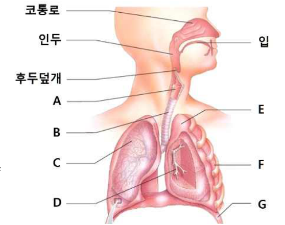
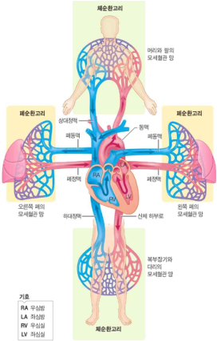
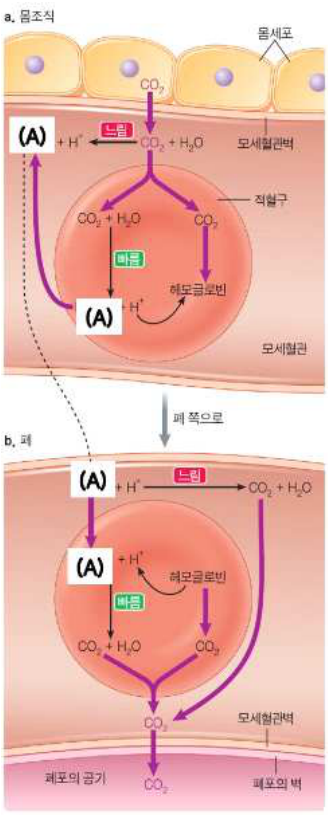
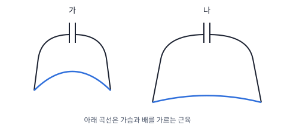
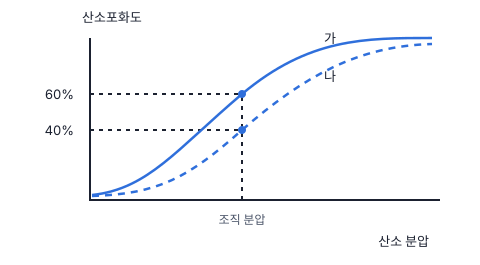

# 복습문제 46선 — 1119 수업 범위

기출 33개와 변형 연습 13개예요. 변형 연습은 기본 11개, 심화 2개예요. 먼저 스스로 풀어 보고 풀이를 확인해요.

> `복습문제_1119_Respiratory_and_Circulatory_Systems.html`를 마크다운으로 옮겼어요. 원문, 힌트, 풀이는 접혀 있어요. 먼저 풀어 보고 펼쳐 보세요.

**목차**

- [B. 기출](#partB)
  - [P1. 혈액 세포의 생산 장소](#p1)
  - [P2. 들숨이 시작되는 이유](#p2)
  - [P3. 혈관의 총 단면적](#p3)
  - [P4. 방실판막의 위치](#p4)
  - [P5. 심장박동과 심장주기](#p5)
  - [P6. 혈액 CO₂와 pH](#p6)
  - [P7. 모세혈관 내피 통과](#p7)
  - [P8. 폐를 둘러싼 두 층](#p8)
  - [P9. 폐 모세혈관의 적혈구 반응](#p9)
  - [P10. 음압 들숨의 부피와 압력](#p10)
  - [P11. 동맥벽의 층과 탄성](#p11)
  - [P12. 모세혈관의 물질교환](#p12)
  - [P13. 포유류 심장과 순환 경로](#p13)
  - [P14. 잔기량과 폐활량](#p14)
  - [P15. 그림에서 찾는 들숨 근육](#p15)
  - [P16. 적혈구와 산소 운반 단백질](#p16)
  - [P17. 호흡 조절에 민감한 기체](#p17)
  - [P18. 호흡률을 높이는 변화](#p18)
  - [P19. 날숨 때 흉강 변화](#p19)
  - [P20. 폐순환의 혈액 이동 순서](#p20)
  - [P21. 동맥·정맥·모세혈관 비교](#p21)
  - [P22. 모세혈관의 흐름과 교환](#p22)
  - [P23. 순환계 기능과 혈액 세포 생산](#p23)
  - [P24. 폐에서 돌아오는 첫 심장 방](#p24)
  - [P25. 혈장의 성분](#p25)
  - [P26. 심장에 드나드는 혈관의 방향](#p26)
  - [P27. 뇌중추가 받는 호흡 조절 정보](#p27)
  - [P28. 화학수용체의 위치](#p28)
  - [P29. CO₂ 운반 그림의 공통 물질](#p29)
  - [P30. 혈액의 주된 산소 운반 방식](#p30)
  - [P31. 숨을 참을 때 호흡 욕구](#p31)
  - [P32. pH에 따른 산소 해리곡선](#p32)
  - [P33. 심장주기의 압력과 판막 소리](#p33)
- [C. 변형 연습](#partC)
  - [P34. [변형] 기도의 방어와 교환 표면](#p34)
  - [P35. [변형] 두 환기 상태의 전환](#p35)
  - [P36. [변형] 최대로 움직인 양과 남은 양](#p36)
  - [P37. [변형] 두 감지 위치에서 읽을 수 있는 변화](#p37)
  - [P38. [변형] 같은 조직 분압에서 산소 방출량 비교](#p38)
  - [P39. [변형] 폐에서 되돌아가는 탄소 형태](#p39)
  - [P40. [변형] 산소가 적은 혈액도 지나는 동맥](#p40)
  - [P41. [변형] 혈액 성분을 분리해서 보기](#p41)
  - [P42. [변형] 심실의 압력이 떨어지는 순간](#p42)
  - [P43. [변형] 심장의 신호 시작과 박동 측정](#p43)
  - [P44. [변형] 모세혈관 하나와 혈관망 전체](#p44)
  - [P45. [변형] 가는 관 수를 바꾼 교환 장치](#p45)
  - [P46. [변형] 심장의 첫 신호를 만드는 구조](#p46)

## B. 기출

### P1. 혈액 세포의 생산 장소

사람의 혈액 세포들은 다음 중 어디에서 생산되는가?

- (1) 적색골수
- (2) 간
- (3) 림프절
- (4) 심장
- (5) 신장

원문 정보 보기

기출 13강 합본 1번 (PDF 1쪽)

힌트 보기

혈액을 만드는 곳과 이미 만들어진 혈액이 하는 일을 나누어 생각해요.

풀이 보기

1. (1) 맞아요. 혈액 세포는 적색골수의 조혈줄기세포에서 만들어져요.
2. (2) 틀려요. 간은 성인의 정상적인 혈액 세포 생산 장소가 아니에요.
3. (3) 틀려요. 림프절은 면역 반응이 일어나는 곳이에요.
4. (4) 틀려요. 심장은 혈액을 내보내는 펌프예요.
5. (5) 틀려요. 신장은 적혈구 생산을 조절하는 신호를 보낼 수 있지만 생산은 골수에서 이루어져요.
6. [1119 수업의 관련 개념](정리노트_1119_Respiratory_and_Circulatory_Systems.md#s2-blood)을 적용해요. 적혈구·백혈구·혈소판 생성의 출발점은 골수예요.

**정답:** (1)

---

### P2. 들숨이 시작되는 이유

사람의 흡기(들숨)동안 공기가 폐로 들어오는 이유는?

- (1) 폐포의 압력이 증가하여
- (2) 외늑간근과 횡격막의 수축으로 흉강의 부피가 증가하여
- (3) 기체가 압력이 낮은 지역에서 높은 지역으로 흐르므로
- (4) 횡경막이 수축할 때 양압(positive pressure)이 발생하므로
- (5) 폐 근육이 수축하여 폐 표면을 잡아당기므로

원문 정보 보기

기출 13강 합본 2번 (PDF 1쪽)

힌트 보기

들이쉬기 직전에 어떤 근육이 작동하고 압력 차가 어떻게 생기는지 떠올려요.

풀이 보기

1. (1) 틀려요. 폐 안의 압력이 대기압보다 낮아져야 공기가 들어와요.
2. (2) 맞아요. 외늑간근과 횡격막이 수축하면 흉강이 넓어지고 폐 안 압력이 대기압보다 낮아져요.
3. (3) 틀려요. 공기는 압력이 높은 쪽에서 낮은 쪽으로 흘러요.
4. (4) 틀려요. 횡격막의 수축은 흉강을 넓혀 폐 안 압력을 낮춰요.
5. (5) 틀려요. 횡격막과 외늑간근이 수축해 흉강이 넓어지면 폐가 이를 따라 팽창해요.
6. [1119 수업의 관련 개념](정리노트_1119_Respiratory_and_Circulatory_Systems.md#s0-ventilation)을 적용해요. 들숨은 근육의 수축에서 시작해 부피와 압력의 변화로 이어져요.

**정답:** (2)

---

### P3. 혈관의 총 단면적

다음 중 총 단면적이 가장 넓은 혈관은 무엇인가?

- (1) 동맥
- (2) 세동맥
- (3) 모세혈관
- (4) 세정맥
- (5) 정맥

원문 정보 보기

기출 13강 합본 4번 (PDF 1쪽)

힌트 보기

‘총’에서 각각의 가지를 어떻게 비교해야 하는지 생각해요.

풀이 보기

1. (1) 틀려요. 하나의 동맥 단면은 넓지만 같은 구간의 여러 혈관을 합하면 모세혈관 쪽이 더 넓어요.
2. (2) 틀려요. 세동맥의 가지는 이후 더 많은 모세혈관으로 갈라져요.
3. (3) 맞아요. 모세혈관 하나는 가늘지만 수가 많아 단면적의 합이 가장 커요.
4. (4) 틀려요. 세정맥은 모세혈관에서 나온 혈액이 합쳐지는 구간이에요.
5. (5) 틀려요. 정맥 하나의 지름이 커도 구간 전체 단면적은 모세혈관 쪽이 더 넓어요.
6. [1119 수업의 관련 개념](정리노트_1119_Respiratory_and_Circulatory_Systems.md#s3-vessels)을 적용해요. 가지 전체의 단면을 합쳐야 모세혈관에서 흐름이 느린 이유를 설명할 수 있어요.

**정답:** (3)

---

### P4. 방실판막의 위치

방실판막(atrioventricular valve, AV valve)은 어디에 위치하는가?

- (1) 좌심방과 좌심실의 사이 그리고 우심방과 우심실의 사이
- (2) 우심방과 우심실의 사이에만
- (3) 좌심방과 좌심실의 사이에만
- (4) 혈액이 대동맥으로 들어가는 부분
- (5) 혈액이 폐동맥으로 들어가는 부분

원문 정보 보기

기출 13강 합본 5번 (PDF 1쪽)

힌트 보기

명칭의 ‘방’과 ‘실’이 가리키는 곳을 각각 확인해요.

풀이 보기

1. (1) 맞아요. 심방에서 심실로 들어가는 판막이 심장 양쪽에 하나씩 있어요.
2. (2) 틀려요. 오른쪽 판막 외에 좌심방과 좌심실 사이에도 있어요.
3. (3) 틀려요. 왼쪽 판막 외에 우심방과 우심실 사이에도 있어요.
4. (4) 틀려요. 대동맥 입구는 좌심실의 출구로 반월판막이 있어요.
5. (5) 틀려요. 폐동맥 입구는 우심실의 출구로 반월판막이 있어요.
6. [1119 수업의 관련 개념](정리노트_1119_Respiratory_and_Circulatory_Systems.md#s3-cycle)을 적용해요. 심방과 심실의 경계 두 곳에 방실판막이 있어요.

**정답:** (1)

---

### P5. 심장박동과 심장주기

다음은 심장박동과 심장주기에 관한 설명이다. 설명 중 잘못된 것은?

- (1) 심근세포의 수축은 굴심방결절에 의해 조절된다
- (2) 심실이 이완을 시작하면 반월판막이 닫히고, 혈액들이 심방과 심실로 재유입된다
- (3) 심장의 수축기는 심장이 혈액을 내보내는 시기이다
- (4) 심장의 수축을 위해서는 외부자극이 필요하다
- (5) 심전도(ECG)는 심장주기를 촉발하는 전기 신호의 패턴을 측정한 것이다

원문 정보 보기

기출 13강 합본 6번 (PDF 1쪽)

힌트 보기

스스로 박동을 시작하는 곳과 그때 만들어지는 신호를 떠올려요.

풀이 보기

1. (1) 맞아요. 굴심방결절의 박동원 세포가 정상 박동의 시작 신호를 만들어요.
2. (2) 맞아요. 심실 이완 초기에 반월판막이 닫혀요. 조금 뒤 심실 압력이 심방 압력보다 낮아지면 방실판막이 열려 심실이 다시 채워져요.
3. (3) 맞아요. 심실 수축으로 압력이 높아지면 혈액이 동맥으로 나가요.
4. (4) 틀려요. 심장 내부의 박동원 세포에서 신호가 생기므로 정상 박동을 시작하는 데 외부 자극이 필요하지 않아요.
5. (5) 맞아요. 심전도는 심장 전기 활동의 시간에 따른 변화를 기록해요.
6. [1119 수업의 관련 개념](정리노트_1119_Respiratory_and_Circulatory_Systems.md#s3-pacemaker)을 적용해요. 전기 신호를 만드는 곳과 그 신호를 피부에서 측정하는 일이 구분돼요.

**정답:** (4)

(2)는 심실 이완 과정 전체를 요약한 보기예요. 반월판막이 닫히자마자 심실이 채워지는 건 아니에요.

---

### P6. 혈액 CO₂와 pH

혈액 속의 CO₂ 농도가 _________하면 pH ______의 원인이 되어 호흡이 빨라진다.

- (1) 증가, 증가
- (2) 증가, 감소
- (3) 감소, 감소
- (4) 답이 없다
- (5) 감소, 증가

원문 정보 보기

기출 13강 합본 7번 (PDF 1쪽)

힌트 보기

CO₂가 물과 반응할 때 생기는 이온이 산성도에 어떤 영향을 주는지 생각해요.

풀이 보기

1. (1) 틀려요. CO₂ 증가로 생긴 수소 이온이 늘면 pH는 떨어져요.
2. (2) 맞아요. CO₂ 증가로 수소 이온이 늘고 pH가 떨어지면 호흡이 빨라져요.
3. (3) 틀려요. 다른 조건이 같으면 CO₂가 감소하는 쪽에서는 수소 이온이 줄어들어요.
4. (4) 틀려요. 수소 이온의 변화를 따르면 알맞은 짝을 고를 수 있어요.
5. (5) 틀려요. 다른 조건이 같을 때 이 조합은 CO₂가 줄어든 쪽이며, 수업의 환기 증가 신호는 CO₂가 늘며 pH가 떨어지는 변화예요.
6. [1119 수업의 관련 개념](정리노트_1119_Respiratory_and_Circulatory_Systems.md#s1-control)을 적용해요. CO₂가 물에 녹은 뒤 수소 이온이 늘어나는 연결이 호흡 조절의 출발점이에요.

**정답:** (2)

---

### P7. 모세혈관 내피 통과

다음 중 모세혈관 내피세포를 쉽게 빠져나올 수 없는 것을 고르시오.

- (1) 물
- (2) 적혈구
- (3) 산소
- (4) 포도당
- (5) 이산화탄소

원문 정보 보기

기출 13강 합본 8번 (PDF 1쪽)

힌트 보기

보기들을 세포 하나와 작은 분자들로 나누어 보세요.

풀이 보기

1. (1) 맞아요. 물은 일반적인 모세혈관과 주변 조직액 사이를 이동할 수 있어요.
2. (2) 틀려요. 적혈구는 온전한 세포라 일반적인 모세혈관 벽을 쉽게 빠져나가지 못해요.
3. (3) 맞아요. 산소는 작은 기체 분자라 농도 차를 따라 확산할 수 있어요.
4. (4) 맞아요. 포도당은 일반적인 모세혈관에서 조직 쪽으로 이동할 수 있는 작은 용질이에요.
5. (5) 맞아요. 이산화탄소는 작은 기체 분자라 분압 차를 따라 확산할 수 있어요.
6. [1119 수업의 관련 개념](정리노트_1119_Respiratory_and_Circulatory_Systems.md#s3-vessels)을 적용해요. 폭이 적혈구 하나가 지나갈 정도의 모세혈관에서 혈액과 조직의 물질교환은 혈관 벽을 사이에 두고 일어나요.

**정답:** (2)

---

### P8. 폐를 둘러싼 두 층

폐를 덮고 있으며 사이에 미끄러운 액체로 채워져 있어서 폐의 움직임을 돕는 두 층의 상피조직을 무엇이라고 하는가?

- (1) 횡경막
- (2) 폐포
- (3) 내늑각근
- (4) 흉막
- (5) 외늑각근

원문 정보 보기

기출 13강 합본 9번 (PDF 1쪽)

힌트 보기

근육과 공기주머니를 먼저 구분하고, 폐를 싸는 구조를 찾아요.

풀이 보기

1. (1) 틀려요. 횡경막은 횡격막을 가리키며 가슴과 배를 나누는 근육이에요.
2. (2) 틀려요. 폐포는 폐 안의 기체 교환 표면이에요.
3. (3) 틀려요. 원문의 내늑각근은 갈비뼈 사이 근육을 가리켜요.
4. (4) 맞아요. 흉막은 두 층으로 이루어지고 층 사이의 얇은 액체층은 호흡 시 마찰을 줄여요.
5. (5) 틀려요. 원문의 외늑각근은 갈비뼈 사이에 있는 들숨 근육을 가리켜요.
6. [1119 수업의 관련 개념](정리노트_1119_Respiratory_and_Circulatory_Systems.md#s0-ventilation)을 적용해요. 흉막은 폐의 표면과 가슴벽 쪽을 잇는 호흡 구조예요.

**정답:** (4)

---

### P9. 폐 모세혈관의 적혈구 반응

폐의 모세혈관에 있는 적혈구에서 우세하게 일어나는 반응은? (Hb=헤모글로빈)

- (1) Hb + 4 O₂ → Hb(O₂)₄
- (2) H₂CO₃ → H⁺+ HCO₃⁻
- (3) CO₂+ H₂O → H₂CO₃
- (4) Hb + 4 CO₂ → Hb(CO₂)₄
- (5) Hb(O₂)₄ → Hb + 4 O₂

원문 정보 보기

기출 13강 합본 10번 (PDF 1쪽)

힌트 보기

폐에서 산소가 적혈구 안으로 들어온 직후 어떻게 운반되는지 생각해요.

풀이 보기

1. (1) 맞아요. 폐에서는 산소 분압이 높아 헤모글로빈에 산소가 결합하는 쪽이 우세해요.
2. (2) 틀려요. 폐의 적혈구에서는 중탄산 이온과 수소 이온이 결합하는 방향이 촉진돼요.
3. (3) 틀려요. 폐에서는 이산화탄소가 빠져나가므로 이 반응의 반대 방향이 순효과예요.
4. (4) 틀려요. 폐에서는 헤모글로빈에 결합한 일부 이산화탄소도 떨어져 나가 배출돼요.
5. (5) 틀려요. 산소가 헤모글로빈에서 떨어지는 방향은 산소 분압이 낮은 조직에서 우세해요.
6. [1119 수업의 관련 개념](정리노트_1119_Respiratory_and_Circulatory_Systems.md#s1-oxygen)을 적용해요. 폐에서는 산소를 실으며 이산화탄소는 내려놓는 방향이 유리해요.

**정답:** (1)

---

### P10. 음압 들숨의 부피와 압력

음압메커니즘에 따르면, 흡기(inhalation, 들숨) 동안 흉강의 부피는 ( )되고 이것은 폐의 공기압을 대기압보다 ( )시킨다. 결과적으로 공기가 폐로 들어간다.

- (1) 증가, 증가
- (2) 감소, 감소
- (3) 증가, 감소
- (4) 감소, 증가
- (5) 유지, 증가

원문 정보 보기

기출 13강 합본 11번 (PDF 1쪽)

힌트 보기

근육이 수축하면 흉강 부피가 어떻게 바뀌고 공기가 어느 압력 쪽으로 흐르는지 연결해요.

풀이 보기

1. (1) 틀려요. 흉강이 커질 때 폐의 공기압은 대기압보다 낮아져요.
2. (2) 틀려요. 폐 안 압력은 낮아지지만 흉강의 부피는 늘어나요.
3. (3) 맞아요. 흉강이 커지면 폐 안 압력이 대기압보다 낮아져 바깥 공기가 들어와요.
4. (4) 틀려요. 부피 감소와 압력 증가는 평상시 날숨의 관계예요.
5. (5) 틀려요. 들숨에는 흉강 부피가 커져야 하며 폐 안 압력이 낮아져요.
6. [1119 수업의 관련 개념](정리노트_1119_Respiratory_and_Circulatory_Systems.md#s0-ventilation)을 적용해요. 음압의 기준은 대기압이에요.

**정답:** (3)

---

### P11. 동맥벽의 층과 탄성

다음과 같은 특징을 지니는 혈관은 무엇인가? “가장 바깥층은 콜라젠섬유와 엘라스틴 단백질 섬유가 섞인 결합조직층으로 혈관에 반발력을 제공하며, 상대적으로 두꺼운 가운데층은 엘라스틴 섬유와 섞인 혈관 민무늬근 세포로 이루어진다.”

- (1) 세정맥
- (2) 동맥
- (3) 모세혈관
- (4) 세동맥
- (5) 정맥

원문 정보 보기

기출 13강 합본 12번 (PDF 1쪽)

힌트 보기

박동으로 생기는 큰 압력과 혈관 벽의 구조를 연결해요.

풀이 보기

1. (1) 틀려요. 세정맥은 모세혈관에서 온 혈액을 모으며, 구조 설명의 두꺼운 탄성층은 전형적인 특징이 아니에요.
2. (2) 맞아요. 동맥은 엘라스틴·콜라젠이 있는 외층과 발달한 중간층으로 높은 압력에 버티고 탄성 반동을 만들어요.
3. (3) 틀려요. 모세혈관은 교환을 위한 얇은 내피층이 중심이며 설명과 같은 두꺼운 중간층이 없어요.
4. (4) 틀려요. 세동맥에도 민무늬근이 있지만 구조 설명의 두꺼운 탄성 벽은 큰 동맥의 특징이에요.
5. (5) 틀려요. 정맥벽은 같은 크기 동맥의 벽보다 일반적으로 얇고 탄성 조직이 적어요.
6. [1119 수업의 관련 개념](정리노트_1119_Respiratory_and_Circulatory_Systems.md#s3-vessels)을 적용해요. 동맥벽의 두께는 압력에 견디는 데, 탄성은 늘어났다 돌아오는 데 쓰여요.

**정답:** (2)

PDF에 (5) 뒤로 20번 발문의 시작 부분이 붙어 있어, 문항 구분을 바로잡았어요.

---

### P12. 모세혈관의 물질교환

모세혈관에서의 물질교환이 일어날 때 _______________.

- (1) 적혈구는 모세혈관 내부를 두 줄로 서로 겹쳐서 지나갈 수 있다
- (2) 혈액 흐름에 대한 저항이 동맥이나 정맥에서보다 약하다
- (3) 확산은 세정맥 쪽에 가까운 곳에서 가장 강하게 일어난다
- (4) 물, 이온, 포도당 그리고 적혈구들은 혈액과 조직 사이를 자유롭게 통과할 수 있다
- (5) 농도기울기에 따른 확산과 대량이동이 작동한다

원문 정보 보기

기출 13강 합본 13번 (PDF 2쪽)

힌트 보기

혈관 속에서 흐르는 세포와 벽을 넘어 교환되는 물질을 나누어 보세요.

풀이 보기

1. (1) 틀려요. 수업의 모세혈관 도식처럼 적혈구는 대개 한 줄로 좁은 통로를 지나가요.
2. (2) 틀려요. 모세혈관의 작은 지름 때문에 개별 혈관의 저항이 작다고 볼 수 없으며, 교환을 설명하는 핵심은 벽을 가로지르는 이동이에요.
3. (3) 틀려요. 확산은 개별 물질의 농도 차를 따르므로 세정맥 쪽에서 일률적으로 가장 강하지 않아요.
4. (4) 틀려요. 물과 작은 용질은 이동할 수 있지만 적혈구는 보통 혈관 안에 머물러요.
5. (5) 맞아요. 작은 물질은 농도 차를 따라 확산하고, 물과 용질의 일부는 압력 차에 의한 대량이동에 함께 움직여요.
6. [1119 수업의 관련 개념](정리노트_1119_Respiratory_and_Circulatory_Systems.md#s3-vessels)을 적용해요. 얇은 벽과 느린 흐름은 혈액과 조직 사이의 교환에 유리해요.

**정답:** (5)

---

### P13. 포유류 심장과 순환 경로

다음 포유동물의 심장에 관한 설명 중 틀린 것은?

- (1) 포유동물은 2개의 심방과 2개의 심실로 이루어진다
- (2) 폐순환의 혈액은 좌심실에서 시작하여 대동맥, 동맥을 거쳐 우심방으로 들어온다
- (3) 심장 자체에도 관상순환이라는 혈액의 순환이 존재한다
- (4) 체순환은 조직세포에 O₂와 영양분을 공급하고 노폐물과 CO₂를 받아온다
- (5) 심방의 경우 심실에 비하여 크기가 작고 근육이 얇다

원문 정보 보기

기출 13강 합본 14번 (PDF 2쪽)

힌트 보기

순환 고리의 이름이 말해 주는 목적지를 떠올려요.

풀이 보기

1. (1) 맞아요. 포유류의 심장은 두 심방과 두 심실로 이루어져요.
2. (2) 틀려요. 좌심실에서 대동맥을 거쳐 몸을 돌아 우심방으로 오는 경로는 체순환이에요.
3. (3) 맞아요. 심장근육에도 산소와 영양분을 보내는 관상순환이 있어요.
4. (4) 맞아요. 체순환 혈액은 조직에 산소와 영양분을 주고 이산화탄소와 노폐물을 받아요.
5. (5) 맞아요. 심실은 혈액을 동맥으로 내보내므로 심방보다 근육벽이 두꺼워요.
6. [1119 수업의 관련 개념](정리노트_1119_Respiratory_and_Circulatory_Systems.md#s2-circuits)을 적용해요. 폐로 향하는 고리는 우심실에서, 온몸으로 향하는 고리는 좌심실에서 시작해요.

**정답:** (2)

---

### P14. 잔기량과 폐활량

다음 설명 중 틀린 것을 고르시오.

- (1) 최대한 강제적으로 호기를 하면 폐에 공기를 남기지 않을 수 있다
- (2) 육체적 활동이 증가하면 1회 호흡량은 증가한다
- (3) 폐활량이란 최대 1회 호흡량이다
- (4) 1회 호흡량이란 흡기와 호기 동안 폐로 들어가고 나가는 공기의 부피를 말한다
- (5) 기체교환은 폐로 흐르는 혈액과 폐포 안의 공기 사이에서 항상 일어난다

원문 정보 보기

기출 13강 합본 15번 (PDF 2쪽)

힌트 보기

최대로 내쉰 뒤 폐에 남는 몫이 있는지 확인해요.

풀이 보기

1. (1) 틀려요. 최대로 내쉰 뒤에도 폐에 잔기량이 남아요.
2. (2) 맞아요. 보통 신체 활동이 증가하면 더 깊게 숨을 쉬어 1회 호흡량이 늘어요.
3. (3) 강의노트의 표현으로 읽으면 맞아요. “최대 1회 호흡량”은 최대로 들이쉰 뒤 최대로 내쉬는 양을 뜻해요. 평소 한 번에 드나드는 1회 호흡량(tidal volume)과 구분해요.
4. (4) 맞아요. 한 번의 들숨이나 날숨에 이동하는 공기의 부피가 1회 호흡량이에요.
5. (5) 정상 조건에서는 맞아요. 정상적으로 환기와 혈류가 유지되는 폐포에서는 들숨과 날숨 사이에도 기체교환이 이어져요.
6. [1119 수업의 관련 개념](정리노트_1119_Respiratory_and_Circulatory_Systems.md#s0-volumes)을 적용해요. 내보낸 공기의 최대 부피와 내보내도 폐에 남는 부피를 구분해요.

**정답:** (1)

출제 의도는 (1)이에요. (3)은 최대 들숨 후 최대 날숨으로, (5)는 정상 환기와 혈류가 유지되는 경우로 해석해요. 환기나 혈류가 끊긴 폐포까지 포함하면 기체교환이 지속되지 않을 수 있어요.

---

### P15. 그림에서 찾는 들숨 근육

폐에 공기를 채우게 하기 위하여 수축되는 흉곽과 복강 사이의 근육층은 무엇인가?

- (1) G
- (2) E
- (3) B
- (4) D
- (5) F

원문 정보 보기

기출 13강 합본 17번 (PDF 2쪽)

힌트 보기

흉곽 아래쪽에서 복강과 가슴을 가르는 경계를 찾아요.

풀이 보기

1. (1) 맞아요. G는 흉곽 바닥의 횡격막으로, 수축할 때 아래로 내려가 흉강을 넓혀요.
2. (2) 틀려요. E는 흉곽 위쪽에 표시된 구조로, 가슴과 배를 가르는 층에 있지 않아요.
3. (3) 틀려요. B는 공기가 지나는 기관을 가리켜요.
4. (4) 틀려요. D는 폐 안으로 가지 치는 기관지를 가리켜요.
5. (5) 틀려요. F는 흉곽의 옆쪽에 표시돼 있고 흉곽과 복강을 가르는 바닥에 있지 않아요.
6. [1119 수업의 관련 개념](정리노트_1119_Respiratory_and_Circulatory_Systems.md#s0-ventilation)을 적용해요. 횡격막을 찾는 단서는 폐의 아래쪽과 복강의 위쪽을 가르는 근육층이에요.

**정답:** (1)

---

### P16. 적혈구와 산소 운반 단백질

다음 중 적혈구에 대한 설명으로 옳지 않은 것은?

- (1) 적혈구생성소(EPO) 호르몬에 의해 생산이 증가된다
- (2) 폐로부터 조직 곳곳으로 산소를 운반하는데 적당하다
- (3) 혈액의 세포 성분 중 가장 수가 많다
- (4) 수명이 다하면 대식세포에 의해 파괴된다
- (5) 산소를 운반하는 철 원자가 포함된 피브리노겐이 들어있다

원문 정보 보기

기출 13강 합본 19번 (PDF 2쪽)

힌트 보기

적혈구 안에서 산소를 싣는 단백질과 혈장 안의 응고 단백질을 구분해요.

풀이 보기

1. (1) 맞아요. 적혈구생성소(EPO)는 골수의 적혈구 생산을 촉진해요.
2. (2) 맞아요. 적혈구에 있는 헤모글로빈이 폐에서 결합한 산소를 조직으로 가져가요.
3. (3) 맞아요. 정상 혈액의 세포 성분 가운데 적혈구가 가장 많아요.
4. (4) 맞아요. 수명이 끝난 적혈구는 대식세포가 제거해요.
5. (5) 틀려요. 산소 운반에 관여하는 철은 헤모글로빈의 헴에 있고 피브리노겐은 응고에 관여해요.
6. [1119 수업의 관련 개념](정리노트_1119_Respiratory_and_Circulatory_Systems.md#s2-blood)을 적용해요. 적혈구의 산소 운반과 혈장의 응고 단백질은 기능과 위치가 다르게 배치돼요.

**정답:** (5)

---

### P17. 호흡 조절에 민감한 기체

다음 중 뇌중추에서의 호흡 조절에 가장 크게 영향을 미치는 물질은 무엇인가?

- (1) 헤모글로빈
- (2) N₂
- (3) CO₂
- (4) O₂
- (5) 보기의 모든 물질들은 호흡률에 영향을 주지 않는다

원문 정보 보기

기출 13강 합본 21번 (PDF 3쪽)

힌트 보기

평상시 산소와 이산화탄소 중 작은 변화로도 호흡이 조절되는 쪽을 떠올려요.

풀이 보기

1. (1) 틀려요. 헤모글로빈은 기체의 운반에 주로 쓰여요.
2. (2) 틀려요. 질소는 정상적인 호흡 피드백의 주요 신호가 아니에요.
3. (3) 맞아요. 이산화탄소 변화는 수소 이온과 pH 변화를 일으켜 호흡 중추에 크게 영향을 줘요.
4. (4) 틀려요. 산소도 감지되지만 보통 동맥 산소가 크게 떨어질 때 말초 신호가 강해져요.
5. (5) 틀려요. 이산화탄소 변화에 따라 호흡률이 바뀔 수 있어요.
6. [1119 수업의 관련 개념](정리노트_1119_Respiratory_and_Circulatory_Systems.md#s1-control)을 적용해요. 뇌간은 이산화탄소의 변화에 민감하게 반응하며 산소 감소 신호에는 주로 말초 수용체가 관여해요.

**정답:** (3)

---

### P18. 호흡률을 높이는 변화

호흡률은 뇌에 있는 호흡중추에 의해 자동적으로 조절된다. 다음에 나오는 각각의 변화가 호흡률을 상승 혹은 저하 시킨다. 보기 중에서 호흡률을 상승시키는 것만을 고른 것은?

- ㄱ) 혈액의 CO₂ 농도의 증가
- ㄴ) 일부러 CO₂를 배출하는 과호흡
- ㄷ) 혈액의 산소 농도의 심한 감소
- ㄹ) 뇌척수액의 pH 증가
- ㅁ) 혈액 내 탄산의 증가
- ㅂ) 활발한 운동

- (1) ㄱ, ㅂ
- (2) ㄱ, ㄷ, ㅁ, ㅂ
- (3) ㄴ, ㄷ, ㅁ
- (4) ㄷ, ㄹ, ㅁ, ㅂ
- (5) ㄴ, ㅁ, Q

원문 정보 보기

기출 13강 합본 23번 (PDF 3쪽)

힌트 보기

각 변화 뒤 CO₂, 산소 또는 pH 중 무엇이 호흡중추에 신호가 되는지 살펴요.

풀이 보기

1. (1) 틀려요. ㄱ과 ㅂ은 맞지만, 산소가 크게 감소하는 ㄷ과 산성화하는 ㅁ도 들어가야 해요.
2. (2) 맞아요. ㄱ과 ㅁ은 pH를 떨어뜨리는 방향, ㄷ은 말초 화학수용체의 자극, ㅂ은 운동으로 인한 환기 증가에 해당해요.
3. (3) 틀려요. ㄴ의 과호흡은 CO₂를 줄여 화학적 호흡 자극을 낮춰요.
4. (4) 틀려요. ㄹ의 뇌척수액 pH 상승은 CO₂ 증가에 대한 자극과 반대 방향이에요.
5. (5) 답으로 고를 수 없어요. ㄴ은 CO₂를 줄이는 변화이며 Q는 원문의 제시 진술에 정의되어 있지 않아요.
6. [1119 수업의 관련 개념](정리노트_1119_Respiratory_and_Circulatory_Systems.md#s1-control)을 적용해요. 과호흡으로 CO₂를 내보낸 경우와 운동으로 호흡이 늘어나는 경우를 구분해요.

**정답:** (2)

인쇄된 (5)의 Q는 제시문에 정의되지 않은 표기예요. 제시문 안에서 판정하면 (2)가 성립해요.

---

### P19. 날숨 때 흉강 변화

사람의 폐로부터 공기를 배출할 때 일어나는 현상으로 옳은 것은?

- (1) 횡경막이 수축한다.
- (2) 외늑각근이 수축한다.
- (3) 흉곽이 확장된다.
- (4) 흉강의 부피가 감소한다.
- (5) 후두덮개가 닫힌다.

원문 정보 보기

기출 13강 합본 24번 (PDF 3쪽)

힌트 보기

편하게 내쉬는 상황을 가정하고 들숨 뒤 근육이 어떻게 되는지 떠올려요.

풀이 보기

1. (1) 틀려요. 편한 날숨에는 횡격막이 이완하면서 위로 올라가요.
2. (2) 틀려요. 외늑간근의 수축은 들숨에 흉곽을 넓히는 작용이에요.
3. (3) 틀려요. 평상시 날숨 때 흉곽은 줄어들어요.
4. (4) 맞아요. 흉강과 폐의 부피가 작아지며 폐 안 압력이 대기압보다 높아져 공기가 빠져나가요.
5. (5) 틀려요. 후두덮개는 삼킬 때 기도 입구를 보호하며 편한 날숨에는 공기 통로가 열려 있어요.
6. [1119 수업의 관련 개념](정리노트_1119_Respiratory_and_Circulatory_Systems.md#s0-ventilation)을 적용해요. 흡기 때와 호기 때 부피, 압력, 공기 이동 방향을 각각 반대로 읽어요.

**정답:** (4)

---

### P20. 폐순환의 혈액 이동 순서

다음 중 사람의 순환계를 통해 혈액이 흐르는 순서로 옳게 나타낸 것은?

- (1) 우심방-우심실-좌심방-폐모세혈관-우심실
- (2) 좌심실-폐정맥-폐모세혈관-폐동맥-우심방
- (3) 우심실-폐동맥-폐모세혈관-폐정맥-좌심방
- (4) 좌심실-폐동맥-폐정맥-폐모세혈관-우심방
- (5) 우심실-폐정맥-폐모세혈관-폐동맥-우심방

원문 정보 보기

기출 13강 합본 25번 (PDF 3쪽)

힌트 보기

폐에 가는 길을 심장에서 나가는 쪽부터 한 칸씩 따라가요.

풀이 보기

1. (1) 틀려요. 우심실에서 혈액은 폐를 거쳐야 좌심방에 도착해요.
2. (2) 틀려요. 좌심실의 출구는 폐정맥이 아니라 대동맥으로 이어져요.
3. (3) 맞아요. 우심실에서 폐동맥을 거쳐 폐모세혈관에 도달한 혈액은 폐정맥을 통해 좌심방으로 돌아와요.
4. (4) 틀려요. 좌심실은 대동맥으로 내보내고 폐정맥은 폐모세혈관 뒤에 와요.
5. (5) 틀려요. 폐정맥은 폐에서 심장으로 돌아오는 혈관이므로 우심실의 출구에 있지 않아요.
6. [1119 수업의 관련 개념](정리노트_1119_Respiratory_and_Circulatory_Systems.md#s2-circuits)을 적용해요. 동맥과 정맥의 이름은 혈액의 산소량보다 심장을 기준으로 한 방향을 따라 정해져요.

**정답:** (3)

---

### P21. 동맥·정맥·모세혈관 비교

순환계의 혈관들에 대한 설명 중 옳은 것은?

- (1) 동맥은 가장 높은 압력이 주어지고, 구조적으로 높은 압력에 견딜 수 있도록 설계되어 있다.
- (2) 동맥의 가장 바깥층은 특수한 상피조직인 내피로 이루어져 있다.
- (3) 정맥은 많은 양의 혈액이 일방적으로 흐르기 때문에 판막이 존재하지 않는다.
- (4) 모세혈관은 원활한 가스교환을 위하여 3겹의 층으로 이루어져 있다.
- (5) 모세혈관은 가늘기 때문에 혈관들 중에서 혈압이 가장 낮다.

원문 정보 보기

기출 13강 합본 26번 (PDF 3쪽)

힌트 보기

어느 혈관이 심실이 내보낸 혈액을 가장 먼저 받는지 생각해요.

풀이 보기

1. (1) 맞아요. 동맥은 심실에서 나온 혈액의 높은 압력을 견디는 두꺼운 벽이 있어요.
2. (2) 틀려요. 내피는 혈액과 맞닿은 가장 안쪽 층이고 바깥층은 결합조직이에요.
3. (3) 틀려요. 팔다리의 여러 정맥에서 판막이 혈액의 역류를 줄여요.
4. (4) 틀려요. 일반적인 모세혈관의 벽은 한 겹의 내피세포층을 중심으로 이루어져요.
5. (5) 틀려요. 혈압은 순환 경로를 따라 낮아져 큰 정맥 쪽에서 모세혈관보다 낮아요.
6. [1119 수업의 관련 개념](정리노트_1119_Respiratory_and_Circulatory_Systems.md#s3-vessels)을 적용해요. 동맥의 압력과 탄성, 모세혈관의 얇은 벽, 정맥의 귀환 기능을 구분해요.

**정답:** (1)

---

### P22. 모세혈관의 흐름과 교환

다음은 모세혈관에 관한 설명이다. 틀린 것은?

- (1) 세동맥과 모세혈관 괄약근 근육이 완전히 이완되었을 때 혈액이 최대로 흐른다.
- (2) 모세혈관과 간질액 사이의 물질교환은 농도기울기를 통한 확산과 대량이동이 중요하다.
- (3) 모세혈관에서 물과 포도당, 이온과 같은 작은 분자들의 물질교환이 발생한다.
- (4) 모세혈관은 빠른 물질교환을 위하여 혈액의 속도가 증가한다.
- (5) 뇌의 경우에는 서로 단단하게 접착된 내피세포에 의해 물질교환이 제한되어 있다.

원문 정보 보기

기출 13강 합본 27번 (PDF 3쪽)

힌트 보기

모세혈관의 가느다란 한 가닥이 아니라 모든 가지의 총 단면적을 떠올려요.

풀이 보기

1. (1) 맞아요. 같은 압력 차를 가정하면 세동맥과 모세혈관 입구의 괄약근이 최대한 이완한 쪽에서는 저항이 작아 그 혈관망의 혈류가 가장 커져요.
2. (2) 맞아요. 농도 차를 따른 확산과 압력 차에 의한 대량이동이 교환에 관여해요.
3. (3) 맞아요. 물과 작은 용질은 혈관과 조직액 사이에서 교환될 수 있어요.
4. (4) 틀려요. 모세혈관은 전체 단면적이 커서 혈액이 느리게 흐르며 교환할 시간을 확보해요.
5. (5) 맞아요. 뇌 모세혈관 내피의 밀착연접이 물질의 통과를 제한해요.
6. [1119 수업의 관련 개념](정리노트_1119_Respiratory_and_Circulatory_Systems.md#s3-vessels)을 적용해요. 수업에서 관의 총 단면적이 크면 같은 양의 혈액이 더 느리게 흐른다고 설명했어요.

**정답:** (4)

---

### P23. 순환계 기능과 혈액 세포 생산

다음 중 순환계의 기능이 아닌 것은?

- (1) 호르몬 수송
- (2) 면역 작용
- (3) 체온조절
- (4) 적혈구와 백혈구 합성
- (5) 산소, 영양소, 노폐물 운반

원문 정보 보기

기출 13강 합본 29번 (PDF 4쪽)

힌트 보기

혈액으로 몸을 돌며 하는 일과 혈액 자체를 만드는 일을 구분해요.

풀이 보기

1. (1) 맞아요. 호르몬은 혈액으로 이동해 다른 조직에 신호를 전달해요.
2. (2) 맞아요. 순환은 백혈구와 항체를 운반해 몸의 방어를 도와요.
3. (3) 맞아요. 혈액은 몸의 열을 옮겨 체온 조절에 기여해요.
4. (4) 틀려요. 적혈구와 백혈구의 출발점인 조혈은 골수에서 일어나요.
5. (5) 맞아요. 혈액은 산소와 영양소를 조직에 전하고 노폐물을 운반해요.
6. [1119 수업의 관련 개념](정리노트_1119_Respiratory_and_Circulatory_Systems.md#s2-blood)을 적용해요. 혈액은 여러 물질을 운반하고 혈액 세포를 만드는 조직은 골수예요.

**정답:** (4)

---

### P24. 폐에서 돌아오는 첫 심장 방

위 그림을 참고하여 폐순환고리로부터 돌아오는 혈액은 심장의 어디로 처음 들어가게 되는가?

- (1) 좌심방과 우심방에 모두
- (2) 우심방
- (3) 우심실
- (4) 좌심실
- (5) 좌심방

원문 정보 보기

기출 13강 합본 31번 (PDF 4쪽)

힌트 보기

폐혈관의 화살표를 심장 쪽 끝까지 따라가요.

풀이 보기

1. (1) 틀려요. 폐순환에서 돌아오는 혈액은 좌심방으로 모여요.
2. (2) 틀려요. 우심방은 체순환을 마친 혈액이 대정맥을 통해 들어오는 곳이에요.
3. (3) 틀려요. 우심실은 폐순환의 출발점이에요.
4. (4) 틀려요. 좌심실은 먼저 좌심방을 거친 혈액을 받아요.
5. (5) 맞아요. 폐모세혈관을 지난 혈액은 폐정맥을 타고 좌심방에 도착해요.
6. [1119 수업의 관련 개념](정리노트_1119_Respiratory_and_Circulatory_Systems.md#s2-circuits)을 적용해요. 심방은 돌아온 혈액을 받는 곳이며 폐순환 귀환은 왼쪽이에요.

**정답:** (5)

---

### P25. 혈장의 성분

다음 중 혈장에 포함되지 않는 물질은?

- (1) 알부민
- (2) 물
- (3) 글로블린
- (4) B 세포
- (5) 피브리노겐

원문 정보 보기

기출 13강 합본 32번 (PDF 4쪽)

힌트 보기

혈액을 액체층과 세포가 있는 층으로 나눠요.

풀이 보기

1. (1) 맞아요. 알부민은 혈장에 녹아 있는 단백질이에요.
2. (2) 맞아요. 물은 혈장의 가장 큰 부분이에요.
3. (3) 맞아요. 글로블린으로 표기된 글로불린은 여러 혈장 단백질을 포함하는 분류예요.
4. (4) 틀려요. B 세포는 백혈구의 일종인 세포 성분이에요.
5. (5) 맞아요. 피브리노겐은 혈장에 녹아 있다가 응고 과정에 참여하는 단백질이에요.
6. [1119 수업의 관련 개념](정리노트_1119_Respiratory_and_Circulatory_Systems.md#s2-blood)을 적용해요. 혈장의 물·용질과 혈구를 구분하면 항체와 면역 세포도 나눠 볼 수 있어요.

**정답:** (4)

---

### P26. 심장에 드나드는 혈관의 방향

심장을 통한 혈액순환의 특징으로 올바른 것은?

- (1) 상대정맥이 혈액을 머리로 수송한다.
- (2) 폐동맥이 혈액을 폐로부터 좌심방으로 수송한다
- (3) 하대정맥이 혈액을 우심방으로 수송한다.
- (4) 폐정맥이 혈액을 좌심실로 수송한다.
- (5) 대동맥은 심장근육으로부터 혈액을 수송하는 2개의 관상동맥으로 분지한다.

원문 정보 보기

기출 13강 합본 34번 (PDF 4쪽)

힌트 보기

각 혈관의 출발점과 도착점을 화살표로 먼저 적어 보세요.

풀이 보기

1. (1) 틀려요. 상대정맥은 머리와 상체에서 돌아오는 혈액을 우심방으로 보내요.
2. (2) 틀려요. 우심실에서 나온 혈액이 폐동맥을 통해 폐로 향해요.
3. (3) 맞아요. 하대정맥은 몸의 하부에서 돌아오는 혈액을 우심방에 보내요.
4. (4) 틀려요. 폐정맥은 혈액을 좌심방에 보내고, 다음에 좌심실로 이동해요.
5. (5) 틀려요. 관상동맥은 대동맥에서 갈라져 심장근육에 혈액을 공급해요.
6. [1119 수업의 관련 개념](정리노트_1119_Respiratory_and_Circulatory_Systems.md#s2-circuits)을 적용해요. 혈관의 이름을 외울 때 흐름의 양 끝점도 함께 적어요.

**정답:** (3)

---

### P27. 뇌중추가 받는 호흡 조절 정보

뇌중추에서 이루어지는 호흡의 조절은 어떤 정보를 인지하여 작동하는가?

- (1) 적혈구 농도
- (2) 헤모글로빈 농도
- (3) CO₂와 O₂농도, pH 변화
- (4) 폐와 후두상태
- (5) 혈액의 적혈구생성소(EPO) 농도

원문 정보 보기

기출 13강 합본 35번 (PDF 4쪽)

힌트 보기

연수와 동맥소체의 화학수용체가 물리적으로 어디의 어떤 변화를 감지하는지 떠올려요.

풀이 보기

1. (1) 틀려요. 적혈구 수는 이 호흡 피드백에서 수업이 다룬 직접 입력이 아니에요.
2. (2) 틀려요. 헤모글로빈 농도는 산소 운반에 관여하지만 이 수용체들이 측정하는 값은 아니에요.
3. (3) 맞아요. CO₂와 관련된 pH 변화 및 동맥 O₂ 변화가 호흡 조절에 쓰여요.
4. (4) 틀려요. 여기서 묻는 화학 조절 신호는 기체의 양과 산성도예요.
5. (5) 틀려요. 적혈구생성소는 적혈구 생산 조절에 쓰여요.
6. [1119 수업의 관련 개념](정리노트_1119_Respiratory_and_Circulatory_Systems.md#s1-control)을 적용해요. 연수는 뇌척수액의 pH 변화에 반응하고, 말초 화학수용체는 동맥혈의 변화에 반응해요.

**정답:** (3)

---

### P28. 화학수용체의 위치

다음 중 호흡률과 호흡량을 조절하도록 뇌중추에 신호를 보내는 화학수용체가 위치한 곳이 아닌 곳은?

- (1) 대동맥소체
- (2) 보기 모두 화학수용체가 위치한다
- (3) 연수
- (4) 흉막
- (5) 목동맥소체

원문 정보 보기

기출 13강 합본 36번 (PDF 4쪽)

힌트 보기

혈액이나 뇌척수액의 변화를 감지하는 세 곳을 기억해요.

풀이 보기

1. (1) 맞아요. 대동맥소체에는 말초 화학수용체가 있어요.
2. (2) 성립하지 않아요. 대동맥소체·연수·목동맥소체는 해당하지만 흉막은 해당하지 않으므로 “보기 모두”로 묶을 수 없어요. (2) 자체는 위치 이름도 아니에요.
3. (3) 맞아요. 연수 부근의 중추 화학수용체가 뇌척수액 pH 변화에 반응해요.
4. (4) 답에 해당해요. 흉막은 폐의 움직임을 돕는 막이며 예시의 화학수용체 위치에 들어가지 않아요.
5. (5) 맞아요. 목동맥소체에는 말초 화학수용체가 있어요.
6. [1119 수업의 관련 개념](정리노트_1119_Respiratory_and_Circulatory_Systems.md#s1-control)을 적용해요. 흉막의 기계적 기능과 동맥소체 및 연수의 화학 감지를 구분해요.

**정답:** (4)

---

### P29. CO₂ 운반 그림의 공통 물질

위 그림은 몸 조직에서 폐포 공기로의 CO₂ 운반 동안 일어나는 반응들을 표현하고 있다. (A)에 공통적으로 들어가는 물질은?

- (1) CO₂
- (2) HCO₃
- (3) O₂
- (4) HCO₃⁻
- (5) H₂O

원문 정보 보기

기출 13강 합본 38번 (PDF 4쪽)

힌트 보기

조직에서 만들어져 폐로 가고, 폐에서 다시 CO₂로 바뀌는 형태를 찾아요.

풀이 보기

1. (1) 틀려요. CO₂는 조직에서 생기는 출발 물질이며 폐로 그대로 이동하는 몫도 있어요. A는 그림에서 CO₂로 바뀌기 전 형태예요.
2. (2) 틀려요. 식의 전하 기호가 빠졌어요. 그림의 운반형은 음전하를 띠는 이온이에요.
3. (3) 틀려요. 산소는 이 그림의 이산화탄소 운반형이 아니에요.
4. (4) 맞아요. 조직에서 CO₂가 중탄산 이온으로 전환되고 폐에서는 중탄산 이온이 다시 CO₂를 만드는 데 쓰여요.
5. (5) 틀려요. 물은 반응에 참여하지만 조직에서 폐까지 이동하는 주요 CO₂ 운반 형태는 아니에요.
6. [1119 수업의 관련 개념](정리노트_1119_Respiratory_and_Circulatory_Systems.md#s1-carbon)을 적용해요. 같은 화학식이라도 음전하를 표시해야 중탄산 이온을 정확히 적은 거예요.

**정답:** (4)

---

### P30. 혈액의 주된 산소 운반 방식

포유동물의 경우 대부분의 O₂는 혈액 내에서 어떻게 운반되는가?

- (1) 혈장 내에 녹아 있는 상태로
- (2) 위의 보기에는 답이 없다
- (3) 중탄산염 이온상태로
- (4) H₂O 형태로 전환되어
- (5) 헤모글로빈에 결합하여

원문 정보 보기

기출 13강 합본 39번 (PDF 4쪽)

힌트 보기

산소가 혈장에 녹는 양과 적혈구 단백질에 붙는 양을 비교해요.

풀이 보기

1. (1) 틀려요. 혈장에 녹는 산소는 일부예요.
2. (2) 틀려요. 산소 대부분을 싣는 단백질이 보기에 있어요.
3. (3) 틀려요. 중탄산염은 이산화탄소의 주요 운반 형태예요.
4. (4) 틀려요. 산소는 혈액 속에서 물로 전환되어 조직으로 운반되는 방식이 아니에요.
5. (5) 맞아요. 산소 대부분은 적혈구의 헤모글로빈과 가역적으로 결합하여 운반돼요.
6. [1119 수업의 관련 개념](정리노트_1119_Respiratory_and_Circulatory_Systems.md#s1-oxygen)을 적용해요. 폐와 조직 사이에서 산소를 싣고 내리는 역할은 적혈구의 헤모글로빈이 해요.

**정답:** (5)

---

### P31. 숨을 참을 때 호흡 욕구

잠시 동안 숨을 참는다면, 호흡을 촉진하도록 재촉하는 변화는 무엇인가?

- (1) 혈액 속 O₂ 농도의 증가
- (2) 혈액 속 CO₂ 농도의 상승
- (3) 적혈구의 감소
- (4) 혈액 속 CO₂ 농도의 감소
- (5) 질산의 상승

원문 정보 보기

기출 13강 합본 41번 (PDF 5쪽)

힌트 보기

숨을 멈춰도 계속 일어나는 세포호흡을 생각해요.

풀이 보기

1. (1) 틀려요. 숨을 참는 동안 산소가 소비되므로 혈액의 산소 양이 늘어나는 것이 아니에요.
2. (2) 맞아요. 계속 만들어지는 CO₂를 충분히 배출하지 못하면 CO₂가 쌓여 호흡 자극이 강해져요.
3. (3) 틀려요. 잠깐 숨을 참는 것으로 적혈구 수가 감소하지 않아요.
4. (4) 틀려요. CO₂를 밖으로 내보내기 어려워 농도가 떨어지기보다 올라가요.
5. (5) 틀려요. 이 과정의 산성화는 탄산을 거쳐 수소 이온이 늘면서 생겨요.
6. [1119 수업의 관련 개념](정리노트_1119_Respiratory_and_Circulatory_Systems.md#s1-control)을 적용해요. 이산화탄소가 계속 만들어지는 상태에서 배출을 멈추면 pH가 떨어지는 쪽으로 변해요.

**정답:** (2)

---

### P32. pH에 따른 산소 해리곡선

헤모글로빈의 O₂ 해리곡선은 ___________________.

- (1) pH가 높으면 헤모글로빈은 O₂와 덜 결합함을 증명한다
- (2) 폐포에서 헤모글로빈의 50% 포화도를 반영한다
- (3) pH가 낮아지면 왼쪽으로 이동한다
- (4) 폐의 높은 pH에서 헤모글로빈이 어떻게 O₂와 결합하고, 조직의 낮은 pH에서 헤모글로빈이 어떻게 O₂를 방출하는지 설명한다
- (5) CO₂ 수준에 의존적이지 않음을 증명한다

원문 정보 보기

기출 13강 합본 42번 (PDF 5쪽)

힌트 보기

같은 산소 분압에서 pH만 다를 때 산소포화도와 방출량을 비교해요.

풀이 보기

1. (1) 틀려요. 높은 pH에서는 같은 산소 분압에서 헤모글로빈이 산소를 더 잘 붙잡아요.
2. (2) 틀려요. 폐의 높은 산소 분압에서는 보통 포화도가 50%보다 높아요.
3. (3) 틀려요. pH가 낮아지면 같은 산소 분압에서 포화도가 낮아져 곡선이 오른쪽으로 이동해요.
4. (4) 맞아요. 폐의 높은 산소 분압과 비교적 높은 pH는 결합에 유리하고 조직의 낮은 pH는 산소 방출에 유리해요.
5. (5) 틀려요. CO₂는 pH를 낮춰 같은 산소 분압에서 산소포화도를 떨어뜨릴 수 있어요.
6. [1119 수업의 관련 개념](정리노트_1119_Respiratory_and_Circulatory_Systems.md#s1-oxygen)을 적용해요. 산소 분압의 변화와 pH에 따라 곡선 자체가 이동하는 효과를 구분해요.

**정답:** (4)

---

### P33. 심장주기의 압력과 판막 소리

심장박동에 포함되는 것은?

- (1) 심장에 혈액을 채울 때의 수축기
- (2) 심장근육이 수축할 때의 이완기
- (3) 방실판막을 열고 심실에 혈액을 채우는 압력
- (4) 방실판막을 열고 반월판막을 닫는 심실 내의 증가한 압력
- (5) 반월판막이 열릴 때의 ‘쿵’ 소리와 방실판막이 닫힐 때의 ‘닥’ 소리

원문 정보 보기

기출 13강 합본 45번 (PDF 5쪽)

힌트 보기

심실이 채워지는 순간에 어느 쪽 압력이 더 높은지 생각해요.

풀이 보기

1. (1) 틀려요. 심실은 이완할 때 혈액을 받아들이며, 심방 수축은 심실 채우기를 마무리해요.
2. (2) 틀려요. 근육이 수축하는 시기를 수축기라고 해요.
3. (3) 맞아요. 심방의 압력이 심실 압력보다 커지면 방실판막이 열리고 심실에 혈액이 들어와요.
4. (4) 틀려요. 심실 압력이 심방보다 높아지면 방실판막이 닫히고 동맥보다 높아지면 반월판막이 열려요.
5. (5) 틀려요. 첫 소리는 방실판막이 닫힐 때, 둘째 소리는 반월판막이 닫힐 때 발생해요.
6. [1119 수업의 관련 개념](정리노트_1119_Respiratory_and_Circulatory_Systems.md#s3-cycle)을 적용해요. 각 판막은 양쪽의 압력 차에 따라 열리고 닫히며 심장 소리는 닫히는 시점과 연결돼요.

**정답:** (3)

---

## C. 변형 연습

### P34. [변형] 기도의 방어와 교환 표면

사람의 기도와 폐포에 관한 설명으로 옳지 않은 것은?

- (1) 일부 이물질은 코에서 걸러진다.
- (2) 기도의 점액은 들어온 이물질을 붙잡는다.
- (3) 기도의 섬모는 점액을 폐포 쪽으로 보내 기체 교환을 돕는다.
- (4) 좁은 공기길 끝에는 폐포가 모여 있다.
- (5) 얇은 경계를 사이에 둔 폐포 공기와 모세혈관 혈액은 기체를 교환한다.

원문 정보 보기

원문 기출이 아닌 생성 변형이에요. 다루는 혼동: 점액·섬모의 역할과 폐포의 역할. [관련 정리노트](정리노트_1119_Respiratory_and_Circulatory_Systems.md#s0-airway)

힌트 보기

점액이 무엇을 하는지, 섬모가 점액을 어디로 보내는지 차례로 떠올려요.

풀이 보기

1. (1) 맞아요. 코의 여과 과정에서 큰 이물질의 일부가 걸러져요.
2. (2) 맞아요. 끈끈한 점액에 이물질이 붙어요.
3. (3) 틀려요. 기도의 섬모는 이물질이 붙은 점액을 목 쪽으로 이동시켜요.
4. (4) 맞아요. 세기관지 끝부분에서 폐포 무리를 만나요.
5. (5) 맞아요. 폐포와 모세혈관 사이의 얇은 경계에서는 기체가 확산으로 이동해요.
6. 1119 수업에서는 기도 청소와 폐포의 기체 교환을 서로 다른 일로 설명했어요. [개념 확인](정리노트_1119_Respiratory_and_Circulatory_Systems.md#s0-airway)

**정답:** (3)

---

### P35. [변형] 두 환기 상태의 전환

그림의 가 상태에서 나 상태로 변하는 동안 일어나는 일로 옳은 것은?

- (1) 흉강 부피가 감소하고 공기가 들어온다.
- (2) 폐 안 압력이 대기압보다 높아져 공기가 들어온다.
- (3) 횡격막이 이완하고 폐 안 압력이 일시적으로 낮아진다.
- (4) 흉강 부피가 늘고 폐 안 압력이 일시적으로 대기압보다 낮아진다.
- (5) 흉강 부피가 늘지만 공기는 폐에서 바깥으로 흐른다.

원문 정보 보기

원문 기출이 아닌 생성 변형이에요. 다루는 혼동: 들숨·날숨의 부피 및 폐 안 압력. [관련 정리노트](정리노트_1119_Respiratory_and_Circulatory_Systems.md#s0-ventilation)

힌트 보기

두 상태에서 가슴 공간의 크기를 먼저 비교해요. 부피가 바뀌는 중의 압력을 판단해요.

풀이 보기

1. (1) 틀려요. 나에서는 가에 비해 가슴 공간이 넓어져요.
2. (2) 틀려요. 공기를 끌어들이려면 폐 안 압력이 대기압보다 낮아야 해요.
3. (3) 틀려요. 횡격막이 내려가 평평해지는 모습은 수축에 해당해요.
4. (4) 맞아요. 가보다 나에서 흉강 부피가 커져 폐 안 압력이 잠시 대기압보다 낮아져요.
5. (5) 틀려요. 부피 증가로 폐 안 압력이 더 낮아진 상태에서는 높은 압력 쪽인 바깥에서 공기가 들어와요.
6. 1119 수업의 음압 호흡에서는 횡격막의 수축, 부피의 증가, 폐 안 압력의 감소, 공기의 유입이 이어져요. [개념 확인](정리노트_1119_Respiratory_and_Circulatory_Systems.md#s0-ventilation)

**정답:** (4)

---

### P36. [변형] 최대로 움직인 양과 남은 양

표의 조건에서 이 사람의 폐활량과 잔기량은 각각 얼마인가?

| 측정 항목 | 폐에 들어 있는 공기의 양 |
|---|---|
| 최대한 들이쉰 직후 | 5.2 L |
| 최대한 내쉰 직후 | 1.1 L |

- (1) 5.2 L, 0 L
- (2) 4.1 L, 1.1 L
- (3) 1.1 L, 4.1 L
- (4) 5.2 L, 1.1 L
- (5) 4.1 L, 0 L

원문 정보 보기

원문 기출이 아닌 생성 변형이에요. 다루는 혼동: 폐활량과 잔기량. [관련 정리노트](정리노트_1119_Respiratory_and_Circulatory_Systems.md#s0-volumes)

힌트 보기

내보낼 수 있었던 양과 내보낸 뒤 남은 양을 따로 계산해요.

풀이 보기

1. (1) 틀려요. 5.2 L는 최대 들숨 직후 폐 속 전체 공기량이고 최대 날숨 후에도 1.1 L가 남아요.
2. (2) 맞아요. 폐활량은 5.2 − 1.1 = 4.1 L이고, 남아 있는 1.1 L가 잔기량이에요.
3. (3) 틀려요. 폐활량과 잔기량을 서로 바꾸어 읽었어요.
4. (4) 틀려요. 5.2 L에서 최대 날숨 뒤에도 움직이지 않은 1.1 L를 빼야 해요.
5. (5) 틀려요. 4.1 L가 나간 뒤에도 1.1 L가 남아요.
6. 1119 수업에서는 최대한 내쉬어도 남는 공기의 양을 잔기량이라고 불렀어요. [개념 확인](정리노트_1119_Respiratory_and_Circulatory_Systems.md#s0-volumes)

**정답:** (2)

---

### P37. [변형] 두 감지 위치에서 읽을 수 있는 변화

혈액의 CO₂가 증가해 동맥 혈액의 pH가 낮아졌다. 가상의 장치가 뇌척수액 pH만 변화 전 수준으로 유지하고, 동맥 혈액의 pH와 산소에는 영향을 주지 않는다. pH 감소에 반응하는 수용체 신호를 비교한 설명으로 옳은 것은?

- (1) 동맥의 화학수용체와 연수의 화학수용체 모두 pH 감소에 반응한다.
- (2) 연수의 화학수용체에서만 pH 감소에 반응한다.
- (3) 두 위치 모두 pH 감소 신호가 없다.
- (4) 목동맥소체에서만 pH 감소 신호가 있고 대동맥소체에는 없다.
- (5) 동맥의 화학수용체에서는 pH 감소에 반응할 수 있고, 연수의 화학수용체에는 뇌척수액 pH 감소가 입력되지 않는다.

원문 정보 보기

원문 기출이 아닌 생성 변형이에요. 다루는 혼동: 혈액 pH와 뇌척수액 pH의 구분. [관련 정리노트](정리노트_1119_Respiratory_and_Circulatory_Systems.md#s1-control)

힌트 보기

각 수용체가 직접 확인하는 액체를 따로 배정한 뒤, 어느 액체에서 pH가 변했는지 확인해요.

풀이 보기

1. (1) 틀려요. 뇌척수액 pH가 고정되었으므로 연수 쪽에는 그 변화가 없어요.
2. (2) 틀려요. 낮아진 pH가 남아 있는 곳은 동맥 혈액이에요.
3. (3) 틀려요. 동맥 혈액의 pH가 실제로 감소했으므로 말초에서 감지할 수 있어요.
4. (4) 틀려요. 동맥 혈액의 pH 변화는 목동맥소체와 대동맥소체에서 감지할 수 있어요.
5. (5) 맞아요. 동맥과 연수의 화학수용체가 접하는 액체가 서로 달라요.
6. 1119 수업에서는 연수의 화학수용체가 뇌척수액 pH를, 목동맥소체와 대동맥소체가 동맥 혈액의 변화를 읽는다고 설명했어요. [개념 확인](정리노트_1119_Respiratory_and_Circulatory_Systems.md#s1-control)

**정답:** (5)

---

### P38. [변형] 같은 조직 분압에서 산소 방출량 비교

두 혈액 표본이 헤모글로빈 양과 조직에 들어갈 때의 산소포화도(95%)는 같았지만, 조직에서 서로 다른 pH 조건을 만났다. 그래프의 두 곡선 중 pH가 더 낮은 경우와, 그 경우 헤모글로빈의 산소포화도가 감소한 폭을 고르시오.

- (1) 나, 55%p
- (2) 가, 35%p
- (3) 나, 35%p
- (4) 가, 55%p
- (5) 나, 40%p

원문 정보 보기

원문 기출이 아닌 생성 변형이에요. 다루는 혼동: 산소 분압의 변화와 pH에 따른 곡선 이동. [관련 정리노트](정리노트_1119_Respiratory_and_Circulatory_Systems.md#s1-oxygen)

힌트 보기

같은 조직 분압에서 산소를 덜 붙드는 곡선을 찾고, 처음과 나중의 포화도를 비교해요.

풀이 보기

1. (1) 맞아요. 같은 조직 산소 분압에서 나의 산소포화도는 40%로 더 낮으며, 95 − 40 = 55%p 감소했어요.
2. (2) 틀려요. 가의 감소 폭은 35%p이지만, 같은 분압에서 더 낮은 포화도의 나는 pH가 더 낮아요.
3. (3) 틀려요. 35%p는 가의 감소 폭이에요.
4. (4) 틀려요. 낮은 pH는 나에 대응하고 가는 60%까지 감소해요.
5. (5) 틀려요. 40%는 조직에서 남은 포화도예요. 감소 폭은 진입값 95%에서 남은 값을 빼요.
6. 1119 수업에서 배운 보어 효과의 핵심은 같은 산소 분압에서도 pH가 낮으면 헤모글로빈의 산소포화도가 낮아진다는 점이에요. [개념 확인](정리노트_1119_Respiratory_and_Circulatory_Systems.md#s1-oxygen)

**정답:** (1)

---

### P39. [변형] 폐에서 되돌아가는 탄소 형태

인체에서 CO₂가 혈액을 통해 운반되는 방식에 대한 설명으로 옳지 않은 것은?

- (1) 일부 CO₂는 혈장에 녹아 이동한다.
- (2) 일부 CO₂는 헤모글로빈에 결합하여 이동한다.
- (3) 조직에서 생긴 CO₂는 적혈구에 들어가 중탄산 이온 생성에 쓰일 수 있다.
- (4) 폐에서는 중탄산 이온이 그대로 폐포 공기로 빠져나가 날숨으로 배출된다.
- (5) 탄산무수화효소는 적혈구에서 CO₂와 물 사이의 반응을 빠르게 한다.

원문 정보 보기

원문 기출이 아닌 생성 변형이에요. 다루는 혼동: 조직과 폐의 CO₂ 수송 반응 방향. [관련 정리노트](정리노트_1119_Respiratory_and_Circulatory_Systems.md#s1-carbon)

힌트 보기

혈액이 장거리로 운반하는 형태와 폐포 경계를 넘는 형태를 구분해요.

풀이 보기

1. (1) 맞아요. 혈장에 용해된 CO₂로도 일부가 운반돼요.
2. (2) 맞아요. 일부는 헤모글로빈과 결합해요.
3. (3) 맞아요. 조직 쪽에서 들어온 CO₂는 중탄산 이온을 만드는 방향으로 반응할 수 있어요.
4. (4) 틀려요. 폐 쪽에서 중탄산 이온은 CO₂로 돌아가고, CO₂가 폐포 공기로 확산해요.
5. (5) 맞아요. 탄산무수화효소가 CO₂와 물이 탄산을 형성하는 가역 반응을 빠르게 해요.
6. 1119 수업에서는 CO₂가 조직에서 운반 형태로 바뀌고 폐에서 다시 기체가 되는 과정을 연결했어요. [개념 확인](정리노트_1119_Respiratory_and_Circulatory_Systems.md#s1-carbon)

**정답:** (4)

---

### P40. [변형] 산소가 적은 혈액도 지나는 동맥

표지된 혈액이 우심실에서 출발하여 폐의 모세혈관을 지난다. 우심실을 나와 처음 지나는 큰 혈관과 그 분류 이유가 알맞게 짝지어진 것은?

- (1) 폐정맥 — 산소가 적은 혈액만 정맥으로 들어가므로
- (2) 폐동맥 — 우심실에서 폐 쪽으로 혈액을 내보내므로
- (3) 대동맥 — 심장에서 나오는 혈액은 모두 대동맥에 들어가므로
- (4) 폐정맥 — 폐 쪽으로 흐르는 혈관이므로
- (5) 대정맥 — 혈액이 심장과 이어진 혈관이므로

원문 정보 보기

원문 기출이 아닌 생성 변형이에요. 다루는 혼동: 동맥·정맥의 방향 기준과 산소량. [관련 정리노트](정리노트_1119_Respiratory_and_Circulatory_Systems.md#s2-circuits)

힌트 보기

심장에 들어오는 방향인지 나가는 방향인지 판정하고, 어느 심실에서 출발했는지 이어서 확인해요.

풀이 보기

1. (1) 틀려요. 폐에서 심장으로 오는 폐정맥은 기체 교환을 마친 혈액을 실어요.
2. (2) 맞아요. 폐동맥은 우심실에서 폐로 향하며, 심장에서 나가는 방향으로 동맥을 분류해요.
3. (3) 틀려요. 대동맥은 좌심실에서 체순환으로 나가는 혈액을 받아요.
4. (4) 틀려요. 폐정맥을 흐르는 혈액은 폐에서 좌심방으로 와요.
5. (5) 틀려요. 대정맥은 몸에서 우심방으로 돌아가는 통로예요.
6. 1119 수업에서는 동맥과 정맥을 혈액 속 산소량 대신 심장을 드나드는 방향으로 구별했어요. [개념 확인](정리노트_1119_Respiratory_and_Circulatory_Systems.md#s2-circuits)

**정답:** (2)

---

### P41. [변형] 혈액 성분을 분리해서 보기

응고되지 않게 처리한 혈액을 원심분리하였다. 혈액 성분에 관한 설명으로 옳지 않은 것은?

- (1) 혈장은 위쪽의 액체층이다.
- (2) 바닥 쪽의 붉은 층은 주로 적혈구로 이루어진다.
- (3) 헤마토크릿은 전체 혈액 부피를 기준으로 구한 적혈구 부피의 비율이다.
- (4) 피브리노겐은 혈장 단백질에 해당한다.
- (5) 적혈구 전체는 혈장에 녹아 있는 성분으로 분류한다.

원문 정보 보기

원문 기출이 아닌 생성 변형이에요. 다루는 혼동: 혈장과 혈액의 세포 성분. [관련 정리노트](정리노트_1119_Respiratory_and_Circulatory_Systems.md#s2-blood)

힌트 보기

액체에 녹아 있는 분자와 분리된 세포층을 구분해요.

풀이 보기

1. (1) 맞아요. 혈장은 원심분리에서 위쪽 액체층을 이루어요.
2. (2) 맞아요. 원심분리한 혈액에서 적혈구는 아래쪽에 모여요.
3. (3) 맞아요. 헤마토크릿에서는 적혈구 부피를 전체 혈액 부피로 나눠요.
4. (4) 맞아요. 피브리노겐은 혈장에 녹아 있고 응고 과정에 참여하는 단백질이에요.
5. (5) 틀려요. 적혈구는 혈액 속의 세포 성분으로, 원심분리하면 혈장과 구분되는 층을 이루어요.
6. 1119 수업의 원심분리 사례에서는 혈장과 적혈구층을 각각 보면서 헤마토크릿의 분모를 전체 혈액으로 정했어요. [개념 확인](정리노트_1119_Respiratory_and_Circulatory_Systems.md#s2-blood)

**정답:** (5)

---

### P42. [변형] 심실의 압력이 떨어지는 순간

피를 내보낸 뒤 이완이 시작된 왼심실의 압력이 대동맥보다 낮아졌다. 이 압력 역전 직후 반달판막의 작용은?

- (1) 열리면서 대동맥에서 왼심실로 피가 흐르게 한다.
- (2) 열리면서 왼심방에서 대동맥으로 피가 바로 흐르게 한다.
- (3) 닫히면서 대동맥에서 왼심실로 피가 역류하는 것을 막는다.
- (4) 닫히면서 왼심실에서 왼심방으로 피가 역류하는 것을 막는다.
- (5) 열리면서 왼심실에서 대동맥으로 피의 박출을 시작한다.

원문 정보 보기

원문 기출이 아닌 생성 변형이에요. 다루는 혼동: 반월판막의 위치와 닫히는 조건. [관련 정리노트](정리노트_1119_Respiratory_and_Circulatory_Systems.md#s3-cycle)

힌트 보기

이 판막이 사이에 있는 두 곳을 먼저 떠올려요. 판막이 없다면 압력이 높은 곳에서 어느 쪽으로 흐를까요?

풀이 보기

1. (1) 틀려요. 반달판막은 대동맥 압력이 더 높아지면 닫혀 역류를 막아요.
2. (2) 틀려요. 왼심방은 대동맥과 직접 이어지지 않아요.
3. (3) 맞아요. 반달판막은 반월판막과 같은 말이에요. 왼심실과 대동맥 사이의 판막이 닫혀 대동맥에서 왼심실로 향하는 역류를 막아요.
4. (4) 틀려요. 왼심실과 왼심방 사이에서 역류를 막는 것은 방실판막이에요.
5. (5) 틀려요. 왼심실에서 계속 박출하려면 왼심실 압력이 대동맥 압력보다 높아야 해요.
6. 1119 수업에서는 혈액이 지나가는 방향이 압력 차에 따라 달라지고, 판막이 역류를 막는다고 설명했어요. [개념 확인](정리노트_1119_Respiratory_and_Circulatory_Systems.md#s3-cycle)

**정답:** (3)

---

### P43. [변형] 심장의 신호 시작과 박동 측정

다음은 심장박동과 심장주기에 관한 설명이다. 설명 중 잘못된 것은?

- (1) 심장 내부의 박동원세포에서 수축을 시작하게 하는 전기 신호가 생길 수 있다.
- (2) 정상적인 신호 전달에서 심방 쪽 수축이 심실 쪽 수축보다 먼저 시작된다.
- (3) 심실이 이완하고 그 압력이 동맥보다 낮아질 때, 반월판막이 열리면서 심실에서 동맥으로 피가 나간다.
- (4) 피부 전극으로 심장에서 비롯된 전기적 변화를 기록할 수 있다.
- (5) 방실판막이 닫히면서 심실에서 심방으로 향하는 역류가 막힌다.

원문 정보 보기

기출 13강 6번 발문에 정답을 바꾼 생성 변형이에요. 다루는 혼동: 자체 박동·심전도와 박출 구간. [관련 정리노트](정리노트_1119_Respiratory_and_Circulatory_Systems.md#s3-pacemaker)

힌트 보기

수축을 시작하는 신호와, 어느 쪽 압력이 더 높을 때 판막이 열리는지를 따로 검토해요.

풀이 보기

1. (1) 맞아요. 굴심방결절의 박동원세포는 스스로 활동전위를 만들 수 있어요.
2. (2) 맞아요. 신호가 심방에서 심실 쪽으로 전달되어 그 순서로 수축이 이어져요.
3. (3) 틀려요. 이 조건에서 반월판막은 닫혀 동맥에서 심실로 향하는 역류를 막아요.
4. (4) 맞아요. 심전도는 피부에 붙인 전극으로 심장의 전기 활동에 따른 신호를 기록해요.
5. (5) 맞아요. 심실 쪽 압력이 심방보다 커질 때 방실판막이 닫혀요.
6. 원문 정답과 달라진 점: 원문은 심장이 외부 자극을 필요로 한다는 설명이 틀렸어요. 이 문항은 심실 압력이 낮아졌을 때 반월판막이 열린다는 설명이 틀렸어요.
7. 1119 수업에서는 심장 내부에서 박동이 시작되고 그 신호를 심전도로 기록할 수 있음을 배웠어요. [개념 확인](정리노트_1119_Respiratory_and_Circulatory_Systems.md#s3-pacemaker)

**정답:** (3)

---

### P44. [변형] 모세혈관 하나와 혈관망 전체

순환계의 혈관들에 대한 설명 중 옳은 것은?

- (1) 모세혈관 한 가닥의 단면적이 동맥 한 가닥의 단면적보다 크다.
- (2) 동맥은 얇고 탄성이 거의 없는 벽으로 심장에서 나온 높은 압력을 견딘다.
- (3) 몸을 지나 심장으로 돌아올 때에는 정맥에서 세정맥으로, 다시 모세혈관으로 흐른다.
- (4) 모세혈관망은 개별 혈관의 폭이 작아도 나란히 뻗은 혈관 수가 많아 총 단면적이 크다.
- (5) 모세혈관에서 혈액이 느리게 흐르면 물질을 교환할 시간이 짧아진다.

원문 정보 보기

기출 13강 26번 발문에 정답을 바꾼 생성 변형이에요. 다루는 혼동: 개별 혈관과 총 단면적의 구분. [관련 정리노트](정리노트_1119_Respiratory_and_Circulatory_Systems.md#s3-vessels)

힌트 보기

한 가닥의 단면적을 묻는지, 같은 구간의 여러 가닥을 모두 더한 면적을 묻는지 구분해요.

풀이 보기

1. (1) 틀려요. 한 가닥만 비교하면 모세혈관이 매우 가늘어요.
2. (2) 틀려요. 동맥의 두껍고 탄력 있는 벽은 심실에서 밀려온 피의 압력을 견디는 데 도움이 돼요.
3. (3) 틀려요. 몸 쪽에서는 모세혈관에서 세정맥을 거쳐 정맥으로 모여요.
4. (4) 맞아요. 개별 혈관의 단면적이 작아도 수많은 모세혈관의 값을 더하면 총 단면적이 커요.
5. (5) 틀려요. 혈액의 흐름이 느리면 혈액과 주변 조직 사이에 물질을 교환할 시간이 늘어요.
6. 원문 정답과 달라진 점: 원문의 바른 설명은 동맥 벽이 높은 압력을 견딘다는 내용이었어요. 이 문항에서는 모세혈관망의 총 단면적 설명이 옳아요.
7. 1119 수업에서는 모세혈관이 한 가닥씩 보면 매우 가늘지만 모두 합친 단면적은 가장 넓다고 강조했어요. [개념 확인](정리노트_1119_Respiratory_and_Circulatory_Systems.md#s3-vessels)

**정답:** (4)

---

### P45. [변형] 가는 관 수를 바꾼 교환 장치

수업의 모세혈관 원리를 검토하려고 동일한 길이의 가는 관을 병렬로 놓았다. 장치 가는 단면적 2 mm²인 관 6개, 장치 나는 단면적 3 mm²인 관 8개로 되어 있다. 두 장치 모두 단위 시간에 통과하는 액체의 전체 부피가 같고, 각 장치 안에서 액체는 가지마다 고르게 나뉜다. 액체가 관 벽을 사이에 두고 바깥과 접하는 시간과 평균 흐름 속도를 비교하면?

- (1) 나는 가보다 평균 흐름 속도가 2배이고 접하는 시간이 짧다.
- (2) 나는 가보다 평균 흐름 속도가 절반이고 접하는 시간이 길다.
- (3) 전체 부피 흐름이 같으므로 평균 흐름 속도와 접하는 시간이 같다.
- (4) 나는 가보다 평균 흐름 속도가 3분의 2이고 접하는 시간이 길다.
- (5) 나는 가보다 평균 흐름 속도가 절반이고 접하는 시간이 같다.

원문 정보 보기

원문 기출이 아닌 생성 변형이에요. 다루는 혼동: 총 단면적과 흐름 속도를 새 장치에 적용. [관련 정리노트](정리노트_1119_Respiratory_and_Circulatory_Systems.md#s3-vessels)

힌트 보기

먼저 각 장치에서 액체가 동시에 통과하는 단면적을 전부 더해요. 거리와 시간을 연결해 마지막 판단을 해요.

풀이 보기

1. (1) 틀려요. 두 배가 되는 것은 평균 속도가 아니라 총 단면적이에요.
2. (2) 맞아요. 총 단면적은 12 mm²와 24 mm²이므로 나는 평균 흐름 속도가 절반이고, 같은 길이를 지나는 시간이 더 길어요.
3. (3) 틀려요. 단위 시간에 같은 부피를 보낼 때 총 단면적이 달라지면 속도도 달라져요.
4. (4) 틀려요. 3분의 2는 관 한 가닥의 단면적만 비교한 값이에요. 가닥 수까지 반영해야 해요.
5. (5) 틀려요. 길이가 같고 평균 흐름 속도가 절반이면 액체가 통과하는 데 더 오래 걸려요.
6. 1119 수업에서는 같은 시간 동안 같은 부피가 흐르면 총 단면적이 큰 곳에서 속도가 느려지고, 물질을 교환할 시간이 늘어난다고 설명했어요. [개념 확인](정리노트_1119_Respiratory_and_Circulatory_Systems.md#s3-vessels)

**정답:** (2)

---

### P46. [변형] 심장의 첫 신호를 만드는 구조

정상적인 박동에서 최초의 전기 신호를 내는 박동원세포들이 모인 곳은 어디인가?

- (1) 방실결절
- (2) 반월판막
- (3) 푸르키네 섬유
- (4) 굴심방결절
- (5) 방실판막

원문 정보 보기

원문 기출이 아닌 생성 변형이에요. 다루는 혼동: 동방결절·방실결절과 역할 비교. [관련 정리노트](정리노트_1119_Respiratory_and_Circulatory_Systems.md#s3-pacemaker)

힌트 보기

처음 신호를 만드는 곳과, 만들어진 신호를 나중에 전달하는 곳을 구별해요.

풀이 보기

1. (1) 틀려요. 방실결절은 먼저 생긴 신호를 심실 쪽으로 이어주는 경로의 일부예요.
2. (2) 틀려요. 반월판막은 동맥에서 심실로 혈액이 되돌아오는 것을 막아요.
3. (3) 틀려요. 푸르키네 섬유는 시작된 신호가 심실로 전달되는 경로에 포함돼요.
4. (4) 맞아요. 굴심방결절은 동방결절과 같은 곳이며 박동원세포가 첫 전기 신호를 만들어요.
5. (5) 틀려요. 방실판막은 심실에서 심방으로 혈액이 역류하는 것을 막아요.
6. 1119 수업에서는 굴심방결절을 동방결절이라고도 부르며, 신호가 이곳에서 먼저 생긴다고 설명했어요. [개념 확인](정리노트_1119_Respiratory_and_Circulatory_Systems.md#s3-pacemaker)

**정답:** (4)

---

2023·2024 생명과학 기출 13강 합본의 인쇄 답과 판정 근거를 대조했습니다. 변형 연습은 수업 내용으로 만든 생성 문제입니다.
