# 호흡계와 순환계 — 5살도 이해하는 정리노트

이영만 교수님 생명과학 · 1119 수업 (13장 호흡계와 순환계)

> `정리노트_1119_Respiratory_and_Circulatory_Systems.html`를 마크다운으로 옮겼어요. 그림은 `figures_1119/` 폴더의 SVG, 위젯은 대표 설정의 정적 그림으로 바꿨어요. 수식은 `$…$` / `$$…$$`라서 GitHub, Obsidian, Typora에서 보여요.

**목차**

- [1. 기도와 폐의 환기](#s0)
  - [지난 수업 복습](#s0-recap)
  - [기도의 구조와 방어](#s0-airway)
  - [흉막과 들숨·날숨](#s0-ventilation)
  - [1회 호흡량·폐활량·잔기량](#s0-volumes)
- [2. 호흡 조절과 기체 운반](#s1)
  - [호흡 중추와 화학수용체](#s1-control)
  - [헤모글로빈과 산소 운반](#s1-oxygen)
  - [이산화탄소의 운반](#s1-carbon)
- [3. 혈액과 순환 경로](#s2)
  - [심장의 네 방과 두 순환](#s2-circuits)
  - [혈액의 조성과 기능](#s2-blood)
- [4. 심장 주기와 혈관](#s3)
  - [압력차와 심장 판막](#s3-cycle)
  - [심장 박동의 시작과 심전도](#s3-pacemaker)
  - [혈관의 구조와 모세혈관의 혈류](#s3-vessels)
- [요약 · 예고](#s4)
  - [한눈에 다시 보기](#s4-cheatsheet)
  - [다음 수업에서 이어질 내용](#s4-next)
  - [연결 자료](#s4-links)

## 1. 기도와 폐의 환기

### 지난 수업 복습

*1119 수업 · 13장 p1*

**정확히 말하면**

- 공기는 코나 입을 거쳐 인두·후두·기관·기관지·세기관지 순서로 폐포까지 들어와요.
- 폐포의 공기와 모세혈관 혈액 사이에서는 확산으로 기체가 교환돼요.
- 넓은 면적과 얇은 장벽은 짧은 거리에서 많은 기체가 오가는 데 유리해요.

[1117 수업의 공기 통로와 폐포 구조](../../1117/정리노트_1117_Nervous_and_Sensory_Systems_and_Respiratory_and_Circulatory_Systems.html#s6-airway)

**페이지 요약**

폐포에 도착한 공기는 얇고 넓은 표면을 사이에 두고 혈액과 기체를 주고받아요.

*용어*

- **기관과 기관지** — 기관이 좌우 기관지로 갈라지고 더 작은 가지가 폐포까지 이어져요.
- **폐포의 기체 교환** — 얇은 장벽과 넓은 면적 덕분에 확산이 빨라요.

---

### 기도의 구조와 방어

*1119 수업 · 13장 p1*

**쉽게 말하면**

끈끈한 층에 먼지가 달라붙으면 작은 솔들이 그 층을 목 쪽으로 밀어요.

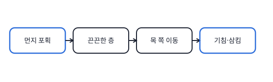

*공기길의 청소 순서*

**정확히 말하면**

1. 코나 입
2. 인두·후두
3. 기관
4. 기관지·세기관지
5. 폐포

| 역할 | 말발굽 모양 연골 | 점액(mucus) | 섬모(cilia) |
|---|---|---|---|
| 하는 일 | 기관 통로 열어 두기 | 먼지·미생물 붙잡기 | 이물질이 붙은 점액을 인두 쪽으로 밀기 |
| 결과 | 공기 흐름 유지 | 입자의 깊은 침투 감소 | 기침·삼킴으로 제거 |

코털은 들이마신 공기의 일부 이물질을 입구에서 걸러요. 흡연은 섬모 기능을 약화시켜 점액 청소를 어렵게 해요. 낭포성 섬유증에서는 끈끈한 점액이 잘 제거되지 않아 감염이 쉬워져요.

초미세먼지(PM₂.₅)는 공기역학적 지름이 2.5 μm 이하인 입자예요. 일부는 폐포 깊숙이 도달하고 그중 아주 작은 입자의 일부가 혈액에 들어갈 수 있어요.

폐포(alveolus)에서는 공기와 모세혈관 혈액 사이로 기체가 단순확산해요. 많은 폐포가 교환 면적을 넓히고, 얇은 장벽이 확산 거리를 짧게 해요.

**꼭 기억해요**

| 묻는 것 | 틀리기 쉬운 답 | 맞는 답 |
|---|---|---|
| 점액 이동 방향 | ~~폐포 쪽~~ | 목(인두) 쪽 |
| 기도 방어 역할 | ~~섬모가 붙잡고 점액이 움직임~~ | 점액이 붙잡고 섬모가 이동시킴 |
| 초미세먼지 침투 | ~~모든 입자가 혈액에 도달~~ | 크기와 위치에 따라 일부가 깊이 도달 |

교수님 말씀

> 밑으로 내리면 큰일 나죠. 위로만 올려줍니다.

**페이지 요약**

점액과 섬모는 공기길을 청소하고, 폐포는 공기를 혈액과 맞대어 기체의 확산을 도와요.

*용어*

- **코털** — 바깥 공기가 들어올 때 비교적 큰 입자의 일부를 걸러요.
- **점액·섬모** — 이물질이 달라붙은 점액을 인두로 옮기면 기침이나 삼킴으로 제거할 수 있어요.
- **말발굽 모양 연골** — 기관의 공기 통로를 지탱해요.
- **낭포성 섬유증과 흡연** — 끈끈한 점액이나 섬모 운동 저하가 청소 효율을 떨어뜨려요.
- **초미세먼지** — 2.5 μm 이하에 해당하며 일부는 폐포까지 도달해요.
- **폐포와 모세혈관** — 넓은 면적과 짧은 거리에서 단순확산이 일어나요.

---

### 흉막과 들숨·날숨

*1119 수업 · 13장 p1–2*

**쉽게 말하면**

통 안의 자리가 넓어지면 공기가 들어와요. 좁아지면 공기가 밖으로 밀려나요.

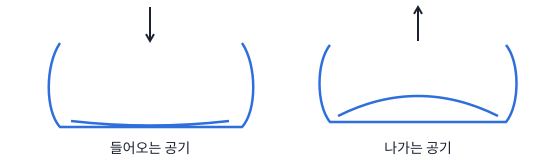

*가슴 아래쪽 근육의 위치 변화*

**정확히 말하면**

**횡격막(diaphragm)** = 흉강과 복강을 가르는 근육

흉막(pleura)은 폐 표면과 흉벽 안쪽을 각각 덮는 두 겹의 막이에요. 두 막 사이 흉막강에는 소량의 액체가 있고, 정상적인 조용한 호흡에서는 폐포 안의 압력(폐포압)이 흉막강 안의 압력(흉막강압)보다 높아서 폐가 펴진 상태를 유지해요.

1. 흉막강에 공기 유입
2. 흉막강 압력 상승
3. 폐를 펴는 압력차 감소
4. 폐가 부분적으로 또는 크게 접힘(기흉)

폐포압과 흉막강압의 차이는 폐를 펴는 데 작용해요. 공기가 드나드는 방향은 대기압과 폐포압의 차이로 정해져요.

1. 들숨 근육이 수축해 가슴 공간 증가
2. 폐가 흉벽을 따라 팽창
3. 폐포압이 잠시 대기압보다 낮아짐
4. 공기가 폐로 들어옴

| 비교 기준 | 들숨(흡기) | 조용한 날숨(호기) |
|---|---|---|
| 횡격막과 늑간근 | 횡격막과 외늑간근 수축 | 흡기에 쓰인 근육 이완 |
| 위치 | 횡격막 하강·갈비뼈 상승 | 횡격막 상승·갈비뼈 하강 |
| 폐의 부피 | 증가 | 탄성 되튐으로 감소 |
| 공기 흐름을 정하는 압력 | 폐포 내압이 대기압보다 낮음 | 폐포 내압이 대기압보다 높음 |
| 공기 흐름 | 대기에서 폐로 | 폐에서 대기로 |

폐 안을 대기보다 낮은 압력으로 만들어 공기를 들이는 방식이 음압 호흡(negative pressure breathing)이에요. 개구리가 입에서 공기를 밀어 넣는 양압 호흡과 비교할 수 있어요.

횡격막과 갈비뼈가 움직일 때 폐포 내압과 공기 흐름이 어떻게 바뀌는지 [들숨과 날숨 모형](../%EC%9D%B8%ED%84%B0%EB%A0%89%ED%8B%B0%EB%B8%8C_02_%EB%93%A4%EC%88%A8%EA%B3%BC_%EB%82%A0%EC%88%A8%EC%9D%98_%EC%95%95%EB%A0%A5%EC%B0%A8.html)에서 재생해 보세요.

**꼭 기억해요**

| 묻는 것 | 틀리기 쉬운 답 | 맞는 답 |
|---|---|---|
| 들숨을 시작하는 변화 | ~~공기가 먼저 들어온 뒤 폐가 커짐~~ | 근육 수축으로 폐가 커지고 압력이 낮아져 공기 유입 |
| 기흉의 압력 변화 | ~~흉막강 압력 하강~~ | 흉막강 압력 상승과 폐를 펼치는 압력차 감소 |

교수님 말씀

> 커피 봉지가 이렇게 빵빵해졌더라고. 그만큼 기압이 낮아졌습니다.

**페이지 요약**

폐포압과 흉막강압의 차이는 폐를 펴고, 대기압과 폐포압의 차이는 공기를 움직여요.

*용어*

- **흉막과 흉막강** — 두 흉막 사이에는 액체가 소량 있어요. 정상적인 조용한 호흡에서 흉막강 압력이 폐포 내압보다 낮아 폐를 펴는 데 도움이 돼요.
- **횡격막·외늑간근 수축** — 횡격막이 내려가고 갈비뼈가 올라가면 폐가 흉벽을 따라 커져요. 폐포압이 잠시 대기압보다 낮아져 공기가 들어와요.
- **조용한 날숨** — 들숨 근육이 이완되고 폐가 탄성으로 오그라들면 폐포압이 잠시 대기압보다 높아져 공기가 나가요.
- **기흉** — 흉막강에 공기가 들어오면 압력이 올라가 폐를 팽창시키는 압력차가 줄어요.
- **양압 호흡** — 개구리처럼 입에서 공기를 밀어 넣는 방식이에요.

---

### 1회 호흡량·폐활량·잔기량

*1119 수업 · 13장 p2*

**쉽게 말하면**

물을 최대한 따른 뒤에도 바닥에 조금 남을 수 있어요. 숨을 최대한 내쉰 뒤에도 안에는 공기가 남아요.

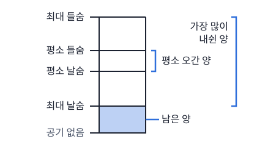

*폐 속 공기 양을 같은 높이 눈금으로 비교한 그림*

**정확히 말하면**

| 비교 기준 | 1회 호흡량(tidal volume) | 폐활량(vital capacity) | 잔기량(residual volume) |
|---|---|---|---|
| 기준 동작 | 평소 한 번의 들숨이나 날숨 | 최대로 들이쉰 뒤 최대로 내쉼 | 최대로 내쉰 직후 |
| 재는 부피 | 한 번에 드나든 양 | 최대로 내보낼 수 있는 양 | 폐 안에 여전히 남은 양 |

활동량이 늘면 보통 숨이 깊어져 1회 호흡량이 커져요. 평소 날숨 뒤에는 더 내쉴 수 있는 공기가 남아 있어요. 최대 날숨 뒤에도 남은 양만 잔기량이라고 해요.

날숨이 끝나도 폐포에 공기가 남으므로 환기와 혈류가 정상적으로 유지되는 동안 들숨과 날숨 사이에도 기체 교환이 이어져요. 사람은 같은 공기 통로로 들이쉬고 내쉬어서 남아 있던 공기와 새로 들이쉰 공기가 섞여요. 강의에서는 새의 공기주머니와 폐를 지나는 한 방향 공기 흐름을 대비로 언급했어요.

**꼭 기억해요**

| 묻는 것 | 틀리기 쉬운 답 | 맞는 답 |
|---|---|---|
| 최대한 내쉰 뒤에도 남은 공기 | ~~폐활량~~ | 잔기량 |
| 폐활량에 포함되는 범위 | ~~폐 안의 모든 공기~~ | 최대 들숨 뒤 내보낼 수 있는 공기 |

교수님 말씀

> 헌 공기가 조금 남아 있는 상태에서 새로운 공기를 받아들여요.

**페이지 요약**

평소 한 번에 오가는 양은 1회 호흡량, 최대 들숨부터 최대 날숨까지 내보낸 양은 폐활량, 최대 날숨 뒤에 남은 양은 잔기량이에요.

*용어*

- **운동과 정상 기체 교환** — 운동으로 숨이 깊어지면 1회 호흡량이 늘어요. 폐포에 공기가 남아 정상 환기·혈류가 유지되는 동안 날숨 중에도 교환이 이어져요.
- **사람의 공기 경로** — 공기가 같은 통로를 양방향으로 지나므로 새 공기와 폐 안에 남아 있던 공기가 섞여요.
- **새의 한 방향 흐름** — 공기주머니가 폐 내 한 방향 공기 흐름을 유지하는 데 도움을 줘요.

---

## 2. 호흡 조절과 기체 운반

### 호흡 중추와 화학수용체

*1119 수업 · 13장 p2*

**쉽게 말하면**

몸속에서 내보낼 것이 늘면 알림이 울리고, 숨을 더 자주 더 크게 쉬어요.

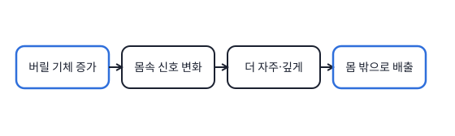

*호흡을 바꾸는 알림과 반응*

**정확히 말하면**

뇌간(brain stem)의 연수(medulla)는 호흡 리듬을 만들고 횡격막·늑간근의 운동을 조절해요. 뇌교(pons)는 호흡 리듬의 전환을 조정해요.

| 비교 기준 | 중추 화학수용체 | 말초 화학수용체 |
|---|---|---|
| 위치 | 연수 부근 | 목동맥소체·대동맥소체 |
| 주요 감지 대상 | 뇌척수액 pH 변화 | 동맥혈 pH와 CO₂ 및 O₂ 상태 |
| pH 하강 때 | 호흡 중추 자극 | 연수에 감각 신호 전달 |

혈액의 CO₂가 증가하면 동맥혈과 뇌척수액에서 물과 반응한 CO₂가 H⁺를 늘려 pH를 낮춰요. 뇌척수액의 pH 하강은 중추 화학수용체가, 동맥혈의 pH 하강은 말초 화학수용체가 감지해요. 호흡이 빨라지고 깊어져 CO₂ 배출이 늘면 pH가 회복되는 방향으로 바뀌어 호흡을 촉진하던 자극이 약해져요.

$$
\mathrm{CO_2+H_2O\rightleftharpoons H_2CO_3\rightleftharpoons H^++HCO_3^-}
$$

일상적인 호흡 조절에서는 CO₂·pH 변화에 민감해요. 말초 화학수용체가 호흡을 크게 촉진하는 O₂ 신호는 동맥혈 O₂ 분압이 많이 낮을 때 중요해져요. 활발히 운동하면 호흡이 더 빠르고 깊어져요. 숨을 참으면 CO₂가 쌓이지만, 필요 이상으로 빠르고 깊게 호흡하면 CO₂가 줄어들 수 있어요.

**꼭 기억해요**

| 묻는 것 | 틀리기 쉬운 답 | 맞는 답 |
|---|---|---|
| 일상적인 호흡 자극 | ~~O₂의 작은 감소가 가장 민감~~ | CO₂ 상승에 따른 pH 하강 |
| 연수의 화학수용체가 읽는 곳 | ~~몸 전체의 동맥혈을 직접 측정~~ | 뇌척수액의 pH에 반응 |
| pH 방향 | ~~CO₂가 늘면 pH 상승~~ | CO₂가 늘면 H⁺ 증가와 pH 하강 |

교수님 말씀

> 우물 안 개구리에요. 뇌 속의 연수에요, 뇌 속의 연수.

**페이지 요약**

뇌간은 혈액과 뇌척수액의 신호를 모아 호흡을 조절하며, 평소에는 CO₂가 일으키는 pH 변화에 민감해요.

*핵심 식*

- CO₂와 pH의 연결

  $$
  \mathrm{CO_2+H_2O\rightleftharpoons H_2CO_3\rightleftharpoons H^++HCO_3^-}
  $$

*용어*

- **연수와 뇌교** — 연수가 기본 호흡 리듬을 만들고 근육 운동을 조절해요. 뇌교는 리듬 전환을 다듬어요.
- **중추와 말초 화학수용체** — 연수 부근은 뇌척수액의 pH, 목동맥소체·대동맥소체는 동맥혈 pH와 CO₂ 및 O₂ 상태에 반응해요.
- **CO₂ 증가** — CO₂가 늘어 pH가 낮아지면 호흡이 깊고 빨라져 CO₂ 배출이 늘어요. CO₂가 줄어 pH가 회복되는 쪽으로 바뀌면 처음의 호흡 자극도 약해져요. 숨을 참으면 CO₂가 쌓이고 지나친 환기에서는 CO₂가 줄어요.
- **운동** — 활발히 움직이면 호흡이 깊고 빨라져 환기가 늘어요.
- **심한 O₂ 저하** — 동맥혈 O₂ 분압이 크게 떨어지면 말초 화학수용체가 환기를 자극해요.

---

### 헤모글로빈과 산소 운반

*1119 수업 · 13장 p2–3*

**쉽게 말하면**

네 자리 중 한 자리만 찼다면 전체 자리의 4분의 1이 찬 셈이에요.

*같은 칸 네 개를 기준으로 센 비율*

**정확히 말하면**

산소는 물에 잘 녹지 않아요. 폐포에서 혈장으로 확산한 산소를 적혈구(red blood cell)의 헤모글로빈(hemoglobin, Hb)이 가역적으로 붙잡으면, 혈액이 운반할 수 있는 산소량이 크게 늘어요.

**산소 분압(oxygen partial pressure, PO₂)** = 혼합 기체나 용액에서 산소에 해당하는 부분압

**산소 포화도(oxygen saturation)** = 전체 산소 결합 자리 중 채워진 자리의 비율

헤모글로빈은 폴리펩티드 4개를 가지며 각각의 헴(heme)에 든 철 원자 1개에 O₂ 1분자가 결합해요. 따라서 한 분자가 붙잡을 수 있는 O₂는 최대 4분자예요. 먼저 산소가 하나 결합하면 구조가 바뀌어 나머지 자리의 결합이 쉬워져요.

| 비교 기준 | 폐 모세혈관 | 활동하는 조직의 모세혈관 |
|---|---|---|
| 산소 분압 | 높음 | 세포의 산소 소비로 낮음 |
| 해리곡선에서 | 높은 포화도의 평평한 구간 | 포화도가 크게 변할 수 있는 가파른 구간 |
| 결과 | 헤모글로빈의 산소 결합 우세 | 헤모글로빈의 산소 방출과 조직 공급 |

1. 활동 증가로 조직에서 CO₂ 생성 증가
2. H⁺ 증가와 pH 하강
3. 헤모글로빈 산소 친화도 감소
4. 같은 산소 분압에서 더 낮은 포화도
5. 조직으로 산소 방출 증가

낮은 pH에서 산소 해리곡선이 오른쪽으로 이동하는 현상을 보어 효과(Bohr effect)라고 해요. 두 곡선에서 고정하는 값에 따라 포화도 차이와 오른쪽 이동을 각각 읽을 수 있어요.

#### 같은 분압에서 포화도 비교하기 *(정적 스냅샷 — 직접 조작은 HTML 버전)*

산소 분압을 움직이면 pH가 다를 때 채워진 자리의 비율을 비교할 수 있어요.

pH 7.4 **50%** · pH 7.2 **32%**

범례: pH 7.4 · 낮게 그려진 선은 pH 7.2

곡선과 수치는 pH의 효과를 읽기 위한 개념 모형이에요.

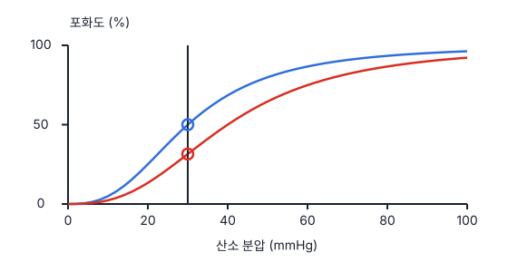

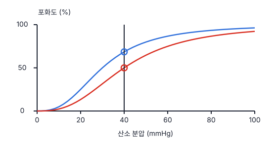

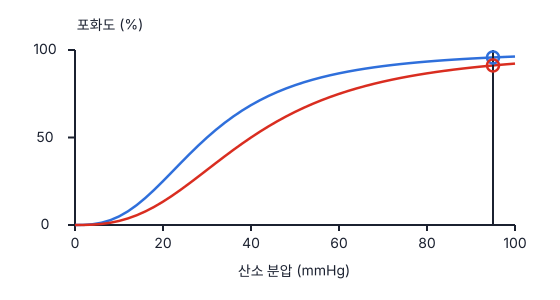

| 산소 분압 | pH 7.4 모형 | pH 7.2 모형 |
|---|---|---|
| 30 mmHg | 50% | 32% |
| 40 mmHg | 68% | 50% |
| 95 mmHg | 96% | 91% |

**산소 분압 30 mmHg를 고정하면** 모형에서 pH 7.4의 포화도는 50%, pH 7.2에서는 32%예요. 같은 양의 헤모글로빈이 같은 포화도(예를 들어 96%)로 조직에 들어왔다면, pH 7.2 쪽에서 비워진 자리의 비율이 18%p(50% − 32%) 더 높아요. 자리 100개당 산소 18분자를 더 내놓은 셈이에요.

**50% 포화도를 고정하면** pH 7.4 곡선은 30 mmHg, pH 7.2 곡선은 40 mmHg에서 그 높이에 닿아요. 같은 높이에서 더 큰 분압 쪽으로 점이 옮겨져서 오른쪽 이동이라고 해요.

같은 산소 분압에서 pH에 따라 헤모글로빈 포화도가 얼마나 달라지는지 [산소 포화도 비교 모형](../%EC%9D%B8%ED%84%B0%EB%A0%89%ED%8B%B0%EB%B8%8C_03_%ED%97%A4%EB%AA%A8%EA%B8%80%EB%A1%9C%EB%B9%88%EC%9D%98_%EC%82%B0%EC%86%8C_%ED%8F%AC%ED%99%94%EB%8F%84.html)에서 확인해 보세요.

**꼭 기억해요**

| 묻는 것 | 틀리기 쉬운 답 | 맞는 답 |
|---|---|---|
| 산소 포화도 25% | ~~분자 네 개 중 하나만 산소 결합~~ | 전체 결합 자리 중 4분의 1이 점유됨 |
| pH 하강 효과를 비교할 때 | ~~다른 산소 분압의 점 두 개 비교~~ | 같은 산소 분압에서 포화도 비교 |
| S자 곡선의 원인 | ~~네 결합 자리가 서로 독립적~~ | 앞선 결합이 다음 결합을 돕는 협동 결합 |
| 분압 변화와 pH 변화 | ~~두 경우 모두 곡선 자체가 움직임~~ | 분압만 바뀌면 동일 곡선의 점 이동, pH가 낮아지면 곡선 우측 이동 |

교수님 말씀

> 교실에 의자가 50개라고 해서 항상 학생들이 50명 앉아 있는 것은 아니지요.

**보충 · 노트에 빠졌던 수업 내용**

강의노트의 기준에서 혈액 속 산소는 약 98.5%가 헤모글로빈에 결합하고 약 1.5%가 혈장에 녹아 있어요. 이 수치는 산소가 어떤 형태로 실리는지 나타내요.

출처: 강의노트 13장 p2 · 교재 13장 p.295

**페이지 요약**

산소 분압이 높은 폐에서 헤모글로빈이 산소를 붙잡고, 산소 분압이 낮거나 pH가 낮아진 조직에서는 더 쉽게 놓아줘요.

*용어*

- **운반 경로** — 산소가 폐포에서 혈장과 적혈구로 확산하고 헤모글로빈과 가역 결합해요. 조직에서는 혈장에서 조직으로 확산할 때 헤모글로빈이 산소를 보충해요.
- **헴과 최대 결합량** — 헤모글로빈의 헴 네 개에 철이 하나씩 있고 철마다 O₂ 한 분자가 결합해요.
- **해리곡선** — 가로축은 O₂ 분압, 세로축은 전체 결합 자리의 점유율이에요. 협동 결합으로 S자 모양이며 폐 쪽 평탄부와 조직 쪽 가파른 부분을 구분해요.
- **보어 효과** — 활동 조직의 CO₂가 증가해 pH가 내려가면 같은 포화도에 더 높은 분압이 필요해 곡선이 오른쪽으로 이동해요. 같은 분압에서는 포화도가 더 낮아요. 헤모글로빈 양과 처음 포화도가 같다면 더 많은 자리가 비어 산소 방출량이 늘어요.

- **(보충) 혈액 산소의 운반 비율** — 혈액 속 산소 약 98.5%는 헤모글로빈이 운반하고, 약 1.5%는 혈장에 녹아요. 출처는 강의노트 13장 p2 · 교재 13장 p.295예요.

---

### 이산화탄소의 운반

*1119 수업 · 13장 p3*

**쉽게 말하면**

움직이기 어려운 짐은 포장을 바꿔 들고 가요. 내보낼 곳에 도착하면 원래 모습으로 돌려요.

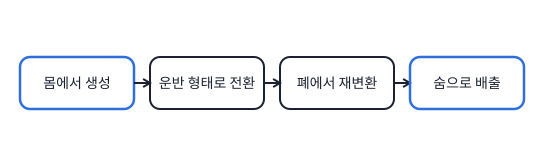

*이동하는 모습과 나갈 때의 모습*

**정확히 말하면**

몸 조직에서 만들어진 CO₂는 분압이 더 낮은 혈장으로 확산해요. 운반 형태는 혈장에 녹은 CO₂, 헤모글로빈에 결합한 CO₂, 중탄산 이온(HCO₃⁻) 세 가지이며, 대부분이 중탄산 이온이에요.

적혈구의 탄산무수화효소(carbonic anhydrase)는 CO₂와 물 사이의 가역 반응 속도를 크게 높여요.

| 비교 기준 | 조직 주위 모세혈관 | 폐포 주위 모세혈관 |
|---|---|---|
| 기체 이동 | 조직에서 혈장과 적혈구로 CO₂ 확산 | 혈액에서 폐포 쪽으로 CO₂ 확산 |
| 반응 방향 | CO₂에서 HCO₃⁻ 및 H⁺ 형성(정반응) | HCO₃⁻와 H⁺에서 CO₂와 물 형성(역반응) |
| 주요 운반 형태의 이동 | HCO₃⁻가 적혈구에서 혈장으로 | 혈장의 HCO₃⁻가 적혈구 안으로 이동하여 CO₂ 생성 |

폐에서 CO₂가 먼저 폐포로 확산해 혈액에 녹아 있던 CO₂가 줄면 역반응이 우세해져요. 적혈구 안의 HCO₃⁻와 H⁺에서 새로 생긴 CO₂도 폐포로 확산해 날숨으로 나가요.

$$
\mathrm{CO_2+H_2O\rightleftharpoons H_2CO_3\rightleftharpoons H^++HCO_3^-}
$$

**꼭 기억해요**

| 묻는 것 | 틀리기 쉬운 답 | 맞는 답 |
|---|---|---|
| 폐포 공기로 나가는 형태 | ~~HCO₃⁻ 이온 자체~~ | 재형성된 CO₂ 분자 |
| 효소의 역할 | ~~조직에선 정반응, 폐에선 별도 효소가 역반응~~ | 동일 효소가 가역 반응 가속, 조건이 우세 방향 결정 |

교수님 말씀

> 얘가 빠져나가니까 HCO3-가 다시 CO2로 바뀌는 거예요.

**페이지 요약**

조직에서 생긴 CO₂는 대부분 HCO₃⁻ 형태로 옮겨지고 폐에 도착하면 CO₂로 돌아와 날숨으로 나가요.

*핵심 식*

- 장소마다 우세 방향이 다른 가역 반응

  $$
  \mathrm{CO_2+H_2O\rightleftharpoons H_2CO_3\rightleftharpoons H^++HCO_3^-}
  $$

*용어*

- **세 가지 운반 형태** — 용해된 CO₂, 헤모글로빈 결합 CO₂, 대다수를 차지하는 중탄산 이온(HCO₃⁻)이에요.
- **조직 주위** — CO₂가 적혈구로 들어가면 탄산무수화효소가 반응을 빠르게 하고 생성된 HCO₃⁻가 혈장으로 나가요.
- **폐포 주위** — CO₂가 폐포로 빠져나가 혈액의 CO₂가 줄면, 적혈구에서 HCO₃⁻와 H⁺로부터 CO₂가 다시 만들어져요. 새 CO₂도 폐포로 나가요.

---

## 3. 혈액과 순환 경로

### 심장의 네 방과 두 순환

*1119 수업 · 13장 p3–4*

**쉽게 말하면**

두 길이 한 바퀴를 이뤄요. 한 길은 공기에서 필요한 것을 받으러 가고, 다른 길은 그걸 몸 곳곳에 나눠 줘요.

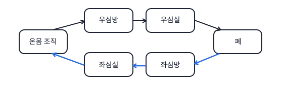

*심장의 네 방을 잇는 두 길*

**정확히 말하면**

폐에서 혈액에 실은 산소가 전신의 조직에 닿으려면 심장이 혈액을 밀어 혈관을 따라 보내야 해요. 혈액, 그 통로인 혈관, 혈액을 미는 심장이 순환계(circulatory system)를 이뤄요. 사람의 심장에는 들어오는 혈액을 받는 심방(atrium) 두 개와 혈액을 내보내는 심실(ventricle) 두 개가 있어요.

**폐순환(pulmonary circulation)** = 폐에서 CO₂를 내보내고 O₂를 받아 오는 혈액 경로

1. 우심실
2. 폐동맥
3. 폐 모세혈관
4. 폐정맥
5. 좌심방

**체순환(systemic circulation)** = 조직에 O₂·영양분을 공급하고 CO₂·노폐물을 가져오는 혈액 경로

1. 좌심실
2. 대동맥과 동맥
3. 전신 모세혈관
4. 정맥과 대정맥
5. 우심방

심장을 기준으로 멀어지는 혈관은 동맥(artery), 돌아오는 혈관은 정맥(vein)이에요. 폐순환에선 폐동맥의 혈액이 산소가 상대적으로 적고 폐정맥의 혈액은 산소가 상대적으로 많아요.

**꼭 기억해요**

| 묻는 것 | 틀리기 쉬운 답 | 맞는 답 |
|---|---|---|
| 폐에서 막 돌아온 혈액의 첫 심장 방 | ~~우심방~~ | 좌심방 |
| 폐로 나가는 혈관 | ~~폐정맥~~ | 우심실에서 나가는 폐동맥 |
| 동맥·정맥의 이름 기준 | ~~혈액의 산소량~~ | 심장을 기준으로 한 흐름의 방향 |

교수님 말씀

> 그래서 이제 어디로 가는지를 꼭 외워야 됩니다. 무조건 시험에 나올 테니까.

**보충 · 노트에 빠졌던 수업 내용**

심방은 심실보다 대체로 작고 벽이 얇으며 좌심실의 벽이 가장 두꺼워요. 관상순환에서는 대동맥에서 갈라지는 관상동맥이 심장 근육에 혈액을 공급해요.

상대정맥과 하대정맥은 각각 몸의 위쪽과 아래쪽에서 돌아오는 혈액을 우심방으로 보내요.

출처: 강의노트 13장 p4 · 교재 13장 p.300–301

**페이지 요약**

폐순환은 오른쪽 심실에서 출발해 폐에서 산소를 받아 왼쪽 심방으로 돌아오고, 체순환은 왼쪽 심실에서 출발해 전신에 산소를 보내고 오른쪽 심방으로 돌아와요.

*용어*

- **두 심방과 두 심실** — 심방은 정맥에서 혈액을 받아 같은 쪽 심실로 보내고, 심실은 동맥으로 밀어내요.
- **폐순환** — 우심실 → 폐동맥 → 폐 모세혈관 → 폐정맥 → 좌심방. 폐에서 혈액에 O₂가 들어오고 CO₂가 나가요.
- **체순환** — 좌심실 → 대동맥 → 전신의 동맥·모세혈관·정맥 → 대정맥 → 우심방. 조직에 산소와 영양분을 전달하고 노폐물을 거둬요.
- **혈관 이름과 산소량** — 동맥은 심장에서 나가는 혈관, 정맥은 심장으로 들어오는 혈관이에요. 폐동맥은 O₂가 적고 폐정맥은 상대적으로 많아요.

- **(보충) 심실의 벽·관상순환·대정맥** — 심실은 심방보다 대체로 크고 벽이 두꺼우며 좌심실이 가장 두꺼워요. 대동맥에서 갈라진 관상동맥은 심근에 혈액을 공급하며, 상대정맥과 하대정맥은 각각 몸 위쪽과 아래쪽의 혈액을 우심방으로 보내요. 출처는 강의노트 13장 p4 · 교재 13장 p.300–301예요.

---

### 혈액의 조성과 기능

*1119 수업 · 13장 p3–4*

**쉽게 말하면**

피를 빠르게 돌려 나누면 맑은 윗부분, 얇은 중간 줄, 붉은 아랫부분이 보여요.

*빠르게 돌려 나눈 피의 세 층*

**정확히 말하면**

혈액은 세포에 산소·영양분을 보내고 CO₂와 노폐물을 옮겨요. 용해된 물질이 이동하는 통로인 혈장(plasma)은 대부분 물이며 포도당, 아미노산, 이온, 호르몬, 비타민, 녹아 있는 기체와 혈장 단백질을 포함해요.

| 원심분리 층 | 윗층 | 얇은 중간층 | 아래층 |
|---|---|---|---|
| 대표 성분 | 혈장 | 백혈구(leukocyte)·혈소판(platelet) | 적혈구(red blood cell) |
| 대표 역할 | 용해 물질 운반 | 백혈구는 방어, 혈소판은 지혈 | 헤모글로빈으로 산소 운반 |

**적혈구 용적률(hematocrit)** = 전체 혈액 부피 중 적혈구가 차지하는 비율

같은 부피의 혈액에서 적혈구가 차지하는 몫이 작으면 혈액에 실을 수 있는 산소량도 줄 수 있어요. 그래서 적혈구 용적률이 낮으면 빈혈의 단서가 될 수 있어요. 용적률이 너무 높으면 혈액의 점도가 커져요.

혈장 단백질에는 알부민, 글로불린, 피브리노겐이 있어요. 글로불린 중 면역글로불린(Ig)은 항체예요.

혈액 세포는 골수(bone marrow)에서 만들어져요. 상처가 나면 혈소판이 응고를 돕고 혈장 피브리노겐은 혈병을 만드는 데 쓰여요. 특정 응고인자의 이상으로 응고가 잘 일어나지 않는 유전 질환이 혈우병(hemophilia)이에요.

**꼭 기억해요**

| 묻는 것 | 틀리기 쉬운 답 | 맞는 답 |
|---|---|---|
| 혈장의 단백질 | ~~단백질은 모두 세포층에 있음~~ | 알부민·면역글로불린·피브리노겐은 혈장에 녹음 |
| 산소 운반의 철을 가진 단백질 | ~~혈장의 피브리노겐~~ | 적혈구의 헤모글로빈 |
| 적혈구 용적률의 기준 | ~~혈액 세포 중 적혈구 개수 비율~~ | 전체 혈액 부피에서 적혈구 부피 비율 |

교수님 말씀

> 자, 혈액의 성분은 국물하고 건더기죠, 국물과 건더기.

**보충 · 노트에 빠졌던 수업 내용**

성인의 혈액 세포는 주로 적색골수에서 만들어져요. 백혈구에는 B세포 같은 림프구가 포함돼요. 적혈구는 혈액 세포 중 수가 가장 많아요. 산소 공급이 부족할 때 신장이 적혈구생성소(EPO)를 분비하면 골수의 적혈구 생성이 늘어요. 수명이 다한 적혈구는 비장·간·골수의 대식세포에 의해 제거돼요.

혈소판은 골수에서 유래한 세포 조각이며, 응고 때 피브리노겐이 불용성 피브린 섬유로 바뀌어요. 순환은 호르몬과 항체의 이동, 열 전달과 체온 조절도 도와요.

출처: 강의노트 13장 p3–4 · 교재 13장 p.298–300

**페이지 요약**

혈액의 액체 성분인 혈장은 물질을 녹여 운반하고, 적혈구·백혈구·혈소판은 각각 산소 운반·방어·지혈에 관여해요.

*용어*

- **원심분리 층** — 혈장이 위, 백혈구와 혈소판이 얇은 중간, 적혈구가 아래에 모여요.
- **혈장 단백질** — 알부민·글로불린·피브리노겐이 혈장에 있어요. 면역글로불린은 항체이고 피브리노겐은 응고에 쓰여요.
- **적혈구 용적률** — 전체 혈액 부피에서 적혈구가 차지하는 비율이에요. 낮으면 같은 부피의 혈액이 실을 수 있는 산소가 줄 수 있어 빈혈의 단서가 돼요. 너무 높으면 혈액의 점도가 커져요.
- **골수와 지혈** — 혈액 세포는 골수에서 생겨요. 혈소판이 응고를 돕고 특정 응고인자 이상은 혈우병의 원인이 돼요.

- **(보충) 적혈구의 생성·분해와 혈액의 역할** — 성인에서는 적색골수가 조혈을 담당해요. B세포는 백혈구의 일종이에요. 가장 많은 혈액 세포는 적혈구이며, 신장 EPO가 골수의 적혈구 생성을 촉진하고 비장·간·골수 대식세포가 노화 적혈구를 제거해요. 골수에서 유래한 혈소판은 세포 조각이고, 응고에서 피브리노겐이 피브린으로 변해요. 혈액은 호르몬·항체·열도 옮겨요. 출처는 강의노트 13장 p3–4 · 교재 13장 p.298–300예요.

---

## 4. 심장 주기와 혈관

### 압력차와 심장 판막

*1119 수업 · 13장 p4–5*

**쉽게 말하면**

안쪽의 힘으로 열리는 문이 있어요. 반대쪽 힘이 세지면 문이 닫히고 물이 되돌아오지 못해요.

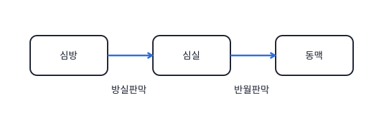

*피가 차례로 지나는 두 문*

**정확히 말하면**

수축기(systole)에는 심근이 수축해 압력을 올리고 혈액을 밀어내요. 이완기(diastole)에는 심근이 이완해 압력이 내려가 혈액이 채워져요. 심장주기(cardiac cycle)는 이 과정의 반복이에요.

| 비교 기준 | 방실판막(AV valve) | 반월판막(semilunar valve) |
|---|---|---|
| 위치와 수 | 좌·우 심방과 같은 쪽 심실 사이 두 개 | 심실에서 대동맥·폐동맥으로 나가는 곳 두 개 |
| 열릴 때 | 심방 압력이 심실보다 높음 | 심실 압력이 동맥보다 높음 |
| 닫힐 때 | 수축을 시작한 심실 압력이 심방보다 높아짐 | 이완을 시작한 심실 압력이 동맥보다 낮아짐 |
| 닫혀서 막는 역류 | 심실에서 심방으로 | 동맥에서 심실로 |
| 심장음 | 첫 소리 | 두 번째 소리 |

심방이 수축해 심실 채우기를 마치면 심실이 수축을 시작해요. **심방압 &lt; 심실압 &lt; 동맥압**인 동안에는 심실압이 심방압을 넘어 방실판막이 닫혔고, 동맥압에는 아직 못 미쳐 반월판막도 닫혀 있어요. 두 판막이 모두 닫혀 심실로 들어오거나 나가는 혈액이 없고, 심실압이 동맥압보다 높아져야 혈액이 나가요.

심실이 이완을 시작하면 심실압이 동맥압보다 낮아져 반월판막이 먼저 닫혀요. 심실압이 아직 심방압보다 높으면 두 판막이 모두 닫혀 있어요. 심실압이 심방압보다 낮아질 때 방실판막이 열리면서 다시 심실이 채워져요.

심방·심실·동맥의 압력 순서와 혈액이 지나는 판막을 [심장 주기와 판막 모형](../%EC%9D%B8%ED%84%B0%EB%A0%89%ED%8B%B0%EB%B8%8C_01_%EC%8B%AC%EC%9E%A5_%EC%A3%BC%EA%B8%B0%EC%99%80_%ED%8C%90%EB%A7%89.html)에서 단계별로 비교해 보세요.

**꼭 기억해요**

| 묻는 것 | 틀리기 쉬운 답 | 맞는 답 |
|---|---|---|
| 판막을 움직이는 조건 | ~~동시에 열라는 별도 명령~~ | 앞뒤 공간의 압력차 |
| 심장음 | ~~판막이 열릴 때~~ | 방실판막과 반월판막이 차례로 닫힐 때 |
| 심실 수축을 시작한 직후 | ~~반월판막부터 즉시 열림~~ | 방실판막이 닫히고, 심실 압력이 동맥을 넘을 때 반월판막 열림 |

교수님 말씀

> 얘가 열릴 때는 소리가 안 들리는데 닫힐 때 소리가 들린다.

**페이지 요약**

심근 수축과 이완으로 바뀌는 압력차가 방실판막과 반월판막을 열고 닫으며, 혈액을 심방에서 심실을 거쳐 동맥으로 보내요.

*용어*

- **수축기·이완기** — 심실이 수축하면 압력이 오르고, 이완하면 내려가요. 압력 변화에 따라 혈액을 내보내거나 받아요.
- **방실판막** — 좌우 각각 심방과 심실 사이에 있어요. 심방 압력이 더 높으면 열리고, 심실 수축으로 심실 압력이 올라가면 닫혀 첫 심장음과 연결돼요.
- **반월판막** — 심실과 대동맥 또는 폐동맥 사이에 있어요. 심실 압력이 동맥보다 높으면 열리고, 심실 이완으로 더 낮아지면 닫혀 두 번째 심장음과 연결돼요.
- **수축과 채우기의 순서** — 심방 수축으로 채우기가 끝난 뒤 심실이 수축해요. 수축 초기에 심실압이 심방압보다 높고 동맥압보다 낮으면 두 판막이 닫혀 혈액이 드나들지 않아요. 이완 초기에는 반월판막이 먼저 닫히고, 심실압이 심방압 아래로 내려가야 방실판막이 열려요.

---

### 심장 박동의 시작과 심전도

*1119 수업 · 13장 p5*

**쉽게 말하면**

처음 박자를 내는 곳이 있고 그 신호가 옆으로 퍼져요. 피부에 붙인 센서는 그 변화를 잡아요.

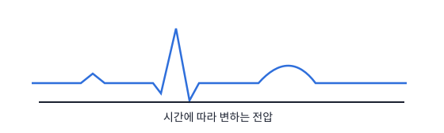

*박자를 기록할 때 보이는 전압의 모양*

**정확히 말하면**

**동방결절(굴심방결절, SA node)** = 우심방에 있는 자연 박동원

동방결절의 박동원세포(pacemaker cell)는 막전압이 스스로 변하는 성질이 있어 바깥 운동 뉴런의 명령 없이 활동전위를 만들어요. 심근세포 사이의 통로를 통해 전기적 변화가 전달돼요.

1. 동방결절이 박동 신호 생성
2. 양쪽 심방으로 퍼져 먼저 수축
3. 방실결절(AV node)에서 전달 지연
4. 전도 섬유와 푸르키네 섬유로 전파
5. 심실로 퍼져 심실 수축

방실결절에서 신호가 잠시 늦어지는 동안 심방이 [심실 채우기](#s3-cycle)를 마칠 시간을 벌어요.

**심전도(electrocardiogram, ECG)** = 피부 표면 전극에서 시간에 따라 측정한 심장 전기 활동의 전압차 기록

표면 전극은 심장 안에서 시작되어 퍼진 전기 활동의 변화를 기록해요. 파형의 모양과 간격을 보면 박동이 어떤 리듬으로 시작되고 전달되는지 판단할 단서를 얻어요. 인공 심박동기(pacemaker)는 필요할 때 전기 자극을 주어 박동을 돕는 장치예요.

**꼭 기억해요**

| 묻는 것 | 틀리기 쉬운 답 | 맞는 답 |
|---|---|---|
| 정상 박동의 시작 | ~~운동 뉴런이 매 박동을 시작~~ | 동방결절 박동원세포가 시작 |
| 심전도가 직접 잰 값 | ~~심장음이나 혈류량~~ | 피부에서 잰 심장 전기 활동의 전압차 |
| 동방결절과 방실결절 | ~~방실결절이 정상 신호를 먼저 만듦~~ | 동방결절이 시작하고 방실결절이 전달을 중계 |

교수님 말씀

> 자 심장을 꺼냈는데, 심장이 혼자서 스스로 뛰고 있죠?

**페이지 요약**

정상 박동 신호는 동방결절에서 시작해 심방을 먼저, 심실을 나중에 수축시키고 그 전기 활동을 심전도로 기록할 수 있어요.

*용어*

- **박동원세포** — 동방결절의 세포가 막전압을 스스로 바꾸어 활동전위를 만들어요.
- **전도 경로** — 동방결절에서 심방으로 퍼진 신호는 방실결절에서 잠깐 지연돼요. 그사이에 심방이 심실 채우기를 마치고, 이어 푸르키네 섬유 등을 통해 신호를 받은 심실이 수축해요.
- **심전도** — 피부 전극에 나타나는 전압차를 시간에 따라 기록해 리듬과 전기 전달의 단서를 얻어요.
- **인공 심박동기** — 필요할 때 전기 자극을 내보내 박동을 보조해요.

---

### 혈관의 구조와 모세혈관의 혈류

*1119 수업 · 13장 p5*

**쉽게 말하면**

한 줄로 들어왔던 물이 여러 갈래로 퍼져요. 같은 양이 흐를 때 지나갈 자리가 넓으면 평균 속도가 줄어요.

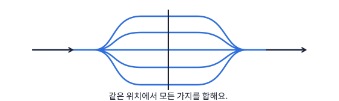

*한 가닥의 넓이와 모든 가닥의 합*

**정확히 말하면**

1. 동맥
2. 세동맥
3. 모세혈관
4. 세정맥
5. 정맥

| 비교 기준 | 동맥 | 모세혈관 | 정맥 |
|---|---|---|---|
| 하는 일 | 심장에서 혈액을 받아 조직 쪽으로 보냄 | 혈액과 조직 사이 기체·영양분·노폐물 교환 | 혈액을 모아 심장으로 되돌림 |
| 혈관벽 | 두꺼운 평활근·탄력 있는 결합조직 | 매우 얇은 벽 | 동맥보다 얇은 벽 |
| 상대적 혈압 | 높음 | 동맥보다 낮음 | 더 낮음 |

**혈압(blood pressure)** = 혈액이 혈관 벽에 가하는 압력

심실이 밀어낸 혈액이 동맥을 늘리면, 탄성 되튐이 그다음에도 혈액을 앞으로 밀어요. 압력은 혈류가 저항을 받으면서 하류로 갈수록 낮아져요.

1. 개별 모세혈관 지름이 작음
2. 수많은 모세혈관이 나란하므로 총 단면적 최대
3. 같은 시간에 같은 부피가 통과할 때 평균 유속 최소
4. 혈액과 조직이 물질을 교환할 시간 증가

안정적으로 순환할 때는 동맥과 정맥 사이에 혈액이 계속 쌓이지 않으므로, 체순환의 각 단계 전체를 지나는 평균 총유량이 같아요. 모세혈관 단계에서는 각 가지의 유량을 모두 더한 값이에요.

가령 동맥과 모세혈관 단계의 평균 총유량이 각각 10 mL/s이고 총 단면적이 2 cm²와 10 cm²라면, 평균 유속은 각각 10 ÷ 2 = 5 cm/s와 10 ÷ 10 = 1 cm/s예요. 총 단면적은 같은 단계에서 혈관을 흐름에 수직으로 잘라 합친 면적이에요.

같은 유량에서 나란한 혈관 수를 바꾸면 총 단면적과 평균 유속이 어떻게 달라지는지 [모세혈관 유속 모형](../%EC%9D%B8%ED%84%B0%EB%A0%89%ED%8B%B0%EB%B8%8C_04_%EB%AA%A8%EC%84%B8%ED%98%88%EA%B4%80%EC%9D%98_%EC%B4%9D_%EB%8B%A8%EB%A9%B4%EC%A0%81%EA%B3%BC_%EC%9C%A0%EC%86%8D.html)에서 비교해 보세요.

**꼭 기억해요**

| 묻는 것 | 틀리기 쉬운 답 | 맞는 답 |
|---|---|---|
| 한 가닥 지름과 총 단면적 | ~~개별 지름이 크면 항상 총 단면적도 가장 큼~~ | 모세혈관은 개별 지름이 작지만 가지 수가 많아 총 단면적이 가장 큼 |
| 모세혈관의 평균 유속 | ~~교환을 위해 혈액이 빨라짐~~ | 총 단면적이 커 혈액이 느려지고 교환할 시간이 늘어남 |

교수님 말씀

> 단위 시간당 같은 부피가 이동해야 되기 때문에 요 단면적이 좁아지면은 거리가 길어져야 되어서

**보충 · 수업에서 다루지 않았어요**

동맥 바깥층은 콜라겐과 엘라스틴을 포함한 결합조직층이고 가운데층은 평활근과 탄성 섬유를 포함하며 가장 안쪽은 내피예요. 모세혈관 벽은 내피세포 한 겹이고, 일부 정맥에는 역류를 막는 판막이 있어요.

일반적인 조직 모세혈관에서 O₂·CO₂·포도당·이온 등은 확산으로 이동할 수 있어요. 혈압 등 압력차로 물과 작은 용질이 함께 움직이는 대량이동도 일어나요. 적혈구는 좁은 모세혈관에서 대개 한 줄로 지나가며, 대부분의 혈장 단백질과 함께 정상적인 혈관 밖으로 쉽게 나가지 못해요. 한 가닥의 저항과 병렬로 연결된 혈관망 전체의 저항은 구별해요.

세동맥과 모세혈관 앞 괄약근이 이완하면 해당 모세혈관망으로 흐르는 혈액이 늘어요. 뇌에서는 내피세포가 밀착연접으로 촘촘하게 결합해 교환이 제한돼요.

출처: 교재 13장 p.303–305 · 강의노트 13장 p5–6 · 1117 정리노트의 혈액뇌장벽

**페이지 요약**

동맥은 심장의 높은 압력을 견디고, 모세혈관은 총 단면적이 커서 혈액이 느리게 흘러 교환 시간을 벌며, 정맥은 혈액을 심장으로 돌려보내요.

*용어*

- **동맥·세동맥·모세혈관·세정맥·정맥** — 심장에서 나간 혈액은 가는 가지들로 나뉘어 교환한 뒤 다시 모여 심장으로 돌아가요.
- **동맥의 탄성** — 두꺼운 벽이 높은 압력을 견디고, 늘어난 벽이 되튀면서 혈액을 계속 밀어요.
- **총 단면적과 유속** — 안정적으로 순환할 때 각 혈관 단계의 평균 총유량은 같아요. 모세혈관은 가지를 합친 총 단면적이 가장 넓어 평균 유속이 가장 느리고 교환 시간이 길어요.
- **혈압의 방향** — 혈관벽에 가해지는 혈액의 압력은 흐름에서 저항을 받아 동맥에서 정맥 쪽으로 낮아져요.

- **(보충) 혈관벽과 교환의 조건** — 동맥은 안쪽 내피·평활근과 탄성 섬유를 포함한 중간층·바깥 결합조직층으로 이루어져요. 모세혈관은 내피 한 겹, 일부 정맥에는 판막이 있어요. 일반적인 조직에서 작은 물질은 확산하고 압력차에 따른 대량이동도 일어나지만 적혈구는 주로 한 줄로 지나가며 대부분의 혈장 단백질과 함께 혈관 안에 머물러요. 한 가닥의 저항과 병렬 혈관망 전체의 저항은 비교 단위가 달라요. 세동맥·괄약근 이완은 해당 망의 혈류를 늘리고, 뇌의 밀착연접은 통과를 제한해요. 출처는 교재 13장 p.303–305 · 강의노트 13장 p5–6 · 1117 정리노트의 혈액뇌장벽예요.

---

## 요약 · 예고

### 한눈에 다시 보기

| 주제 | 시험 직전 한 줄 |
|---|---|
| 이동을 일으키는 차이 | 공기는 대기와 폐포 사이의 압력차, O₂와 CO₂는 각각의 분압차, 혈액은 심장이 만드는 혈압차를 따라 이동해요. |
| 기도와 폐포 | 점액이 이물질을 붙잡고 섬모가 인두 쪽으로 이동시켜요. 얇고 넓은 폐포에서 단순확산으로 기체 교환이 일어나요. |
| 흉막과 음압 호흡 | 들숨에는 횡격막·외늑간근 수축, 부피 증가, 폐포압 감소, 공기 유입 순서예요. 조용한 날숨에는 근육 이완과 탄성 되튐으로 반대 변화가 일어나요. |
| 호흡 부피 | 1회 호흡량은 평소 한 번의 공기 이동량, 폐활량은 최대 들숨 뒤 내쉴 수 있는 양, 잔기량은 최대로 내쉰 뒤에도 남은 양이에요. |
| 호흡 조절 | 중추는 뇌척수액 pH, 말초는 동맥혈 pH와 기체 상태에 반응해요. CO₂가 늘어 pH가 떨어지면 환기가 늘고, CO₂ 배출이 늘어 자극이 약해져요. |
| 산소 운반 | O₂는 주로 적혈구의 헤모글로빈으로 이동해요. 같은 O₂ 분압에서 낮은 pH의 포화도가 더 낮아요. Hb 양과 처음 포화도가 같으면 산소 방출량이 더 커요. |
| 이산화탄소 운반 | 조직에서 CO₂가 HCO₃⁻로 바뀌어 주로 혈장으로 운반돼요. 폐에서는 CO₂가 폐포로 빠져 혈액의 CO₂가 줄면 HCO₃⁻가 다시 CO₂로 바뀌어요. |
| 두 순환고리 | 폐순환은 우심실에서 폐를 돌아 좌심방, 체순환은 좌심실에서 온몸을 돌아 우심방에 닿아요. 동맥과 정맥은 심장을 기준으로 흐르는 방향이 달라요. |
| 혈액 성분 | 혈장은 알부민·면역글로불린·피브리노겐 같은 물질을 녹여 운반해요. 적혈구는 산소 운반, 백혈구는 방어, 혈소판은 응고를 도와요. |
| 심장 판막 | 심방압보다 높고 동맥압보다 낮은 심실압에서는 두 판막이 닫혀요. 이완기에 심실압이 심방압보다 낮아지면 방실판막이 열려 다시 채워져요. |
| 동방결절과 심전도 | 동방결절에서 시작한 신호가 방실결절에서 잠시 늦어져 심방이 심실을 채울 시간을 벌어요. 심전도는 피부 전극에서 기록한 전기 신호예요. |
| 모세혈관의 단면적 | 한 가닥은 가늘어도 병렬 혈관의 총 단면적은 가장 커요. 안정적으로 순환할 때 각 단계의 평균 총유량이 같아 총 단면적이 가장 큰 곳에서 평균 유속이 가장 느려요. |

---

### 다음 수업에서 이어질 내용

- 이번 수업은 모세혈관에서 느린 혈류가 물질 교환 시간을 확보한다는 설명에서 끝났어요. “자, 여기까지 합시다, 일단.”
- 강의노트의 뒤쪽에 이어지는 주제는 정맥 환류의 골격근 펌프, 혈압과 심박출량 조절, 죽상경화판, 림프모세관이에요.

---

### 연결 자료

- [1119 복습문제 풀기](복습문제_1119_Respiratory_and_Circulatory_Systems.md)

---

출처 자료는 이영만 교수님 강의노트 13장, 11월 19일 수업 전사, 『생명과학: 기초와 응용』 2판 13장입니다.
