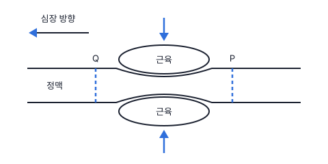
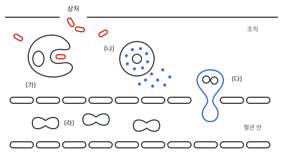
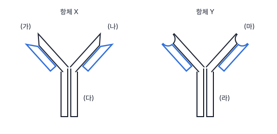

# 생명과학 복습 1124 문제설명

왼쪽 목차로 문항을 고르고, 오른쪽 문제를 보며 해설을 따라가요.

문제의 첫 줄부터 검산까지 설명해요.

**목차**

- [문항별 설명](#problems)
  - [P1. 판막이 있는 기관](#p1)
  - [P2. 심박출량을 늘리는 조절](#p2)
  - [P3. 림프계의 구성과 기능](#p3)
  - [P4. 감염세포와 암세포를 죽이는 세포](#p4)
  - [P5. 항체 구조에서 결합 위치 찾기](#p5)
  - [P6. 항원 수용체와 유전자](#p6)
  - [P7. 두 번째 노출의 면역반응 그래프](#p7)
  - [P8. 항체매개면역의 요소](#p8)
  - [P9. B 세포의 특징](#p9)
  - [P10. B 세포와 세포독성 T 세포의 기능](#p10)
  - [P11. 항체 다양성이 생기는 방법](#p11)
  - [P12. 제1방어선과 제2방어선의 성질](#p12)
  - [P13. 예방접종이 효과를 내는 이유](#p13)
  - [P14. 암세포를 상대하는 면역체계](#p14)
  - [P15. 세포매개면역의 구성 요소](#p15)
  - [P16. 항체의 기능](#p16)
  - [P17. T 세포가 성숙하는 기관](#p17)
  - [P18. 외래항원을 제거하는 방법](#p18)
  - [P19. 비특이적 방어기작(선천면역)](#p19)
  - [P20. 염증반응에 나오는 세포와 물질](#p20)
  - [P21. 특이적 방어선의 예](#p21)
  - [P22. 적응면역을 활성화하는 외래물질](#p22)
  - [P23. 퍼포린과 프로테아제로 죽이는 세포](#p23)
  - [P24. 히스타민을 분비하는 세포](#p24)
  - [P25. 체액에서 일어나는 특이적 방어](#p25)
  - [P26. 항체에 관한 틀린 설명](#p26)
  - [P27. 바이러스 방어에 쓰이는 선천면역 물질](#p27)
  - [P28. 1차 방어선이 아닌 것](#p28)
  - [P29. 예방접종이 효과를 내는 까닭](#p29)
  - [P30. 체액의 특이적 방어기작](#p30)
  - [P31. 특이적 방어선 고르기](#p31)
  - [P32. 적응면역을 활성화하는 물질](#p32)
  - [P33. 감염성 물질에 대한 방어선 구분](#p33)
  - [P34. 병을 일으키는 유기체의 이름](#p34)
  - [P35. 세균을 직접 섭식하는 것](#p35)
  - [P36. 항체의 구조와 기능](#p36)
  - [P37. 초기 분화가 일어나는 기관](#p37)
  - [P38. [변형] 모세혈관 양 끝의 물 이동](#p38)
  - [P39. [변형] 누워 있는 다리의 정맥](#p39)
  - [P40. [변형] 콜레스테롤의 이동과 혈관](#p40)
  - [P41. [변형] 심박출량을 늘리는 신호](#p41)
  - [P42. [변형] 감염성 물질에 대한 특이적 방어선](#p42)
  - [P43. [변형] 상처 부위의 단면](#p43)
  - [P44. [변형] 투과성만 막는 가상 물질](#p44)
  - [P45. [변형] 세 가지 관찰과 죽이는 방법](#p45)
  - [P46. [변형] 인터페론과 세 세포](#p46)
  - [P47. [변형] 가슴샘에서 성숙하는 세포](#p47)
  - [P48. [변형] 같은 클래스의 두 항체](#p48)
  - [P49. [변형] 네 세포의 항체 유전자](#p49)
  - [P50. [변형] 세 사람의 항체 반응](#p50)
  - [P51. [변형] 외래항원을 제거하는 방법](#p51)
  - [P52. [변형] 도움 T세포가 거의 없는 사람](#p52)

## 문항별 설명

### P1. 판막이 있는 기관

기출 13강 3 · [원 문제 보기](../%EB%B3%B5%EC%8A%B5%EB%AC%B8%EC%A0%9C_1124_Respiratory_and_Circulatory_Systems_and_Immune_System.html#p1)

다음 중 판막을 가지고 있는 기관으로만 짝 지어진 것은?

- (1) 동맥, 모세혈관, 심장
- (2) 림프모세관, 동맥, 심장
- (3) 정맥, 심장
- (4) 동맥, 정맥
- (5) 동맥, 심장

기출 원문 보기

기출 13강 합본 3번 (PDF 1쪽)

#### 문제가 묻는 것

보기에 묶인 기관이 **하나도 빠짐없이** 판막을 가진 짝을 골라요. 판막이 없는 기관이 하나라도 섞이면 그 짝은 답이 아니에요.

#### 이 문제를 봤을 때 떠올릴 개념과 공식

판막(valve)은 피가 거꾸로 흐르지 않게 막는 문이에요. 그래서 ‘역류를 막아야 하는 곳인가’를 물어요.

심장에서는 심실이 수축·이완할 때 피가 되돌아오지 않도록 방실판막과 반월판막이 닫혀요. 정맥(vein)은 혈압이 낮고 다리에서는 중력을 거슬러야 해서, 골격근이 쉬는 동안 피가 내려오지 않게 판막이 막아요. 동맥(artery)은 혈압이 가장 높아 피가 앞으로 밀려가고, 모세혈관(capillary)은 물질을 주고받는 얇은 관이라 둘 다 역류를 막는 판막이 없다고 배워요.

판단 기준: 혈관과 심장 가운데 판막이 있는 곳은 **심장과 정맥**이에요. 짝에 동맥이나 모세혈관이 있는지만 찾아도 지울 수 있어요.

관련 정리노트: [정맥 환류와 판막](../%EC%A0%95%EB%A6%AC%EB%85%B8%ED%8A%B8_1124_Respiratory_and_Circulatory_Systems_and_Immune_System.html#s0-venous)

#### 왜 이렇게 푸는지 함께 따라가요

(1) 동맥, 모세혈관, 심장: 답이 아니에요. 심장에는 판막이 있지만 동맥과 모세혈관에는 없어요.

(2) 림프모세관, 동맥, 심장: 답이 아니에요. 동맥에 판막이 없으므로 이 짝은 이미 탈락해요. 림프계에서 역류를 막는 일방판막은 림프모세관이 모여 이룬 림프관에 있다고 배워요.

(3) 정맥, 심장: 답이에요. 정맥의 판막은 심장 쪽으로 가던 피가 내려오는 것을, 심장의 판막은 심방과 심실 사이, 심실과 동맥 사이에서 피가 되돌아오는 것을 막아요. 둘 다 판막을 가져요.

(4) 동맥, 정맥: 답이 아니에요. 정맥에는 판막이 있지만 동맥에는 없어요.

(5) 동맥, 심장: 답이 아니에요. 심장에는 판막이 있지만 동맥에는 없어요.

따라서 답은 (3)이에요.

#### 완성 답과 검산

답 (3). 거꾸로 동맥이 든 짝을 지우면 (1), (2), (4), (5)가 모두 사라지고 (3)만 남아요. 림프모세관을 몰라도 같은 결론이 나와요.

#### 헷갈리는 곳을 구별해요

대동맥과 폐동맥이 시작하는 곳에 있는 반월판막 때문에 동맥에도 판막이 있다고 세기 쉬워요. 이 판막은 심실의 출구에 있는 심장의 판막으로 세고, 동맥이 뻗어 가는 길에는 판막이 없어요.

#### 설명을 닫고 다시 판단해요

- 다리 정맥에서 피를 밀어 올리는 것과 내려오지 못하게 막는 것을 각각 말해 봐요.

**페이지 요약**

#### 판단 기준

판막은 역류를 막는 문이고, 혈관과 심장 가운데 심장과 정맥에 있어요. 동맥·모세혈관이 든 짝은 지워요.

#### 답

(3) 정맥, 심장

---

### P2. 심박출량을 늘리는 조절

기출 13강 16 · [원 문제 보기](../%EB%B3%B5%EC%8A%B5%EB%AC%B8%EC%A0%9C_1124_Respiratory_and_Circulatory_Systems_and_Immune_System.html#p2)

심박출량을 증가시키기 위해서 _______________.

- (1) 자율신경계가 화학수용기에 감지된 낮은 산소농도에 반응하여 심장박동의 강도를 낮춘다
- (2) 과도한 혈액 산소에 의해 자극된 화학수용기가 심장박동 횟수를 증가시킨다
- (3) 뇌간이 압력수용체에 신호를 주어 심장을 빨리 뛰게 한다
- (4) 부신속질은 에피네프린을 분비한다
- (5) 뇌의 압력수용체가 교감신경에 신호를 준다

기출 원문 보기

기출 13강 합본 16번 (PDF 2쪽)

#### 문제가 묻는 것

빈칸에 넣었을 때 **심박출량이 늘어나는** 올바른 설명을 골라요. 신호가 가는 방향과 박동이 변하는 방향이 모두 맞아야 해요.

#### 이 문제를 봤을 때 떠올릴 개념과 공식

심박출량(cardiac output)은 심실에서 나가는 혈액의 양이에요. 심장이 더 자주, 더 세게 뛰면 늘어요.

첫째, **신호의 방향**을 봐요. 심근·대동맥·목동맥의 압력수용체(baroreceptor)와 대동맥·목동맥의 화학수용기가 감지한 정보를 뇌간으로 보내고, 뇌간이 자율신경계를 통해 심장에 명령해요. 압력수용체는 뇌에 있지 않아요.

둘째, **박동의 방향**을 봐요. 혈액의 O₂가 정상보다 적으면 박동의 횟수와 강도가 늘고, O₂가 너무 많으면 반대로 줄어요. 부신속질(adrenal medulla)의 에피네프린(epinephrine)은 교감신경계의 작용을 강화해 횟수와 강도를 늘려요(에피네프린과 O₂의 영향은 강의노트와 교재로 보충한 내용이에요).

관련 정리노트: [혈압의 결정과 연수의 조절](../%EC%A0%95%EB%A6%AC%EB%85%B8%ED%8A%B8_1124_Respiratory_and_Circulatory_Systems_and_Immune_System.html#s1-pressure)

#### 왜 이렇게 푸는지 함께 따라가요

(1) 틀려요. 박동의 강도를 낮추면 한 번에 나가는 혈액이 줄어 심박출량도 줄어요. 게다가 산소가 부족할 때의 반응은 강도를 높이는 쪽이에요.

(2) 틀려요. 산소가 지나치게 많으면 심장박동과 심박출량이 줄어드는 쪽으로 조절돼요. ‘횟수를 증가시킨다’가 반대예요.

(3) 틀려요. 신호의 방향이 거꾸로예요. 압력수용체가 뇌간에 정보를 보내고, 뇌간은 압력수용체가 아니라 심장 쪽에 명령을 보내요.

(4) 맞아요. 부신속질이 혈액으로 내보낸 에피네프린은 심장박동의 횟수와 강도를 모두 높여요. 더 자주, 더 세게 뛰므로 심박출량이 늘어요.

(5) 틀려요. 압력수용체가 있는 곳은 뇌가 아니라 심근·대동맥·목동맥이고, 그 신호는 먼저 뇌간으로 전달돼요.

따라서 답은 (4)예요.

#### 완성 답과 검산

답 (4). 보기를 원인 → 결과로 다시 이으면 (1)은 강도 감소 → 심박출량 감소라 빈칸의 목적과 어긋나고, (2)는 과잉 산소의 결과가, (3)과 (5)는 신호의 출발점이 틀려요. ‘에피네프린 → 횟수·강도 증가 → 심박출량 증가’만 끝까지 이어져요.

#### 헷갈리는 곳을 구별해요

수업에서 심박수 조절의 정보를 ‘산소량이 아니라 혈압’이라고 한 말은 주된 신호가 압력이라는 강조예요. 산소와 무관하다는 이유로 (1), (2)를 지우면 안 되고, 두 보기는 변화의 방향이 틀려서 지워요.

**페이지 요약**

#### 판단 기준

압력수용체 → 뇌간 → 심장으로 이어지는 신호 방향과, 박동의 횟수·강도가 느는지를 확인해요.

#### 답

(4) 부신속질의 에피네프린은 횟수와 강도를 모두 높여요.

---

### P3. 림프계의 구성과 기능

기출 13강 22 · [원 문제 보기](../%EB%B3%B5%EC%8A%B5%EB%AC%B8%EC%A0%9C_1124_Respiratory_and_Circulatory_Systems_and_Immune_System.html#p3)

림프계는 여유분의 세포간질액을 모아서 정맥혈로 되돌려 보내는 매우 방대한 관들의 네트워크이다. 림프계에 대한 설명 중 잘못된 것은?

- (1) 림프절 내부에 세균이나 바이러스가 대량 포획되면 림프질이 붓고 통증을 느낀다.
- (2) 림프계에는 림프절, 비장, 가슴샘, 편도 등이 포함된다.
- (3) 림프모세관은 전신에 걸쳐 분포한다.
- (4) 림프계는 면역계의 중요한 구성요소이다.
- (5) 림프모세관은 순환계 모세혈관과 달리 여러 겹의 세포층으로 구성된 벽을 가진다,

기출 원문 보기

기출 13강 합본 22번 (PDF 3쪽)

#### 문제가 묻는 것

림프계에 대한 설명 가운데 **잘못된 것**을 골라요.

**문항 결함:** 보기 (1)의 ‘림프질이 붓고’는 ‘림프절이 붓고’의 오타로 보여요. 이렇게 읽으면 답 (5)는 그대로예요.

#### 이 문제를 봤을 때 떠올릴 개념과 공식

림프계(lymphatic system)는 모세혈관에서 빠져나온 물 가운데 남는 세포간질액을 모아 정맥혈로 돌려보내고, 면역에도 참여해요.

‘순환계 모세혈관과 달리’라는 비교가 나오면 **무엇이 같고 무엇이 다른지**를 나눠요. 림프모세관(lymphatic capillary)과 모세혈관은 벽이 모두 내피세포 한 겹으로 같고, 림프모세관의 지름이 더 커요.

나머지 보기는 세 가지로 확인해요. 속하는 기관은 림프절·비장·가슴샘(흉선, thymus)·편도 등이고, 림프모세관은 온몸에 퍼져 있으며, 림프절(lymph node)은 병원체를 걸러 내는 검문소예요. 림프모세관의 벽과 기관 목록은 강의노트로 보충한 내용이에요.

관련 정리노트: [림프계와 림프절](../%EC%A0%95%EB%A6%AC%EB%85%B8%ED%8A%B8_1124_Respiratory_and_Circulatory_Systems_and_Immune_System.html#s1-lymph)

#### 왜 이렇게 푸는지 함께 따라가요

(1) 맞아요(‘림프질’은 ‘림프절’로 읽어요). 세균이나 바이러스가 림프절에 대량으로 걸리면 면역세포가 모여 붓고 아플 수 있어요. 옳은 설명이라 답이 아니에요.

(2) 맞아요. 림프절, 비장, 가슴샘, 편도는 모두 림프계의 조직과 기관이에요. 답이 아니에요.

(3) 맞아요. 림프모세관은 모세혈관과 가깝게 섞여 온몸에 분포해요. 답이 아니에요.

(4) 맞아요. 림프절의 면역세포가 림프관을 따라온 세균과 바이러스를 찾아내므로 면역계의 중요한 구성요소예요. 답이 아니에요.

(5) 틀려요. 림프모세관의 벽도 모세혈관처럼 내피세포층 한 겹이에요. ‘여러 겹’과 ‘달리’가 모두 잘못됐으므로 이 문제의 답이에요.

잘못된 설명을 고르므로 답은 (5)예요.

#### 완성 답과 검산

답 (5). 기능으로도 확인돼요. 림프모세관은 조직에서 세포간질액을 받아들이는 관이라 벽이 얇아야 해요. (1)의 ‘림프질’을 ‘림프절’로 읽으면 기관·분포·면역에 관한 (1)~(4)는 옳은 설명이어서, 잘못된 것은 (5) 하나예요.

#### 헷갈리는 곳을 구별해요

시험에서 ‘림프질’ 같은 오타를 만나면 문맥에 맞는 용어(림프절)로 읽어 봐요. (5)는 벽의 층수라는 내용 자체가 틀리므로 오타 하나로 (1)을 고르지 않아요.

**페이지 요약**

#### 판단 기준

림프모세관과 모세혈관은 벽이 똑같이 한 겹이고 지름이 달라요.

#### 답

(5) ‘여러 겹의 세포층’이 잘못된 설명이에요. (1)의 ‘림프질’은 ‘림프절’의 오타로 읽어요.

---

### P4. 감염세포와 암세포를 죽이는 세포

기출 14강 2 · [원 문제 보기](../%EB%B3%B5%EC%8A%B5%EB%AC%B8%EC%A0%9C_1124_Respiratory_and_Circulatory_Systems_and_Immune_System.html#p4)

림프구의 일종으로 바이러스에 감염되거나 암세포로 변한 세포를 퍼포린과 프로테아제를 이용하여 죽이는 면역세포는?

- (1) 세포독성 T세포
- (2) 호중구
- (3) 대식세포
- (4) 비만세포
- (5) 자연살생세포

기출 원문 보기

기출 14강 합본 2번 (PDF 1쪽)

#### 문제가 묻는 것

바이러스에 감염된 세포와 암세포를 **퍼포린과 프로테아제**로 죽이는 **림프구**를 골라요.

**문항 결함:** 발문에 선천면역·비특이적 같은 조건이 없어서 (5) 자연살생세포뿐 아니라 (1) 세포독성 T세포도 설명에 들어맞아요. 인쇄 정답은 (5)예요.

#### 이 문제를 봤을 때 떠올릴 개념과 공식

단서는 셋이에요. ① 림프구(lymphocyte)인가, ② 표적이 세균이 아니라 감염된 세포와 암세포인가, ③ 퍼포린(perforin)으로 막에 구멍을 내고 프로테아제(protease, 단백질분해효소)를 넣어 자살을 유도하는가를 봐요.

자연살생세포(natural killer cell, NK세포)는 셋 모두에 해당하는 선천면역의 림프구예요. 세포독성 T세포(cytotoxic T cell)도 림프구이고 비슷한 방법으로 감염된 세포와 암세포를 죽이지만, 자기 수용체로 특정 항원을 인식하는 적응면역 세포예요. 두 세포를 가르려면 **특이성과 기억이 있는지**를 알아야 해요.

림프구라는 분류, 프로테아제라는 이름, 세포독성 T세포의 죽이는 방법은 강의노트와 교재로 보충한 내용이에요.

관련 정리노트: [자연살생세포와 세포의 죽음](../%EC%A0%95%EB%A6%AC%EB%85%B8%ED%8A%B8_1124_Respiratory_and_Circulatory_Systems_and_Immune_System.html#s3-nk) · [B세포와 T세포](../%EC%A0%95%EB%A6%AC%EB%85%B8%ED%8A%B8_1124_Respiratory_and_Circulatory_Systems_and_Immune_System.html#s4-lymphocytes)

#### 왜 이렇게 푸는지 함께 따라가요

(1) 출제 의도의 답은 아니지만 엄밀히는 맞을 수도 있어요. 세포독성 T세포도 림프구이고, 퍼포린으로 구멍을 낸 뒤 단백질분해효소를 넣어 감염된 세포와 암세포를 죽여요. 발문에는 ‘특정 항원을 인식하지 않는다’처럼 이 세포를 뺄 조건이 없어요.

(2) 부적합해요. 호중구(neutrophil)는 주로 세균을 둘러싸 삼켜 죽이는 식세포예요. 림프구도 아니고 퍼포린을 쓰는 방식도 아니에요.

(3) 부적합해요. 대식세포(macrophage)는 병원체를 삼켜 분해하고 사이토카인을 내는 식세포예요. 구멍을 내고 효소를 넣는 방식과 달라요.

(4) 부적합해요. 비만세포(mast cell)는 염증 반응에서 히스타민을 내보내는 세포예요. 감염된 세포나 암세포를 죽이는 세포가 아니에요.

(5) 출제 의도의 답이에요. 자연살생세포는 림프구이고, 감염된 세포와 암세포에 퍼포린으로 구멍을 낸 뒤 프로테아제를 넣어 아포토시스(apoptosis, 세포자살)를 유도해요.

출제 의도의 답은 (5)예요. 다만 (1)도 발문만으로는 뺄 수 없어요.

#### 완성 답과 검산

출제 의도의 답 (5). 식세포인 (2), (3)과 염증 세포인 (4)를 지우면 (1)과 (5)가 남아요. 발문은 교재의 자연살생세포 설명과 같은 표현(림프구의 일종, 감염된 세포와 암세포로 변한 세포, 퍼포린, 프로테아제)을 쓰므로 (5)를 겨냥한 문장이에요. 그러나 교재는 세포독성 T세포도 유사한 방법을 쓴다고 설명하므로 (1)이 틀린 것으로 확정되지는 않아요.

#### 헷갈리는 곳을 구별해요

시험에서 두 세포가 함께 나오고 조건이 더 없으면, 이 수업에서 퍼포린을 다룬 자연살생세포 (5)를 골라요. ‘특정 항원 인식’, ‘적응면역’, ‘세포매개면역’이 보이면 세포독성 T세포, ‘선천면역’, ‘비특이적’이 보이면 자연살생세포로 갈라요. 보체도 막에 구멍을 내지만 세포가 아니라 단백질이고 주된 표적이 세균이에요.

**페이지 요약**

#### 판단 기준

림프구 + 감염세포·암세포 + 퍼포린·프로테아제. 자연살생세포(선천면역)와 세포독성 T세포(적응면역)가 모두 해당해요.

#### 답

출제 의도의 답 (5) / (1) 세포독성 T세포는 발문만으로 배제되지 않아 엄밀성 주의

---

### P5. 항체 구조에서 결합 위치 찾기

기출 14강 3 · [원 문제 보기](../%EB%B3%B5%EC%8A%B5%EB%AC%B8%EC%A0%9C_1124_Respiratory_and_Circulatory_Systems_and_Immune_System.html#p5)

위의 항체 구조에서 에피톱(항원결정부)과 결합하는 부위는?

- (1) 6
- (2) 5
- (3) 3
- (4) 4
- (5) 1

기출 원문 보기

기출 14강 합본 3번 (PDF 1쪽)

#### 문제가 묻는 것

항체 그림에서 항원의 **에피톱과 직접 맞물리는 부위**의 번호를 찾고, 그 번호가 적힌 보기를 골라요. 보기 번호와 그림 번호가 다르니 주의해요.

#### 이 문제를 봤을 때 떠올릴 개념과 공식

에피톱(epitope, 항원결정부)은 항원에서 항체가 결합하는 일부분이에요(강의노트로 보충한 이름이에요). 항체(antibody)는 무거운 사슬(heavy chain) 2개와 가벼운 사슬(light chain) 2개로 된 Y자 단백질이고, **두 팔 끝의 항원 결합 부위**가 에피톱과 맞물려요.

판단 기준은 둘이에요. ① Y자의 위쪽 팔 끝인가, ② 무거운 사슬과 가벼운 사슬의 끝을 **함께** 포함하는가를 봐요. 팔 끝의 가변 영역(variable region)은 항체마다 서열이 달라 결합할 항원을 정하고, 줄기의 불변 영역(constant region)은 같은 클래스의 항체끼리 같아서 특정 항원을 알아볼 수 없어요.

관련 정리노트: [항체의 구조와 다양성 문제](../%EC%A0%95%EB%A6%AC%EB%85%B8%ED%8A%B8_1124_Respiratory_and_Circulatory_Systems_and_Immune_System.html#s4-antibody)

#### 왜 이렇게 푸는지 함께 따라가요

(1) 그림의 6: 답이 아니에요. 두 무거운 사슬의 아래쪽 끝을 둘러싼 타원이라 팔 끝이 아니고, 불변 영역이에요.

(2) 그림의 5: 답이 아니에요. 무거운 사슬의 아래 줄기예요. 불변 영역이라 항원마다 다른 모양을 만들지 못해요.

(3) 그림의 3: 답이 아니에요. 가벼운 사슬 가운데 끝이 아닌 안쪽 부분으로 불변 영역이에요. 가벼운 사슬 하나만 가리켜 두 사슬이 함께 만드는 결합 부위도 아니에요.

(4) 그림의 4: 답이 아니에요. 두 무거운 사슬 사이의 이황화결합(S—S)을 가리켜요. 사슬을 서로 묶는 결합이에요.

(5) 그림의 1: 답이에요. 왼쪽 팔 끝에서 무거운 사슬과 가벼운 사슬의 끝을 함께 둘러싼 타원이에요. 두 사슬의 가변 영역이 함께 만든 항원 결합 부위가 에피톱과 맞물려요.

그림의 1번 부위가 적힌 보기를 고르므로 답은 (5)예요.

#### 완성 답과 검산

답 (5). 두 손으로 비유해도 같아요. 한 항체에는 같은 모양의 항원 결합 부위가 팔마다 하나씩 있어야 하므로 좌우 양쪽에 대칭으로 있는 위치여야 해요. 한가운데의 4와 아래의 6은 양팔에 하나씩 있는 위치가 아니고, 5와 3은 끝에서 떨어져 있어요.

#### 헷갈리는 곳을 구별해요

무거운 사슬이 길다고 아래 줄기를 결합 부위로 고르기 쉬워요. 줄기(불변 영역)는 항체의 기능과 클래스를, 팔 끝(가변 영역)은 결합할 항원을 정해요. 그림에는 왼쪽 팔에만 타원이 있지만 오른쪽 팔 끝도 같은 모양의 결합 부위예요.

**페이지 요약**

#### 판단 기준

에피톱은 팔 끝에서 무거운 사슬과 가벼운 사슬의 가변 영역이 함께 만든 자리에 붙어요. 줄기와 이황화결합은 아니에요.

#### 답

(5) 그림의 1

---

### P6. 항원 수용체와 유전자

기출 14강 4 · [원 문제 보기](../%EB%B3%B5%EC%8A%B5%EB%AC%B8%EC%A0%9C_1124_Respiratory_and_Circulatory_Systems_and_Immune_System.html#p6)

다음 문장에 대해 참/거짓으로 답하시오.

“림프구에 의해 합성된 모든 항원 수용체는 독립된 유전자에 의해 암호화된다.”

- (1) 참
- (2) 거짓

기출 원문 보기

기출 14강 합본 4번 (PDF 1쪽)

#### 문제가 묻는 것

“모든 항원 수용체는 독립된 유전자에 의해 암호화된다”가 참인지 거짓인지 판단해요. **수용체 종류마다 유전자가 하나씩 따로 있는지**를 묻는 문장이에요.

#### 이 문제를 봤을 때 떠올릴 개념과 공식

항원 수용체는 림프구의 막에서 항원에 결합하는 단백질이에요. B세포 수용체는 BCR, T세포 수용체는 TCR이라고 해요(이름은 강의노트로 보충했어요).

먼저 수를 비교해요. 사람의 유전자는 2만~2만 5천 개뿐인데, 한 사람이 가진 BCR은 약 1억 종류예요. 종류마다 유전자가 하나씩 있다면 유전자가 턱없이 모자라요.

해결은 DNA 재배열(DNA rearrangement)이에요. 성숙하는 동안 같은 항체 유전자의 조각을 무작위로 다르게 이어 붙여, **적은 유전자로 세포마다 다른 수용체**를 만들어요. TCR 유전자도 재배열을 거쳐요.

관련 정리노트: [DNA 재배열과 항체의 다양성](../%EC%A0%95%EB%A6%AC%EB%85%B8%ED%8A%B8_1124_Respiratory_and_Circulatory_Systems_and_Immune_System.html#s5-rearrangement) · [항체의 구조와 다양성 문제](../%EC%A0%95%EB%A6%AC%EB%85%B8%ED%8A%B8_1124_Respiratory_and_Circulatory_Systems_and_Immune_System.html#s4-antibody)

#### 왜 이렇게 푸는지 함께 따라가요

(1) 참은 답이 아니에요. 이 문장이 참이려면 수용체 종류마다 별도의 유전자가 있어야 하는데, 1억 종류의 수용체에 필요한 유전자를 2만여 개의 유전자로는 채울 수 없어요.

(2) 거짓이 답이에요. 서로 다른 수용체는 저마다 독립된 유전자가 아니라, 같은 유전자의 조각들을 세포마다 다르게 이어 붙여 만들어져요.

따라서 답은 (2) 거짓이에요.

#### 완성 답과 검산

답 (2). 거꾸로 이 문장이 참이라고 가정해 봐요. 몸의 모든 세포는 같은 유전자를 물려받으니 수용체 유전자 1억 개를 모든 세포가 갖고 있어야 해요. 실제 유전자 수는 2만여 개이므로 모순이고, 이 문장은 거짓이에요.

#### 헷갈리는 곳을 구별해요

BCR과 TCR을 암호화하는 유전자가 서로 다르다는 것은 맞아요. 하지만 그것은 B세포용과 T세포용이 나뉜다는 뜻이지, 수용체 하나하나에 유전자가 따로 있다는 뜻이 아니에요. 교수님의 “항체 유전자는 한 개”도 항체 종류마다 유전자가 따로 있지 않다는 뜻이에요.

**페이지 요약**

#### 판단 기준

유전자 2만~2만 5천 개로 수용체 약 1억 종류를 만들려면 유전자 조각을 재배열해야 해요. 종류마다 유전자를 두지 않아요.

#### 답

(2) 거짓

---

### P7. 두 번째 노출의 면역반응 그래프

기출 14강 5 · [원 문제 보기](../%EB%B3%B5%EC%8A%B5%EB%AC%B8%EC%A0%9C_1124_Respiratory_and_Circulatory_Systems_and_Immune_System.html#p7)

위 그림에 대한 설명으로 잘못된 것은?

- (1) 2차반응의 유도를 위해서는 1차반응과 비슷한 양의 항원이 유입되어야 한다
- (2) 위 그림은 면역기억현상을 나타낸다
- (3) 동일한 항원이 들어오면 2차반응은 1차반응보다 신속하게 이루어진다
- (4) 기억 B 세포 및 기억 도움 T 세포는 불활성화 상태로 세포내에 남아 있었다
- (5) 면역반응으로 병원체가 제거되면 형질세포나 T 세포의 클론은 더 이상 세포분열을 하지 않는다

기출 원문 보기

기출 14강 합본 5번 (PDF 1쪽)

#### 문제가 묻는 것

항체량 그래프에 대한 설명 가운데 **잘못된 것**을 골라요.

**문항 결함:** 보기 (4)의 ‘세포내에 남아 있었다’는 기억세포가 남는 곳을 ‘림프계 같은 체내’라고 써야 할 것을 잘못 적은 표현으로 보여요. 글자대로면 (4)도 잘못된 설명이에요. 인쇄 정답은 (1)이고, (4)를 ‘체내에’로 읽을 때만 (1) 하나가 답이에요.

#### 이 문제를 봤을 때 떠올릴 개념과 공식

먼저 그래프의 짝을 찾아요. 파란 곡선의 왼쪽은 항원 A의 **1차** 반응, 오른쪽은 항원 A의 **2차** 반응이에요. 빨간 곡선 B는 그때 처음 들어온 항원이라 1차 반응이에요. 세로축은 항체의 양이고 항원의 양이 아니에요.

면역기억(immunological memory)은 수명이 긴 기억세포(memory cell)가 남아, 같은 항원이 다시 들어오면 더 빠르고 강하게 반응하는 현상이에요.

판단 기준은 셋이에요. 2차 반응은 ① 같은 항원에 대해 일어나고, ② 1차보다 **더 빠르고 더 많은 항체**를 만들며, ③ **더 적은 항원**으로도 일어나요. 기억세포는 림프계와 감염됐던 조직에 불활성화 상태로 남고, 항원이 제거되면 활성화된 대부분의 세포는 분열을 멈춰요. ③과 기억세포가 남는 곳, 분열 정지는 강의노트로 보충한 내용이에요.

관련 정리노트: [클론 선택과 면역의 기억](../%EC%A0%95%EB%A6%AC%EB%85%B8%ED%8A%B8_1124_Respiratory_and_Circulatory_Systems_and_Immune_System.html#s5-clonal)

#### 왜 이렇게 푸는지 함께 따라가요

(1) 틀려요. 2차 반응은 이미 있는 기억 B세포와 기억 T세포가 이끌므로 1차보다 소량의 항원으로도 일어나요. ‘비슷한 양이 유입되어야 한다’가 잘못이라 출제 의도의 답이에요.

(2) 맞아요. 다시 만난 A는 첫 노출보다 빠르고 높은 봉우리를 만들고, 같은 때 처음 만난 B는 첫 노출의 A처럼 느리고 낮아요. 이 차이가 A에 대한 기억을 보여 줘요. 답이 아니에요.

(3) 맞아요. A의 봉우리는 1차에서 2주 무렵, 2차에서 1주를 조금 지나 나타나 2차가 더 빨라요. 답이 아니에요.

(4) 출제 의도로는 답이 아니지만, 엄밀히는 이것도 잘못된 설명일 수 있어요. 기억 B세포와 기억 도움 T세포가 불활성화 상태로 남는다는 말은 맞지만, 남는 곳은 세포 안이 아니라 림프계와 감염됐던 조직이에요. ‘세포내’를 ‘체내’로 읽어야 옳은 설명이 돼요.

(5) 맞아요. 병원체가 제거되면 형질세포나 T세포 클론은 더 이상 분열하지 않고, 대부분 죽어 사라져요. 답이 아니에요.

출제 의도의 답은 (1)이에요. 다만 (4)는 글자대로 읽으면 잘못된 설명이에요.

#### 완성 답과 검산

출제 의도의 답 (1). 원리로 다시 보면, 2차 반응은 처음부터 맞는 세포가 많이 준비돼 있어 적은 항원으로도 충분히 자극돼요. 그래프는 항체량만 보여 주므로 (1)은 곡선의 높이가 아니라 이 원리로 판정해야 해요. (2)와 (3)은 A의 2차 봉우리가 1차보다 빠르고 높다는 그림으로, (5)는 항원이 제거된 뒤의 원리로 확인돼요. (4)는 ‘체내에’로 읽는 조건에서만 맞아요.

#### 헷갈리는 곳을 구별해요

시험에서는 2차 반응에 필요한 항원이 1차보다 적다는 점이 분명히 어긋난 (1)을 고르고, (4)는 남는 장소의 표기가 문제라는 점을 구별해요. 원리로 고르면 (1)이 먼저 나와요.

같은 날 들어온 A와 B 가운데 A만 빨랐다고 모든 항원의 반응이 빨라졌다고 읽지 않아요. 기억은 항원마다 따로예요.

#### 설명을 닫고 다시 판단해요

- 설명을 닫고, B가 A와 같은 날 들어왔는데도 낮고 느린 이유를 한 문장으로 말해 봐요.

**페이지 요약**

#### 판단 기준

2차 반응은 같은 항원에 대해 소량의 항원으로도 빠르고 많은 항체를 만들어요. 기억세포는 림프계와 감염됐던 조직에 남아요.

#### 답

출제 의도의 답 (1) / (4)의 ‘세포내’는 글자대로면 틀려 엄밀성 주의

---

### P8. 항체매개면역의 요소

기출 14강 8 · [원 문제 보기](../%EB%B3%B5%EC%8A%B5%EB%AC%B8%EC%A0%9C_1124_Respiratory_and_Circulatory_Systems_and_Immune_System.html#p8)

다음 중 항체매개면역을 구성하는 중요한 요소가 아닌 것은?

- (1) 세포독성 T 세포
- (2) 면역글로불린
- (3) B 세포
- (4) 기억세포
- (5) 보체단백질

기출 원문 보기

기출 14강 합본 8번 (PDF 1쪽)

#### 문제가 묻는 것

항체매개면역의 중요한 구성요소가 **아닌 것**을 골라요.

#### 이 문제를 봤을 때 떠올릴 개념과 공식

적응면역은 무엇이 나서는지로 나눠요. 항체매개면역(antibody-mediated immunity, 체액성 면역)은 B세포가 분화한 형질세포의 항체가 체액에서 항원에 결합하고, 세포매개면역(cell-mediated immunity)은 세포독성 T세포가 감염된 세포나 암세포를 직접 죽여요.

판단 기준: 보기가 **항체를 만들거나, 항체이거나, 항체의 작용에 함께하거나, 나중에 다시 항체 반응을 일으키는가**를 물어요. 넷 중 하나면 항체매개면역의 요소예요. 세포를 직접 죽이는 역할이면 세포매개면역이에요.

관련 정리노트: [항체매개면역·세포매개면역과 도움 T세포](../%EC%A0%95%EB%A6%AC%EB%85%B8%ED%8A%B8_1124_Respiratory_and_Circulatory_Systems_and_Immune_System.html#s5-helper) · [항체의 작용](../%EC%A0%95%EB%A6%AC%EB%85%B8%ED%8A%B8_1124_Respiratory_and_Circulatory_Systems_and_Immune_System.html#s5-effect)

#### 왜 이렇게 푸는지 함께 따라가요

(1) 아닌 것이라 답이에요. 세포독성 T세포는 감염된 숙주세포를 직접 죽이는 세포매개면역의 세포예요. 항체를 만들거나 쓰는 역할이 아니에요.

(2) 해당하는 요소라 답이 아니에요. 면역글로불린(immunoglobulin, Ig)은 항체의 다른 이름이에요.

(3) 해당하는 요소라 답이 아니에요. B세포가 형질세포로 분화해 항체를 분비해요.

(4) 해당하는 요소라 답이 아니에요. B세포에서 생긴 기억세포는 같은 항원이 다시 들어올 때 빠르게 형질세포가 되어 항체 반응을 일으켜요. 세포매개면역에도 기억세포가 있지만, 그 이유로 항체매개면역에서 빠지지는 않아요.

(5) 해당하는 요소라 답이 아니에요. 보체(complement)는 원래 선천면역의 단백질이지만, 항원에 결합한 항체가 보체를 활성화하면 막공격복합체(membrane attack complex)가 세균 막에 구멍을 내요. 항체가 하는 방어에 참여해요(항체가 보체를 활성화한다는 점은 강의노트로 보충했어요).

아닌 것을 고르므로 답은 (1)이에요.

#### 완성 답과 검산

답 (1). 각 보기에 ‘항체와 어떻게 이어지는가’를 물으면 (2)는 항체 자체, (3)은 만드는 세포, (4)는 다음 항체 반응의 준비, (5)는 항체가 부르는 단백질로 모두 이어지고, (1)만 이어지지 않아요.

#### 헷갈리는 곳을 구별해요

보체는 선천면역의 단백질이지만 여기서 그 사실만으로 빼지 않아요. ‘항체매개면역을 구성하는 요소’라는 물음에서는 항체가 보체를 활성화해 세균을 죽인다는 연결을 봐요.

**페이지 요약**

#### 판단 기준

항체·B세포·기억세포·보체는 항체매개면역과 이어져요. 세포를 직접 죽이는 세포독성 T세포는 세포매개면역이에요.

#### 답

(1) 세포독성 T세포

---

### P9. B 세포의 특징

기출 14강 9 · [원 문제 보기](../%EB%B3%B5%EC%8A%B5%EB%AC%B8%EC%A0%9C_1124_Respiratory_and_Circulatory_Systems_and_Immune_System.html#p9)

B 세포의 특징은?

- (1) 바이러스에 감염된 세포에 결합하고 그들을 직접 죽인다
- (2) 제1형 MHC에 얹힌 항원을 인식한다
- (3) 무척추동물이든 척추동물이든 같은 구조를 가지고 있다
- (4) 하나의 B 세포 표면에 다수의 다른 종류의 BCR을 발현한다
- (5) 골수에서 줄기세포로부터 분화를 마친다

기출 원문 보기

기출 14강 합본 9번 (PDF 2쪽)

#### 문제가 묻는 것

B세포의 특징으로 옳은 설명을 골라요. 다른 면역세포의 일을 B세포에 붙여 놓은 보기를 가려내요.

#### 이 문제를 봤을 때 떠올릴 개념과 공식

B세포(B cell)의 이름은 성숙하는 곳인 골수(bone marrow)와 이어져요. B세포와 T세포는 모두 골수에서 태어나고, **B세포는 골수에서, T세포는 흉선(가슴샘, thymus)에서** 성숙해요.

확인할 기준은 셋이에요. ① 하는 일(B세포는 항체, 세포독성 T세포는 감염된 세포를 직접 죽임), ② 항원을 알아보는 방식(B세포는 BCR, B세포 수용체로 항원 자체에 결합), ③ 수용체의 종류(B세포 하나에는 같은 모양의 BCR만 있음)예요. BCR과 MHC는 강의노트로 보충한 이름이에요.

관련 정리노트: [B세포와 T세포](../%EC%A0%95%EB%A6%AC%EB%85%B8%ED%8A%B8_1124_Respiratory_and_Circulatory_Systems_and_Immune_System.html#s4-lymphocytes) · [선천면역과 후천면역](../%EC%A0%95%EB%A6%AC%EB%85%B8%ED%8A%B8_1124_Respiratory_and_Circulatory_Systems_and_Immune_System.html#s2-two-systems)

#### 왜 이렇게 푸는지 함께 따라가요

(1) 틀려요. 감염된 세포에 결합해 직접 죽이는 것은 세포독성 T세포예요. B세포는 항체를 만드는 쪽이에요.

(2) 틀려요. B세포는 BCR로 항원 자체에 결합해요. 제1형 MHC에 얹힌 항원을 인식하는 것은 세포독성 T세포예요(이번 수업에서 아직 다루지 않은 보충 내용이에요).

(3) 틀려요. B세포가 맡는 적응면역은 척추동물만 갖고 있어요. 무척추동물에 같은 B세포가 있다고 할 수 없어요.

(4) 틀려요. B세포 하나의 막에 있는 수천 개의 BCR은 모두 같은 종류예요. 다양성은 한 세포 안이 아니라 서로 다른 B세포 사이에서 나와요.

(5) 맞아요. B세포는 골수의 줄기세포에서 태어나 성숙도 골수에서 마쳐요. ‘골수에서 줄기세포로부터 분화를 마친다’는 이 내용이에요.

따라서 답은 (5)예요.

#### 완성 답과 검산

답 (5). 네 오답은 어느 세포 또는 어떤 원리의 이야기를 잘못 옮긴 것인지로 확인돼요. (1)과 (2)는 세포독성 T세포, (3)은 척추동물만 가진 적응면역, (4)는 ‘한 세포에 한 종류’의 반대예요. 이름의 B를 골수로 되짚어도 (5)가 맞아요.

#### 헷갈리는 곳을 구별해요

(5)의 ‘분화를 마친다’는 골수에서 성숙을 마친다는 뜻이에요. 항원을 만난 뒤 형질세포나 기억세포로 분화하는 과정은 골수를 나간 다음의 일이에요.

#### 설명을 닫고 다시 판단해요

- B세포와 T세포가 태어나는 곳과 성숙하는 곳을 각각 말해 봐요.

**페이지 요약**

#### 판단 기준

B세포는 골수에서 성숙하고, 세포 하나에 BCR 한 종류를 갖고, 항체를 만들어요. 감염세포를 직접 죽이는 일과 제1형 MHC에 얹힌 항원의 인식은 세포독성 T세포예요.

#### 답

(5) 골수에서 분화를 마쳐요.

---

### P10. B 세포와 세포독성 T 세포의 기능

기출 14강 10 · [원 문제 보기](../%EB%B3%B5%EC%8A%B5%EB%AC%B8%EC%A0%9C_1124_Respiratory_and_Circulatory_Systems_and_Immune_System.html#p10)

B 세포와 세포독성 T 세포 기능의 차이로 가장 적절한 것은?

- (1) B 세포는 감염된 숙주세포를 죽이지만, 세포독성 T 세포는 병원체를 직접 죽인다
- (2) B 세포는 능동면역에, 세포독성 T 세포는 수동면역에 관여한다
- (3) B 세포는 항원을 인식하지만, 세포독성 T 세포는 항원과 결합하지 못한다
- (4) B 세포는 세포매개면역반응을, 세포독성 T 세포는 항체매개면역반응을 수행한다
- (5) B 세포는 병원균에 대한 항체를 생산하고, 세포독성 T 세포는 병원균에 감염된 숙주세포를 죽인다

기출 원문 보기

기출 14강 합본 10번 (PDF 2쪽)

#### 문제가 묻는 것

두 세포의 기능 차이를 **양쪽 모두** 맞게 쓴 보기를 골라요. 한쪽이라도 틀리면 답이 아니에요.

#### 이 문제를 봤을 때 떠올릴 개념과 공식

B세포는 형질세포로 분화해 항체를 분비하는 항체매개면역을, 세포독성 T세포(cytotoxic T cell)는 감염된 숙주세포를 직접 죽이는 세포매개면역을 맡아요. 숙주세포는 감염된 우리 몸의 세포예요.

각 보기를 ‘B세포는 ~’와 ‘세포독성 T세포는 ~’로 잘라, **누가 무엇을 공격하는가**와 **어느 면역인가**를 한쪽씩 확인해요. 능동면역과 수동면역은 이번 수업 밖의 보충으로, 항원에 맞서 몸이 스스로 면역을 만들면 능동면역, 다른 개체의 항체 같은 면역 성분을 전달받으면 수동면역이에요.

관련 정리노트: [항체매개면역·세포매개면역과 도움 T세포](../%EC%A0%95%EB%A6%AC%EB%85%B8%ED%8A%B8_1124_Respiratory_and_Circulatory_Systems_and_Immune_System.html#s5-helper) · [B세포와 T세포](../%EC%A0%95%EB%A6%AC%EB%85%B8%ED%8A%B8_1124_Respiratory_and_Circulatory_Systems_and_Immune_System.html#s4-lymphocytes)

#### 왜 이렇게 푸는지 함께 따라가요

(1) 틀려요. 감염된 숙주세포를 죽이는 쪽은 세포독성 T세포이고, B세포는 항체를 만들어요. 세포독성 T세포가 떠다니는 병원체를 직접 죽인다는 말도 맞지 않아요.

(2) 틀려요. 능동면역과 수동면역은 면역을 스스로 만드는지, 전달받는지의 구분이에요. B세포와 세포독성 T세포가 하나씩 나눠 맡는 일이 아니에요.

(3) 틀려요. 앞부분은 맞지만 뒷부분이 틀려요. 세포독성 T세포도 자기 수용체로 감염된 세포의 항원을 알아봐야 그 세포를 공격해요.

(4) 틀려요. 면역의 이름이 서로 바뀌었어요. B세포가 항체매개면역, 세포독성 T세포가 세포매개면역이에요.

(5) 맞아요. B세포는 항체를 생산하고, 세포독성 T세포는 병원균에 감염된 숙주세포를 죽여요. 양쪽 모두 맞아요.

따라서 답은 (5)예요.

#### 완성 답과 검산

답 (5). 보기를 반으로 잘라 세면 양쪽이 모두 맞는 보기는 (5)뿐이에요. (1)과 (4)는 역할이나 이름이 뒤바뀌었고, (2)는 두 세포를 나누는 기준이 아니며, (3)은 뒷부분이 틀려요.

#### 헷갈리는 곳을 구별해요

세포독성 T세포가 죽이는 것은 세포 안에 병원체가 든 숙주세포이고, 항체가 맞서는 것은 체액의 항원이에요. ‘병원체를 직접’과 ‘감염된 세포를’을 구별해요.

**페이지 요약**

#### 판단 기준

B세포는 항체로 항체매개면역을, 세포독성 T세포는 감염된 숙주세포를 직접 죽여 세포매개면역을 맡아요.

#### 답

(5) 양쪽 기능을 모두 맞게 썼어요.

---

### P11. 항체 다양성이 생기는 방법

기출 14강 11 · [원 문제 보기](../%EB%B3%B5%EC%8A%B5%EB%AC%B8%EC%A0%9C_1124_Respiratory_and_Circulatory_Systems_and_Immune_System.html#p11)

항체의 다양성 형성은 ____________.

- (1) 여러 형태의 C 조각을 선택하여 기능을 갖춘 가벼운 사슬 유전자를 만든다
- (2) V 조각만으로 기능을 갖춘 가벼운 사슬 유전자를 만든다
- (3) V 조각과 J 조각에서 각기 하나씩 무작위로 C 조각과 연결하여 기능을 갖춘 가벼운 사슬 유전자를 만든다
- (4) 한 세포에서 IgG가 먼저 생기고 나중에 IgM이 만들어진다
- (5) J 조각을 잘라내어 기능을 갖춘 가벼운 사슬 유전자를 만든다

기출 원문 보기

기출 14강 합본 11번 (PDF 2쪽)

#### 문제가 묻는 것

“항체의 다양성 형성은 ____.”의 빈칸이에요. 유전자 수는 한정돼 있는데 항체 종류는 왜 많은지, 그 방법을 가벼운 사슬(light chain) 유전자에서 고르면 돼요.

#### 이 문제를 봤을 때 떠올릴 개념과 공식

‘V 조각·J 조각·C 조각’이라는 말이 나오면 DNA 재배열(DNA rearrangement)을 떠올려요. B세포가 골수에서 성숙하는 동안, 흩어져 있던 유전자 조각(분절)을 골라 이어 붙여 하나의 유전자를 완성하는 과정이에요.

V·J·C 조각은 수업에서 생략해 교재로 보충한 내용이에요. 사람의 가벼운 사슬 유전자 예에서 V(variable)는 약 40개, J(joining)는 5개, C(constant)는 1개예요. V와 J는 항원과 결합하는 가변 영역을, C는 불변 영역을 담당해요.

보기마다 두 가지를 확인해요. 첫째, **여러 개 중에서 고르는 조각**이 V와 J인가요? 고를 것이 여럿이어야 조합이 다양해져요. 둘째, **V·J·C 세 종류가 모두 이어졌나요?** 하나라도 빠지면 기능을 갖춘 유전자가 아니에요.

관련 정리노트: [DNA 재배열과 항체의 다양성](../%EC%A0%95%EB%A6%AC%EB%85%B8%ED%8A%B8_1124_Respiratory_and_Circulatory_Systems_and_Immune_System.html#s5-rearrangement)

#### 왜 이렇게 푸는지 함께 따라가요

(1) 틀려요. ‘여러 형태의 C 조각을 선택’한다고 했는데, 이 유전자에서 C는 1개뿐이라 고를 것이 없어요. 골라서 조합을 늘리는 쪽은 V와 J예요.

(2) 틀려요. ‘V 조각만으로’라면 J와 C가 빠져요. 가변 영역의 나머지(J)도 불변 영역(C)도 없으므로 세 종류가 모두 이어져야 한다는 기준에 어긋나요.

(3) 맞아요. ‘V와 J에서 각기 하나씩 무작위로’는 여러 개 중에서 고르는 조각과 일치하고, ‘C 조각과 연결하여’까지 있으니 세 종류가 모두 갖춰져요.

(4) 틀려요. IgG와 IgM은 항체의 클래스(class, 종류) 이름이에요. 보통 IgM이 먼저, IgG가 나중이라 차례가 거꾸로예요. 게다가 클래스는 불변 영역으로 정해지는 것이라, 항원 결합 부위가 다양해지는 조각 조합을 설명하지도 않아요.

(5) 틀려요. ‘J 조각을 잘라내어’ 없애면 가변 영역의 나머지를 담을 조각이 사라져요. 재배열 때 고르지 않은 J가 함께 빠질 수는 있지만, 고른 J 하나는 V와 C 사이에 반드시 남아야 해요.

따라서 답은 (3)이에요.

#### 완성 답과 검산

답 (3). 조합 수로 확인해요. V 하나와 J 하나를 고르면 $40\times5=200$가지 가벼운 사슬이 나와요. (2)처럼 V만 세면 40가지에 그치는 데다 완성된 사슬도 아니고, (1)처럼 C에서 고르면 $1$가지라 다양성이 생기지 않아요.

#### 주의할 점

(4)의 ‘IgM이 먼저’는 1차 반응은 주로 IgM, 2차 반응은 주로 IgG라는 강의 내용과 같은 방향이에요. 한 B세포가 IgM에서 다른 클래스로 바꾸는 과정을 클래스 전환(class switching)이라고 하는데, 이 이름은 수업 밖 보충이에요. 클래스가 바뀌어도 항원 결합 부위의 특이성은 유지되므로 V–J 조합과 다른 문제로 구별해요.

**페이지 요약**

#### 판단 기준

고르는 조각은 V와 J, C는 하나뿐이에요. 세 종류가 모두 이어져야 기능을 갖춘 유전자예요.

#### 결론

답 (3). V 하나 + J 하나를 무작위로 골라 C와 연결해요.

---

### P12. 제1방어선과 제2방어선의 성질

기출 14강 13 · [원 문제 보기](../%EB%B3%B5%EC%8A%B5%EB%AC%B8%EC%A0%9C_1124_Respiratory_and_Circulatory_Systems_and_Immune_System.html#p12)

다음 문장에 대해 참/거짓으로 답하시오.

**“제1방어선과 제2방어선은 서로 다른 병원체를 구별할 수 있는 특이적 방어기작이다.”**

- (1) 거짓
- (2) 참

기출 원문 보기

기출 14강 합본 13번 (PDF 2쪽)

#### 문제가 묻는 것

“제1방어선과 제2방어선은 … **특이적** 방어기작이다”라는 문장이 참인지 거짓인지 판정하는 문제예요. 보기 (1)이 ‘거짓’, (2)가 ‘참’이므로 번호와 판정이 뒤바뀌지 않게 읽어요.

#### 이 문제를 봤을 때 떠올릴 개념과 공식

‘서로 다른 병원체를 구별할 수 있는 특이적’이라는 표현에서 특이성(specificity)을 떠올려요. 정해진 상대 하나를 가려내 그 상대에만 작용하는 성질이에요.

방어선은 셋이에요. 제1방어선은 피부·점액·위산 같은 장벽, 제2방어선은 선천면역(innate immunity), 제3방어선은 적응면역(adaptive immunity, 후천면역)이에요.

판단 기준: 그 방어선이 **들어온 병원체가 어떤 종류인지 하나하나 골라서** 작용하나요? 문장이 두 방어선을 함께 말하므로 제1과 제2를 따로 확인해요.

관련 정리노트: [선천면역과 후천면역의 비교](../%EC%A0%95%EB%A6%AC%EB%85%B8%ED%8A%B8_1124_Respiratory_and_Circulatory_Systems_and_Immune_System.html#s2-two-systems)

#### 왜 이렇게 푸는지 함께 따라가요

(1) ‘거짓’이라는 판정이 맞아요. 제1방어선의 피부와 점액은 어떤 균이든 똑같이 막고, 제2방어선의 대식세포(macrophage)나 보체도 특정한 한 종류만 골라 공격하지 않아요. 둘 다 비특이적(nonspecific)이므로 ‘특이적 방어기작’이라는 문장은 거짓이에요.

(2) ‘참’이라는 판정은 틀려요. 참이 되려면 두 방어선이 병원체를 하나하나 구별해야 하는데, 그 일은 B세포·T세포·항체가 맡는 제3방어선(적응면역)의 특징이에요.

따라서 답은 (1) 거짓이에요.

#### 완성 답과 검산

답 (1). 주어를 바꿔 확인해요. 문장의 앞부분을 ‘제3방어선(적응면역)은’으로 바꾸면 참이 돼요. 특이성은 세 번째에서 처음 나타나므로 첫째·둘째를 주어로 쓴 원래 문장은 거짓이에요.

#### 주의할 점

선천면역도 세균에 흔한 분자를 알아보기는 해요. 하지만 여러 병원체가 공통으로 가진 분자를 알아보는 것이라, 한 병원체를 다른 병원체와 구별해 기억하는 적응면역의 특이성과 달라요.

**페이지 요약**

#### 판단 기준

병원체를 하나하나 골라 작용하면 특이적이에요. 제1(장벽)·제2(선천면역)는 비특이적, 제3(적응면역)은 특이적이에요.

#### 결론

문장은 거짓 → 답 (1).

---

### P13. 예방접종이 효과를 내는 이유

기출 14강 14 · [원 문제 보기](../%EB%B3%B5%EC%8A%B5%EB%AC%B8%EC%A0%9C_1124_Respiratory_and_Circulatory_Systems_and_Immune_System.html#p13)

특정 병원체에 예방접종을 받으면 그 병원체에 대항할 수 있는 이유는 다음 중 무엇 때문인가?

- (1) 자가면역반응
- (2) 선천면역
- (3) 면역기억
- (4) 알레르기 반응
- (5) 디펜신에 의한 반응

기출 원문 보기

기출 14강 합본 14번 (PDF 2쪽)

#### 문제가 묻는 것

예방접종을 받은 **특정 병원체**에 나중에 대항할 수 있게 해 주는 원리를 고르는 문제예요. ‘미리 만난 적이 있다’는 점이 핵심이에요.

#### 이 문제를 봤을 때 떠올릴 개념과 공식

‘예방접종(vaccination)’과 ‘특정 병원체’에서 기억세포(memory cell)를 떠올려요. 백신으로 병을 일으키지 않게 한 항원을 먼저 만나면, 그 항원에 맞는 B세포·T세포 일부가 수명이 긴 기억세포로 남아요. 같은 항원이 다시 들어오면 기억세포가 더 빠르고 강하게 반응하는데, 이것이 면역기억(immunological memory)이에요.

판단 기준은 둘이에요. ① 먼저 만난 경험이 **남아서 다음 반응에 쓰이나요**(기억)? ② **그 병원체에만** 대비하나요(특이성)?

관련 정리노트: [클론 선택과 면역의 기억](../%EC%A0%95%EB%A6%AC%EB%85%B8%ED%8A%B8_1124_Respiratory_and_Circulatory_Systems_and_Immune_System.html#s5-clonal)

#### 왜 이렇게 푸는지 함께 따라가요

(1) 부적합해요. 자가면역반응(autoimmune reaction)은 자기 몸의 분자를 공격하는 이상 반응이라, 밖에서 들어온 특정 병원체에 대비하는 일이 아니에요.

(2) 부적합해요. 선천면역은 빠르지만 만난 병원체를 기억하지 못하고 특정 병원체를 가리지도 않아요. 기준 ①②에 모두 어긋나요.

(3) 적합해요. 면역기억은 접종 때 생긴 기억세포가 남아(①) 같은 항원에만 빠르게 반응하는(②) 현상이에요.

(4) 부적합해요. 알레르기 반응(allergic reaction)은 꽃가루 같은 물질에 면역이 지나치게 반응해 해를 주는 일이에요. 병원체에 맞서는 접종의 효과가 아니에요.

(5) 부적합해요. 디펜신(defensin)은 상피세포가 분비하는 항미생물 펩티드로, 병원체를 가리지 않고 죽이며 기억을 남기지 않아요. 접종하지 않아도 작용해요.

따라서 답은 (3) 면역기억이에요. (1)·(4)는 이번 수업 뒤에 배우는 내용이지만, ‘미리 만난 병원체에 대비하는가’만 물어도 제외돼요.

#### 완성 답과 검산

답 (3). 접종한 사람과 안 한 사람이 같은 병원체에 걸린 상황을 비교해요. 선천면역과 디펜신은 두 사람 모두에게 똑같이 있으므로 차이를 만들 수 없어요. 한쪽에만 있는 것은 기억세포이므로 면역기억이 남아요.

#### 설명을 닫고 다시 해 봐요

- 백신 주사와 완성된 항체 주사 중 기억세포가 남는 쪽은 어느 것이고, 왜 그런지 말해 봐요.

**페이지 요약**

#### 판단 기준

경험이 남는가(기억) + 그 병원체에만 대비하는가(특이성).

#### 결론

답 (3). 예방접종 → 기억세포 → 재노출 때 더 빠르고 강한 반응.

---

### P14. 암세포를 상대하는 면역체계

기출 14강 15 · [원 문제 보기](../%EB%B3%B5%EC%8A%B5%EB%AC%B8%EC%A0%9C_1124_Respiratory_and_Circulatory_Systems_and_Immune_System.html#p14)

다음 중 자신의 암세포로부터 신체를 보호하기 위한 면역체계는 무엇인가?

- (1) 효소 반응
- (2) 염증 반응
- (3) 자가면역반응
- (4) 방어 단백질
- (5) 세포매개면역

기출 원문 보기

기출 14강 합본 15번 (PDF 2쪽)

#### 문제가 묻는 것

**자신의 암세포**를 상대해 몸을 보호하는 면역체계의 이름을 고르는 문제예요. 상대가 밖에서 온 세균이 아니라 변해 버린 우리 몸의 세포라는 점을 봐요.

**공식 답 미확인:** 이 문항은 기출 자료에 정답 표시가 없어요. 아래 (5)는 개념 근거로 판단한 답이에요.

#### 이 문제를 봤을 때 떠올릴 개념과 공식

‘암세포’에서 세포를 직접 죽이는 면역을 떠올려요. 적응면역은 둘로 나뉘어요. 항체매개면역(antibody-mediated immunity)은 항체가 체액에서 항원에 결합하고, 세포매개면역(cell-mediated immunity)은 세포독성 T세포(cytotoxic T cell)가 바이러스에 감염된 세포나 암세포를 **직접 죽여요**.

판단 기준은 둘이에요. ① 보기가 물질이나 반응 하나가 아니라 **면역체계의 이름**인가요? ② 그것이 겨냥하는 **표적이 암세포**인가요?

관련 정리노트: [항체매개면역과 세포매개면역](../%EC%A0%95%EB%A6%AC%EB%85%B8%ED%8A%B8_1124_Respiratory_and_Circulatory_Systems_and_Immune_System.html#s5-helper)

#### 왜 이렇게 푸는지 함께 따라가요

(1) 부적합해요. 효소 반응은 효소가 일으키는 화학 반응을 두루 가리키는 말이라 면역체계의 이름이 아니에요(①).

(2) 부적합해요. 염증 반응(inflammation)은 상처로 들어온 세균 쪽으로 대식세포·호중구를 모으는 선천면역 반응이에요. 암세포를 겨냥한 방어를 가리키는 이름이 아니에요(②).

(3) 부적합해요. 자가면역반응은 자기 몸의 **정상** 분자를 공격해 해를 주는 이상 반응이에요. ‘자신의 세포를 공격한다’는 말은 비슷해 보여도 몸을 보호하는 일이 아니에요.

(4) 부적합해요. 보체·인터페론 같은 방어 단백질은 선천면역에서 세균이나 바이러스를 막는 물질이에요. 암세포를 찾아 죽이는 면역체계의 이름이 아니에요(①②).

(5) 적합해요. 세포매개면역의 세포독성 T세포는 암세포에만 나타나는 변형된 단백질 조각을 알아보고 그 세포를 직접 죽여요. 면역체계의 이름이고 표적도 암세포라 두 기준을 모두 충족해요.

따라서 답은 (5) 세포매개면역으로 판단해요.

#### 완성 답과 검산

판단 답 (5), 공식 답 미확인. 표적으로 거꾸로 짝지어요. 세균 → 염증 반응·보체, 바이러스 확산 → 인터페론, 정상 자기 분자 → 자가면역반응이고, 남은 암세포와 짝이 되는 보기는 세포매개면역 하나예요.

#### 주의할 점

자연살생세포(natural killer cell)도 암세포를 죽이지만 선천면역의 세포이고, 이 문제의 보기에는 없어요. 보기에 함께 나오면 선천면역인지 적응면역인지를 먼저 확인해요.

**페이지 요약**

#### 판단 기준

표적이 암세포인가 + 면역체계의 이름인가. 세포독성 T세포가 직접 죽이면 세포매개면역이에요.

#### 결론

판단 답 (5). 기출 자료에 정답 표시가 없어 공식 답은 미확인이에요.

---

### P15. 세포매개면역의 구성 요소

기출 14강 16 · [원 문제 보기](../%EB%B3%B5%EC%8A%B5%EB%AC%B8%EC%A0%9C_1124_Respiratory_and_Circulatory_Systems_and_Immune_System.html#p15)

다음 중 세포매개면역을 구성하는 중요 요소가 아닌 것은 무엇인가?

- (1) B 세포
- (2) 퍼포린
- (3) 항원제시세포
- (4) 기억 세포독성 T 세포
- (5) 세포독성 T 세포

기출 원문 보기

기출 14강 합본 16번 (PDF 2쪽)

#### 문제가 묻는 것

세포매개면역을 구성하는 요소가 **아닌 것**을 고르는 부정형 문제예요. 다섯 보기가 세포매개면역에 쓰이는지 먼저 판정하고, 쓰이지 않는 하나를 골라요.

#### 이 문제를 봤을 때 떠올릴 개념과 공식

‘세포매개면역’에서 중심 세포가 무엇인지 떠올려요. 세포매개면역(cell-mediated immunity)은 **세포독성 T세포**(cytotoxic T cell)가 감염된 세포나 암세포를 직접 죽이는 적응면역이고, 항체매개면역(antibody-mediated immunity)은 **B세포**에서 나온 형질세포가 항체를 분비하는 적응면역이에요.

판단 기준: 그 보기가 **T세포를 활성화하거나, T세포 자신이거나, T세포가 표적을 죽이는 데 쓰는 것**인가요? 그렇다면 구성 요소이고, 항체를 만드는 쪽이면 아니에요.

항원제시세포와 세포독성 T세포가 퍼포린을 쓰는 과정은 이번 수업에서 다루지 않은 강의노트·교재 보충이에요. 몰라도 B세포의 소속만 알면 답을 고를 수 있어요.

관련 정리노트: [항체매개면역과 세포매개면역에 속하는 것](../%EC%A0%95%EB%A6%AC%EB%85%B8%ED%8A%B8_1124_Respiratory_and_Circulatory_Systems_and_Immune_System.html#s5-helper)

#### 왜 이렇게 푸는지 함께 따라가요

(1) 요소가 아니에요. B 세포는 형질세포가 되어 항체를 분비하는 항체매개면역의 중심 세포예요. 감염된 세포를 직접 죽이지 않아요.

(2) 요소예요. 퍼포린(perforin)은 세포독성 T세포가 표적세포의 막에 구멍을 낼 때 분비하는 단백질이라 ‘죽이는 데 쓰는 것’에 해당해요.

(3) 요소예요. 항원제시세포(antigen-presenting cell, APC)는 항원 조각을 T세포에 보여 주어 활성화하므로 ‘T세포를 활성화하는 것’에 해당해요.

(4) 요소예요. 활성화되어 늘어난 T세포 일부가 기억 세포독성 T 세포로 남아 같은 항원에 다시 대비하므로 ‘T세포 자신’에 해당해요.

(5) 요소예요. 세포독성 T 세포는 표적세포를 직접 죽이는 중심 세포예요.

질문은 요소가 **아닌 것**이므로 답은 (1)이에요.

#### 완성 답과 검산

답 (1). 세포매개면역의 흐름에 보기를 넣어 봐요. 항원제시세포가 항원을 보여 줌 (3) → 세포독성 T세포가 생김 (5), 일부는 기억세포 (4) → 퍼포린으로 표적세포에 구멍 (2). 넷은 자리가 있고 B 세포만 남아요.

#### 주의할 점

퍼포린은 자연살생세포(선천면역)도 써요. 그래서 퍼포린 하나로 선천·적응을 정하지 말고 어느 세포가 쓰는지 확인해요. 이 문항에서는 세포독성 T세포의 무기로 세포매개면역에 들어가요.

**페이지 요약**

#### 판단 기준

T세포를 활성화함 · T세포 자신 · T세포의 무기 → 세포매개면역. 항체를 만드는 쪽 → 항체매개면역.

#### 결론

아닌 것은 (1) B 세포.

---

### P16. 항체의 기능

기출 14강 17 · [원 문제 보기](../%EB%B3%B5%EC%8A%B5%EB%AC%B8%EC%A0%9C_1124_Respiratory_and_Circulatory_Systems_and_Immune_System.html#p16)

항체의 기능으로 가장 옳은 것은?

- (1) 보체를 불활성화한다
- (2) 2차 면역반응이 일어날 기회를 없앤다
- (3) 세포내 바이러스를 죽인다
- (4) 자연살생세포를 중화한다
- (5) 대식세포에 쉽게 먹히도록 세균이나 바이러스를 응집한다

기출 원문 보기

기출 14강 합본 17번 (PDF 2쪽)

#### 문제가 묻는 것

항체의 기능으로 **가장 옳은 것**을 고르는 문제예요. 항체가 무엇에 붙어 어떤 결과를 내는지, 방향이 맞는지를 봐요.

#### 이 문제를 봤을 때 떠올릴 개념과 공식

‘항체의 기능’에서 항체(antibody)는 형질세포가 분비해 체액을 도는 단백질이며, 하는 일은 **세포 밖의 항원에 결합하는 것**임을 떠올려요. 그 결합 때문에 다음 일이 일어나요. 독소의 작용이 막히는 중화(neutralization), 세균·바이러스가 엮이는 응집(agglutination), 보체의 활성화, 식세포가 더 잘 먹게 되는 일이에요.

보기마다 세 가지를 확인해요. ① 항체가 붙는 상대가 **항원**인가요? ② 작용하는 곳이 **세포 밖**인가요? ③ 보체·식세포·다음 반응을 **돕는 방향**인가요?

보체 활성화와 식세포를 돕는 일은 강의노트·교재에서 보충한 내용이에요.

관련 정리노트: [항체의 작용: 중화와 응집](../%EC%A0%95%EB%A6%AC%EB%85%B8%ED%8A%B8_1124_Respiratory_and_Circulatory_Systems_and_Immune_System.html#s5-effect)

#### 왜 이렇게 푸는지 함께 따라가요

(1) 틀려요. ‘보체를 불활성화’는 방향이 반대예요(③). 항원에 결합한 항체는 보체를 활성화하고, 보체가 만든 막공격복합체가 세균에 구멍을 내요.

(2) 틀려요. 2차 면역반응은 남아 있는 기억세포가 일으켜요. 항체가 이번 항원을 처리했다고 해서 같은 항원이 다시 올 때의 기회가 사라지지 않아요(③).

(3) 틀려요. ‘세포내 바이러스’는 항체가 닿지 않는 곳에 있어요(②). 항체는 결합할 뿐 직접 죽이지도 않으며, 감염된 세포를 죽이는 것은 세포독성 T세포나 자연살생세포예요.

(4) 틀려요. 중화는 독소 같은 항원의 작용을 막는 일이에요. 자연살생세포는 우리 몸의 면역세포라 항체가 막을 항원이 아니에요(①).

(5) 맞아요. 상대는 세균·바이러스라는 항원이고(①), 세포 밖에서 엮이며(②), 덩어리가 되면 대식세포가 먹기 쉬워져요(③). 항체 하나에 결합 부위가 둘이라 서로 다른 세균을 이을 수 있어요.

따라서 답은 (5)예요.

#### 완성 답과 검산

답 (5). 항체를 빼고 생각해요. 항체가 없으면 세균·바이러스가 엮이지 않아 대식세포가 먹기 어려워지므로 (5)의 관계가 성립해요. 반면 항체를 빼도 기억세포의 2차 반응 능력은 남고, 보체를 막던 손길이 사라져 더 활발해지는 일도 없으니 (2)·(1)은 성립하지 않아요.

#### 설명을 닫고 다시 해 봐요

- “항체가 세균을 죽였다”라는 문장을, 실제로 죽이는 주체가 드러나게 고쳐 써 봐요.

**페이지 요약**

#### 판단 기준

항체는 세포 밖 항원에 결합해요. 결과는 중화·응집·보체 활성화·식세포 작용 도움이에요.

#### 결론

답 (5). 응집하면 대식세포가 먹기 쉬워져요.

---

### P17. T 세포가 성숙하는 기관

기출 14강 19 · [원 문제 보기](../%EB%B3%B5%EC%8A%B5%EB%AC%B8%EC%A0%9C_1124_Respiratory_and_Circulatory_Systems_and_Immune_System.html#p17)

T 세포가 많은 분화(성숙)를 겪는 기관은 어디인가?

- (1) 갑상선
- (2) 골수
- (3) 부신
- (4) 뇌하수체
- (5) 가슴샘(흉선)

기출 원문 보기

기출 14강 합본 19번 (PDF 3쪽)

#### 문제가 묻는 것

T 세포가 **분화(성숙)**하는 기관을 묻는 문제예요. 태어나는 곳이 아니라 성숙하는 곳이에요.

#### 이 문제를 봤을 때 떠올릴 개념과 공식

‘T 세포’와 ‘성숙’에서 흉선 = 가슴샘 = thymus, 곧 T세포 이름의 첫 글자를 떠올려요. 세 이름은 같은 기관이에요.

B세포와 T세포는 모두 골수(bone marrow)의 줄기세포에서 태어나요. B세포는 골수에 남아 성숙하고, T세포는 분화 도중 골수를 떠나 가슴샘으로 옮겨 성숙해요.

판단 기준: 그 기관이 ① 림프구가 자라는 기관인가요? ② 그렇다면 T세포가 **태어나는 곳**인가요, **성숙하는 곳**인가요?

관련 정리노트: [B세포와 T세포가 태어나고 성숙하는 곳](../%EC%A0%95%EB%A6%AC%EB%85%B8%ED%8A%B8_1124_Respiratory_and_Circulatory_Systems_and_Immune_System.html#s4-lymphocytes)

#### 왜 이렇게 푸는지 함께 따라가요

(1) 부적합해요. 갑상선(thyroid gland)은 호르몬을 분비하는 내분비 기관이라 ①에서 제외돼요.

(2) 부적합해요. 골수는 T세포가 태어나는 곳이지만, 성숙까지 하는 것은 B세포예요. ②에서 ‘태어나는 곳’에 해당해요.

(3) 부적합해요. 부신(adrenal gland)은 에피네프린 같은 호르몬을 분비하는 내분비 기관이라 ①에서 제외돼요.

(4) 부적합해요. 뇌하수체(pituitary gland)도 호르몬을 분비하는 내분비 기관이라 ①에서 제외돼요.

(5) 적합해요. 가슴샘(흉선, thymus)은 골수를 떠난 T세포가 옮겨 와 성숙하는 기관이에요.

따라서 답은 (5) 가슴샘(흉선)이에요.

#### 완성 답과 검산

답 (5). 이름으로 확인해요. B세포의 B는 bone marrow, T세포의 T는 thymus에서 왔어요. 이름이 성숙하는 곳의 첫 글자이므로 T세포에는 thymus가 짝이에요.

#### 주의할 점

갑상선(thyroid)과 가슴샘(thymus)은 영어가 비슷해요. 갑상선은 목에 있는 호르몬 기관이고, 면역세포가 자라는 쪽은 가슴에 있는 가슴샘이에요. 림프절도 성숙하는 곳이 아니라 성숙한 T세포가 나중에 가는 곳이에요.

**페이지 요약**

#### 판단 기준

태어나는 곳: B·T 모두 골수. 성숙하는 곳: B는 골수, T는 가슴샘(thymus).

#### 결론

답 (5) 가슴샘(흉선).

---

### P18. 외래항원을 제거하는 방법

기출 14강 20 · [원 문제 보기](../%EB%B3%B5%EC%8A%B5%EB%AC%B8%EC%A0%9C_1124_Respiratory_and_Circulatory_Systems_and_Immune_System.html#p18)

적응면역에서 외래항원의 제거가 이루어지는 방법이 아닌 것은?

- (1) 감염된 세균 자체의 경우 항체가 항원에 결합하여 수 많은 세균을 연결하여 응집시킨다
- (2) 항체는 프로테아제를 분비하여 세균의 세포자살을 유발한다
- (3) 침입세균의 독소는 항체에 의해 중화된다
- (4) 항체는 식세포가 세균과 바이러스를 더욱 더 잘 섭취하도록 한다
- (5) 항원에 결합한 항체는 보체를 활성화 시켜 세균을 제거한다

기출 원문 보기

기출 14강 합본 20번 (PDF 3쪽)

#### 문제가 묻는 것

적응면역에서 외래항원을 제거하는 방법이 **아닌 것**을 고르는 부정형 문제예요. 각 보기가 실제로 일어나는 제거 방법인지 판정하고, 일어나지 않는 하나를 골라요.

#### 이 문제를 봤을 때 떠올릴 개념과 공식

‘외래항원의 제거’와 ‘항체’에서 항체(antibody)가 하는 일의 범위를 떠올려요. 항체는 항원에 **결합할 뿐** 효소를 분비하거나 세균을 직접 죽이지 않아요. 결합한 뒤의 일은 중화(neutralization), 응집(agglutination), 보체 활성화, 식세포의 섭취를 돕는 일이에요.

판단 기준: ① 항체가 한 일이 **결합과 그 결과**로 설명되나요? ② 세균을 죽이는 장면이면 실제 주체가 **식세포나 보체**인가요?

보체 활성화와 식세포를 돕는 일은 강의노트·교재에서 보충한 내용이에요.

관련 정리노트: [항체의 작용](../%EC%A0%95%EB%A6%AC%EB%85%B8%ED%8A%B8_1124_Respiratory_and_Circulatory_Systems_and_Immune_System.html#s5-effect), [자연살생세포와 세포의 죽음](../%EC%A0%95%EB%A6%AC%EB%85%B8%ED%8A%B8_1124_Respiratory_and_Circulatory_Systems_and_Immune_System.html#s3-nk)

#### 왜 이렇게 푸는지 함께 따라가요

(1) 실제 제거 방법이에요. ‘항원에 결합하여 세균을 연결’하는 것은 결합의 결과인 응집이에요. 결합 부위가 둘이라 한 항체가 두 세균을 이어요.

(2) 제거 방법이 아니에요. 항체는 세포가 아닌 단백질이라 프로테아제(protease, 단백질분해효소)를 ‘분비’할 수 없어요(①). 프로테아제를 넣어 세포자살(apoptosis)을 일으키는 것은 자연살생세포·세포독성 T세포이고, 표적도 세균이 아니라 감염된 세포나 암세포예요.

(3) 실제 제거 방법이에요. 항체가 독소에 결합해 세포를 해치지 못하게 막는 중화예요.

(4) 실제 제거 방법이에요. 식세포가 병원체에 붙은 항체를 알아보고 결합해 삼키므로, 먹는 주체는 식세포이고 항체는 돕는 역할이에요(②).

(5) 실제 제거 방법이에요. 항원에 결합한 항체가 보체를 활성화하고, 보체의 막공격복합체(membrane attack complex)가 세균의 막에 구멍을 내요. 죽이는 주체는 보체예요(②).

질문은 제거 방법이 **아닌 것**이므로 답은 (2)예요.

#### 완성 답과 검산

답 (2). 주어를 바꿔 확인해요. (2)를 ‘자연살생세포는 프로테아제로 **감염된 세포**의 세포자살을 유발한다’로 고치면 맞는 문장이에요. 주어(항체)와 표적(세균)이 둘 다 어긋나 있으므로 (2)가 틀린 이유가 분명해요. 나머지 넷은 ‘항체가 붙는다’에서 출발해 모두 설명돼요.

**페이지 요약**

#### 판단 기준

항체는 결합까지. 그 결과가 중화·응집·보체 활성화·식세포 섭취 촉진이에요. 효소 분비·세포자살 유도는 자연살생세포·세포독성 T세포의 일이에요.

#### 결론

아닌 것은 (2).

---

### P19. 비특이적 방어기작(선천면역)

기출 14강 22 · [원 문제 보기](../%EB%B3%B5%EC%8A%B5%EB%AC%B8%EC%A0%9C_1124_Respiratory_and_Circulatory_Systems_and_Immune_System.html#p19)

다음 중 신체의 비특이적 방어기작(선천면역)의 일부인 것은?

- (1) 상피조직
- (2) 항체
- (3) B 세포
- (4) 비만세포
- (5) T 세포

기출 원문 보기

기출 14강 합본 22번 (PDF 3쪽)

#### 문제가 묻는 것

신체의 비특이적 방어기작(**선천면역**)에 속하는 것을 고르는 문제예요. 괄호 안의 ‘선천면역’이 중요한 조건이에요.

**문항 결함:** ‘비특이적 방어’만 보면 (1) 상피조직도 맞아요. 괄호의 ‘선천면역’을 장벽 다음의 두 번째 방어선으로 좁혀 읽어야 (4) 하나로 정해져요.

#### 이 문제를 봤을 때 떠올릴 개념과 공식

‘비특이적’과 ‘선천면역’에서 세 방어선의 구분을 떠올려요. 첫째는 상피조직(epithelium) 같은 장벽, 둘째는 선천면역(innate immunity), 셋째는 특이적인 적응면역(adaptive immunity)이에요. 첫째와 둘째는 **모두 비특이적**이에요.

판단 기준은 둘이에요. ① 병원체를 하나하나 구별하지 않나요(비특이적)? ② **장벽을 통과한 병원체**에 맞서는 두 번째 방어선에 속하나요(이 수업의 선천면역)?

관련 정리노트: [선천면역과 후천면역의 비교](../%EC%A0%95%EB%A6%AC%EB%85%B8%ED%8A%B8_1124_Respiratory_and_Circulatory_Systems_and_Immune_System.html#s2-two-systems), [염증 반응과 비만세포](../%EC%A0%95%EB%A6%AC%EB%85%B8%ED%8A%B8_1124_Respiratory_and_Circulatory_Systems_and_Immune_System.html#s2-inflammation)

#### 왜 이렇게 푸는지 함께 따라가요

(1) 엄밀히는 맞을 수도 있어요. 상피조직 장벽은 비특이적이라 ①을 충족하고, 상피조직이 분비하는 디펜신(defensin)은 선천면역에 들어가요. 다만 이 수업은 장벽 자체를 첫 번째 방어선으로 따로 두므로 ②를 좁게 적용하면 제외돼요.

(2) 부적합해요. 항체(antibody)는 맞는 항원에만 결합하는 적응면역의 단백질이라 ①에 어긋나요.

(3) 부적합해요. B 세포는 세포마다 인식하는 항원이 정해져 있는 적응면역의 세포라 ①에 어긋나요.

(4) 적합해요. 비만세포(mast cell)는 상처 부위에서 히스타민(histamine)을 분비해 염증 반응을 일으켜요. 염증 반응은 장벽을 통과한 병원체에 가리지 않고 맞서므로 ①②를 모두 충족해요.

(5) 부적합해요. T 세포도 특이성과 기억이 있는 적응면역의 세포라 ①에 어긋나요.

따라서 출제 의도의 답은 (4) 비만세포예요. (1)은 선천면역의 범위를 어떻게 잡느냐에 따라 성립할 수 있어요.

#### 완성 답과 검산

답 (4), (1)은 범위에 따라 주의. 방어선 번호를 붙여 확인해요. 상피조직 1, 비만세포 2, 항체·B 세포·T 세포 3이에요. 3은 특이적이라 모두 빠지고, ‘비특이적’만 물으면 1과 2가 남아요. 괄호의 선천면역을 2로 읽을 때 (4) 하나가 남아요.

#### 주의할 점

시험에서 ‘비특이적’과 ‘선천면역’이 함께 나오고 상피조직과 면역세포가 나란히 있으면, 선천면역이라는 말에 더 직접 맞는 면역세포 쪽 (4)를 골라요. 복수 정답을 허용하거나 ‘비특이적인 것을 모두’ 묻는다면 (1)도 함께 확인해요.

**페이지 요약**

#### 판단 기준

장벽(1차)과 선천면역(2차)은 모두 비특이적이에요. 이 수업은 장벽을 선천면역과 나누어요.

#### 결론

출제 의도의 답 (4) 비만세포. (1) 상피조직도 비특이적이라 범위에 따라 성립할 수 있어요.

---

### P20. 염증반응에 나오는 세포와 물질

기출 14강 23 · [원 문제 보기](../%EB%B3%B5%EC%8A%B5%EB%AC%B8%EC%A0%9C_1124_Respiratory_and_Circulatory_Systems_and_Immune_System.html#p20)

다음 중 염증반응에 속하지 않는 것은?

- (1) 사이토카인
- (2) 호중구
- (3) 대식세포
- (4) 비만세포
- (5) B 세포

기출 원문 보기

기출 14강 합본 23번 (PDF 3쪽)

#### 문제가 묻는 것

염증반응에 **속하지 않는** 것을 고르는 부정형 문제예요. 각 보기가 염증의 어느 단계에서 일하는지 찾고, 자리가 없는 하나를 골라요.

#### 이 문제를 봤을 때 떠올릴 개념과 공식

‘염증반응(inflammation)’은 상처로 세균이 들어온 자리가 빨갛고 붓고 열나고 아픈 **선천면역** 반응임을 떠올려요. 흐름은 섭취(대식세포) → 신호(사이토카인·히스타민) → 혈관 확장과 투과성 증가 → 호중구가 혈관을 빠져나와 섭취예요.

판단 기준: 그 보기가 이 흐름의 **한 단계를 맡나요**? 아니면 특정 항원만 골라 상대하는 **적응면역**의 요소인가요?

관련 정리노트: [염증 반응의 순서와 세포](../%EC%A0%95%EB%A6%AC%EB%85%B8%ED%8A%B8_1124_Respiratory_and_Circulatory_Systems_and_Immune_System.html#s2-inflammation)

#### 왜 이렇게 푸는지 함께 따라가요

(1) 속해요. 사이토카인(cytokine)은 대식세포 등이 내보내는 신호 물질로, 호중구가 혈관벽에 붙게 하고 다른 면역세포를 불러요. ‘신호’ 단계예요.

(2) 속해요. 호중구(neutrophil)는 혈관벽을 빠져나와 상처 부위의 세균을 삼키는 백혈구예요. 마지막 ‘섭취’ 단계예요.

(3) 속해요. 대식세포(macrophage)는 침입한 세균을 처음 삼키고 사이토카인을 내보내요. ‘섭취’와 ‘신호’ 단계예요.

(4) 속해요. 비만세포(mast cell)는 히스타민을 분비해 혈관을 넓히고 투과성을 높여요. ‘혈관 변화’를 일으키는 단계예요.

(5) 속하지 않아요. B 세포는 특정 항원에 맞는 항체를 만드는 적응면역의 세포라 이 흐름에 맡은 단계가 없어요.

질문은 염증반응에 속하지 **않는** 것이므로 답은 (5)예요.

#### 완성 답과 검산

답 (5). 한 요소씩 빼 봐요. 대식세포나 사이토카인이 없으면 신호가, 비만세포가 없으면 혈관 변화가, 호중구가 없으면 세균 제거가 약해져요. B 세포가 없으면 항체가 만들어지지 않을 뿐 이 염증의 흐름은 이어져요.

**페이지 요약**

#### 판단 기준

염증은 대식세포·비만세포·호중구와 사이토카인·히스타민이 일하는 선천면역이에요. 특정 항원을 고르는 적응면역 세포는 빠져요.

#### 결론

속하지 않는 것은 (5) B 세포.

---

### P21. 특이적 방어선의 예

기출 14강 25 · [원 문제 보기](../%EB%B3%B5%EC%8A%B5%EB%AC%B8%EC%A0%9C_1124_Respiratory_and_Circulatory_Systems_and_Immune_System.html#p21)

다음 중 감염성 물질에 대한 특이적 방어선의 예는?

- (1) B 세포는 침입한 병원균의 표면에 붙는다
- (2) 대식세포는 감염 지역에서 침입자를 삼켜버린다
- (3) 허파의 점액층은 침범한 병원균을 가둔다
- (4) 활성화된 대식세포는 여러 종류의 사이토카인을 분비한다
- (5) 피부는 감염원의 감염을 물리적으로 차단한다

기출 원문 보기

기출 14강 합본 25번 (PDF 3쪽)

#### 문제가 묻는 것

몸의 방어 다섯 가지 가운데 **특이적** 방어를 찾아요. 막거나 죽이는 힘의 세기가 아니라 상대를 골라 작용하는지를 물어요.

#### 이 문제를 봤을 때 떠올릴 개념과 공식

‘특이적 방어선’에서 특이성(specificity)을 떠올려요. 특이성은 정해진 상대 하나를 구별해 그 상대에만 작용하는 성질이에요.

첫 번째 방어선(장벽)과 두 번째 방어선인 선천면역(innate immunity)은 비특이적이고, 세 번째인 적응면역(adaptive immunity)만 특이적이에요. 판단 기준은 두 가지예요. ① 선지의 주체가 장벽·선천면역·적응면역 중 어디에 속하는가 ② 항원(antigen) 하나에 맞는 수용체나 항체로 상대를 고르는가.

B 세포(B cell)의 막에는 같은 모양의 B 세포 수용체(BCR)가 박혀 있어, B 세포 하나는 한 가지 항원 구조만 알아봐요.

관련 정리노트: [특이적 방어와 비특이적 방어의 구별](../%EC%A0%95%EB%A6%AC%EB%85%B8%ED%8A%B8_1124_Respiratory_and_Circulatory_Systems_and_Immune_System.html#s2-two-systems) · [B세포와 B세포 수용체](../%EC%A0%95%EB%A6%AC%EB%85%B8%ED%8A%B8_1124_Respiratory_and_Circulatory_Systems_and_Immune_System.html#s4-lymphocytes)

#### 왜 이렇게 푸는지 함께 따라가요

(1) 특이적 방어의 예로 적합해요. B 세포는 적응면역의 림프구이고, 막에 박힌 수용체의 모양에 맞는 항원을 지닌 병원균에만 붙으므로 기준 ①②를 모두 만족해요.

(2) 부적합해요. 대식세포(macrophage)가 침입자를 삼키는 식세포 작용은 실제로 일어나지만, 침입자의 종류 하나만 고르는 것이 아니라 여러 병원체를 삼키는 선천면역이에요.

(3) 부적합해요. 점액은 걸린 것을 종류와 관계없이 가두는 첫 번째 방어선이에요.

(4) 부적합해요. 활성화된 대식세포가 사이토카인(cytokine)을 내는 것은 맞지만, 다른 면역세포를 부르는 염증 반응의 신호일 뿐 특정 항원 하나에 맞춘 작용이 아니에요.

(5) 부적합해요. 피부는 누구든 물리적으로 막는 장벽, 곧 첫 번째 방어선이에요.

따라서 답은 (1)이에요.

#### 완성 답과 검산

답 (1). 방어선별로 묶어 보면 (3)·(5)는 첫 번째, (2)·(4)는 두 번째, (1)만 세 번째 방어선이에요. 세 방어선 중 특이성이 있는 것은 세 번째뿐이라 하나만 남아요.

#### 주의할 점

보기 (2)와 (4)도 사실로는 맞는 문장이에요. ‘맞는 문장’이 아니라 ‘특이적인 방어’를 고르는 문제예요. 대식세포도 병원체의 성분을 알아보고 붙지만, 여러 병원체가 공통으로 가진 성분을 보는 것이라 항원 하나를 고르는 적응면역의 특이성과 달라요.

**페이지 요약**

#### 판단 기준

항원 하나에 맞는 수용체·항체로 상대를 고르면 특이적(적응면역)이에요.

#### 결론

답 (1). (3)·(5) 장벽, (2)·(4) 선천면역.

---

### P22. 적응면역을 활성화하는 외래물질

기출 14강 26 · [원 문제 보기](../%EB%B3%B5%EC%8A%B5%EB%AC%B8%EC%A0%9C_1124_Respiratory_and_Circulatory_Systems_and_Immune_System.html#p22)

외래물질로 적응면역계를 활성화 시키는 물질을 ( ) (이)라 한다.

- (1) 보체
- (2) 항원
- (3) 미생물
- (4) 인터페론
- (5) 항체

기출 원문 보기

기출 14강 합본 26번 (PDF 3쪽)

#### 문제가 묻는 것

괄호에 들어갈 이름을 골라요. 조건은 **외래물질**일 것, **적응면역을 활성화**할 것 두 가지예요.

#### 이 문제를 봤을 때 떠올릴 개념과 공식

‘적응면역계를 활성화시키는 외래물질’은 항원(antigen)의 정의예요. 항원을 B 세포나 T 세포가 알아보면 그에 맞는 림프구가 선택되어 적응면역이 시작돼요.

판단 기준은 ① 몸 밖에서 온 물질인가, 우리 몸이 만든 물질인가 ② 적응면역을 일으키는 쪽인가, 일어난 반응의 결과나 선천면역의 도구인가 ③ 그런 물질 전체를 부르는 이름인가예요.

관련 정리노트: [항원과 항체의 정의](../%EC%A0%95%EB%A6%AC%EB%85%B8%ED%8A%B8_1124_Respiratory_and_Circulatory_Systems_and_Immune_System.html#s4-antibody)

#### 왜 이렇게 푸는지 함께 따라가요

(1) 부적합해요. 보체(complement)는 우리 몸이 만든 단백질이고 선천면역에 속해요. ①에서 어긋나요.

(2) 적합해요. 항원은 적응면역을 유발하는 외래물질을 통틀어 부르는 이름이라 세 기준에 모두 맞아요.

(3) 부적합해요. 미생물은 항원을 지닐 수 있지만 ‘작은 생물’을 부르는 이름이에요. 세균의 독소나 꽃가루처럼 미생물이 아니어도 항원이 될 수 있으니 ③에서 어긋나요.

(4) 부적합해요. 인터페론(interferon)은 바이러스에 감염된 우리 세포가 내는 선천면역의 신호 물질이에요. ①에서 어긋나요.

(5) 부적합해요. 항체(antibody)는 항원에 특이적으로 결합하도록 우리 몸이 만든 단백질이에요. 적응면역을 일으키는 쪽이 아니라 적응면역이 만들어 낸 결과예요.

따라서 답은 (2) 항원이에요.

#### 완성 답과 검산

답 (2). 우리 몸이 만든 보체·인터페론·항체를 먼저 지우면 미생물과 항원이 남고, 그중 물질 전체를 가리키는 이름은 항원뿐이에요.

**페이지 요약**

#### 판단 기준

밖에서 와서 적응면역을 일으키는 물질 = 항원. 그에 맞춰 우리 몸이 만든 단백질 = 항체.

#### 결론

답 (2).

---

### P23. 퍼포린과 프로테아제로 죽이는 세포

기출 14강 27 · [원 문제 보기](../%EB%B3%B5%EC%8A%B5%EB%AC%B8%EC%A0%9C_1124_Respiratory_and_Circulatory_Systems_and_Immune_System.html#p23)

림프구의 일종으로 바이러스에 감염되거나 암세포로 변한 세포를 퍼포린과 프로테아제를 이용하여 죽이는 면역세포는?

- (1) 자연살생세포
- (2) 호중구
- (3) 대식세포
- (4) 세포독성 T 세포
- (5) 비만세포

기출 원문 보기

기출 14강 합본 27번 (PDF 3쪽)

#### 문제가 묻는 것

퍼포린과 프로테아제로 바이러스 감염세포와 암세포를 죽이는 림프구를 골라요. 세균을 삼키는 세포가 아니라 우리 몸의 변한 세포를 죽이는 세포예요.

**문항 결함:** 인쇄 정답은 (1)이지만 세포독성 T 세포인 (4)도 발문의 조건을 모두 만족해요. 자연살생세포만 가리키는 조건(선천면역, 비특이적)이 빠져 있어요.

#### 이 문제를 봤을 때 떠올릴 개념과 공식

‘퍼포린(perforin)’에서 표적세포의 막에 구멍을 내는 단백질을, ‘프로테아제(protease, 단백질분해효소)’에서 그 구멍으로 들어가 세포자살(apoptosis)을 일으키는 효소를 떠올려요.

판단 기준은 ① 림프구(lymphocyte)인가 ② 표적이 바이러스 감염세포와 암세포인가 ③ 구멍을 내고 효소를 넣어 죽이는가예요.

자연살생세포(natural killer cell, NK세포)와 세포독성 T 세포(cytotoxic T cell)는 세 기준이 같아요(세포독성 T 세포의 퍼포린·프로테아제 사용은 이번 수업 밖 보충). 둘을 가르는 것은 소속이에요. 자연살생세포는 특정 항원을 고르거나 기억하지 않는 선천면역, 세포독성 T 세포는 항원 특이적인 적응면역이에요.

관련 정리노트: [자연살생세포가 표적을 죽이는 방법](../%EC%A0%95%EB%A6%AC%EB%85%B8%ED%8A%B8_1124_Respiratory_and_Circulatory_Systems_and_Immune_System.html#s3-nk) · [세포독성 T세포와 자연살생세포의 구별](../%EC%A0%95%EB%A6%AC%EB%85%B8%ED%8A%B8_1124_Respiratory_and_Circulatory_Systems_and_Immune_System.html#s4-lymphocytes)

#### 왜 이렇게 푸는지 함께 따라가요

(1) 적합해요. 자연살생세포는 림프구의 일종이고, 퍼포린으로 구멍을 낸 뒤 프로테아제를 넣어 감염세포와 암세포를 세포자살로 죽이므로 ①②③에 모두 맞아요.

(2) 부적합해요. 호중구(neutrophil)는 림프구가 아닌 백혈구이고, 조직에 들어온 세균을 둘러싸 삼켜요. ①②③이 모두 어긋나요.

(3) 부적합해요. 대식세포(macrophage)는 표적을 삼켜 리소좀에서 분해하는 식세포예요. ①과 ③이 어긋나요.

(4) 엄밀히는 이 보기도 맞을 수 있어요. 세포독성 T 세포도 림프구이고, 퍼포린과 단백질분해효소로 감염세포와 암세포를 죽여요. 발문에 선천면역이라는 조건이 없어 배제할 근거가 부족해요.

(5) 부적합해요. 비만세포(mast cell)는 림프구가 아니고, 히스타민을 내어 염증 반응을 일으켜요.

출제 의도에 따른 답은 (1) 자연살생세포예요. 다만 (4)도 발문에 들어맞으므로 (1)만 유일하게 맞는다고 단정할 수는 없어요.

#### 완성 답과 검산

답 (1), 단 (4)는 엄밀성 주의. 림프구라는 조건으로 (2)·(3)·(5)가 먼저 빠지고 (1)과 (4)가 남아요. 발문의 ‘림프구의 일종’, ‘암세포로 변한 세포’, ‘퍼포린’, ‘프로테아제’는 교재의 자연살생세포 설명에 그대로 나오는 말이라 출제 의도가 (1)임을 확인할 수 있어요.

#### 주의할 점

시험에서 조건이 이대로면 교재 표현과 일치하는 자연살생세포를 골라요. 발문에 ‘항원 특이적’, ‘T세포 수용체’, ‘MHC’, ‘세포매개면역’ 같은 말이 있으면 세포독성 T 세포, ‘선천면역’, ‘비특이적’이 있으면 자연살생세포예요.

#### 설명을 닫고 다시 해 보기

- 보기 (4)가 확실히 틀리도록 발문에 넣을 조건 하나를 말해 보세요.

**페이지 요약**

#### 판단 기준

림프구 + 감염세포·암세포 + 퍼포린·프로테아제. 자연살생세포는 선천면역, 세포독성 T 세포는 적응면역.

#### 결론

인쇄 정답과 분석 답 (1). (4)도 성립할 수 있는 문항 결함이 있어요.

---

### P24. 히스타민을 분비하는 세포

기출 14강 28 · [원 문제 보기](../%EB%B3%B5%EC%8A%B5%EB%AC%B8%EC%A0%9C_1124_Respiratory_and_Circulatory_Systems_and_Immune_System.html#p24)

다음 세포 중 알레르기 항원과 결합하여 히스타민을 분비하여 심한 염증반응을 일으키는 세포는 어느 것인가?

- (1) 호산구
- (2) 자연살생세포
- (3) 대식세포
- (4) 비만세포
- (5) B 세포

기출 원문 보기

기출 14강 합본 28번 (PDF 3쪽)

#### 문제가 묻는 것

알레르기 항원이 들어왔을 때 **히스타민을 분비**해 심한 염증을 일으키는 세포를 골라요.

#### 이 문제를 봤을 때 떠올릴 개념과 공식

‘히스타민(histamine)을 분비’가 핵심 단서예요. 히스타민은 혈관을 확장하고 혈관벽의 투과성을 높이는 신호 물질이고, 보기 가운데 이것을 내는 세포는 비만세포(mast cell)예요.

판단 기준은 각 세포의 대표적인 일이 히스타민 분비인지, 다른 일(삼키기, 세포 죽이기, 항체 만들기, 기생충 공격)인지예요.

알레르기에서 이어지는 순서(수업 밖 보충): 처음 노출 때 B 세포가 알레르기 항원에 맞는 IgE 항체를 만들어요 → IgE가 비만세포 표면에 붙어 있어요 → 같은 알레르기 항원이 다시 들어와 그 IgE에 결합해요 → 비만세포가 히스타민을 내보내요.

관련 정리노트: [염증 반응과 히스타민을 내는 비만세포](../%EC%A0%95%EB%A6%AC%EB%85%B8%ED%8A%B8_1124_Respiratory_and_Circulatory_Systems_and_Immune_System.html#s2-inflammation)

#### 왜 이렇게 푸는지 함께 따라가요

(1) 부적합해요. 호산구(eosinophil)는 기생충을 죽이는 물질을 분비하는 백혈구예요(보충).

(2) 부적합해요. 자연살생세포는 퍼포린과 효소로 감염세포와 암세포를 죽이며 히스타민을 내는 일을 맡지 않아요.

(3) 부적합해요. 대식세포는 병원체를 삼키고 사이토카인(cytokine)을 분비해요. 신호를 낸다는 점은 같지만 내는 물질이 히스타민이 아니에요.

(4) 적합해요. 비만세포는 히스타민을 담고 있다가, 표면의 IgE에 알레르기 항원이 결합하면 내보내 심한 염증을 일으켜요.

(5) 부적합해요. B 세포도 막의 수용체로 알레르기 항원과 결합하지만, 그 결과는 히스타민 분비가 아니라 IgE 항체를 만드는 형질세포와 기억세포로의 분화예요.

따라서 답은 (4) 비만세포예요.

#### 완성 답과 검산

답 (4). 알레르기 항원과 결합하는 세포로 좁히면 (4)·(5)가 남고, 히스타민을 분비하는 세포라는 조건에서 (5)가 빠져요. 항히스타민제가 막는 대상도 비만세포가 낸 히스타민의 작용이에요(보충).

#### 주의할 점

‘알레르기 항원과 결합하여’만 보고 (5)를 고르기 쉬워요. 비만세포는 알레르기 항원을 자기 표면에 붙은 IgE를 통해 만나고, 그 IgE를 만든 쪽이 B 세포 계열이에요.

**페이지 요약**

#### 판단 기준

히스타민 분비 = 비만세포. 사이토카인 분비·식세포 작용 = 대식세포.

#### 결론

답 (4).

---

### P25. 체액에서 일어나는 특이적 방어

기출 14강 31 · [원 문제 보기](../%EB%B3%B5%EC%8A%B5%EB%AC%B8%EC%A0%9C_1124_Respiratory_and_Circulatory_Systems_and_Immune_System.html#p25)

다음 중 체액에서 주로 항원에 대항하는 특이적 방어기작은 무엇인가?

- (1) 리소자임
- (2) 세포매개면역
- (3) 보체계
- (4) 항체매개면역
- (5) 염증 반응

기출 원문 보기

기출 14강 합본 31번 (PDF 4쪽)

#### 문제가 묻는 것

조건 두 가지를 함께 만족하는 방어를 골라요. **체액에서** 작용하고 **특이적**이어야 해요.

#### 이 문제를 봤을 때 떠올릴 개념과 공식

‘체액’과 ‘특이적’을 표의 두 축처럼 나눠 봐요. 특이적 방어는 적응면역뿐이고, 적응면역은 항체매개면역(antibody-mediated immunity)과 세포매개면역(cell-mediated immunity)으로 나뉘어요.

항체매개면역은 형질세포가 분비한 항체가 혈액·림프액 같은 체액을 돌며 항원에 결합하는 방어라 체액성 면역(humoral immunity)이라고도 해요. 세포매개면역은 세포독성 T 세포가 감염세포나 암세포를 직접 죽여요.

판단 기준은 ① 항원을 골라 작용하는가 ② 주로 맞서는 곳이 체액인가, 감염된 세포인가예요.

관련 정리노트: [항체매개면역과 세포매개면역의 비교](../%EC%A0%95%EB%A6%AC%EB%85%B8%ED%8A%B8_1124_Respiratory_and_Circulatory_Systems_and_Immune_System.html#s5-helper) · [체액 속 보체와 항체의 차이](../%EC%A0%95%EB%A6%AC%EB%85%B8%ED%8A%B8_1124_Respiratory_and_Circulatory_Systems_and_Immune_System.html#s3-complement)

#### 왜 이렇게 푸는지 함께 따라가요

(1) 부적합해요. 리소자임(lysozyme, 라이소자임)은 침·눈물에서 세균의 세포벽을 녹이는 첫 번째 방어선의 효소예요. 종류를 골라 작용하지 않아 ①에서 어긋나요.

(2) 부적합해요. 세포매개면역은 특이적이라 ①은 만족하지만, 세포독성 T 세포가 감염세포·암세포를 직접 죽이는 방어라 ②에서 어긋나요.

(3) 부적합해요. 보체계(complement system)는 체액을 도는 단백질이라 ②는 만족하지만, 선천면역이라 ①에서 어긋나요.

(4) 적합해요. 체액에 녹은 항체가 모양이 맞는 항원에만 결합하므로 ①②를 모두 만족해요.

(5) 부적합해요. 염증 반응은 상대를 가리지 않는 선천면역이라 ①에서 어긋나요.

따라서 답은 (4) 항체매개면역이에요.

#### 완성 답과 검산

답 (4). 특이적인 것만 남기면 (2)·(4), 혈액·림프액 같은 체액을 도는 단백질이 맡는 것만 남기면 (3)·(4)예요. 두 묶음에 모두 든 것은 (4)뿐이에요.

#### 주의할 점

항체가 보체를 활성화하기도 하지만, 상대를 고르는 쪽은 항체예요. 보체가 특이적 방어가 되는 것은 아니에요.

**페이지 요약**

#### 판단 기준

체액 + 특이적 = 항체매개면역(체액성 면역). 체액 + 비특이적 = 보체계. 세포 + 특이적 = 세포매개면역.

#### 결론

답 (4).

---

### P26. 항체에 관한 틀린 설명

기출 14강 33 · [원 문제 보기](../%EB%B3%B5%EC%8A%B5%EB%AC%B8%EC%A0%9C_1124_Respiratory_and_Circulatory_Systems_and_Immune_System.html#p26)

항체에 관한 설명 중 틀린 것은?

- (1) 항체분자는 2개의 가벼운 사슬과 2개의 무거운 사슬로 구성된다
- (2) 항체는 면역글로불린으로 알려진 단백질 그룹에 속하는 거대 복합단백질이다
- (3) 항체의 가변영역이 항체의 종류를 결정한다
- (4) 항체는 다양한 메커니즘을 통하여 다양성을 확보한다
- (5) 사람에게는 IgM, IgG, IgA, IgE, IgD 의 5가지 항체가 존재한다

기출 원문 보기

기출 14강 합본 33번 (PDF 4쪽)

#### 문제가 묻는 것

항체 설명 가운데 **틀린 것**을 골라요.

#### 이 문제를 봤을 때 떠올릴 개념과 공식

항체(antibody)는 무거운 사슬(heavy chain) 2개와 가벼운 사슬(light chain) 2개로 된 Y자 단백질이고, 각 사슬에 가변영역(variable region)과 불변영역(constant region)이 있어요. 다른 이름은 면역글로불린(immunoglobulin, Ig)이고, 사람의 클래스(class)는 Ig 뒤의 글자로 구별하는 IgG·IgA·IgE·IgD·IgM 다섯이에요.

판단 기준은 어느 영역이 무엇을 정하는지예요. 가변영역은 팔 끝의 항원 결합 부위를 이루어 **어떤 항원에 결합할지**를 정하고, 불변영역은 항체의 기능을 정하며 **IgG·IgA 같은 종류(클래스)**가 갈리는 곳이에요. 같은 클래스의 항체끼리는 불변영역의 서열이 같아요.

관련 정리노트: [항체의 구조와 가변·불변 영역](../%EC%A0%95%EB%A6%AC%EB%85%B8%ED%8A%B8_1124_Respiratory_and_Circulatory_Systems_and_Immune_System.html#s4-antibody) · [DNA 재배열과 항체의 다양성](../%EC%A0%95%EB%A6%AC%EB%85%B8%ED%8A%B8_1124_Respiratory_and_Circulatory_Systems_and_Immune_System.html#s5-rearrangement)

#### 왜 이렇게 푸는지 함께 따라가요

(1) 맞아요. 항체 한 분자는 가벼운 사슬 2개 + 무거운 사슬 2개, 모두 4개의 사슬이라는 구조와 일치해요.

(2) 맞아요. 항체의 다른 이름이 면역글로불린(Ig)이고 사슬 4개가 이어진 큰 단백질이므로, ‘면역글로불린 무리’와 ‘거대 복합단백질’이라는 두 표현에 모두 들어맞아요.

(3) 틀려요. 가변영역은 결합할 항원, 곧 항원 특이성을 정해요. 종류(클래스)를 정하는 것은 무거운 사슬의 불변영역이므로 두 영역의 역할을 바꿔 쓴 설명이에요.

(4) 맞아요. 유전자 수만으로는 다양한 항체를 설명할 수 없고, DNA 조각의 무작위 재배열을 비롯한 여러 방법으로 다양성을 얻어요.

(5) 맞아요. 선지의 IgM, IgG, IgA, IgE, IgD를 다섯 클래스의 목록과 하나씩 맞추면 빠짐도 더함도 없어요.

틀린 설명은 (3) 하나이므로 답은 (3)이에요.

#### 완성 답과 검산

답 (3). 클래스가 같은 두 항체가 서로 다른 항원에 결합하는 경우를 생각해 봐요. 가변영역은 다른데 종류는 같으므로, 가변영역이 종류를 정한다는 설명은 성립하지 않아요.

#### 주의할 점

‘항체의 종류’를 ‘결합하는 항원이 다른 항체들’로 읽으면 (3)이 맞아 보여요. 보기 (5)가 IgM~IgD를 ‘5가지 항체’라고 부르므로 이 문항의 종류는 클래스로 읽어요.

**페이지 요약**

#### 판단 기준

가변영역 → 결합할 항원. 무거운 사슬의 불변영역 → 종류(클래스).

#### 결론

틀린 것은 (3).

---

### P27. 바이러스 방어에 쓰이는 선천면역 물질

기출 14강 36 · [원 문제 보기](../%EB%B3%B5%EC%8A%B5%EB%AC%B8%EC%A0%9C_1124_Respiratory_and_Circulatory_Systems_and_Immune_System.html#p27)

비특이적인 선천면역반응에서, 특히 바이러스의 방어에 사용되는 물질은?

- (1) IgE
- (2) 인터페론
- (3) 인터루킨
- (4) 단일클론항체
- (5) 디펜신

기출 원문 보기

기출 14강 합본 36번 (PDF 4쪽)

#### 문제가 묻는 것

선천면역 물질이면서 **특히 바이러스** 방어에 쓰이는 것을 골라요. 두 조건을 모두 봐야 해요.

#### 이 문제를 봤을 때 떠올릴 개념과 공식

‘비특이적인 선천면역’과 ‘특히 바이러스’에서 인터페론(interferon)을 떠올려요. 바이러스에 감염된 세포가 내는 신호로, 신호를 받은 주변 세포가 RNA 분해 효소 등을 준비해 바이러스의 증식과 확산을 막아요.

판단 기준은 ① 특정 항원을 고르지 않는 선천면역 물질인가(항체라면 탈락) ② 그 물질의 대표적인 일이 바이러스 방어인가예요.

관련 정리노트: [인터페론의 바이러스 방어](../%EC%A0%95%EB%A6%AC%EB%85%B8%ED%8A%B8_1124_Respiratory_and_Circulatory_Systems_and_Immune_System.html#s3-interferon) · [디펜신](../%EC%A0%95%EB%A6%AC%EB%85%B8%ED%8A%B8_1124_Respiratory_and_Circulatory_Systems_and_Immune_System.html#s2-peptide)

#### 왜 이렇게 푸는지 함께 따라가요

(1) 부적합해요. IgE는 항체의 한 클래스예요. 항원에 특이적으로 결합하는 적응면역 물질이라 ①에서 어긋나요.

(2) 적합해요. 인터페론은 바이러스 하나를 골라 기억하지 않는 선천면역의 신호이고, 감염 신호를 받은 세포가 바이러스에 대비하게 하므로 ①②를 모두 만족해요.

(3) 부적합해요. 인터루킨(interleukin)은 백혈구 사이의 신호로 쓰이는 사이토카인 무리이고, T 세포를 활성화하는 등 면역세포를 조절해요(보충). 특히 바이러스를 막는 물질이라는 ②에 맞지 않아요.

(4) 부적합해요. 단일클론항체(monoclonal antibody)는 항원의 한 부위만 알아보는 한 종류의 항체라(보충) 비특이적이라는 ①과 반대예요.

(5) 부적합해요. 디펜신(defensin)은 선천면역 물질이라 ①은 만족하지만, 상피조직이 내어 세균 등 병원체를 종류 없이 죽이는 펩티드라 ‘특히 바이러스’라는 ②에 맞지 않아요.

따라서 답은 (2) 인터페론이에요.

#### 완성 답과 검산

답 (2). 항체인 (1)·(4)를 먼저 지우고, 남은 (2)·(3)·(5)를 내는 세포로 비교해요. 인터루킨은 면역세포 사이의 신호, 디펜신은 상피조직의 분비물이고, 바이러스 감염 자체가 분비의 신호가 되는 것은 인터페론이에요.

**페이지 요약**

#### 판단 기준

선천면역 + 특히 바이러스 = 인터페론. 선천면역 + 상피조직의 항미생물 펩티드 = 디펜신. Ig·항체 = 적응면역.

#### 결론

답 (2).

---

### P28. 1차 방어선이 아닌 것

기출 14강 37 · [원 문제 보기](../%EB%B3%B5%EC%8A%B5%EB%AC%B8%EC%A0%9C_1124_Respiratory_and_Circulatory_Systems_and_Immune_System.html#p28)

감염원에 대항하는 1차방어선이 아닌 것은?

- (1) 대식세포에 의한 식세포작용
- (2) 위의 강한 산성 환경
- (3) 점막
- (4) 분비샘의 분비물
- (5) 피부

기출 원문 보기

기출 14강 합본 37번 (PDF 4쪽)

#### 문제가 묻는 것

감염원을 막는 **1차 방어선이 아닌 것**을 골라요.

#### 이 문제를 봤을 때 떠올릴 개념과 공식

1차(첫 번째) 방어선은 병원체가 몸속 조직으로 들어오기 **전에** 겉에서 막는 장벽과 그 표면의 물질이에요. 장벽을 통과한 **뒤에** 상대하는 식세포 작용과 염증 반응은 두 번째 방어선인 선천면역(innate immunity)이에요.

판단 기준은 ‘몸 안으로 들어오기 전에 막는가, 들어온 것을 잡는가’예요. 둘 다 비특이적이므로 특이성으로는 나눌 수 없어요.

관련 정리노트: [첫 번째 방어선의 범위](../%EC%A0%95%EB%A6%AC%EB%85%B8%ED%8A%B8_1124_Respiratory_and_Circulatory_Systems_and_Immune_System.html#s2-barrier) · [대식세포의 식세포 작용](../%EC%A0%95%EB%A6%AC%EB%85%B8%ED%8A%B8_1124_Respiratory_and_Circulatory_Systems_and_Immune_System.html#s2-inflammation)

#### 왜 이렇게 푸는지 함께 따라가요

(1) 1차 방어선이 아니에요. 대식세포(macrophage)의 식세포 작용(phagocytosis)은 이미 조직에 들어온 침입자를 삼키므로 두 번째 방어선이에요.

(2) 1차 방어선이에요. 위의 강한 산성 환경은 삼킨 것과 함께 온 병원체를 조직에 들어오기 전에 파괴해요.

(3) 1차 방어선이에요. 점막은 기도처럼 점액으로 덮인 안쪽 표면이고, 점액이 병원체를 가두어 침입을 막아요.

(4) 1차 방어선이에요. 침·눈물 같은 분비샘의 분비물에는 세균의 세포벽을 녹이는 라이소자임(lysozyme)이 있어 표면에서 막아요.

(5) 1차 방어선이에요. 피부는 병원체의 침입을 막는 바깥쪽 장벽이에요.

1차 방어선에 해당하지 않는 것은 (1)이므로 답은 (1)이에요.

#### 완성 답과 검산

답 (1). 작용하는 곳을 다시 짚으면 (2) 위 안쪽 표면, (3) 점막 표면, (4) 침·눈물이 덮는 표면, (5) 몸 바깥 표면이고, (1)만 표면 안쪽의 조직이에요.

**페이지 요약**

#### 판단 기준

들어오기 전에 표면에서 막으면 1차, 들어온 뒤 조직에서 잡으면 2차(선천면역)예요.

#### 결론

1차 방어선이 아닌 것은 (1).

---

### P29. 예방접종이 효과를 내는 까닭

기출 14강 41 · [원 문제 보기](../%EB%B3%B5%EC%8A%B5%EB%AC%B8%EC%A0%9C_1124_Respiratory_and_Circulatory_Systems_and_Immune_System.html#p29)

특정 병원체에 예방접종을 받으면 그 병원체에 대항할 수 있는 이유는 다음 중 무엇 때문인가?

- (1) 알레르기 반응
- (2) 선천면역
- (3) 자가면역반응
- (4) 디펜신에 의한 반응
- (5) 면역기억

기출 원문 보기

기출 14강 합본 41번 (PDF 5쪽)

#### 문제가 묻는 것

예방접종을 받은 사람이 **그 병원체에** 대항할 수 있는 이유를 골라요. 특정 병원체 하나에 대한 준비가 남는다는 점이 단서예요.

#### 이 문제를 봤을 때 떠올릴 개념과 공식

‘예방접종(vaccination)’에서 기억세포(memory cell)를 떠올려요. 약하게 하거나 죽인 병원체 또는 그 단백질 같은 항원을 넣으면, 맞는 림프구가 선택·증식하면서 수명이 긴 기억세포가 남아요.

면역기억(immunological memory)은 이 기억세포 덕분에 같은 항원이 다시 들어올 때 더 빠르고 강하게 반응하는 현상이에요. 판단 기준은 ① 접종한 그 병원체를 구별하는가(특이성) ② 접종 뒤에 준비가 남는가(기억) ③ 몸을 지키는 반응인가예요.

관련 정리노트: [클론 선택과 면역의 기억](../%EC%A0%95%EB%A6%AC%EB%85%B8%ED%8A%B8_1124_Respiratory_and_Circulatory_Systems_and_Immune_System.html#s5-clonal) · [선천면역과 후천면역의 기억 차이](../%EC%A0%95%EB%A6%AC%EB%85%B8%ED%8A%B8_1124_Respiratory_and_Circulatory_Systems_and_Immune_System.html#s2-two-systems)

#### 왜 이렇게 푸는지 함께 따라가요

(1) 부적합해요. 알레르기 반응은 알레르기 항원에 대한 과민한 면역반응이에요(보충). 병원체에서 몸을 지키는 이유가 아니므로 ③에서 어긋나요.

(2) 부적합해요. 선천면역은 특이성과 기억이 없어, 접종한 병원체를 기억해 두었다가 더 빨리 대항하게 하지 못해요. ①②에서 어긋나요.

(3) 부적합해요. 자가면역반응은 면역계가 자기 몸의 분자를 공격하는 반응이에요(보충). 공격 대상이 병원체가 아니므로 ③에서 어긋나요.

(4) 부적합해요. 디펜신(defensin)은 상피조직이 내는 선천면역의 펩티드라 종류를 가리지 않고 세균을 죽여요. 접종한 병원체를 기억하지 않으므로 ①②에서 어긋나요.

(5) 적합해요. 접종으로 생긴 기억세포가 같은 병원체를 만나면 더 빨리, 더 많은 항체를 만들게 하므로 ①②③을 모두 만족해요.

따라서 답은 (5) 면역기억이에요.

#### 완성 답과 검산

답 (5). 첫 노출과 재노출의 항체량을 비교해도 같은 결론이에요. 같은 항원의 재노출에서만 빠르고 많은 반응이 나타나고, 처음 만나는 다른 항원에는 첫 노출과 같은 느린 반응이 나타나요.

#### 주의할 점

백신으로 넣은 항체가 남아서 대항한다고 생각하기 쉬워요. 넣는 것은 항원이고, 항체와 기억세포는 우리 몸이 만들어요.

**페이지 요약**

#### 판단 기준

예방접종 → 항원 투입 → 기억세포 → 같은 병원체에 빠르고 강한 반응(면역기억).

#### 결론

답 (5).

---

### P30. 체액의 특이적 방어기작

기출 14강 42 · [원 문제 보기](../%EB%B3%B5%EC%8A%B5%EB%AC%B8%EC%A0%9C_1124_Respiratory_and_Circulatory_Systems_and_Immune_System.html#p30)

다음 중 체액에서 주로 항원에 대항하는 특이적 방어기작은 무엇인가?

- (1) 항체매개면역
- (2) 세포매개면역
- (3) 보체계
- (4) 염증 반응
- (5) 리소자임

기출 원문 보기

기출 14강 합본 42번 (PDF 5쪽)

#### 문제가 묻는 것

다섯 방어 가운데 **체액의 항원**에 대항하면서 **특이적**인 것을 골라요. 보기의 순서에 기대지 않고 두 조건으로 판단해요.

#### 이 문제를 봤을 때 떠올릴 개념과 공식

‘특이적’에서 적응면역을, ‘체액’에서 항체를 떠올려요. 항체매개면역(antibody-mediated immunity)은 형질세포(plasma cell)가 분비한 항체가 체액에서 맞는 항원에 결합하는 방어이고, 체액성 면역(humoral immunity)과 같은 말이에요.

판단 기준은 ① 특이적인가(적응면역인가) ② 체액의 항원에 맞서는가, 감염된 세포에 맞서는가예요.

관련 정리노트: [항체매개면역과 세포매개면역의 비교](../%EC%A0%95%EB%A6%AC%EB%85%B8%ED%8A%B8_1124_Respiratory_and_Circulatory_Systems_and_Immune_System.html#s5-helper) · [선천면역과 후천면역의 특이성](../%EC%A0%95%EB%A6%AC%EB%85%B8%ED%8A%B8_1124_Respiratory_and_Circulatory_Systems_and_Immune_System.html#s2-two-systems)

#### 왜 이렇게 푸는지 함께 따라가요

(1) 적합해요. 항체는 체액에 녹아 있고 모양이 맞는 항원에만 결합하므로 ①②를 모두 만족해요.

(2) 부적합해요. 세포매개면역도 적응면역이라 ①은 만족해요. 하지만 세포독성 T 세포가 감염세포·암세포를 직접 죽이는 쪽이라 ②에서 어긋나요.

(3) 부적합해요. 보체계는 체액을 도는 단백질로 이루어져 ②에 가까워 보이지만, 특정 항원을 고르지 않는 선천면역이라 ①에서 어긋나요.

(4) 부적합해요. 염증 반응은 대식세포·비만세포·호중구가 침입자의 종류를 가리지 않고 나서는 선천면역이라 ①에서 어긋나요.

(5) 부적합해요. 리소자임(lysozyme, 라이소자임)은 침·눈물에서 세균의 세포벽을 녹이는 첫 번째 방어선의 효소라 ①에서 어긋나요.

따라서 답은 (1) 항체매개면역이에요.

#### 완성 답과 검산

답 (1). 비특이적인 (3)·(4)·(5)를 지우면 적응면역의 두 갈래인 (1)과 (2)만 남아요. 분비된 물질이 항원에 붙는 쪽이 (1), 세포가 직접 죽이는 쪽이 (2)이므로 체액이라는 조건이 (1)을 골라 줘요.

#### 설명을 닫고 다시 해 보기

- 보체계와 세포매개면역이 각각 ‘체액’과 ‘특이적’ 중 어느 조건에서 탈락하는지 설명을 보지 않고 말해 보세요.

**페이지 요약**

#### 판단 기준

특이적 → (1)·(2)만 남음. 체액 → 분비된 항체가 맞서는 (1).

#### 결론

답 (1).

---

### P31. 특이적 방어선 고르기

기출 14강 43 · [원 문제 보기](../%EB%B3%B5%EC%8A%B5%EB%AC%B8%EC%A0%9C_1124_Respiratory_and_Circulatory_Systems_and_Immune_System.html#p31)

다음 중 감염성 물질에 대한 특이적 방어선의 예는?

- (1) B 세포는 침입한 병원균의 표면에 붙는다
- (2) 활성화된 대식세포는 여러 종류의 사이토카인을 분비한다
- (3) 대식세포는 감염 지역에서 침입자를 삼켜버린다
- (4) 피부는 감염원의 감염을 물리적으로 차단한다
- (5) 허파의 점액층은 침범한 병원균을 가둔다

기출 원문 보기

기출 14강 합본 43번 (PDF 5쪽)

#### 문제가 묻는 것

감염성 물질을 막는 다섯 작용 가운데 **상대를 골라 작용하는(특이적) 방어**를 골라요. 다섯 문장은 모두 실제로 일어나는 일이므로, 내용이 맞는지가 아니라 특이적인지를 봐요.

#### 이 문제를 봤을 때 떠올릴 개념과 공식

‘특이적 방어선’에서 세 방어선과 특이성(specificity)을 떠올려요. 특이성은 정해진 항원을 구별해 그 상대에만 작용하는 성질이에요.

판단 기준은 **작용하는 주체가 한 항원에 맞는 수용체나 항체로 상대를 고르는가**예요. 첫 번째 방어선(피부·점액)과 두 번째 방어선인 선천면역(innate immunity, 대식세포·염증 반응)은 비특이적이고, 세 번째 방어선인 적응면역(adaptive immunity, B 세포·T 세포·항체)은 특이적이에요.

관련 정리노트: [선천면역과 후천면역의 구별](../%EC%A0%95%EB%A6%AC%EB%85%B8%ED%8A%B8_1124_Respiratory_and_Circulatory_Systems_and_Immune_System.html#s2-two-systems), [B세포 수용체가 한 가지 항원만 인식하는 까닭](../%EC%A0%95%EB%A6%AC%EB%85%B8%ED%8A%B8_1124_Respiratory_and_Circulatory_Systems_and_Immune_System.html#s4-lymphocytes-supp-1)

#### 왜 이렇게 푸는지 함께 따라가요

(1) 특이적 방어예요. B 세포는 막에 달린 수용체(BCR)와 모양이 맞는 항원을 가진 병원균에만 붙어요. 한 B 세포의 수용체는 모두 같은 모양이라 상대를 골라 작용한다는 기준을 채워요.

(2) 특이적 방어가 아니에요. 사이토카인(cytokine)은 혈관과 다른 면역세포에 보내는 신호예요. ‘활성화된’이라는 말은 병원체를 만나 일을 시작했다는 뜻이고, 한 종류의 항원만 골라 반응한다는 뜻이 아니라서 비특이적인 선천면역이에요.

(3) 특이적 방어가 아니에요. 대식세포가 삼키는 일(식세포 작용)은 여러 병원체가 공통으로 가진 성분을 알아보고 일어나므로, 항원 하나만 골라 상대하지 않는 선천면역이에요.

(4) 특이적 방어가 아니에요. ‘물리적으로 차단’은 병원체의 종류와 상관없이 막는 장벽의 작용이라 비특이적인 첫 번째 방어선이에요.

(5) 특이적 방어가 아니에요. 점액은 들어온 것을 종류와 상관없이 붙잡으므로 비특이적인 첫 번째 방어선이에요.

따라서 답은 (1), B 세포의 결합이에요.

#### 완성 답과 검산

답 (1). 방어선 순서로 다시 나눠요. 피부·점액층은 침입 전의 장벽(첫 번째), 대식세포의 섭취와 사이토카인 분비는 장벽을 통과한 병원체에 바로 반응하는 것(두 번째)이에요. 세 번째 방어선에 놓이는 것은 B 세포 하나뿐이에요.

#### 설명을 닫고 다시 판단하기

- 대식세포가 병원체를 알아보고 붙는다는 설명을 들었을 때, 그것이 왜 특이적 방어의 근거가 되지 않는지 한 문장으로 말해 보세요.

**페이지 요약**

#### 판단 기준

한 항원에 맞는 수용체·항체로 상대를 고르면 특이적(적응면역)이에요. 피부·점액은 첫 번째 방어선, 대식세포의 섭취와 신호는 선천면역이라 모두 비특이적이에요.

#### 결론

답 (1).

---

### P32. 적응면역을 활성화하는 물질

기출 14강 45 · [원 문제 보기](../%EB%B3%B5%EC%8A%B5%EB%AC%B8%EC%A0%9C_1124_Respiratory_and_Circulatory_Systems_and_Immune_System.html#p32)

외래물질로 적응면역계를 활성화 시키는 물질을 ( ) (이)라 한다.

- (1) 인터페론
- (2) 항원
- (3) 보체
- (4) 미생물
- (5) 항체

기출 원문 보기

기출 14강 합본 45번 (PDF 5쪽)

#### 문제가 묻는 것

적응면역계를 활성화하는 **외래물질**의 이름을 골라요. 우리 몸이 만든 물질인지, 밖에서 온 물질인지부터 갈라요.

#### 이 문제를 봤을 때 떠올릴 개념과 공식

‘외래물질로 적응면역계를 활성화’는 항원(antigen)의 정의예요. 항원은 B 세포와 T 세포가 인식하는 외래물질이고, 항체(antibody)는 그 항원에 결합하도록 우리 몸이 만든 단백질이에요.

판단 기준은 두 가지예요. **① 밖에서 온 물질인가, ② 적응면역을 일으키는 물질 자체를 가리키는 이름인가.** 둘을 모두 채워야 답이에요.

관련 정리노트: [항원과 항체의 정의](../%EC%A0%95%EB%A6%AC%EB%85%B8%ED%8A%B8_1124_Respiratory_and_Circulatory_Systems_and_Immune_System.html#s4-antibody)

#### 왜 이렇게 푸는지 함께 따라가요

(1) 빈칸에 부적합해요. 인터페론(interferon)은 바이러스에 감염된 우리 세포가 분비하는 신호라서 ①을 채우지 못해요.

(2) 빈칸에 적합해요. 항원은 밖에서 온 물질이고 B 세포·T 세포에 인식되어 적응면역을 일으키므로 ①과 ②를 모두 채워요.

(3) 빈칸에 부적합해요. 보체(complement)는 우리 혈액과 체액에 있는 선천면역 단백질이라 ①을 채우지 못해요.

(4) 빈칸에 부적합해요. 미생물은 밖에서 올 수 있지만 ‘작은 생물’의 이름이라 ②를 채우지 못해요. 미생물 표면의 분자는 항원이 될 수 있고, 독소처럼 미생물에서 떨어져 있는 물질도 항원이 될 수 있어요.

(5) 빈칸에 부적합해요. 항체는 항원을 만난 뒤 B 세포 쪽에서 만드는 우리 몸의 단백질이라 ①을 채우지 못해요. 항원에 결합해 맞서는 쪽이에요.

따라서 답은 (2), 항원이에요.

#### 완성 답과 검산

답 (2). 사건의 순서에 넣어 봐요. ‘항원이 들어옴 → B 세포가 인식 → 항체가 만들어짐’에서 반응을 시작시키는 자리는 항원이고, 항체는 결과의 자리예요. 남은 보기 가운데 밖에서 온 것은 미생물뿐인데 물질의 이름이 아니라 소거돼요.

**페이지 요약**

#### 판단 기준

밖에서 온 물질이면서 적응면역을 일으키면 항원이에요. 항체·보체·인터페론은 우리 몸이 만들어요.

#### 결론

답 (2).

---

### P33. 감염성 물질에 대한 방어선 구분

기출 14강 46 · [원 문제 보기](../%EB%B3%B5%EC%8A%B5%EB%AC%B8%EC%A0%9C_1124_Respiratory_and_Circulatory_Systems_and_Immune_System.html#p33)

다음 중 감염성 물질에 대한 특이적 방어선의 예는?

- (1) 허파의 점액층은 침범한 병원균을 가둔다
- (2) 대식세포는 감염 지역에서 침입자를 삼켜버린다
- (3) 피부는 감염원의 감염을 물리적으로 차단한다
- (4) B 세포는 침입한 병원균의 표면에 붙는다
- (5) 활성화된 대식세포는 여러 종류의 사이토카인을 분비한다

기출 원문 보기

기출 14강 합본 46번 (PDF 5쪽)

#### 문제가 묻는 것

감염성 물질을 막는 다섯 작용 가운데 **상대를 골라 작용하는(특이적) 방어**를 골라요. 다섯 문장은 모두 실제로 일어나는 일이므로, 내용이 맞는지가 아니라 특이적인지를 봐요.

#### 이 문제를 봤을 때 떠올릴 개념과 공식

‘특이적 방어선’에서 세 방어선과 특이성(specificity)을 떠올려요. 특이성은 정해진 항원을 구별해 그 상대에만 작용하는 성질이에요.

판단 기준은 **작용하는 주체가 한 항원에 맞는 수용체나 항체로 상대를 고르는가**예요. 첫 번째 방어선(피부·점액)과 두 번째 방어선인 선천면역(innate immunity, 대식세포·염증 반응)은 비특이적이고, 세 번째 방어선인 적응면역(adaptive immunity, B 세포·T 세포·항체)은 특이적이에요.

관련 정리노트: [선천면역과 후천면역의 구별](../%EC%A0%95%EB%A6%AC%EB%85%B8%ED%8A%B8_1124_Respiratory_and_Circulatory_Systems_and_Immune_System.html#s2-two-systems), [B세포 수용체가 한 가지 항원만 인식하는 까닭](../%EC%A0%95%EB%A6%AC%EB%85%B8%ED%8A%B8_1124_Respiratory_and_Circulatory_Systems_and_Immune_System.html#s4-lymphocytes-supp-1)

#### 왜 이렇게 푸는지 함께 따라가요

(1) 특이적 방어가 아니에요. 점액은 들어온 것을 종류와 상관없이 붙잡으므로 비특이적인 첫 번째 방어선이에요.

(2) 특이적 방어가 아니에요. 대식세포가 삼키는 일(식세포 작용)은 여러 병원체가 공통으로 가진 성분을 알아보고 일어나므로, 항원 하나만 골라 상대하지 않는 선천면역이에요.

(3) 특이적 방어가 아니에요. ‘물리적으로 차단’은 병원체의 종류와 상관없이 막는 장벽의 작용이라 비특이적인 첫 번째 방어선이에요.

(4) 특이적 방어예요. B 세포는 막에 달린 수용체(BCR)와 모양이 맞는 항원을 가진 병원균에만 붙어요. 한 B 세포의 수용체는 모두 같은 모양이라 상대를 골라 작용한다는 기준을 채워요.

(5) 특이적 방어가 아니에요. 사이토카인(cytokine)은 혈관과 다른 면역세포에 보내는 신호예요. ‘활성화된’이라는 말은 병원체를 만나 일을 시작했다는 뜻이고, 한 종류의 항원만 골라 반응한다는 뜻이 아니라서 비특이적인 선천면역이에요.

따라서 답은 (4), B 세포의 결합이에요.

#### 완성 답과 검산

답 (4). 주체만 뽑아 다시 확인해요. 점액층·대식세포·피부·B 세포·대식세포 가운데 적응면역의 세포는 B 세포뿐이고, 같은 병원체를 기억하는 성질도 이 가운데 B 세포 쪽에만 있어요.

**페이지 요약**

#### 판단 기준

한 항원에 맞는 수용체·항체로 상대를 고르면 특이적(적응면역)이에요. 피부·점액은 첫 번째 방어선, 대식세포의 섭취와 신호는 선천면역이라 모두 비특이적이에요.

#### 결론

답 (4).

---

### P34. 병을 일으키는 유기체의 이름

기출 14강 48 · [원 문제 보기](../%EB%B3%B5%EC%8A%B5%EB%AC%B8%EC%A0%9C_1124_Respiratory_and_Circulatory_Systems_and_Immune_System.html#p34)

병을 일으키는 유기체를 통틀어 일컫는 말은 무엇인가?

- (1) 기생충
- (2) 곰팡이
- (3) 병원체
- (4) 호중구
- (5) 미생물

기출 원문 보기

기출 14강 합본 48번 (PDF 5쪽)

#### 문제가 묻는 것

병을 일으키는 유기체(생물)를 **통틀어** 부르는 이름을 골라요. 한 무리의 이름이 아니라 전체를 묶는 이름이 필요해요.

#### 이 문제를 봤을 때 떠올릴 개념과 공식

‘병을 일으키는 … 통틀어’에서 병원체(pathogen)를 떠올려요. 병원체는 종류나 크기가 아니라 **병을 일으키는가**로 묶은 이름이에요.

판단 기준은 두 가지예요. **① 병을 일으킨다는 뜻이 이름에 들어 있는가, ② 여러 무리를 빠뜨리지 않고 묶는가.**

관련 정리노트: [병원체의 뜻과 미생물과의 구별](../%EC%A0%95%EB%A6%AC%EB%85%B8%ED%8A%B8_1124_Respiratory_and_Circulatory_Systems_and_Immune_System.html#s2-barrier)

#### 왜 이렇게 푸는지 함께 따라가요

(1) 총칭으로 부적합해요. 기생충은 병을 일으킬 수 있는 한 무리라서 세균이나 곰팡이를 묶지 못해 ②를 채우지 못해요.

(2) 총칭으로 부적합해요. 곰팡이는 병을 일으킬 수 있는 한 무리이고 병을 일으키지 않는 것도 있어 ①과 ②를 모두 채우지 못해요.

(3) 총칭으로 적합해요. 병원체는 세균·균류·기생충 등을 가리지 않고 병을 일으키는 것을 묶으므로 ①과 ②를 모두 채워요.

(4) 총칭으로 부적합해요. 호중구(neutrophil)는 세균을 잡아먹는 우리 몸의 백혈구라 병을 막는 쪽이에요.

(5) 총칭으로 부적합해요. 미생물은 크기가 작다는 기준의 이름이에요. 병을 일으키지 않는 미생물도 들어가서 ①을 채우지 못해요.

따라서 답은 (3), 병원체예요.

#### 완성 답과 검산

답 (3). 반례로 확인해요. 장에 공생하는 세균은 미생물이지만 병을 일으키지 않을 수 있고, 눈에 보이는 기생충은 미생물이 아니어도 병을 일으킬 수 있어요. ‘작음’과 ‘병을 일으킴’은 다른 기준이라 미생물은 병원체를 대신하지 못해요.

**페이지 요약**

#### 판단 기준

병을 일으키는 생물의 총칭은 병원체예요. 기생충·곰팡이는 한 무리, 미생물은 크기로 묶은 이름, 호중구는 우리 백혈구예요.

#### 결론

답 (3).

---

### P35. 세균을 직접 섭식하는 것

기출 14강 49 · [원 문제 보기](../%EB%B3%B5%EC%8A%B5%EB%AC%B8%EC%A0%9C_1124_Respiratory_and_Circulatory_Systems_and_Immune_System.html#p35)

다음 중 세균을 직접 섭식하여 죽이는 것은 무엇인가?

- (1) 자연살생세포
- (2) 비만세포
- (3) 보체단백질
- (4) 대식세포
- (5) B 세포

기출 원문 보기

기출 14강 합본 49번 (PDF 5쪽)

#### 문제가 묻는 것

세균을 **직접 섭식하여(삼켜서)** 죽이는 것을 골라요. 죽이는 방법과 죽이는 대상을 둘 다 확인해요.

#### 이 문제를 봤을 때 떠올릴 개념과 공식

‘직접 섭식’은 식세포 작용(phagocytosis)을 가리켜요. 세포가 세균을 막으로 둘러싸 안으로 들이고 리소좀(lysosome)으로 분해하는 방법이에요.

판단 기준은 **① 삼킬 수 있는 세포인가, ② 죽이는 대표 방법이 삼키기인가, ③ 대상이 세균인가**예요. 구멍을 뚫거나 신호·항체를 내보내는 것은 ②에 걸려요.

관련 정리노트: [대식세포의 식세포 작용과 염증 반응](../%EC%A0%95%EB%A6%AC%EB%85%B8%ED%8A%B8_1124_Respiratory_and_Circulatory_Systems_and_Immune_System.html#s2-inflammation), [식세포·보체·자연살생세포의 죽이는 방법 비교](../%EC%A0%95%EB%A6%AC%EB%85%B8%ED%8A%B8_1124_Respiratory_and_Circulatory_Systems_and_Immune_System.html#s3-nk)

#### 왜 이렇게 푸는지 함께 따라가요

(1) 부적합해요. 자연살생세포(natural killer cell)는 식세포 작용을 하지 않아요. 바이러스에 감염된 세포와 암세포에 구멍을 내고 자살을 유도하는 효소를 넣으므로 ②와 ③에서 빠져요.

(2) 부적합해요. 비만세포(mast cell)가 염증 반응에서 맡는 일은 히스타민(histamine)을 분비해 혈관을 넓히고 투과성을 높이는 것이라 ②에서 빠져요.

(3) 부적합해요. 보체단백질은 세균의 막에 막공격복합체(membrane attack complex)로 구멍을 내요. 대상은 세균이지만 세포가 아닌 단백질이라 삼킬 수 없어 ①과 ②에서 빠져요.

(4) 적합해요. 대식세포(macrophage)는 상처로 들어온 세균을 둘러싸 삼키고 리소좀으로 분해하므로 ①~③을 모두 채워요.

(5) 부적합해요. B 세포의 대표 역할은 형질세포(plasma cell)로 분화해 항체를 분비하는 것이에요. 수용체에 붙은 항원을 안으로 들여 조각을 T 세포에 보여 주기도 하지만(수업 밖 보충), 세균을 먹어 치우는 식세포로 분류하지 않아 ②에서 빠져요.

따라서 답은 (4), 대식세포예요.

#### 완성 답과 검산

답 (4). 세균을 죽이는 수단으로 짝지어 봐요. 대식세포 — 삼키기, 보체 — 구멍, B 세포 — 항체, 비만세포 — 신호, 자연살생세포 — 감염된 세포의 자살 유도예요. ‘삼키기’가 짝지어지는 것은 하나예요.

**페이지 요약**

#### 판단 기준

섭식 = 식세포 작용(둘러싸 삼켜 리소좀으로 분해). 구멍(보체·자연살생세포), 신호(비만세포), 항체(B 세포 쪽)와 구별해요.

#### 결론

답 (4).

---

### P36. 항체의 구조와 기능

기출 14강 50 · [원 문제 보기](../%EB%B3%B5%EC%8A%B5%EB%AC%B8%EC%A0%9C_1124_Respiratory_and_Circulatory_Systems_and_Immune_System.html#p36)

항체는 _________________.

- (1) 4개의 가벼운 사슬과 4개의 무거운 사슬로 구성되어 있다.
- (2) 한쪽 끝에 항체의 체내 위치를 결정하는 가변영역이 있다.
- (3) 혈액에 있는 주된 항체형은 IgE다.
- (4) 점막에서 많이 발견되는 항체는 IgG에 속한다.
- (5) 체액에 존재하는 자유형의 항원을 인식하고 결합하는 것이 그 주된 기능이다.

기출 원문 보기

기출 14강 합본 50번 (PDF 5쪽)

#### 문제가 묻는 것

빈칸에 넣었을 때 **옳은 항체 설명**이 되는 보기를 골라요. 사슬 수, 영역의 구실, 많이 있는 곳의 클래스, 하는 일을 따로 확인해요.

#### 이 문제를 봤을 때 떠올릴 개념과 공식

‘사슬’과 ‘가변영역’에서 항체(antibody) 한 분자의 구조를 떠올려요. 무거운 사슬 2개와 가벼운 사슬 2개가 Y자를 이루고, 팔 끝의 가변 영역(variable region)은 **결합할 항원**을, 불변 영역(constant region)은 **클래스와 항체의 기능**을 정해요.

‘혈액’과 ‘점막’에서는 클래스의 분포를 확인해요. 혈액에 가장 많은 것은 IgG, 점막 분비물에 가장 많은 것은 IgA예요. 이 분포는 수업에서 자세히 다루지 않은 보충 내용이에요.

‘체액의 자유형 항원’은 세포 속에 숨어 있지 않고 혈액·림프액에 노출된 항원이에요. 항체도 같은 체액을 도는 수용성 단백질이라 이런 항원에 결합할 수 있어요.

관련 정리노트: [항체의 구조와 항원 결합 부위](../%EC%A0%95%EB%A6%AC%EB%85%B8%ED%8A%B8_1124_Respiratory_and_Circulatory_Systems_and_Immune_System.html#s4-antibody), [체액을 도는 항체의 일](../%EC%A0%95%EB%A6%AC%EB%85%B8%ED%8A%B8_1124_Respiratory_and_Circulatory_Systems_and_Immune_System.html#s4-antibody-supp-2), [IgG·IgA의 분포와 불변 영역](../%EC%A0%95%EB%A6%AC%EB%85%B8%ED%8A%B8_1124_Respiratory_and_Circulatory_Systems_and_Immune_System.html#s4-antibody-supp-3)

#### 왜 이렇게 푸는지 함께 따라가요

(1) 틀려요. ‘4개와 4개’가 아니라 가벼운 사슬 2개와 무거운 사슬 2개예요. 4개는 한 분자를 이루는 사슬 전체의 수예요.

(2) 틀려요. 팔 끝에 가변 영역이 있다는 부분은 맞지만, 가변 영역이 정하는 것은 체내 위치가 아니라 결합할 항원이에요. 클래스에 따라 많이 있는 곳이 달라지고, 클래스를 정하는 쪽은 불변 영역이에요.

(3) 틀려요. 혈액의 주된 항체형은 IgE가 아니라 IgG예요.

(4) 틀려요. 점막에서 많이 발견되는 항체는 IgG가 아니라 IgA예요.

(5) 맞아요. 항체는 혈액과 림프액을 돌면서 노출된 항원을 특이적으로 인식해 결합하므로, ‘체액의 자유형 항원을 인식하고 결합’이라는 설명과 일치해요.

따라서 답은 (5)예요.

#### 완성 답과 검산

답 (5). 틀린 네 보기는 한 곳만 고치면 맞는 문장이 돼요. (1) 2개와 2개, (2) 결합할 항원을 결정하는, (3) IgG, (4) IgA예요. (5)는 고칠 곳이 없어요.

#### 설명을 닫고 다시 판단하기

- (2)를 가변 영역에 대한 옳은 문장과 불변 영역에 대한 옳은 문장으로 각각 바꿔 써 보세요.

**페이지 요약**

#### 판단 기준

무거운 사슬 2 + 가벼운 사슬 2. 가변 영역 = 결합할 항원, 불변 영역 = 클래스·기능. 혈액 IgG, 점막 IgA. 항체는 체액의 항원에 결합해요.

#### 결론

답 (5).

---

### P37. 초기 분화가 일어나는 기관

기출 14강 51 · [원 문제 보기](../%EB%B3%B5%EC%8A%B5%EB%AC%B8%EC%A0%9C_1124_Respiratory_and_Circulatory_Systems_and_Immune_System.html#p37)

면역관용에 따르면, 골수나 ( )에서의 초기 분화과정에서 자기 단백질 펩티드와 반응하는 B 세포나 T 세포는 세포자살에 의해 제거된다. 괄호 안에 들어갈 기관은?

- (1) 갑상선
- (2) 가슴샘(흉선)
- (3) 신장
- (4) 림프절
- (5) 이자

기출 원문 보기

기출 14강 합본 51번 (PDF 6쪽)

#### 문제가 묻는 것

B 세포나 T 세포가 **초기 분화**를 하는 기관 가운데 골수가 아닌 하나를 골라요. 면역관용이라는 말을 몰라도 두 림프구가 성숙하는 곳을 알면 빈칸을 채울 수 있어요.

#### 이 문제를 봤을 때 떠올릴 개념과 공식

면역관용(immunological tolerance)은 자기 몸의 분자가 면역계의 공격을 받지 않는 현상이에요(수업 밖 보충). 자기 단백질에 반응하는 림프구를 성숙하는 동안 없애는 것이 그 방법 가운데 하나예요.

‘골수나 ( )에서의 초기 분화’와 ‘B 세포나 T 세포’를 짝지어요. 판단 기준은 **림프구가 태어나 성숙하는 곳인가**예요. B 세포는 골수(bone marrow)에서 성숙하고, T 세포는 골수에서 태어난 뒤 가슴샘(흉선, thymus)으로 옮겨 성숙해요.

관련 정리노트: [B세포와 T세포가 성숙하는 곳](../%EC%A0%95%EB%A6%AC%EB%85%B8%ED%8A%B8_1124_Respiratory_and_Circulatory_Systems_and_Immune_System.html#s4-lymphocytes), [성숙한 뒤 림프절로 가는 순서](../%EC%A0%95%EB%A6%AC%EB%85%B8%ED%8A%B8_1124_Respiratory_and_Circulatory_Systems_and_Immune_System.html#s4-lymphocytes-supp-2)

#### 왜 이렇게 푸는지 함께 따라가요

(1) 부적합해요. 갑상선(thyroid)은 호르몬을 분비하는 기관이고 림프구가 성숙하는 곳이 아니에요.

(2) 적합해요. 골수가 B 세포의 성숙 장소이므로 남은 T 세포의 성숙 장소인 가슴샘(흉선)이 빈칸에 들어가요.

(3) 부적합해요. 신장(kidney)은 오줌을 만드는 기관이고 림프구가 성숙하는 곳이 아니에요.

(4) 부적합해요. 림프절(lymph node)은 성숙을 마친 림프구가 가서 항원을 만나는 곳이에요. 면역 기관이지만 ‘초기 분화’ 장소라는 기준에서 빠져요.

(5) 부적합해요. 이자(pancreas)는 소화효소와 호르몬을 분비하는 기관이고 림프구가 성숙하는 곳이 아니에요.

따라서 답은 (2), 가슴샘(흉선)이에요.

#### 완성 답과 검산

답 (2). 이름으로 다시 확인해요. B는 bone marrow, T는 thymus에서 왔으므로 지문의 골수 옆에 빠진 기관은 thymus예요. 림프구가 모이는 림프절과 헷갈리면 ‘성숙하기 전인가, 마친 뒤인가’를 물어요.

**페이지 요약**

#### 판단 기준

B 세포는 골수, T 세포는 가슴샘(흉선)에서 성숙해요. 림프절은 성숙을 마친 뒤 가는 곳이에요.

#### 결론

답 (2).

---

### P38. [변형] 모세혈관 양 끝의 물 이동

생성 변형 s0-fluid · [원 문제 보기](../%EB%B3%B5%EC%8A%B5%EB%AC%B8%EC%A0%9C_1124_Respiratory_and_Circulatory_Systems_and_Immune_System.html#p38)

표는 어떤 사람의 모세혈관 양 끝에서 혈압과 혈액의 삼투압을 상대값으로 나타낸 것이다. 혈압과 혈액의 삼투압 외의 조건은 모두 같고, 물의 이동 방향은 이 두 값만 비교하여 정한다고 본다. 옳은 해석은?

| 상태 | 위치 | 혈압 | 혈액의 삼투압 |
|---|---|---|---|
| 평소 | 동맥 쪽 | 35 | 25 |
| 평소 | 정맥 쪽 | 15 | 25 |
| 오래 굶은 때 | 동맥 쪽 | 35 | 12 |
| 오래 굶은 때 | 정맥 쪽 | 15 | 12 |

- (1) 평소에는 정맥 쪽에서 물이 혈관 밖으로 나간다.
- (2) 오래 굶은 때에는 동맥 쪽에서 물이 혈관 안으로 들어온다.
- (3) 오래 굶은 때에는 정맥 쪽에서도 물이 조직으로 나가 조직이 붓는다.
- (4) 오래 굶은 때에는 평소보다 혈압이 높아져 물이 조직으로 밀려 나간다.
- (5) 오래 굶은 때에는 정맥 쪽에서 평소보다 많은 물이 혈관 안으로 들어온다.

기출 원문 보기

원문 기출이 아닌 생성 변형이에요. 다루는 혼동: 혈압과 삼투압의 방향, 굶주릴 때의 부종. 근거 토픽: [모세혈관의 물 이동과 삼투압](../%EC%A0%95%EB%A6%AC%EB%85%B8%ED%8A%B8_1124_Respiratory_and_Circulatory_Systems_and_Immune_System.html#s0-fluid)

#### 문제가 묻는 것

표의 네 칸마다 혈압과 혈액의 삼투압을 비교해 물의 방향을 정하고, 평소와 오래 굶은 때를 비교한 **옳은 해석**을 골라요. 지문이 두 값만 비교한다고 정했으므로 다른 요인은 넣지 않아요.

#### 이 문제를 봤을 때 떠올릴 개념과 공식

‘혈압’과 ‘혈액의 삼투압’에서 모세혈관의 두 힘을 떠올려요. 혈압(blood pressure)은 물을 혈관 밖으로 밀고, 혈액의 삼투압(osmotic pressure)은 물을 혈관 안으로 끌어들여요.

판단 기준은 **혈압 &gt; 혈액의 삼투압이면 물이 조직으로 나가고, 혈압 &lt; 혈액의 삼투압이면 혈관으로 들어온다**예요. 두 상태를 비교할 때는 어느 값이 바뀌었는지도 확인해요.

오래 굶으면 혈청 단백질이 줄어 혈액의 삼투압이 낮아져요. 이때 조직이 붓는 것이 기아성 부종이에요.

관련 정리노트: [모세혈관의 물 이동과 기아성 부종](../%EC%A0%95%EB%A6%AC%EB%85%B8%ED%8A%B8_1124_Respiratory_and_Circulatory_Systems_and_Immune_System.html#s0-fluid)

#### 종이에 쓸 첫 줄

네 칸의 부등호와 방향을 먼저 채워요.

| 상태·위치 | 비교 | 물의 방향 |
|---|---|---|
| 평소·동맥 쪽 | 혈압 35 &gt; 삼투압 25 | 나감 |
| 평소·정맥 쪽 | 혈압 15 &lt; 삼투압 25 | 들어옴 |
| 굶은 때·동맥 쪽 | 혈압 35 &gt; 삼투압 12 | 나감 |
| 굶은 때·정맥 쪽 | 혈압 15 &gt; 삼투압 12 | 나감 |

#### 왜 이렇게 푸는지 함께 따라가요

(1) 틀려요. 평소 정맥 쪽은 혈압 15 &lt; 삼투압 25라서 물이 혈관 안으로 들어와요.

(2) 틀려요. 굶은 때 동맥 쪽은 혈압 35 &gt; 삼투압 12라서 물이 혈관 밖으로 나가요.

(3) 맞아요. 굶은 때 정맥 쪽은 혈압 15 &gt; 삼투압 12라서 평소 들어오던 물이 여기서도 나가요. 양 끝에서 모두 나가기만 하므로 조직에 물이 남아 부어요.

(4) 틀려요. 혈압은 두 상태에서 35와 15로 같아요. 바뀐 값은 25에서 12로 낮아진 혈액의 삼투압이므로 ‘혈압이 높아져’라는 원인이 표와 달라요.

(5) 틀려요. 굶은 때 정맥 쪽에서는 방향이 나가는 쪽으로 바뀌었으므로 들어오는 양을 평소보다 많다고 할 수 없어요.

따라서 답은 (3)이에요.

#### 완성 답과 검산

답 (3). 혈압에서 삼투압을 뺀 값의 부호로 다시 확인해요(양수면 나감, 음수면 들어옴). 평소는 +10과 −10이라 나가는 곳과 들어오는 곳이 있고, 굶은 때는 +23과 +3이라 들어오는 곳이 없어요. 두 상태의 차이는 혈압이 그대로여서 모두 삼투압에서 왔어요.

**페이지 요약**

#### 판단 기준

혈압 &gt; 혈액 삼투압이면 나감, 반대면 들어옴. 굶은 때 바뀐 값은 혈압이 아니라 삼투압이에요.

#### 첫 줄

혈압 − 삼투압: 평소 +10, −10 / 굶은 때 +23, +3.

#### 결론

굶은 때는 정맥 쪽에서도 나가 부어요. 답 (3).

---

### P39. [변형] 누워 있는 다리의 정맥

생성 변형 s0-venous · [원 문제 보기](../%EB%B3%B5%EC%8A%B5%EB%AC%B8%EC%A0%9C_1124_Respiratory_and_Circulatory_Systems_and_Immune_System.html#p39)

그림은 누워 있는 사람의 다리 정맥 일부를 나타낸 것이다. P와 Q는 판막의 위치이며, 열림과 닫힘은 나타내지 않았다. P와 Q 사이의 근육이 수축하여 정맥을 조이는 순간에 대한 설명으로 옳은 것은?

- (1) P는 열리고 Q는 닫혀 혈액이 발 쪽으로 간다.
- (2) P는 닫히고 Q는 열려 혈액이 심장 쪽으로 간다.
- (3) P와 Q가 모두 열려 혈액이 양쪽으로 간다.
- (4) P와 Q가 모두 닫혀 혈액의 흐름이 멈춘다.
- (5) P와 Q가 스스로 수축해 혈액을 심장 쪽으로 민다.

기출 원문 보기

원문 기출이 아닌 생성 변형이에요. 다루는 혼동: 정맥혈을 밀어 올리는 힘과 역류를 막는 것의 구분. 근거 토픽: [정맥 환류와 판막](../%EC%A0%95%EB%A6%AC%EB%85%B8%ED%8A%B8_1124_Respiratory_and_Circulatory_Systems_and_Immune_System.html#s0-venous)

#### 문제가 묻는 것

근육이 정맥을 조이는 **순간**에 두 판막이 열리는지 닫히는지, 혈액이 어느 쪽으로 가는지 골라요. 그림에서 심장 방향은 왼쪽이므로 **Q가 심장 쪽, P가 발 쪽**이에요.

#### 이 문제를 봤을 때 떠올릴 개념과 공식

‘근육이 수축하여 정맥을 조인다’에서 혈액을 미는 힘과 판막(valve)의 구실을 구별해요. 미는 힘은 골격근의 수축이 정맥 안의 압력을 높여 만들고, 판막은 혈액이 밀고 지나가거나 되돌아올 때 열리고 닫히는 일방향 문이에요.

판단 기준은 두 단계예요. **① 화살표로 심장 쪽 판막을 찾는다. ② 조인 곳에서 심장 쪽 판막은 혈액에 밀려 열리고, 반대쪽 판막은 되돌아가려는 혈액에 밀려 닫힌다.** 위아래나 좌우로 외우지 않으면 누운 그림에도 그대로 쓸 수 있어요.

관련 정리노트: [골격근의 수축과 정맥 판막의 여닫힘](../%EC%A0%95%EB%A6%AC%EB%85%B8%ED%8A%B8_1124_Respiratory_and_Circulatory_Systems_and_Immune_System.html#s0-venous)

#### 왜 이렇게 푸는지 함께 따라가요

(1) 틀려요. 발 쪽 P가 열리고 심장 쪽 Q가 닫힌다고 해서 두 판막과 흐름의 방향이 모두 반대예요.

(2) 맞아요. 짜인 혈액이 심장 쪽 Q를 밀어 열고, 발 쪽으로 되돌아가려는 혈액은 P를 닫아요. 혈액이 심장 쪽으로 간다는 결과도 맞아요.

(3) 틀려요. Q가 열리는 것은 맞지만 P까지 열리면 역류를 막지 못해요. P는 발 쪽으로 밀리는 혈액에 닫혀요.

(4) 틀려요. P가 닫히는 것은 맞지만 Q는 짜인 혈액에 밀려 열리므로 흐름이 멈추지 않아요. 두 판막이 모두 닫히는 때는 근육이 이완할 때예요.

(5) 틀려요. 판막은 스스로 수축하지 않아요. 혈액을 미는 힘은 근육이 정맥을 조여 만들어요.

따라서 답은 (2)예요.

#### 완성 답과 검산

답 (2). 그림을 왼쪽이 위가 되도록 세워 생각해 봐요. 심장 방향이 위, Q가 위 판막, P가 아래 판막인 서 있는 다리의 그림이 되고, 근육이 수축할 때 위 판막이 열리고 아래 판막이 닫히는 모습과 같아요.

#### 설명을 닫고 다시 판단하기

- 같은 그림에서 근육이 이완하면 P와 Q가 각각 어떻게 되는지, 그 까닭과 함께 말해 보세요.

**페이지 요약**

#### 판단 기준

심장 쪽 판막(Q)은 열리고 반대쪽(P)은 닫혀요. 미는 힘은 근육, 판막은 역류를 막는 문이에요.

#### 결론

혈액은 심장 쪽으로. 답 (2).

---

### P40. [변형] 콜레스테롤의 이동과 혈관

생성 변형 s1-cholesterol · [원 문제 보기](../%EB%B3%B5%EC%8A%B5%EB%AC%B8%EC%A0%9C_1124_Respiratory_and_Circulatory_Systems_and_Immune_System.html#p40)

콜레스테롤과 혈관에 대한 설명으로 옳지 않은 것은?

- (1) 저밀도 지질단백질은 콜레스테롤을 온몸의 세포로 공급한다.
- (2) 콜레스테롤은 세포막의 성분이고 스테로이드 호르몬의 재료이다.
- (3) 혈관에 쌓인 콜레스테롤을 면역세포가 공격하면 염증이 생기고 플라크가 커진다.
- (4) 고밀도 지질단백질은 콜레스테롤을 간에서 온몸의 세포로 공급하므로 낮을수록 좋다.
- (5) 심장으로 가는 혈관이 막히면 심근경색, 뇌로 가는 혈관이 막히면 뇌졸중이 생긴다.

기출 원문 보기

원문 기출이 아닌 생성 변형이에요. 다루는 혼동: LDL과 HDL의 이동 방향, 막힌 혈관과 질환의 짝. 근거 토픽: [콜레스테롤과 혈관 질환](../%EC%A0%95%EB%A6%AC%EB%85%B8%ED%8A%B8_1124_Respiratory_and_Circulatory_Systems_and_Immune_System.html#s1-cholesterol)

#### 문제가 묻는 것

콜레스테롤과 혈관에 대한 설명 가운데 **옳지 않은 것**을 골라요. 한 문장에 여러 주장이 있으면 쓰임·방향·수치·질환을 나눠 확인해요.

#### 이 문제를 봤을 때 떠올릴 개념과 공식

‘저밀도·고밀도 지질단백질’이라는 이름을 약자로 바꿔요. 저밀도 지질단백질(low-density lipoprotein)은 LDL, 고밀도 지질단백질(high-density lipoprotein)은 HDL이에요.

판단 기준은 쓰임, 이동 방향, 막힌 혈관 세 가지예요.

**① 쓰임:** 콜레스테롤은 간에서 합성돼 세포막 성분과 스테로이드 호르몬의 재료로 쓰이므로 세포에 공급돼야 하는 물질이에요(혈관에 쌓이면 문제).

**② 이동 방향:** LDL은 온몸의 세포로 공급해서 낮아야 좋고, HDL은 남은 것을 간으로 수거해서 높아야 좋아요.

**③ 막힌 혈관:** 혈관 질환은 막힌 혈관이 어디로 가는지로 판단해요. 심장으로 가면 심근경색(myocardial infarction), 뇌로 가면 뇌졸중(stroke)이에요. 막는 덩어리인 플라크(plaque)에는 콜레스테롤과 염증을 일으킨 면역세포의 찌꺼기가 모여 있어요.

관련 정리노트: [LDL·HDL의 방향과 혈관 질환](../%EC%A0%95%EB%A6%AC%EB%85%B8%ED%8A%B8_1124_Respiratory_and_Circulatory_Systems_and_Immune_System.html#s1-cholesterol)

#### 왜 이렇게 푸는지 함께 따라가요

(1) 맞아요. 저밀도 지질단백질은 LDL이고, ‘온몸의 세포로 공급’은 LDL의 방향과 일치해요.

(2) 맞아요. ‘세포막의 성분’과 ‘스테로이드 호르몬의 재료’는 기준 ①의 두 쓰임과 하나씩 일치해요. 쌓이면 해롭다는 것은 혈관에서의 문제라, 세포에서의 쓰임을 말한 이 문장과 어긋나지 않아요.

(3) 맞아요. 쌓인 콜레스테롤을 면역세포가 공격하면 염증이 생기고, 콜레스테롤 덩어리에 면역세포 찌꺼기가 더해져 플라크가 커져요.

(4) 틀려요. 고밀도 지질단백질은 HDL이에요. 방향은 ‘간에서 세포로 공급’이 아니라 ‘세포 쪽에서 간으로 수거’이고, 수치도 ‘낮을수록’이 아니라 높아야 좋아요.

(5) 맞아요. 심장으로 가는 혈관과 심근경색, 뇌로 가는 혈관과 뇌졸중이 바르게 짝지어져 있어요.

옳지 않은 것을 고르므로 답은 (4)예요.

#### 완성 답과 검산

답 (4). 틀린 문장은 하나뿐이에요. (4)의 주어를 ‘저밀도 지질단백질’로 바꾸면 ‘간에서 세포로 공급하고 낮을수록 좋다’는 LDL의 설명이 되므로, HDL 자리에 LDL의 설명을 넣은 문장임을 확인할 수 있어요.

**페이지 요약**

#### 판단 기준

쓰임: 세포막 성분·스테로이드 호르몬 재료. LDL: 세포로 공급, 낮아야 좋음. HDL: 간으로 수거, 높아야 좋음. 심장 혈관 — 심근경색, 뇌혈관 — 뇌졸중.

#### 결론

옳지 않은 것은 (4).

---

### P41. [변형] 심박출량을 늘리는 신호

생성 변형 s1-pressure · [원 문제 보기](../%EB%B3%B5%EC%8A%B5%EB%AC%B8%EC%A0%9C_1124_Respiratory_and_Circulatory_Systems_and_Immune_System.html#p41)

심박출량을 증가시키기 위해서 _______________.

- (1) 부신속질이 에피네프린의 분비를 줄인다
- (2) 연수가 대동맥의 센서 세포에 명령을 보내 혈압을 높이게 한다
- (3) 심실이 한 번 수축할 때 내보내는 혈액의 양을 줄인다
- (4) 목동맥의 센서 세포가 연수를 거치지 않고 심장에 직접 명령한다
- (5) 연수가 심장박동의 횟수와 강도를 높이는 신호를 보낸다

기출 원문 보기

기출 13강 16번 발문에 정답을 바꾼 생성 변형이에요. 다루는 혼동: 혈압을 감지하는 쪽과 심장에 신호를 보내는 쪽의 방향. 근거 토픽: [혈압의 결정과 연수의 조절](../%EC%A0%95%EB%A6%AC%EB%85%B8%ED%8A%B8_1124_Respiratory_and_Circulatory_Systems_and_Immune_System.html#s1-pressure)

#### 문제가 묻는 것

심박출량(cardiac output)을 **늘리는** 일로 맞는 문장을 골라요. 문장마다 신호의 방향과 심박출량의 증감을 함께 확인해요.

#### 이 문제를 봤을 때 떠올릴 개념과 공식

‘심박출량을 증가’에서 심실에서 나가는 혈액의 양을 떠올려요. 심장이 더 자주, 더 세게 뛰면 이 양이 늘어요.

‘연수’, ‘센서 세포’에서는 신호의 방향을 봐요. 대동맥·목동맥의 센서 세포는 혈압을 감지해 정보를 연수(medulla oblongata)로 보내고, 연수는 심장박동의 횟수와 강도를 바꾸는 신호를 심장 쪽으로 보내요.

‘부신속질’은 수업 밖 보충이에요. 부신속질(adrenal medulla)의 에피네프린(epinephrine)은 교감신경계의 작용을 강화해 심장박동의 횟수와 강도를 늘려요.

판단 기준은 두 가지예요. 신호가 센서 → 연수 → 심장 방향인가, 그 결과 심실에서 나가는 양이 느는가예요.

관련 정리노트: [혈압의 결정과 연수의 조절](../%EC%A0%95%EB%A6%AC%EB%85%B8%ED%8A%B8_1124_Respiratory_and_Circulatory_Systems_and_Immune_System.html#s1-pressure)

#### 왜 이렇게 푸는지 함께 따라가요

(1) 틀려요. 에피네프린은 박동을 더 자주, 더 세게 만드는 호르몬이에요. ‘분비를 줄인다’는 심박출량이 줄어드는 방향이에요.

(2) 틀려요. ‘연수가 센서 세포에 명령’은 화살표가 거꾸로예요. 대동맥의 센서 세포는 혈압을 감지해 연수에 알리는 쪽이고, 혈압을 높이는 일을 하지 않아요.

(3) 틀려요. 한 번 수축할 때 나가는 양이 줄면, 박동 횟수가 같을 때 심실에서 나가는 전체 양도 줄어요. 늘리는 방법과 반대예요.

(4) 틀려요. 목동맥의 센서 세포가 보낸 정보는 연수에 모이고, 심장박동을 조절하는 신호는 연수에서 나와요. ‘연수를 거치지 않고 직접 명령’이 이 길과 어긋나요.

(5) 맞아요. ‘연수 → 심장’ 방향이 맞고, 횟수와 강도가 함께 늘면 심실에서 나가는 혈액이 많아져요. 두 기준을 모두 통과해요.

따라서 답은 (5)예요.

#### 완성 답과 검산

답 (5). 틀린 이유를 종류별로 세면 (2)·(4)는 신호의 길이 틀리고, (1)·(3)은 심박출량이 줄어드는 방향이에요. 길과 증감이 모두 맞는 문장은 (5) 하나예요.

#### 설명을 닫고 다시 해 봐요

- ‘대동맥 센서, 연수, 심장’ 사이에 화살표를 그리고, 각 화살표가 정보인지 명령인지 적어 봐요.

**페이지 요약**

#### 판단 기준

정보는 센서 → 연수, 조절 신호는 연수 → 심장. 더 자주, 더 세게 뛰면 심박출량이 늘어요.

#### 답

(5) 연수가 횟수와 강도를 높이는 신호를 보내요.

---

### P42. [변형] 감염성 물질에 대한 특이적 방어선

생성 변형 s2-two-systems · [원 문제 보기](../%EB%B3%B5%EC%8A%B5%EB%AC%B8%EC%A0%9C_1124_Respiratory_and_Circulatory_Systems_and_Immune_System.html#p42)

다음 중 감염성 물질에 대한 특이적 방어선의 예는?

- (1) 형질세포가 분비한 항체가 모양이 맞는 항원에만 결합한다
- (2) B세포가 항체의 모양과 상관없이 모든 병원균의 표면에 붙는다
- (3) 침과 눈물의 라이소자임이 세균의 세포벽을 녹인다
- (4) 상피조직의 디펜신이 종류를 가리지 않고 세균을 죽인다
- (5) 보체단백질이 막공격복합체를 만들어 세균의 막에 구멍을 낸다

기출 원문 보기

기출 14강 25번 발문에 정답을 바꾼 생성 변형이에요. 같은 발문은 기출 14강 43번과 46번에도 있어요. 다루는 혼동: 특이적 방어와 비특이적 방어. 근거 토픽: [선천면역과 후천면역](../%EC%A0%95%EB%A6%AC%EB%85%B8%ED%8A%B8_1124_Respiratory_and_Circulatory_Systems_and_Immune_System.html#s2-two-systems)

#### 문제가 묻는 것

감염성 물질을 **특이적으로** 막는 예를 골라요. 효과가 있는 방어인지가 아니라, 상대를 하나하나 구별해 작용하는지를 물어요.

#### 이 문제를 봤을 때 떠올릴 개념과 공식

‘특이적 방어선’에서 특이성(specificity)을 떠올려요. 정해진 상대 하나를 구별해 그 상대에만 작용하는 성질이고, 적응면역(adaptive immunity)의 특징이에요.

피부·라이소자임 같은 첫 번째 방어선과 디펜신·보체 같은 선천면역(innate immunity)은 병원체의 종류를 하나하나 구별하지 않아서 비특이적이에요.

판단 기준은 ‘모양이 맞는 상대에만 작용하는가’예요. B세포나 항체라는 이름이 나와도, 문장이 상대를 가리지 않는다고 하면 특이적 방어가 아니에요.

관련 정리노트: [선천면역과 후천면역의 특이성 비교](../%EC%A0%95%EB%A6%AC%EB%85%B8%ED%8A%B8_1124_Respiratory_and_Circulatory_Systems_and_Immune_System.html#s2-two-systems) · [항체가 한 항원에만 결합하는 이유](../%EC%A0%95%EB%A6%AC%EB%85%B8%ED%8A%B8_1124_Respiratory_and_Circulatory_Systems_and_Immune_System.html#s4-antibody)

#### 왜 이렇게 푸는지 함께 따라가요

(1) 맞아요. 형질세포(plasma cell)가 분비한 항체(antibody)는 ‘모양이 맞는 항원에만’ 결합해요. 상대를 골라 작용하므로 특이적 방어예요.

(2) 틀려요. B세포는 막에 달린 자기 항체와 모양이 맞는 상대에만 붙어요. ‘모양과 상관없이 모든 병원균’이면 특이성이 사라진 설명이에요.

(3) 특이적 방어의 예가 아니에요. 라이소자임(lysozyme)이 세균의 세포벽을 녹인다는 내용은 맞지만, 병원체 하나를 골라 상대하지 않는 첫 번째 방어선이에요.

(4) 특이적 방어의 예가 아니에요. 디펜신(defensin)이 세균을 죽인다는 내용은 맞지만, ‘종류를 가리지 않고’가 비특이적임을 그대로 보여 줘요.

(5) 특이적 방어의 예가 아니에요. 보체가 막공격복합체(membrane attack complex)로 구멍을 낸다는 내용은 맞지만, 보체는 맞는 항원 하나만 고르지 않는 선천면역이에요.

따라서 답은 (1)이에요.

#### 완성 답과 검산

답 (1). 방어선 순서로 다시 나누면 (3)은 첫 번째, (4)·(5)는 두 번째, (1)은 세 번째 방어선이에요. (2)는 세 번째 방어선의 세포를 들었지만 사실과 다른 문장이라, 남는 예는 (1)뿐이에요.

#### 헷갈리기 쉬운 곳

(3)·(4)·(5)는 문장 내용이 사실이라 고르기 쉬워요. 사실인지 다음에 ‘특이적인가’를 한 번 더 물어요.

**페이지 요약**

#### 판단 기준

이름이 아니라 ‘맞는 상대에만 작용하는가’를 봐요.

#### 답

(1). (3)·(4)·(5)는 실제 방어이지만 비특이적이고, (2)는 B세포의 특이성을 없앤 틀린 설명이에요.

---

### P43. [변형] 상처 부위의 단면

생성 변형 s2-inflammation · [원 문제 보기](../%EB%B3%B5%EC%8A%B5%EB%AC%B8%EC%A0%9C_1124_Respiratory_and_Circulatory_Systems_and_Immune_System.html#p43)

그림은 상처 부위의 조직과 혈관을 나타낸 단면이다. 짧은 막대는 세균, 작은 점은 세포가 내놓는 물질이다. (가)~(라)에 대한 설명으로 옳은 것은?

- (1) (가)는 세균을 삼키기만 하고 다른 면역세포에 신호를 보내지 않는다.
- (2) (다)는 히스타민을 분비하는 비만세포이다.
- (3) (라)도 (다)처럼 혈관을 빠져나와 세균을 잡아먹는다.
- (4) (나)가 내놓은 물질은 혈관을 넓히고 혈관벽의 투과성을 높인다.
- (5) (가)는 표적세포에 구멍을 뚫어 스스로 죽게 한다.

기출 원문 보기

원문 기출이 아닌 생성 변형이에요. 다루는 혼동: 염증 반응에 나오는 세포의 역할. 근거 토픽: [염증 반응](../%EC%A0%95%EB%A6%AC%EB%85%B8%ED%8A%B8_1124_Respiratory_and_Circulatory_Systems_and_Immune_System.html#s2-inflammation)

#### 문제가 묻는 것

상처 단면에서 (가)~(라)의 모양과 위치로 세포를 알아낸 뒤, 각 세포가 하는 일을 **옳게** 말한 것을 골라요. 짧은 막대는 세균, 작은 점은 세포가 내놓는 물질이에요.

#### 이 문제를 봤을 때 떠올릴 개념과 공식

‘상처 부위의 조직과 혈관’에서 염증 반응(inflammation)을 떠올려요. 조직의 대식세포(macrophage)는 세균을 막으로 감싸 삼키는 식세포 작용을 하고, 신호 물질도 내보내 다른 면역세포를 불러요.

비만세포(mast cell)는 히스타민(histamine)을 분비해요. 히스타민은 혈관을 넓히고 혈관벽의 투과성(permeability)을 높여요. 그러면 호중구(neutrophil) 같은 백혈구가 혈관벽을 빠져나와 세균을 먹어요. 적혈구는 혈관 안을 지나가기만 해요.

판단 기준은 모양 단서(감싸기, 알갱이 분비, 벽 통과, 오목한 원반)로 이름을 정하고, 선지가 그 세포의 일을 말하는지 보는 거예요.

관련 정리노트: [염증 반응에 나오는 세포와 히스타민의 작용](../%EC%A0%95%EB%A6%AC%EB%85%B8%ED%8A%B8_1124_Respiratory_and_Circulatory_Systems_and_Immune_System.html#s2-inflammation) · [구멍을 내는 자연살생세포의 표적과 방법](../%EC%A0%95%EB%A6%AC%EB%85%B8%ED%8A%B8_1124_Respiratory_and_Circulatory_Systems_and_Immune_System.html#s3-nk)

#### 첫 줄을 이렇게 적어요

| 표시 | 그림의 단서 | 이름 |
|---|---|---|
| (가) | 조직에서 막을 뻗어 세균을 감쌈 | 대식세포 |
| (나) | 안에 찬 알갱이를 혈관 쪽으로 내놓음 | 비만세포 |
| (다) | 혈관벽 틈에 걸쳐 조직 쪽으로 나옴 | 호중구 |
| (라) | 혈관 안, 가운데가 오목한 원반 | 적혈구 |

#### 왜 이렇게 푸는지 함께 따라가요

(1) 틀려요. (가)는 대식세포예요. 세균을 삼키는 것은 맞지만 사이토카인 같은 신호로 다른 면역세포를 부르므로 ‘신호를 보내지 않는다’가 틀려요.

(2) 틀려요. (다)는 혈관벽의 틈을 빠져나오는 호중구예요. 히스타민을 분비하는 비만세포는 알갱이를 내놓는 (나)예요.

(3) 틀려요. (라)는 혈관 안의 가운데가 오목한 원반, 즉 적혈구예요. 벽을 빠져나오는 혈구는 백혈구이고, 적혈구는 세균을 먹지도 않아요.

(4) 맞아요. (나)는 비만세포이고 내놓은 물질은 히스타민이에요. 히스타민의 두 작용인 혈관 확장과 투과성 증가를 모두 바르게 말했어요.

(5) 틀려요. (가)는 세균을 감싸 안는 대식세포예요. 표적세포에 구멍을 내고 효소를 넣어 스스로 죽게 하는 것은 자연살생세포(natural killer cell)예요.

따라서 답은 (4)예요.

#### 완성 답과 검산

답 (4). 일에서 거꾸로 세포를 찾아도 확인돼요. ‘혈관을 바꾸는 물질을 낸다’는 비만세포의 일이고, 그림에서 알갱이를 혈관 쪽으로 내놓는 것은 (나)뿐이에요. 나머지 선지의 일은 호중구·적혈구·자연살생세포 자리에 잘못 붙였거나 대식세포의 신호를 뺐어요.

**페이지 요약**

#### 모양으로 이름 정하기

(가) 감싸 안음 = 대식세포, (나) 알갱이 분비 = 비만세포, (다) 혈관벽 통과 = 호중구, (라) 오목한 원반 = 적혈구

#### 답

(4) 비만세포의 히스타민은 혈관을 넓히고 투과성을 높여요.

---

### P44. [변형] 투과성만 막는 가상 물질

생성 변형 s2-inflammation · [원 문제 보기](../%EB%B3%B5%EC%8A%B5%EB%AC%B8%EC%A0%9C_1124_Respiratory_and_Circulatory_Systems_and_Immune_System.html#p44)

어떤 가상 물질은 히스타민의 작용 가운데 혈관 확장은 그대로 두고 혈관벽의 투과성 증가만 막는다. 이 물질을 염증이 시작되는 상처에 썼다. 히스타민의 두 작용만 고려할 때 예상되는 것은?

- (1) 빨개지지 않지만 크게 붓고, 조직으로 나오는 호중구도 많다.
- (2) 빨개지지만 덜 붓고, 조직으로 나오는 호중구도 줄어든다.
- (3) 빨개지고 크게 붓지만, 조직으로 나오는 호중구만 줄어든다.
- (4) 빨개지지도 붓지도 않지만, 호중구는 평소처럼 조직으로 나온다.
- (5) 빨개지지만 덜 붓고, 호중구는 평소처럼 조직으로 나온다.

기출 원문 보기

원문 기출이 아닌 생성 변형이에요. 다루는 혼동: 히스타민의 두 작용과 증상의 연결. 근거 토픽: [염증 반응](../%EC%A0%95%EB%A6%AC%EB%85%B8%ED%8A%B8_1124_Respiratory_and_Circulatory_Systems_and_Immune_System.html#s2-inflammation)

#### 문제가 묻는 것

히스타민의 두 작용 중 혈관 확장은 남고 투과성 증가만 막혔어요. 이때 빨개짐, 붓기, 호중구의 이동이 어떻게 되는지 묻고, 히스타민의 **두 작용만** 고려해요.

#### 이 문제를 봤을 때 떠올릴 개념과 공식

‘혈관 확장은 그대로’, ‘투과성 증가만 막는다’에서 히스타민(histamine)의 두 작용을 나누어 떠올려요. 하나가 다른 하나를 대신하지 못해요.

혈관 확장 → 적혈구를 포함한 혈구가 많이 지나감 → 빨개짐이에요. 투과성(permeability) 증가 → 혈장 성분(물)이 조직으로 빠져나옴 → 붓기이고, 백혈구인 호중구(neutrophil)도 벽을 통과하기 쉬워져요.

판단 기준은 증상마다 어느 작용에서 왔는지예요. 남은 작용의 결과는 그대로 나타나고, 막힌 작용의 결과는 줄어요.

관련 정리노트: [히스타민의 혈관 확장과 투과성 증가 비교](../%EC%A0%95%EB%A6%AC%EB%85%B8%ED%8A%B8_1124_Respiratory_and_Circulatory_Systems_and_Immune_System.html#s2-inflammation)

#### 왜 이렇게 푸는지 함께 따라가요

(1) 틀려요. 확장이 남아 있으므로 빨개지고, 투과성이 늘지 않으므로 덜 붓고 호중구도 적게 나와요. 세 결과가 모두 반대예요.

(2) 맞아요. 확장이 남아 빨개지고, 투과성이 늘지 않아 물이 덜 나와 덜 부으며, 벽을 통과하는 호중구도 줄어요. 세 결과가 모두 맞아요.

(3) 틀려요. 빨개짐과 호중구 감소는 맞지만, ‘크게 붓는다’가 틀려요. 물이 빠져나오는 것도 막힌 작용의 결과라서 덜 부어요.

(4) 틀려요. 확장이 남아 있으니 빨개져요. 또 투과성이 늘지 않았는데 호중구만 평소처럼 나올 수 없어요.

(5) 틀려요. 빨개지고 덜 붓는 것까지는 맞아요. 하지만 혈관이 넓어지는 것은 지나가는 수를 늘릴 뿐이라, 투과성이 늘지 않으면 조직으로 나오는 호중구는 줄어요.

따라서 답은 (2)예요.

#### 완성 답과 검산

답 (2). 증상별로 소거해요. 빨개져야 하므로 (1)·(4)가 빠지고, 덜 부어야 하므로 (3)이 빠지고, 호중구가 줄어야 하므로 (5)가 빠져 (2)만 남아요.

#### 헷갈리기 쉬운 곳

수업에서 튼 영상은 혈관 확장을 말하며 ‘붓고 붉어진다’고 함께 이야기해요. 이 문항은 투과성이 늘어 물이 나온 것이 붓기라는 교수님의 설명으로 나누면 풀려요. 선지의 ‘덜 붓는다’는 전혀 붓지 않는다는 뜻이 아니에요.

#### 설명을 닫고 다시 해 봐요

- 반대로 투과성 증가만 남기고 혈관 확장을 막으면 빨개짐과 붓기가 각각 어느 쪽으로 바뀔지 말해 봐요.

**페이지 요약**

#### 판단 기준

확장 → 빨개짐. 투과성 증가 → 붓기와 호중구의 통과.

#### 답

(2). 확장만 남으면 빨개지지만 덜 붓고 호중구도 덜 나와요.

---

### P45. [변형] 세 가지 관찰과 죽이는 방법

생성 변형 s3-nk · [원 문제 보기](../%EB%B3%B5%EC%8A%B5%EB%AC%B8%EC%A0%9C_1124_Respiratory_and_Circulatory_Systems_and_Immune_System.html#p45)

표는 선천면역에서 표적이 죽는 과정을 세 가지로 나누어 관찰한 결과이다.

| 관찰 | 표적 | 관찰 결과 |
|---|---|---|
| (가) | 세균 | 어떤 세포 안으로 들어가 리소좀에서 분해된다. |
| (나) | 바이러스에 감염된 세포 | 막에 구멍이 나고 효소가 들어간 뒤 스스로 죽는다. |
| (다) | 세균 | 면역세포 없이 혈액의 단백질만 넣었는데 막에 구멍이 나 터진다. |

(가), (나), (다)에서 표적을 죽인 것을 순서대로 짝 지은 것은?

- (1) 자연살생세포 · 대식세포 · 보체
- (2) 대식세포 · 보체 · 자연살생세포
- (3) 대식세포 · 자연살생세포 · 보체
- (4) 보체 · 자연살생세포 · 대식세포
- (5) 대식세포 · 자연살생세포 · 인터페론

기출 원문 보기

원문 기출이 아닌 생성 변형이에요. 다루는 혼동: 대식세포·자연살생세포·보체의 표적과 죽이는 방법. 근거 토픽: [자연살생세포와 세포의 죽음](../%EC%A0%95%EB%A6%AC%EB%85%B8%ED%8A%B8_1124_Respiratory_and_Circulatory_Systems_and_Immune_System.html#s3-nk)

#### 문제가 묻는 것

선천면역에서 표적이 죽는 세 장면을 보고, 각각 무엇이 죽였는지 (가) → (나) → (다) **순서대로** 짝지어요.

#### 이 문제를 봤을 때 떠올릴 개념과 공식

‘표적’과 ‘관찰 결과’에서 죽이는 주체의 세 가지 특징을 떠올려요. 대식세포(macrophage)는 세균을 삼켜 리소좀에서 분해해요. 자연살생세포(natural killer cell)는 감염된 세포나 암세포에 구멍을 내고 효소를 넣어 스스로 죽게 해요. 보체(complement)는 세포가 아닌 단백질이고, 막공격복합체(membrane attack complex)로 세균의 막에 구멍을 내 터뜨려요.

구멍이 났다는 단서만으로는 자연살생세포와 보체를 가를 수 없어요. 판단 기준은 표적이 무엇인지, 주체가 세포인지 단백질인지, 어떻게 죽는지(분해·스스로 죽음·터짐)예요.

관련 정리노트: [대식세포·보체·자연살생세포의 비교](../%EC%A0%95%EB%A6%AC%EB%85%B8%ED%8A%B8_1124_Respiratory_and_Circulatory_Systems_and_Immune_System.html#s3-nk) · [보체계와 막공격복합체](../%EC%A0%95%EB%A6%AC%EB%85%B8%ED%8A%B8_1124_Respiratory_and_Circulatory_Systems_and_Immune_System.html#s3-complement) · [인터페론이 하는 일](../%EC%A0%95%EB%A6%AC%EB%85%B8%ED%8A%B8_1124_Respiratory_and_Circulatory_Systems_and_Immune_System.html#s3-interferon)

#### 왜 이렇게 푸는지 함께 따라가요

(1) 틀려요. 앞의 둘이 바뀌었어요. 세균이 세포 안으로 들어가 리소좀에서 분해된 (가)는 삼키는 대식세포이고, 감염된 세포가 스스로 죽은 (나)가 자연살생세포예요.

(2) 틀려요. 뒤의 둘이 바뀌었어요. (다)는 ‘면역세포 없이’ 일어났으므로 세포인 자연살생세포일 수 없어요. (나)는 감염된 세포에 효소가 들어간 것이라 보체의 방식이 아니에요.

(3) 맞아요. (가) 삼켜서 분해 = 대식세포, (나) 감염된 세포 + 효소 + 스스로 죽음 = 자연살생세포, (다) 단백질만으로 세균에 구멍 = 보체예요. 세 칸이 모두 기준과 맞아요.

(4) 틀려요. (가)의 보체는 세포가 아니라서 세균을 자기 안으로 넣어 리소좀으로 분해할 수 없고, (다)의 대식세포는 세포라서 ‘면역세포 없이’라는 조건에 어긋나요.

(5) 틀려요. (가)·(나)는 맞지만 (다)가 틀려요. 인터페론(interferon)은 바이러스에 감염된 세포가 주변 세포에 보내는 신호이고, 세균의 막에 구멍을 내지 않아요.

따라서 답은 (3)이에요.

#### 완성 답과 검산

답 (3). 가장 좁은 조건부터 확인해도 같아요. (다)의 ‘면역세포 없이’와 ‘막에 구멍’을 함께 만족하는 것은 보체뿐이라 (1)과 (3)만 남아요. (가)는 세균을 삼킨 것이므로 식세포 작용을 하지 않는 자연살생세포가 빠져 (3)만 남아요.

**페이지 요약**

#### 판단 기준

표적 + 세포인지 단백질인지 + 죽는 방식을 함께 봐요.

#### 답

(3) 대식세포(삼킴) · 자연살생세포(자살 유도) · 보체(단백질의 구멍)

---

### P46. [변형] 인터페론과 세 세포

생성 변형 s3-interferon · [원 문제 보기](../%EB%B3%B5%EC%8A%B5%EB%AC%B8%EC%A0%9C_1124_Respiratory_and_Circulatory_Systems_and_Immune_System.html#p46)

세포 A는 바이러스에 감염되어 인터페론을 분비했다. A의 이웃 세포 B에는 인터페론 수용체가 있고, 다른 이웃 세포 C에는 인터페론 수용체가 없다. B와 C는 아직 감염되지 않았다. 이에 대한 설명으로 옳지 않은 것은?

- (1) 인터페론을 분비한 것은 바이러스에 감염된 A이다.
- (2) B는 신호를 받아 RNA 분해 효소 등을 만들어 둔다.
- (3) B의 준비는 B에 바이러스가 들어오기 전에도 시작된다.
- (4) 이 반응은 바이러스 하나만 골라 기억하는 반응이 아니다.
- (5) C도 인터페론이 닿기만 하면 수용체 없이 B와 똑같이 대비한다.

기출 원문 보기

원문 기출이 아닌 생성 변형이에요. 다루는 혼동: 인터페론을 분비하는 세포와 대비하는 세포. 근거 토픽: [인터페론](../%EC%A0%95%EB%A6%AC%EB%85%B8%ED%8A%B8_1124_Respiratory_and_Circulatory_Systems_and_Immune_System.html#s3-interferon)

#### 문제가 묻는 것

감염된 A가 인터페론을 냈고, 이웃 B에는 수용체가 있고 C에는 없어요. 설명 중 **옳지 않은 것**을 골라요.

#### 이 문제를 봤을 때 떠올릴 개념과 공식

‘바이러스에 감염되어 분비’에서 인터페론(interferon)을 떠올려요. 감염된 세포가 내고, 주변 세포가 인터페론 수용체(receptor)로 신호를 받아 RNA 분해 효소 등을 미리 만들어 대비하게 하는 선천면역의 신호예요.

판단 기준은 내는 세포와 받는 세포를 나누고, 받는 세포에 **수용체가 있는지** 보는 거예요. 신호를 받아들이지 못하면 같은 대비를 시작하지 못해요. 선천면역이라 특정 바이러스를 고르거나 기억하지 않아요.

관련 정리노트: [인터페론을 내는 세포와 받는 세포](../%EC%A0%95%EB%A6%AC%EB%85%B8%ED%8A%B8_1124_Respiratory_and_Circulatory_Systems_and_Immune_System.html#s3-interferon) · [선천면역의 비특이성](../%EC%A0%95%EB%A6%AC%EB%85%B8%ED%8A%B8_1124_Respiratory_and_Circulatory_Systems_and_Immune_System.html#s2-two-systems)

#### 왜 이렇게 푸는지 함께 따라가요

(1) 맞아요. 지문의 A는 바이러스에 감염된 세포이고, 인터페론은 감염된 세포가 분비해요.

(2) 맞아요. B에는 수용체가 있어 신호를 받고, RNA 분해 효소 등을 만들어 바이러스에 대비해요.

(3) 맞아요. B는 아직 감염되지 않았지만 이웃이 보낸 신호만으로 준비를 시작해요. 바이러스가 들어오기 전이라도 가능해요.

(4) 맞아요. 인터페론은 선천면역에 속해 특이성과 기억이 없으므로, 바이러스 하나만 골라 기억하는 반응이 아니에요.

(5) 틀려요. C에는 수용체가 없으므로 인터페론이 닿아도 신호를 받아들이지 못해요. ‘수용체 없이 B와 똑같이’가 조건과 어긋나요.

**옳지 않은 것**을 물었으므로, 내용이 틀린 (5)를 골라요. 따라서 답은 (5)예요.

#### 완성 답과 검산

답 (5). 문제의 조건만 비교해도 확인돼요. B와 C는 둘 다 감염되지 않은 이웃이고 다른 점은 수용체뿐이에요. 둘이 똑같이 대비한다면 수용체가 하는 일이 없어지므로, 이 문장만 원리와 모순돼요.

**페이지 요약**

#### 판단 기준

감염된 세포가 내고, 수용체가 있는 주변 세포가 받아 미리 대비해요.

#### 답

옳지 않은 것은 (5). 수용체가 없는 C는 같은 대비를 시작하지 못해요.

---

### P47. [변형] 가슴샘에서 성숙하는 세포

생성 변형 s4-lymphocytes · [원 문제 보기](../%EB%B3%B5%EC%8A%B5%EB%AC%B8%EC%A0%9C_1124_Respiratory_and_Circulatory_Systems_and_Immune_System.html#p47)

골수에서 태어나 가슴샘(thymus)에서 성숙하는 세포에 대한 설명으로 옳은 것은?

- (1) 돕는 세포와 감염된 세포를 죽이는 세포 두 종류로 나뉜다.
- (2) 형질세포로 분화해 항체를 분비한다.
- (3) 이름의 첫 글자는 bone marrow에서 왔다.
- (4) 특이성 없이 감염된 세포를 죽이는 선천면역 세포이다.
- (5) 막에 박힌 항체로 항원에 맞는지 선택된다.

기출 원문 보기

원문 기출이 아닌 생성 변형이에요. 다루는 혼동: 림프구가 태어나는 곳과 성숙하는 곳, B세포와 T세포의 역할. 근거 토픽: [B세포와 T세포](../%EC%A0%95%EB%A6%AC%EB%85%B8%ED%8A%B8_1124_Respiratory_and_Circulatory_Systems_and_Immune_System.html#s4-lymphocytes)

#### 문제가 묻는 것

골수에서 태어나 가슴샘에서 성숙하는 세포가 무엇인지 먼저 정하고, 그 세포에 대한 **옳은** 설명을 골라요.

#### 이 문제를 봤을 때 떠올릴 개념과 공식

‘가슴샘(thymus)에서 성숙’에서 T세포(T cell)를 떠올려요. 가슴샘은 흉선과 같은 기관의 다른 이름이고, thymus의 T가 이름이 됐어요. B세포(B cell)도 골수(bone marrow)에서 태어나지만 골수에서 성숙해요.

태어나는 곳은 둘 다 골수라서 가를 수 없고, 성숙하는 곳이 판단 기준이에요. T세포는 다른 면역세포를 돕는 도움 T세포(helper T cell)와 감염된 세포를 죽이는 세포독성 T세포(cytotoxic T cell)로 나뉘어요. 항체를 만드는 쪽은 B세포예요.

관련 정리노트: [B세포와 T세포가 성숙하는 곳과 하는 일](../%EC%A0%95%EB%A6%AC%EB%85%B8%ED%8A%B8_1124_Respiratory_and_Circulatory_Systems_and_Immune_System.html#s4-lymphocytes)

#### 왜 이렇게 푸는지 함께 따라가요

(1) 맞아요. ‘돕는 세포’는 도움 T세포, ‘감염된 세포를 죽이는 세포’는 세포독성 T세포예요. T세포의 두 종류를 바르게 말했어요.

(2) 틀려요. 형질세포로 분화해 항체를 분비하는 것은 B세포예요. T세포는 항체를 만들지 않아요.

(3) 틀려요. bone marrow의 B에서 이름이 온 것은 골수에서 성숙하는 B세포예요. 이 세포의 T는 thymus에서 왔어요.

(4) 틀려요. 특이성 없이 감염된 세포를 죽이는 선천면역 세포는 자연살생세포(natural killer cell)예요. T세포는 특이성이 있는 적응면역 세포예요.

(5) 틀려요. 막에 박힌 항체로 항원에 맞는지 선택되는 것은 B세포예요. 수업 밖 보충으로, T세포의 막에 있는 것은 T세포 수용체(TCR)예요.

따라서 답은 (1)이에요.

#### 완성 답과 검산

답 (1). 선지마다 주인을 적어 보면 (2)·(3)·(5)는 B세포, (4)는 자연살생세포예요. T세포가 주인인 선지는 (1) 하나예요.

#### 헷갈리기 쉬운 곳

‘골수에서 태어나’만 보고 B세포로 정하지 않아요. 또 ‘감염된 세포를 죽인다’는 세포독성 T세포와 자연살생세포가 같으므로, 특이성 유무(적응면역·선천면역)로 갈라요.

**페이지 요약**

#### 판단 기준

가슴샘 = 흉선 = thymus에서 성숙 → T세포.

#### 답

(1). 도움 T세포와 세포독성 T세포로 나뉘어요.

---

### P48. [변형] 같은 클래스의 두 항체

생성 변형 s4-antibody · [원 문제 보기](../%EB%B3%B5%EC%8A%B5%EB%AC%B8%EC%A0%9C_1124_Respiratory_and_Circulatory_Systems_and_Immune_System.html#p48)

그림은 같은 클래스에 속하는 두 항체 X와 Y를 나타낸 것이다. 항체는 홈의 모양이 맞는 에피톱에만 결합하고, 이 문항의 항원에는 항원마다 에피톱이 한 종류씩만 있다고 본다. 이에 대한 설명으로 옳지 않은 것은?

- (1) (가)와 (나)는 같은 항원에 결합한다.
- (2) (다)와 (라)의 아미노산 서열은 같다.
- (3) (다)와 (라)가 같은 클래스이므로 X와 Y는 같은 항원에 결합한다.
- (4) (가)와 (마)는 모양이 달라 결합하는 항원이 다르다.
- (5) X는 무거운 사슬 2개와 가벼운 사슬 2개로 이루어진다.

기출 원문 보기

원문 기출이 아닌 생성 변형이에요. 다루는 혼동: 클래스를 나타내는 불변 영역과 특이성을 정하는 항원 결합 부위. 근거 토픽: [항체의 구조와 다양성 문제](../%EC%A0%95%EB%A6%AC%EB%85%B8%ED%8A%B8_1124_Respiratory_and_Circulatory_Systems_and_Immune_System.html#s4-antibody)

#### 문제가 묻는 것

같은 클래스인 두 항체 X와 Y의 설명 중 **옳지 않은 것**을 골라요. 홈 모양이 맞는 에피톱에만 결합하고, 항원마다 에피톱이 한 종류뿐이라는 조건이 붙어 있어요.

#### 이 문제를 봤을 때 떠올릴 개념과 공식

‘같은 클래스’에서 항체(antibody)의 아래쪽 불변 영역(constant region)을, ‘홈의 모양이 맞는 에피톱’에서 팔 끝의 항원 결합 부위를 떠올려요. 에피톱(epitope)은 항원에서 항체가 결합하는 일부분이에요.

클래스는 불변 영역으로 갈리고, 같은 클래스끼리 이 부분의 아미노산 서열이 같아요. 결합할 항원은 팔 끝의 모양이 정해요. 한 항체의 두 팔 끝은 모양이 같아요.

판단 기준은 줄기를 보면 클래스, 팔 끝을 보면 항원이에요. 줄기가 같다는 것에서 항원이 같다는 결론을 끌어낼 수 없어요. 사슬은 무거운 사슬(heavy chain) 2개와 가벼운 사슬(light chain) 2개예요.

관련 정리노트: [항체의 불변 영역과 항원 결합 부위](../%EC%A0%95%EB%A6%AC%EB%85%B8%ED%8A%B8_1124_Respiratory_and_Circulatory_Systems_and_Immune_System.html#s4-antibody)

#### 왜 이렇게 푸는지 함께 따라가요

(1) 맞아요. (가)와 (나)는 항체 X의 두 팔 끝이고 똑같은 삼각형 홈이에요. 모양이 같으므로 같은 항원에 결합해요.

(2) 맞아요. (다)와 (라)는 두 항체의 아래 줄기, 즉 불변 영역이에요. X와 Y가 같은 클래스라고 했으므로 아미노산 서열이 같아요.

(3) 틀려요. 줄기가 같은 것은 클래스가 같다는 뜻일 뿐이에요. 결합할 항원은 팔 끝이 정하는데 X는 삼각형, Y는 둥근 홈이라, 이 문항의 조건에서는 서로 다른 항원에 결합해요.

(4) 맞아요. 삼각형 홈 (가)와 둥근 홈 (마)는 맞는 에피톱이 달라요. 항원마다 에피톱이 한 종류라고 했으므로 에피톱이 다르면 항원도 달라요.

(5) 맞아요. 그림에서 줄기까지 이어진 긴 사슬 2개가 무거운 사슬, 팔에만 있는 짧은 사슬 2개가 가벼운 사슬이에요.

**옳지 않은 것**을 물었으므로, 내용이 틀린 (3)을 골라요. 따라서 답은 (3)이에요.

#### 완성 답과 검산

답 (3). (3)과 (4)는 ‘X와 Y의 항원이 같다’, ‘다르다’로 서로 반대라 둘 중 하나는 반드시 틀려요. 홈 모양이 다르고 항원마다 에피톱이 한 종류이므로 ‘다르다’가 맞고, 틀린 쪽은 (3)이에요.

#### 헷갈리기 쉬운 곳

(4)는 ‘항원마다 에피톱이 한 종류’라는 조건 덕분에 성립해요. 이 조건이 없으면 홈 모양이 다른 두 항체가 한 항원의 서로 다른 에피톱에 각각 붙을 수도 있어요.

**페이지 요약**

#### 판단 기준

줄기(불변 영역) → 클래스, 팔 끝의 홈 → 결합할 항원.

#### 답

옳지 않은 것은 (3). 클래스가 같아도 팔 끝의 모양이 다르면 이 조건에서 항원이 달라요.

---

### P49. [변형] 네 세포의 항체 유전자

생성 변형 s5-rearrangement · [원 문제 보기](../%EB%B3%B5%EC%8A%B5%EB%AC%B8%EC%A0%9C_1124_Respiratory_and_Circulatory_Systems_and_Immune_System.html#p49)

한 사람의 네 세포 M, P1, P2, Q가 있다. M은 근육세포이다. P1과 P2는 성숙한 B세포 하나가 증식해 생겼고, Q는 다른 성숙한 B세포이다. 재배열이 끝난 뒤에는 항체 유전자가 더 바뀌지 않는다고 본다. 다음 중 옳은 것만을 모두 고른 것은?

- ㄱ. P1과 P2의 항체 유전자 염기서열은 같다.
- ㄴ. M과 P1의 항체 유전자 염기서열은 같다.
- ㄷ. P1과 Q가 다른 모양의 항체를 만드는 것은 골수에서 일어난 무작위 재배열 때문이다.

- (1) ㄱ
- (2) ㄱ, ㄷ
- (3) ㄴ
- (4) ㄴ, ㄷ
- (5) ㄱ, ㄴ, ㄷ

기출 원문 보기

원문 기출이 아닌 생성 변형이에요. 다루는 혼동: B세포마다 다른 항체 유전자와 같은 클론의 항체 유전자. 근거 토픽: [DNA 재배열과 항체의 다양성](../%EC%A0%95%EB%A6%AC%EB%85%B8%ED%8A%B8_1124_Respiratory_and_Circulatory_Systems_and_Immune_System.html#s5-rearrangement)

#### 문제가 묻는 것

근육세포 M, 같은 B세포에서 나온 P1·P2, 다른 B세포 Q의 항체 유전자를 비교해 **옳은 진술만 모두** 모은 보기를 골라요. 재배열이 끝난 뒤에는 유전자가 더 바뀌지 않는다고 봐요.

#### 이 문제를 봤을 때 떠올릴 개념과 공식

‘성숙한 B세포’와 ‘항체 유전자’에서 DNA 재배열(DNA rearrangement)을 떠올려요. B세포가 골수에서 성숙하는 동안 항체 유전자의 분절이 세포마다 무작위로 다시 이어져 염기서열이 달라져요. 근육세포에서는 이 재배열이 일어나지 않아요.

증식은 재배열을 마친 세포가 분열하는 것이라, 한 B세포에서 나온 클론(clone)은 서열을 그대로 물려받아요.

판단 기준은 차례로 두 가지예요. 재배열을 한 세포인가, 했다면 같은 세포에서 분열해 나왔는가예요. 재배열은 골수에서, 항원을 만나기 전에 일어나요.

관련 정리노트: [DNA 재배열과 세포끼리의 항체 유전자 비교](../%EC%A0%95%EB%A6%AC%EB%85%B8%ED%8A%B8_1124_Respiratory_and_Circulatory_Systems_and_Immune_System.html#s5-rearrangement)

#### 왜 이렇게 푸는지 함께 따라가요

ㄱ. 맞아요. P1과 P2는 재배열을 마친 B세포 하나가 증식한 같은 클론이에요. 그 뒤로 더 바뀌지 않는다는 조건이 있으므로 항체 유전자의 서열이 같아요.

ㄴ. 틀려요. P1은 재배열을 했고 근육세포 M은 하지 않았어요. 다른 유전자의 서열은 같아도 항체 유전자의 서열은 달라요.

ㄷ. 맞아요. P1과 Q는 따로 성숙한 B세포예요. 골수에서 저마다 무작위로 재배열해 항체의 모양이 달라졌어요.

(1) 부적합해요. ㄱ은 맞지만 맞는 진술 ㄷ이 빠졌어요.

(2) 적합해요. 맞는 진술 ㄱ과 ㄷ만 모두 들어 있어요.

(3) 부적합해요. 틀린 진술 ㄴ을 골랐고 ㄱ과 ㄷ이 빠졌어요.

(4) 부적합해요. ㄷ은 맞지만 틀린 ㄴ이 들어 있고 ㄱ이 빠졌어요.

(5) 부적합해요. ㄱ과 ㄷ은 맞지만 틀린 ㄴ이 들어 있어요.

따라서 답은 (2) ㄱ, ㄷ이에요.

#### 완성 답과 검산

답 (2). 서열이 같은 것끼리 묶으면 {M}, {P1, P2}, {Q}의 세 무리예요. ㄱ은 한 무리 안의 비교라 같고, ㄴ은 무리가 달라 서열도 달라요. ㄷ은 P1과 Q가 무리가 갈린 까닭인 무작위 재배열을 바르게 말했어요.

#### 헷갈리기 쉬운 곳

‘한 사람의 세포는 DNA가 모두 같다’는 규칙을 ㄴ에 그대로 쓰기 쉬워요. 성숙한 B세포의 항체 유전자는 이 규칙의 예외예요. 또 ‘재배열 뒤 바뀌지 않는다’는 가정을 빼면 ㄱ을 이렇게 단정할 수 없어요.

**페이지 요약**

#### 판단 기준

① 재배열을 했는가 ② 같은 B세포에서 분열했는가.

#### 답

(2) ㄱ, ㄷ. 근육세포와 성숙한 B세포는 항체 유전자의 서열이 달라 ㄴ이 틀려요.

---

### P50. [변형] 세 사람의 항체 반응

생성 변형 s5-clonal · [원 문제 보기](../%EB%B3%B5%EC%8A%B5%EB%AC%B8%EC%A0%9C_1124_Respiratory_and_Circulatory_Systems_and_Immune_System.html#p50)

항원 X와 Y는 서로 다르다. 표는 세 사람이 이번에 항원에 노출되었을 때 그 항원에 맞는 항체의 반응을 나타낸 것이다. 세 사람은 표에 적힌 것 말고는 X와 Y를 만난 적이 없다.

| 사람 | 석 달 전 백신 | 이번에 노출된 항원 | 노출 뒤 항체가 늘기 시작한 때 | 항체 최고량(상대값) |
|---|---|---|---|---|
| 가 | X 백신 | X | 3일 | 900 |
| 나 | X 백신 | Y | 10일 | 100 |
| 다 | 없음 | X | 10일 | 100 |

이에 대한 해석으로 옳은 것은?

- (1) 가의 반응이 빠른 것은 백신으로 넣어 준 항체가 남아 있었기 때문이다.
- (2) 가와 나를 비교하면 백신은 모든 항원에 대한 반응을 빠르게 한다.
- (3) 다에게는 X에 맞는 B세포가 하나도 없었다.
- (4) 나의 반응이 다와 비슷한 것은 X에 대한 기억세포가 Y에는 작동하지 않기 때문이다.
- (5) 가의 반응이 빠른 것은 선천면역이 X를 기억했기 때문이다.

기출 원문 보기

원문 기출이 아닌 생성 변형이에요. 다루는 혼동: 첫 노출과 재노출, 백신의 목적, 기억의 특이성. 근거 토픽: [클론 선택과 면역의 기억](../%EC%A0%95%EB%A6%AC%EB%85%B8%ED%8A%B8_1124_Respiratory_and_Circulatory_Systems_and_Immune_System.html#s5-clonal)

#### 문제가 묻는 것

세 사람의 백신 이력과 이번에 만난 항원을 비교해, 항체 반응의 빠르기와 양을 바르게 **해석한 것**을 골라요. X와 Y는 서로 다른 항원이에요.

#### 이 문제를 봤을 때 떠올릴 개념과 공식

‘석 달 전 백신’과 ‘이번에 노출된 항원’에서 첫 노출과 재노출을 떠올려요. 첫 노출 때는 맞는 B세포가 적고 선택·증식·분화에 시간이 걸려 항체가 늦게 적게 생겨요. 같은 항원을 다시 만나면 기억세포(memory cell)가 이미 있어 빨리 많이 생겨요.

백신(vaccine)은 항체가 아니라 항원을 넣어 기억세포를 만들게 해요. 기억은 항원마다 따로 생기므로 X에 대한 기억세포는 Y에 대비하지 않아요.

판단 기준은 **이번에 만난 바로 그 항원**을 전에 만났는지예요. 백신을 맞았는지만으로 정하지 않아요. 이런 기억은 적응면역의 특징이고 선천면역에는 없어요.

관련 정리노트: [첫 노출과 재노출, 백신의 목적](../%EC%A0%95%EB%A6%AC%EB%85%B8%ED%8A%B8_1124_Respiratory_and_Circulatory_Systems_and_Immune_System.html#s5-clonal) · [기억이 있는 면역과 없는 면역](../%EC%A0%95%EB%A6%AC%EB%85%B8%ED%8A%B8_1124_Respiratory_and_Circulatory_Systems_and_Immune_System.html#s2-two-systems)

#### 첫 줄을 이렇게 적어요

| 사람 | 이번 항원을 전에 만났나 | 구분 | 반응 |
|---|---|---|---|
| 가 | X 백신으로 만남 | X 재노출 | 3일 · 900 (빠르고 많음) |
| 나 | Y는 만난 적 없음 | Y 첫 노출 | 10일 · 100 (늦고 적음) |
| 다 | X를 만난 적 없음 | X 첫 노출 | 10일 · 100 (늦고 적음) |

#### 왜 이렇게 푸는지 함께 따라가요

(1) 틀려요. 백신으로 항체를 넣어 준 것이 아니에요. 백신이 X에 대한 기억세포를 만들게 했고, 그 기억세포가 이번 X에 빨리 반응했어요.

(2) 틀려요. ‘나’도 백신을 맞았지만 Y에는 10일·100으로 빨라지지 않았어요. 모든 항원이 아니라 백신에 든 X에만 대비해요.

(3) 틀려요. ‘다’에게도 X에 맞는 항체가 100만큼 생겼어요. 맞는 B세포가 있어야 가능한 일이고, 그 수가 적어 늦고 적었어요.

(4) 맞아요. ‘나’에게 Y는 처음 만난 항원이에요. ‘나’의 기억세포는 X에 대한 것이라 Y에 작동하지 않고, 그래서 X를 처음 만난 ‘다’와 같은 10일·100이 나왔어요.

(5) 틀려요. 선천면역은 병원체를 기억하지 않아요. X를 기억한 것은 적응면역의 기억세포예요.

따라서 답은 (4)예요.

#### 완성 답과 검산

답 (4). 한 조건만 다른 쌍으로 확인해요. ‘가’와 ‘다’는 X 노출이 같고 X를 미리 만났는지만 달라 기억의 효과가 보여요. ‘가’와 ‘나’는 X 백신이 같고 이번 항원만 달라 기억이 X에 한정됨이 보여요. 두 비교를 함께 설명하는 선지는 (4)예요.

#### 설명을 닫고 다시 해 봐요

- ‘다’가 몇 달 뒤 X를 다시 만나면 이번의 ‘가’와 ‘나’ 중 누구와 비슷한 반응이 나올지, 이유를 한 문장으로 말해 봐요.

**페이지 요약**

#### 첫 줄

가 = X 재노출, 나 = Y 첫 노출, 다 = X 첫 노출

#### 판단 기준

이번에 만난 바로 그 항원을 전에 만났는지 봐요.

#### 답

(4). X에 대한 기억세포는 Y에 작동하지 않아요.

---

### P51. [변형] 외래항원을 제거하는 방법

생성 변형 s5-effect · [원 문제 보기](../%EB%B3%B5%EC%8A%B5%EB%AC%B8%EC%A0%9C_1124_Respiratory_and_Circulatory_Systems_and_Immune_System.html#p51)

적응면역에서 외래항원의 제거가 이루어지는 방법이 아닌 것은?

- (1) 항체가 세균의 세포막에 스스로 구멍을 뚫어 터뜨린다
- (2) 항체가 독성 분자를 붙들어 작용을 막는다
- (3) 세포독성 T세포가 바이러스에 감염된 세포를 죽인다
- (4) 결합 부위가 둘인 항체가 세균끼리 엮어 덩어리지게 한다
- (5) 항체에 붙잡힌 세균을 대식세포가 잡아먹는다

기출 원문 보기

기출 14강 20번 발문에 정답을 바꾼 생성 변형이에요. 다루는 혼동: 항체가 하는 일과 실제로 죽이는 것. 근거 토픽: [항체의 작용](../%EC%A0%95%EB%A6%AC%EB%85%B8%ED%8A%B8_1124_Respiratory_and_Circulatory_Systems_and_Immune_System.html#s5-effect)

#### 문제가 묻는 것

적응면역에서 외래항원이 제거되는 방법이 **아닌 것**을 골라요. 각 선지에서 그 일을 하는 주체가 맞는지 확인해요.

#### 이 문제를 봤을 때 떠올릴 개념과 공식

‘적응면역’과 ‘외래항원의 제거’에서 항체(antibody)의 작용과 세포독성 T세포(cytotoxic T cell)를 떠올려요.

항체가 직접 하는 일은 항원에 결합해 붙잡는 거예요. 독성 분자를 붙들어 작용을 막는 것이 중화(neutralization), 결합 부위 둘로 세균을 서로 엮는 것이 응집(agglutination)이에요. 붙잡힌 세균은 대식세포가 먹거나, 보체(complement)가 막공격복합체(membrane attack complex)로 구멍을 내 죽여요.

판단 기준은 **붙잡는 쪽과 죽이는 쪽**을 나누는 거예요. 감염된 세포를 직접 죽이는 일은 세포매개면역의 세포독성 T세포가 해요.

관련 정리노트: [항체의 중화와 응집](../%EC%A0%95%EB%A6%AC%EB%85%B8%ED%8A%B8_1124_Respiratory_and_Circulatory_Systems_and_Immune_System.html#s5-effect) · [보체와 항체의 차이](../%EC%A0%95%EB%A6%AC%EB%85%B8%ED%8A%B8_1124_Respiratory_and_Circulatory_Systems_and_Immune_System.html#s3-complement) · [항체매개면역과 세포매개면역](../%EC%A0%95%EB%A6%AC%EB%85%B8%ED%8A%B8_1124_Respiratory_and_Circulatory_Systems_and_Immune_System.html#s5-helper)

#### 왜 이렇게 푸는지 함께 따라가요

(1) 틀린 설명이라 방법이 아니에요. 항체는 결합할 뿐 스스로 막에 구멍을 내지 못해요. 막에 구멍을 뚫어 세균을 터뜨리는 것은 보체예요.

(2) 제거 방법이에요. 항체가 독성 분자에 붙어 다른 세포에 작용하지 못하게 하는 중화예요.

(3) 제거 방법이에요. 세포독성 T세포는 세포매개면역에서 바이러스에 감염된 세포를 직접 죽여요. 세포매개면역도 적응면역이에요.

(4) 제거 방법이에요. 항체 하나의 결합 부위 둘이 서로 다른 세균에 붙어 세균끼리 얽히는 응집이에요.

(5) 제거 방법이에요. 항체가 붙잡은 세균은 식세포인 대식세포가 잡아먹어 없애요.

**아닌 것**을 물었으므로, 적응면역의 제거 방법으로 성립하지 않는 (1)을 골라요. 따라서 답은 (1)이에요.

#### 완성 답과 검산

답 (1). 선지에서 ‘항체’가 직접 하는 동작만 뽑으면 (2) 붙들기, (4) 엮기, (5) 붙잡기로 모두 결합이에요. (1)만 ‘스스로 구멍을 뚫기’라서 결합이라는 항체의 일을 벗어나요.

#### 헷갈리기 쉬운 곳

수업 밖 보충으로, 항원에 결합한 항체는 보체를 활성화할 수 있어요. 그때도 구멍을 내는 것은 보체의 막공격복합체예요. ‘항체가 보체를 활성화해 제거한다’는 맞고, ‘항체가 스스로 구멍을 뚫는다’는 틀려요.

**페이지 요약**

#### 판단 기준

항체 = 결합(중화·응집), 구멍 = 보체, 감염된 세포를 직접 죽임 = 세포독성 T세포.

#### 답

방법이 아닌 것은 (1). 항체는 스스로 구멍을 뚫지 못해요.

---

### P52. [변형] 도움 T세포가 거의 없는 사람

생성 변형 s5-helper · [원 문제 보기](../%EB%B3%B5%EC%8A%B5%EB%AC%B8%EC%A0%9C_1124_Respiratory_and_Circulatory_Systems_and_Immune_System.html#p52)

세균에 감염된 뒤 두 사람의 B세포를 비교했다. 한 사람은 도움 T세포가 정상이고, 다른 사람은 거의 없다. 두 사람 모두 B세포 1은 자기 항체에 맞는 항원을 만났고 B세포 2는 만나지 않았다. 수업에서 다룬 항체매개면역의 과정으로 볼 때 옳지 않은 것은?

- (1) 도움 T세포가 거의 없으면 B세포 1의 증식과 분화가 잘 일어나지 않는다.
- (2) 도움 T세포가 거의 없는 사람은 형질세포가 적어 분비되는 항체도 적다.
- (3) 도움 T세포가 거의 없는 사람도 대식세포는 세균을 삼킬 수 있다.
- (4) 정상인 사람의 도움 T세포도 같은 항원을 먼저 접해야 한다.
- (5) 정상인 사람의 도움 T세포는 B세포 1과 2를 똑같이 돕는다.

기출 원문 보기

원문 기출이 아닌 생성 변형이에요. 다루는 혼동: 도움 T세포가 돕는 B세포와 도움의 조건. 근거 토픽: [항체매개면역·세포매개면역과 도움 T세포](../%EC%A0%95%EB%A6%AC%EB%85%B8%ED%8A%B8_1124_Respiratory_and_Circulatory_Systems_and_Immune_System.html#s5-helper)

#### 문제가 묻는 것

도움 T세포가 정상인 사람과 거의 없는 사람에서, 항원을 만난 B세포 1과 만나지 않은 B세포 2를 비교해 **옳지 않은 것**을 골라요. 수업에서 다룬 항체매개면역의 과정으로 판단해요.

#### 이 문제를 봤을 때 떠올릴 개념과 공식

‘도움 T세포’와 ‘자기 항체에 맞는 항원을 만났다’에서 B세포가 증식하는 조건을 떠올려요. 도움 T세포(helper T cell)는 먼저 어떤 항원을 접한 뒤, 똑같은 항원을 만난 B세포만 알아보고 자극해요. 그 B세포가 증식해 형질세포(plasma cell)와 기억세포로 분화하고, 형질세포가 항체를 분비해요.

판단 기준은 두 조건이 모두 있는지예요. B세포가 항원을 만났는가, 같은 항원을 접한 도움 T세포의 자극이 있는가예요. 대식세포가 세균을 삼키는 일은 선천면역이라 이 조건과 따로 봐요.

관련 정리노트: [도움 T세포가 돕는 B세포와 조건](../%EC%A0%95%EB%A6%AC%EB%85%B8%ED%8A%B8_1124_Respiratory_and_Circulatory_Systems_and_Immune_System.html#s5-helper) · [대식세포의 식세포 작용](../%EC%A0%95%EB%A6%AC%EB%85%B8%ED%8A%B8_1124_Respiratory_and_Circulatory_Systems_and_Immune_System.html#s2-inflammation)

#### 왜 이렇게 푸는지 함께 따라가요

(1) 맞아요. B세포 1은 항원을 만났지만 도움 T세포의 자극이 거의 없어요. 두 조건 중 하나가 부족해 증식과 분화가 잘 일어나지 않아요.

(2) 맞아요. B세포의 분화가 잘 일어나지 않으면 형질세포가 적고, 항체를 분비하는 세포가 적으니 항체도 적어요.

(3) 맞아요. 대식세포가 세균을 삼키는 것은 선천면역의 식세포 작용이에요. 도움 T세포가 거의 없어도 일어날 수 있어요.

(4) 맞아요. 도움 T세포도 같은 항원을 먼저 접해야 그 항원을 만난 B세포를 도울 수 있어요.

(5) 틀려요. 도움 T세포는 항원을 만난 B세포만 도와요. B세포 1은 도움을 받지만, 항원을 만나지 않은 B세포 2는 받지 못하므로 ‘똑같이’가 틀려요.

**옳지 않은 것**을 물었으므로, 내용이 틀린 (5)를 골라요. 따라서 답은 (5)예요.

#### 완성 답과 검산

답 (5). 두 조건을 칸으로 세어 확인해요. 증식 조건이 다 갖춰지는 경우는 ‘정상인 사람의 B세포 1’ 하나뿐이에요. (5)처럼 B세포 2도 똑같이 돕는다면 항원을 만났는지와 상관없이 증식하게 되어, 항원에 맞는 클론만 늘어난다는 클론 선택(clonal selection)과 모순돼요.

**페이지 요약**

#### 판단 기준

B세포가 항원을 만남 + 같은 항원을 먼저 접한 도움 T세포의 자극. 대식세포의 섭취는 선천면역이라 따로예요.

#### 답

옳지 않은 것은 (5). 도움 T세포는 항원을 만난 B세포만 도와요.

---

원 문제·정리노트·PDF는 보존해요.
