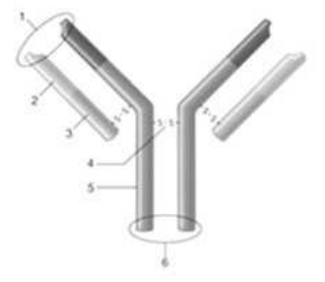
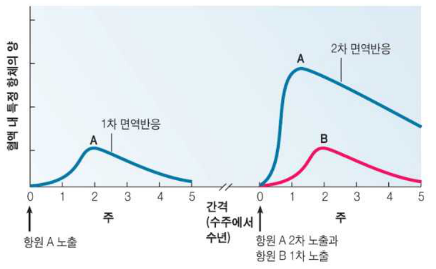
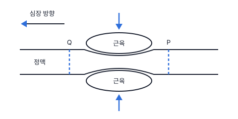
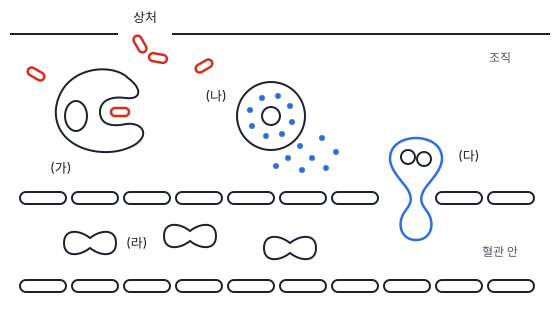
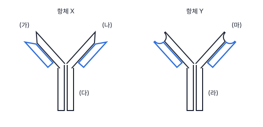

# 복습문제 52선 — 1124 수업 범위

기출 37개와 변형 연습 15개예요. 변형 연습은 기본 13개·심화 2개예요. 먼저 스스로 풀어 보고, 풀이를 열어 확인해요.

> `복습문제_1124_Respiratory_and_Circulatory_Systems_and_Immune_System.html`를 마크다운으로 옮겼어요. 원문, 힌트, 풀이는 접혀 있어요. 먼저 풀어 보고 펼쳐 보세요.

**목차**

- [B. 기출](#partB)
  - [P1. 판막이 있는 기관](#p1)
  - [P2. 심박출량을 늘리는 조절](#p2)
  - [P3. 림프계의 구성과 기능](#p3)
  - [P4. 감염세포와 암세포를 죽이는 세포](#p4)
  - [P5. 항체 구조에서 결합 위치 찾기](#p5)
  - [P6. 항원 수용체와 유전자](#p6)
  - [P7. 두 번째 노출의 면역반응 그래프](#p7)
  - [P8. 항체매개면역의 요소](#p8)
  - [P9. B 세포의 특징](#p9)
  - [P10. B 세포와 세포독성 T 세포의 기능](#p10)
  - [P11. 항체 다양성이 생기는 방법](#p11)
  - [P12. 제1방어선과 제2방어선의 성질](#p12)
  - [P13. 예방접종이 효과를 내는 이유](#p13)
  - [P14. 암세포를 상대하는 면역체계](#p14)
  - [P15. 세포매개면역의 구성 요소](#p15)
  - [P16. 항체의 기능](#p16)
  - [P17. T 세포가 성숙하는 기관](#p17)
  - [P18. 외래항원을 제거하는 방법](#p18)
  - [P19. 비특이적 방어기작(선천면역)](#p19)
  - [P20. 염증반응에 나오는 세포와 물질](#p20)
  - [P21. 특이적 방어선의 예](#p21)
  - [P22. 적응면역을 활성화하는 외래물질](#p22)
  - [P23. 퍼포린과 프로테아제로 죽이는 세포](#p23)
  - [P24. 히스타민을 분비하는 세포](#p24)
  - [P25. 체액에서 일어나는 특이적 방어](#p25)
  - [P26. 항체에 관한 틀린 설명](#p26)
  - [P27. 바이러스 방어에 쓰이는 선천면역 물질](#p27)
  - [P28. 1차 방어선이 아닌 것](#p28)
  - [P29. 예방접종이 효과를 내는 까닭](#p29)
  - [P30. 체액의 특이적 방어기작](#p30)
  - [P31. 특이적 방어선 고르기](#p31)
  - [P32. 적응면역을 활성화하는 물질](#p32)
  - [P33. 감염성 물질에 대한 방어선 구분](#p33)
  - [P34. 병을 일으키는 유기체의 이름](#p34)
  - [P35. 세균을 직접 섭식하는 것](#p35)
  - [P36. 항체의 구조와 기능](#p36)
  - [P37. 초기 분화가 일어나는 기관](#p37)
- [C. 변형 연습](#partC)
  - [P38. [변형] 모세혈관 양 끝의 물 이동](#p38)
  - [P39. [변형] 누워 있는 다리의 정맥](#p39)
  - [P40. [변형] 콜레스테롤의 이동과 혈관](#p40)
  - [P41. [변형] 심박출량을 늘리는 신호](#p41)
  - [P42. [변형] 감염성 물질에 대한 특이적 방어선](#p42)
  - [P43. [변형] 상처 부위의 단면](#p43)
  - [P44. [변형] 투과성만 막는 가상 물질](#p44)
  - [P45. [변형] 세 가지 관찰과 죽이는 방법](#p45)
  - [P46. [변형] 인터페론과 세 세포](#p46)
  - [P47. [변형] 가슴샘에서 성숙하는 세포](#p47)
  - [P48. [변형] 같은 클래스의 두 항체](#p48)
  - [P49. [변형] 네 세포의 항체 유전자](#p49)
  - [P50. [변형] 세 사람의 항체 반응](#p50)
  - [P51. [변형] 외래항원을 제거하는 방법](#p51)
  - [P52. [변형] 도움 T세포가 거의 없는 사람](#p52)

## B. 기출

### P1. 판막이 있는 기관

다음 중 판막을 가지고 있는 기관으로만 짝 지어진 것은?

- (1) 동맥, 모세혈관, 심장
- (2) 림프모세관, 동맥, 심장
- (3) 정맥, 심장
- (4) 동맥, 정맥
- (5) 동맥, 심장

원문 정보 보기

기출 13강 합본 3번 (PDF 1쪽)

힌트 보기

압력이 낮아 혈액이 거꾸로 흐르기 쉬운 곳에 역류를 막는 장치가 필요해요. 보기 하나라도 판막이 없는 것이 섞이면 지워요.

풀이 보기

1. (1) 틀려요. 동맥은 압력이 높아 혈액이 앞으로 밀려가므로 판막이 없고, 모세혈관도 판막이 없어요.
2. (2) 틀려요. 동맥이 섞여 있어서 “판막을 가진 기관으로만” 이루어진 짝이 아니에요.
3. (3) 맞아요. 심장의 판막과 정맥의 판막은 모두 혈액이 거꾸로 흐르는 것을 막아요.
4. (4) 틀려요. 정맥에는 판막이 있지만 동맥에는 없어요.
5. (5) 틀려요. 심장에는 판막이 있지만 동맥에는 없어요. 동맥으로 나가는 입구의 판막은 심장의 판막으로 세요.
6. 1124 수업의 [정맥 환류와 판막](정리노트_1124_Respiratory_and_Circulatory_Systems_and_Immune_System.md#s0-venous)에서 판막은 심장에도 있고 정맥에도 있다고 강조했어요. 다리 정맥에서 혈액을 밀어 올리는 것은 골격근이고, 판막은 되돌아가지 못하게 막아요.

**정답:** (3)

---

### P2. 심박출량을 늘리는 조절

심박출량을 증가시키기 위해서 _______________.

- (1) 자율신경계가 화학수용기에 감지된 낮은 산소농도에 반응하여 심장박동의 강도를 낮춘다
- (2) 과도한 혈액 산소에 의해 자극된 화학수용기가 심장박동 횟수를 증가시킨다
- (3) 뇌간이 압력수용체에 신호를 주어 심장을 빨리 뛰게 한다
- (4) 부신속질은 에피네프린을 분비한다
- (5) 뇌의 압력수용체가 교감신경에 신호를 준다

원문 정보 보기

기출 13강 합본 16번 (PDF 2쪽)

힌트 보기

신호는 감지하는 곳에서 뇌간으로, 뇌간에서 심장으로 가요. 보기마다 이 방향과 감지기의 위치, 결과가 늘어나는 쪽인지를 확인해요.

풀이 보기

1. (1) 틀려요. 심장박동의 강도를 낮추면 한 번에 내보내는 혈액이 줄어서 심박출량이 줄어들어요.
2. (2) 틀려요. 심장박동을 늘리는 쪽의 자극은 산소가 부족한 것이지 산소가 지나치게 많은 것이 아니에요.
3. (3) 틀려요. 방향이 거꾸로예요. 압력수용체가 뇌간에 신호를 보내고, 뇌간이 심장에 신호를 보내요.
4. (4) 맞아요. 부신속질이 혈액으로 내보내는 에피네프린은 교감신경계의 작용을 강화해서 심장박동의 횟수와 강도를 높여요.
5. (5) 틀려요. 압력수용체는 뇌가 아니라 심근, 대동맥, 목동맥에 있고, 그 신호는 뇌간으로 전달돼요.
6. 1124 수업의 [혈압의 결정과 연수의 조절](정리노트_1124_Respiratory_and_Circulatory_Systems_and_Immune_System.md#s1-pressure)에서 대동맥과 목동맥의 감지 세포가 혈압 정보를 보내면 연수가 심장박동의 횟수와 강도를 조절한다고 했어요. 부신속질의 에피네프린은 강의노트로 보충한 내용이에요.

**정답:** (4)

---

### P3. 림프계의 구성과 기능

림프계는 여유분의 세포간질액을 모아서 정맥혈로 되돌려 보내는 매우 방대한 관들의 네트워크이다. 림프계에 대한 설명 중 잘못된 것은?

- (1) 림프절 내부에 세균이나 바이러스가 대량 포획되면 림프질이 붓고 통증을 느낀다.
- (2) 림프계에는 림프절, 비장, 가슴샘, 편도 등이 포함된다.
- (3) 림프모세관은 전신에 걸쳐 분포한다.
- (4) 림프계는 면역계의 중요한 구성요소이다.
- (5) 림프모세관은 순환계 모세혈관과 달리 여러 겹의 세포층으로 구성된 벽을 가진다,

원문 정보 보기

기출 13강 합본 22번 (PDF 3쪽)

힌트 보기

액체가 쉽게 드나드는 가장 가는 관의 벽이 어떤 두께여야 하는지 생각해요. 잘못된 설명을 고르는 문제예요.

풀이 보기

1. (1) 맞아요. 림프절에 병원체가 많이 잡히면 면역세포가 모여 림프절이 붓고 아파요. 그래서 이 문제의 답이 아니에요.
2. (2) 맞아요. 림프절, 비장, 가슴샘(흉선), 편도는 모두 림프계의 조직과 기관이에요.
3. (3) 맞아요. 림프모세관은 모세혈관과 가까이 섞여 온몸에 퍼져 있어요.
4. (4) 맞아요. 림프절의 면역세포가 림프관으로 돌아다니는 세균과 바이러스를 찾아내므로 림프계는 면역에 중요해요.
5. (5) 틀려요. 림프모세관의 벽도 모세혈관처럼 한 겹의 내피세포층이에요. “여러 겹”과 “달리”가 잘못됐고, 그래서 이 문제의 답이에요.
6. 1124 수업의 [림프계와 림프절](정리노트_1124_Respiratory_and_Circulatory_Systems_and_Immune_System.md#s1-lymph)에서 림프계는 모세혈관에서 빠져나간 물을 모아 혈액으로 돌려보내고, 림프절은 검문소 구실을 한다고 했어요. 림프모세관의 벽과 비장·편도는 강의노트로 보충한 내용이에요.

**정답:** (5)

원문 보기 (1)의 “림프질”은 “림프절”의 오기로 읽어요. 정답에는 영향이 없어요.

---

### P4. 감염세포와 암세포를 죽이는 세포

림프구의 일종으로 바이러스에 감염되거나 암세포로 변한 세포를 퍼포린과 프로테아제를 이용하여 죽이는 면역세포는?

- (1) 세포독성 T세포
- (2) 호중구
- (3) 대식세포
- (4) 비만세포
- (5) 자연살생세포

원문 정보 보기

기출 14강 합본 2번 (PDF 1쪽)

힌트 보기

삼켜서 죽이는 세포와, 구멍을 뚫어 스스로 죽게 하는 세포를 나눠요. 선천면역 단원에서 이 방법으로 설명한 세포를 떠올려요.

풀이 보기

1. (1) 출제 의도로는 답이 아니지만 성립하는 보기예요. 세포독성 T세포도 림프구이고 퍼포린으로 감염된 세포와 암세포를 죽이며, 발문만으로는 뺄 수 없어요.
2. (2) 틀려요. 호중구는 세균을 둘러싸 삼켜서 죽이는 세포예요.
3. (3) 틀려요. 대식세포는 병원체를 삼켜 리소좀으로 분해하고 신호를 보내요.
4. (4) 틀려요. 비만세포는 염증 반응에서 히스타민을 분비하는 세포예요.
5. (5) 맞아요. 자연살생세포는 퍼포린으로 표적세포에 구멍을 뚫고 자살을 유도하는 효소(프로테아제)를 넣어 아포토시스를 일으켜요.
6. 1124 수업의 [자연살생세포와 세포의 죽음](정리노트_1124_Respiratory_and_Circulatory_Systems_and_Immune_System.md#s3-nk)에서 무엇을 죽이느냐가 문제라고 강조했어요. 세균이 아니라 암세포와 바이러스에 감염된 세포가 표적이고, 퍼포린으로 구멍을 뚫어 자살을 유도해요.

**정답:** (5)

이 문제는 모호해요. 인쇄된 답안지의 (5)를 정답으로 두지만, 보기 (1) 세포독성 T세포도 성립할 수 있어요. 세포독성 T세포도 림프구이고 퍼포린과 세포자살을 일으키는 단백질로 감염세포와 암세포를 죽이기 때문이에요(강의노트 14장 6쪽). 발문에 선천면역이라거나 특이성이 없다는 조건이 없어서, 퍼포린과 프로테아제만으로는 (1)을 뺄 수 없어요. 이번 수업은 이 방법을 자연살생세포에서만 다뤘고, 발문의 “림프구의 일종”, “암세포로 변한 세포”, “프로테아제”가 교재의 자연살생세포 설명(314쪽)과 같은 표현이라 출제 의도상 답을 (5)로 둬요.

---

### P5. 항체 구조에서 결합 위치 찾기

위의 항체 구조에서 에피톱(항원결정부)과 결합하는 부위는?

- (1) 6
- (2) 5
- (3) 3
- (4) 4
- (5) 1

원문 정보 보기

기출 14강 합본 3번 (PDF 1쪽)

힌트 보기

항체마다 달라서 항원과 맞닿는 곳은 Y자의 끝이에요. 에피톱은 항원에서 항체가 알아보는 작은 부분이에요.

풀이 보기

1. (1) 틀려요. 6은 두 무거운 사슬이 만나는 Y자의 아래쪽 끝이에요. 무거운 사슬의 불변 영역에 속하며, 에피톱과 결합하는 곳은 두 팔 끝이에요.
2. (2) 틀려요. 5는 무거운 사슬의 아래쪽 줄기로, 불변 영역에 속해요.
3. (3) 틀려요. 3은 가벼운 사슬의 안쪽 부분으로, 끝에 있는 결합 부위가 아니에요.
4. (4) 틀려요. 4는 두 무거운 사슬 사이를 잇는 이황화 결합이에요. 사슬을 묶는 역할만 해요.
5. (5) 맞아요. 1은 무거운 사슬과 가벼운 사슬의 끝이 함께 만드는 항원 결합 부위예요. 여기가 에피톱과 맞물려요.
6. 1124 수업의 [항체의 구조와 다양성 문제](정리노트_1124_Respiratory_and_Circulatory_Systems_and_Immune_System.md#s4-antibody)에서 항체는 무거운 사슬 2개와 가벼운 사슬 2개로 이루어진 Y자 모양이고, 위쪽 끝의 항원 결합 부위가 모양이 맞는 항원과 결합한다고 했어요. 에피톱이라는 말은 강의노트로 보충한 내용이에요.

**정답:** (5)

---

### P6. 항원 수용체와 유전자

다음 문장에 대해 참/거짓으로 답하시오.

“림프구에 의해 합성된 모든 항원 수용체는 독립된 유전자에 의해 암호화된다.”

- (1) 참
- (2) 거짓

원문 정보 보기

기출 14강 합본 4번 (PDF 1쪽)

힌트 보기

사람이 가진 유전자의 수와, 림프구가 알아볼 수 있는 항원의 수를 견주어 봐요.

풀이 보기

1. (1) 틀려요. 항원마다 유전자가 따로 있다면 유전자가 모자라요. 사람의 유전자는 2만~2만 5천 개뿐인데 항원은 훨씬 다양해요.
2. (2) 맞아요. 이 문장은 거짓이에요. 하나하나 다른 수용체는 독립된 유전자가 아니라, 성숙하는 동안 일어난 DNA 재배열로 같은 유전자의 조각을 다르게 이어 만들어요.
3. 1124 수업의 [DNA 재배열과 항체의 다양성](정리노트_1124_Respiratory_and_Circulatory_Systems_and_Immune_System.md#s5-rearrangement)에서 교수님은 항체 종류마다 유전자가 따로 있지 않다는 뜻으로 항체 유전자는 한 개라고 했어요. 골수에서 성숙하는 동안 조각이 무작위로 재배열되어 B세포마다 다른 항체가 돼요.

**정답:** (2)

---

### P7. 두 번째 노출의 면역반응 그래프

위 그림에 대한 설명으로 잘못된 것은?

- (1) 2차반응의 유도를 위해서는 1차반응과 비슷한 양의 항원이 유입되어야 한다
- (2) 위 그림은 면역기억현상을 나타낸다
- (3) 동일한 항원이 들어오면 2차반응은 1차반응보다 신속하게 이루어진다
- (4) 기억 B 세포 및 기억 도움 T 세포는 불활성화 상태로 세포내에 남아 있었다
- (5) 면역반응으로 병원체가 제거되면 형질세포나 T 세포의 클론은 더 이상 세포분열을 하지 않는다

원문 정보 보기

기출 14강 합본 5번 (PDF 1쪽)

힌트 보기

그래프에서 항원 A의 첫 반응과 두 번째 반응의 높이와 속도를 비교하고, 그 차이가 무엇이 남아 있어서 생기는지 생각해요.

풀이 보기

1. (1) 틀려요. 그래서 이 문제의 답이에요. 2차반응은 기억세포가 이미 많아서 1차반응보다 소량의 항원으로도 일어나요.
2. (2) 맞아요. 항원 A의 두 번째 노출에서 항체가 더 빨리 더 많이 생기고, 처음 만난 항원 B는 낮게 천천히 생기므로 면역기억을 보여 줘요.
3. (3) 맞아요. 동일한 항원 A의 2차반응은 더 짧은 시간에 높은 값에 도달해요.
4. (4) 출제 의도로는 답이 아니지만 글자대로 읽으면 틀린 설명이에요. 기억세포는 불활성화 상태로 오래 살아남는데, 남아 있는 곳은 “세포내”가 아니라 림프계와 감염됐던 조직이에요.
5. (5) 맞아요. 병원체가 제거되면 활성화되었던 대부분의 B세포와 T세포는 더 이상 세포분열을 하지 않고 사라져요.
6. 1124 수업의 [클론 선택과 면역의 기억](정리노트_1124_Respiratory_and_Circulatory_Systems_and_Immune_System.md#s5-clonal)에서 첫 노출은 늦고 적게, 재노출은 기억세포가 많아 더 빨리 더 많이 항체가 생긴다고 했어요. 2차반응이 소량의 항원으로도 일어난다는 점은 강의노트로 보충한 내용이에요.

**정답:** (1)

이 문제는 모호해요. 인쇄된 답안지의 (1)을 정답으로 두지만, 보기 (4)의 “세포내에 남아 있었다”를 글자대로 읽으면 (4)도 틀린 설명이라 답이 둘이 돼요. 강의노트(14장 5쪽)는 기억세포가 림프계와 감염됐던 조직에 불활성화 상태로 남는다고 하고, 교재도 림프계에 남는다고 해요. “세포내”를 “체내”의 오기로 볼 때만 (1) 하나가 답이에요.

---

### P8. 항체매개면역의 요소

다음 중 항체매개면역을 구성하는 중요한 요소가 아닌 것은?

- (1) 세포독성 T 세포
- (2) 면역글로불린
- (3) B 세포
- (4) 기억세포
- (5) 보체단백질

원문 정보 보기

기출 14강 합본 8번 (PDF 1쪽)

힌트 보기

체액에 녹은 항체가 중심인 면역과, 세포가 직접 죽이는 면역을 나눠 생각해요.

풀이 보기

1. (1) 틀려요. 항체매개면역의 요소가 아니라서 이 문제의 답이에요. 세포독성 T 세포는 감염된 세포를 직접 죽이는 세포매개면역의 세포예요.
2. (2) 맞아요. 면역글로불린은 곧 항체예요. 항체매개면역의 요소라 답이 아니에요.
3. (3) 맞아요. B 세포는 형질세포로 분화해 항체를 분비해요. 항체매개면역의 요소라 답이 아니에요.
4. (4) 맞아요. B 세포에서 생긴 기억세포는 같은 항원이 다시 들어올 때 항체 반응을 빠르게 해요. 항체매개면역의 요소라 답이 아니에요.
5. (5) 맞아요. 보체 자체는 선천면역의 단백질이지만, 항원에 결합한 항체가 보체를 활성화해 세균에 막공격복합체라는 구멍을 뚫게 해요. 항체매개면역의 요소라 답이 아니에요.
6. 1124 수업의 [항체매개면역·세포매개면역과 도움 T세포](정리노트_1124_Respiratory_and_Circulatory_Systems_and_Immune_System.md#s5-helper)에서 항체매개면역은 체액성 면역이라고도 하고, 세포매개면역은 독성 T세포가 감염세포를 직접 죽이는 것이라고 나눴어요. 항체가 세균을 붙잡고 보체가 구멍을 뚫는다는 것은 같은 수업의 [항체의 작용](정리노트_1124_Respiratory_and_Circulatory_Systems_and_Immune_System.md#s5-effect)에서 다뤘고, 항체가 보체를 활성화한다는 것은 강의노트 14장 p5로 보충한 내용이에요.

**정답:** (1)

---

### P9. B 세포의 특징

B 세포의 특징은?

- (1) 바이러스에 감염된 세포에 결합하고 그들을 직접 죽인다
- (2) 제1형 MHC에 얹힌 항원을 인식한다
- (3) 무척추동물이든 척추동물이든 같은 구조를 가지고 있다
- (4) 하나의 B 세포 표면에 다수의 다른 종류의 BCR을 발현한다
- (5) 골수에서 줄기세포로부터 분화를 마친다

원문 정보 보기

기출 14강 합본 9번 (PDF 2쪽)

힌트 보기

B세포와 T세포의 이름이 어디에서 왔는지 떠올리고, 한 B세포가 만드는 항체가 몇 종류인지 생각해요.

풀이 보기

1. (1) 틀려요. 감염된 세포를 직접 죽이는 것은 세포독성 T세포이고, B세포는 항체를 만들어요.
2. (2) 틀려요. B세포는 막에 박힌 항체(B세포 수용체, BCR)로 항원 자체에 결합해요. 제1형 MHC에 얹힌 항원을 알아보는 것은 세포독성 T세포예요.
3. (3) 틀려요. B세포가 맡는 후천면역은 척추동물만 가지고 있고 무척추동물에는 없어요.
4. (4) 틀려요. 성숙한 B세포 하나는 한 종류의 BCR만 만들어요. 다양성은 서로 다른 B세포가 많아서 생겨요.
5. (5) 맞아요. B세포는 골수에서 줄기세포로부터 태어나고 성숙도 골수에서 마쳐요.
6. 1124 수업의 [B세포와 T세포](정리노트_1124_Respiratory_and_Circulatory_Systems_and_Immune_System.md#s4-lymphocytes)에서 이름은 성숙하는 곳에서 왔다고 했어요. 둘 다 골수에서 태어나고, B세포는 골수에서, T세포는 흉선(가슴샘)에서 성숙해요. BCR이라는 이름은 강의노트로 보충한 내용이에요.

**정답:** (5)

---

### P10. B 세포와 세포독성 T 세포의 기능

B 세포와 세포독성 T 세포 기능의 차이로 가장 적절한 것은?

- (1) B 세포는 감염된 숙주세포를 죽이지만, 세포독성 T 세포는 병원체를 직접 죽인다
- (2) B 세포는 능동면역에, 세포독성 T 세포는 수동면역에 관여한다
- (3) B 세포는 항원을 인식하지만, 세포독성 T 세포는 항원과 결합하지 못한다
- (4) B 세포는 세포매개면역반응을, 세포독성 T 세포는 항체매개면역반응을 수행한다
- (5) B 세포는 병원균에 대한 항체를 생산하고, 세포독성 T 세포는 병원균에 감염된 숙주세포를 죽인다

원문 정보 보기

기출 14강 합본 10번 (PDF 2쪽)

힌트 보기

두 세포가 각각 무엇을 내놓거나 무엇을 공격하는지 정리하고, 짝이 바뀐 보기를 지워요.

풀이 보기

1. (1) 틀려요. 감염된 숙주세포를 죽이는 쪽은 세포독성 T 세포이고, B 세포는 항체를 만들어요. 두 역할이 잘못 짝지어졌어요.
2. (2) 틀려요. 능동면역과 수동면역은 면역을 스스로 얻었는지, 만들어진 항체를 받았는지의 구분이라 두 세포의 역할 차이가 아니에요.
3. (3) 틀려요. 세포독성 T 세포도 자기 수용체로 항원을 알아봐야 감염된 세포를 공격할 수 있어요.
4. (4) 틀려요. 두 면역의 이름이 서로 바뀌었어요. B 세포가 항체매개면역, 세포독성 T 세포가 세포매개면역이에요.
5. (5) 맞아요. B 세포는 항체를 생산하고, 세포독성 T 세포는 병원균에 감염된 숙주세포를 직접 죽여요.
6. 1124 수업의 [항체매개면역·세포매개면역과 도움 T세포](정리노트_1124_Respiratory_and_Circulatory_Systems_and_Immune_System.md#s5-helper)에서 B세포는 항체매개면역을, 세포독성 T세포는 세포매개면역을 맡는다고 나눴어요.

**정답:** (5)

---

### P11. 항체 다양성이 생기는 방법

항체의 다양성 형성은 ____________.

- (1) 여러 형태의 C 조각을 선택하여 기능을 갖춘 가벼운 사슬 유전자를 만든다
- (2) V 조각만으로 기능을 갖춘 가벼운 사슬 유전자를 만든다
- (3) V 조각과 J 조각에서 각기 하나씩 무작위로 C 조각과 연결하여 기능을 갖춘 가벼운 사슬 유전자를 만든다
- (4) 한 세포에서 IgG가 먼저 생기고 나중에 IgM이 만들어진다
- (5) J 조각을 잘라내어 기능을 갖춘 가벼운 사슬 유전자를 만든다

원문 정보 보기

기출 14강 합본 11번 (PDF 2쪽)

힌트 보기

가벼운 사슬 유전자는 여러 종류의 조각이 모두 모여야 완성돼요. 어떤 조각이 여러 개라서 고를 수 있는지 생각해요.

풀이 보기

1. (1) 틀려요. 가벼운 사슬의 C 조각은 불변 영역을 정하는 하나뿐이라 여러 형태 중에서 고르지 않아요. 고르는 쪽은 V 조각과 J 조각이에요.
2. (2) 틀려요. V 조각만으로는 완성되지 않아요. J 조각과 C 조각까지 이어져야 기능을 갖춘 유전자가 돼요.
3. (3) 맞아요. 여러 V 조각 중 하나와 여러 J 조각 중 하나가 무작위로 골라져 C 조각과 이어져요. 이 조합이 B세포마다 달라서 항체가 다양해져요.
4. (4) 틀려요. 순서가 거꾸로예요. 처음 항원을 만났을 때 주로 만들어지는 것이 IgM이에요. 게다가 클래스의 순서는 결합 부위가 다양해지는 원리도 아니에요.
5. (5) 틀려요. J 조각을 없애는 것이 아니라, 여러 J 조각 중 하나를 골라 V 조각·C 조각과 이어야 유전자가 완성돼요.
6. 1124 수업에서 B세포가 골수에서 성숙하는 동안 항체 유전자에 무작위로 DNA 재배열이 일어나 B세포마다 서열이 달라진다고 했어요. 재배열의 자세한 과정은 수업에서 생략했어요. V·J·C 조각은 교재(p.316–317), IgM의 차례는 강의노트 14장 p5로 보충한 내용이에요([DNA 재배열과 항체의 다양성](정리노트_1124_Respiratory_and_Circulatory_Systems_and_Immune_System.md#s5-rearrangement)).

**정답:** (3)

---

### P12. 제1방어선과 제2방어선의 성질

다음 문장에 대해 참/거짓으로 답하시오.

**“제1방어선과 제2방어선은 서로 다른 병원체를 구별할 수 있는 특이적 방어기작이다.”**

- (1) 거짓
- (2) 참

원문 정보 보기

기출 14강 합본 13번 (PDF 2쪽)

힌트 보기

피부와 점액, 그리고 선천면역이 상대를 하나하나 가려서 막는지 떠올려요.

풀이 보기

1. (1) 맞아요. 문장은 거짓이에요. 제1방어선(피부·점액 같은 장벽)과 제2방어선(선천면역)은 병원체의 종류를 가리지 않고 막는 비특이적 방어예요.
2. (2) 틀려요. 병원체를 하나하나 구별해 맞는 것만 상대하는 특이성은 적응면역(후천면역)의 특징이에요.
3. 1124 수업에서 선천면역은 기억도 특이성도 없고, 적응면역의 특징이 기억과 특이성이라고 강조한 내용이에요([선천면역과 후천면역](정리노트_1124_Respiratory_and_Circulatory_Systems_and_Immune_System.md#s2-two-systems)).

**정답:** (1)

---

### P13. 예방접종이 효과를 내는 이유

특정 병원체에 예방접종을 받으면 그 병원체에 대항할 수 있는 이유는 다음 중 무엇 때문인가?

- (1) 자가면역반응
- (2) 선천면역
- (3) 면역기억
- (4) 알레르기 반응
- (5) 디펜신에 의한 반응

원문 정보 보기

기출 14강 합본 14번 (PDF 2쪽)

힌트 보기

예방접종을 하면 몸에 무엇이 오래 남는지 생각해요.

풀이 보기

1. (1) 틀려요. 자가면역반응은 이름 그대로 자기 몸을 상대로 일어나는 면역 반응이라, 병원체에 대비하는 일이 아니에요.
2. (2) 틀려요. 선천면역은 만난 병원체를 기억하지 못하므로, 특정 병원체에 미리 대비하게 해 주지 않아요.
3. (3) 맞아요. 예방접종은 그 병원체에 맞는 기억세포를 만들어 줘요. 그래서 진짜 병원체를 만나면 더 빨리, 더 많은 항체를 만들어요. 이것이 면역기억이에요.
4. (4) 틀려요. 알레르기 반응은 면역이 지나치게 반응해 해를 주는 일이라, 예방접종이 노리는 효과가 아니에요.
5. (5) 틀려요. 디펜신은 상피조직이 늘 분비하는 항미생물 펩티드예요. 종류를 가리지 않고 세균을 죽이며 기억을 남기지 않아요.
6. 1124 수업에서 백신의 목적을 “기억세포를 만들어 주기 위해서”라고 한 설명과 이어져요([클론 선택과 면역의 기억](정리노트_1124_Respiratory_and_Circulatory_Systems_and_Immune_System.md#s5-clonal)).

**정답:** (3)

---

### P14. 암세포를 상대하는 면역체계

다음 중 자신의 암세포로부터 신체를 보호하기 위한 면역체계는 무엇인가?

- (1) 효소 반응
- (2) 염증 반응
- (3) 자가면역반응
- (4) 방어 단백질
- (5) 세포매개면역

원문 정보 보기

기출 14강 합본 15번 (PDF 2쪽)

힌트 보기

암세포는 우리 몸의 세포가 변한 것이에요. 세포를 직접 죽이는 T세포가 속한 면역을 떠올려요.

풀이 보기

1. (1) 틀려요. 효소 반응은 효소가 일으키는 화학 반응을 두루 이르는 말이라, 암세포를 상대하는 면역체계의 이름이 아니에요.
2. (2) 틀려요. 염증 반응은 상처나 감염 부위에 대식세포·호중구 등이 모여 침입한 세균을 없애는 선천면역 반응이에요.
3. (3) 틀려요. 자가면역반응은 자기 몸을 상대로 일어나 해를 주는 반응이에요. 몸을 보호하기 위한 면역체계가 아니에요.
4. (4) 틀려요. 보체나 인터페론 같은 방어 단백질은 선천면역에서 세균이나 바이러스를 막는 물질이에요. 암세포를 직접 죽이는 면역체계를 가리키지 않아요.
5. (5) 맞아요. 세포매개면역에서는 세포독성 T세포가 암세포나 바이러스에 감염된 세포를 직접 죽여요.
6. 1124 수업에서 적응면역을 항체매개면역과 세포매개면역으로 나누고, 세포매개면역은 독성 T세포가 직접 죽이는 면역이라고 한 정의를 그대로 적용해요([항체매개면역·세포매개면역과 도움 T세포](정리노트_1124_Respiratory_and_Circulatory_Systems_and_Immune_System.md#s5-helper)).

**정답:** (5)

인쇄된 답안지에는 이 문항의 답이 표시되어 있지 않아요. 세포매개면역의 독성 T세포가 감염세포와 암세포를 직접 죽이고, 나머지 보기는 암세포를 겨냥한 면역체계의 이름이 아니므로 (5)로 판단해요.

---

### P15. 세포매개면역의 구성 요소

다음 중 세포매개면역을 구성하는 중요 요소가 아닌 것은 무엇인가?

- (1) B 세포
- (2) 퍼포린
- (3) 항원제시세포
- (4) 기억 세포독성 T 세포
- (5) 세포독성 T 세포

원문 정보 보기

기출 14강 합본 16번 (PDF 2쪽)

힌트 보기

적응면역은 항체가 나서는 쪽과 T세포가 직접 나서는 쪽으로 나뉘어요. 항체를 만드는 세포가 어느 쪽인지 찾아요.

풀이 보기

1. (1) 틀려요. 그래서 답이에요. B 세포는 형질세포로 분화해 항체를 분비하므로 세포매개면역이 아니라 항체매개면역(체액성 면역)의 주인공이에요.
2. (2) 맞아요. 세포매개면역의 요소라 답이 아니에요. 세포독성 T세포도 자연살생세포처럼 퍼포린으로 표적세포의 막에 구멍을 내요.
3. (3) 맞아요. 세포매개면역의 요소라 답이 아니에요. 항원제시세포는 항원 조각을 T세포에게 보여 주어 T세포가 활성화되게 해요.
4. (4) 맞아요. 세포매개면역의 요소라 답이 아니에요. 한 번 활성화된 세포독성 T세포의 일부가 기억세포로 남아 같은 항원에 다시 대비해요.
5. (5) 맞아요. 세포매개면역의 요소라 답이 아니에요. 감염된 세포나 암세포를 직접 죽이는 중심 세포예요.
6. 1124 수업에서 B세포는 항체를 만들고, 세포매개면역은 독성 T세포가 직접 죽인다고 나눈 기준을 적용해요. 수업에서 자세히 다루지 않은 보기가 있어도 B 세포를 먼저 가려내면 풀려요([항체매개면역·세포매개면역과 도움 T세포](정리노트_1124_Respiratory_and_Circulatory_Systems_and_Immune_System.md#s5-helper)).

**정답:** (1)

---

### P16. 항체의 기능

항체의 기능으로 가장 옳은 것은?

- (1) 보체를 불활성화한다
- (2) 2차 면역반응이 일어날 기회를 없앤다
- (3) 세포내 바이러스를 죽인다
- (4) 자연살생세포를 중화한다
- (5) 대식세포에 쉽게 먹히도록 세균이나 바이러스를 응집한다

원문 정보 보기

기출 14강 합본 17번 (PDF 2쪽)

힌트 보기

항체는 결합 부위가 두 개예요. 세균 여럿을 한꺼번에 붙들면 어떻게 되는지 생각해요.

풀이 보기

1. (1) 틀려요. 방향이 거꾸로예요. 항원에 결합한 항체는 보체를 활성화해서 세균에 구멍이 나게 해요.
2. (2) 틀려요. 항체는 다음 반응의 기회를 없애지 않아요. 기억세포가 남아 있으면 같은 항원을 다시 만났을 때 더 빠르고 강한 반응이 일어나요.
3. (3) 틀려요. 항체는 체액에 녹아 세포 밖의 항원에 붙는 단백질이에요. 바이러스가 이미 들어간 세포는 세포독성 T세포나 자연살생세포가 죽여요.
4. (4) 틀려요. 항체의 중화는 독성 분자 같은 항원을 붙들어 작용을 막는 것이에요. 자연살생세포는 우리 몸의 면역세포라 중화할 대상이 아니에요.
5. (5) 맞아요. 항체는 결합 부위가 둘이라 여러 세균이나 바이러스를 서로 엮어 덩어리지게 해요. 이렇게 응집되면 대식세포가 쉽게 잡아먹어요.
6. 1124 수업에서 항체는 붙잡아 둘 뿐이고 실제로 죽이는 것은 대식세포나 보체라고 한 구별을 적용해요([항체의 작용](정리노트_1124_Respiratory_and_Circulatory_Systems_and_Immune_System.md#s5-effect)).

**정답:** (5)

---

### P17. T 세포가 성숙하는 기관

T 세포가 많은 분화(성숙)를 겪는 기관은 어디인가?

- (1) 갑상선
- (2) 골수
- (3) 부신
- (4) 뇌하수체
- (5) 가슴샘(흉선)

원문 정보 보기

기출 14강 합본 19번 (PDF 3쪽)

힌트 보기

B와 T라는 이름은 태어난 곳이 아니라 성숙한 곳에서 왔어요. T가 어떤 낱말의 첫 글자인지 떠올려요.

풀이 보기

1. (1) 틀려요. 갑상선은 호르몬을 분비하는 기관이고, T세포가 성숙하는 곳이 아니에요.
2. (2) 틀려요. 골수는 T세포가 태어나는 곳이에요. 골수에서 성숙까지 마치는 것은 B세포예요.
3. (3) 틀려요. 부신은 에피네프린 같은 호르몬을 분비하는 기관이고, T세포가 성숙하는 곳이 아니에요.
4. (4) 틀려요. 뇌하수체는 호르몬을 분비하는 기관이고, T세포가 성숙하는 곳이 아니에요.
5. (5) 맞아요. T세포는 골수에서 태어난 뒤 가슴샘(흉선, thymus)으로 옮겨 가 성숙해요. T는 thymus의 첫 글자예요.
6. 1124 수업에서 태어나는 곳은 둘 다 골수이고, 성숙하는 곳이 B세포는 골수, T세포는 흉선이라고 되물으며 구별했어요([B세포와 T세포](정리노트_1124_Respiratory_and_Circulatory_Systems_and_Immune_System.md#s4-lymphocytes)).

**정답:** (5)

---

### P18. 외래항원을 제거하는 방법

적응면역에서 외래항원의 제거가 이루어지는 방법이 아닌 것은?

- (1) 감염된 세균 자체의 경우 항체가 항원에 결합하여 수 많은 세균을 연결하여 응집시킨다
- (2) 항체는 프로테아제를 분비하여 세균의 세포자살을 유발한다
- (3) 침입세균의 독소는 항체에 의해 중화된다
- (4) 항체는 식세포가 세균과 바이러스를 더욱 더 잘 섭취하도록 한다
- (5) 항원에 결합한 항체는 보체를 활성화 시켜 세균을 제거한다

원문 정보 보기

기출 14강 합본 20번 (PDF 3쪽)

힌트 보기

항체가 스스로 물질을 내보내 상대를 죽이는지, 붙잡기만 하는지 생각해요.

풀이 보기

1. (1) 맞아요. 실제로 일어나는 제거 방법이라 답이 아니에요. 결합 부위가 둘인 항체가 세균끼리 엮어 덩어리지게 해요.
2. (2) 틀려요. 그래서 답이에요. 항체는 항원에 붙는 단백질이라 프로테아제를 분비하지 않아요. 프로테아제를 넣어 세포자살을 유발하는 것은 자연살생세포의 방법이고, 그 표적도 세균이 아니라 감염된 세포나 암세포예요.
3. (3) 맞아요. 실제로 일어나는 제거 방법이라 답이 아니에요. 항체가 독소에 붙어 작용을 막는 것이 중화예요.
4. (4) 맞아요. 실제로 일어나는 제거 방법이라 답이 아니에요. 항체가 붙은 세균과 바이러스는 식세포가 더 잘 잡아먹어요.
5. (5) 맞아요. 실제로 일어나는 제거 방법이라 답이 아니에요. 항원에 붙은 항체가 보체를 활성화하면 보체가 세균의 막에 구멍을 내요.
6. 1124 수업에서 “항체는 그냥 붙으면 끝이에요”라고 한 강조를 적용해요. 중화와 응집은 항체가 붙어서 하는 일이고, 죽이는 일은 대식세포나 보체가 맡아요([항체의 작용](정리노트_1124_Respiratory_and_Circulatory_Systems_and_Immune_System.md#s5-effect)).

**정답:** (2)

---

### P19. 비특이적 방어기작(선천면역)

다음 중 신체의 비특이적 방어기작(선천면역)의 일부인 것은?

- (1) 상피조직
- (2) 항체
- (3) B 세포
- (4) 비만세포
- (5) T 세포

원문 정보 보기

기출 14강 합본 22번 (PDF 3쪽)

힌트 보기

괄호 안의 선천면역은 장벽을 뚫고 들어온 병원체를 상대하는 두 번째 방어선이에요. 염증 반응에 나오는 세포를 떠올려요.

풀이 보기

1. (1) 출제 의도로는 답이 아니지만, 상피조직의 장벽도 병원체의 종류를 가리지 않는 비특이적 방어이고, 상피조직이 분비하는 디펜신은 선천면역에 들어가요. 그래서 (1)도 성립할 수 있어요. 다만 강의노트와 교재는 상피조직을 1차 방어선으로, 선천면역을 2차 방어로 나누어요.
2. (2) 틀려요. 항체는 맞는 항원에만 결합하는 적응면역의 단백질이에요.
3. (3) 틀려요. B 세포는 세포마다 맞는 항원이 정해져 있는 적응면역의 세포예요.
4. (4) 맞아요. 비만세포는 상처가 나면 히스타민을 분비해 염증 반응을 일으키는 선천면역의 세포예요.
5. (5) 틀려요. T 세포는 특이성과 기억이 있는 적응면역의 세포예요.
6. 1124 수업에서 선천면역 다섯 가지 중 하나로 염증 반응을 들고, 비만세포가 분비하는 히스타민이 중요하다고 강조했어요([염증 반응](정리노트_1124_Respiratory_and_Circulatory_Systems_and_Immune_System.md#s2-inflammation)).

**정답:** (4)

이 문항은 모호해요. 인쇄된 답은 (4)이고 그대로 유지하지만, (1) 상피조직도 성립할 수 있어요. 발문이 묻는 비특이적 방어에 상피조직의 장벽이 들어가고, 1124 수업에서 배운 디펜신은 상피조직이 분비하는 선천면역 물질이기 때문이에요. (4)만 답이 되려면 1차 방어선과 선천면역을 나누는 구분이 필요해요. 강의노트 14장 p1과 교재 p.312는 상피조직을 1차 방어선으로, 선천면역을 2차 방어로 나누므로 이 구분으로 읽으면 괄호의 “선천면역”에 맞는 것은 (4)예요.

---

### P20. 염증반응에 나오는 세포와 물질

다음 중 염증반응에 속하지 않는 것은?

- (1) 사이토카인
- (2) 호중구
- (3) 대식세포
- (4) 비만세포
- (5) B 세포

원문 정보 보기

기출 14강 합본 23번 (PDF 3쪽)

힌트 보기

염증 반응은 선천면역이에요. 보기 가운데 적응면역에 속하는 것을 찾아요.

풀이 보기

1. (1) 맞아요. 염증반응에 속하므로 답이 아니에요. 사이토카인은 대식세포 등이 내보내 다른 면역세포를 부르는 신호 물질이에요.
2. (2) 맞아요. 염증반응에 속하므로 답이 아니에요. 호중구는 혈관벽을 빠져나와 상처 부위의 세균을 잡아먹어요.
3. (3) 맞아요. 염증반응에 속하므로 답이 아니에요. 대식세포는 세균을 잡아먹고 신호를 보내 다른 면역세포를 불러요.
4. (4) 맞아요. 염증반응에 속하므로 답이 아니에요. 비만세포는 히스타민을 분비해 혈관을 넓히고 투과성을 높여요.
5. (5) 틀려요. 그래서 답이에요. B 세포는 특정 항원에 맞는 항체를 만드는 적응면역의 세포예요.
6. 1124 수업에서 대식세포가 먹고 신호를 보내고, 비만세포의 히스타민으로 혈관이 넓어지고 투과성이 늘면 호중구가 빠져나온다고 한 순서를 적용해요([염증 반응](정리노트_1124_Respiratory_and_Circulatory_Systems_and_Immune_System.md#s2-inflammation)).

**정답:** (5)

---

### P21. 특이적 방어선의 예

다음 중 감염성 물질에 대한 특이적 방어선의 예는?

- (1) B 세포는 침입한 병원균의 표면에 붙는다
- (2) 대식세포는 감염 지역에서 침입자를 삼켜버린다
- (3) 허파의 점액층은 침범한 병원균을 가둔다
- (4) 활성화된 대식세포는 여러 종류의 사이토카인을 분비한다
- (5) 피부는 감염원의 감염을 물리적으로 차단한다

원문 정보 보기

기출 14강 합본 25번 (PDF 3쪽)

힌트 보기

상대의 종류를 가리지 않는 방어를 하나씩 지우고, 맞는 상대만 골라 대응하는 것을 찾아요.

풀이 보기

1. (1) 맞아요. B 세포는 막에 박힌 항체와 모양이 맞는 항원에만 붙으므로 적응면역의 특이적 방어예요.
2. (2) 틀려요. 대식세포가 침입자를 삼키는 일은 종류를 가리지 않는 선천면역이에요.
3. (3) 틀려요. 점액은 누구든 들어오지 못하게 가두는 첫 번째 방어선이라 비특이적이에요.
4. (4) 틀려요. 대식세포가 사이토카인으로 다른 면역세포를 부르는 일은 염증 반응의 일부이고, 특정 항원 하나를 겨냥하지 않아요.
5. (5) 틀려요. 피부는 상대를 가리지 않고 막는 해부학적 장벽, 곧 첫 번째 방어선이에요.
6. 1124 수업의 [선천면역과 후천면역](정리노트_1124_Respiratory_and_Circulatory_Systems_and_Immune_System.md#s2-two-systems)을 적용해요. 교수님은 후천면역(적응면역)의 특징을 기억과 특이성으로 정리했어요.

**정답:** (1)

---

### P22. 적응면역을 활성화하는 외래물질

외래물질로 적응면역계를 활성화 시키는 물질을 ( ) (이)라 한다.

- (1) 보체
- (2) 항원
- (3) 미생물
- (4) 인터페론
- (5) 항체

원문 정보 보기

기출 14강 합본 26번 (PDF 3쪽)

힌트 보기

우리 몸이 만들어 내는 방어 물질과, 밖에서 들어와 방어를 일으키는 물질을 나누어요.

풀이 보기

1. (1) 틀려요. 보체는 우리 몸이 만든 선천면역 단백질이고 외래물질이 아니에요.
2. (2) 맞아요. 항원은 항체가 특이적으로 결합하는 상대이며, 이에 맞는 B세포가 선택되면서 적응면역이 시작돼요.
3. (3) 틀려요. 미생물은 항원을 지닐 수 있는 생물이지만, 적응면역을 일으키는 물질을 통틀어 부르는 이름은 아니에요.
4. (4) 틀려요. 인터페론은 바이러스에 감염된 우리 세포가 주변 세포에 보내는 신호 물질이에요.
5. (5) 틀려요. 항체는 항원에 특이적으로 결합하도록 우리 몸이 만든 단백질이라 방향이 반대예요.
6. 1124 수업의 [항체의 구조와 다양성 문제](정리노트_1124_Respiratory_and_Circulatory_Systems_and_Immune_System.md#s4-antibody)를 적용해요. 교수님은 항체를 항원에 특이적으로 결합하는 단백질이라고 정의했으니, 결합하는 쪽과 결합되는 쪽을 구별해요.

**정답:** (2)

---

### P23. 퍼포린과 프로테아제로 죽이는 세포

림프구의 일종으로 바이러스에 감염되거나 암세포로 변한 세포를 퍼포린과 프로테아제를 이용하여 죽이는 면역세포는?

- (1) 자연살생세포
- (2) 호중구
- (3) 대식세포
- (4) 세포독성 T 세포
- (5) 비만세포

원문 정보 보기

기출 14강 합본 27번 (PDF 3쪽)

힌트 보기

삼켜서 죽이는 세포를 먼저 지우고, 구멍을 뚫어 스스로 죽게 하는 방법을 수업에서 어느 세포의 것으로 배웠는지 떠올려요.

풀이 보기

1. (1) 맞아요. 자연살생세포는 퍼포린으로 구멍을 뚫고 자살을 유도하는 효소(프로테아제)를 넣어, 바이러스에 감염된 세포와 암세포를 죽이는 림프구예요.
2. (2) 틀려요. 호중구는 혈관을 빠져나와 세균을 둘러싸 삼켜요.
3. (3) 틀려요. 대식세포는 표적을 둘러싸 안으로 넣고 리소좀에서 분해해요.
4. (4) 출제 의도로는 답이 아니지만 세포독성 T 세포도 림프구이고 퍼포린과 프로테아제로 감염세포·암세포를 죽여요. 발문에 선천면역이나 특이성 없음 같은 조건이 없어서 이 보기도 발문에 들어맞아요.
5. (5) 틀려요. 비만세포는 히스타민을 분비해 염증 반응을 일으키는 세포예요.
6. 1124 수업의 [자연살생세포와 세포의 죽음](정리노트_1124_Respiratory_and_Circulatory_Systems_and_Immune_System.md#s3-nk)을 적용해요. 교수님은 “죽이는데 뭘 죽이느냐가 문제입니다.”라고 강조하며 표적을 세균이 아니라 암세포와 바이러스에 감염된 세포로 바로잡았어요.

**정답:** (1)

인쇄된 답안지는 (1)이에요. 다만 (4) 세포독성 T 세포도 성립해서 모호한 문항이에요. 강의노트 14장 6쪽에서 세포독성 T세포도 퍼포린과 자살 유도 단백질로 표적을 죽인다고 하고, 발문에는 자연살생세포만 가리키는 조건(선천면역, 특이성 없음)이 없어요. 그러니 (4)를 골랐어도 개념을 틀리게 안 것은 아니에요. 이번 수업은 이 방법을 자연살생세포에서만 다뤘고 교재 p.314의 자연살생세포 설명이 발문과 같은 말을 쓰므로 (1)을 출제 의도로 봐요.

---

### P24. 히스타민을 분비하는 세포

다음 세포 중 알레르기 항원과 결합하여 히스타민을 분비하여 심한 염증반응을 일으키는 세포는 어느 것인가?

- (1) 호산구
- (2) 자연살생세포
- (3) 대식세포
- (4) 비만세포
- (5) B 세포

원문 정보 보기

기출 14강 합본 28번 (PDF 3쪽)

힌트 보기

발문에서 “히스타민을 분비”한다는 단서에 집중해요.

풀이 보기

1. (1) 틀려요. 호산구는 기생충을 죽이는 물질을 분비하는 백혈구예요(교재 p.324 표 14.1).
2. (2) 틀려요. 자연살생세포는 구멍을 뚫고 자살을 유도하는 효소를 넣어 감염세포와 암세포를 죽여요.
3. (3) 틀려요. 대식세포는 병원체를 삼키고 사이토카인 같은 신호를 내보내요.
4. (4) 맞아요. 비만세포가 히스타민을 분비하면 혈관이 확장되고 투과성이 높아져 염증이 일어나요.
5. (5) 틀려요. B 세포는 항원에 맞으면 선택되어 형질세포나 기억세포가 되며, 히스타민을 분비하는 역할은 하지 않아요.
6. 1124 수업의 [염증 반응](정리노트_1124_Respiratory_and_Circulatory_Systems_and_Immune_System.md#s2-inflammation)을 적용해요. 교수님이 “특히 이제 히스타민이 중요한데.”라고 강조한 물질을 내놓는 세포가 비만세포예요.

**정답:** (4)

---

### P25. 체액에서 일어나는 특이적 방어

다음 중 체액에서 주로 항원에 대항하는 특이적 방어기작은 무엇인가?

- (1) 리소자임
- (2) 세포매개면역
- (3) 보체계
- (4) 항체매개면역
- (5) 염증 반응

원문 정보 보기

기출 14강 합본 31번 (PDF 4쪽)

힌트 보기

“체액에서”와 “특이적”이라는 두 조건을 모두 만족하는지 확인해요.

풀이 보기

1. (1) 틀려요. 리소자임(라이소자임)은 침과 눈물에서 세균의 세포벽을 녹이는 비특이적인 첫 번째 방어선이에요.
2. (2) 틀려요. 세포매개면역은 특이적이지만, 독성 T세포가 감염세포 등을 직접 죽이는 방어예요.
3. (3) 틀려요. 보체계는 체액에서 작용하지만 특이성이 없는 선천면역이에요.
4. (4) 맞아요. 항체매개면역은 체액에 녹은 항체가 맞는 항원에만 결합하는 방어라서 체액성 면역이라고도 해요.
5. (5) 틀려요. 염증 반응은 상대를 가리지 않는 선천면역이에요.
6. 1124 수업의 [항체매개면역·세포매개면역과 도움 T세포](정리노트_1124_Respiratory_and_Circulatory_Systems_and_Immune_System.md#s5-helper)를 적용해요. 항체는 체액에 녹아 있는 단백질이라 항체매개면역과 체액성 면역이 같은 말이에요.

**정답:** (4)

---

### P26. 항체에 관한 틀린 설명

항체에 관한 설명 중 틀린 것은?

- (1) 항체분자는 2개의 가벼운 사슬과 2개의 무거운 사슬로 구성된다
- (2) 항체는 면역글로불린으로 알려진 단백질 그룹에 속하는 거대 복합단백질이다
- (3) 항체의 가변영역이 항체의 종류를 결정한다
- (4) 항체는 다양한 메커니즘을 통하여 다양성을 확보한다
- (5) 사람에게는 IgM, IgG, IgA, IgE, IgD 의 5가지 항체가 존재한다

원문 정보 보기

기출 14강 합본 33번 (PDF 4쪽)

힌트 보기

항체의 아래 줄기와 팔 끝이 각각 무엇을 정하는지 나누어 생각해요.

풀이 보기

1. (1) 맞아요. 항체는 무거운 사슬 2개와 가벼운 사슬 2개로 된 Y자 모양이에요.
2. (2) 맞아요. 항체는 면역글로불린(Ig)에 속하는 거대한 복합 단백질이에요.
3. (3) 틀려요. 가변영역은 어떤 항원에 결합할지를 정하고, 항체의 종류(클래스)는 무거운 사슬의 불변 영역이 정해요. 그래서 이 보기가 답이에요.
4. (4) 맞아요. 이번 수업에서 배운 무작위 DNA 재배열이 B세포마다 다른 항체를 만드는 대표적인 방법이에요.
5. (5) 맞아요. 사람의 면역글로불린은 G, A, E, D, M의 다섯 클래스로 나뉘어요.
6. 1124 수업의 [항체의 구조와 다양성 문제](정리노트_1124_Respiratory_and_Circulatory_Systems_and_Immune_System.md#s4-antibody)를 적용해요. 클래스는 무거운 사슬의 불변 영역으로 구분해요. 같은 클래스 안에서도 불변 영역에 서열 차이가 있을 수 있고, 팔 끝의 가변 영역이 어떤 에피톱에 결합할지 정해요.

**정답:** (3)

---

### P27. 바이러스 방어에 쓰이는 선천면역 물질

비특이적인 선천면역반응에서, 특히 바이러스의 방어에 사용되는 물질은?

- (1) IgE
- (2) 인터페론
- (3) 인터루킨
- (4) 단일클론항체
- (5) 디펜신

원문 정보 보기

기출 14강 합본 36번 (PDF 4쪽)

힌트 보기

항체에 속하는 보기를 먼저 지우고, 감염된 세포가 주변 세포를 대비시키는 물질을 찾아요.

풀이 보기

1. (1) 틀려요. IgE는 면역글로불린의 한 클래스, 곧 항체라서 특이적인 적응면역에 속해요.
2. (2) 맞아요. 인터페론은 바이러스에 감염된 세포가 분비하며, 신호를 받은 주변 세포가 RNA 분해 효소 등을 미리 만들어 바이러스에 대비해요.
3. (3) 틀려요. 인터루킨은 T세포 등을 활성화하는 사이토카인이고, 바이러스 방어를 특별히 맡는 선천면역 물질로 보지 않아요(교재 14장의 인터루킨 설명).
4. (4) 틀려요. 단일클론항체는 특정 항원의 한 부위만 인식하는 한 종류의 항체라서 비특이적이라는 조건에 맞지 않아요(강의노트 14장).
5. (5) 틀려요. 디펜신은 선천면역 물질이지만, 상피조직이 분비해 세균 등을 종류 없이 죽이는 펩티드라서 특히 바이러스를 맡는 물질이 아니에요.
6. 1124 수업의 [인터페론](정리노트_1124_Respiratory_and_Circulatory_Systems_and_Immune_System.md#s3-interferon)을 적용해요. 교수님은 “인터페론 하면 무조건 바이러스입니다, 바이러스.”라고 강조했어요.

**정답:** (2)

---

### P28. 1차 방어선이 아닌 것

감염원에 대항하는 1차방어선이 아닌 것은?

- (1) 대식세포에 의한 식세포작용
- (2) 위의 강한 산성 환경
- (3) 점막
- (4) 분비샘의 분비물
- (5) 피부

원문 정보 보기

기출 14강 합본 37번 (PDF 4쪽)

힌트 보기

몸 안으로 들어오지 못하게 막는 것과, 이미 들어온 뒤에 잡는 것을 나누어요.

풀이 보기

1. (1) 틀려요. 대식세포의 식세포작용은 장벽을 뚫고 들어온 침입자를 잡는 선천면역, 곧 두 번째 방어선이에요. 그래서 이 보기가 답이에요.
2. (2) 맞아요. 위산은 먹은 것과 함께 들어온 병원체를 막는 1차 방어선이에요.
3. (3) 맞아요. 점막은 점액으로 병원체를 가두어 침입을 막는 1차 방어선이에요.
4. (4) 맞아요. 침과 눈물 같은 분비물에는 세균의 세포벽을 녹이는 라이소자임이 있어 1차 방어선이에요.
5. (5) 맞아요. 피부는 침입을 막는 해부학적 장벽으로 1차 방어선이에요.
6. 1124 수업의 [면역계와 첫 번째 방어선](정리노트_1124_Respiratory_and_Circulatory_Systems_and_Immune_System.md#s2-barrier)을 적용해요. 피부 같은 장벽뿐 아니라 점액·섬모, 위산, 라이소자임도 첫 번째 방어선에 들어가요.

**정답:** (1)

---

### P29. 예방접종이 효과를 내는 까닭

특정 병원체에 예방접종을 받으면 그 병원체에 대항할 수 있는 이유는 다음 중 무엇 때문인가?

- (1) 알레르기 반응
- (2) 선천면역
- (3) 자가면역반응
- (4) 디펜신에 의한 반응
- (5) 면역기억

원문 정보 보기

기출 14강 합본 41번 (PDF 5쪽)

힌트 보기

백신을 맞는 목적이 어떤 세포를 만들어 두는 것인지 떠올려요.

풀이 보기

1. (1) 틀려요. 알레르기 반응은 알레르기 항원에 대한 과민한 면역반응이라 예방접종의 효과와 달라요(강의노트 14장).
2. (2) 틀려요. 선천면역은 특이성과 기억이 없어서 특정 병원체를 기억해 두지 못해요.
3. (3) 틀려요. 자가면역반응은 면역계가 자기 몸을 공격하는 반응이라 병원체에 대항하는 이유가 아니에요(강의노트 14장).
4. (4) 틀려요. 디펜신은 종류를 가리지 않고 세균을 죽이는 선천면역 물질이라 예방접종한 병원체를 기억하지 않아요.
5. (5) 맞아요. 예방접종으로 기억세포가 만들어져 면역기억이 생기고, 같은 병원체가 들어오면 더 빨리, 더 많은 항체를 만들어요.
6. 1124 수업의 [클론 선택과 면역의 기억](정리노트_1124_Respiratory_and_Circulatory_Systems_and_Immune_System.md#s5-clonal)을 적용해요. 교수님은 백신의 목적을 “기억세포를 만들어 주기 위해서.”라고 설명했어요.

**정답:** (5)

---

### P30. 체액의 특이적 방어기작

다음 중 체액에서 주로 항원에 대항하는 특이적 방어기작은 무엇인가?

- (1) 항체매개면역
- (2) 세포매개면역
- (3) 보체계
- (4) 염증 반응
- (5) 리소자임

원문 정보 보기

기출 14강 합본 42번 (PDF 5쪽)

힌트 보기

적응면역의 두 갈래 중 체액에 녹은 단백질로 싸우는 쪽을 찾아요.

풀이 보기

1. (1) 맞아요. 항체매개면역은 형질세포가 분비한 항체가 체액에서 맞는 항원에 결합하는 특이적 방어예요.
2. (2) 틀려요. 세포매개면역도 특이적이지만, 체액의 항체가 아니라 독성 T세포가 감염세포 등을 직접 죽여요.
3. (3) 틀려요. 보체계는 체액의 단백질이지만 선천면역이라 특이성이 없어요.
4. (4) 틀려요. 염증 반응은 침입자의 종류를 가리지 않는 선천면역이에요.
5. (5) 틀려요. 리소자임(라이소자임)은 세균의 세포벽을 녹이는 첫 번째 방어선으로 비특이적이에요.
6. 1124 수업의 [항체매개면역·세포매개면역과 도움 T세포](정리노트_1124_Respiratory_and_Circulatory_Systems_and_Immune_System.md#s5-helper)를 적용해요. 항체매개면역은 체액성 면역이고, 세포매개면역은 독성 T세포가 직접 나서는 쪽이에요.

**정답:** (1)

---

### P31. 특이적 방어선 고르기

다음 중 감염성 물질에 대한 특이적 방어선의 예는?

- (1) B 세포는 침입한 병원균의 표면에 붙는다
- (2) 활성화된 대식세포는 여러 종류의 사이토카인을 분비한다
- (3) 대식세포는 감염 지역에서 침입자를 삼켜버린다
- (4) 피부는 감염원의 감염을 물리적으로 차단한다
- (5) 허파의 점액층은 침범한 병원균을 가둔다

원문 정보 보기

기출 14강 합본 43번 (PDF 5쪽)

힌트 보기

상대를 가리지 않고 작용하는 것과 맞는 상대에게만 작용하는 것을 나누어요.

풀이 보기

1. (1) 맞아요. B 세포는 막에 박힌 항체(B세포 수용체)로 모양이 맞는 항원에만 붙으므로 특이적인 적응면역이에요.
2. (2) 틀려요. 대식세포가 사이토카인으로 다른 면역세포를 부르는 일은 염증 반응이고, 상대를 가리지 않는 선천면역이에요.
3. (3) 틀려요. 대식세포는 들어온 세균을 종류에 상관없이 삼키므로 비특이적인 선천면역이에요.
4. (4) 틀려요. 피부는 무엇이든 못 들어오게 막는 첫 번째 방어선의 장벽이고 특이성이 없어요.
5. (5) 틀려요. 점액은 여러 이물질을 붙잡는 첫 번째 방어선이고 특이성이 없어요.
6. 1124 수업의 [선천면역과 후천면역](정리노트_1124_Respiratory_and_Circulatory_Systems_and_Immune_System.md#s2-two-systems)에서 적응면역의 특징은 기억과 특이성이라고 강조했어요. 피부·점액·대식세포는 아무나 상대하고 B 세포는 맞는 항원만 상대해요.

**정답:** (1)

---

### P32. 적응면역을 활성화하는 물질

외래물질로 적응면역계를 활성화 시키는 물질을 ( ) (이)라 한다.

- (1) 인터페론
- (2) 항원
- (3) 보체
- (4) 미생물
- (5) 항체

원문 정보 보기

기출 14강 합본 45번 (PDF 5쪽)

힌트 보기

면역계가 만들어 내는 것과 바깥에서 들어와 면역을 일으키는 것을 구분해요.

풀이 보기

1. (1) 틀려요. 인터페론은 바이러스에 감염된 세포가 주변 세포에 보내는 신호로, 우리 몸이 만든 물질이에요.
2. (2) 맞아요. 적응면역을 일으키는 외래물질이 항원이고, B세포와 T세포가 항원을 인식해요.
3. (3) 틀려요. 보체는 우리 몸의 혈액에 있는 선천면역 단백질이에요.
4. (4) 틀려요. 미생물은 작은 생물을 부르는 말이에요. 미생물이 항원을 지닐 수는 있지만 적응면역을 일으키는 물질을 가리키는 이름은 아니에요.
5. (5) 틀려요. 항체는 항원에 특이적으로 결합하는 단백질로, 우리 몸이 항원에 맞서 만들어요.
6. 1124 수업의 [항체의 구조](정리노트_1124_Respiratory_and_Circulatory_Systems_and_Immune_System.md#s4-antibody)에서 항체를 항원에 특이적으로 결합하는 단백질이라고 정의했어요. 결합당하는 쪽이 항원, 결합하는 쪽이 항체예요.

**정답:** (2)

---

### P33. 감염성 물질에 대한 방어선 구분

다음 중 감염성 물질에 대한 특이적 방어선의 예는?

- (1) 허파의 점액층은 침범한 병원균을 가둔다
- (2) 대식세포는 감염 지역에서 침입자를 삼켜버린다
- (3) 피부는 감염원의 감염을 물리적으로 차단한다
- (4) B 세포는 침입한 병원균의 표면에 붙는다
- (5) 활성화된 대식세포는 여러 종류의 사이토카인을 분비한다

원문 정보 보기

기출 14강 합본 46번 (PDF 5쪽)

힌트 보기

첫 번째 방어선, 선천면역, 적응면역으로 보기를 나누어 보아요.

풀이 보기

1. (1) 틀려요. 점액은 여러 이물질을 붙잡는 첫 번째 방어선이고 특이성이 없어요.
2. (2) 틀려요. 대식세포는 들어온 세균을 종류에 상관없이 삼키므로 비특이적인 선천면역이에요.
3. (3) 틀려요. 피부는 무엇이든 못 들어오게 막는 첫 번째 방어선의 장벽이고 특이성이 없어요.
4. (4) 맞아요. B 세포는 막에 박힌 항체(B세포 수용체)로 모양이 맞는 항원에만 붙으므로 특이적인 적응면역이에요.
5. (5) 틀려요. 대식세포가 사이토카인으로 다른 면역세포를 부르는 일은 염증 반응이고, 상대를 가리지 않는 선천면역이에요.
6. 1124 수업의 [선천면역과 후천면역](정리노트_1124_Respiratory_and_Circulatory_Systems_and_Immune_System.md#s2-two-systems)에서 선천면역은 먼저 빨리 작용하지만 특이성이 없다고 했어요. 특이성이 있는 쪽은 B 세포와 T 세포가 맡는 적응면역이에요.

**정답:** (4)

---

### P34. 병을 일으키는 유기체의 이름

병을 일으키는 유기체를 통틀어 일컫는 말은 무엇인가?

- (1) 기생충
- (2) 곰팡이
- (3) 병원체
- (4) 호중구
- (5) 미생물

원문 정보 보기

기출 14강 합본 48번 (PDF 5쪽)

힌트 보기

병을 일으키는 한 종류의 이름과 전체를 묶는 이름을 구분해요.

풀이 보기

1. (1) 틀려요. 기생충은 병을 일으킬 수 있는 한 무리일 뿐 전체를 묶는 말이 아니에요.
2. (2) 틀려요. 곰팡이도 병을 일으킬 수 있는 한 무리이고, 병을 일으키지 않는 곰팡이도 있어요.
3. (3) 맞아요. 병을 일으키는 생물을 종류에 상관없이 묶어 병원체라고 해요.
4. (4) 틀려요. 호중구는 병원체를 잡아먹는 우리 몸의 백혈구예요.
5. (5) 틀려요. 미생물은 작은 생물이라는 뜻이라 병을 일으키지 않는 것도 들어가고, 눈에 보이는 기생충은 빠질 수 있어요.
6. 1124 수업의 [면역계와 첫 번째 방어선](정리노트_1124_Respiratory_and_Circulatory_Systems_and_Immune_System.md#s2-barrier)에서 병을 일으키는 생물을 병원체라고 부르며 여러 방어선을 설명하기 시작했어요.

**정답:** (3)

---

### P35. 세균을 직접 섭식하는 것

다음 중 세균을 직접 섭식하여 죽이는 것은 무엇인가?

- (1) 자연살생세포
- (2) 비만세포
- (3) 보체단백질
- (4) 대식세포
- (5) B 세포

원문 정보 보기

기출 14강 합본 49번 (PDF 5쪽)

힌트 보기

죽이는 방법이 삼키기인지, 구멍 뚫기인지, 신호 보내기인지 나누어요.

풀이 보기

1. (1) 틀려요. 자연살생세포는 바이러스에 감염된 세포나 암세포에 구멍을 뚫어 자살을 유도해요.
2. (2) 틀려요. 염증 반응에서 비만세포가 맡는 일은 히스타민을 내보내 혈관을 넓히고 투과성을 높이는 것이에요.
3. (3) 틀려요. 보체단백질은 막공격복합체로 세균의 막에 구멍을 내요. 단백질이라 삼키지 못해요.
4. (4) 맞아요. 대식세포는 세균을 막으로 둘러싸 세포 안으로 넣고 리소좀으로 분해해요.
5. (5) 틀려요. B 세포가 맡는 일은 형질세포로 분화해 항체를 분비하는 것이에요.
6. 1124 수업의 [염증 반응](정리노트_1124_Respiratory_and_Circulatory_Systems_and_Immune_System.md#s2-inflammation)에서 대식세포는 세균을 먹고 끝나지 않고 신호로 다른 면역세포도 부른다고 했어요.

**정답:** (4)

---

### P36. 항체의 구조와 기능

항체는 _________________.

- (1) 4개의 가벼운 사슬과 4개의 무거운 사슬로 구성되어 있다.
- (2) 한쪽 끝에 항체의 체내 위치를 결정하는 가변영역이 있다.
- (3) 혈액에 있는 주된 항체형은 IgE다.
- (4) 점막에서 많이 발견되는 항체는 IgG에 속한다.
- (5) 체액에 존재하는 자유형의 항원을 인식하고 결합하는 것이 그 주된 기능이다.

원문 정보 보기

기출 14강 합본 50번 (PDF 5쪽)

힌트 보기

사슬의 수와 부위별 역할을 먼저 확인하고, 항체가 어디에서 무엇에 붙는지 떠올려요.

풀이 보기

1. (1) 틀려요. 항체 하나는 가벼운 사슬 2개와 무거운 사슬 2개로 이루어져요.
2. (2) 틀려요. 가변 영역은 어떤 항원과 결합할지를 정해요. 항체의 클래스를 가르고 체내 위치와 관련되는 쪽은 불변 영역이에요.
3. (3) 틀려요. 혈액에 있는 주된 항체형은 IgG예요.
4. (4) 틀려요. 점막에서 많이 발견되는 항체는 IgA예요.
5. (5) 맞아요. 항체는 체액에 녹아 있는 항원에 특이적으로 결합해요.
6. 1124 수업의 [항체의 구조](정리노트_1124_Respiratory_and_Circulatory_Systems_and_Immune_System.md#s4-antibody)에서 항체는 무거운 사슬 2개와 가벼운 사슬 2개로 된 Y자 모양이고, 팔 끝의 항원 결합 부위로 항원에 붙는다고 했어요. 가변 영역의 구실과 혈액의 IgG·점막의 IgA는 보충한 내용이에요.

**정답:** (5)

---

### P37. 초기 분화가 일어나는 기관

면역관용에 따르면, 골수나 ( )에서의 초기 분화과정에서 자기 단백질 펩티드와 반응하는 B 세포나 T 세포는 세포자살에 의해 제거된다. 괄호 안에 들어갈 기관은?

- (1) 갑상선
- (2) 가슴샘(흉선)
- (3) 신장
- (4) 림프절
- (5) 이자

원문 정보 보기

기출 14강 합본 51번 (PDF 6쪽)

힌트 보기

골수는 B 세포가 성숙하는 곳이에요. 나머지 한 세포가 성숙하는 곳을 떠올려요.

풀이 보기

1. (1) 틀려요. 갑상선은 호르몬을 내보내는 기관이고 림프구가 성숙하는 곳이 아니에요.
2. (2) 맞아요. B 세포는 골수에서, T 세포는 가슴샘(흉선)에서 성숙하므로 두 세포의 초기 분화 장소는 골수와 가슴샘(흉선)이에요.
3. (3) 틀려요. 신장은 오줌을 만드는 기관이고 림프구가 성숙하는 곳이 아니에요.
4. (4) 틀려요. 림프절은 림프에 섞인 병원체를 면역세포가 살피는 검문소이고, T 세포가 성숙하는 곳이 아니에요.
5. (5) 틀려요. 이자는 소화효소와 호르몬을 내보내는 기관이고 림프구가 성숙하는 곳이 아니에요.
6. 1124 수업의 [B세포와 T세포](정리노트_1124_Respiratory_and_Circulatory_Systems_and_Immune_System.md#s4-lymphocytes)에서 두 세포는 모두 골수에서 태어나지만 B세포는 골수, T세포는 흉선에서 성숙한다고 했어요.

**정답:** (2)

---

## C. 변형 연습

### P38. [변형] 모세혈관 양 끝의 물 이동

표는 모세혈관 양 끝의 혈압과 혈액 삼투압을 나타낸 교과서 모형이다. 수치는 상대값이며, 이 모형에서는 혈압과 혈액 삼투압만 비교해 물이 이동하는 방향을 정한다. 옳은 해석은?

| 상태 | 위치 | 혈압 | 혈액의 삼투압 |
|---|---|---|---|
| 평소 | 동맥 쪽 | 35 | 25 |
| 평소 | 정맥 쪽 | 15 | 25 |
| 오래 굶은 때 | 동맥 쪽 | 35 | 12 |
| 오래 굶은 때 | 정맥 쪽 | 15 | 12 |

- (1) 평소에는 정맥 쪽에서 물이 혈관 밖으로 나간다.
- (2) 오래 굶은 때에는 동맥 쪽에서 물이 혈관 안으로 들어온다.
- (3) 오래 굶은 때에는 정맥 쪽에서도 물이 조직으로 나가 부종이 생기기 쉬워진다.
- (4) 오래 굶은 때에는 평소보다 혈압이 높아져 물이 조직으로 밀려 나간다.
- (5) 오래 굶은 때에는 정맥 쪽에서 평소보다 많은 물이 혈관 안으로 들어온다.

원문 정보 보기

원문 기출이 아닌 생성 변형이에요. 다루는 혼동: 혈압과 삼투압의 방향, 굶주릴 때의 부종. 근거 토픽: [모세혈관의 물 이동과 삼투압](정리노트_1124_Respiratory_and_Circulatory_Systems_and_Immune_System.md#s0-fluid)

힌트 보기

이 모형에서 행마다 혈압과 삼투압 중 어느 쪽이 큰지 먼저 정하고, 평소와 굶은 때에 달라진 값이 무엇인지 찾아요.

풀이 보기

1. (1) 틀려요. 모형에서 평소 정맥 쪽은 혈압 15가 삼투압 25보다 낮아 물이 혈관 안으로 들어와요.
2. (2) 틀려요. 굶은 때 동맥 쪽은 혈압 35가 삼투압 12보다 높아 물이 혈관 밖으로 나가요.
3. (3) 맞아요. 굶은 때 정맥 쪽은 혈압 15가 삼투압 12보다 높아요. 이 모형에서는 양 끝에서 모두 물이 나가므로 조직에 물이 쌓이기 쉬워요.
4. (4) 틀려요. 혈압은 두 상태에서 35와 15로 같아요. 낮아진 값은 혈액의 삼투압이에요.
5. (5) 틀려요. 평소에는 들어오던 물이 굶은 때에는 정맥 쪽에서도 나가는 방향으로 바뀌어요.
6. 1124 수업의 [기아성 부종 설명](정리노트_1124_Respiratory_and_Circulatory_Systems_and_Immune_System.md#s0-fluid)을 참고해요. 실제 조직에서는 여과된 물이 주로 림프관을 통해 돌아가요. 혈청 단백질이 줄어 여과량이 림프관의 회수량을 넘으면 조직이 부을 수 있어요.

**정답:** (3)

---

### P39. [변형] 누워 있는 다리의 정맥

그림은 누워 있는 사람의 다리 정맥 일부를 나타낸 것이다. P와 Q는 판막의 위치이며, 열림과 닫힘은 나타내지 않았다. P와 Q 사이의 근육이 수축하여 정맥을 조이는 순간에 대한 설명으로 옳은 것은?

- (1) P는 열리고 Q는 닫혀 혈액이 발 쪽으로 간다.
- (2) P는 닫히고 Q는 열려 혈액이 심장 쪽으로 간다.
- (3) P와 Q가 모두 열려 혈액이 양쪽으로 간다.
- (4) P와 Q가 모두 닫혀 혈액의 흐름이 멈춘다.
- (5) P와 Q가 스스로 수축해 혈액을 심장 쪽으로 민다.

원문 정보 보기

원문 기출이 아닌 생성 변형이에요. 다루는 혼동: 정맥혈을 밀어 올리는 힘과 역류를 막는 것의 구분. 근거 토픽: [정맥 환류와 판막](정리노트_1124_Respiratory_and_Circulatory_Systems_and_Immune_System.md#s0-venous)

힌트 보기

화살표로 심장에 가까운 판막을 먼저 찾아요. 조여진 혈액이 어느 쪽으로 지나갈 수 있는지 생각해요.

풀이 보기

1. (1) 틀려요. 판막은 혈액이 심장 쪽으로 갈 때 열리므로 열림과 닫힘, 흐름의 방향이 모두 반대예요.
2. (2) 맞아요. 짜인 혈액이 심장 쪽 판막 Q를 밀어 열고, 발 쪽으로 되돌아가려는 혈액은 P를 닫아요.
3. (3) 틀려요. 발 쪽으로 되돌아가는 흐름은 판막 P가 닫혀 막아요.
4. (4) 틀려요. 짜인 혈액은 심장 쪽 판막 Q를 열고 빠져나가므로 멈추지 않아요.
5. (5) 틀려요. 혈액을 미는 힘은 근육의 수축이고, 판막은 역류를 막는 문이에요.
6. 1124 수업의 [정맥 환류와 판막](정리노트_1124_Respiratory_and_Circulatory_Systems_and_Immune_System.md#s0-venous)에서 근육이 혈관을 짜 주면 혈액이 심장으로 가고, 판막은 거꾸로 흐르지 않게 막는다고 했어요.

**정답:** (2)

---

### P40. [변형] 콜레스테롤의 이동과 혈관

콜레스테롤과 혈관에 대한 설명으로 옳지 않은 것은?

- (1) 저밀도 지질단백질은 콜레스테롤을 온몸의 세포로 공급한다.
- (2) 콜레스테롤은 세포막의 성분이고 스테로이드 호르몬의 재료이다.
- (3) 혈관에 쌓인 콜레스테롤을 면역세포가 공격하면 염증이 생기고 플라크가 커진다.
- (4) 고밀도 지질단백질은 콜레스테롤을 간에서 온몸의 세포로 공급하므로 낮을수록 좋다.
- (5) 심장 근육에 혈액을 공급하는 혈관이 막혀 심장 근육이 손상되면 심근경색이, 뇌혈관이 막혀 뇌 조직이 손상되면 허혈성 뇌졸중이 생길 수 있다.

원문 정보 보기

원문 기출이 아닌 생성 변형이에요. 다루는 혼동: LDL과 HDL의 이동 방향, 막힌 혈관과 질환의 짝. 근거 토픽: [콜레스테롤과 혈관 질환](정리노트_1124_Respiratory_and_Circulatory_Systems_and_Immune_System.md#s1-cholesterol)

힌트 보기

두 지질단백질이 콜레스테롤을 나르는 방향을 각각 떠올려요. 혈액검사에서 높아야 하는 쪽도 확인해요.

풀이 보기

1. (1) 맞아요. 저밀도 지질단백질은 LDL이고, 콜레스테롤을 세포로 공급해요.
2. (2) 맞아요. 콜레스테롤은 세포막을 이루고 스테로이드 호르몬을 만드는 데 쓰여요.
3. (3) 맞아요. 콜레스테롤 덩어리와 면역세포 찌꺼기가 쌓이면서 플라크가 커져요.
4. (4) 틀려요. 고밀도 지질단백질은 HDL이고, 남은 콜레스테롤을 간으로 수거하므로 높아야 좋아요.
5. (5) 맞아요. 혈관이 막혀 심장 근육이 손상되면 심근경색, 뇌 조직이 손상되면 허혈성 뇌졸중이 생길 수 있어요.
6. 1124 수업의 [콜레스테롤 설명](정리노트_1124_Respiratory_and_Circulatory_Systems_and_Immune_System.md#s1-cholesterol)에서 LDL은 공급, HDL은 수거를 맡고 HDL과 LDL의 비율이 중요하다고 강조했어요.

**정답:** (4)

---

### P41. [변형] 심박출량을 늘리는 신호

심박출량을 증가시키기 위해서 _______________.

- (1) 부신속질이 에피네프린의 분비를 줄인다
- (2) 연수가 대동맥의 센서 세포에 명령을 보내 혈압을 높이게 한다
- (3) 심실이 한 번 수축할 때 내보내는 혈액의 양을 줄인다
- (4) 목동맥의 센서 세포가 연수를 거치지 않고 심장에 직접 명령한다
- (5) 연수가 심장박동의 횟수와 강도를 높이는 신호를 보낸다

원문 정보 보기

기출 13강 16번 발문에 정답을 바꾼 생성 변형이에요. 다루는 혼동: 혈압을 감지하는 쪽과 심장에 신호를 보내는 쪽의 방향. 근거 토픽: [혈압의 결정과 연수의 조절](정리노트_1124_Respiratory_and_Circulatory_Systems_and_Immune_System.md#s1-pressure)

힌트 보기

정보를 보내는 쪽과 명령을 보내는 쪽을 나누어요. 그다음 심실에서 나가는 혈액이 늘어나는 변화인지 확인해요.

풀이 보기

1. (1) 틀려요. 에피네프린은 교감신경계의 작용을 강화해 심박출량을 늘리므로, 분비를 줄이면 반대 방향이에요.
2. (2) 틀려요. 대동맥의 센서 세포는 혈압을 감지해 연수에 정보를 보내는 쪽이에요. 명령을 받아 혈압을 높이는 곳이 아니에요.
3. (3) 틀려요. 심박출량은 심실에서 나가는 혈액의 양이므로, 한 번에 내보내는 양을 줄이는 것은 심박출량을 늘리는 방법이 아니에요.
4. (4) 틀려요. 목동맥의 센서 세포는 연수에 정보를 전달하고, 심장박동을 조절하는 신호는 연수가 보내요.
5. (5) 맞아요. 연수가 심장박동의 횟수와 강도를 높이면 심실에서 나가는 혈액의 양이 늘어요.
6. 원문 정답과 달라진 점: 원문은 부신속질이 에피네프린을 분비한다는 보기가 정답이에요. 이 문항은 에피네프린 분비를 반대로 바꾸어 오답으로 두고, 연수가 보내는 신호를 정답으로 했어요.
7. 1124 수업의 혈압 조절에서는 대동맥·목동맥의 센서 세포가 연수에 정보를 보내고, 연수가 심장박동의 횟수와 강도를 조절한다고 배웠어요. 연수는 호흡뿐 아니라 심박수도 조절해요. [개념 확인](정리노트_1124_Respiratory_and_Circulatory_Systems_and_Immune_System.md#s1-pressure)

**정답:** (5)

---

### P42. [변형] 감염성 물질에 대한 특이적 방어선

다음 중 감염성 물질에 대한 특이적 방어선의 예는?

- (1) 형질세포가 분비한 항체가 모양이 맞는 항원에만 결합한다
- (2) B세포가 항체의 모양과 상관없이 모든 병원균의 표면에 붙는다
- (3) 침과 눈물의 라이소자임이 세균의 세포벽을 녹인다
- (4) 상피조직의 디펜신이 종류를 가리지 않고 세균을 죽인다
- (5) 보체단백질이 막공격복합체를 만들어 세균의 막에 구멍을 낸다

원문 정보 보기

기출 14강 25번 발문에 정답을 바꾼 생성 변형이에요. 같은 발문은 기출 14강 43번과 46번에도 있어요. 다루는 혼동: 특이적 방어와 비특이적 방어. 근거 토픽: [선천면역과 후천면역](정리노트_1124_Respiratory_and_Circulatory_Systems_and_Immune_System.md#s2-two-systems)

힌트 보기

상대를 가리는지, 가리지 않는지를 보기마다 확인해요.

풀이 보기

1. (1) 맞아요. 항체는 모양이 맞는 항원 하나에만 결합하므로 특이성이 있는 적응면역이에요.
2. (2) 틀려요. B세포는 자기 항체의 모양에 맞는 항원에만 결합해요. 모양과 상관없이 모두에 붙는다면 특이성이 없어요.
3. (3) 틀려요. 라이소자임은 첫 번째 방어선에 속하고, 특정 세균 하나만 골라 상대하지 않아요.
4. (4) 틀려요. 디펜신은 종류를 가리지 않고 죽이는 항미생물 펩티드라 선천면역이에요.
5. (5) 틀려요. 보체는 세균의 막에 구멍을 내지만 특이성이 없는 선천면역이에요.
6. 원문 정답과 달라진 점: 원문은 B세포가 침입한 병원균의 표면에 붙는다는 보기가 정답이에요. 이 문항은 그 개념에서 특이성을 빼 오답으로 만들고, 맞는 항원에만 결합하는 항체를 정답으로 했어요.
7. 1124 수업의 선천면역과 후천면역 비교에서 “적응 면역, 후천 면역의 특징은 기억, 특이성입니다.”라고 강조했어요. 맞는 항원 하나만 상대하는지가 판별 기준이에요. [개념 확인](정리노트_1124_Respiratory_and_Circulatory_Systems_and_Immune_System.md#s2-two-systems)

**정답:** (1)

---

### P43. [변형] 상처 부위의 단면

그림은 상처 부위의 조직과 혈관을 나타낸 단면이다. 짧은 막대는 세균, 작은 점은 세포가 내놓는 물질이다. (가)~(라)에 대한 설명으로 옳은 것은?

- (1) (가)는 세균을 삼키기만 하고 다른 면역세포에 신호를 보내지 않는다.
- (2) (다)는 히스타민을 분비하는 비만세포이다.
- (3) (라)도 (다)처럼 혈관을 빠져나와 세균을 잡아먹는다.
- (4) (나)가 내놓은 물질은 혈관을 넓히고 혈관벽의 투과성을 높인다.
- (5) (가)는 표적세포에 구멍을 뚫어 스스로 죽게 한다.

원문 정보 보기

원문 기출이 아닌 생성 변형이에요. 다루는 혼동: 염증 반응에 나오는 세포의 역할. 근거 토픽: [염증 반응](정리노트_1124_Respiratory_and_Circulatory_Systems_and_Immune_System.md#s2-inflammation)

힌트 보기

감싸 안는 세포, 물질을 내놓는 세포, 혈관벽을 빠져나오는 세포, 혈관 안에 머무는 세포를 먼저 구별해요.

풀이 보기

1. (1) 틀려요. (가)는 세균을 감싸 안는 대식세포이고, 잡아먹으면서 신호로 다른 면역세포도 불러요.
2. (2) 틀려요. (다)는 혈관벽 틈을 빠져나오는 호중구이고, 히스타민을 분비하는 비만세포는 (나)예요.
3. (3) 틀려요. (라)는 가운데가 오목한 적혈구이고, 혈관 안을 지나가기만 해요.
4. (4) 맞아요. (나)는 비만세포이고, 내놓은 히스타민이 혈관을 넓히고 혈관벽의 투과성을 높여요.
5. (5) 틀려요. 구멍을 뚫어 스스로 죽게 하는 것은 자연살생세포의 방법이에요. (가)는 세균을 삼켜서 분해해요.
6. 1124 수업의 염증 반응에서는 대식세포가 세균을 삼키고, 비만세포가 히스타민을 분비하고, 호중구가 혈관을 빠져나온다고 배웠어요. 히스타민의 두 작용을 특히 강조했어요. [개념 확인](정리노트_1124_Respiratory_and_Circulatory_Systems_and_Immune_System.md#s2-inflammation)

**정답:** (4)

---

### P44. [변형] 투과성만 막는 가상 물질

어떤 가상 물질은 히스타민의 작용 가운데 혈관 확장은 그대로 두고 혈관벽의 투과성 증가만 막는다. 이 물질을 염증이 시작되는 상처에 썼다. 히스타민의 두 작용만 고려할 때 예상되는 것은?

- (1) 빨개지지 않지만 크게 붓고, 조직으로 나오는 호중구도 많다.
- (2) 빨개지지만 덜 붓고, 조직으로 나오는 호중구도 줄어든다.
- (3) 빨개지고 크게 붓지만, 조직으로 나오는 호중구만 줄어든다.
- (4) 빨개지지도 붓지도 않지만, 호중구는 평소처럼 조직으로 나온다.
- (5) 빨개지지만 덜 붓고, 호중구는 평소처럼 조직으로 나온다.

원문 정보 보기

원문 기출이 아닌 생성 변형이에요. 다루는 혼동: 히스타민의 두 작용과 증상의 연결. 근거 토픽: [염증 반응](정리노트_1124_Respiratory_and_Circulatory_Systems_and_Immune_System.md#s2-inflammation)

힌트 보기

남아 있는 작용과 막힌 작용을 나누어요. 빨개짐, 붓기, 호중구의 이동이 각각 어느 작용과 이어지는지 따져요.

풀이 보기

1. 남은 작용은 혈관 확장이고 막힌 작용은 투과성 증가예요. 빨개짐은 혈관 확장, 붓기와 호중구의 통과는 투과성 증가와 이어져요.
2. (1) 틀려요. 혈관 확장이 남아 있어 빨개지고, 투과성이 늘지 않아 덜 부어요. 두 작용을 서로 바꾼 설명이에요.
3. (2) 맞아요. 혈관이 넓어져 적혈구가 많이 지나가므로 빨개져요. 투과성이 늘지 않으면 물이 덜 나와 덜 붓고, 호중구도 조직으로 덜 나와요.
4. (3) 틀려요. 붓는 것도 투과성이 늘어 혈장 성분(물)이 나온 결과이므로, 투과성 증가를 막으면 덜 부어요.
5. (4) 틀려요. 혈관 확장은 남아 있으므로 빨개져요. 호중구는 평소처럼 나오지 못해요.
6. (5) 틀려요. 혈관이 넓어져 많이 지나가더라도, 혈관벽의 투과성이 늘지 않으면 호중구가 조직으로 나오기 어려워요.
7. 1124 수업의 염증 반응에서는 혈관이 넓어지는 것만으로는 부족하고 투과성도 늘어야 면역세포가 조직으로 들어온다고 강조했어요. 길만 넓고 교문을 못 들어오면 소용없다는 비유와 이어져요. [개념 확인](정리노트_1124_Respiratory_and_Circulatory_Systems_and_Immune_System.md#s2-inflammation)

**정답:** (2)

---

### P45. [변형] 세 가지 관찰과 죽이는 방법

표는 선천면역에서 표적이 죽는 과정을 세 가지로 나누어 관찰한 결과이다.

| 관찰 | 표적 | 관찰 결과 |
|---|---|---|
| (가) | 세균 | 어떤 세포 안으로 들어가 리소좀에서 분해된다. |
| (나) | 바이러스에 감염된 세포 | 막에 구멍이 나고 효소가 들어간 뒤 스스로 죽는다. |
| (다) | 세균 | 면역세포 없이 혈액의 단백질만 넣었는데 막에 구멍이 나 터진다. |

(가), (나), (다)에서 표적을 죽인 것을 순서대로 짝 지은 것은?

- (1) 자연살생세포 · 대식세포 · 보체
- (2) 대식세포 · 보체 · 자연살생세포
- (3) 대식세포 · 자연살생세포 · 보체
- (4) 보체 · 자연살생세포 · 대식세포
- (5) 대식세포 · 자연살생세포 · 인터페론

원문 정보 보기

원문 기출이 아닌 생성 변형이에요. 다루는 혼동: 대식세포·자연살생세포·보체의 표적과 죽이는 방법. 근거 토픽: [자연살생세포와 세포의 죽음](정리노트_1124_Respiratory_and_Circulatory_Systems_and_Immune_System.md#s3-nk)

힌트 보기

표적이 세균인지 감염된 세포인지, 삼켰는지 구멍을 냈는지, 면역세포가 있었는지를 행마다 확인해요.

풀이 보기

1. (1) 틀려요. (가)와 (나)를 바꾸었어요. 세균을 삼켜 분해한 것은 대식세포이고, 감염된 세포를 스스로 죽게 한 것은 자연살생세포예요.
2. (2) 틀려요. (나)와 (다)를 바꾸었어요. (다)에는 면역세포가 없었으므로 자연살생세포일 수 없어요.
3. (3) 맞아요. 대식세포는 세균을 삼켜 리소좀에서 분해하고, 자연살생세포는 구멍과 효소로 자살을 유도하고, 보체는 단백질만으로 막에 구멍을 내요.
4. (4) 틀려요. (가)처럼 삼켜서 분해하는 것은 세포의 일이고, (다)처럼 세포 없이 구멍을 내는 것은 보체예요.
5. (5) 틀려요. 인터페론은 바이러스에 감염된 세포가 주변 세포에 보내는 신호예요. 세균의 막에 구멍을 내지 않아요.
6. 1124 수업의 자연살생세포 설명에서 “죽이는데 뭘 죽이느냐가 문제입니다.”라고 강조했어요. 세균은 대식세포·호중구가, 감염된 세포와 암세포는 자연살생세포가 죽이고, 보체는 막공격복합체로 세균을 터뜨려요. [개념 확인](정리노트_1124_Respiratory_and_Circulatory_Systems_and_Immune_System.md#s3-nk)

**정답:** (3)

---

### P46. [변형] 인터페론과 세 세포

세포 A는 바이러스에 감염되어 인터페론을 분비했다. A의 이웃 세포 B에는 인터페론 수용체가 있고, 다른 이웃 세포 C에는 인터페론 수용체가 없다. B와 C는 아직 감염되지 않았다. 이에 대한 설명으로 옳지 않은 것은?

- (1) 인터페론을 분비한 것은 바이러스에 감염된 A이다.
- (2) B는 신호를 받아 RNA 분해 효소 등을 만들어 둔다.
- (3) B의 준비는 B에 바이러스가 들어오기 전에도 시작된다.
- (4) 이 반응은 바이러스 하나만 골라 기억하는 반응이 아니다.
- (5) C도 인터페론이 닿기만 하면 수용체 없이 B와 똑같이 대비한다.

원문 정보 보기

원문 기출이 아닌 생성 변형이에요. 다루는 혼동: 인터페론을 분비하는 세포와 대비하는 세포. 근거 토픽: [인터페론](정리노트_1124_Respiratory_and_Circulatory_Systems_and_Immune_System.md#s3-interferon)

힌트 보기

신호를 내는 세포와 받는 세포를 나누고, 신호를 받으려면 무엇이 필요한지 확인해요.

풀이 보기

1. (1) 맞아요. 인터페론은 바이러스에 감염된 세포가 분비해요.
2. (2) 맞아요. B는 수용체로 인터페론의 신호를 받아 RNA 분해 효소 등을 미리 만들어 대비해요.
3. (3) 맞아요. 주변 세포인 B는 바이러스가 들어오기 전에 신호를 받아 미리 준비해요.
4. (4) 맞아요. 인터페론은 선천면역이므로 특이성과 기억이 없어요.
5. (5) 틀려요. 주변 세포는 수용체로 신호를 받으므로, 수용체가 없는 C는 인터페론이 닿아도 B처럼 대비하지 못해요.
6. 1124 수업의 인터페론 설명에서는 감염된 세포가 분비하고, 주변 세포가 수용체로 신호를 받아 대비한다고 배웠어요. “인터페론 하면 무조건 바이러스입니다”라는 말로 바이러스 방어와 묶었어요. [개념 확인](정리노트_1124_Respiratory_and_Circulatory_Systems_and_Immune_System.md#s3-interferon)

**정답:** (5)

---

### P47. [변형] 가슴샘에서 성숙하는 세포

골수에서 태어나 가슴샘(thymus)에서 성숙하는 세포에 대한 설명으로 옳은 것은?

- (1) 돕는 세포와 감염된 세포를 죽이는 세포 두 종류로 나뉜다.
- (2) 형질세포로 분화해 항체를 분비한다.
- (3) 이름의 첫 글자는 bone marrow에서 왔다.
- (4) 특이성 없이 감염된 세포를 죽이는 선천면역 세포이다.
- (5) 막에 박힌 항체로 항원에 맞는지 선택된다.

원문 정보 보기

원문 기출이 아닌 생성 변형이에요. 다루는 혼동: 림프구가 태어나는 곳과 성숙하는 곳, B세포와 T세포의 역할. 근거 토픽: [B세포와 T세포](정리노트_1124_Respiratory_and_Circulatory_Systems_and_Immune_System.md#s4-lymphocytes)

힌트 보기

태어나는 곳만으로는 구별할 수 없어요. 성숙하는 곳의 이름에서 세포의 이름을 떠올려요.

풀이 보기

1. (1) 맞아요. 가슴샘은 흉선과 같은 말이고 여기서 성숙하는 세포는 T세포예요. T세포에는 도움 T세포와 세포독성 T세포가 있어요.
2. (2) 틀려요. 형질세포로 분화해 항체를 분비하는 것은 B세포예요.
3. (3) 틀려요. bone marrow(골수)에서 이름이 온 것은 골수에서 성숙하는 B세포예요. T세포의 이름은 thymus에서 왔어요.
4. (4) 틀려요. 특이성 없이 감염된 세포를 죽이는 것은 자연살생세포예요. T세포는 특이성이 있는 적응면역의 세포예요.
5. (5) 틀려요. 막에 박힌 항체로 항원에 맞는지 선택되는 것은 B세포예요.
6. 1124 수업의 B세포와 T세포 비교에서는 둘 다 골수에서 태어나지만 B세포는 골수, T세포는 흉선에서 성숙한다고 배웠어요. 성숙하는 곳이 이름의 유래예요. [개념 확인](정리노트_1124_Respiratory_and_Circulatory_Systems_and_Immune_System.md#s4-lymphocytes)

**정답:** (1)

---

### P48. [변형] 같은 클래스의 두 항체

그림은 같은 클래스에 속하는 두 항체 X와 Y를 나타낸 것이다. 항체는 홈의 모양이 맞는 에피톱에만 결합하고, 이 문항의 항원에는 항원마다 에피톱이 한 종류씩만 있다고 본다. 이에 대한 설명으로 옳지 않은 것은?

- (1) (가)와 (나)는 같은 항원에 결합한다.
- (2) (다)와 (라)는 각각 항체 클래스 구분에 쓰이는 무거운 사슬의 불변 영역에 속한다.
- (3) X와 Y는 같은 클래스이므로 같은 항원에 결합한다.
- (4) (가)와 (마)는 모양이 달라 결합하는 항원이 다르다.
- (5) X는 무거운 사슬 2개와 가벼운 사슬 2개로 이루어진다.

원문 정보 보기

원문 기출이 아닌 생성 변형이에요. 다루는 혼동: 클래스를 나타내는 불변 영역과 특이성을 정하는 항원 결합 부위. 근거 토픽: [항체의 구조와 다양성 문제](정리노트_1124_Respiratory_and_Circulatory_Systems_and_Immune_System.md#s4-antibody)

힌트 보기

아래 줄기가 정하는 것과 팔 끝이 정하는 것을 나누고, 팔 끝의 홈 모양을 비교해요. 에피톱에 대한 조건도 확인해요.

풀이 보기

1. (1) 맞아요. 한 항체의 두 항원 결합 부위는 똑같이 생겼으므로 같은 항원에 결합해요.
2. (2) 맞아요. (다)와 (라)는 무거운 사슬의 불변 영역을 가리켜요. 이 영역으로 클래스를 구분하며 같은 클래스 안에서도 서열 차이가 있을 수 있어요.
3. (3) 틀려요. 결합할 항원은 팔 끝의 항원 결합 부위가 정해요. X와 Y는 클래스가 같아도 팔 끝의 홈 모양이 다르고, 이 문항의 조건에서는 서로 다른 항원에 결합해요.
4. (4) 맞아요. 항원 결합 부위의 모양에 맞는 에피톱에만 결합하므로, 삼각형 홈과 둥근 홈에 맞는 에피톱은 서로 달라요. 항원마다 에피톱이 한 종류뿐인 조건이라 결합하는 항원도 달라요. 이 조건이 없으면 한 항원의 서로 다른 에피톱에 각각 결합할 수도 있어요.
5. (5) 맞아요. 항체는 무거운 사슬 2개와 가벼운 사슬 2개로 된 Y자 모양이에요.
6. 수업에서 쓴 비유의 목 아래는 클래스에 따른 공통점을, 얼굴은 항원 결합 부위의 차이를 나타내요. [개념 확인](정리노트_1124_Respiratory_and_Circulatory_Systems_and_Immune_System.md#s4-antibody)

**정답:** (3)

---

### P49. [변형] 네 세포의 항체 유전자

한 사람의 네 세포 M, P1, P2, Q가 있다. M은 근육세포이다. P1과 P2는 성숙한 B세포 하나가 증식해 생겼고, Q는 다른 성숙한 B세포이다. 재배열이 끝난 뒤에는 항체 유전자가 더 바뀌지 않는다고 본다. 다음 중 옳은 것만을 모두 고른 것은?

- ㄱ. P1과 P2의 항체 유전자 염기서열은 같다.
- ㄴ. M과 P1의 항체 유전자 염기서열은 같다.
- ㄷ. P1과 Q가 다른 모양의 항체를 만드는 것은 골수에서 일어난 무작위 재배열 때문이다.

- (1) ㄱ
- (2) ㄱ, ㄷ
- (3) ㄴ
- (4) ㄴ, ㄷ
- (5) ㄱ, ㄴ, ㄷ

원문 정보 보기

원문 기출이 아닌 생성 변형이에요. 다루는 혼동: B세포마다 다른 항체 유전자와 같은 클론의 항체 유전자. 근거 토픽: [DNA 재배열과 항체의 다양성](정리노트_1124_Respiratory_and_Circulatory_Systems_and_Immune_System.md#s5-rearrangement)

힌트 보기

재배열이 일어난 세포와 일어나지 않은 세포를 나누고, 어느 세포끼리 같은 클론인지 확인해요.

풀이 보기

1. ㄱ. 맞아요. P1과 P2는 재배열을 마친 B세포 하나에서 증식한 같은 클론이므로 항체 유전자의 염기서열이 같아요.
2. ㄴ. 틀려요. P1의 항체 유전자는 골수에서 재배열되었지만 근육세포 M에서는 재배열이 일어나지 않았어요.
3. ㄷ. 맞아요. 골수에서 성숙하는 동안 재배열이 B세포마다 무작위로 일어나 서로 다른 모양의 항체를 만들어요.
4. (1) 틀려요. ㄱ은 맞지만 ㄷ도 맞으므로 빠뜨렸어요.
5. (2) 맞아요. 옳은 진술은 ㄱ과 ㄷ이에요.
6. (3) 틀려요. 성숙한 B세포의 항체 유전자는 다른 종류의 세포와 다르므로 ㄴ은 옳지 않아요.
7. (4) 틀려요. ㄷ은 맞지만 ㄴ이 옳지 않고, ㄱ도 빠졌어요.
8. (5) 틀려요. ㄱ과 ㄷ은 맞지만 ㄴ이 옳지 않아요.
9. 1124 수업의 항체 다양성에서는 골수에서 성숙하는 동안 DNA 재배열이 무작위로 일어나 B세포마다 항체 유전자가 달라진다고 배웠어요. 성숙한 B세포는 모든 세포의 DNA가 같다는 규칙의 예외예요. [개념 확인](정리노트_1124_Respiratory_and_Circulatory_Systems_and_Immune_System.md#s5-rearrangement)

**정답:** (2)

---

### P50. [변형] 세 사람의 항체 반응

항원 X와 Y는 서로 다르다. 표는 세 사람이 이번에 항원에 노출되었을 때 그 항원에 맞는 항체의 반응을 나타낸 것이다. 세 사람은 표에 적힌 것 말고는 X와 Y를 만난 적이 없다.

| 사람 | 석 달 전 백신 | 이번에 노출된 항원 | 노출 뒤 항체가 늘기 시작한 때 | 항체 최고량(상대값) |
|---|---|---|---|---|
| 가 | X 백신 | X | 3일 | 900 |
| 나 | X 백신 | Y | 10일 | 100 |
| 다 | 없음 | X | 10일 | 100 |

이에 대한 해석으로 옳은 것은?

- (1) 가의 반응이 빠른 것은 백신으로 넣어 준 항체가 남아 있었기 때문이다.
- (2) 가와 나를 비교하면 백신은 모든 항원에 대한 반응을 빠르게 한다.
- (3) 다에게는 X에 맞는 B세포가 하나도 없었다.
- (4) 나의 반응이 다와 비슷한 것은 X에 대한 기억세포가 Y에는 작동하지 않기 때문이다.
- (5) 가의 반응이 빠른 것은 선천면역이 X를 기억했기 때문이다.

원문 정보 보기

원문 기출이 아닌 생성 변형이에요. 다루는 혼동: 첫 노출과 재노출, 백신의 목적, 기억의 특이성. 근거 토픽: [클론 선택과 면역의 기억](정리노트_1124_Respiratory_and_Circulatory_Systems_and_Immune_System.md#s5-clonal)

힌트 보기

세 사람이 이번에 만난 항원이 각자에게 첫 노출인지 재노출인지 먼저 적어요.

풀이 보기

1. 가는 X의 재노출이고, 나는 Y의 첫 노출, 다는 X의 첫 노출이에요. 가와 다를 비교하면 기억의 효과를, 가와 나를 비교하면 기억의 특이성을 알 수 있어요.
2. (1) 틀려요. 백신의 목적은 항체를 넣어 주는 것이 아니라 기억세포를 만들게 하는 거예요. 가는 X에 대한 기억세포가 있어 빨리 많이 반응했어요.
3. (2) 틀려요. 나는 백신을 맞았지만 Y에는 빨라지지 않았으므로, 백신의 효과는 그 항원에만 나타나요.
4. (3) 틀려요. 다에게도 X에 대한 항체가 생겼으므로 맞는 B세포가 있었어요. 첫 노출 때는 그 수가 적어 늦게 적게 생겨요.
5. (4) 맞아요. 나에게 Y는 첫 노출이에요. X에 대한 기억세포는 Y에 작동하지 않아 다의 첫 노출과 비슷한 반응이 나타나요.
6. (5) 틀려요. 선천면역에는 기억이 없어요. X를 기억한 것은 적응면역의 기억세포예요.
7. 1124 수업의 면역기억에서는 첫 노출 때는 맞는 B세포가 적어 늦게 적게 생기고, 재노출 때는 기억세포가 많아 더 빨리 많이 생긴다고 배웠어요. 백신의 목적을 “기억세포를 만들어 주기 위해서”라고 강조했어요. [개념 확인](정리노트_1124_Respiratory_and_Circulatory_Systems_and_Immune_System.md#s5-clonal)

**정답:** (4)

---

### P51. [변형] 외래항원을 제거하는 방법

적응면역에서 외래항원의 제거가 이루어지는 방법이 아닌 것은?

- (1) 항체가 세균의 세포막에 스스로 구멍을 뚫어 터뜨린다
- (2) 항체가 독성 분자를 붙들어 작용을 막는다
- (3) 세포독성 T세포가 바이러스에 감염된 세포를 죽인다
- (4) 결합 부위가 둘인 항체가 세균끼리 엮어 덩어리지게 한다
- (5) 항체에 붙잡힌 세균을 대식세포가 잡아먹는다

원문 정보 보기

기출 14강 20번 발문에 정답을 바꾼 생성 변형이에요. 다루는 혼동: 항체가 하는 일과 실제로 죽이는 것. 근거 토픽: [항체의 작용](정리노트_1124_Respiratory_and_Circulatory_Systems_and_Immune_System.md#s5-effect)

힌트 보기

붙잡는 일과 죽이는 일을 나누고, 항체가 직접 하는 일이 무엇인지 확인해요.

풀이 보기

1. (1) 틀려요. 항체는 붙잡아 둘 뿐이고, 막공격복합체로 구멍을 뚫어 세균을 터뜨리는 것은 보체예요. 그래서 제거 방법이 아닌 보기예요.
2. (2) 맞아요. 항체가 독성 분자에 결합해 작용을 막는 중화예요.
3. (3) 맞아요. 세포매개면역에서는 세포독성 T세포가 감염된 세포를 직접 죽여요.
4. (4) 맞아요. 항체 하나에 결합 부위가 둘이라 세균끼리 얽혀 덩어리지는 응집이에요.
5. (5) 맞아요. 항체가 결합한 세균은 식세포인 대식세포가 더 잘 잡아먹어요.
6. 원문 정답과 달라진 점: 원문은 항체가 프로테아제를 분비해 세균의 세포자살을 일으킨다는 보기가 정답이에요. 이 문항은 세포를 죽이는 일을 실제 담당인 세포독성 T세포에 연결하고, 구멍을 뚫는 주체를 항체로 바꾼 보기를 정답으로 했어요.
7. 1124 수업의 보체와 항체 비교에서 “항체는 그냥 붙으면 끝이에요.”라고 강조했어요. 항체가 붙잡은 뒤에는 대식세포가 잡아먹거나 보체가 구멍을 뚫어요. [개념 확인](정리노트_1124_Respiratory_and_Circulatory_Systems_and_Immune_System.md#s5-effect)

**정답:** (1)

---

### P52. [변형] 도움 T세포가 거의 없는 사람

세균에 감염된 뒤 두 사람의 B세포를 비교했다. 한 사람은 도움 T세포가 정상이고, 다른 사람은 거의 없다. 두 사람 모두 B세포 1은 자기 항체에 맞는 항원을 만났고 B세포 2는 만나지 않았다. 수업에서 다룬 항체매개면역의 과정으로 볼 때 옳지 않은 것은?

- (1) 도움 T세포가 거의 없으면 B세포 1의 증식과 분화가 잘 일어나지 않는다.
- (2) 도움 T세포가 거의 없는 사람은 형질세포가 적어 분비되는 항체도 적다.
- (3) 도움 T세포가 거의 없는 사람도 대식세포는 세균을 삼킬 수 있다.
- (4) 정상인 사람의 도움 T세포도 같은 항원을 먼저 접해야 한다.
- (5) 정상인 사람의 도움 T세포는 B세포 1과 2를 똑같이 돕는다.

원문 정보 보기

원문 기출이 아닌 생성 변형이에요. 다루는 혼동: 도움 T세포가 돕는 B세포와 도움의 조건. 근거 토픽: [항체매개면역·세포매개면역과 도움 T세포](정리노트_1124_Respiratory_and_Circulatory_Systems_and_Immune_System.md#s5-helper)

힌트 보기

두 B세포 가운데 항원을 만난 것을 고르고, 도움이 필요한 과정과 선천면역을 나누어요.

풀이 보기

1. (1) 맞아요. 항원을 만난 B세포도 증식하고 분화하려면 도움 T세포의 자극이 필요해요.
2. (2) 맞아요. B세포의 분화가 잘 일어나지 않으면 형질세포가 적고, 형질세포가 분비하는 항체도 적어요.
3. (3) 맞아요. 대식세포가 세균을 삼키는 것은 선천면역이라, 도움 T세포가 거의 없어도 일어날 수 있어요.
4. (4) 맞아요. 도움 T세포 자신도 먼저 같은 항원을 접해야 B세포를 도울 수 있어요.
5. (5) 틀려요. 도움 T세포는 항원을 만난 B세포만 도우므로 B세포 1은 돕고 B세포 2는 돕지 않아요.
6. 1124 수업의 도움 T세포 설명에서 “항원을 만난 B세포만 도와주는 거예요.”라고 강조했어요. 클론 선택 그림에 빠진 것이 도움 T세포의 자극이에요. [개념 확인](정리노트_1124_Respiratory_and_Circulatory_Systems_and_Immune_System.md#s5-helper)

**정답:** (5)

---

출처: 2023·2024 생명과학 기출(13강·14강 합본). 정답은 인쇄된 답안지와 독립 판단을 대조했고, 어긋난 곳은 풀이에 밝혔습니다. 변형 연습은 수업 내용으로 만든 생성 문제입니다.
