# 순환계와 면역계 — 5살도 이해하는 정리노트

이영만 교수님 생명과학 · 1124 수업 (13장 호흡계와 순환계 · 14장 면역계)

> `정리노트_1124_Respiratory_and_Circulatory_Systems_and_Immune_System.html`를 마크다운으로 옮겼어요. 그림은 `figures_1124/` 폴더의 SVG, 위젯은 대표 설정의 정적 그림으로 바꿨어요. 수식은 `$…$` / `$$…$$`라서 GitHub, Obsidian, Typora에서 보여요.

**목차**

- [1. [13장] 혈구와 혈관의 흐름](#s0)
  - [지난 수업 복습](#s0-recap)
  - [혈구의 생성과 적혈구의 일생](#s0-bloodcells)
  - [모세혈관의 물 이동과 삼투압](#s0-fluid)
  - [정맥 환류와 판막](#s0-venous)
  - [평활근과 혈류 배분](#s0-distribution)
- [2. [13장] 혈관 질환·혈압·림프계](#s1)
  - [콜레스테롤과 혈관 질환](#s1-cholesterol)
  - [혈압의 결정과 연수의 조절](#s1-pressure)
  - [림프계와 림프절](#s1-lymph)
- [3. [14장] 방어선과 염증 반응](#s2)
  - [면역계와 첫 번째 방어선](#s2-barrier)
  - [선천면역과 후천면역](#s2-two-systems)
  - [항미생물 펩티드](#s2-peptide)
  - [염증 반응](#s2-inflammation)
- [4. [14장] 보체·인터페론·자연살생세포](#s3)
  - [보체계와 막공격복합체](#s3-complement)
  - [인터페론](#s3-interferon)
  - [자연살생세포와 세포의 죽음](#s3-nk)
- [5. [14장] 림프구와 항체의 구조](#s4)
  - [B세포와 T세포](#s4-lymphocytes)
  - [항체의 구조와 다양성 문제](#s4-antibody)
- [6. [14장] 클론 선택과 적응면역의 작동](#s5)
  - [DNA 재배열과 항체의 다양성](#s5-rearrangement)
  - [클론 선택과 면역의 기억](#s5-clonal)
  - [항체의 작용](#s5-effect)
  - [항체매개면역·세포매개면역과 도움 T세포](#s5-helper)
- [요약 · 예고](#s6)
  - [한눈에 다시 보기](#s6-cheatsheet)
  - [다음 수업에서 이어질 내용](#s6-next)
  - [연결 자료](#s6-links)

## 1. [13장] 혈구와 혈관의 흐름

### 지난 수업 복습

*1124 수업 · 13장 p5*

**정확히 말하면**

- 동맥은 혈압이 가장 높은 혈관이라 평활근과 결합조직으로 된 벽이 두꺼워요.
- 동맥벽은 잘 늘어나고 탄력이 있어요. 엘라스틴(elastin) 단백질이 늘어난 벽을 되튕겨 피를 온몸으로 보내요.
- 모세혈관은 벽이 매우 얇아요.
- 모세혈관은 총 단면적이 넓어 혈액이 느리게 흐르고, 그만큼 물질을 교환할 시간을 벌어요.

[1119 수업의 혈관의 구조와 모세혈관의 혈류](../../1119/정리노트_1119_Respiratory_and_Circulatory_Systems.html#s3-vessels)

**페이지 요약**

동맥은 두껍고 탄력 있는 벽으로 높은 혈압을 견디며 피를 밀어 보내고, 모세혈관은 얇은 벽과 느린 혈류로 물질을 교환해요.

*용어*

- **엘라스틴(elastin)** — 동맥벽이 늘어났다가 되튕기게 하는 단백질이에요.
- **모세혈관의 느린 혈류** — 총 단면적이 넓어 혈액이 느려지고 물질교환 시간이 늘어나요.

---

### 혈구의 생성과 적혈구의 일생

*1124 수업 · 13장 p3–4*

**쉽게 말하면**

피를 이루는 작은 알갱이는 뼈 속 공장에서 만들어져요. 낡은 알갱이가 치워지는 만큼 새 알갱이가 나와요.

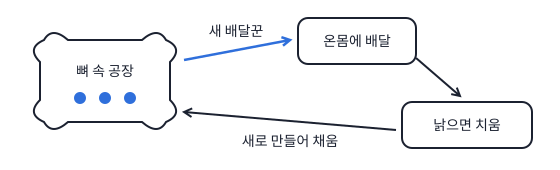

*공장에서 나와 일하고 낡으면 바뀌는 배달꾼*

**정확히 말하면**

**골수(bone marrow)** = 모든 혈구가 만들어지는 곳

**적혈구생성소(에리스로포이에틴, erythropoietin, EPO)** = 골수의 적혈구 생성을 촉진하는 호르몬

1. 산소가 많이 필요하거나 적혈구가 부족함
2. 적혈구생성소 분비 증가
3. 골수의 적혈구 생성 촉진
4. 산소를 나를 적혈구 증가

강의노트는 산소 농도가 낮아질 때 신장이 이 호르몬을 만든다고 적어요. 호르몬을 내보내는 신장과 적혈구를 만드는 골수를 구별해요([1119 수업의 혈액의 조성과 기능](../../1119/정리노트_1119_Respiratory_and_Circulatory_Systems.html#s2-blood)).

고지대에 처음 온 사람도 산소가 적은 환경에서 약 3주면 적혈구를 더 많이 만들기 시작해요(영상).

**적혈구의 일생**

1. 골수에서 약 5일 동안 자람(영상)
2. 혈류로 나가 동맥·세동맥을 지남
3. 모세혈관에서 조직에 산소 전달
4. 수명이 다하면 파괴

수명과 파괴에 관한 설명은 영상과 강의노트가 달라요.

| 비교 기준 | 수업 영상 | 강의노트 13장 p4 |
|---|---|---|
| 수명 | 약 석 달 | 약 120일 |
| 파괴되는 곳 | 골수 | 비장·간·골수 |
| 파괴하는 세포 | 보모세포(특별한 백혈구) | 대식세포(macrophage) |

늙은 적혈구가 파괴되는 속도와 새 적혈구가 생기는 속도가 같아서 산소를 나르는 능력이 유지돼요. 영상은 두 속도를 모두 분당 1억 5천만 개로 소개했어요.

영상은 몸속을 도는 적혈구가 약 25조 개라고 소개했어요.

**꼭 기억해요**

| 묻는 것 | 틀리기 쉬운 답 | 맞는 답 |
|---|---|---|
| 모든 혈구가 만들어지는 곳 | ~~신장(적혈구생성소를 만드는 곳)~~ | 골수 |
| 적혈구생성소가 하는 일 | ~~적혈구로 변함~~ | 골수의 적혈구 생성을 촉진 |

교수님 강조:

> 골수. 적어라, 이제.

> 골수죠, 골수, 골수. 골수에서 만들어집니다.

교수님 말씀

영상은 골수를 적혈구 전용 공장, 보모세포를 공장 일꾼에 빗댔어요. 일꾼은 적혈구를 정성껏 키워 내보내고, 낡아서 돌아온 적혈구는 파괴해요. 안데스 고지대를 오르는 순례자 이야기도 함께 나왔어요.

**페이지 요약**

모든 혈구는 골수에서 만들어지고, 적혈구가 부족하거나 산소가 많이 필요하면 적혈구생성소가 골수의 적혈구 생성을 늘려요.

*용어*

- **골수(bone marrow)** — 적혈구를 포함한 모든 혈구가 만들어지는 곳이에요.
- **적혈구생성소(erythropoietin, EPO)** — 산소가 많이 필요하거나 적혈구가 부족할 때 분비되는 호르몬이에요. 강의노트 기준으로 신장이 만들고, 작용하는 곳은 골수예요.
- **적혈구의 일생** — 골수에서 자라 혈류로 나가 조직에 산소를 주고, 수명이 다하면 파괴돼요. 생성과 파괴의 속도가 같아 균형이 유지돼요.
- **수명과 파괴 장소** — 강의노트는 약 120일, 비장·간·골수의 대식세포로 적어요. 영상은 약 석 달, 골수의 보모세포라고 소개했어요.
- **고지대 적응** — 산소가 적은 곳에 처음 와도 약 3주면 적혈구를 더 많이 만들기 시작해요.

---

### 모세혈관의 물 이동과 삼투압

*1124 수업 · 13장 p5*

**쉽게 말하면**

아주 가는 관의 틈으로 물이 나가기도 하고 들어오기도 해요. 미는 힘이 세면 나가고, 당기는 힘이 세면 들어와요.

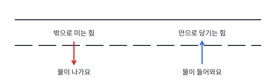

*틈이 있는 관에서 힘겨루기를 하는 물*

**정확히 말하면**

일반적인 모세혈관의 벽을 이루는 내피세포들은 아주 빈틈없이 붙어 있지 않아서, 약간의 틈으로 물이 드나들어요. 내피세포가 빈틈없이 맞붙은 [혈액뇌장벽](../../1117/정리노트_1117_Nervous_and_Sensory_Systems_and_Respiratory_and_Circulatory_Systems.html#s1-protection)과 대비돼요.

**혈압(blood pressure)** = 혈액이 혈관벽을 미는 힘. 물을 밖으로 밀어냄

**삼투압(osmotic pressure)** = 용질 농도가 높은 쪽으로 물을 끌어들이는 압력. 혈액의 용질 농도가 조직액보다 높으면 물을 혈관 안으로 끌어들임

| 비교 기준 | 혈압 &gt; 혈액 삼투압인 곳 | 혈액 삼투압 &gt; 혈압인 곳 |
|---|---|---|
| 물의 방향 | 혈관에서 조직 쪽으로 나감 | 조직에서 혈관 속으로 들어옴 |
| 더 크게 작용하는 쪽 | 미는 혈압 | 끌어들이는 삼투압 |

혈압은 혈액이 흘러갈수록 낮아져요. 그래서 혈액 삼투압이 비슷하다면, 한 모세혈관에서도 혈압이 아직 높은 동맥 쪽에서는 물이 나가고 혈압이 낮아진 정맥 쪽에서는 들어올 수 있어요. 정맥 쪽에서 물을 되찾지 못하면 조직에 물이 남아요.

**혈청 단백질(serum protein)** = 혈액에 녹아 있으면서 혈액의 삼투압을 유지하는 용질

대부분의 혈청 단백질은 모세혈관의 틈을 쉽게 빠져나가지 못해 혈관 안에 남아요([1119 노트의 보충](../../1119/정리노트_1119_Respiratory_and_Circulatory_Systems.html#s3-vessels)). 그래서 단백질이 줄면 혈액이 물을 끌어들이는 힘이 약해져요.

**너무 못 먹었을 때: 기아성 부종**

1. 음식을 너무 적게 먹음
2. 혈청 단백질 농도 감소
3. 혈액 삼투압 감소
4. 혈관의 물이 밖으로 빠져나감
5. 조직이 부음

혈압이 올라서가 아니라 혈액 삼투압이 내려가서 붓는 거예요. 아래 가상의 값에서 두 상태의 혈압은 같아요. 정맥 쪽의 혈압 20은 평소에는 삼투압 30보다 작지만, 굶주리면 삼투압 14보다 커져 물을 되찾던 곳에서도 물이 나가요.

| 비교 기준 | 평소 | 오래 굶주렸을 때 |
|---|---|---|
| 동맥 쪽 | 혈압 40 &gt; 삼투압 30 · 나감 | 혈압 40 &gt; 삼투압 14 · 더 세게 나감 |
| 정맥 쪽 | 혈압 20 &lt; 삼투압 30 · 들어옴 | 혈압 20 &gt; 삼투압 14 · 나감 |
| 바뀐 값 | 기준 | 혈액 삼투압만 낮아짐 |

#### 직접 해 보기: 물은 나갈까, 들어올까 *(정적 스냅샷 — 직접 조작은 HTML 버전)*

동맥 쪽 혈압과 혈액 삼투압을 따로 움직이면 다섯 지점에서 물이 움직이는 방향과 세기가 바뀌어요. 혈청 단백질이 줄어든 상황은 혈액 삼투압을 낮춰서 확인해요.

나가는 물 **15** · 들어오는 물 **15** · 나가는 물과 들어오는 물이 같아요.

범례: 아래쪽 화살표: 조직으로 나가는 물 · 위쪽 화살표: 혈관으로 들어오는 물 · 칠해진 점: 조직에 남는 물

값은 모두 가상의 상대값이에요. 정맥 쪽 혈압은 동맥 쪽보다 20 낮고, 혈액 삼투압은 다섯 지점에서 같다고 두었어요. 남은 물이 [림프계](#s1-lymph)로 돌아가는 과정은 넣지 않았어요.

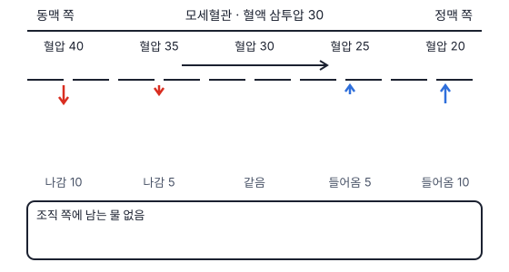

*평소: 동맥 쪽 혈압 40, 혈액 삼투압 30*

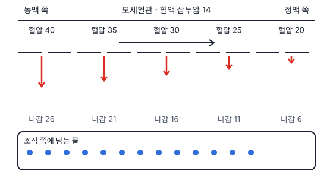

*혈청 단백질 부족: 동맥 쪽 혈압 40, 혈액 삼투압 14*

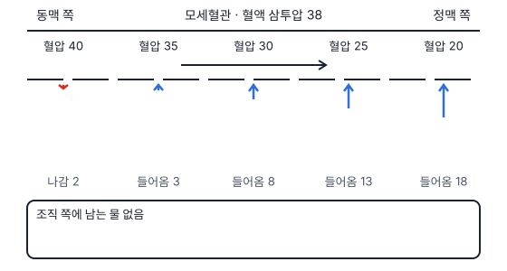

*혈액의 용질 농도가 높을 때: 동맥 쪽 혈압 40, 혈액 삼투압 38*

| 설정 | 나가는 물 | 들어오는 물 | 결과 |
|---|---|---|---|
| 혈압 40, 혈액 삼투압 30 | 15 | 15 | 나가는 물과 들어오는 물이 같아요. |
| 혈압 40, 혈액 삼투압 14 | 80 | 0 | 어느 지점에서도 물이 돌아오지 않아요. 조직에 물이 많이 남아 붓는 부종 상황이에요. |
| 혈압 40, 혈액 삼투압 38 | 2 | 42 | 들어오는 물이 나가는 물보다 많아요. |

**꼭 기억해요**

| 묻는 것 | 틀리기 쉬운 답 | 맞는 답 |
|---|---|---|
| 굶주린 아이의 배가 부풀어 오른 까닭 | ~~많이 먹어서~~ | 못 먹어 혈액 삼투압이 낮아져서 |
| 혈압 &gt; 혈액 삼투압 | ~~물이 혈관으로 들어옴~~ | 물이 조직 쪽으로 나감 |
| 혈액 삼투압 &gt; 혈압 | ~~물이 조직 쪽으로 나감~~ | 물이 혈관 속으로 들어옴 |
| 기아성 부종에서 먼저 달라진 값 | ~~혈압이 높아짐~~ | 혈액 삼투압이 낮아짐 |

교수님이 거듭 말한 요지:

> 삼투압이 너무 낮아지니까 혈관에 있던 물이 밖으로 빠져나와요.

교수님 말씀

배가 볼록한 기아 아동을 예로 들었어요. 무엇을 먹었길래 배가 부르냐고 묻기 쉽지만 사정은 반대예요.

> 얘네들은 너무 못 먹어서 그래요, 못 먹어서.

**페이지 요약**

모세혈관에서 혈압이 혈액 삼투압보다 크면 물이 조직으로 나가고, 혈액 삼투압이 더 크면 물이 혈관으로 들어와요.

*용어*

- **모세혈관의 틈** — 일반적인 모세혈관의 내피세포 사이에는 약간의 틈이 있어 물이 드나들어요. 혈액뇌장벽은 빈틈없이 맞붙어 있어요.
- **혈압과 삼투압(osmotic pressure)** — 혈압은 물을 밖으로 밀고, 혈액의 용질 농도가 조직액보다 높아 생기는 삼투압은 물을 안으로 끌어들여요.
- **동맥 쪽과 정맥 쪽** — 혈압은 흐를수록 낮아져요. 혈액 삼투압이 비슷하다면 동맥 쪽에서 나간 물을 정맥 쪽에서 되찾을 수 있어요.
- **혈청 단백질** — 혈액에 녹아 혈액의 삼투압을 유지하는 용질이에요. 대부분 혈관 안에 남는다는 것은 1119 노트의 보충이에요.
- **기아성 부종** — 못 먹어 혈청 단백질이 줄면 혈액 삼투압이 낮아져요. 혈압은 그대로여도 물이 정맥 쪽에서까지 빠져나가 조직이 부어요.

---

### 정맥 환류와 판막

*1124 수업 · 13장 p5–6*

**쉽게 말하면**

다리의 피는 높은 곳에 있는 심장까지 올라가야 해요. 옆에서 꾹 눌러 주면 올라가고, 문이 닫혀 다시 내려오지 못해요.

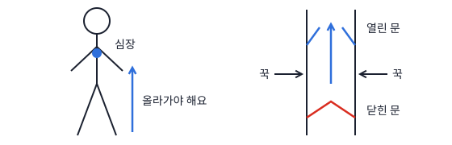

*꾹 누르면 한쪽 문으로만 지나가는 피*

**정확히 말하면**

모세혈관의 혈액은 정맥(vein)으로 모여 심장으로 들어가요. 혈압은 혈액이 흘러갈수록 떨어져 정맥에서 가장 낮아요. 특히 다리는 심장보다 낮아서 중력을 거슬러야 하므로, 정맥에서는 피가 거꾸로 흐를 수 있어요.

| 비교 기준 | 골격근 수축 | 판막(valve) |
|---|---|---|
| 맡은 일 | 정맥을 짜서 피를 보내는 힘 | 피의 역류를 막음 |
| 작동 방식 | 정맥 안의 압력을 높임 | 심장 쪽으로 미는 피에는 열리고 되돌아오는 피에는 닫힘 |

**골격근(skeletal muscle)이 수축할 때**

1. 골격근이 정맥을 짬
2. 짜인 곳의 압력 증가
3. 심장 쪽 판막이 열리고 반대쪽 판막이 닫힘
4. 혈액이 심장 쪽으로 이동

골격근이 이완할 때는 판막이 닫혀, 올라간 혈액이 되돌아오지 못해요.

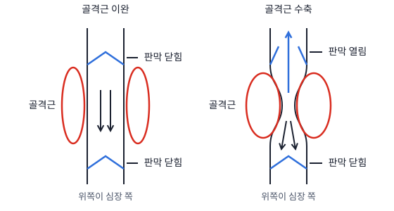

*골격근의 두 상태와 판막의 여닫힘*

그림이 누워 있거나 뒤집혀 있으면 위아래나 왼쪽·오른쪽으로 외우지 말고 심장 쪽부터 찾아요. 조인 곳에서 심장 쪽에 있는 판막은 혈액에 밀려 열리고, 반대쪽 판막은 닫혀요. 판막은 스스로 수축해 혈액을 밀지 않아요.

**판막이 있는 곳(심장과 혈관 가운데)** = 심장, 정맥

심장에는 [방실판막·반월판막](../../1119/정리노트_1119_Respiratory_and_Circulatory_Systems.html#s3-cycle)이 있어요. 동맥과 모세혈관은 역류를 막는 판막이 있다고 배운 곳이 아니에요. 혈관이 아닌 림프관의 일방판막은 [림프계와 림프절](#s1-lymph)의 보충에서 다뤄요.

**꼭 기억해요**

| 묻는 것 | 틀리기 쉬운 답 | 맞는 답 |
|---|---|---|
| 판막의 위치(심장과 혈관 가운데) | ~~심장에만 있음~~ | 심장과 정맥에 있음 |
| 정맥혈을 심장으로 올리는 힘 | ~~판막의 수축~~ | 골격근의 수축 |
| 정맥의 역류를 막는 것 | ~~골격근~~ | 판막 |
| 근육이 조일 때 열리는 판막 | ~~양쪽 판막 모두~~ | 조인 곳에서 심장 쪽에 있는 판막 |

교수님 강조:

> 판막은 심장에도 있고 정맥에도 있다.

교수님 말씀

골격근이 혈관을 쥐어짜 준다고 표현했어요.

> 피를 척 쥐어짜 주면서

너무 오래 서 있으면 피가 심장 쪽, 머리 쪽으로 가지 못해 쓰러질 수 있어요. 쓰러지면 머리가 낮아져 뇌로 다시 혈액이 흘러요.

**페이지 요약**

정맥은 혈압이 가장 낮아서, 골격근 수축이 혈액을 심장으로 밀어 올리고 판막이 역류를 막아요.

*용어*

- **정맥의 어려움** — 혈압이 가장 낮고, 다리에서는 중력도 거슬러야 해서 피가 거꾸로 흐를 수 있어요.
- **골격근의 수축** — 정맥을 짜서 압력을 높이고 혈액을 심장 쪽으로 보내요.
- **판막(valve)** — 조인 곳의 심장 쪽 판막은 열리고 반대쪽 판막은 닫혀요. 이완할 때도 닫혀 역류를 막으며, 스스로 수축해 밀지는 않아요.
- **판막의 위치(심장과 혈관 가운데)** — 심장과 정맥에 있어요. 동맥과 모세혈관은 판막이 있다고 배운 곳이 아니에요.
- **오래 서 있을 때** — 피가 머리 쪽으로 가지 못해 쓰러질 수 있고, 쓰러져 머리가 낮아지면 뇌로 혈액이 다시 흘러요.

---

### 평활근과 혈류 배분

*1124 수업 · 13장 p6*

**쉽게 말하면**

호스를 꽉 쥐면 물이 잘 안 가고, 힘을 빼면 많이 가요. 몸도 길의 넓이를 바꿔 필요한 곳으로 피를 더 보내요.

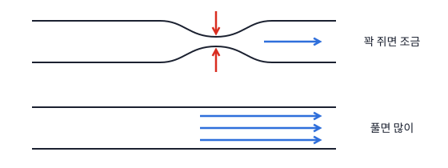

*쥐었을 때와 풀었을 때의 호스*

**정확히 말하면**

혈액은 온몸에 늘 고르게 퍼져 있지 않고 필요한 곳으로 많이 가요. 손을 쓸 때는 손 근육으로, 식사 후 쉴 때는 소화관으로 많이 보내요. 많이 보낸다는 것은 그쪽으로 가는 혈관이 넓어진다는 뜻이에요.

| 비교 기준 | 세동맥(arteriole) | 모세혈관이 시작되는 부위 | 모세혈관 자체 |
|---|---|---|---|
| 근육 | 벽의 평활근(smooth muscle) | 모세혈관 괄약근(precapillary sphincter) | 없음 |
| 특징 | 모세혈관 앞쪽의 동맥을 싸고 있음 | 입구에서 혈류를 조절 | 벽이 너무 얇음 |

평활근은 의식적으로 움직일 수 없고 자율신경의 영향을 받아요.

수업에서 말한 소동맥은 강의노트의 세동맥과 같은 말이에요. 교재는 평활근을 민무늬근으로도 적어요(교재 13장 p.303).

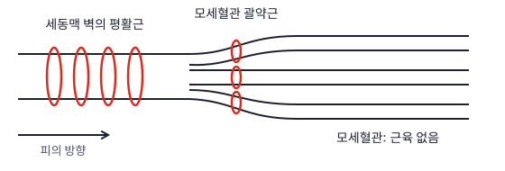

*모세혈관 앞쪽의 두 근육과 근육 없는 모세혈관*

**세동맥의 평활근과 모세혈관 괄약근의 상태에 따라**

| 비교 기준 | 수축 | 이완 |
|---|---|---|
| 혈관의 너비 | 좁아짐 | 넓어짐 |
| 그쪽 혈류 | 감소 | 증가 |

**꼭 기억해요**

| 묻는 것 | 틀리기 쉬운 답 | 맞는 답 |
|---|---|---|
| 모세혈관의 혈류를 조절하는 근육의 위치 | ~~모세혈관 벽~~ | 시작 부위(괄약근)와 앞쪽 동맥(평활근) |
| 혈관 근육이 수축하면 그쪽 혈류 | ~~증가~~ | 감소 |
| 혈관 근육이 이완하면 그쪽 혈류 | ~~감소~~ | 증가 |
| 평활근의 조절 | ~~의식적으로 움직임~~ | 자율신경의 영향을 받음 |

교수님 말씀

근육 수축을 고무호스를 쥐는 일에 빗댔어요.

> 고무호스를 꽉 쥐는 거야. 그럼 그쪽으로 피가 안 가는 거죠?

**페이지 요약**

세동맥의 평활근과 모세혈관 괄약근이 수축하면 그쪽 혈류가 줄고 이완하면 늘어, 혈액이 필요한 곳으로 많이 가요.

*용어*

- **평활근(smooth muscle)** — 세동맥 벽에 있어요. 의식적으로 움직일 수 없고 자율신경의 영향을 받아요.
- **모세혈관 괄약근(precapillary sphincter)** — 모세혈관이 시작되는 부위의 근육이에요. 모세혈관 자체에는 벽이 얇아 근육이 없어요.
- **수축과 이완** — 수축하면 혈관이 좁아지고, 이완하면 넓어져요.
- **혈류 배분의 예** — 손을 쓸 때는 손 근육, 식사 후 쉴 때는 소화관으로 많이 가요.

---

## 2. [13장] 혈관 질환·혈압·림프계

### 콜레스테롤과 혈관 질환

*1124 수업 · 13장 p6*

**쉽게 말하면**

배달차가 너무 많고 수거차가 적으면 길에 짐이 쌓여 막혀요.

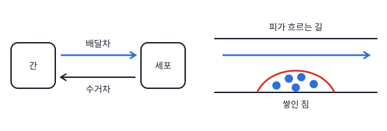

*점이 쌓인 곳은 길이 좁아졌어요.*

**정확히 말하면**

콜레스테롤(cholesterol)은 간에서 합성돼요. 세포막의 성분이고 스테로이드 호르몬의 재료라서 세포에 필요하지만, 혈관에 쌓이면 병의 원인이 돼요. 콜레스테롤은 지질단백질(lipoprotein) 형태로 이동해요.

| 비교 기준 | LDL | HDL |
|---|---|---|
| 이름 | 저밀도 지질단백질(low-density lipoprotein) | 고밀도 지질단백질(high-density lipoprotein) |
| 하는 일 | 콜레스테롤을 세포로 공급 | 필요 없어진 콜레스테롤을 간으로 수거 |
| 혈액검사에서 바람직한 쪽 | 낮음. 너무 많으면 콜레스테롤이 지나치게 공급된다는 뜻 | 높음 |

**혈관이 막히기까지**

1. 혈관에 콜레스테롤이 쌓임
2. 면역세포가 공격해 염증이 생김
3. 콜레스테롤 덩어리와 면역세포 찌꺼기가 모여 플라크 형성
4. 혈관이 막힘

**플라크(plaque, 죽상경화판)** = 혈관에 콜레스테롤 덩어리와 면역세포 찌꺼기가 쌓인 것

**뇌졸중(stroke)** = 뇌로 가는 혈관이 막힌 것. “중”은 중풍의 중(교수님)

**심근경색(myocardial infarction)** = 심장으로 가는 혈관이 막혀 심장이 멈출 수 있는 것

**꼭 기억해요**

| 묻는 것 | 틀리기 쉬운 답 | 맞는 답 |
|---|---|---|
| LDL의 방향과 바람직한 수치 | ~~간으로 수거, 높을수록 좋음~~ | 세포로 공급, 낮아야 함 |
| HDL의 방향과 바람직한 수치 | ~~세포로 공급, 낮을수록 좋음~~ | 간으로 수거, 높아야 함 |
| 바른 표기 | ~~뇌졸증~~ | 뇌졸중 |
| 뇌로 가는 혈관이 막힘 | ~~심근경색~~ | 뇌졸중 |
| 심장으로 가는 혈관이 막힘 | ~~뇌졸중~~ | 심근경색 |

혈액검사에서는 중성지방 농도와 콜레스테롤 농도를 함께 말씀하신 뒤 HDL 대 LDL 비율을 강조하셨어요. “이게 상당히 중요합니다.”

교수님 말씀

나이가 들면 멀쩡하던 사람도 갑자기 쓰러질 수 있으니 혈압과 혈중 콜레스테롤을 재 보라고 하셨어요. 혈액검사 때 부탁할 말도 알려 주셨어요.

> 특히 콜레스테롤이 중요하죠.

> 콜레스테롤 검사해 주세요, LDL 검사해 주세요라고 꼭 얘기하세요.

**페이지 요약**

LDL은 콜레스테롤을 세포로 공급하고 HDL은 간으로 수거하며, 콜레스테롤이 혈관에 쌓여 생긴 플라크가 혈관을 막으면 뇌졸중이나 심근경색이 생겨요.

*용어*

- **콜레스테롤(cholesterol)** — 간에서 합성해요. 세포막 성분이자 스테로이드 호르몬의 재료이고, 지질단백질 형태로 이동해요.
- **LDL(저밀도 지질단백질)** — 세포로 공급하며 수치가 낮아야 해요. 너무 많으면 공급이 지나치다는 뜻이에요.
- **HDL(고밀도 지질단백질)** — 필요 없어진 것을 간으로 거두며 수치가 높아야 해요. HDL 대 LDL 비율이 중요해요.
- **플라크(plaque)** — 혈관에 쌓인 콜레스테롤을 면역세포가 공격해 염증이 생기고, 덩어리와 면역세포 찌꺼기가 모여 혈관을 막아요.
- **뇌졸중·심근경색** — 뇌로 가는 혈관이 막히면 뇌졸중(뇌졸증이 아님), 심장으로 가는 혈관이 막히면 심근경색이에요.

---

### 혈압의 결정과 연수의 조절

*1124 수업 · 13장 p6*

**쉽게 말하면**

수도관의 압력계가 소식을 보내면, 관리실이 펌프의 빠르기와 세기를 바꿔요.

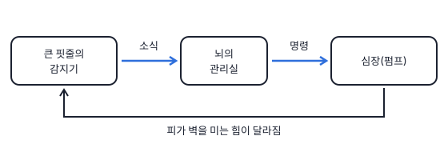

*소식은 뇌로 가고 명령은 심장으로 가요.*

**정확히 말하면**

**혈압(blood pressure)** = 혈액이 혈관벽을 미는 힘

**심박출량(cardiac output)** = 심실에서 나가는 혈액의 양

| 혈압을 결정하는 요인 | 혈압이 높아지는 쪽 | 혈압이 낮아지는 쪽 |
|---|---|---|
| 총 혈액량 | 많을 때 | 적을 때 |
| 심박출량 | 많을 때(예: 운동하면 심박출량 증가) | 적을 때(예: 휴식하면 심박출량 감소) |
| 동맥의 수축 정도 | 수축해 쥐어짤 때 | 이완해 느슨해질 때 |

표의 각 행은 나머지 두 요인이 같을 때의 방향이에요.

**심장박동을 바꾸는 신호의 길**

1. 대동맥·목동맥의 센서 세포가 혈압 변화(예: 너무 높아짐)를 감지
2. 뇌간의 연수(medulla oblongata)로 정보 전달
3. 연수가 심장박동의 횟수와 강도 조절
4. 심박출량 변화

정보는 센서에서 연수로, 명령은 연수에서 심장으로 가요. 더 자주, 더 세게 뛰면 심박출량이 늘어요.

조절은 혈압 변화를 되돌리는 쪽으로 일어나요. 혈압이 너무 높을 때 횟수와 강도를 줄이면 심박출량이 줄고, 심박출량이 적을수록 혈압이 낮으므로 올라간 혈압이 되돌아와요. 혈압이 낮을 때는 반대이고, 교재 보충의 표에서 확인할 수 있어요.

수업은 “혈압이 너무 높아지면” 연수에 알린다는 계기를 말했어요. 되돌리는 방향은 위 표의 심박출량과 혈압 관계로 풀이한 것이에요.

| 비교 기준 | 호흡 조절 | 심박수 조절 |
|---|---|---|
| 감지하는 곳 | 대동맥소체·경동맥소체(목동맥소체)의 센서 세포 | 대동맥·목동맥에 있는, 혈압을 감지하는 세포 |
| 대동맥·목동맥에서 감지하는 정보 | 이산화 탄소 농도·산소 농도 | 혈압 |
| 조절하는 곳 | 연수 | 연수 |

**꼭 기억해요**

| 묻는 것 | 틀리기 쉬운 답 | 맞는 답 |
|---|---|---|
| 수업에서 강조한 심박수 조절의 정보 | ~~산소량~~ | 혈압 |
| 연수가 조절하는 것 | ~~호흡만~~ | 호흡과 심박수 |
| 명령을 보내는 쪽 | ~~대동맥·목동맥의 센서 세포~~ | 연수 |

수업의 “산소량이 아니라 혈압”을 “O₂는 심장박동과 무관하다”로 착각하기 쉬워요. 이 말은 혈압을 조절하는 주된 신호가 압력이라는 강조로 이해해요. 강의노트 13장 p6은 화학수용기가 감지한 O₂ 함유량도 심장박동 조절에 영향을 준다고 적었어요.

교수님 말씀

> 혈압도 중요한데

> 연수가 호흡도 조절하지만 심박수도 조절합니다, 심박수.

**보충 · 노트에 빠졌던 수업 내용**

강의노트는 혈압을 감지하는 센서를 압력수용체(baroreceptor)라고 불러요. 압력수용체는 심근·대동맥·목동맥에 있으며, 뇌에 있는 것이 아니에요. 압력수용체가 뇌간에 신호를 보내고, 뇌간은 자율신경계를 통해 심장에 신호를 보내요.

호르몬도 심박출량과 세동맥 지름을 조절해요. 부신속질(adrenal medulla)은 스트레스 반응으로 에피네프린(epinephrine)과 노르에피네프린을 혈액으로 내보내 교감신경계의 작용을 강화해요. 부신겉질과 뇌하수체 후엽도 혈압 조절에 관여하는 호르몬을 내보내요.

혈관의 수축 정도는 주로 세동맥에서 조절돼요.

출처: 강의노트 13장 p6(수업에서는 말하지 않은 부분)

**보충 · 수업에서 다루지 않았어요**

| 상황 | 심장박동과 심박출량의 변화 |
|---|---|
| 동맥혈압이 정상보다 낮음 | 심장이 더 빠르고 강하게 수축 |
| 혈액의 O₂가 정상보다 적음 | 뇌간이 압력 정보와 종합해 횟수와 강도를 늘리는 신호를 냄 |
| 혈액의 O₂가 너무 많음 | 반대로 작용해 심박출량 감소 |
| 에피네프린 분비 | 횟수와 강도 증가 |

에피네프린은 피부·장·신장의 세동맥을 수축시켜 혈압을 높여요. 심장·골격근·폐로 가는 세동맥은 반대로 확장시켜 그 조직의 혈액 공급을 늘려요.

출처: 교재 13장 p.306

**페이지 요약**

혈압은 총 혈액량·심박출량·동맥의 수축 정도로 정해지고, 연수는 대동맥과 목동맥에서 온 혈압 정보를 받아 심장박동의 횟수와 강도를 조절해요.

*용어*

- **혈압(blood pressure)** — 혈액이 혈관벽을 미는 힘이에요. 다른 요인이 같다면 총 혈액량이나 심박출량이 많을 때, 동맥이 수축할 때 높아져요.
- **심박출량(cardiac output)** — 심실에서 나가는 혈액의 양이에요. 더 자주, 더 세게 뛰면 늘고, 운동할 때 많고 쉴 때 적어요.
- **연수(medulla oblongata)** — 뇌간에 있으며 호흡과 심박수를 모두 조절해요. 정보는 센서에서 연수로, 명령은 연수에서 심장으로 가요. 혈압이 너무 높아지는 변화를 되돌리도록 조절하는데, 심박출량을 줄이는 쪽이라는 방향은 심박출량과 혈압의 관계로 풀이한 것이에요.
- **대동맥·목동맥의 두 감지** — 호흡 조절에서는 대동맥소체·경동맥소체가 CO₂·O₂ 농도를, 심박수 조절에서는 혈압 감지 세포가 혈압을 감지해요. 수업은 주된 신호가 압력임을 강조했지만, 강의노트는 O₂ 함유량의 영향도 적었으므로 O₂가 무관하다고 하지 않아요.

- **(보충) 압력수용체와 부신속질** — 압력수용체는 뇌가 아니라 심근·대동맥·목동맥에 있고, 뇌간에 신호를 보내요. 뇌간은 자율신경계로 심장을 조절해요. 부신속질은 스트레스 반응으로 에피네프린·노르에피네프린을 내보내 교감신경계 작용을 강화하고, 부신겉질·뇌하수체 후엽의 호르몬도 혈압 조절에 관여해요. 호르몬은 심박출량과 세동맥 지름을 조절하며, 혈관 수축 정도는 주로 세동맥에서 조절돼요. 출처는 강의노트 13장 p6이에요.

- **(보충) 심박출량이 바뀌는 방향** — 동맥혈압이나 혈액의 O₂가 정상보다 낮으면 심장이 더 자주, 더 세게 뛰고, O₂가 너무 많으면 심박출량이 줄어요. 에피네프린은 박동의 횟수와 강도를 늘리고, 피부·장·신장의 세동맥은 수축, 심장·골격근·폐로 가는 세동맥은 확장시켜요. 출처는 교재 13장 p.306이에요.

---

### 림프계와 림프절

*1124 수업 · 13장 p7*

**쉽게 말하면**

새어 나온 물을 하수관처럼 모아 다시 피로 돌려보내고, 길목마다 나쁜 손님을 잡아요.

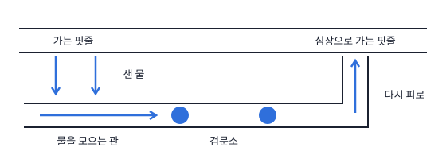

*색칠된 점이 검문소예요.*

**정확히 말하면**

**림프계(lymphatic system)** = 모세혈관에서 빠져나간 물을 모아 혈액으로 돌려보내는 계. 림프관(lymphatic vessel)과 그 사이사이의 림프절(lymph node)로 구성

모세혈관에서는 [혈압과 삼투압에 따라 물이 나가고 들어와요](#s0-fluid). 빠져나간 혈장 성분의 물은 결국 다시 혈액으로 들어와요.

**물을 돌려보낼 때**

1. 모세혈관에서 물이 조직으로 나감
2. 림프관이 물을 모음
3. 혈액으로 돌아감

**침입자를 찾아낼 때**

1. 세균·바이러스가 림프관을 따라 이동
2. 림프절의 면역세포가 찾아냄
3. 면역세포가 모여듦
4. 림프절이 부음

교수님 말씀

림프절은 림프관 사이사이에서 지나가는 세균과 바이러스를 확인하는 검문소예요.

> 일종의 검문소입니다, 검문소.

> 이 림프절에서 면역세포들이 검문을 하는 겁니다.

**보충 · 노트에 빠졌던 수업 내용**

림프계는 여유분의 세포간질액을 모아 정맥혈로 되돌려요. 림프계가 모은 세포간질액을 림프액(lymph)이라고 해요. 소장에서 흡수한 지방도 모아 혈액으로 전달하며, 면역계의 중요한 구성요소예요.

**림프모세관(lymphatic capillary)** = 전신에 분포하는 림프계의 가장 작은 관. 모여서 림프관이 됨

| 비교 기준 | 순환계의 모세혈관 | 림프모세관 |
|---|---|---|
| 벽 | 내피세포층 한 겹 | 내피세포층 한 겹(여러 겹이 아님) |
| 지름 | 더 작음 | 더 큼 |

두 관은 벽의 층수가 아니라 지름에서 달라요. 림프모세관은 모세혈관들과 가깝게 섞여 있어요. 림프관에는 일방판막이 있어 림프액의 역류를 막아요.

림프계의 조직과 기관에는 림프절·비장(spleen)·흉선(가슴샘, thymus)·편도(편도선) 등이 있고, 감염과 암으로부터 몸을 보호해요. 림프절은 작은 콩알 모양이고 안에 백혈구가 있어요. 세균이나 바이러스가 림프절에 대량 포획되면 붓고 통증을 느껴, 그 림프절과 연결된 부위의 감염을 알려 주는 지표가 돼요.

출처: 강의노트 13장 p7(수업에서는 말하지 않은 부분), 교재 13장 p.306–307

**페이지 요약**

림프계는 모세혈관에서 빠져나간 물을 림프관으로 모아 혈액에 돌려보내고, 림프절의 면역세포는 림프관을 따라온 세균과 바이러스를 찾아내요.

*용어*

- **림프계(lymphatic system)** — 림프관과 그 사이사이의 림프절로 이루어져요. 혈압과 삼투압에 따라 드나드는 물 가운데 빠져나간 혈장 성분의 물을 모아 혈액으로 보내요.
- **림프절(lymph node)** — 검문소처럼 세균·바이러스를 찾아내요. 면역세포가 모이면 림프절이 부어요.

- **(보충) 림프모세관과 림프계 기관** — 여유분의 세포간질액을 모은 것이 림프액이고 정맥혈로 돌아가요. 소장에서 흡수한 지방도 혈액으로 전달하며 면역계의 중요한 구성요소예요. 림프모세관은 전신에 분포하고 모세혈관과 가깝게 섞여 있으며, 벽은 모세혈관처럼 내피세포층 한 겹이고 지름은 더 커요. 림프모세관이 모인 림프관에는 일방판막이 있어 역류를 막아요. 림프절·비장·흉선(가슴샘)·편도 등은 감염과 암으로부터 몸을 보호해요. 림프절은 작은 콩알 모양으로 안에 백혈구가 있고, 세균·바이러스가 대량 포획되면 붓고 아파 연결된 부위의 감염 지표가 돼요. 출처는 강의노트 13장 p7, 교재 13장 p.306–307이에요.

---

## 3. [14장] 방어선과 염증 반응

### 면역계와 첫 번째 방어선

*1124 수업 · 14장 p1*

**쉽게 말하면**

몸은 성벽을 두른 집 같아서, 나쁜 균이 문밖에서 막히고 씻기고 녹아요.

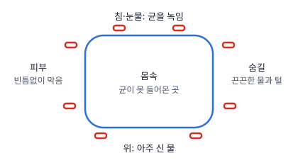

*붉은 테두리 막대가 바깥에 막혀 있는 균이에요.*

**정확히 말하면**

**병원체(pathogen)** = 병을 일으키는 생물을 통틀어 부르는 말

세균, 바이러스, 곰팡이 같은 균류, 기생충은 저마다 병원체가 될 수 있는 한 무리의 이름이에요.

우리는 늘 병원체에 노출돼 있고 몸에는 여러 방어선이 있어요. **첫 번째 방어선**은 병원체가 몸속 조직으로 들어오기 전에 겉에서 막는 해부학적 장벽과 그 표면의 물질이에요.

| 첫 번째 방어선 | 있는 곳 | 막는 방법 |
|---|---|---|
| 피부 | 몸 바깥 표면 | 세균이 뚫지 못하는 장벽. 상처가 나면 그 틈으로 침입 |
| 점액(mucus)과 섬모(cilia) | 기도처럼 점액으로 덮인 안쪽 표면(점막) | 점액이 병원체를 가두고 섬모가 옮김 |
| 위산 | 위 | 강한 산성 환경 |
| 라이소자임(lysozyme) | 침·눈물 같은 분비물 | 세균의 세포벽을 녹이는 효소 |

강의노트와 기출에는 라이소자임이 다른 표기로도 나와요.

리소자임 = 라이소자임(lysozyme). 세포 안에서 물질을 분해하는 소기관 리소좀(lysosome)과는 다른 말이에요.

**제외되는 것:** 대식세포의 식세포 작용과 염증 반응은 장벽을 통과한 병원체를 상대하므로 첫 번째 방어선이 아니라 [선천면역과 후천면역](#s2-two-systems)에서 다루는 선천면역이에요.

**꼭 기억해요**

| 묻는 것 | 틀리기 쉬운 답 | 맞는 답 |
|---|---|---|
| 첫 번째 방어선의 범위 | ~~피부만~~ | 피부 + 점액·섬모 + 위산 + 라이소자임 |
| 대식세포가 세균을 삼키는 일 | ~~첫 번째 방어선~~ | 선천면역(두 번째 방어선) |
| 병을 일으키는 생물의 총칭 | ~~미생물, 기생충~~ | 병원체 |

모든 미생물이 병을 일으키는 것은 아니에요. 그래서 병을 일으키는 생물의 총칭을 물으면 크기가 작다는 뜻의 미생물이 아니라 병원체예요.

강조: “상당히 중요한 면역계죠.” “상당히 어려운 학문이기도 합니다, 면역학이.” “이해를 좀 잘해야 되는데”

교수님 말씀

면역계가 하는 일의 크기를 시체에 빗댔어요.

> 면역계가 기능하지 않으면 우리 몸은 금방 썩어버립니다.

강아지 침에는 라이소자임이 사람보다 훨씬 많다고 했어요. 땅에 떨어진 것을 먹어도 사람보다 깨끗한 침을 가졌다는 이야기예요.

**페이지 요약**

첫 번째 방어선은 병원체가 몸속에 들어오기 전에 막는 장벽과 표면 물질이고, 들어온 뒤 상대하는 대식세포의 작용은 여기에 들지 않아요.

*용어*

- **병원체(pathogen)** — 병을 일으키는 생물의 총칭이에요. 세균·바이러스·균류·기생충이 포함될 수 있고, 모든 미생물이 병원체는 아니에요.
- **피부** — 세균이 뚫지 못하는 장벽이에요. 상처가 나면 그 틈으로 들어와요.
- **점액과 섬모** — 기도 같은 점막에서 점액이 병원체를 가두고 섬모가 옮겨요.
- **위산** — 위의 강한 산성 환경으로 막아요.
- **라이소자임(lysozyme)** — 침·눈물에 있고 세균의 세포벽을 녹이는 효소예요.
- **제외되는 것** — 대식세포의 식세포 작용과 염증 반응은 장벽을 통과한 뒤의 선천면역이에요.

---

### 선천면역과 후천면역

*1124 수업 · 14장 p1–p2*

**쉽게 말하면**

먼저 온 수비대는 들어온 균을 아무나 막고, 나중에 온 수비대는 얼굴을 기억해 둔 한 녀석만 막아요.

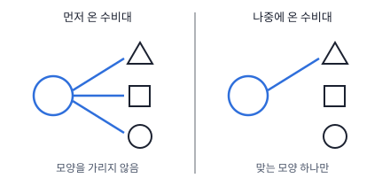

*선이 이어진 모양이 막는 상대예요.*

**정확히 말하면**

**특이성** = 정해진 상대 하나를 구별해 그 상대에만 작용하는 성질

**비특이적** = 병원체의 종류를 하나하나 구별하지 않고 작용함

1. 피부가 찢어져 세균 침입
2. 선천면역이 먼저, 빠르게 작용
3. 후천면역이 상대를 골라 작용하고 기억

| 비교 기준 | 첫 번째 방어선 | 선천면역(innate immunity) | 후천면역 = 적응면역(adaptive immunity) |
|---|---|---|---|
| 방어선 순서 | 첫 번째. 침입을 겉에서 차단 | 두 번째 방어선. 장벽을 통과한 병원체를 먼저 상대 | 세 번째. 선천면역 다음 |
| 특이성 | 없음(비특이적) | 없음(비특이적) | 있음 |
| 기억 | 없음 | 없음 | 있음 |
| 속하는 것 | 피부, 점액·섬모, 위산, 라이소자임 | 항미생물 펩티드, 염증 반응, 보체, 인터페론, 자연살생세포 | B세포, T세포, 항체 |
| 작용의 예 | 기도의 점액층이 병원균을 가둠 | 대식세포가 침입자를 삼키고 사이토카인을 분비 | B세포가 자기 항체에 맞는 병원체에 붙음 |

특이적 방어인지는 **상대를 골라서 작용하는가**로 판단해요. 대식세포는 삼킬 때나 신호를 보낼 때나 한 종류만 고르지 않으므로 비특이적이에요. 항체는 모양이 맞는 항원(적응면역을 유발하는 외래물질, [항체의 구조와 다양성 문제](#s4-antibody))에만 결합하고, B세포도 막에 달린 항체에 맞는 상대에만 붙으므로 특이적이에요.

B세포가 병원체마다 가리지 않고 붙는다면 특이적 방어가 될 수 없어요.

후천면역은 척추동물만 가지고 있고 무척추동물에는 없어요.

**꼭 기억해요**

| 묻는 것 | 틀리기 쉬운 답 | 맞는 답 |
|---|---|---|
| 장벽이 뚫린 뒤 먼저 작용하는 것 | ~~후천면역~~ | 선천면역 |
| 기억과 특이성을 가진 것 | ~~선천면역~~ | 후천면역 |
| 적응면역과 같은 말 | ~~선천면역~~ | 후천면역 |
| 후천면역을 가진 동물 | ~~모든 동물~~ | 척추동물 |
| 제1방어선과 제2방어선 | ~~병원체를 구별하는 특이적 방어~~ | 둘 다 비특이적 |
| 보체·라이소자임이 하는 방어 | ~~특이적~~ | 비특이적 |

비특이적이면 모두 선천면역이라고 착각하기 쉬워요. 이 수업의 구분에서 상피조직 장벽은 첫 번째 방어선, 선천면역은 장벽을 통과한 뒤의 두 번째 방어선이고, 둘 다 비특이적이에요.

강조: “적응 면역, 후천 면역의 특징은 기억, 특이성입니다.”

교수님 말씀

선천면역은 아무나 빨리 죽이는 쪽에, 후천면역은 한 놈만 상대하는 쪽에 빗댔어요.

> 아무나 죽인다, 빨리 죽여라.

> 나는 한 놈만 기억해서 그놈만 팰 거야.

**페이지 요약**

선천면역은 상대를 가리지 않고 먼저 작용하며 기억하지 않고, 후천면역은 특정 상대에만 작용하고 그 상대를 기억해요.

*용어*

- **선천면역(innate immunity)** — 장벽을 통과한 병원체를 빠르게 상대하는 두 번째 방어선이에요. 항미생물 펩티드, 염증 반응, 보체, 인터페론, 자연살생세포가 속해요.
- **후천면역 = 적응면역(adaptive immunity)** — 특이성과 기억을 가진 세 번째 방어선이에요. B세포·T세포·항체가 속하고 척추동물만 가져요.
- **비특이적** — 병원체의 종류를 구별하지 않는다는 뜻이에요. 첫 번째 방어선과 선천면역이 모두 비특이적이지만, 상피조직 장벽은 선천면역과 나누어 첫 번째 방어선이라고 해요.
- **특이성 판별** — 상대를 골라 작용하면 특이적이에요. 항체와 B세포는 맞는 항원(적응면역을 유발하는 외래물질)에만 결합하고, 대식세포가 삼키거나 사이토카인을 내는 일은 비특이적이에요.

---

### 항미생물 펩티드

*1124 수업*

**쉽게 말하면**

피부는 가만히 있는 벽이 아니라, 균을 죽이는 물을 늘 내뿜는 벽이에요.

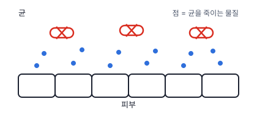

*피부에서 나온 점이 균을 죽이는 모습이에요.*

**정확히 말하면**

**펩티드(peptide)** = 아미노산 몇 개가 붙은 짧은 단백질

**항미생물 펩티드(antimicrobial peptide)** = 미생물을 죽이는 펩티드

**디펜신(defensin)** = 모든 상피조직이 분비하는, 세균을 죽이는 펩티드. 디펜스(defense, 방어·수비)로 기억(교수님)

우리는 늘 세균과 바이러스에 닿아 있고, 피부는 이들을 죽이는 물질을 항상 분비해요. 손바닥에는 RNA를 분해하는 효소도 있어요.

디펜신은 세균의 종류를 가리지 않고 죽여요. 특정 상대를 고르지 않으므로 [선천면역](#s2-two-systems)이에요.

**꼭 기억해요**

| 묻는 것 | 틀리기 쉬운 답 | 맞는 답 |
|---|---|---|
| 코로나19 바이러스가 더 오래 남는 곳 | ~~사람 손~~ | 휴대전화 표면 |
| 상피조직이 내는 디펜신의 분류 | ~~후천면역~~ | 선천면역 |
| 디펜신과 라이소자임의 차이 | ~~같은 물질~~ | 디펜신은 펩티드, 라이소자임은 세포벽을 녹이는 효소 |

상피조직에서 나온다는 이유로 디펜신을 첫 번째 방어선으로 묶기 쉬워요. 이 수업에서는 라이소자임을 첫 번째 방어선에, 디펜신을 선천면역에 넣었어요.

교수님 말씀

코로나19 시기에 바이러스를 손등과 휴대전화 위에 각각 묻혀 둔 실험을 들려줬어요.

> 사람 피부에 있을 때 더 빨리 죽습니다.

**페이지 요약**

상피조직은 장벽일 뿐 아니라 세균을 가리지 않고 죽이는 항미생물 펩티드(디펜신)를 분비하며, 이 작용은 선천면역이에요.

*용어*

- **항미생물 펩티드(antimicrobial peptide)** — 미생물을 죽이는 펩티드예요. 펩티드는 아미노산 몇 개가 붙은 짧은 단백질이에요.
- **디펜신(defensin)** — 모든 상피조직이 분비해 세균을 죽여요. 특이성이 없으므로 선천면역이고, 첫 번째 방어선의 효소인 라이소자임과 달라요.
- **피부가 분비하는 물질** — 세균과 바이러스를 죽이는 물질을 늘 분비하고, 손바닥에는 RNA 분해효소가 있어요. 코로나19 바이러스는 휴대전화보다 피부 위에서 더 빨리 죽었어요.

---

### 염증 반응

*1124 수업 · 14장 p1*

**쉽게 말하면**

도둑이 들면 가까운 사람이 먼저 막으면서 도움을 부르고, 길과 문을 넓혀 구조대가 들어오게 해요.

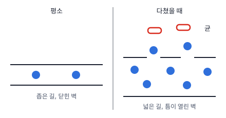

*점은 구조대예요.*

**정확히 말하면**

**염증 반응(inflammation)** = 상처로 세균이 들어온 자리가 열나고 따갑고 빨갛고 붓는 선천면역 반응

상처 주위의 대식세포는 침입한 세균을 바로 먹기 시작해요. 하지만 그 자리의 세포끼리 싸우는 데서 끝나지 않고, 신호를 보내 혈액 속 백혈구를 더 불러와야 해요.

1. **침입:** 찢어진 피부 틈으로 세균이 들어와요.
2. **섭취:** 주위의 대식세포(macrophage)가 세균을 막으로 둘러싸 세포 안으로 넣고, 리소좀이 분해해요. 이렇게 삼켜 죽이는 방법이 식세포 작용(phagocytosis)이에요.
3. **신호:** 대식세포는 사이토카인(cytokine, 강의노트 표기 시토카인도 같음)을, 비만세포(mast cell)는 히스타민(histamine)을 내보내요.
4. **혈관 변화:** 히스타민이 혈관을 확장하고 혈관벽의 투과성(permeability)을 높여요.
5. **이동:** 혈관벽의 단백질에 붙잡힌 호중구(neutrophil) 등 백혈구가 벽을 빠져나와 상처 조직으로 가요.
6. **파괴:** 호중구가 세균을 잡아먹어요.

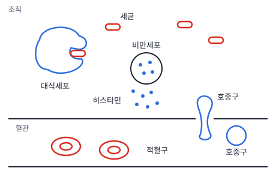

*상처 부위 단면*

사이토카인·케모카인(chemokine)·히스타민은 모두 세포가 내보내는 신호 물질이에요.

| 비교 기준 | 히스타민 작용: 혈관 확장 | 히스타민 작용: 투과성 증가 |
|---|---|---|
| 백혈구에 생기는 일 | 혈관을 지나가는 수가 늘어남 | 혈관벽을 빠져나와 조직으로 들어감 |
| 함께 생기는 일 | 적혈구도 많이 지나감 | 혈장 성분(물)도 빠져나옴 |
| 겉으로 보이는 결과 | 빨개짐 | 부음 |

두 작용은 서로를 대신하지 못해요. 확장은 상처 근처에 **지나가는** 양을, 투과성은 벽을 넘어 조직에 **들어가는** 양을 늘려요. 그래서 한 작용이 달라졌을 때의 결과는 위 표의 그 열을 따라 판단해요.

혈구 가운데 벽을 빠져나오는 것은 백혈구예요. 적혈구는 혈관 안을 지나가기만 해요.

**염증 반응에 속하는 것:** 대식세포, 비만세포, 호중구, 사이토카인, 케모카인, 히스타민. **속하지 않는 것:** 상대를 골라 작용하는 B세포·T세포·항체. 이들은 [후천면역](#s4-lymphocytes)이에요.

**꼭 기억해요**

| 묻는 것 | 틀리기 쉬운 답 | 맞는 답 |
|---|---|---|
| 빨개지는 까닭 | ~~적혈구가 조직으로 빠져나와서~~ | 혈관 확장으로 적혈구가 많이 지나가서 |
| 붓는 까닭 | ~~혈관이 넓어진 것만으로~~ | 투과성 증가로 물이 조직으로 나와서 |
| 혈관벽을 빠져나오는 혈구 | ~~적혈구와 백혈구~~ | 백혈구 |
| 대식세포의 일 | ~~먹고 끝~~ | 먹고 신호도 보냄 |
| 백혈구가 조직으로 들어오는 조건 | ~~혈관 확장만~~ | 투과성 증가도 필요 |
| 히스타민을 분비하는 세포 | ~~대식세포, B세포~~ | 비만세포 |
| 세균을 직접 삼켜 죽이는 세포 | ~~비만세포, 자연살생세포, B세포~~ | 대식세포, 호중구 |

보체도 세균을 죽이지만 삼키는 세포가 아니라 구멍을 뚫는 단백질이에요. 자연살생세포는 세균을 먹는 대신 암세포나 바이러스에 감염된 세포를 죽여요([보체계와 막공격복합체](#s3-complement), [자연살생세포와 세포의 죽음](#s3-nk)).

강조: “특히 이제 히스타민이 중요한데.” “요게 중요한 히스타민의 작용입니다.”

교수님 말씀

대식세포는 이름처럼 세균을 잘 먹는 ‘대식가’예요. 학교에 도둑이 들면 수위와 군대를 다녀온 학생들이 먼저 싸우면서 경찰과 군인을 부르듯, 대식세포도 신호를 보내요.

> 얘가 하는 일은 잡아먹고 끝나는 게 아닙니다.

군인이 탱크를 몰고 오려면 길이 넓어야 해요(혈관 확장). 탱크가 30대 와도 교문이 좁으면 못 들어오고 돌아가요(투과성). 불려 온 군인이 호중구예요.

> 혈관만 넓어지면 뭐하나? 그냥 지나가면 안 되잖아요.

백혈구는 데굴데굴 굴러가다 벽의 단백질에 딱 걸려 빠져나온다고 했어요.

염증 반응 전체는 침입한 세균을 일단 임시방편으로 죽이는 작용이라고 정리했어요.

수업에서 본 영상은 대식세포를 순찰하는 경찰관, 비만세포를 통신 요원, 호중구를 특수부대원에 빗댔어요.

**페이지 요약**

염증 반응은 비만세포의 히스타민이 혈관을 넓히고 벽의 투과성을 높이며, 대식세포도 세균을 먹으면서 신호를 보내, 호중구가 상처 조직으로 나와 세균을 먹게 하는 선천면역이에요.

*용어*

- **진행 순서** — 세균 침입, 대식세포의 섭취, 신호 분비, 혈관 확장과 투과성 증가, 백혈구의 이동, 호중구의 세균 파괴 순서예요.
- **대식세포(macrophage)** — 조직에서 세균을 막으로 둘러싸 삼키고 리소좀이 분해해요(식세포 작용). 사이토카인 같은 신호로 다른 면역세포도 불러요.
- **비만세포(mast cell)** — 히스타민을 분비해요.
- **호중구(neutrophil)** — 혈관벽의 단백질에 붙잡힌 뒤 벽을 빠져나와 세균을 잡아먹는 백혈구예요. 적혈구는 혈관 안을 지나가기만 해요.
- **히스타민: 혈관 확장** — 면역세포와 적혈구가 많이 지나가고, 그래서 빨개져요.
- **히스타민: 투과성 증가** — 백혈구가 조직으로 들어가고 혈장 성분(물)도 나와 부어요. 확장만으로는 부족하고 투과성도 늘어야 해요.
- **사이토카인·케모카인** — 염증에 쓰이는 신호 물질이에요. 대식세포가 사이토카인을 내요.
- **구분** — B세포·T세포·항체는 후천면역이라 염증 반응에 속하지 않아요. 보체는 삼키지 않고 구멍을 뚫고, 자연살생세포는 세균이 아니라 암세포·감염된 세포를 죽여요.

---

## 4. [14장] 보체·인터페론·자연살생세포

### 보체계와 막공격복합체

*1124 수업 · 14장 p2, p5*

**쉽게 말하면**

한쪽은 나쁜 세균을 붙잡아 두고, 다른 쪽은 세균에 구멍을 뚫어 터뜨려요.

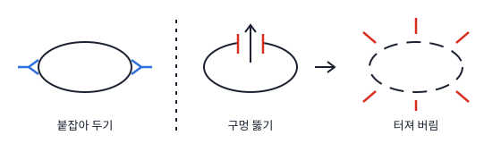

*붙잡는 쪽과 구멍을 뚫는 쪽은 서로 달라요.*

**정확히 말하면**

**보체계(complement system)** = 세균을 죽이는 작용을 **보충**하는 단백질들로 이루어진 선천면역(보체 = 보충, 교수님)

**항체(antibody)** = [항원](#s4-antibody)(적응면역을 유발하는 외래물질)에 특이적으로 결합하는 단백질

항체가 세균에 붙어도 세균은 그 자리에 붙들릴 뿐 아직 살아 있어요. 그래서 붙들린 세균을 실제로 죽이는 쪽이 따로 필요하고, 그 일을 대식세포나 보체가 해요.

| 비교 기준 | 보체 | 항체 |
|---|---|---|
| 무엇인가 | 세포가 아니라 우리 몸이 만든 단백질 | 세포가 아니라 우리 몸이 만든 단백질 |
| 속한 면역 | 선천면역 | 후천면역(적응면역) |
| 특이성 | 없음 | 있음(맞는 항원에만 결합) |
| 세균에 하는 일 | 죽임 | 붙잡아 다른 세포에 침입하지 못하게 함 |

**보체가 세균을 죽일 때**

1. 보체 단백질이 막공격복합체(membrane attack complex) 형성
2. 세균의 막에 구멍
3. 세균이 터져 죽음

보체는 선천면역이라 항체가 있어야만 작용하는 것은 아니에요.

항체가 독성 분자를 막거나 세균을 덩어리로 만드는 자세한 작용은 [항체의 작용](#s5-effect)에서 이어져요.

**꼭 기억해요**

| 묻는 것 | 틀리기 쉬운 답 | 맞는 답 |
|---|---|---|
| 세균을 실제로 죽이는 것 | ~~항체~~ | 대식세포 또는 보체 |
| 막공격복합체를 만드는 것 | ~~항체~~ | 보체 |
| 보체의 분류 | ~~항체처럼 단백질이므로 후천면역~~ | 선천면역 |

> 항체는 그냥 붙으면 끝이에요.

교수님 말씀

항체를 손이 두 개인 일꾼에 비유했어요. 양손으로 세균을 하나씩 잡으니 세균끼리 얽히고설켜 가라앉아요.

> 항체가 손이 두 개이기 때문에

**보충 · 노트에 빠졌던 수업 내용**

보체는 항체가 없어도 병원체 표면의 분자를 인식해 활성화될 수 있어요. 항체가 붙은 세균에 작용하는 것은 여러 경우 중 하나예요.

출처: 강의노트 14장 p2

**페이지 요약**

항체는 항원에 붙어 붙잡아 두기만 하고, 보체는 막공격복합체로 세균에 구멍을 뚫어 죽여요.

*용어*

- **보체계(complement system)** — 세균을 죽이는 작용을 보충하는 단백질이에요. 세포가 아니고, 특이성이 없는 선천면역에 속해요. 항체가 있어야만 작용하는 것은 아니에요.
- **막공격복합체(membrane attack complex)** — 보체 단백질이 만든 구멍이에요. 세균의 막이 뚫려 세균이 터져 죽어요.
- **항체(antibody)** — 항원(적응면역을 유발하는 외래물질)에 특이적으로 결합하는 후천면역의 단백질이에요. 붙들린 세균은 다른 세포에 침입하지 못하지만 아직 죽은 것은 아니에요.
- **실제로 죽이는 쪽** — 붙들린 세균은 대식세포나 보체가 죽여요. 항체도 보체도 단백질이라는 점만으로 같은 면역으로 묶지 않아요.

- **(보충) 항체 없는 활성화** — 보체는 항체가 없어도 병원체 표면의 분자를 인식해 활성화될 수 있어요. 항체가 붙은 세균에 작용하는 것은 여러 경우 중 하나예요(강의노트 14장 p2).

---

### 인터페론

*1124 수업 · 14장 p2*

**쉽게 말하면**

먼저 병에 걸린 세포가 이웃에게 “너희는 미리 준비해!” 하고 편지를 보내요.

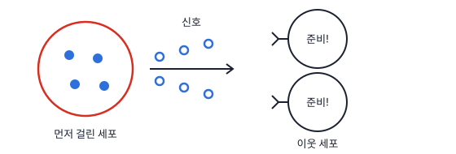

*신호를 받는 손이 있어야 이웃도 알아차려요.*

**정확히 말하면**

**인터페론(interferon)** = 바이러스에 감염된 세포가 분비해 주변 세포에 알리는 선천면역의 신호 분자

1. 세포가 바이러스에 감염
2. 감염된 세포가 인터페론 분비
3. 주변 세포가 인터페론 수용체로 신호를 받음
4. 주변 세포가 RNA 분해 효소 등을 미리 만듦
5. 바이러스 침입에 대비

수업에서는 이미 감염된 세포 자신보다 아직 괜찮은 주변 세포를 지키는 신호로 설명했어요. 인터페론은 알리는 일을 하고, 실제 준비는 신호를 받은 세포가 해요. 그래서 바이러스가 들어오기 전에 준비가 시작되고, 수용체가 없는 세포는 이 신호를 받아들이지 못해 같은 대비를 시작하지 못해요.

미리 만든 RNA 분해 효소는 RNA 바이러스가 들어왔을 때 그 RNA를 분해할 수 있어요. 바이러스 하나를 골라 기억하는 반응이 아니므로 특이성과 기억이 없어요([선천면역과 후천면역](#s2-two-systems)).

**꼭 기억해요**

| 묻는 것 | 틀리기 쉬운 답 | 맞는 답 |
|---|---|---|
| 인터페론을 분비하는 세포 | ~~아직 감염되지 않은 주변 세포~~ | 바이러스에 감염된 세포 |
| 신호를 받아 대비하는 세포 | ~~이미 감염된 그 세포만~~ | 수용체가 있는 주변 세포 |
| 특히 바이러스 방어에 쓰는 선천면역 물질 | ~~디펜신~~([상피조직의 항미생물 펩티드](#s2-peptide)) | 인터페론 |
| IgE 같은 항체의 분류 | ~~인터페론과 같은 선천면역 물질~~ | 후천면역의 단백질 |

> 인터페론 하면 무조건 바이러스입니다, 바이러스.

교수님 말씀

감염된 세포가 “나는 안 되겠지만 내 주위 세포들은 미리 준비해야지” 하고 보내는 신호에 비유했어요.

> 나는 미리 준비해야지. RNA 분해 효소 미리 만들어 놔야지.

**페이지 요약**

인터페론은 바이러스에 감염된 세포가 내보내고, 수용체로 받은 주변 세포가 바이러스에 미리 대비하게 하는 신호예요.

*용어*

- **인터페론(interferon)** — 바이러스 방어에 쓰는 선천면역의 신호 분자예요. 특이성과 기억이 없어요.
- **분비하는 세포** — 바이러스에 감염된 세포예요.
- **인터페론 수용체** — 주변 세포가 신호를 받는 곳이에요. 수용체가 없으면 신호를 받아들이지 못해 같은 대비를 시작하지 못해요.
- **대비하는 방법** — 신호를 받은 주변 세포가 RNA 분해 효소 등을 바이러스가 들어오기 전에 만들어요. 이 효소는 RNA 바이러스의 RNA를 분해할 수 있어요.
- **다른 물질과의 구분** — 디펜신은 상피조직의 항미생물 펩티드이고, IgE 같은 항체는 후천면역의 단백질이에요.

---

### 자연살생세포와 세포의 죽음

*1124 수업 · 14장 p2*

**쉽게 말하면**

우리 몸에는 나쁘게 변한 우리 편 세포를 찾아, 구멍으로 “이제 멈춰” 쪽지를 넣는 세포가 있어요.

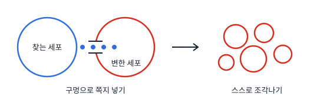

*찾는 세포는 쪽지를 넣고, 변한 세포는 스스로 죽어요.*

**정확히 말하면**

**자연살생세포(natural killer cell, NK세포)** = 암세포와 바이러스에 감염된 세포를 죽이는 선천면역 세포

자연살해세포라고도 불러요. 이름은 태어날 때부터 킬러라는 뜻으로 풀이했어요(교수님).

**자연살생세포가 죽일 때**

1. 구별되는 표시가 있는 표적세포를 찾음
2. 퍼포린(perforin)이 표적세포의 막에 구멍을 냄
3. 구멍으로 자살을 유도하는 효소를 넣음
4. 표적세포의 아포토시스

자연살생세포가 하는 일은 구멍을 내고 효소를 넣는 데까지예요. 그다음 죽는 과정은 표적세포가 스스로 진행해요. 그래서 구멍을 뚫는다는 단서 하나만 보지 말고, 죽이는 것이 세포인지와 표적이 무엇인지를 함께 봐요.

| 비교 기준 | 대식세포·호중구 | 보체 | 자연살생세포 |
|---|---|---|---|
| 정체 | 세포 | 단백질 | 세포 |
| 주된 표적 | 세균 | 세균 | 암세포, 바이러스에 감염된 세포 |
| 죽이는 방법 | 둘러싸 삼키는 식세포 작용 | 막공격복합체 구멍으로 터뜨림 | 퍼포린 구멍으로 효소를 넣어 자살 유도 |

표시로 표적을 가려내지만, 특정 항원 하나를 기억해 그것만 공격하는 후천면역의 특이성과는 달라요. 감염된 세포를 죽이는 점은 세포독성 T세포와 비슷해요. 자연살생세포는 특이성과 기억이 없는 선천면역, [세포독성 T세포](#s4-lymphocytes)는 적응면역이라는 소속으로 갈라요.

**세포가 죽는 두 방식**

| 비교 기준 | 아포토시스(apoptosis, 세포자살) | 괴사(necrosis) |
|---|---|---|
| 죽는 까닭 | 계획과 유전자 발현에 따름 | 손상에 따름 |
| 예 | 자연살생세포가 효소를 넣은 표적세포 | 타거나 굶거나 긁혀 죽은 세포 |

**꼭 기억해요**

| 묻는 것 | 틀리기 쉬운 답 | 맞는 답 |
|---|---|---|
| 자연살생세포의 표적 | ~~세균~~ | 암세포와 바이러스에 감염된 세포 |
| 자연살생세포가 죽이는 방법 | ~~둘러싸 삼킴~~ | 구멍을 뚫어 자살 유도 |
| 타거나 굶어서 죽은 세포 | ~~아포토시스~~ | 괴사 |
| 히스타민을 내는 세포 | ~~자연살생세포~~ | 비만세포([염증 반응](#s2-inflammation)) |

> 죽이는데 뭘 죽이느냐가 문제입니다.

교수님 말씀

세균과 싸우는 군인은 이미 많고, 자연살생세포는 우리 편이었다가 변한 배신자를 처단한다고 비유했어요. 구멍으로 권총이나 사약을 넣어 “네가 알아서 죽어라” 하는 방식이에요.

> 얘는 배신자들을 처단합니다.

면역에 도움이 된다는 건강식품 광고에서 NK세포 활성도를 내세우는 예도 소개했어요. 이 세포가 일을 잘해야 암에 덜 걸린다는 생각을 이용한 광고예요.

**보충 · 노트에 빠졌던 수업 내용**

자연살생세포는 림프구(lymphocyte)의 일종이고 혈액을 따라 순환해요. 퍼포린이 낸 구멍으로 표적세포 안의 분자와 이온이 빠져나가 삼투 균형이 깨지면, 그것만으로도 표적세포가 파괴될 수 있어요. 보체는 혈액이나 체액을 순환하는 물에 녹는 단백질이에요.

출처: 강의노트 14장 p2

**보충 · 수업에서 다루지 않았어요**

림프구는 림프계의 조직이나 기관에서 대부분의 기능을 수행하는 백혈구예요. 자연살생세포가 구멍으로 넣는 자살 유도 효소를 교재는 프로테아제(protease, 단백질분해효소)라고 부르고, 이 효소가 아포토시스를 유발한다고 설명해요. 자연살생세포는 식세포 작용을 하지 않아요.

출처: 교재 14장 p.314

**페이지 요약**

자연살생세포는 암세포와 바이러스에 감염된 세포에 퍼포린으로 구멍을 내고 효소를 넣어, 표적이 계획된 죽음인 아포토시스로 죽게 해요.

*용어*

- **자연살생세포(natural killer cell, NK세포)** — 표시로 표적을 찾지만, 특정 항원을 기억하는 특이성은 없는 선천면역 세포예요. 세균을 주로 맡는 것은 대식세포·호중구예요.
- **퍼포린(perforin)** — 표적세포의 막에 구멍을 내는 단백질이에요. 그 구멍으로 자살 유도 효소가 들어가고, 죽는 과정은 표적세포가 스스로 진행해요.
- **구멍을 내는 둘의 구분** — 보체는 단백질이고 막공격복합체로 세균을 터뜨려요. 자연살생세포는 세포이고 감염세포·암세포의 자살을 유도해요.
- **대식세포·호중구와의 구분** — 이들은 세균을 둘러싸 삼키는 식세포 작용으로 죽여요.
- **세포독성 T세포와의 구분** — 둘 다 감염된 세포를 죽이지만, 자연살생세포는 선천면역이고 세포독성 T세포는 적응면역이에요.
- **아포토시스(apoptosis)** — 계획과 유전자 발현에 따라 죽는 세포자살이에요.
- **괴사(necrosis)** — 타거나 굶거나 긁히는 손상으로 죽는 것이에요.

- **(보충) 림프구와 구멍의 효과** — 자연살생세포는 혈액을 순환하는 림프구의 일종이에요. 퍼포린 구멍으로 분자와 이온이 빠져나가 삼투 균형이 깨지는 것만으로도 표적이 파괴될 수 있어요. 보체는 혈액이나 체액을 순환하는 물에 녹는 단백질이에요(강의노트 14장 p2).

- **(보충) 림프구의 뜻과 프로테아제** — 림프구는 림프계의 조직이나 기관에서 대부분의 기능을 수행하는 백혈구예요. 교재는 자살 유도 효소를 프로테아제(단백질분해효소)라고 부르고 아포토시스를 유발한다고 설명해요. 자연살생세포는 식세포 작용을 하지 않아요(교재 14장 p.314).

---

## 5. [14장] 림프구와 항체의 구조

### B세포와 T세포

*1124 수업 · 14장 p3*

**쉽게 말하면**

B와 T는 같은 곳에서 태어나지만 졸업한 학교가 달라요.

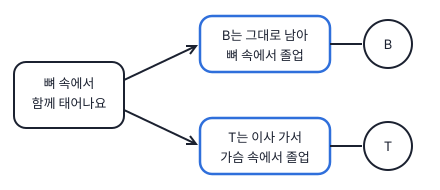

*졸업한 곳의 첫 글자가 이름이 됐어요.*

**정확히 말하면**

**B세포(B cell)·T세포(T cell)** = 적응면역을 맡는 두 종류의 림프구(lymphocyte)

| 비교 기준 | B세포 | T세포 |
|---|---|---|
| 태어나는 곳 | 골수(bone marrow) | 골수(bone marrow) |
| 성숙하는 곳 | 골수 | 흉선(가슴샘, thymus) |
| 이름의 유래 | bone marrow의 B | thymus의 T |
| 하는 일 | 항체(antibody) 생산 | 도움 T세포와 세포독성 T세포가 나누어 맡음 |

**T세포의 두 종류**

| 비교 기준 | 도움 T세포(helper T cell) | 세포독성 T세포(cytotoxic T cell) |
|---|---|---|
| 하는 일 | 면역세포를 도움 | 바이러스에 감염된 세포를 죽임 |
| 이름의 뜻 | helper = 돕는 | cytotoxic = 세포에 독성을 띠는 |

면역세포는 태어나자마자 일하지 못해요. 여러 분화 단계를 거치고, 그중 성숙하는 단계를 지나야 항체를 만들거나 감염된 세포를 죽이거나 다른 세포를 도울 수 있어요.

1. 골수에서 탄생
2. B세포는 골수에서, T세포는 흉선에서 성숙
3. 성숙을 마치고 온몸으로 나감

B세포가 성숙하는 동안 일어나는 변화는 [DNA 재배열과 항체의 다양성](#s5-rearrangement)에서, 항체를 분비하는 형질세포로 분화하는 과정은 [클론 선택과 면역의 기억](#s5-clonal)에서 이어져요.

**꼭 기억해요**

| 묻는 것 | 틀리기 쉬운 답 | 맞는 답 |
|---|---|---|
| T세포가 태어나는 곳 | ~~흉선~~ | 골수(B세포와 같음) |
| T세포가 성숙하는 곳 | ~~골수~~ | 흉선 |
| B세포가 성숙하는 곳 | ~~흉선~~ | 골수 |
| 흉선·가슴샘·thymus | ~~서로 다른 기관~~ | 같은 기관의 다른 이름 |
| 감염된 세포를 죽이는 T세포 | ~~도움 T세포~~ | 세포독성 T세포 |
| 항체를 만드는 세포 | ~~T세포~~ | B세포 |

세포독성 T세포를 자연살생세포와 같은 세포로 착각하기 쉬워요. 감염된 세포를 죽이는 점은 비슷하지만, [자연살생세포](#s3-nk)는 특이성이 없는 선천면역 세포이고 세포독성 T세포는 특이성이 있는 적응면역 세포예요.

교수님 강조: “일단 적응면역에서 중요한 두 개의 세포가 있는데”

교수님 말씀

B와 T는 세포의 생김새가 아니라 **출신 학교**예요. B세포는 골수에서 초등학교부터 고등학교까지 다니고, T세포는 골수 유치원만 다닌 뒤 흉선 초등학교로 이사해 흉선 고등학교를 졸업해요.

> 얘네들의 출신 학교라고 생각하면 돼요, 출신 학교.

면허도 필기, 실기, 연수를 거쳐야 실제로 운전할 수 있듯이 면역세포도 단계를 거쳐야 일해요.

**보충 · 노트에 빠졌던 수업 내용**

**B세포 수용체(BCR)**는 B세포의 세포막에 있는 항원 수용체예요. 세포막에는 같은 수용체가 수천 개 있지만, **한 B세포의 수용체는 모두 같은 항원 결합 모양**을 가져요. 그래서 B세포 하나는 한 가지 항원 구조만 인식해요. T세포에는 T세포 수용체(TCR)가 있어요.

출처: 강의노트 14장 p3, 교재 14장 p.315

**보충 · 노트에 빠졌던 수업 내용**

B세포는 골수의 줄기세포(stem cell)에서 분화를 시작해 골수에서 분화를 마쳐요. T세포는 분화 도중에 골수를 떠나 가슴샘으로 가서 성숙해요. **림프절은 성숙하는 곳이 아니라 성숙을 마친 뒤 가는 곳**이에요. B세포는 혈액을 타고 림프기관에 가고, T세포는 성숙한 뒤 림프절로 가요.

출처: 강의노트 14장 p3, 교재 14장 p.314

**페이지 요약**

B세포와 T세포는 모두 골수에서 태어나지만, B세포는 골수에서 성숙해 항체를 만들고 T세포는 흉선에서 성숙해 다른 면역세포를 돕거나 감염된 세포를 죽여요.

*용어*

- **B세포(B cell)** — 골수에서 성숙하고 항체를 만드는 적응면역 세포예요. 이름은 bone marrow에서 왔어요.
- **T세포(T cell)** — 골수에서 태어나 흉선(가슴샘, thymus)으로 옮겨 성숙해요. 이름은 thymus에서 왔어요.
- **도움 T세포와 세포독성 T세포** — 도움 T세포는 면역세포를 돕고, 세포독성 T세포는 바이러스에 감염된 세포를 죽여요.
- **세포독성 T세포와 자연살생세포** — 둘 다 감염된 세포를 죽이지만 세포독성 T세포는 특이성이 있는 적응면역, 자연살생세포는 특이성이 없는 선천면역 세포예요.
- **성숙** — 여러 분화 단계 중 하나로, 이 단계를 지나야 항체를 만들거나 죽이거나 도울 수 있어요.

- **(보충) B세포 수용체(BCR)** — B세포 막의 항원 수용체예요. 한 B세포의 수용체는 모두 같은 항원 결합 모양이라 한 가지 항원 구조만 인식해요. T세포의 수용체는 TCR이에요.

- **(보충) 분화와 이동** — B세포는 골수의 줄기세포에서 시작해 골수에서 분화를 마치고, T세포는 도중에 가슴샘으로 옮겨요. 성숙을 마친 뒤 B세포는 혈액을 타고 림프기관으로, T세포는 림프절로 가요. 림프절은 성숙하는 곳이 아니에요.

---

### 항체의 구조와 다양성 문제

*1124 수업 · 14장 p3–4*

**쉽게 말하면**

몸속에는 손바닥 모양이 딱 맞는 침입자만 붙잡는 손이 있어요.

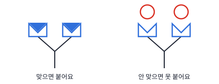

*한 사람의 양손처럼 두 손바닥은 같은 모양이에요.*

**정확히 말하면**

**항원(antigen)** = 적응면역을 유발하는 외래물질

**항체(antibody)** = 항원에 특이적으로 결합하는 단백질, 다른 이름은 면역글로불린(immunoglobulin, Ig)

항체 한 분자는 사슬 4개로 된 Y자 모양이에요.

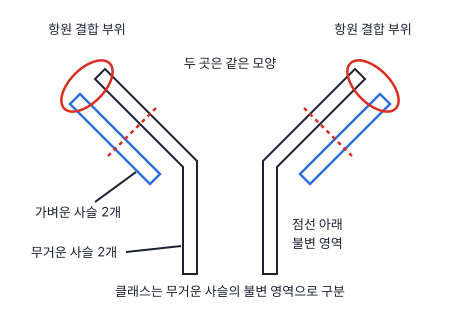

*항체 한 분자를 이루는 사슬 4개와 부위의 이름*

| 비교 기준 | 점선 아래쪽 | 점선 위쪽 |
|---|---|---|
| 이름 | 불변 영역(constant region) | 끝부분이 항원 결합 부위 |
| 아미노산 서열 | 같은 클래스의 항체끼리 같음 | 항체마다 다름 |
| 정해지는 것 | 클래스가 갈리는 부분 | 결합할 항원(팔 끝의 모양) |

| 비교 기준 | 무거운 사슬(중쇄, heavy chain) | 가벼운 사슬(경쇄, light chain) |
|---|---|---|
| 개수 | 2개 | 2개 |
| 길이와 위치 | 길고 가운데 | 짧고 양쪽 바깥 |

면역글로불린에는 IgG, IgA, IgE, IgD, IgM의 다섯 클래스(class)가 있어요.

**항체가 한 항원에 특이적인 이유**

1. 항체 유전자의 DNA 염기서열
2. 아미노산 서열(1차 구조)
3. 항원 결합 부위의 3차원 모양
4. 모양이 들어맞는 항원만 결합

**다양성 문제**

살면서 만나는 항원은 무궁무진해서 항원 결합 부위의 모양도 그만큼 다양해야 해요. 모양이 다르려면 유전자의 염기서열이 달라야 하니, 항원이 100가지면 항체 유전자도 100개가 필요해 보여요. 그런데 사람의 유전자는 2만~2만 5천 개뿐이에요.

모든 유전자가 항체를 만드는 데 쓰일 리도 없고, 전부 쓴다고 해도 부족해요. 그래서 항체의 다양성은 유전자의 개수만으로 설명할 수 없어요. 해결은 [DNA 재배열과 항체의 다양성](#s5-rearrangement)에서 이어져요.

**꼭 기억해요**

| 묻는 것 | 틀리기 쉬운 답 | 맞는 답 |
|---|---|---|
| 불변 영역의 아미노산 서열 | ~~모든 항체가 같음~~ | 같은 클래스의 항체끼리 같음 |
| 클래스가 같은 두 항체 | ~~같은 항원에 결합~~ | 항원 결합 부위의 모양이 다르면 다른 항원에 결합 |
| 한 항체의 두 항원 결합 부위 | ~~서로 다른 항원에 결합~~ | 모양이 같아 같은 항원에 결합 |
| 항체 한 분자의 사슬 | ~~무거운 사슬 4개와 가벼운 사슬 4개~~ | 무거운 사슬 2개와 가벼운 사슬 2개 |
| 적응면역을 유발하는 외래물질 | ~~항체~~ | 항원(항체는 우리 몸이 만든 단백질) |
| 항원과 미생물 | ~~같은 말~~ | 항원은 미생물이 지닌 물질일 수도 있지만, 독소처럼 따로 있는 물질도 포함 |
| 다양한 항체를 만드는 방법 | ~~항원마다 유전자를 하나씩 보유~~ | 유전자 개수로는 설명 불가 |

교수님 강조: “자, 이 모양이 중요합니다.” 특이성은 “어떻게 특이적일 수가 있느냐, 이게 중요한 겁니다.”라고 물으며 이해하라고 하셨어요.

교수님 말씀

항체는 팔을 벌린 사람과 같아요. **손바닥**이 항원 결합 부위이고, 양 손바닥은 똑같이 생겼어요.

클래스가 같은 항체는 목 밑이 똑같고 **얼굴만 다른** 사람들이에요.

> 똑같이 생겼는데 얼굴만 다른 거예요, 예를 들면.

클래스의 이름에 대해서는 이렇게 덧붙이셨어요.

> 전공자가 아닌 이상 뭐 G, A, E 이런 거는 잘 몰라도 되긴 한데

**보충 · 노트에 빠졌던 수업 내용**

**에피톱(epitope, 항원결정부)**은 항원 분자에서 항체나 수용체가 결합하는 일부분이에요. 항체는 항원 전체가 아니라 에피톱에 붙어요.

각 사슬은 **가변 영역(variable region, V)**과 불변 영역(C)을 모두 가져요. 가변 영역은 Y자의 팔에서 대략 위쪽 절반이고, 한 팔의 무거운 사슬과 가벼운 사슬의 가변 영역이 함께 접혀 항원 결합 부위가 돼요. 사슬 사이는 이황화결합(—S—S—)으로 이어져요.

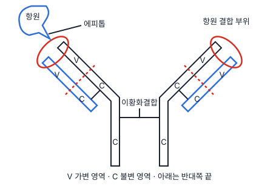

*에피톱이 닿는 곳은 무거운 사슬과 가벼운 사슬의 V가 함께 만든 팔 끝이에요.*

**가변 영역은 항원 특이성을, 불변 영역은 항체의 기능을 결정해요.**

출처: 강의노트 14장 p3–4, 교재 14장 p.315–316

**보충 · 노트에 빠졌던 수업 내용**

항체는 혈액과 림프액 같은 체액을 따라 도는 **수용성 단백질**이에요. 체액에 있는 항원을 특이적으로 인식해 결합하는 것이 항체의 일이에요. 젖먹이에게 모유로 전달되는 항체는 **IgA**예요.

출처: 강의노트 14장 p3, p6, 교재 14장 p.314

**보충 · 수업에서 다루지 않았어요**

혈액에 가장 많은 항체 클래스는 **IgG**(혈청 항체의 약 80%)이고, 점막의 분비물에 가장 많은 클래스는 **IgA**예요. 항체의 클래스(종류)를 정하는 부위는 불변 영역이에요. 가변 영역은 클래스도, 몸속 위치도 정하지 않아요.

출처: OpenStax Microbiology 18.1 [Overview of Specific Adaptive Immunity](https://openstax.org/books/microbiology/pages/18-1-overview-of-specific-adaptive-immunity)

**페이지 요약**

항체는 유전자 서열이 정한 팔 끝의 모양이 맞는 항원에만 결합하는데, 필요한 모양이 너무 많아 유전자 개수만으로는 항체의 다양성을 설명할 수 없어요.

*용어*

- **항원(antigen)** — 적응면역을 유발하는 외래물질이에요. 독소처럼 따로 있는 물질도 포함해 미생물과 같은 말이 아니에요.
- **항체(antibody)** — 우리 몸이 만들어 항원에 특이적으로 결합하는 단백질이에요. 면역글로불린(Ig)이라고도 해요.
- **무거운 사슬·가벼운 사슬** — 무거운 사슬 2개는 길고 가운데에, 가벼운 사슬 2개는 짧고 양쪽 바깥에 있어 Y자를 이뤄요.
- **항원 결합 부위** — 두 팔의 끝이에요. 한 항체의 두 곳은 모양이 같아 같은 항원에 결합하고, 이 모양이 결합할 항원을 정해요.
- **불변 영역과 클래스** — 불변 영역은 같은 클래스끼리 아미노산 서열이 같아요. 클래스는 IgG, IgA, IgE, IgD, IgM 다섯 가지이고, 클래스가 같아도 결합하는 항원은 다를 수 있어요.
- **특이성의 원리** — DNA 염기서열이 아미노산 서열을, 아미노산 서열이 3차원 모양을 정하고, 모양이 들어맞는 항원만 결합해요.
- **다양성 문제** — 항원은 무궁무진한데 유전자는 2만~2만 5천 개뿐이라, 전부 항체 유전자여도 부족해요. 유전자 개수만으로는 설명할 수 없어요.

- **(보충) 에피톱과 가변 영역** — 에피톱(항원결정부)은 항원에서 항체가 결합하는 일부분이에요. 팔 위쪽 절반의 가변 영역이 무거운 사슬과 가벼운 사슬에서 함께 접혀 항원 결합 부위를 만들어요. 가변 영역은 항원 특이성을, 불변 영역은 기능을 정하고 사슬은 이황화결합으로 이어져요.

- **(보충) 체액 속의 항체** — 항체는 혈액과 림프액을 따라 도는 수용성 단백질로, 체액의 항원을 인식해 결합해요. 모유로 전달되는 항체는 IgA예요.

- **(보충) 클래스와 분포** — 혈액에 가장 많은 것은 IgG(혈청 항체의 약 80%), 점막 분비물에 가장 많은 것은 IgA예요. 클래스는 불변 영역이 정하고, 가변 영역은 클래스나 몸속 위치를 정하지 않아요.

---

## 6. [14장] 클론 선택과 적응면역의 작동

### DNA 재배열과 항체의 다양성

*1124 수업 · 14장 p3*

**쉽게 말하면**

같은 블록 상자를 받은 아이들이 눈을 감고 블록을 골라 이어요. 아이마다 다른 모양이 나와요.

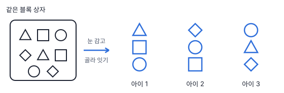

**정확히 말하면**

만나는 항원은 무궁무진하지만 유전자 수는 한정돼 있어요([항체의 구조와 다양성 문제](#s4-antibody)). 항체 종류마다 유전자를 하나씩 두는 대신, B세포가 성숙하는 동안 항체 유전자를 다시 이어 붙이면 적은 재료로 많은 모양을 만들 수 있어요.

**DNA 재배열(DNA rearrangement, DNA 분절의 재배치)** = 골수에서 성숙하는 B세포마다 항체 유전자의 DNA 분절이 무작위로 다시 이어져 염기서열이 달라지는 과정

1. 골수에서 갓 태어난 B세포: 항체 유전자 서열이 모두 같음
2. 성숙하는 동안 무작위 DNA 재배열
3. B세포마다 다른 항체 유전자 서열
4. B세포마다 다른 모양의 항체 한 가지
5. 재배열을 마쳐야 골수를 나가 온몸을 돌아다님

가능한 조합이 매우 많아서, 웬만한 항원에 맞는 모양이 항원보다 먼저 갖춰져요.

강의노트 14장 p3은 한 사람이 서로 다른 B세포 수용체를 대략 1억 종류 가진다고 적어요.

세포끼리 비교할 때는 재배열을 했는지, 했다면 같은 세포에서 분열해 나왔는지를 차례로 물어요. 아래 표는 재배열을 마친 뒤 서열이 더 바뀌지 않는다고 볼 때예요.

| 비교 기준 | 한 B세포가 분열해 생긴 두 세포 | 따로 성숙한 두 B세포 | 성숙한 B세포와 근육세포 |
|---|---|---|---|
| 항체 유전자 서열 | 같음 | 다름 | 다름 |
| 까닭 | 재배열을 마친 서열을 함께 물려받음 | 골수에서 저마다 무작위로 재배열 | 항체 유전자의 재배열은 B세포에서만 일어남 |
| 항체 유전자를 뺀 나머지 서열 | 같음 | 같음 | 같음 |
| 만드는 항체의 모양 | 같음 | 다름 | 근육세포는 항체를 만들지 않음 |

**꼭 기억해요**

| 묻는 것 | 틀리기 쉬운 답 | 맞는 답 |
|---|---|---|
| 우리 몸 모든 세포의 항체 유전자 서열 | ~~모두 같음~~ | 성숙한 B세포는 예외 |
| 항원 수용체의 종류가 많은 까닭 | ~~종류마다 독립된 유전자가 하나씩 있음~~ | 한정된 유전자 조각을 무작위로 재배열 |
| 항체의 모양이 정해지는 방식 | ~~항원을 보고 거기에 맞춰 만듦~~ | 항원을 만나기 전 무작위로 미리 만듦 |
| 항체 유전자의 재배열이 일어나는 곳 | ~~항원을 만난 조직~~ | 골수 |

교수님은 "항체 유전자는 그냥 한 개"라고 강조했어요. 유전자 자리가 글자 그대로 하나라는 뜻으로 착각하기 쉽지만, 항체 종류마다 유전자가 따로 있지 않다는 뜻이에요.

교수님 말씀

교수님은 B세포를 학교에 다니는 아이에 빗댔어요. 태어날 때 같던 얼굴(항체 유전자 서열)이 성숙하면서 달라지고, 졸업해야(재배열을 마쳐야) 사회(온몸)로 나가요.

> "고등학교 졸업할 때 보니까 얼굴이 다 달라졌어."

**보충 · 수업에서 다루지 않았어요**

교수님은 재배열이 어떻게 일어나는지는 복잡하다며 생략했어요. 교재의 가벼운 사슬 유전자 예는 이래요. 조각은 분절이라고도 불러요.

| 비교 기준 | V 조각 | J 조각 | C 조각 |
|---|---|---|---|
| 사람의 가벼운 사슬 유전자에 있는 수 | 약 40개 | 5개 | 1개 |
| 쓰는 방식 | 무작위로 하나 고름 | 무작위로 하나 고름 | 하나뿐이라 고르지 않고 이어 붙임 |
| 담는 정보 | 가변 영역의 대부분 | 가변 영역의 나머지 | 불변 영역 |

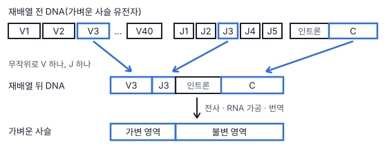

*파란 테두리는 이번 예에서 쓰인 조각이에요. 재배열 뒤 DNA는 교재의 단순 모식도처럼 V3, J3, 인트론, C만 그렸어요.*

V 조각만으로는 안 되고 J 조각을 빼서도 안 돼요. 세 종류가 이어져야 기능을 갖춘 가벼운 사슬 유전자가 되고, 다양성은 V와 J를 고르는 데서 나와요(V–J 짝만 40 × 5 = 200가지).

이어 붙일 때 고른 V 조각과 고른 J 조각 사이에 있던 DNA가 제거돼요. J와 C 사이의 인트론은 재배열 뒤에도 남아 있다가 RNA 가공에서 제거돼요(그림). 교재 p.316은 이를 V와 C 사이의 DNA 부분이 제거된다고 줄여 적어요.

무거운 사슬 유전자도 비슷하게 재배열되고, T세포의 항원 수용체(TCR) 유전자도 재배열을 거쳐요. 그래서 B세포든 T세포든 항원 수용체마다 독립된 유전자가 하나씩 있다는 말은 거짓이에요.

출처: 교재 14장 p.316–317(그림 14.4), 강의노트 14장 p3(TCR의 무작위 재조합)

**보충 · 노트에 빠졌던 수업 내용**

항체의 클래스는 항원 결합 부위의 모양과 별개예요. 처음 항원에 노출된 1차 면역반응에서는 주로 IgM이, 같은 항원에 다시 노출된 2차 면역반응에서는 주로 IgG가 만들어져요. 그래서 나오는 차례는 IgM이 먼저, IgG가 나중이에요.

출처: 강의노트 14장 p5

**페이지 요약**

항체 유전자의 분절이 골수에서 B세포마다 무작위로 다시 이어져, 항체 종류마다 유전자를 두지 않고도 다양한 항체가 항원보다 먼저 갖춰져요.

*용어*

- **DNA 재배열(DNA rearrangement)** — 골수에서 성숙하는 B세포의 항체 유전자 분절이 무작위로 다시 이어지는 과정이에요. 시작할 때 같던 서열이 세포마다 달라지고, 이 과정이 끝나야 골수를 나가요.
- **항체 유전자 서열의 비교** — 한 B세포에서 분열한 세포끼리는 같고, 따로 성숙한 B세포끼리는 달라요. 재배열을 하지 않는 근육세포와도 다르지만, 항체 유전자를 뺀 나머지 서열은 같아요.
- **한 B세포, 한 모양** — 성숙한 B세포 하나는 한 가지 모양의 항체만 만들어요. 그 모양은 항원을 보고 맞춘 것이 아니라 무작위로 미리 정해져요.
- **항체 유전자 "한 개"** — 항체 종류마다 독립된 유전자가 있지 않다는 뜻이에요. 한정된 조각을 재배열해 종류를 늘려요.

- **(보충) V·J·C 조각** — 가벼운 사슬 유전자는 V 조각(약 40개)과 J 조각(5개)에서 하나씩 무작위로 골라 하나뿐인 C 조각과 이어요. V·J는 가변 영역, C는 불변 영역의 정보를 담아요. 이어 붙일 때 고른 V와 고른 J 사이의 DNA가 제거되고, J와 C 사이의 인트론은 남아 있다가 RNA 가공에서 제거돼요. 무거운 사슬과 TCR 유전자도 재배열되므로 항원 수용체마다 독립된 유전자가 있는 것은 아니에요.

- **(보충) IgM과 IgG의 차례** — 1차 면역반응에서는 주로 IgM, 2차 면역반응에서는 주로 IgG가 만들어져 IgM이 먼저예요. 클래스는 항원 결합 부위의 모양과 별개예요.

---

### 클론 선택과 면역의 기억

*1124 수업 · 14장 p3–p5*

**쉽게 말하면**

모양이 다른 틀을 든 친구들이 미리 기다리다가, 손님과 모양이 맞는 친구만 뽑혀 수가 늘어나요. 그중 몇은 오래 남아서, 같은 손님이 또 오면 훨씬 빨리 나서요.

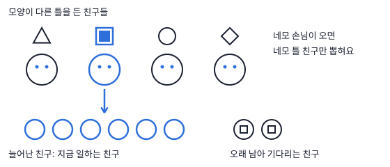

**정확히 말하면**

**클론(clone)** = 유전적으로 동일한 세포 집단. 한 B세포에서 나온 클론은 같은 모양의 항체만 만듦

**클론 선택(clonal selection)** = 여러 클론 중 항원에 맞는 클론이 선택되어 증식하는 과정

1. 서로 다른 모양의 항체를 세포막에 단 여러 B세포
2. 항원에 맞는 B세포만 선택
3. 같은 클론으로 증식
4. 일부는 형질세포, 일부는 기억세포로 분화

| 비교 기준 | 형질세포(plasma cell) | 기억세포(memory cell) |
|---|---|---|
| 하는 일 | 항체를 세포 밖으로 분비 | 같은 항원이 다시 들어올 때를 대비 |
| 수명 | 보통의 면역세포처럼 길지 않음 | 긺 |
| 재노출 때 | 기억세포가 분열해 새로 만듦 | 빨리 분열해 형질세포가 됨 |

#### 직접 해 보기: 어느 클론이 선택될까 *(정적 스냅샷 — 직접 조작은 HTML 버전)*

항원 모양과 노출 횟수를 고르면, 미리 있던 B세포 가운데 선택되는 클론과 항체량이 달라져요. 세포 수와 항체량은 비교를 위한 모형값이에요.

**세모 항원 · 첫 노출: 맞는 B세포 1개(1번)에서 출발, 최고 항체량 1(2주째, 모형값)**

범례: 고른 노출의 항체량 · 다른 노출(점선)

조건: 증식과 분화에는 도움 T세포의 자극이 필요해요([항체매개면역·세포매개면역과 도움 T세포](#s5-helper)).

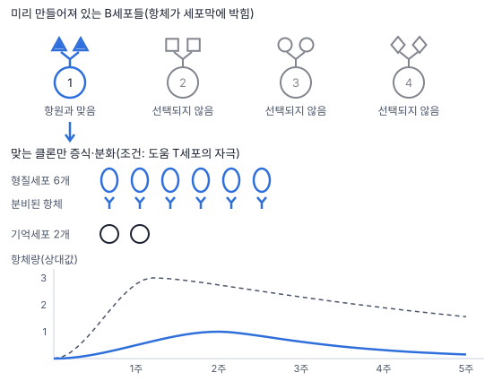

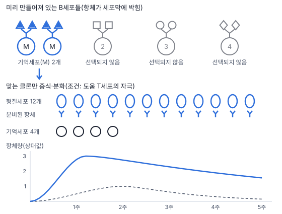

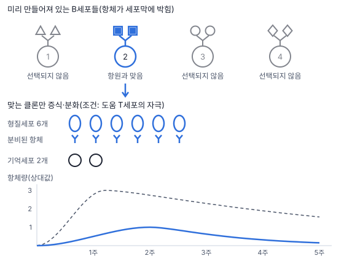

| 설정 | 선택되는 클론 | 출발하는 맞는 세포 | 분화한 세포(모형값) | 최고 항체량과 시기(모형값) |
|---|---|---|---|---|
| 세모 · 첫 노출 | B세포 1 | B세포 1개 | 형질세포 6, 기억세포 2 | 1, 2주째 |
| 세모 · 재노출 | B세포 1과 같은 클론 | 기억세포 2개 | 형질세포 12, 기억세포 4 | 3, 1.2주째 |
| 네모 · 첫 노출 | B세포 2 | B세포 1개 | 형질세포 6, 기억세포 2 | 1, 2주째 |

조건: 도움 T세포의 자극이 있어야 선택된 B세포가 증식하고 분화해요.

| 비교 기준 | 첫 노출 | 같은 항원에 재노출 |
|---|---|---|
| 항원에 맞는 세포 | 맞는 B세포가 적음 | 기억세포가 이미 많음 |
| 항체가 생기는 속도 | 느림(선택·증식·분화에 시간이 걸림) | 빠름 |
| 항체의 양 | 적음 | 많음 |

기억은 항원마다 따로 생겨요. 항원 X를 만나 생긴 기억세포는 X에 대비하고, 전에 만난 적 없는 다른 항원 Y가 들어오면 Y에 맞는 클론이 첫 노출과 같은 과정을 밟아요. 그래서 반응이 빠를지는 **그 항원**을 만난 적이 있는지로 판단해요.

백신(vaccine, 예방접종)의 목적은 기억세포를 만들어 두는 것이에요. 여러 모양의 항체를 만드는 B세포는 이미 갖춰져 있고, 그중 맞는 하나가 선택돼요. 뒤에 같은 병원체가 들어오면 재노출 때처럼 반응해요.

**꼭 기억해요**

| 묻는 것 | 틀리기 쉬운 답 | 맞는 답 |
|---|---|---|
| 항원이 하는 일 | ~~맞는 모양의 항체를 새로 설계하게 함~~ | 이미 있는 클론 중 맞는 것이 선택되게 함 |
| 형질세포가 되기 전 항체의 위치 | ~~세포 밖으로 분비~~ | 세포막에 박힘 |
| 항체를 분비하는 세포 | ~~기억세포~~ | 형질세포 |
| 첫 노출의 항체가 늦고 적은 까닭 | ~~맞는 B세포가 하나도 없음~~ | 맞는 B세포가 적고 증식·분화에 시간이 걸림 |
| 재노출의 항체 | ~~첫 노출과 속도·양이 비슷함~~ | 더 빨리, 더 많이 |
| 백신을 맞은 뒤 반응이 빠른 까닭 | ~~백신으로 넣은 항체가 남음~~ | 백신이 기억세포를 만들게 함 |
| 항원 X의 백신이 대비하는 것 | ~~모든 항원~~ | 항원 X |
| 병원체를 기억해 빨리 반응하는 면역 | ~~선천면역~~ | [적응면역](#s2-two-systems) |

교수님이 강조한 말: "기억세포의 특징은 수명, 수명이 길어진다." / 백신은 "기억세포를 만들어 주기 위해서."

교수님 말씀

교수님은 항체 모양을 색깔로 나타낸 1~4번 B세포를 사회로 나간 졸업생에, 항원에 맞는 2번을 뽑힌 인재에 빗댔어요.

> "너가 사회에 필요한 인재로구나. 너 빨리 증식해."

코로나에 처음 감염되면 맞는 B세포 하나가 걸려 늘어나기까지 오래 걸리고, 기억세포가 많은 상태에서 다시 침입하면 훨씬 빨리 잡힌다고 했어요.

**보충 · 노트에 빠졌던 수업 내용**

**면역기억(immunological memory)** = 기억세포가 남아 있어, 같은 항원에 다시 노출될 때 더 빠르고 강하게 반응하는 현상

예방접종을 받으면 그 병원체에 대항할 수 있는 까닭이 면역기억이에요. 백신으로는 항체가 아니라 병을 일으키지 않을 만큼 약하게 하거나 죽인 병원체, 또는 병원체의 단백질 같은 항원을 넣어요.

| 비교 기준 | 1차 면역반응(primary) | 2차 면역반응(secondary) |
|---|---|---|
| 일어나는 때 | 처음으로 항원에 노출됨 | 동일한 항원이 다시 들어옴 |
| 필요한 항원의 양 | 2차보다 많음 | 1차보다 소량의 항원으로도 일어남 |
| 반응을 이끄는 세포 | 새로 선택된 B세포와 T세포 | 이미 있던 기억 B세포·기억 T세포 |
| 주된 항체형 | IgM | IgG |

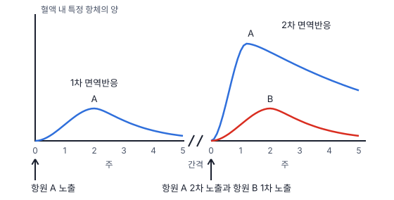

*파란 선은 항원 A, 빨간 선은 항원 B에 대한 항체예요. 같은 날 들어와도 처음 만난 B의 반응은 1차 반응이에요.*

항원이 제거되면, 증식·분화해 활성화된 대부분의 B세포와 T세포는 더 분열하지 않고 죽어 체액에서 사라져요. 수명이 긴 기억 B세포와 기억 T세포(기억 도움 T세포 등)는 림프계와 감염됐던 조직에 불활성화 상태로 남아요.

출처: 강의노트 14장 p5, 교재 14장 p.320–321(그림 14.9)

**보충 · 노트에 빠졌던 수업 내용**

수업은 한 항원에 한 클론이 선택된다고 단순하게 그렸어요. 실제로는 한 항원에도 에피톱이 여럿이고 병원체 표면에도 여러 항원이 있어, 서로 다른 여러 클론이 선택될 수 있어요.

출처: 강의노트 14장 p3·p5

**페이지 요약**

항원은 새 항체를 설계하게 하는 것이 아니라 미리 있던 클론 중 맞는 것을 선택되게 하고, 그때 남은 기억세포 덕분에 같은 항원의 재노출에는 더 빨리, 더 많은 항체가 생겨요.

*용어*

- **클론 선택(clonal selection)** — 서로 다른 항체를 막에 단 B세포들 중 항원에 맞는 클론만 선택되어 증식하고, 일부는 형질세포, 일부는 기억세포가 돼요. 클론은 유전적으로 동일한 집단이라 같은 모양의 항체만 만들어요.
- **형질세포(plasma cell)** — 항체를 세포 밖으로 분비하는 세포예요. 형질세포가 되기 전에는 항체가 세포막에 박혀 있어요.
- **기억세포(memory cell)** — 수명이 길고, 같은 항원이 다시 들어오면 빨리 분열해 형질세포가 돼요.
- **첫 노출과 재노출** — 첫 노출은 맞는 B세포가 적어 증식·분화에 시간이 걸리고 항체가 적어요. 재노출은 기억세포가 많아 더 빠르고 많아요.
- **기억의 특이성** — 기억세포는 자신을 만들게 한 항원에만 대비해요. 다른 항원을 처음 만나면 첫 노출과 같은 과정을 밟아요. 선천면역에는 이런 기억이 없어요.
- **백신(vaccine)** — 기억세포를 만들어 두는 것이 목적이에요. 맞는 항체를 만드는 B세포는 이미 갖춰져 있고 그중에서 선택돼요.
- **성립 조건** — 선택된 B세포가 증식·분화하려면 도움 T세포의 자극이 필요해요.

- **(보충) 면역기억과 1차·2차 면역반응** — 면역기억은 기억세포가 남아 생기며 예방접종이 효과를 내는 까닭이에요. 백신으로는 항체가 아니라 항원을 넣어요. 2차 반응은 동일한 항원에 대해 일어나고, 1차보다 소량의 항원으로도 빠르게 더 많은 항체(주로 IgG, 1차는 주로 IgM)를 만들어요. 그래프에서 처음 만난 항원 B의 반응은 1차예요. 항원이 제거되면 활성화된 세포 대부분은 분열을 멈추고 죽으며, 기억 B·T세포는 불활성화 상태로 남아요.

- **(보충) 여러 클론의 선택** — 한 항원에도 에피톱이 여럿이고 병원체 표면에 항원도 여럿이라, 실제로는 여러 클론이 선택될 수 있어요. 한 클론은 수업의 단순화예요.

---

### 항체의 작용

*1124 수업 · 14장 p5*

**쉽게 말하면**

손이 두 개인 도우미가 나쁜 것을 꽉 붙잡아요. 붙잡힌 것은 해를 못 끼치거나 덩어리가 되고, 그 뒤에 청소부가 없애요.

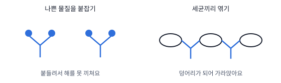

**정확히 말하면**

형질세포가 분비한 항체는 혈액과 체액을 돌아다니며 항원을 붙잡아 둬요. 붙잡은 것이 무엇이냐에 따라 일어나는 일이 달라요.

| 비교 기준 | 중화(neutralization) | 응집(agglutination) |
|---|---|---|
| 항체가 붙는 것 | 독성 분자 | 세균 |
| 일어나는 일 | 붙들려서 다른 세포에 작용하지 못함 | 항체 하나가 세균 둘에 붙어, 여럿이 얽혀 덩어리져 가라앉음 |
| 그 뒤 | 독성의 작용이 막힘 | 대식세포가 와서 죽이거나 보체가 구멍을 뚫어 죽임 |

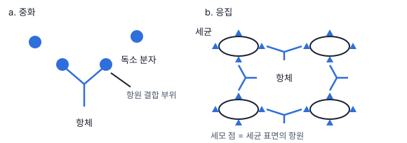

응집에는 한 항체에 항원 결합 부위가 둘 있다는 점이 중요해요. 결합 부위가 하나라면 세균 하나에 붙을 뿐 다른 세균과 이어 주지 못해요.

항체는 체액에 녹아 세포 밖을 돌아다니므로, 이미 세포 안에 들어간 바이러스를 직접 죽이지 않아요. 감염된 세포를 죽이는 쪽은 [세포독성 T세포](#s5-helper)예요.

**꼭 기억해요**

| 묻는 것 | 틀리기 쉬운 답 | 맞는 답 |
|---|---|---|
| 독성 분자에 항체가 붙어 작용이 막히는 것 | ~~응집~~ | 중화 |
| 응집된 세균 | ~~바로 죽음~~ | 덩어리질 뿐, 대식세포나 보체가 죽임 |
| 세균의 막에 구멍을 뚫는 것 | ~~항체~~ | 보체([막공격복합체](#s3-complement)) |
| 항체가 세균을 없애는 방식 | ~~자살 유도 효소를 분비해 세포자살을 일으킴~~ | 항원에 결합할 뿐임. 자살 유도 효소(프로테아제, 보충)로 세포자살을 일으키는 예는 [자연살생세포](#s3-nk) |
| 항체가 중화하는 것 | ~~자연살생세포~~ | 독성 분자(독소) |
| 항체가 항원을 처리한 뒤의 재노출 | ~~반응이 일어날 기회가 없어짐~~ | 남은 [기억세포](#s5-clonal)가 더 빠르게 반응 |

교수님 말씀

교수님은 항체의 두 결합 부위를 손 두 개에 빗댔어요. 한 항체가 양손에 세균을 하나씩 잡으니 서로 엮여요.

> "이 손이 두 개이기 때문에 요렇게 얽히고설킨다"

**보충 · 노트에 빠졌던 수업 내용**

항체는 선천면역의 무기를 돕기도 해요.

- **보체:** 항원에 결합한 항체는 보체를 활성화해요. 세균 표면에 막공격복합체가 생겨 세균이 죽어요. 보체를 막는(불활성화하는) 것이 아니에요.
- **식세포:** 항체가 붙으면 식세포가 세균과 바이러스를 더 잘 섭취해요. 응집된 세균과 바이러스도 대식세포 같은 식세포에 쉽게 먹혀요.
- **응집:** 세균을 움직이지 못하게 해(부동화) 감염이 퍼지는 것을 막아요. 바이러스도 응집시킬 수 있어요.

출처: 강의노트 14장 p5, 교재 14장 p.320(그림 14.8, 바이러스의 응집)

**페이지 요약**

항체는 항원을 붙잡아 독성 분자의 작용을 막거나(중화) 세균을 엮어 덩어리지게(응집) 하고, 실제로 세균을 죽이는 것은 대식세포나 보체예요.

*용어*

- **중화(neutralization)** — 독성 분자에 항체가 붙어, 다른 세포에 작용하지 못하게 하는 일이에요.
- **응집(agglutination)** — 결합 부위가 둘인 항체가 세균을 서로 엮어 덩어리져 가라앉게 하는 일이에요. 세균이 바로 죽지는 않아요.
- **실제로 죽이는 것** — 대식세포가 죽이거나 보체가 막에 구멍을 뚫어요. 항체는 구멍을 뚫거나 자살 유도 효소를 넣지 않고, 자연살생세포를 중화하지도 않아요.
- **항체가 작용하는 곳** — 체액에 녹아 세포 밖에서 작용해요. 세포 안의 바이러스는 직접 죽이지 않고, 감염된 세포는 세포독성 T세포가 죽여요.
- **재노출과의 관계** — 항체가 항원을 처리해도 기억세포가 남아 재노출 때 더 빠르게 반응해요.

- **(보충) 보체와 식세포를 돕는 항체** — 항원에 결합한 항체는 보체를 활성화해 막공격복합체로 세균을 죽게 하고, 식세포가 세균과 바이러스를 더 잘 섭취하게 해요. 응집은 세균을 움직이지 못하게 해 감염의 확산을 막고 식세포에 쉽게 먹히게 하며, 바이러스도 응집될 수 있어요.

---

### 항체매개면역·세포매개면역과 도움 T세포

*1124 수업 · 14장 p3–p4*

**쉽게 말하면**

몸을 지키는 팀은 둘이에요. 한 팀은 물에 그물을 풀고, 다른 팀은 탈이 난 세포를 직접 찾아가요. 그물 팀은 도우미가 거들어야 움직여요.

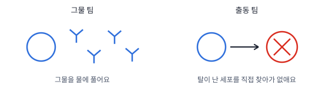

**정확히 말하면**

적응면역(후천면역)은 둘로 나뉘어요. 둘 다 적응면역이라 항원을 특이적으로 인식하고 기억을 남겨요([선천면역과 후천면역](#s2-two-systems)).

| 비교 기준 | 항체매개면역(antibody-mediated immunity) | 세포매개면역(cell-mediated immunity) |
|---|---|---|
| 이름의 까닭 | 항체가 매개함. 항체가 체액에 녹은 단백질이라 체액성 면역(humoral immunity)이라고도 함 | 세포가 직접 나섬 |
| 공격하는 방식 | 분비된 항체가 체액에서 항원에 결합 | 세포독성 T세포가 직접 죽임 |
| 주로 맞서는 대상 | 체액의 항원(병원체, 독성 분자) | 바이러스에 감염된 숙주세포(우리 몸의 세포), 암세포 |
| 속하는 것 | B세포, 형질세포, B세포가 분화한 기억세포, 항체(면역글로불린) | 세포독성 T세포 |
| 속하지 않는 것 | 세포독성 T세포 | B세포, 형질세포, 항체 |
| 함께 작용하는 것 | 보체: 선천면역의 단백질이지만 항체가 붙잡은 세균을 죽이는 데 참여. B세포의 증식·분화에는 도움 T세포도 참여 | 이번 수업에서 다루지 않음 |

[클론 선택](#s5-clonal)만 그린 그림에는 도움 T세포(helper T cell)가 빠져 있어요. 그런데 여러 B세포 중 항원을 만난 B세포만 증식하면 되고, 나머지는 증식할 필요가 없어요. 그래서 누구를 도울지 가려내는 조건이 있어요.

1. 도움 T세포가 어떤 항원을 먼저 접함
2. 여러 B세포 중 똑같은 항원을 만난 B세포를 알아봄
3. 그 B세포만 자극
4. 그 B세포가 증식해 형질세포·기억세포로 분화

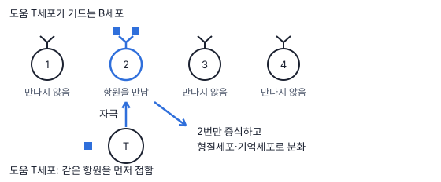

가상으로 도움 T세포가 거의 없는 사람을 생각해 봐요. 항원을 만난 B세포도 자극을 받지 못해 증식·분화가 잘 일어나지 않고, 형질세포와 분비되는 항체가 적어져요. 세균을 삼키는 대식세포의 일은 선천면역이라 따로 일어나요.

도움 T세포가 항원을 만난 B세포를 어떻게 알아보고 돕는지는 다음 시간에 이어져요([다음 수업에서 이어질 내용](#s6-next)).

**꼭 기억해요**

| 묻는 것 | 틀리기 쉬운 답 | 맞는 답 |
|---|---|---|
| 체액에서 항원에 특이적으로 맞서는 방어 | ~~세포매개면역, 보체계, 라이소자임~~ | 항체매개면역(보체계·라이소자임은 특이성이 없는 선천면역) |
| 암세포로부터 몸을 지키는 적응면역 | ~~항체매개면역~~ | 세포매개면역 |
| 세포독성 T세포가 죽이는 것 | ~~체액에 떠다니는 병원체~~ | 병원체에 감염된 숙주세포, 암세포 |
| B세포와 세포독성 T세포의 역할 | ~~B세포가 감염세포를 죽이고 T세포가 항체를 만듦~~ | B세포는 항체를 만들고 세포독성 T세포는 감염된 숙주세포를 죽임 |
| B세포의 증식·분화에 필요한 것 | ~~항원만 있으면 됨~~ | 항원과의 만남 + 도움 T세포의 자극 |
| 도움 T세포가 돕는 B세포 | ~~모든 B세포~~ | 항원을 만난 B세포만 |
| 도움 T세포 쪽의 조건 | ~~항원을 접하지 않아도 됨~~ | 같은 항원을 먼저 접해야 함 |

교수님 말씀

> "항원을 만난 B세포만 도와주는 거예요."

> "고등학교 때는 이제 이런 걸 잘 안 배워요."

**페이지 요약**

적응면역은 체액의 항체로 맞서는 항체매개면역과 세포독성 T세포가 직접 죽이는 세포매개면역으로 나뉘고, 항체매개면역의 B세포는 같은 항원을 접한 도움 T세포의 자극이 있어야 증식·분화해요.

*용어*

- **항체매개면역(체액성 면역, humoral immunity)** — B세포가 분화한 형질세포의 항체가 체액에서 항원에 특이적으로 결합해요. B세포·형질세포·기억세포·항체가 속하고 세포독성 T세포는 속하지 않아요.
- **세포매개면역(cell-mediated immunity)** — 세포독성 T세포가 바이러스에 감염된 숙주세포나 암세포를 직접 죽여요. B세포와 항체는 속하지 않아요.
- **공통점** — 둘 다 적응면역이라 특이성과 기억이 있어요. 보체계·라이소자임은 특이성이 없는 선천면역이고, 보체는 항체가 붙잡은 세균을 죽이는 데 참여해요.
- **도움 T세포(helper T cell)** — 먼저 같은 항원을 접한 뒤, 여러 B세포 중 그 항원을 만난 B세포만 알아보고 자극해요. 나머지 B세포는 증식할 필요가 없어요.
- **도움 T세포가 거의 없을 때** — 항원을 만난 B세포도 증식·분화가 잘 안 되어 형질세포와 항체가 적어져요. 대식세포가 세균을 삼키는 일은 선천면역이라 따로 일어나요.

---

## 요약 · 예고

### 한눈에 다시 보기

*1124 수업*

| 주제 | 시험 직전 한 줄 |
|---|---|
| [동맥과 모세혈관 되짚기](#s0-recap) | 동맥은 벽이 두껍고 엘라스틴이 늘어난 벽을 되튕겨 피를 밀어냄. 모세혈관은 총 단면적이 넓어 혈류가 느려지고, 그만큼 물질교환 시간을 확보 |
| [혈구의 생성](#s0-bloodcells) | 모든 혈구가 만들어지는 곳은 골수. 산소가 많이 필요하거나 적혈구가 부족하면 적혈구생성소(erythropoietin)가 분비되어 골수의 적혈구 생성을 촉진 |
| [모세혈관의 물 이동](#s0-fluid) | 혈압이 혈액의 삼투압보다 높은 곳에서는 물이 조직으로 나가고, 삼투압이 더 높은 곳에서는 혈관으로 들어옴. 오래 못 먹으면 혈청 단백질이 줄고 혈액 삼투압이 낮아져 물이 빠져나가 조직이 부음 |
| [정맥 환류와 판막](#s0-venous) | 혈압은 정맥에서 가장 낮음. 혈액을 심장으로 밀어 올리는 것은 골격근 수축, 거꾸로 흐르지 않게 막는 것은 판막. 판막은 심장과 정맥 모두에 있음 |
| [혈류 배분](#s0-distribution) | 모세혈관 자체에는 근육이 없음. 시작 부위의 모세혈관 괄약근과 앞쪽 세동맥의 평활근이 수축하면 그쪽 혈류 감소, 이완하면 증가. 평활근은 의식이 아니라 자율신경이 조절 |
| [콜레스테롤의 이동](#s1-cholesterol) | 저밀도 지질단백질(LDL)은 세포로 공급하며 혈액검사에서 낮아야 하고, 고밀도 지질단백질(HDL)은 필요 없어진 것을 간으로 수거하며 높아야 함 |
| [플라크와 막힌 혈관](#s1-cholesterol) | 쌓인 콜레스테롤을 면역세포가 공격해 염증이 생기고, 콜레스테롤 덩어리와 면역세포 찌꺼기가 플라크가 됨. 뇌로 가는 혈관이 막히면 뇌졸중, 심장으로 가는 혈관이 막히면 심근경색 |
| [혈압의 결정 요인](#s1-pressure) | 혈액이 혈관벽을 미는 힘인 혈압은 총 혈액량, 심박출량, 동맥의 수축·이완 정도로 결정 |
| [혈압과 심박수 조절](#s1-pressure) | 대동맥·목동맥의 센서가 혈압을 감지해 연수로 정보를 보내고, 연수가 심장박동의 횟수와 강도를 조절하는 명령을 내림. 연수는 호흡과 심박수를 모두 조절. (보충) 산소 함유량도 영향을 주며, 부신속질의 에피네프린은 교감신경의 작용을 강화 |
| [림프계와 림프절](#s1-lymph) | 모세혈관에서 나간 물을 모아 혈액으로 되돌리는 것은 림프계. 림프절의 면역세포가 세균·바이러스를 찾아내면 면역세포가 모여 림프절이 부음. (보충) 림프모세관의 벽은 한 겹의 내피세포층 |
| [첫 번째 방어선](#s2-barrier) | 병을 일으키는 생물은 병원체. 피부뿐 아니라 점액·섬모·위산·라이소자임도 첫 번째 방어선. 라이소자임은 세균의 세포벽을 녹임 |
| [선천면역과 후천면역](#s2-two-systems) | 첫 번째 방어선을 넘으면 선천면역이 먼저 작용하고 기억과 특이성이 없음. 후천면역은 적응면역과 같은 말이며 기억과 특이성이 있고 척추동물만 가짐 |
| [선천면역 다섯 가지](#s2-two-systems) | 항미생물 펩티드, 염증 반응, 보체, 인터페론, 자연살생세포. 항체·B세포·T세포는 적응면역 |
| [항미생물 펩티드](#s2-peptide) | 상피조직이 분비하는 디펜신은 종류를 가리지 않고 세균을 죽이는 짧은 펩티드이며, 가리지 않으므로 선천면역 |
| [염증 반응의 세포](#s2-inflammation) | 대식세포는 세균을 삼켜 분해하고 사이토카인으로 다른 면역세포를 부름. 비만세포는 히스타민을 분비. 호중구는 혈관을 빠져나와 세균을 잡아먹음 |
| [히스타민의 두 작용](#s2-inflammation) | 혈관 확장으로 적혈구가 많이 지나가 빨개지고, 투과성 증가로 혈장 성분이 나와 부음. 백혈구가 조직으로 들어가려면 확장만으로는 부족하고 투과성도 늘어야 함. 적혈구는 빠져나오지 않음 |
| [보체계](#s3-complement) | 특이성이 없는 선천면역 단백질. 막공격복합체라는 구멍을 만들어 세균을 터뜨림. 항체는 항원에 특이적으로 붙는 후천면역 단백질이며 직접 죽이지 않음 |
| [인터페론](#s3-interferon) | 바이러스에 감염된 세포가 분비하고, 수용체로 신호를 받은 주변 세포가 RNA 분해 효소 등을 미리 만들어 대비. 수업 설명의 초점은 이미 감염된 세포보다 아직 괜찮은 주변 세포의 대비 |
| [자연살생세포](#s3-nk) | 표적은 세균이 아니라 암세포와 바이러스에 감염된 세포. 퍼포린으로 구멍을 뚫고 자살을 유도하는 효소를 넣어 표적세포가 스스로 죽게 함. 대식세포·호중구는 삼켜서 죽임. (보충) 자연살생세포는 림프구의 일종 |
| [아포토시스와 괴사](#s3-nk) | 유전자 발현에 따른 계획된 세포자살은 아포토시스(apoptosis), 타거나 굶거나 긁히는 등 손상에 의한 죽음은 괴사(necrosis) |
| [B세포와 T세포의 성숙](#s4-lymphocytes) | 태어나는 곳은 둘 다 골수. 성숙하는 곳은 B세포가 골수, T세포가 흉선(가슴샘, thymus) |
| [림프구의 역할](#s4-lymphocytes) | B세포는 항체를 만드는 쪽. T세포 중 도움 T세포는 면역세포를 돕고, 세포독성 T세포는 바이러스에 감염된 세포를 죽임 |
| [항체의 구조](#s4-antibody) | 무거운 사슬 2개와 가벼운 사슬 2개로 된 Y자 모양. 한 항체의 두 항원 결합 부위는 모양이 같음. 불변 영역의 서열은 클래스가 같을 때 같음. (보충) 항원 특이성을 정하는 쪽은 가변 영역 |
| [항체 다양성 문제](#s4-antibody) | DNA 염기서열이 아미노산 서열을, 아미노산 서열이 입체 모양을 정하고, 모양이 맞는 항원만 결합. 항원은 무궁무진하고 유전자 수는 한정되어, 항체마다 유전자를 따로 두는 방식으로는 설명 불가 |
| [DNA 재배열](#s5-rearrangement) | 골수에서 성숙하는 동안 B세포마다 항체 유전자 분절이 무작위로 재배열되어 서로 다른 서열이 됨. 항원을 만나기 전에 끝나며, 성숙한 B세포의 항체 유전자는 모든 세포의 DNA가 같다는 말의 예외 |
| [가벼운 사슬의 조각 (보충)](#s5-rearrangement) | V 조각 하나와 J 조각 하나가 무작위로 골라져 C 조각에 연결 |
| [클론 선택](#s5-clonal) | 미리 만들어진 여러 B세포 중 항원에 맞는 B세포만 선택되어 증식하고, 일부는 형질세포, 일부는 기억세포로 분화. 항원을 보고 항체 모양을 새로 만드는 것이 아님 |
| [형질세포와 기억세포](#s5-clonal) | 형질세포가 되기 전에는 항체가 세포막에 박혀 있고, 형질세포는 항체를 세포 밖으로 분비. 기억세포는 수명이 길어 재노출에 대비 |
| [첫 노출과 재노출, 백신](#s5-clonal) | 첫 노출에는 항체가 늦게 적게, 같은 항원에 재노출되면 기억세포 덕분에 빨리 많이 생김. 백신의 목적은 기억세포를 만들어 두는 것. (보충) 2차 반응은 소량의 항원으로도 일어남 |
| [항체의 작용](#s5-effect) | 중화는 독성 분자를 붙들어 작용을 막는 것, 응집은 두 결합 부위로 세균끼리 얽혀 가라앉게 하는 것. 세균을 실제로 죽이는 것은 대식세포와 보체. (보충) 항원에 결합한 항체는 보체를 활성화하고 식세포의 섭취를 도움 |
| [적응면역의 두 갈래](#s5-helper) | 항체매개면역(체액성 면역)은 체액에 녹은 항체가 작용. 세포매개면역은 세포독성 T세포가 바이러스에 감염된 세포나 암세포를 직접 죽임 |
| [도움 T세포의 조건](#s5-helper) | B세포의 증식·분화에는 도움 T세포의 자극이 필요. 돕는 대상은 항원을 만난 B세포뿐이며, 도움 T세포도 같은 항원을 먼저 접해야 함 |

---

### 다음 수업에서 이어질 내용

*1124 수업 · 14장 p3–8*

- 끊긴 지점: 도움 T세포가 필요하다는 것과, 도움 T세포도 같은 항원을 먼저 접해야 한다는 조건까지 배웠어요. “도움 T세포가 어떻게 항원을 만난 B세포를 도와주게 될 것이냐는 다음 시간에”
- 교수님이 예고한 주제: 도움 T세포가 항원을 만난 B세포를 알아보고 돕는 방법
- 교수님이 뒤로 미룬 설명: 면역세포가 성숙하는 구체적인 단계. 이번에는 B세포의 DNA 재배열까지만 다루고 T세포의 성숙 단계는 다루지 않았어요.
- 강의노트 14장 p3–4에 남은 제목: T세포 수용체(TCR)와 T세포의 펩티드 항원 인식, T세포 활성화와 수지상세포(dendritic cell), 주조직적합성복합체(MHC), B세포 활성화, 체세포 과돌연변이(somatic hypermutation)
- 강의노트 14장 p5–6에 남은 제목: 1차 반응의 IgM과 2차 반응의 IgG, 능동면역과 수동면역, 세포매개면역에서 세포독성 T세포의 작용, 항체의 연구·진단 이용과 단일클론항체
- 강의노트 14장 p6–8에 남은 제목: 면역체계의 기능부전과 결핍, 면역관용, 자가면역질환, 알레르기와 과민성 쇼크, 코로나-19와 신종 감염병
- 강의노트에는 있지만 이번 수업에서 말하지 않고 지나간 제목: 13장 p6의 산화질소(NO)에 의한 국소조절, 14장 p2의 옵소닌화(opsonization)

---

### 연결 자료

- [1124 복습문제 풀기](복습문제_1124_Respiratory_and_Circulatory_Systems_and_Immune_System.md)
- [1119 정리노트: 호흡계와 순환계](../../1119/정리노트_1119_Respiratory_and_Circulatory_Systems.html)

---

출처: 이영만 교수님 강의노트(13장·14장) · 수업 녹음 전사(1124) · 『생명과학: 기초와 응용』 2판 13장·14장.
