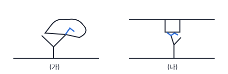
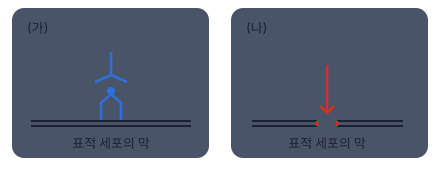
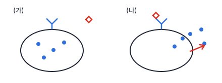

# 생명과학 복습 1126 문제설명

왼쪽 목차로 문항을 고르고, 오른쪽 문제를 보며 해설을 따라가요.

문제의 첫 줄부터 검산까지 설명해요.

**목차**

- [문항별 설명](#problems)
  - [P1. 면역계 구성 요소](#p1)
  - [P2. 예방접종과 항체 주사](#p2)
  - [P3. 수동면역을 고르는 기준](#p3)
  - [P4. 미엘린 수초에 대한 반응](#p4)
  - [P5. 자가면역질환의 판별](#p5)
  - [P6. 알레르기 감작에 쓰이는 항체](#p6)
  - [P7. 완성 항체를 투여하는 사례](#p7)
  - [P8. BCR과 TCR의 유전자](#p8)
  - [P9. 도움 T세포에서 시작하는 억제](#p9)
  - [P10. 면역계 이상과 정상 염증](#p10)
  - [P11. 항원 제시 세포와 도움 T세포](#p11)
  - [P12. 적응면역 수용체와 유전자](#p12)
  - [P13. 꽃가루에 대한 반응](#p13)
  - [P14. 수초를 표적으로 삼는 반응](#p14)
  - [P15. 미엘린 수초가 사라지는 질환](#p15)
  - [P16. 두 종류의 항원 제시 단백질](#p16)
  - [P17. [변형] 두 수용체가 붙는 자리](#p17)
  - [P18. [변형] 항원 인식과 공자극](#p18)
  - [P19. [변형] 항원 조각에 맞는 도움](#p19)
  - [P20. [변형] 두 자녀의 MHC 묶음](#p20)
  - [P21. [변형] 면역계 구성 요소의 구별](#p21)
  - [P22. [변형] 전달된 항체와 스스로 남긴 기억](#p22)
  - [P23. [변형] 감염된 세포를 만난 뒤](#p23)
  - [P24. [변형] 같은 제거 도구, 다른 식별 방식](#p24)
  - [P25. [변형] 성숙 과정의 선별](#p25)
  - [P26. [변형] 두 수용체가 읽는 단서](#p26)
  - [P27. [변형] 처음 붙는 것과 나중에 나오는 것](#p27)
  - [P28. [변형] 히스타민의 작용만 막으면](#p28)
  - [P29. [변형] 무엇을 표적으로 삼았을까](#p29)

## 문항별 설명

### P1. 면역계 구성 요소

기출 14강 1 · [원 문제 보기](../%EB%B3%B5%EC%8A%B5%EB%AC%B8%EC%A0%9C_1126_Immune_System.html#p1)

다음 중 면역계에 대한 설명으로 옳은 것은?

- (1) 자연살생세포 : 적응면역에서 세균을 삼켜 T 세포에 항원을 제시하는 식세포
- (2) IgE : 비만세포 표면 수용체와 결합하여 알레르기 반응을 매개하는 항체
- (3) B 세포 : 골수에서 형성되어 가슴샘(흉선)에서 분화를 마치는 면역세포
- (4) 면역글로불린 : 항원요소를 형성하는 단백질
- (5) 보체계 : 선천면역을 유발하는 세균 표면에 있는 분자

기출 원문 보기

기출 14강 합본 1번 (PDF 1쪽)

#### 문제가 묻는 것

면역계의 이름과 기능을 짝지은 설명 중 옳은 것을 고르는 문제예요.

#### 이 문제를 봤을 때 떠올릴 개념과 공식

설명의 맨 앞에 있는 이름이 세포인지 단백질인지 확인해요. 세포라면 어디에서 성숙하며 무엇을 하는지, 단백질이라면 누가 만들고 무엇을 인식하는지 대조해요.

면역글로불린(immunoglobulin, Ig)은 항체를 가리켜요. 항체는 항원에 특이적으로 붙고, 보체(complement)는 숙주가 만드는 방어 단백질 무리예요.

정리노트 · [선천면역과 항체](../%EC%A0%95%EB%A6%AC%EB%85%B8%ED%8A%B8_1126_Immune_System.html#s0-recap) · [B세포와 T세포의 성숙](../%EC%A0%95%EB%A6%AC%EB%85%B8%ED%8A%B8_1126_Immune_System.html#s0-receptors) · [IgE가 비만세포에 붙는 과정](../%EC%A0%95%EB%A6%AC%EB%85%B8%ED%8A%B8_1126_Immune_System.html#s3-allergy)

#### 왜 이렇게 푸는지 함께 따라가요

(1) 자연살생세포는 선천면역에 속하며 감염된 자기 세포 등을 직접 제거해요. 세균 조각을 T세포에 제시하는 역할은 수지상 세포나 대식세포에 해당해요. 틀린 설명이에요.

(2) IgE는 비만세포 표면 수용체에 붙어 세포를 감작시켜요. 같은 알레르기 항원이 다시 들어오면 반응할 수 있는 상태가 되므로 옳아요.

(3) B세포는 골수에서 성숙해요. 골수에서 생긴 뒤 가슴샘에서 성숙하는 림프구는 T세포예요. 틀린 설명이에요.

(4) 면역글로불린은 항원의 일부를 인식하는 항체예요. 항원 성분을 만드는 단백질이라는 설명은 틀려요.

(5) 보체는 세균 표면에서 활성화될 수 있어요. 그 단백질을 만드는 쪽은 숙주이므로 세균 표면의 구성 분자라는 설명은 틀려요.

답 (2). IgE와 비만세포의 짝이 옳아요.

#### 완성 답과 검산

IgE를 만드는 세포와 붙는 세포를 거꾸로 확인해 봐요. 형질세포가 만들고 비만세포가 표면 수용체로 받아 감작되므로 (2)의 결합 관계가 맞아요.

**페이지 요약**

#### 판단 기준과 답

세포의 역할·성숙 장소와 단백질의 생산자·표적을 각각 확인해요. 답 (2), 비만세포 표면에 결합하는 IgE예요.

---

### P2. 예방접종과 항체 주사

기출 14강 6 · [원 문제 보기](../%EB%B3%B5%EC%8A%B5%EB%AC%B8%EC%A0%9C_1126_Immune_System.html#p2)

어떤 동물의 흙투성이 발톱에 긁힌 후에 응급실에서 예방접종과 함께 파상풍 독소에 대한 항체를 주사 맞았다. 어떤 면역이 전달되었는가?

- (1) 수동면역만
- (2) 선천면역
- (3) 능동면역만
- (4) 능동면역과 수동면역
- (5) 면역관용

기출 원문 보기

기출 14강 합본 6번 (PDF 1쪽)

#### 문제가 묻는 것

예방접종과 완성된 항체 주사를 하나씩 분류하고, 두 처치로 어떤 면역을 얻는지 판단해요.

**문항 결함:** “전달되었는가”를 외부에서 직접 받은 것으로 좁히면 항체에 따른 수동면역만 세게 돼요. 인쇄 답은 두 처치로 얻는 면역을 모두 물은 것으로 해석했어요.

#### 이 문제를 봤을 때 떠올릴 개념과 공식

능동면역(active immunity)은 항원을 접한 자기 면역계가 반응하는 방식이에요. 수동면역(passive immunity)은 미리 형성된 항체를 받는 방식이에요.

두 처치가 함께 나와도 각각 몸에 들어오는 물질과 항체를 만드는 쪽을 따로 표시해요.

정리노트 · [항체의 출처와 면역기억](../%EC%A0%95%EB%A6%AC%EB%85%B8%ED%8A%B8_1126_Immune_System.html#s2-passive)

#### 왜 이렇게 푸는지 함께 따라가요

(1) 전달받은 면역만 따지면 이 보기도 성립해요. 항체 주사는 수동면역이고, 두 처치의 효과를 함께 세는 출제 의도에서는 백신으로 유도되는 능동면역도 포함돼요.

(2) 선천면역은 몸의 기본 방어예요. 지문은 항원 특이적 방어를 얻게 되는 두 처치를 묻고 있어요.

(3) 예방접종의 효과는 담지만 완성 항체를 맞았다는 두 번째 사실을 빠뜨려요.

(4) 출제 의도상 적합해요. 예방접종은 자신의 면역반응을 시작하게 하고, 완성 항체 주사는 만들어 둔 항체를 전달해요.

(5) 면역관용은 특정 항원에 대한 해로운 반응이 억제되는 상태예요. 지문에는 면역관용의 획득을 보여 주는 단서가 없어요.

인쇄 답 (4). 두 처치로 얻는 면역을 모두 세면 능동면역과 수동면역이에요.

#### 완성 답과 검산

환자가 스스로 만드는 것은 접종 뒤의 면역반응, 외부에서 실제로 건네받는 것은 완성 항체예요. 주어진 두 처치를 모두 분류하면 (4), 직접 전달만 세면 (1)도 성립해요.

#### 헷갈리기 쉬운 점

시험 문맥에서는 보통 두 처치의 효과를 모두 세요. 과정을 서술할 때는 예방접종은 능동면역을 “유도”하고 완성 항체는 “전달”된다고 구분해요.

**페이지 요약**

#### 판단 기준과 답

예방접종은 능동면역을 유도하고 완성 항체를 받으면 수동면역이에요. 인쇄 답 (4). 직접 전달만 묻는 표현으로 읽으면 (1)도 성립해요.

---

### P3. 수동면역을 고르는 기준

기출 14강 7 · [원 문제 보기](../%EB%B3%B5%EC%8A%B5%EB%AC%B8%EC%A0%9C_1126_Immune_System.html#p3)

다음 중에서 수동면역에 속하는 것을 모두 고른 것은?

- (가) 임신한 여성의 IgG 항체가 태반을 통해 태아에게 전달됨
- (나) 예방을 위해 불활성화된 세균 독소를 몸으로 주사함
- (다) 독성 뱀에 물린 사람에게 뱀독의 항체를 주사함

- (1) 가, 나, 다
- (2) 나, 다
- (3) 가
- (4) 가, 다
- (5) 나

기출 원문 보기

기출 14강 합본 7번 (PDF 1쪽)

#### 문제가 묻는 것

(가)·(나)·(다)를 하나씩 분류해 수동면역에 속하는 사례를 모두 골라요.

#### 이 문제를 봤을 때 떠올릴 개념과 공식

수용자에게 이미 만들어진 항체가 들어오면 수동면역(passive immunity)이에요. 항원이 들어와 수용자가 스스로 면역반응을 하면 능동면역이에요.

주입 여부만으로 분류하기 어려워요. 태반을 통과하는 물질부터 확인하고, 주사 두 가지는 항원인지 항체인지 나눠요.

정리노트 · [태반 항체와 예방접종의 차이](../%EC%A0%95%EB%A6%AC%EB%85%B8%ED%8A%B8_1126_Immune_System.html#s2-passive)

#### 왜 이렇게 푸는지 함께 따라가요

(1) (가)와 (다)는 항체를 받지만 (나)는 항원으로 쓰이는 불활성화 독소를 받아요. (나)까지 포함하면 수동면역만 모은 조합이 아니에요.

(2) (다)는 완성 항체를 받는 사례예요. (나)는 능동면역이고, 이 조합에는 모체 항체를 전달받는 (가)가 빠졌어요.

(3) (가)의 IgG는 모체가 만든 항체이므로 수동면역이에요. 항뱀독 항체를 받는 (다)도 함께 골라야 해요.

(4) (가)는 태반을 통해 IgG가 전달되고 (다)는 이미 만들어진 뱀독 항체가 주입돼요. 두 사례 모두 수동면역이에요.

(5) (나)는 불활성화된 독소를 항원으로 받아 스스로 면역반응을 만드는 사례예요. 수동면역 사례가 빠져 있어요.

답 (4), (가)와 (다)예요.

#### 완성 답과 검산

받는 쪽에서 세 사례를 다시 확인하면 태아와 (다)의 수용자에게는 이미 쓸 항체가 들어와요. (나)의 수용자는 항원에 먼저 반응해야 해요.

**페이지 요약**

#### 판단 기준과 답

이미 만들어진 항체가 전달되는 사례만 골라요. 태반 IgG (가)와 뱀독 항체 (다)가 해당하므로 (4)예요.

---

### P4. 미엘린 수초에 대한 반응

기출 14강 12 · [원 문제 보기](../%EB%B3%B5%EC%8A%B5%EB%AC%B8%EC%A0%9C_1126_Immune_System.html#p4)

면역체계의 실패로 인하여 때때로 세포들이 자기 세포를 외부물질처럼 공격한다. 다발성 경화증은 뉴런을 감싸고 있는 수초 층에 있는 단백질에 대한 ( ) 때문에 생기는 질환으로, 신경기능의 손상에 따른 근육 약화와 마비, 근육 조절에 문제가 생긴다. 다음 중 괄호 안에 들어갈 단어로 옳은 것은 어느 것인가?

- (1) 면역기억
- (2) 면역관용
- (3) 단일클론항체
- (4) 수동면역
- (5) 자가면역반응

기출 원문 보기

기출 14강 합본 12번 (PDF 2쪽)

#### 문제가 묻는 것

다발성 경화증을 설명하는 문장에서 수초 성분에 일어나는 면역반응의 이름을 채워요.

#### 이 문제를 봤을 때 떠올릴 개념과 공식

수초(myelin sheath)는 뉴런의 일부를 감싸 신경 신호가 전달되는 데 도움을 줘요. 문제는 환자의 면역계가 자기 수초 성분을 공격하는 상황을 줬어요.

공격받는 대상이 자기 성분인지 먼저 확인해요. 그런 공격은 자가면역반응(autoimmune reaction)으로 분류해요.

정리노트 · [자가면역질환과 미엘린 수초](../%EC%A0%95%EB%A6%AC%EB%85%B8%ED%8A%B8_1126_Immune_System.html#s3-autoimmunity) · [면역관용과 자기반응성](../%EC%A0%95%EB%A6%AC%EB%85%B8%ED%8A%B8_1126_Immune_System.html#s3-tolerance)

#### 왜 이렇게 푸는지 함께 따라가요

(1) 면역기억은 같은 항원을 다시 만났을 때 반응이 빠르게 일어날 수 있는 성질이에요. 누가 공격받는지를 설명하는 이름으로는 부적합해요.

(2) 면역관용은 자기 성분에 해로운 면역반응을 일으키지 않게 하는 현상이에요. 이 상황에서는 자기 수초가 면역 공격을 받아요.

(3) 단일클론항체는 특정 항원 부위를 인식하는 항체의 종류를 가리켜요. 빈칸은 자기 성분에 대한 반응의 분류를 물어요.

(4) 수동면역은 외부에서 만든 항체를 받는 방식이에요. 지문에는 외부 항체를 전달받는 과정이 없어요.

(5) 자가면역반응이 적합해요. 면역계가 환자 자신의 수초 성분에 반응하므로 자기 성분을 표적으로 삼는다는 기준에 맞아요.

답 (5), 자가면역반응이에요.

#### 완성 답과 검산

빈칸 뒤의 신경 기능 손상을 설명할 수 있는지 확인해요. 미엘린이 손상되면 신경 신호의 전달이 느려지거나 차단될 수 있어요.

**페이지 요약**

#### 판단 기준과 답

수초는 환자 자신의 성분이에요. 그 수초에 대한 면역 공격을 분류하면 (5) 자가면역반응이에요.

---

### P5. 자가면역질환의 판별

기출 14강 21 · [원 문제 보기](../%EB%B3%B5%EC%8A%B5%EB%AC%B8%EC%A0%9C_1126_Immune_System.html#p5)

다음 중 자가면역반응 질환에 해당하지 않는 것은?

- (1) 다발성 경화증
- (2) 과민성 쇼크
- (3) 퇴행성 관절염
- (4) 인슐린 의존성 당뇨병(제1형 당뇨)
- (5) 전신홍반루푸스

기출 원문 보기

기출 14강 합본 21번 (PDF 3쪽)

#### 문제가 묻는 것

보기의 질환이나 반응을 분류해서 **자가면역질환에 해당하지 않는** 경우를 찾아요.

**문항 결함:** 인쇄 답은 (2)예요. 표준 분류에서 퇴행성 관절염도 자가면역질환에 해당하지 않으므로 (3)도 성립해요.

#### 이 문제를 봤을 때 떠올릴 개념과 공식

자가면역은 면역계가 자기 조직을 표적으로 공격하는 경우예요. 수업에서 다룬 과민성 쇼크는 알레르기 항원에 대한 심한 전신 반응이에요.

관절염도 종류를 확인해요. 퇴행성 관절염은 보통 골관절염을 가리켜요. 관절에 대한 면역 공격이 대표적인 자가면역 관절염은 류마티스 관절염이에요.

정리노트 · [자가면역과 관절염의 분류](../%EC%A0%95%EB%A6%AC%EB%85%B8%ED%8A%B8_1126_Immune_System.html#s3-autoimmunity) · [알레르기 과민반응](../%EC%A0%95%EB%A6%AC%EB%85%B8%ED%8A%B8_1126_Immune_System.html#s3-allergy)

#### 왜 이렇게 푸는지 함께 따라가요

(1) 다발성 경화증은 미엘린 수초가 면역 공격으로 손상될 수 있는 자가면역질환이에요. “해당하지 않는 것”의 답에서 제외해요.

(2) 과민성 쇼크는 이 수업에서 심한 전신 알레르기 반응으로 설명했어요. 자기 조직을 표적으로 하는 분류와 다르므로 인쇄 답이 된 보기예요.

(3) 수업 자료는 면역계가 자기 관절을 공격하는 사례를 ‘퇴행성 관절염’이라고 불렀어요. 그 뜻으로 읽으면 이 보기는 자가면역 사례예요. 표준 명칭의 퇴행성 관절염은 골관절염을 뜻하므로 그 의미로 읽으면 (3)도 답으로 성립해요.

(4) 제1형 당뇨병에서는 면역계가 자기 췌장의 베타세포를 공격해요. 자가면역질환에 해당해요.

(5) 전신홍반루푸스에서는 여러 자기 성분에 대한 면역반응이 일어나요. 자가면역질환에 해당해요.

인쇄 답 (2), 과민성 쇼크예요. 현재 표준 분류에 따르면 (3)도 답이 될 수 있어요.

#### 완성 답과 검산

수업 자료에서 (3)을 자기 관절에 대한 면역 공격으로 부른 뜻을 적용하면 (1), (3), (4), (5)가 자가면역이고 (2)만 남아요. 표준 명칭을 적용하면 (3)도 제외 대상이 돼요.

#### 헷갈리기 쉬운 점

출제자가 수업의 명명을 따랐다면 (2)를 골라요. 표준 분류를 설명할 때는 골관절염을 가리키는 퇴행성 관절염과 대표적인 자가면역 관절염인 류마티스 관절염을 구별해요.

**페이지 요약**

#### 판단 기준과 답

인쇄 답 (2)는 자기 관절의 면역 공격에 수업의 명칭을 적용한 결과예요. 표준 분류에서 퇴행성 관절염은 골관절염이므로 (3)도 성립해요.

---

### P6. 알레르기 감작에 쓰이는 항체

기출 14강 24 · [원 문제 보기](../%EB%B3%B5%EC%8A%B5%EB%AC%B8%EC%A0%9C_1126_Immune_System.html#p6)

위 그림은 알레르기항원의 초기 노출에 대한 감작과정을 나타낸 것이다. 알레르기반응에서 중요한 항체인 (A)는 무엇인가?

- (1) IgD
- (2) IgA
- (3) IgG
- (4) IgE
- (5) IgM

기출 원문 보기

기출 14강 합본 24번 (PDF 3쪽)

#### 문제가 묻는 것

그림의 (A)가 어디에서 분비되어 어느 세포에 붙는지 읽고, 첫 노출에서 감작을 일으키는 항체를 찾아요.

#### 이 문제를 봤을 때 떠올릴 개념과 공식

감작(sensitization)은 첫 노출 뒤 비만세포의 표면에 알레르기 항원을 알아볼 항체가 붙어 있는 상태예요.

그림 속 (A)는 세포 밖을 이동한 뒤 비만세포 표면에 놓여요. 첫 노출의 일반적인 항체가 아니라 비만세포를 감작시키는 항체를 골라요.

정리노트 · [첫 노출에서 IgE가 하는 일](../%EC%A0%95%EB%A6%AC%EB%85%B8%ED%8A%B8_1126_Immune_System.html#s3-allergy) · [IgG와 IgA가 전달되는 예](../%EC%A0%95%EB%A6%AC%EB%85%B8%ED%8A%B8_1126_Immune_System.html#s2-passive)

#### 왜 이렇게 푸는지 함께 따라가요

(1) IgD는 B세포 표면에서 항원 수용체의 일부로 쓰일 수 있어요. 그림에서 찾아야 하는 것은 비만세포 표면 수용체에 붙는 분비 항체예요.

(2) IgA는 점막과 분비물에서 방어에 관여해요. 그림에 나온 비만세포 감작을 맡는 항체는 아니에요.

(3) IgG는 혈액에서 주요한 항체이며 태반을 통과할 수 있어요. 그림의 판단 단서는 비만세포에 붙는 위치예요.

(4) IgE가 맞아요. 첫 노출에 선택된 B세포 계열이 IgE를 분비하고, IgE가 비만세포 표면 수용체에 결합해요.

(5) IgM은 일반적인 1차 항체 반응에서 먼저 나타나는 항체예요. “초기”만 보고 고르면 감작에서 중요한 비만세포 부착을 놓쳐요.

답 (4), IgE예요.

#### 완성 답과 검산

다음 노출 때 어떤 자리가 항원을 알아볼지 확인해요. 그림의 비만세포는 이미 자기 표면에 (A)를 붙이고 있으므로, 그 자리에서 다시 온 항원을 인식할 항체는 IgE예요.

**페이지 요약**

#### 판단 기준과 답

감작 그림에서는 비만세포 표면에 붙는 항체를 찾아요. 답 (4) IgE예요.

---

### P7. 완성 항체를 투여하는 사례

기출 14강 29 · [원 문제 보기](../%EB%B3%B5%EC%8A%B5%EB%AC%B8%EC%A0%9C_1126_Immune_System.html#p7)

알츠하이머를 치료하기 위한 임상에서의 현재 전략은 그 병에서 생산되는 병적 단백질을 표적으로 하는 항체를 환자에게 주입하는 것이다. 이 기술은 무엇에 대한 예시인가?

- (1) 수동면역
- (2) 예방접종
- (3) 능동면역
- (4) 세포성 식세포작용
- (5) 항-알레르겐 캐스케이드

기출 원문 보기

기출 14강 합본 29번 (PDF 3쪽)

#### 문제가 묻는 것

병적 단백질을 겨냥하는 완성 항체를 받는 사례를 면역 획득 방식으로 분류해요.

#### 이 문제를 봤을 때 떠올릴 개념과 공식

지문은 환자가 “항체를 주입”받았다고 해요. 식별할 것은 어떤 병인지보다 항원과 항체 중 무엇이 전달됐는지예요.

다른 곳에서 만들어진 완성 항체를 전달받는 방식이 수동면역(passive immunity)의 원리예요. 항원에 반응해 자신이 면역반응을 만들면 능동면역이에요.

정리노트 · [완성 항체를 받는 방식](../%EC%A0%95%EB%A6%AC%EB%85%B8%ED%8A%B8_1126_Immune_System.html#s2-passive)

#### 왜 이렇게 푸는지 함께 따라가요

(1) 환자는 병적 단백질에 결합할 항체를 이미 만들어진 상태로 받았어요. 수동면역 원리를 적용한 사례에 적합해요.

(2) 예방접종에서는 무엇을 알아볼지 보여 주는 항원이나 그 정보로 자기 면역반응을 시작해요. 지문에서 주입한 것은 그 표적에 이미 결합할 수 있는 항체예요.

(3) 능동면역이라면 환자의 면역계가 항원에 반응해 새로 항체를 만들어야 해요. 이 사례의 항체는 외부에서 들어왔어요.

(4) 식세포작용은 세포가 주위 물질을 삼키는 과정이에요. 지문은 환자에게 완성 단백질을 전달하는 방식에 초점을 둬요.

(5) 알레르기 반응을 보려면 알레르겐과 그에 따른 면역 반응이 제시돼야 해요. 지문은 병적 단백질을 겨냥한 항체의 전달을 설명해요.

답 (1), 수동면역의 원리를 적용한 사례예요.

#### 완성 답과 검산

환자 혈액에 들어온 항체의 생산 주체를 다시 확인해요. 투여 전에 이미 만들어진 항체이므로 환자가 항원에 먼저 반응해 만들 필요가 없어요.

**페이지 요약**

#### 판단 기준과 답

받은 것이 특정 단백질에 결합하는 완성 항체예요. 항체 전달이라는 기준으로 (1), 수동면역에 해당해요.

---

### P8. BCR과 TCR의 유전자

기출 14강 30 · [원 문제 보기](../%EB%B3%B5%EC%8A%B5%EB%AC%B8%EC%A0%9C_1126_Immune_System.html#p8)

다음 적응면역과정에 대한 설명 중 틀린 것은?

- (1) 림프구는 림프조직에서 항원을 만나는데, 항원을 인식하는 림프구는 B 세포와 T 세포가 있다
- (2) BCR이나 TCR은 항원분자의 에피톱과 결합한다
- (3) BCR과 TCR을 암호화 하는 유전자는 같다
- (4) B 세포와 T 세포는 각각 특정 항원과 결합하는 수용체분자를 세포막에 가진다
- (5) 항원을 만나면 림프구는 활성화되어 세포분열을 한다

기출 원문 보기

기출 14강 합본 30번 (PDF 4쪽)

#### 문제가 묻는 것

B세포와 T세포가 항원을 인식하고 활성화되는 과정을 대조해 **틀린 진술**을 찾아요.

**문항 결함:** (5)를 항원과의 접촉만으로 증식이 보장된다는 뜻으로 읽으면 그 보기도 틀려요. 인쇄 답 (3)은 두 수용체의 유전자 차이를 묻는 해석이에요.

#### 이 문제를 봤을 때 떠올릴 개념과 공식

BCR은 B세포 수용체, TCR은 T세포 수용체예요. 둘 다 세포막에서 특정 항원 단서를 확인하지만, BCR은 가공 전 항원의 부위에 결합하고 이 수업에서 다룬 TCR은 펩타이드–MHC 복합체를 읽어요.

같은 과정에서 다양해진다는 사실과 단백질을 만드는 유전자가 같다는 주장을 구별해요. 항원 인식 뒤에도 필요한 활성화 신호가 갖춰져야 증식할 수 있어요.

정리노트 · [두 수용체의 유전자와 인식 표적](../%EC%A0%95%EB%A6%AC%EB%85%B8%ED%8A%B8_1126_Immune_System.html#s0-receptors) · [항원 인식과 추가 활성화 신호](../%EC%A0%95%EB%A6%AC%EB%85%B8%ED%8A%B8_1126_Immune_System.html#s1-presentation)

#### 왜 이렇게 푸는지 함께 따라가요

(1) 림프조직에서 B세포는 항원을, T세포는 제시된 항원 단서를 인식할 수 있어요. 수업의 적응면역 설명과 일치해요.

(2) 두 수용체는 특정 항원 부위를 알아봐요. TCR은 펩타이드 형태로 가공되어 MHC에 실린 상태를 읽는다는 조건이 붙어요. 그 조건을 포함해 읽으면 맞아요.

(3) 틀린 진술이에요. 두 수용체가 유전자 재배열로 다양해지더라도 BCR과 TCR을 암호화하는 유전자 자리는 서로 달라요.

(4) B세포와 T세포는 각각 항원에 특이적인 막 수용체를 갖고 있어요. T세포의 결합 대상에는 제시 분자인 MHC도 필요해요.

(5) 필요한 활성화 신호까지 함께 받은 경우에는 림프구가 증식할 수 있어요. 항원 접촉만으로 충분하다는 뜻으로 읽으면 중요한 조건이 빠져 이 진술도 틀려요.

인쇄 답 (3). BCR과 TCR의 유전자가 같다는 주장이 틀려요. (5)는 활성화 조건을 생략한 표현이에요.

#### 완성 답과 검산

수용체가 다양해지는 방식과 실제 유전자를 분리하면 (3)은 틀려요. (5)는 인식과 필요한 신호를 함께 전제할 때만 참으로 분류할 수 있어요.

#### 헷갈리기 쉬운 점

시험에서는 일반적 활성화 과정으로 줄여 쓴 표현과 유전자 동일성을 직접 단정한 문장을 구분해요. 실제 과정을 설명할 때는 필요한 추가 신호를 포함해요.

**페이지 요약**

#### 판단 기준과 답

두 수용체의 유전자는 서로 달라요. 인쇄 답 (3). (5)는 항원 인식에 필요한 활성화 신호까지 갖춰진 상황으로 읽어요.

---

### P9. 도움 T세포에서 시작하는 억제

기출 14강 32 · [원 문제 보기](../%EB%B3%B5%EC%8A%B5%EB%AC%B8%EC%A0%9C_1126_Immune_System.html#p9)

이식된 장기에 대한 거부반응을 줄이기 위하여 사이클로스포린 A 라는 항체매개면역반응 제어 약물을 사용한다. 이 약물은 결국 무엇을 억제하는 약물인가?

- (1) 염증반응
- (2) 비만세포의 활성화
- (3) 항원제시세포의 활성화
- (4) 리소자임의 분비
- (5) B 세포의 활성화

기출 원문 보기

기출 14강 합본 32번 (PDF 4쪽)

#### 문제가 묻는 것

사이클로스포린 A가 도움 T세포 쪽에 먼저 일으키는 변화와, 그 결과 항체매개 경로에서 줄어드는 후속 반응을 찾아요.

#### 이 문제를 봤을 때 떠올릴 개념과 공식

발문의 “결국”은 연결된 과정의 결과를 가리켜요. 항원을 제시한 B세포가 이미 활성화된 도움 T세포에서 도움 신호를 받아 증식·분화하는 흐름을 떠올려요.

이 수업의 교재 보충에서는 사이클로스포린 A로 도움 T세포의 활성화가 억제된다고 설명해요. 도움을 받는 다음 세포에서 어떤 변화가 생길지 따라가요.

정리노트 · [도움 T세포의 신호와 교재 보충](../%EC%A0%95%EB%A6%AC%EB%85%B8%ED%8A%B8_1126_Immune_System.html#s1-linked-help)

#### 왜 이렇게 푸는지 함께 따라가요

(1) 염증반응은 여러 상황에서 일어날 수 있는 넓은 반응이에요. 지문이 지정한 항체매개 경로에서 직접 도움을 받는 세포의 변화로 범위를 좁혀요.

(2) 비만세포는 IgE 매개 알레르기에서 히스타민을 분비해요. 여기서 추적하는 것은 도움 T세포의 자극을 받아 항체 반응을 시작하는 경로예요.

(3) 항원 제시 세포가 처음 도움 T세포를 활성화할 수 있어요. 선택지의 항원 제시 세포를 그 첫 만남의 세포로 보면, 뒤에 도움을 받아 활성화되는 세포와 구별돼요.

(4) 리소자임은 선천적 방어에 관여해요. 이 경로의 후속 단계인 B세포 도움을 설명하지 못해요.

(5) 적합해요. 도움 T세포가 활성화되기 어려우면 그 신호에 의존하는 B세포가 받는 자극도 줄어들어요.

답 (5). 도움 T세포 활성화가 줄고 그 결과 B 세포의 활성화가 줄어요.

#### 완성 답과 검산

거꾸로 항체매개 반응에 필요한 마지막 신호를 확인해요. B세포가 받아야 하는 도움 신호를 주는 쪽이 이미 활성화된 T세포이므로, 그 T세포의 활성이 낮으면 B세포의 후속 활성도 낮아져요.

**페이지 요약**

#### 판단 기준과 답

직접 억제되는 단계는 도움 T세포의 활성화예요. 그 도움에 의존하는 B 세포의 활성화가 간접적으로 줄어들어 (5)예요.

---

### P10. 면역계 이상과 정상 염증

기출 14강 34 · [원 문제 보기](../%EB%B3%B5%EC%8A%B5%EB%AC%B8%EC%A0%9C_1126_Immune_System.html#p10)

다음 중 면역체계의 이상으로 인해 발생하는 증상이 아닌 것은?

- (1) 과민성 쇼크
- (2) 알레르기 반응
- (3) 염증반응
- (4) 퇴행성 관절염
- (5) 자가면역반응

기출 원문 보기

기출 14강 합본 34번 (PDF 4쪽)

#### 문제가 묻는 것

보기들이 정상 방어에도 나타나는지, 조절 이상에서 생기는지 살펴 **면역체계 이상으로 생기는 증상이 아닌 것**을 골라요.

**문항 결함:** 인쇄 답 (3)은 정상 염증을 떠올린 선택이에요. 표준 분류의 퇴행성 관절염까지 적용하면 (4)도 성립해요.

#### 이 문제를 봤을 때 떠올릴 개념과 공식

염증은 감염이나 손상이 생겼을 때 정상 방어 과정으로도 일어나요. 반면 알레르기는 특정 항원에 과민하게 반응하고, 자가면역은 자기 성분에 면역 공격이 일어나요.

퇴행성 관절염은 관절 조직이 점차 손상되는 골관절염을 가리켜요. 관절을 표적으로 하는 대표 자가면역 예는 류마티스 관절염이에요.

정리노트 · [히스타민과 염증, 알레르기](../%EC%A0%95%EB%A6%AC%EB%85%B8%ED%8A%B8_1126_Immune_System.html#s3-allergy) · [자가면역의 표적과 관절염 구분](../%EC%A0%95%EB%A6%AC%EB%85%B8%ED%8A%B8_1126_Immune_System.html#s3-autoimmunity)

#### 왜 이렇게 푸는지 함께 따라가요

(1) 과민성 쇼크는 수업에서 다룬 심한 전신 알레르기 과민반응에 해당해요. 면역반응의 이상과 관련된 보기예요.

(2) 알레르기 반응은 특정 알레르겐에 대해 과도하게 나타나요. 면역 이상과 관련된 보기예요.

(3) 출제 의도상 답이에요. 염증반응은 정상적인 감염 방어와 손상에 대한 반응에서도 일어나므로 면역 이상만으로 발생하는 증상으로 볼 수 없어요.

(4) 수업 자료는 자기 관절에 대한 면역 공격을 ‘퇴행성 관절염’으로 불렀어요. 그 뜻으로는 면역 이상 사례에 해당해요. 표준 명칭의 퇴행성 관절염은 골관절염을 뜻하므로 (4)도 이 질문의 답으로 성립해요.

(5) 자가면역반응에서는 자기 성분에 대한 면역관용이 깨져 자기 조직이 표적이 돼요. 면역 이상에 해당해요.

인쇄 답 (3), 염증반응이에요. 표준 분류로는 (4)도 선택할 수 있어요.

#### 완성 답과 검산

면역 이상이 없는 상황을 하나 대입해 봐요. 상처를 입어 방어 세포가 모이면 정상 염증의 예가 돼요. 수업에서 (4)를 면역 공격성 관절염의 이름으로 쓴 뜻이라면 일반적인 염증인 (3)만 남아요. 표준 분류에서는 (4)도 성립해요.

#### 헷갈리기 쉬운 점

시험이 수업에 나온 관절염 명칭을 그대로 쓴 경우 (3)을 골라요. 일반적인 분류에서는 퇴행성 관절염과 면역계가 자기 관절을 공격하는 질환을 구분해요.

**페이지 요약**

#### 판단 기준과 답

수업의 관절염 명칭을 적용하면 정상 방어에서도 나타나는 염증 (3)이 남아요. 표준 용어를 적용하면 (4) 퇴행성 관절염도 성립해요.

---

### P11. 항원 제시 세포와 도움 T세포

기출 14강 35 · [원 문제 보기](../%EB%B3%B5%EC%8A%B5%EB%AC%B8%EC%A0%9C_1126_Immune_System.html#p11)

위 그림은 항원제시세포와 도움 T 세포 간의 상호작용을 나타낸 것이다. 이에 대한 설명으로 옳지 않은 것은 ?

- (1) (나)의 사이토카인은 도움 T 세포의 증식과 활성을 돕는다
- (2) 항원수용체가 MHC 분자와 항원조각을 인식할 때 CD4가 필요하다
- (3) 병원균을 섭취한 수지상세포나 대식세포는 항원제시세포가 된다
- (4) (가)는 제1형 MHC 분자이다
- (5) 도움 T 세포는 B 세포를 자극할 수 있다

기출 원문 보기

기출 14강 합본 35번 (PDF 4쪽)

원문에 중복 삽입된 34번 발문을 제외했어요. 그림의 가로 빈 띠는 인쇄본에도 있으며, 상호작용과 표지는 읽을 수 있어요.

#### 문제가 무엇을 묻나요?

두 세포가 맞닿는 곳의 표지와 옆으로 나오는 신호를 읽고, 그림에 대한 설명 중 **옳지 않은 것**을 골라요.

**문항 결함:** 인쇄본에는 앞 문항의 발문이 겹쳐 들어가 있고 그림에 가로 빈 띠가 있어요. 항원 제시를 묻는 발문과 필요한 표지는 읽을 수 있어요.

#### 이 문제를 봤을 때 떠올릴 개념과 공식

위쪽 항원 제시 세포(APC)가 항원 조각을 MHC에 실어 내놓아요. 아래쪽 도움 T세포의 수용체(TCR)는 조각과 MHC의 복합체를 읽고, CD4는 MHC 쪽에 붙어요. 그림에서 MHC의 유형을 판단하려면 어떤 보조 단백질이 붙는지를 확인해요. 도움 T세포의 CD4는 제2형 MHC와 짝을 이뤄요. [MHC와 CD4의 짝](../%EC%A0%95%EB%A6%AC%EB%85%B8%ED%8A%B8_1126_Immune_System.html#s1-mhc)

접촉면 옆의 점은 세포 사이에서 작용하는 사이토카인(cytokine)이에요. 항원 제시 세포의 신호가 T세포 활성화를 돕고, 활성화된 도움 T세포는 다음 만남에서 맞는 항원을 제시한 B세포에 신호를 줄 수 있어요. [항원 제시와 T세포 활성화](../%EC%A0%95%EB%A6%AC%EB%85%B8%ED%8A%B8_1126_Immune_System.html#s1-presentation)

#### 왜 이렇게 푸는지 함께 따라가요

(1) 맞아요. (나)는 항원 제시 세포 쪽에서 도움 T세포로 이어지는 사이토카인 신호예요. 이 신호는 활성화와 증식이 이어지도록 도와요.

(2) 맞아요. 이 그림에서 항원수용체가 펩타이드–MHC 복합체를 읽을 때, CD4가 MHC에 붙어 인식을 도와요.

(3) 맞아요. 수지상세포와 대식세포는 삼킨 병원균의 단백질을 가공해 그 조각을 표면에 제시할 수 있어요.

(4) 틀려요. (가)에 붙은 보조 단백질은 CD4이므로 (가)는 제2형 MHC예요.

(5) 맞아요. 활성화된 도움 T세포는 자신이 인식하는 펩타이드–MHC를 보여 주는 B세포에 도움 신호를 줘요.

**답은 (4)**, (가)를 제1형 MHC로 설명한 보기예요.

#### 완성 답과 검산

반대로 (가)를 제1형이라고 놓으면, 이 수업에서 배운 짝은 CD8과 세포독성 T세포예요. 그림에 남은 CD4와 도움 T세포 표지 둘 다 그 가정과 맞지 않으므로 (4)가 옳지 않아요.

#### 헷갈리기 쉬운 점

이 문항은 항원 제시를 설명하는 첫 발문에 따라 풀어요. 빈 띠의 내용을 추정할 필요 없이, 그림에 남은 보조 단백질 표지와 T세포 이름을 확인해요.

**페이지 요약**

#### 판단 기준

CD4 표지가 남아 있으므로 (가)는 제2형 MHC예요. 제1형이라고 한 (4)가 틀렸어요. 그림에 겹친 앞 문항의 발문은 이 판단에 쓰지 않아요.

---

### P12. 적응면역 수용체와 유전자

기출 14강 38 · [원 문제 보기](../%EB%B3%B5%EC%8A%B5%EB%AC%B8%EC%A0%9C_1126_Immune_System.html#p12)

다음 적응면역과정에 대한 설명 중 틀린 것은?

- (1) BCR과 TCR을 암호화 하는 유전자는 같다
- (2) BCR이나 TCR은 항원분자의 에피톱과 결합한다
- (3) B 세포와 T 세포는 각각 특정 항원과 결합하는 수용체분자를 세포막에 가진다
- (4) 항원을 만나면 림프구는 활성화되어 세포분열을 한다
- (5) 림프구는 림프조직에서 항원을 만나는데, 항원을 인식하는 림프구는 B 세포와 T 세포가 있다

기출 원문 보기

기출 14강 합본 38번 (PDF 4쪽)

#### 문제가 무엇을 묻나요?

두 수용체의 유전자, 결합 대상, 림프구의 반응을 비교하고 **틀린 설명**을 골라요.

**문항 결함:** (4)는 활성화에 필요한 추가 신호를 생략했어요. 항원 접촉만으로 분열한다고 읽으면 (4)도 틀려요.

#### 이 문제를 봤을 때 떠올릴 개념과 공식

BCR은 B세포 수용체, TCR은 T세포 수용체예요. 둘 다 세포막의 단백질이고, 각각 다른 유전자가 암호화해요. 항원 분자의 특정 부위를 에피톱(epitope)이라고 해요. BCR은 가공 전 항원의 부위에 직접 붙고, 이 문항의 TCR은 MHC에 실린 펩타이드까지 포함한 복합체를 읽어요. [BCR과 TCR의 유전자·인식 대상](../%EC%A0%95%EB%A6%AC%EB%85%B8%ED%8A%B8_1126_Immune_System.html#s0-receptors)

림프구가 항원을 알아보는 일과 실제로 활성화되어 분열하는 일을 따로 확인해요. 예를 들어 처음 활성화되는 CD4 T세포는 항원 인식에 더해 공자극 같은 신호를 받아야 해요. [항원 인식 이후의 추가 신호](../%EC%A0%95%EB%A6%AC%EB%85%B8%ED%8A%B8_1126_Immune_System.html#s1-presentation)

#### 왜 이렇게 푸는지 함께 따라가요

(1) 틀려요. BCR과 TCR은 각기 다른 유전자 자리에서 암호화되므로 ‘유전자가 같다’는 진술은 성립하지 않아요.

(2) 출제 문맥에서 맞아요. BCR은 에피톱을 직접 읽고, TCR은 항원에서 유래한 펩타이드가 MHC와 결합한 상태를 인식해요.

(3) 맞아요. 두 림프구 모두 세포막에 각각의 수용체를 두고, 맞는 항원 단서만 인식해요.

(4) 활성화 신호까지 갖춰진 경로를 뜻하면 맞아요. 항원을 만나기만 해도 분열한다고 읽으면 틀려요. 공자극을 받지 못한 미활성 T세포가 반례예요.

(5) 맞아요. B세포와 T세포는 항원을 인식하는 림프구이며, 림프절 같은 림프조직에서 항원과 만날 수 있어요.

**답은 (1)**이 출제 의도상 답이에요. 항원 접촉을 충분조건으로 읽으면 (4)에도 문제가 생겨요.

#### 완성 답과 검산

항원 인식과 공자극을 분리해 확인해요. 맞는 펩타이드–MHC를 그대로 제시하고 공자극을 빼면 인식은 가능해도 충분한 활성화가 어려워요. 따라서 (4)는 조건부이고, 두 수용체의 유전자가 같다고 한 (1)은 그 조건을 어떻게 읽어도 틀려요.

#### 헷갈리기 쉬운 점

시험에서 적응면역이 정상적으로 진행되는 경로를 묻는 문맥이면 필요한 활성화 신호가 갖춰졌다고 읽어요. 별도의 조건 없이 접촉만으로 활성화된다고 단정하는 진술은 공자극이 빠진 경우로 확인해요.

**페이지 요약**

#### 판단 기준

BCR과 TCR을 암호화하는 유전자는 달라요. 출제 의도상 답은 (1)이고, 항원 접촉만으로 분열이 충분하다고 읽으면 (4)도 틀려요.

---

### P13. 꽃가루에 대한 반응

기출 14강 39 · [원 문제 보기](../%EB%B3%B5%EC%8A%B5%EB%AC%B8%EC%A0%9C_1126_Immune_System.html#p13)

여러분은 꽃가루에 노출되어 발적이 생기면서 열이 나고 가렵다. 이를 치료하기 위한 약은 무엇의 작용을 막아야 가장 좋은 효과를 갖는가?

- (1) 보체단백질
- (2) 발열원
- (3) 히스타민
- (4) 시토카인
- (5) 인터페론

기출 원문 보기

기출 14강 합본 39번 (PDF 5쪽)

#### 문제가 무엇을 묻나요?

꽃가루 뒤의 발적과 가려움에 함께 관여하는 물질을 찾아요.

**문항 결함:** ‘열이 나고’를 전신 발열로 읽으면 전형적인 꽃가루 알레르기의 단서로 쓰기 어려워요. 이 문제는 발적과 가려움에 초점을 맞춰요.

#### 이 문제를 봤을 때 떠올릴 개념과 공식

특정 꽃가루에 이미 감작되면 그 꽃가루에 맞는 IgE가 비만세포(mast cell) 표면에 붙어 있어요. 같은 알레르기 항원이 다시 붙으면 비만세포 안 과립에서 물질이 방출돼요. 보기 중 이 순서에서 실제로 방출되어 혈관을 확장하고 가려움에 관여하는 물질을 골라요. [IgE 감작과 히스타민 방출](../%EC%A0%95%EB%A6%AC%EB%85%B8%ED%8A%B8_1126_Immune_System.html#s3-allergy)

#### 왜 이렇게 푸는지 함께 따라가요

(1) 보체단백질은 선천 방어에서 병원체 제거에 관여해요. 꽃가루를 인식한 비만세포에서 방출되어 발적과 가려움을 함께 일으키는 물질이라는 조건에는 해당하지 않아요.

(2) 발열원(pyrogen)은 체온 상승을 일으킬 수 있는 물질이에요. 발열 단서 하나로는 꽃가루 노출에 이어진 발적과 가려움을 함께 설명하기 어려워요.

(3) 히스타민(histamine)은 비만세포 과립에서 방출된 뒤 혈관을 확장해 발적에 기여하고 가려움에도 관여하므로 적합해요.

(4) 시토카인은 면역세포가 정보를 주고받는 신호물질의 범주예요. 이 문제에서는 감작된 비만세포의 방출물과 두 증상을 직접 연결할 수 있어야 해요.

(5) 인터페론은 바이러스 감염에 대응할 때 쓰이는 신호예요. 꽃가루에 따른 비만세포 반응에서 묻는 물질과 작동 경로가 달라요.

**답은 (3)**, 히스타민이에요.

#### 완성 답과 검산

문제에서 ‘열이 나고’를 잠시 빼고 확인해요. 꽃가루와 발적·가려움만 남겨도 IgE가 관여하는 비만세포의 히스타민 반응으로 답을 고를 수 있어요.

#### 헷갈리기 쉬운 점

‘열이 나고’가 체온 상승을 뜻한다면 전형적인 꽃가루 알레르기를 가르는 단서로 쓰기 어려워요. 발적과 가려움을 함께 설명하는 방출물에 초점을 맞춰요.

**페이지 요약**

#### 판단 기준

꽃가루 뒤 발적과 가려움은 비만세포의 히스타민 방출로 설명해요. 답은 (3)이고 ‘열이 나고’만으로는 판별하기 어려워요.

---

### P14. 수초를 표적으로 삼는 반응

기출 14강 40 · [원 문제 보기](../%EB%B3%B5%EC%8A%B5%EB%AC%B8%EC%A0%9C_1126_Immune_System.html#p14)

면역체계의 실패로 인하여 때때로 세포들이 자기 세포를 외부물질처럼 공격한다. 다발성 경화증은 뉴런을 감싸고 있는 수초 층에 있는 단백질에 대한 ( ) 때문에 생기는 질환으로, 신경기능의 손상에 따른 근육 약화와 마비, 근육 조절에 문제가 생긴다. 다음 중 괄호 안에 들어갈 단어로 옳은 것은 어느 것인가?

- (1) 면역관용
- (2) 수동면역
- (3) 단일클론항체
- (4) 자가면역반응
- (5) 면역기억

기출 원문 보기

기출 14강 합본 40번 (PDF 5쪽)

#### 문제가 무엇을 묻나요?

빈칸에는 면역계가 어떤 대상을 공격했는지 설명하는 반응의 이름이 들어가요.

#### 이 문제를 봤을 때 떠올릴 개념과 공식

수초(myelin sheath)는 신경세포의 축삭을 감싸는 자기 조직이에요. 면역계가 그 수초 단백질을 겨냥한다면 표적이 ‘자기 성분’이라는 조건을 충족해요. 반응의 이름을 고를 때는 증상에 앞서 공격한 쪽과 공격받은 쪽을 확인해요. [자기 조직이 표적이 되는 질환](../%EC%A0%95%EB%A6%AC%EB%85%B8%ED%8A%B8_1126_Immune_System.html#s3-autoimmunity)

#### 왜 이렇게 푸는지 함께 따라가요

(1) 면역관용(immune tolerance)은 자기 성분에 대한 면역 공격이 억제되는 상태예요. 지문에서는 자기 수초를 실제로 공격하므로 빈칸에 부적합해요.

(2) 수동면역(passive immunity)은 이미 만들어진 항체를 전달받는 방식이에요. 지문에서는 항체 전달이라는 조건이 주어지지 않아요.

(3) 단일클론항체(monoclonal antibody)는 항체의 한 유형이에요. 빈칸은 수초를 공격하는 반응 자체의 이름을 요구하므로 부적합해요.

(4) 자가면역반응(autoimmune reaction)은 면역계가 자기 성분에 반응할 때를 말해요. 지문 속 수초 단백질이 바로 그 자기 성분이므로 적합해요.

(5) 면역기억(immune memory)은 같은 항원을 다시 만났을 때 대비된 세포가 반응하는 성질이에요. 지문에서 따져야 할 조건은 재노출보다 자기 수초에 대한 공격이에요.

**답은 (4)**, 자가면역반응이에요.

#### 완성 답과 검산

빈칸을 자기 성분에 대한 공격이라고 풀어 넣으면 ‘공격 → 수초 손상 → 신경기능 저하’가 이어져요. 자기 공격이 제한되는 면역관용을 넣으면 이 인과가 성립하지 않아요.

**페이지 요약**

#### 판단 기준

면역계의 표적이 자기 미엘린 수초이므로 (4) 자가면역반응이에요.

---

### P15. 미엘린 수초가 사라지는 질환

기출 14강 44 · [원 문제 보기](../%EB%B3%B5%EC%8A%B5%EB%AC%B8%EC%A0%9C_1126_Immune_System.html#p15)

다음 중, 뉴런을 감싸고 있는 수초 중의 단백질에 특이적으로 반응하여 절연성 미엘린 수초가 상실되는 자가면역질환은?

- (1) 인슐린 의존성 당뇨병
- (2) 퇴행성관절염
- (3) 다발성경화증
- (4) AIDS
- (5) 루프스

기출 원문 보기

기출 14강 합본 44번 (PDF 5쪽)

#### 문제가 무엇을 묻나요?

자기 조직을 공격한다는 공통점에서 한 걸음 더 나아가, 손상된 조직과 일치하는 질환을 골라요.

#### 이 문제를 봤을 때 떠올릴 개념과 공식

이 문항의 표적은 뉴런을 감싸는 미엘린 수초(myelin sheath)예요. 수초는 축삭을 절연하고 신호 전달을 도와요. 면역계가 이를 손상시킨다는 조건을 붙여, 췌장·관절·신경 가운데 어느 조직이 손상되는지 보기마다 비교해요. [자가면역질환과 표적 조직](../%EC%A0%95%EB%A6%AC%EB%85%B8%ED%8A%B8_1126_Immune_System.html#s3-autoimmunity)

#### 왜 이렇게 푸는지 함께 따라가요

(1) 인슐린 의존성 당뇨병(제1형 당뇨병)은 췌장 베타세포가 표적이에요. 수초 손상에 해당하지 않아요.

(2) 퇴행성관절염은 보통 관절 조직이 점차 손상되는 골관절염을 가리켜요. 질문의 신경 수초와 손상 위치가 달라요.

(3) 다발성 경화증(multiple sclerosis)은 면역반응으로 중추신경계의 미엘린 수초가 손상되는 질환이에요. 표적 조직이 정확히 맞아요.

(4) AIDS는 후천성 면역결핍 증후군이에요. 신경 수초에 대한 자기 면역 공격으로 특정되는 질환과 범주가 달라요.

(5) 루프스(루푸스)는 여러 자기 성분에 대한 반응이 나타나는 전신 자가면역질환이에요. 절연성 미엘린 수초의 상실로 특정되는 답으로는 부적합해요.

**답은 (3)**, 다발성 경화증이에요.

#### 완성 답과 검산

질환에서 손상 결과를 거꾸로 확인해요. 미엘린이 벗겨지면 축삭의 신호 전달이 방해돼요. 췌장 베타세포 손상으로 인슐린이 부족해지는 경로나 관절 조직이 닳는 경로로는 이 결과가 이어지지 않아요.

**페이지 요약**

#### 판단 기준

신경의 절연성 미엘린 수초가 면역 공격으로 손상되는 질환은 (3) 다발성 경화증이에요.

---

### P16. 두 종류의 항원 제시 단백질

기출 14강 47 · [원 문제 보기](../%EB%B3%B5%EC%8A%B5%EB%AC%B8%EC%A0%9C_1126_Immune_System.html#p16)

다음은 무엇에 관한 설명인가?

“일란성 쌍둥이가 아닌 이상 한 종에서 두 개체가 같은 이것의 분자조합을 가질 확률은 거의 없다. 이것은 제 1형과 제 2형 단백질을 가지며 각각 적응면역에서 다른 역할을 수행한다.”

- (1) 항원제시세포(APC)
- (2) 막공격복합체
- (3) 주조직적합성복합체(MHC)
- (4) 대식세포
- (5) 항체

기출 원문 보기

기출 14강 합본 47번 (PDF 5쪽)

#### 문제가 무엇을 묻나요?

개인마다 조합이 다양하고 제1형과 제2형이 있는 분자 체계를 찾아요.

#### 이 문제를 봤을 때 떠올릴 개념과 공식

종류를 가르는 가장 구체적인 단서는 ‘제1형·제2형’이에요. 주조직적합성복합체(MHC)는 항원 조각을 제시하는 단백질을 암호화하는 유전자 집합이에요. 그 단백질 가운데 I형은 세포독성 T세포의 CD8, II형은 도움 T세포의 CD4와 연결돼요. [MHC의 유형과 유전적 다양성](../%EC%A0%95%EB%A6%AC%EB%85%B8%ED%8A%B8_1126_Immune_System.html#s1-mhc)

#### 왜 이렇게 푸는지 함께 따라가요

(1) 항원제시세포(APC)는 항원 조각을 제시하는 세포를 묶어 부르는 말이에요. 제1형과 제2형은 세포의 분류가 아니라 그 세포 표면에서 작용하는 분자의 유형이에요.

(2) 막공격복합체는 보체 단백질이 모여 표적 막에 구멍을 내는 구조예요. 두 종류의 항원 제시 단백질이라는 조건에 맞지 않아요.

(3) 주조직적합성복합체(MHC)는 제1형과 제2형을 갖고 그 유전자 조합도 다양해요. 두 단서를 모두 충족해요.

(4) 대식세포는 병원체를 삼키고 항원 조각을 제시할 수 있는 세포예요. 지문은 제시하는 세포 이름보다 제시 단백질 체계를 묻고 있어요.

(5) 항체는 항원에 결합하는 면역글로불린이며 IgG·IgE 등으로 분류해요. 제1형·제2형은 항체 분류 기준에 해당하지 않아요.

**답은 (3)**, 주조직적합성복합체예요.

#### 완성 답과 검산

대상의 역할을 한 번 더 분류해요. 항원을 펩타이드 형태로 실어 T세포에 제시하는 분자를 찾으면 세포 이름인 (1), (4)와 막을 뚫는 (2), 항원을 결합하는 (5)가 빠져요. 남는 (3)은 두 유형의 단서도 충족해요. 가족 사이에 같은 조합이 가능하므로 확률 표현만으로 대상을 판별하지 않아요.

#### 헷갈리기 쉬운 점

‘일란성 쌍둥이가 아니면 거의 없다’는 표현은 조합의 일반적인 다양성을 강조해요. 같은 부모의 자녀가 두 묶음을 모두 같이 물려받는 경우도 가능해요. 이 문항은 I형·II형과 항원 제시 역할로 구별해요.

**페이지 요약**

#### 판단 기준

I형·II형 항원 제시 단백질과 개인별 조합 다양성은 (3) MHC를 가리켜요. 친형제자매도 부모 양쪽에서 같은 묶음을 받을 수 있어요.

---

### P17. [변형] 두 수용체가 붙는 자리

생성 변형 s0-receptors · [원 문제 보기](../%EB%B3%B5%EC%8A%B5%EB%AC%B8%EC%A0%9C_1126_Immune_System.html#p17)

그림 (가)와 (나)에서 아래쪽 세포막에 꽂힌 수용체를 순서대로 고르세요.

- (1) TCR, BCR
- (2) BCR, TCR
- (3) BCR, BCR
- (4) TCR, TCR
- (5) 분비된 항체, MHC

기출 원문 보기

원문 기출이 아닌 생성 변형이에요. 다루는 혼동: 온전한 항원에 직접 결합하는 수용체와 받침에 실린 조각을 읽는 수용체. 근거: [정리노트](../%EC%A0%95%EB%A6%AC%EB%85%B8%ED%8A%B8_1126_Immune_System.html#s0-receptors).

#### 문제가 무엇을 묻나요?

두 그림에서 아래쪽 세포막에 꽂힌 수용체만 읽고 (가), (나) 순서를 지켜 골라요.

#### 이 문제를 봤을 때 떠올릴 개념과 공식

그림에서 결합 상대를 먼저 찾아요. B세포 수용체(BCR)는 가공 전 항원의 부위에 직접 결합해요. 이 그림의 T세포 수용체(TCR)는 마주 보는 세포막의 MHC에 실린 항원 조각을 인식해요. 상대의 받침 유무와 그 받침이 꽂힌 쪽을 확인하면 구분돼요. [두 수용체의 결합 대상](../%EC%A0%95%EB%A6%AC%EB%85%B8%ED%8A%B8_1126_Immune_System.html#s0-receptors)

#### 왜 이렇게 푸는지 함께 따라가요

(1) 순서가 바뀌었어요. (가)는 큰 덩어리 표면에 직접 닿고 (나)는 제시된 작은 조각에 닿아요.

(2) 맞아요. (가)는 항원에 직접 닿는 BCR, (나)는 다른 세포가 제시한 조각을 읽는 TCR이에요.

(3) (가)는 맞아요. (나)에는 위쪽 세포막의 받침에 조각이 실려 있으므로 아래쪽 수용체는 TCR이에요.

(4) (나)는 맞아요. (가)에서는 제시 세포의 받침 없이 항원에 직접 닿으므로 BCR이에요.

(5) (가)의 Y자 모양은 아래쪽 세포막에 연결된 BCR이에요. (나)의 MHC는 위쪽 세포막에 있고, 문제는 아래쪽 TCR을 물어요.

**답은 (2)**, BCR과 TCR 순서예요.

#### 완성 답과 검산

(나)에서 위쪽 막과 아래쪽 막을 따로 따라가요. 항원 조각을 받치는 것은 위쪽 막, 그 조각을 읽는 것은 아래쪽 막에 연결돼요. 아래쪽 (나)가 TCR인 두 보기 중 (가)가 직접 결합하는 조건을 만족하는 것은 (2)뿐이에요.

**페이지 요약**

#### 판단 기준

아래쪽 막에서 (가)는 가공 전 항원에 직접 붙고, (나)는 MHC에 실린 조각을 읽어요. 답 (2), BCR·TCR 순서예요.

---

### P18. [변형] 항원 인식과 공자극

생성 변형 s1-presentation · [원 문제 보기](../%EB%B3%B5%EC%8A%B5%EB%AC%B8%EC%A0%9C_1126_Immune_System.html#p18)

수지상세포가 항원 조각을 제시하고, 미활성 CD4 T세포의 TCR이 이를 인식했어요. 이 실험에서 공자극만 차단했을 때 가장 적절한 결과는 무엇인가요?

- (1) 수지상세포 안에서 항원이 잘리지 않아요.
- (2) 항원을 인식한 것만으로 도움 T세포의 활성화가 충분히 일어나요.
- (3) 항원 인식은 가능하지만 도움 T세포의 충분한 활성화는 어려워져요.
- (4) B세포가 곧바로 퍼포린을 분비해요.
- (5) TCR의 항원 인식 특이성이 사라져요.

기출 원문 보기

원문 기출이 아닌 생성 변형이에요. 다루는 혼동: 항원 인식과 충분한 활성화. 근거: [정리노트](../%EC%A0%95%EB%A6%AC%EB%85%B8%ED%8A%B8_1126_Immune_System.html#s1-presentation).

#### 문제가 무엇을 묻나요?

항원 조각을 알아본 상태는 유지하고 공자극만 지웠을 때 바뀌는 단계를 찾아요.

#### 이 문제를 봤을 때 떠올릴 개념과 공식

처음 활성화되는 CD4 T세포에선 TCR이 맞는 펩타이드–MHC를 인식하는 일과, 수지상세포에서 오는 공자극(costimulation)을 구별해요. 전자는 어떤 항원인지 확인하는 접촉이고, 후자는 충분한 활성화에 필요한 추가 신호예요. 차단한 단계보다 앞서 성립한 조건을 그대로 두고 그 뒤의 결과를 판단해요. [항원 인식과 공자극](../%EC%A0%95%EB%A6%AC%EB%85%B8%ED%8A%B8_1126_Immune_System.html#s1-presentation)

#### 왜 이렇게 푸는지 함께 따라가요

(1) 틀려요. 펩타이드를 이미 표면에 제시했으므로 세포 안에서 항원 가공은 일어났어요.

(2) 틀려요. TCR의 결합만 남은 상태에서는 활성화를 충분히 일으키는 조건이 빠져 있어요.

(3) 맞아요. 이미 성립한 TCR의 항원 인식은 유지되고, 추가 신호가 빠져 충분한 활성화는 어려워져요.

(4) 틀려요. 이 차단은 미활성 T세포에 주는 신호를 바꿔요. 표적 막에 구멍을 내는 퍼포린 분비는 세포독성 T세포 등이 관여하는 다른 경로예요.

(5) 틀려요. 공자극 유무는 이미 있는 TCR의 결합 부위나 어떤 항원에 맞는지를 바꾸지 않아요.

**답은 (3)**, 인식은 유지되고 충분한 활성화는 어려워져요.

#### 완성 답과 검산

같은 펩타이드–MHC 복합체를 계속 보여 주면서 공자극만 다시 넣는다고 생각해요. 이때 되돌리는 조건은 활성화에 필요한 신호이고, 이미 맞아 있던 TCR의 결합 대상은 그대로예요.

**페이지 요약**

#### 판단 기준

인식은 성립하고 공자극만 차단됐어요. 충분한 활성화가 어려워지는 (3)이 답이에요.

---

### P19. [변형] 항원 조각에 맞는 도움

생성 변형 s1-linked-help · [원 문제 보기](../%EB%B3%B5%EC%8A%B5%EB%AC%B8%EC%A0%9C_1126_Immune_System.html#p19)

B세포 X는 BCR로 단백질 A의 표면에 결합했어요. A를 내부로 가져와 분해한 뒤, BCR이 붙었던 부위와 다른 조각 a를 MHC에 실어 제시해요. 이미 활성화된 도움 T세포 Y는 a가 든 복합체를, Z는 다른 단백질 B에서 나온 조각 b가 든 복합체를 인식해요. 다른 도움 조건은 모두 갖춰져 있을 때, X를 직접 도울 세포와 그 분화 결과의 조합을 고르세요.

- (1) Z가 돕고, 형질세포와 기억 B세포가 생길 수 있어요.
- (2) BCR과 TCR이 알아보는 부위가 달라서 Y와 Z 모두 X를 도울 수 없어요.
- (3) Y가 돕고, X가 세포독성 T세포로 분화해요.
- (4) Y가 돕고, 형질세포와 기억 B세포가 생길 수 있어요.
- (5) Y가 돕고, X가 비만세포로 분화해요.

기출 원문 보기

원문 기출이 아닌 생성 변형이에요. 다루는 혼동: 같은 항원에서 BCR이 붙은 부위와 TCR이 인식하는 조각. 근거: [정리노트](../%EC%A0%95%EB%A6%AC%EB%85%B8%ED%8A%B8_1126_Immune_System.html#s1-linked-help).

#### 문제가 무엇을 묻나요?

B세포 X에 직접 신호를 줄 도움 T세포와, 도움을 받은 X의 분화 결과를 둘 다 골라요.

#### 이 문제를 봤을 때 떠올릴 개념과 공식

BCR은 단백질 표면의 한 부위를 붙잡아요. B세포가 그 단백질을 들여와 잘라 내놓으면 도움 T세포의 TCR은 표면에 제시된 펩타이드–MHC를 읽어요. 두 수용체가 같은 부위에 붙을 필요는 없어요. 도움을 줄 상대를 판별할 때는 X가 지금 제시하는 조각과 각 T세포가 읽을 수 있는 조각을 대조해요. 그 뒤 X가 속한 B세포 계열의 분화 산물을 확인해요. [B세포의 항원 제시와 분화](../%EC%A0%95%EB%A6%AC%EB%85%B8%ED%8A%B8_1126_Immune_System.html#s1-linked-help)

#### 왜 이렇게 푸는지 함께 따라가요

(1) 분화 산물은 맞지만 도움을 주는 상대가 달라요. Z는 b가 든 복합체를 읽고 X는 a를 제시해요.

(2) 틀려요. BCR이 A를 붙잡았던 부위와 a가 달라도, a가 X의 표면에 제시되고 Y가 이를 인식한다면 도움을 줄 수 있어요.

(3) Y는 맞아요. 도움 신호는 X의 반응을 촉진하며 X를 세포독성 T세포 계열로 바꾸지는 않아요.

(4) 두 조건이 맞아요. Y가 X의 a–MHC를 인식해 도움을 주고, X의 증식 뒤 항체를 분비하는 형질세포와 기억 B세포가 생길 수 있어요.

(5) Y는 맞아요. X의 B세포 클론에서 나오는 분화 산물은 형질세포와 기억 B세포이며 비만세포가 아니에요.

**답은 (4)**, Y와 형질세포·기억 B세포예요.

#### 완성 답과 검산

후보를 뒤에서부터 소거해요. 결과가 B세포 계열인 형질세포·기억 B세포인 보기는 (1), (4)예요. 그중 X의 표면에 실제로 놓인 a를 인식하는 세포를 고르면 (4)만 남아요.

**페이지 요약**

#### 판단 기준

X가 제시한 a–MHC를 읽는 Y가 도움이 돼요. 형질세포와 기억 B세포가 생길 수 있으므로 답은 (4)예요.

---

### P20. [변형] 두 자녀의 MHC 묶음

생성 변형 s1-mhc · [원 문제 보기](../%EB%B3%B5%EC%8A%B5%EB%AC%B8%EC%A0%9C_1126_Immune_System.html#p20)

표의 가족에서 각 부모는 자신의 MHC 유전자 묶음 중 하나를 그대로 전달해요. 가능한 자녀의 조합 네 가지가 모두 같은 확률로 생길 때, 아이 2가 아이 1과 두 묶음이 모두 일치할 확률은 얼마인가요?

| 가족 구성원 | MHC 유전자 묶음 |
|---|---|
| 아버지 | A, B |
| 어머니 | C, D |
| 아이 1 | A, C |

- (1) 4분의 1
- (2) 2분의 1
- (3) 4분의 3
- (4) 1
- (5) 0

기출 원문 보기

원문 기출이 아닌 생성 변형이에요. 다루는 혼동: 부모 한쪽에서 같은 묶음을 받는 경우와 양쪽이 모두 일치하는 경우. 근거: [정리노트](../%EC%A0%95%EB%A6%AC%EB%85%B8%ED%8A%B8_1126_Immune_System.html#s1-mhc).

#### 문제가 무엇을 묻나요?

아이 1의 A·C를 기준으로, 아이 2도 두 묶음을 모두 같게 받을 확률을 구해요.

#### 이 문제를 봤을 때 떠올릴 개념과 공식

MHC 유전자 묶음(haplotype)은 한 부모에게서 함께 전달되는 대립유전자들의 묶음이에요. 문제에서 아버지는 A·B 중 하나, 어머니는 C·D 중 하나를 전달해요. 네 조합이 등확률이므로 한쪽이 일치할 확률은 각각 절반이에요. 아버지 쪽과 어머니 쪽이 동시에 일치해야 한다는 조건에 곱셈 규칙을 적용해요. [형제자매의 HLA 묶음 일치](../%EC%A0%95%EB%A6%AC%EB%85%B8%ED%8A%B8_1126_Immune_System.html#s1-mhc)

#### 왜 이렇게 푸는지 함께 따라가요

(1) 맞아요. 아버지에게서 A, 어머니에게서 C를 함께 받을 확률은 각각의 절반을 곱한 4분의 1이에요.

(2) 일치 조건 하나만 세면 2분의 1이에요. 두 부모에게서 모두 같은 묶음을 받아야 해서 부족해요.

(3) 4분의 3은 A·C, A·D, B·C처럼 적어도 한 묶음이 같은 경우예요. 문제의 ‘두 묶음 모두’와 조건이 달라요.

(4) 확률 1은 네 조합이 전부 일치한다는 뜻이에요. 가능한 B·D는 어느 쪽도 일치하지 않으므로 성립하지 않아요.

(5) 확률 0은 일치하는 조합이 하나도 없다는 뜻이에요. 가능한 네 가지 중 A·C가 있으므로 성립하지 않아요.

**답은 (1)**, 4분의 1이에요.

#### 완성 답과 검산

| 아버지 / 어머니 | C | D |
|---|---|---|
| A | A·C (둘 다 일치) | A·D |
| B | B·C | B·D |

곱셈 대신 조합을 직접 세어도 전체 네 칸 중 두 묶음이 모두 일치하는 칸은 A·C 하나예요.

**페이지 요약**

#### 판단 기준

아버지 A와 어머니 C를 둘 다 받아야 해요. 등확률인 네 조합 중 하나라서 (1) 4분의 1이에요.

---

### P21. [변형] 면역계 구성 요소의 구별

생성 변형 s0-receptors · [원 문제 보기](../%EB%B3%B5%EC%8A%B5%EB%AC%B8%EC%A0%9C_1126_Immune_System.html#p21)

다음 중 면역계에 대한 설명으로 옳은 것은?

- (1) IgE는 비만세포에 결합하지 않고 오직 체액 속에서만 작용해요.
- (2) B 세포는 골수에서 생겨 흉선에서 B 세포 수용체를 갖춰요.
- (3) 면역글로불린은 항체가 인식하는 외부 물질을 가리켜요.
- (4) 보체는 B 세포가 분비하는 항체의 한 부류예요.
- (5) T 세포 전구체는 골수에서 출발해 흉선에서 성숙해요.

기출 원문 보기

기출 14강 1번 발문에 정답을 바꾼 생성 변형이에요. 다루는 혼동: 림프구의 출발 장소와 성숙 장소. 근거 토픽: s0-receptors.

#### 문제가 묻는 것

면역계에 관한 다섯 설명 중 **옳은 것**을 골라요.

#### 이 문제를 봤을 때 떠올릴 개념과 공식

‘골수에서 출발’과 ‘어디서 성숙’은 서로 다른 정보예요. 판단 기준은 B세포와 T세포 각각의 출발 장소와 성숙 장소를 구별하는 거예요.

다른 보기에서는 항체 자체, 항체가 결합하는 표적, 별도로 작용하는 방어 단백질을 구분해요. 면역글로불린(immunoglobulin, Ig)은 항체를 뜻해요.

관련 정리노트 · [B세포와 T세포의 성숙 장소](../%EC%A0%95%EB%A6%AC%EB%85%B8%ED%8A%B8_1126_Immune_System.html#s0-receptors) · [IgE와 비만세포](../%EC%A0%95%EB%A6%AC%EB%85%B8%ED%8A%B8_1126_Immune_System.html#s3-allergy) · [보체와 항체의 구분](../%EC%A0%95%EB%A6%AC%EB%85%B8%ED%8A%B8_1126_Immune_System.html#s0-recap)

#### 왜 이렇게 푸는지 함께 따라가요

(1) 틀려요. IgE는 비만세포의 표면 수용체에 결합할 수 있어요. 감작에서는 바로 이 결합이 재노출에 대비하는 상태를 만들어요.

(2) 틀려요. B세포 전구체가 골수에서 시작한다는 부분은 맞지만, B세포 수용체(BCR)를 갖추고 성숙하는 곳도 골수예요. 흉선은 T세포의 성숙 장소예요.

(3) 틀려요. 항체가 인식하는 외부 물질을 이 단원에서 항원이라고 해요. 면역글로불린은 그 물질에 결합하는 항체예요.

(4) 틀려요. 보체는 숙주의 방어 단백질이에요. 항체가 보체의 활성화를 도울 수 있어도 보체가 항체의 한 부류가 되는 것은 아니에요.

(5) 맞아요. T세포 전구체는 골수에서 생겨 흉선으로 이동하고, 그곳에서 성숙해요.

따라서 답은 (5)예요.

#### 완성 답과 검산

두 림프구의 경로를 화살표로 그려 보면 B세포는 골수에서 성숙하고, T세포는 골수에서 흉선으로 이동해요. 두 장소를 갈라 적은 (5)만 이 관계와 맞아요.

**페이지 요약**

#### B세포와 T세포의 차이

성숙 장소를 확인해요. B세포는 골수, T세포는 골수에서 출발해 흉선에서 성숙해요. 답은 (5)예요.

---

### P22. [변형] 전달된 항체와 스스로 남긴 기억

생성 변형 s2-passive · [원 문제 보기](../%EB%B3%B5%EC%8A%B5%EB%AC%B8%EC%A0%9C_1126_Immune_System.html#p22)

이전에 해당 항원에 노출된 적 없는 두 집단에 같은 항원을 대비하는 서로 다른 처치를 했어요. 표를 해석한 설명으로 옳지 않은 것은?

| 비교 기준 | 가 | 나 |
|---|---|---|
| 처음 받은 물질 | 다른 개체에서 얻은 항체만 전달 | 기억 형성을 유도하는 예방접종 |
| 처치 직후 외부에서 들어온 완성 항체 | 검출 | 검출되지 않음 |
| 시간이 흐른 뒤 자기 면역세포의 항원 반응 | 실험 조건에서 관찰되지 않음 | 관찰됨 |

- (1) 가의 처치 직후 검출된 항체는 다른 개체에서 가져온 것이에요.
- (2) 나에서는 접종 뒤 자기 면역세포가 항원에 반응해 항체를 만들 수 있어요.
- (3) 나에서는 반응한 자기 면역세포에서 기억세포가 생길 수 있어요.
- (4) 가에서 전달받은 항체가 오래 남아 같은 항원을 기억할 세포를 직접 만들어요.
- (5) 가에서 전달받은 항체가 분해되면 그 항체로 얻던 보호가 약해질 수 있어요.

기출 원문 보기

원문 기출이 아닌 생성 변형이에요. 다루는 혼동: 외부 항체의 즉시 효과와 자기 면역계의 장기 기억. 근거 토픽: s2-passive.

#### 문제가 묻는 것

한 집단은 완성 항체만 받고 다른 집단은 백신을 맞았어요. 표에서 **옳지 않은 해석**을 찾아요.

#### 이 문제를 봤을 때 떠올릴 개념과 공식

처치 직후 검출된 외부 항체는 수동면역(passive immunity)의 단서예요. 시간이 흐른 뒤 자기 면역세포가 항원에 반응하는 것은 능동면역(active immunity) 경로에 해당해요.

판단 기준은 항체의 출처와 기억세포를 만드는 주체예요. 이미 만들어진 항체는 바로 작용할 수 있어요. 기억세포는 항원에 반응한 수용자 자신의 면역세포에서 생겨요.

관련 정리노트 · [항체 전달과 자기 면역기억](../%EC%A0%95%EB%A6%AC%EB%85%B8%ED%8A%B8_1126_Immune_System.html#s2-passive)

#### 왜 이렇게 푸는지 함께 따라가요

(1) 맞아요. 가의 처치는 다른 개체가 만든 항체만 전달해요. 직후에 검출된 외부 항체의 출처는 전달받은 항체예요.

(2) 맞아요. 나는 외부의 완성 항체를 받지 않았지만 접종 후 자기 면역세포의 항원 반응이 관찰됐어요. 반응한 B세포는 항체를 만드는 형질세포로 분화할 수 있어요.

(3) 맞아요. 나의 접종은 면역기억 형성을 유도하는 조건이에요. 반응한 림프구 일부가 기억세포로 남을 수 있어요.

(4) 틀려요. 가의 항체는 항원에 결합하는 단백질이에요. 몸에 한동안 남아 있어도 항체를 받은 것만으로는 수용자의 기억세포가 생기지 않아요.

(5) 맞아요. 가에서 전달받은 항체의 양이 분해로 줄면 그 항체가 제공하는 보호도 약해질 수 있어요.

따라서 틀린 설명을 고르면 답은 (4)예요.

#### 완성 답과 검산

즉시 검출과 나중의 면역세포 반응을 각기 확인해요. 가는 직후 항체가 검출되지만 나중의 자기 세포 반응은 실험 조건에서 관찰되지 않았어요. 두 관측을 뒤섞어 항체가 기억세포를 만든다고 한 보기는 (4)뿐이에요.

**페이지 요약**

#### 항체의 출처와 면역기억

항체 검출과 기억 형성은 별개예요. 수용자의 기억은 자기 면역세포가 형성해요. 틀린 설명은 (4)예요.

---

### P23. [변형] 감염된 세포를 만난 뒤

생성 변형 s2-cytotoxic · [원 문제 보기](../%EB%B3%B5%EC%8A%B5%EB%AC%B8%EC%A0%9C_1126_Immune_System.html#p23)

활성화된 세포독성 T세포가 바이러스에 감염된 표적 세포를 제거하는 장면이에요. (가)에서 표적의 항원 조각을 받치는 분자와 (나)에서 표적의 막에 구멍을 내는 물질을 순서대로 고르세요.

- (1) II형 MHC, 퍼포린
- (2) I형 MHC, 인터루킨
- (3) I형 MHC, 퍼포린
- (4) I형 MHC, 히스타민
- (5) II형 MHC, 항체

기출 원문 보기

원문 기출이 아닌 생성 변형이에요. 다루는 혼동: 표적을 알아보는 단계와 막에 구멍을 내는 단계. 근거 토픽: s2-cytotoxic.

#### 문제가 묻는 것

두 장면의 순서를 확인해요. (가)는 감염된 표적 세포가 항원 조각을 내보인 장면이고, (나)는 표적의 막에 구멍이 생긴 장면이에요.

#### 이 문제를 봤을 때 떠올릴 개념과 공식

판단 기준은 분자의 위치와 역할이에요. 감염된 표적 세포에서는 세포 안에서 생긴 항원 조각이 I형 MHC에 실려요. 활성화된 세포독성 T세포의 수용체가 그 복합체를 읽어요.

퍼포린(perforin)은 표적막에 구멍을 만드는 단백질이에요. (가)는 항원의 제시와 인식, (나)는 표적막에 대한 작용을 묻고 있어요.

관련 정리노트 · [감염세포의 항원 제시와 퍼포린](../%EC%A0%95%EB%A6%AC%EB%85%B8%ED%8A%B8_1126_Immune_System.html#s2-cytotoxic) · [I형·II형 MHC의 역할](../%EC%A0%95%EB%A6%AC%EB%85%B8%ED%8A%B8_1126_Immune_System.html#s1-mhc)

#### 왜 이렇게 푸는지 함께 따라가요

(1) 퍼포린은 구멍을 만들므로 (나)에 맞아요. (가)는 감염된 자기 세포가 세포 안에서 나온 항원 조각을 제시하는 장면이므로 II형 대신 I형 MHC가 맞아요.

(2) I형 MHC는 (가)에 맞아요. 인터루킨은 세포 간 신호를 전달하는 물질이고, 그림에서 표적막의 구멍을 만드는 물질은 퍼포린이에요.

(3) 두 장면에 맞아요. (가)에서는 I형 MHC가 항원 조각을 받치고, (나)에서는 퍼포린이 표적막에 구멍을 만들어요.

(4) I형 MHC는 (가)에 맞아요. 히스타민은 염증 반응에서 혈관에 작용하는 신호 물질이에요. 감염된 표적 세포의 막에 구멍을 내는 이 장면에는 맞지 않아요.

(5) 두 부분이 모두 맞지 않아요. (가)는 I형 MHC에 의한 제시예요. 항체는 표적 항원에 결합하는 단백질이며, 여기서 표적막에 구멍을 내는 물질은 퍼포린이에요.

따라서 답은 (3)예요.

#### 완성 답과 검산

순서를 거꾸로 점검해요. 구멍을 만드는 물질이 퍼포린이어서 (1)과 (3)이 남아요. 앞 장면의 인식 주체가 세포독성 T세포라는 조건까지 적용하면 (3)만 남아요.

**페이지 요약**

#### 항원 제시와 표적막

받침은 I형 MHC, 표적막의 구멍을 만드는 물질은 퍼포린이에요. 답은 (3)이에요.

---

### P24. [변형] 같은 제거 도구, 다른 식별 방식

생성 변형 s2-cytotoxic · [원 문제 보기](../%EB%B3%B5%EC%8A%B5%EB%AC%B8%EC%A0%9C_1126_Immune_System.html#p24)

두 면역세포 가와 나가 각각 바이러스에 감염된 자기 세포를 제거해요. ‘가’는 표적의 I형 MHC와 항원 조각이 이루는 복합체를 TCR로 인식해요. ‘나’는 그런 방식의 항원 특이적 인식 없이 감염 세포를 제거해요. 둘 다 퍼포린을 활용할 때, 가와 나를 순서대로 고르세요.

- (1) 자연살생세포, 세포독성 T세포
- (2) 세포독성 T세포, 자연살생세포
- (3) 세포독성 T세포, 세포독성 T세포
- (4) 자연살생세포, 자연살생세포
- (5) 형질세포, 자연살생세포

기출 원문 보기

원문 기출이 아닌 생성 변형이에요. 다루는 혼동: 자연살생세포와 세포독성 T세포의 표적 인식. 근거 토픽: s2-cytotoxic.

#### 문제가 묻는 것

가와 나는 같은 도구를 써요. 차이가 나는 단서는 표적을 알아보는 방식이고, 답은 가에서 나 순서예요.

#### 이 문제를 봤을 때 떠올릴 개념과 공식

세포독성 T세포는 T세포 수용체(TCR)로 I형 MHC에 실린 항원 조각을 인식해요. 자연살생세포(natural killer cell, NK세포)는 이와 같은 항원 특이적 TCR 인식 없이 감염된 세포를 제거할 수 있어요.

판단 기준은 TCR로 I형 MHC와 항원 조각의 복합체를 읽는지예요. 둘 다 퍼포린을 쓸 수 있으므로 그 물질만으로는 가와 나를 구별할 수 없어요.

관련 정리노트 · [세포독성 T세포의 표적 인식](../%EC%A0%95%EB%A6%AC%EB%85%B8%ED%8A%B8_1126_Immune_System.html#s2-cytotoxic) · [자연살생세포의 제거 방식](../../1124/%EC%A0%95%EB%A6%AC%EB%85%B8%ED%8A%B8_1124_Respiratory_and_Circulatory_Systems_and_Immune_System.html#s3-nk)

#### 왜 이렇게 푸는지 함께 따라가요

(1) 순서가 뒤바뀌었어요. 가는 TCR로 복합체를 읽고 나는 그렇게 인식하지 않아요. 가가 세포독성 T세포, 나가 자연살생세포예요.

(2) 두 단서에 모두 맞아요. 가의 특이적 TCR 인식은 세포독성 T세포의 단서이고, 나의 제거 방식은 이 사례에서 자연살생세포에 해당해요.

(3) 가는 맞아요. 나까지 세포독성 T세포로 고르면, 나에는 가와 같은 특이적 TCR 인식이 없다는 조건을 놓쳐요.

(4) 나는 맞아요. 가까지 자연살생세포로 고르면, 가가 I형 MHC와 항원 조각의 복합체를 TCR로 읽는다는 단서를 설명할 수 없어요.

(5) 나는 맞아요. 형질세포는 항체를 분비해요. 가처럼 TCR로 표적을 알아보고 퍼포린을 이용해 감염된 자기 세포를 제거하는 역할에는 해당하지 않아요.

따라서 답은 (2)예요.

#### 완성 답과 검산

두 세포가 퍼포린을 쓴다는 공통 문장을 가려도 답을 정할 수 있어요. 가의 TCR 인식으로 먼저 (2)와 (3)을 남기고, 나의 인식 방식으로 (3)을 빼면 (2)예요.

**페이지 요약**

#### 표적의 식별 방식

도구는 둘 다 퍼포린이에요. 가는 특정 복합체를 TCR로 읽고, 나는 그 방식으로 읽지 않아요. 답은 (2)예요.

---

### P25. [변형] 성숙 과정의 선별

생성 변형 s3-tolerance · [원 문제 보기](../%EB%B3%B5%EC%8A%B5%EB%AC%B8%EC%A0%9C_1126_Immune_System.html#p25)

성숙 중인 림프구에 대한 설명으로 옳은 것만 골라 묶은 것은?

- ㄱ. 자기 성분을 표적으로 공격할 림프구가 걸러지는 것은 면역관용에 기여해요.
- ㄴ. 이때 가슴샘에서 주로 선별되는 림프구는 B 세포예요.
- ㄷ. 수용체 유전자 재배열로 자기 성분에 반응할 수용체가 생길 수 있어요.

- (1) ㄱ
- (2) ㄱ, ㄷ
- (3) ㄴ
- (4) ㄴ, ㄷ
- (5) ㄱ, ㄴ, ㄷ

기출 원문 보기

원문 기출이 아닌 생성 변형이에요. 다루는 혼동: 자기반응성 후보가 생기는 단계와 선별 장소. 근거 토픽: s3-tolerance.

#### 문제가 묻는 것

성숙 중인 림프구에 관한 ㄱ·ㄴ·ㄷ을 각각 판단한 뒤, 맞는 진술만 담은 조합을 골라요.

#### 이 문제를 봤을 때 떠올릴 개념과 공식

판단 기준은 수용체가 생기는 단계와 자기 성분에 강하게 반응하는 세포를 선별하는 단계를 구별하는 거예요. 유전자 재배열로 수용체가 다양해지고, 그 결과로 자기 성분에 반응하는 후보도 생길 수 있어요.

면역관용(immunological tolerance)은 자기 성분에 대한 면역 공격이 억제되는 상태예요. 가슴샘은 흉선의 다른 이름이에요. B세포는 골수, T세포는 흉선에서 성숙하고 선별돼요.

관련 정리노트 · [골수·가슴샘의 선별과 면역관용](../%EC%A0%95%EB%A6%AC%EB%85%B8%ED%8A%B8_1126_Immune_System.html#s3-tolerance) · [수용체의 재배열과 성숙](../%EC%A0%95%EB%A6%AC%EB%85%B8%ED%8A%B8_1126_Immune_System.html#s0-receptors)

#### 왜 이렇게 푸는지 함께 따라가요

ㄱ. 맞아요. 자기 성분을 공격할 후보 세포를 걸러 내면 자기 조직을 향한 면역 공격이 줄어들어요.

ㄴ. 틀려요. 가슴샘에서 주로 선별되는 세포는 T세포예요. B세포의 성숙과 선별은 골수에서 이루어져요.

ㄷ. 맞아요. 유전자 조각을 무작위로 재배열하면 자기 성분에 맞는 수용체도 생길 수 있어요. 선별은 그 뒤에 일어나요.

(1) ㄱ은 맞지만, 무작위 재배열에서 자기 성분에 반응할 수용체도 생길 수 있다는 ㄷ이 빠졌어요.

(2) 맞는 ㄱ과 ㄷ을 모두 담고 있어요. 선별이 자기 공격을 줄인다는 근거와 자기반응성 수용체가 만들어질 수 있다는 근거가 모두 성립해요.

(3) ㄴ은 가슴샘에서 선별되는 림프구를 B세포라고 했어요. 가슴샘은 T세포의 선별 장소예요.

(4) ㄷ은 맞아요. 가슴샘에서 B세포가 주로 선별된다는 ㄴ이 들어 있어 이 조합은 맞지 않아요.

(5) ㄱ과 ㄷ은 맞아요. 가슴샘에서 주로 선별되는 세포를 B세포라고 한 ㄴ이 함께 들어 있어 제외해요.

따라서 답은 (2)예요.

#### 완성 답과 검산

가슴샘과 B세포를 짝지은 ㄴ이 든 (3)·(4)·(5)를 빼요. 남은 두 조합 중 자기반응성 후보의 생성 가능성인 ㄷ까지 담은 것은 (2)예요.

**페이지 요약**

#### 성숙과 선별

만들기와 선별을 구별해요. 가슴샘에서 선별되는 것은 T세포예요. 옳은 ㄱ·ㄷ의 조합 (2)가 답이에요.

---

### P26. [변형] 두 수용체가 읽는 단서

생성 변형 s0-receptors · [원 문제 보기](../%EB%B3%B5%EC%8A%B5%EB%AC%B8%EC%A0%9C_1126_Immune_System.html#p26)

다음 적응면역과정에 대한 설명 중 틀린 것은?

- (1) BCR과 TCR의 구성 단백질을 암호화하는 유전자는 서로 달라요.
- (2) B 세포의 BCR은 다른 제시 분자를 거치지 않고 항원의 표면 부위에 결합할 수 있어요.
- (3) BCR과 TCR은 각각 B 세포와 T 세포의 세포막에 있는 수용체예요.
- (4) 도움 T 세포의 TCR은 MHC에 결합하지 않은 자유로운 항원 단백질만 인식해요.
- (5) 항원을 알아본 림프구는 필요한 활성화 신호까지 받은 뒤 증식할 수 있어요.

기출 원문 보기

기출 14강 30번 발문에 정답을 바꾼 생성 변형이에요. 다루는 혼동: 수용체가 읽는 항원의 형태. 근거 토픽: s0-receptors.

#### 문제가 묻는 것

B세포와 T세포의 수용체를 비교해, 적응면역 과정에 관한 설명 중 **틀린 것**을 찾아요.

#### 이 문제를 봤을 때 떠올릴 개념과 공식

BCR은 B세포 수용체, TCR은 T세포 수용체예요. 판단 기준은 어느 세포에 있는 수용체인지, 무엇에 결합하는지, 그리고 결합 뒤 증식에 필요한 신호가 있는지예요.

BCR은 항원의 일부에 직접 결합할 수 있어요. 이 문항의 도움 T세포는 항원 제시 분자 MHC에 실린 펩타이드와 MHC가 이루는 복합체를 TCR로 인식해요.

관련 정리노트 · [BCR과 TCR의 유전자와 인식 대상](../%EC%A0%95%EB%A6%AC%EB%85%B8%ED%8A%B8_1126_Immune_System.html#s0-receptors) · [항원 제시와 활성화 신호](../%EC%A0%95%EB%A6%AC%EB%85%B8%ED%8A%B8_1126_Immune_System.html#s1-presentation)

#### 왜 이렇게 푸는지 함께 따라가요

(1) 맞아요. 두 수용체의 구성 단백질은 서로 다른 유전자에서 암호화돼요. 둘 다 항원을 구별하는 수용체라는 공통점은 유전자가 같다는 뜻이 아니에요.

(2) 맞아요. BCR의 결합 부위는 다른 제시 분자를 거치지 않고 항원의 표면 부위를 직접 알아볼 수 있어요.

(3) 맞아요. BCR은 B세포 막, TCR은 T세포 막에 있어요. 둘 다 자기 세포가 항원을 구별하는 데 쓰는 표면 수용체예요.

(4) 틀려요. 도움 T세포가 읽는 것은 자유롭게 떠다니는 항원 단백질이 아니라 펩타이드–MHC 복합체예요.

(5) 맞아요. 항원 인식과 증식 사이에 필요한 활성화 신호를 받는다는 조건이 있어요. 조건이 갖춰지면 림프구가 증식할 수 있어요.

따라서 틀린 설명을 고르면 답은 (4)예요.

#### 완성 답과 검산

항원을 제시하는 세포와 도움 T세포를 그린 모형으로 확인해요. 도움 T세포 쪽 수용체를 향하는 항원 조각은 제시 세포의 MHC에 실려 있어요. (4)의 결합 대상만 이 배치와 맞지 않아요.

**페이지 요약**

#### 수용체가 읽는 형태

BCR은 항원에 직접 결합할 수 있고, 도움 T세포의 TCR은 펩타이드–MHC 복합체를 읽어요. 틀린 설명은 (4)예요.

---

### P27. [변형] 처음 붙는 것과 나중에 나오는 것

생성 변형 s3-allergy · [원 문제 보기](../%EB%B3%B5%EC%8A%B5%EB%AC%B8%EC%A0%9C_1126_Immune_System.html#p27)

그림은 같은 알레르겐을 처음 만난 뒤의 상태 (가)와 다시 만났을 때의 상태 (나)를 보여 줘요. 두 상태에 대한 해석으로 옳지 않은 것은?

- (1) (가)에서 비만세포가 이미 히스타민을 대량으로 분비했어요.
- (2) (가)의 Y자 모양은 비만세포 표면에 결합한 IgE를 나타내요.
- (3) (나)에서 다시 들어온 같은 알레르겐이 비만세포 표면의 항체에 결합해요.
- (4) (나)에서 비만세포 안에 있던 히스타민이 밖으로 나와요.
- (5) (나)에서 방출된 물질은 혈관의 투과성을 높일 수 있어요.

기출 원문 보기

원문 기출이 아닌 생성 변형이에요. 다루는 혼동: 감작 중 IgE 결합과 재노출 중 히스타민 방출 시점. 근거 토픽: s3-allergy.

#### 문제가 묻는 것

처음 만난 뒤와 다시 만난 때를 그린 두 그림을 비교해요. 그림과 **맞지 않는 해석**을 찾아요.

#### 이 문제를 봤을 때 떠올릴 개념과 공식

판단 기준은 표시된 물질의 위치가 어떤 단계를 보여 주는지예요. 비만세포 표면에 Y자 항체 IgE가 붙어 있고 점이 세포 안에 머물면 감작(sensitization) 상태예요.

같은 알레르겐이 다시 들어와 표면 IgE에 붙고 점이 세포 밖에 표시되면, 비만세포의 히스타민 방출을 나타내요. 방출된 히스타민은 혈관 투과성을 높일 수 있어요.

관련 정리노트 · [IgE 감작과 히스타민 방출](../%EC%A0%95%EB%A6%AC%EB%85%B8%ED%8A%B8_1126_Immune_System.html#s3-allergy)

#### 왜 이렇게 푸는지 함께 따라가요

(1) 틀려요. (가)에서 점들은 비만세포 안에 있어요. 이 장면은 감작을 나타내므로 히스타민이 이미 대량 방출됐다는 해석과 맞지 않아요.

(2) 맞아요. (가)의 Y자는 비만세포 표면에 붙은 IgE를 나타내요. 비만세포가 항체를 만든다는 표시가 아니라 표면에 이미 붙어 있다는 표시예요.

(3) 맞아요. (나)에서 마름모가 비만세포 표면의 Y자 끝에 닿아 있어요. 재노출된 같은 알레르겐이 표면 IgE에 결합한 모습이에요.

(4) 맞아요. (나)에서 일부 점이 비만세포 바깥까지 이어져요. 비만세포에 있던 히스타민이 방출됐다는 뜻이에요.

(5) 맞아요. 그림 속 세포 밖의 점이 방출된 히스타민이라면, 그 작용 중 하나인 혈관 투과성 증가도 예상할 수 있어요.

따라서 틀린 설명을 고르면 답은 (1)예요.

#### 완성 답과 검산

두 장면에 공통으로 Y자가 붙어 있으므로 Y자만으로는 방출을 판단할 수 없어요. 점의 세포막 안팎을 비교하면 (가)에서 이미 대량 분비됐다는 (1)만 그림과 어긋나요.

**페이지 요약**

#### 감작과 히스타민 방출

Y자가 표면에 붙는 것은 감작이에요. 바깥으로 이동한 점이 히스타민 방출의 표시예요. 틀린 것은 (1)이에요.

---

### P28. [변형] 히스타민의 작용만 막으면

생성 변형 s3-allergy · [원 문제 보기](../%EB%B3%B5%EC%8A%B5%EB%AC%B8%EC%A0%9C_1126_Immune_System.html#p28)

이미 감작된 사람이 같은 알레르겐에 다시 노출됐어요. 가상의 물질이 분비된 히스타민의 작용만 차단하며, IgE와 알레르겐의 결합이나 비만세포 분비 과정에는 영향을 주지 않아요. 옳지 않은 예측은?

- (1) 알레르겐이 들어오기 전에 비만세포 표면에 IgE가 붙어 있을 수 있어요.
- (2) 다시 들어온 같은 알레르겐은 비만세포 표면에 붙은 IgE와 결합할 수 있어요.
- (3) 알레르겐이 표면 IgE에 결합하면 비만세포는 히스타민을 분비할 수 있어요.
- (4) 히스타민에 의해 일어나는 혈관 확장과 투과성 증가는 약해질 수 있어요.
- (5) 히스타민의 작용을 막으면 비만세포 표면 IgE와 알레르겐의 결합 자체가 차단돼요.

기출 원문 보기

원문 기출이 아닌 생성 변형이에요. 다루는 혼동: 비만세포의 히스타민 방출과 방출 뒤 히스타민 작용. 근거 토픽: s3-allergy.

#### 문제가 묻는 것

가상의 물질이 어디에만 작용하는지 확인해요. 그 조건과 **맞지 않는 예측**을 골라요.

#### 이 문제를 봤을 때 떠올릴 개념과 공식

전형적인 IgE 알레르기에서는 감작으로 비만세포에 IgE가 붙어 있고, 재노출된 알레르겐이 결합하면 비만세포에서 히스타민이 나와 혈관에 영향을 줘요.

판단 기준은 예측이 차단 지점 앞에 있는 결합·분비를 말하는지, 차단 지점에 해당하는 히스타민의 작용을 말하는지예요. 지문에서 결합과 분비는 그대로 가능하다고 정했어요.

관련 정리노트 · [알레르겐 결합, 히스타민 방출과 혈관 반응](../%EC%A0%95%EB%A6%AC%EB%85%B8%ED%8A%B8_1126_Immune_System.html#s3-allergy)

#### 왜 이렇게 푸는지 함께 따라가요

(1) 맞는 예측이에요. 이미 감작됐다는 조건은 이번 알레르겐이 들어오기 전에 비만세포에 IgE가 붙어 있을 수 있다는 뜻이에요.

(2) 맞는 예측이에요. 차단 대상은 히스타민의 작용이에요. 같은 알레르겐이 표면 IgE에 결합하는 앞 단계에는 주어진 물질이 영향을 주지 않아요.

(3) 맞는 예측이에요. 비만세포의 분비 과정도 그대로라는 조건이므로, 표면에서 알레르겐을 인식하면 히스타민은 나올 수 있어요.

(4) 맞는 예측이에요. 나온 히스타민이 표적에 작용하는 과정이 차단되므로 히스타민에 의한 혈관 확장과 투과성 증가는 약해질 수 있어요.

(5) 옳지 않은 예측이에요. 히스타민 작용 차단은 히스타민이 방출된 뒤의 효과에 해당해요. 그보다 앞선 알레르겐과 IgE의 결합을 차단한다는 설명은 지문 조건과 맞지 않아요.

따라서 틀린 설명을 고르면 답은 (5)예요.

#### 완성 답과 검산

차단 지점 앞에서 필요한 사건이 그대로 가능한지 차례로 확인해요. 감작·결합·분비를 진술한 (1)~(3)은 유지되고, (4)는 지정한 차단 지점의 결과예요. 결합도 차단한다고 한 (5)만 조건을 어겨요.

**페이지 요약**

#### 결합·방출·작용

히스타민이 나온 뒤의 작용만 차단돼요. 감작·알레르겐 결합·히스타민 방출은 앞 단계예요. 틀린 것은 (5)예요.

---

### P29. [변형] 무엇을 표적으로 삼았을까

생성 변형 s3-autoimmunity · [원 문제 보기](../%EB%B3%B5%EC%8A%B5%EB%AC%B8%EC%A0%9C_1126_Immune_System.html#p29)

두 사람에게 면역반응이 나타났어요. 가에서는 자기 췌장의 베타세포가 면역 공격을 받았어요. 나에서는 외부에서 들어온 꽃가루에 과민반응이 나타났어요. 가와 나의 반응을 순서대로 분류한 것은?

- (1) 알레르기, 자가면역
- (2) 자가면역, 자가면역
- (3) 수동면역, 수동면역
- (4) 자가면역, 알레르기
- (5) 알레르기, 수동면역

기출 원문 보기

원문 기출이 아닌 생성 변형이에요. 다루는 혼동: 자기 성분에 대한 면역 공격과 외부 항원에 대한 과민반응. 근거 토픽: s3-autoimmunity.

#### 문제가 묻는 것

두 사람이 겪은 반응에서 면역계가 겨냥한 대상을 찾고, 가에서 나 순으로 분류해요.

#### 이 문제를 봤을 때 떠올릴 개념과 공식

자가면역(autoimmunity)은 자기 성분이 면역 공격의 표적이 되는 경우예요. 알레르기(allergy)는 이 사례처럼 외부 항원에 과민하게 반응하는 경우예요.

판단 기준은 증상이나 반응의 세기보다 표적이 자기 조직인지, 외부 알레르겐인지예요. 수동면역은 이미 만들어진 면역 성분을 전달받는 방식에 관한 분류예요.

관련 정리노트 · [자가면역질환의 공격 표적](../%EC%A0%95%EB%A6%AC%EB%85%B8%ED%8A%B8_1126_Immune_System.html#s3-autoimmunity) · [외부 알레르겐에 대한 과민반응](../%EC%A0%95%EB%A6%AC%EB%85%B8%ED%8A%B8_1126_Immune_System.html#s3-allergy) · [수동면역의 전달 기준](../%EC%A0%95%EB%A6%AC%EB%85%B8%ED%8A%B8_1126_Immune_System.html#s2-passive)

#### 왜 이렇게 푸는지 함께 따라가요

(1) 순서가 뒤바뀌었어요. 가는 자기 췌장의 베타세포가 표적이고, 나는 밖에서 들어온 꽃가루가 반응 대상이에요.

(2) 가는 맞아요. 나까지 자가면역으로 보려면 자기 성분이 표적이어야 해요. 나는 외부 꽃가루에 대한 과민반응이에요.

(3) 완성 항체 등을 전달받는 내용이 두 사례 모두에 없어요. 두 사례에서는 전달 방식이 아니라 면역반응의 표적이 제시돼 있어요.

(4) 두 분류가 맞아요. 가는 자기 베타세포를 공격하므로 자가면역이고, 나는 외부 꽃가루에 과민하게 반응하므로 알레르기예요.

(5) 가는 자기 베타세포가 표적이므로 알레르기로 분류할 수 없어요. 나에도 이미 만들어진 항체를 전달받았다는 조건이 없고, 꽃가루 과민반응이 명시돼 있어요.

따라서 답은 (4)예요.

#### 완성 답과 검산

가의 베타세포 옆에 자기, 나의 꽃가루 옆에 외부라고 표시해요. 가에서 자가면역을 고른 (2)와 (4) 중, 외부 꽃가루 과민반응을 알레르기로 분류한 (4)만 남아요.

**페이지 요약**

#### 표적의 소속

가의 표적은 자기 베타세포, 나의 표적은 외부 꽃가루예요. 자가면역, 알레르기 순서인 (4)가 답이에요.

---

원 문제·정리노트·PDF는 보존해요.
