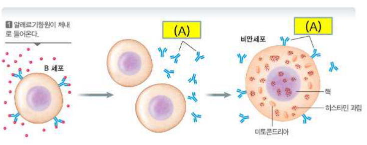
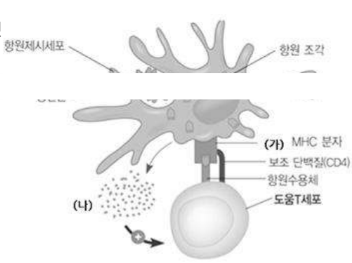
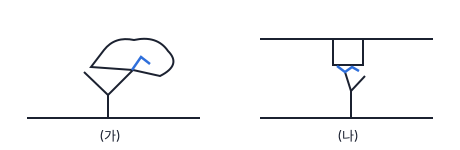
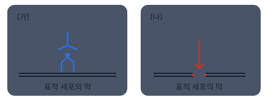
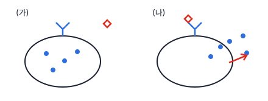

# 복습문제 29선 — 1126 수업 범위

**14강 기출 16개와 변형 연습 13개**예요. 변형의 목표와 실제 구성은 기본 10개·심화 3개예요. 먼저 스스로 풀어 보고 풀이를 열어 확인해요.

> `복습문제_1126_Immune_System.html`를 마크다운으로 옮겼어요. 원문, 힌트, 풀이는 접혀 있어요. 먼저 풀어 보고 펼쳐 보세요.

**목차**

- [B. 기출](#partB)
  - [P1. 면역계 구성 요소](#p1)
  - [P2. 예방접종과 항체 주사](#p2)
  - [P3. 수동면역을 고르는 기준](#p3)
  - [P4. 미엘린 수초에 대한 반응](#p4)
  - [P5. 자가면역질환의 판별](#p5)
  - [P6. 알레르기 감작에 쓰이는 항체](#p6)
  - [P7. 완성 항체를 투여하는 사례](#p7)
  - [P8. BCR과 TCR의 유전자](#p8)
  - [P9. 도움 T세포에서 시작하는 억제](#p9)
  - [P10. 면역계 이상과 정상 염증](#p10)
  - [P11. 항원 제시 세포와 도움 T세포](#p11)
  - [P12. 적응면역 수용체와 유전자](#p12)
  - [P13. 꽃가루에 대한 반응](#p13)
  - [P14. 수초를 표적으로 삼는 반응](#p14)
  - [P15. 미엘린 수초가 사라지는 질환](#p15)
  - [P16. 두 종류의 항원 제시 단백질](#p16)
- [C. 변형 연습](#partC)
  - [P17. [변형] 두 수용체가 붙는 자리](#p17)
  - [P18. [변형] 항원 인식과 공자극](#p18)
  - [P19. [변형] 항원 조각에 맞는 도움](#p19)
  - [P20. [변형] 두 자녀의 MHC 묶음](#p20)
  - [P21. [변형] 면역계 구성 요소의 구별](#p21)
  - [P22. [변형] 전달된 항체와 스스로 남긴 기억](#p22)
  - [P23. [변형] 감염된 세포를 만난 뒤](#p23)
  - [P24. [변형] 같은 제거 도구, 다른 식별 방식](#p24)
  - [P25. [변형] 성숙 과정의 선별](#p25)
  - [P26. [변형] 두 수용체가 읽는 단서](#p26)
  - [P27. [변형] 처음 붙는 것과 나중에 나오는 것](#p27)
  - [P28. [변형] 히스타민의 작용만 막으면](#p28)
  - [P29. [변형] 무엇을 표적으로 삼았을까](#p29)

## B. 기출

### P1. 면역계 구성 요소

다음 중 면역계에 대한 설명으로 옳은 것은?

- (1) 자연살생세포 : 적응면역에서 세균을 삼켜 T 세포에 항원을 제시하는 식세포
- (2) IgE : 비만세포 표면 수용체와 결합하여 알레르기 반응을 매개하는 항체
- (3) B 세포 : 골수에서 형성되어 가슴샘(흉선)에서 분화를 마치는 면역세포
- (4) 면역글로불린 : 항원요소를 형성하는 단백질
- (5) 보체계 : 선천면역을 유발하는 세균 표면에 있는 분자

원문 정보 보기

기출 14강 합본 1번 (PDF 1쪽)

힌트 보기

세포는 성숙 장소와 하는 일로, 단백질은 어디에서 오는지와 무엇에 붙는지로 구별해요.

풀이 보기

1. (1) 틀려요. 자연살생세포는 선천면역의 세포로, 감염되거나 변형된 자기 세포를 직접 제거할 수 있어요.
2. (2) 맞아요. 형질세포가 만든 IgE가 비만세포 표면 수용체에 결합해 알레르기 감작이 일어나요.
3. (3) 틀려요. B세포는 골수에서 성숙하고, 흉선에서 성숙하는 것은 T세포예요.
4. (4) 틀려요. 면역글로불린(Ig)은 항원에 결합하는 항체의 이름이에요.
5. (5) 틀려요. 보체계는 숙주가 만드는 방어 단백질의 체계예요. 일부는 세균 표면에서 활성화돼요.
6. 1126 수업의 비만세포와 IgE가 각각 무엇을 하는지 확인해요. [알레르겐에 처음 노출될 때와 다시 만날 때](정리노트_1126_Immune_System.md#s3-allergy)

**정답:** (2)

---

### P2. 예방접종과 항체 주사

어떤 동물의 흙투성이 발톱에 긁힌 후에 응급실에서 예방접종과 함께 파상풍 독소에 대한 항체를 주사 맞았다. 어떤 면역이 전달되었는가?

- (1) 수동면역만
- (2) 선천면역
- (3) 능동면역만
- (4) 능동면역과 수동면역
- (5) 면역관용

원문 정보 보기

기출 14강 합본 6번 (PDF 1쪽)

힌트 보기

두 처치를 각각 보세요. 넣어 준 것이 면역을 연습시킬 항원인지 이미 작용할 항체인지 확인해요.

풀이 보기

1. (1) 전달된 완성 항체만 세면 수동면역이에요. 접종으로 유도된 면역까지 세는 출제 의도에서는 수동면역만으로는 부족해요.
2. (2) 틀려요. 두 처치 모두 특정 독소에 대한 방어와 연결돼요. 선천면역은 이런 접종으로 생기는 면역 분류가 아니에요.
3. (3) 틀려요. 예방접종은 능동면역이지만, 항체 주사로 즉시 쓸 항체도 받아요.
4. (4) 맞아요. 접종은 자신의 면역반응을 유도하고, 항체 주사는 이미 만든 항체를 전달해요.
5. (5) 틀려요. 면역관용은 특정 항원에 유해한 반응을 일으키지 않는 현상이에요. 이 사례는 두 방식으로 특이적 방어를 얻어요.
6. 1126 수업의 항체 생산 주체와 기억세포 여부를 기준으로 두 처치를 확인해요. [스스로 만드는 항체와 전달받는 항체](정리노트_1126_Immune_System.md#s2-passive)

**정답:** (4)

인쇄 답 (4)는 두 처치로 얻는 면역을 함께 묻는 해석이에요. ‘전달’을 외부에서 바로 받은 것으로 좁히면 (1)도 성립해요.

---

### P3. 수동면역을 고르는 기준

다음 중에서 수동면역에 속하는 것을 모두 고른 것은?

- (가) 임신한 여성의 IgG 항체가 태반을 통해 태아에게 전달됨
- (나) 예방을 위해 불활성화된 세균 독소를 몸으로 주사함
- (다) 독성 뱀에 물린 사람에게 뱀독의 항체를 주사함

- (1) 가, 나, 다
- (2) 나, 다
- (3) 가
- (4) 가, 다
- (5) 나

원문 정보 보기

기출 14강 합본 7번 (PDF 1쪽)

힌트 보기

세 문장마다 몸에 들어온 것이 항원인지 완성된 항체인지 표시해요.

풀이 보기

1. (1) 틀려요. (나)의 불활성화 독소는 자신의 면역계가 반응할 항원이에요.
2. (2) 틀려요. (나)는 능동면역이에요. (다)와 함께 (가)도 수동면역에 들어가요.
3. (3) 틀려요. (가)의 태반을 통한 항체 전달뿐 아니라 (다)의 항뱀독 항체 주사도 수동면역이에요.
4. (4) 맞아요. (가)는 태반을 통해 모체 IgG를 받고 (다)는 이미 만들어진 뱀독 항체를 받아요.
5. (5) 틀려요. (나)는 자기 면역계를 자극해 항체를 만들게 하는 능동면역이에요.
6. 1126 수업의 모체 항체와 항뱀독소 사례를 확인해요. [스스로 만드는 항체와 전달받는 항체](정리노트_1126_Immune_System.md#s2-passive)

**정답:** (4)

---

### P4. 미엘린 수초에 대한 반응

면역체계의 실패로 인하여 때때로 세포들이 자기 세포를 외부물질처럼 공격한다. 다발성 경화증은 뉴런을 감싸고 있는 수초 층에 있는 단백질에 대한 ( ) 때문에 생기는 질환으로, 신경기능의 손상에 따른 근육 약화와 마비, 근육 조절에 문제가 생긴다. 다음 중 괄호 안에 들어갈 단어로 옳은 것은 어느 것인가?

- (1) 면역기억
- (2) 면역관용
- (3) 단일클론항체
- (4) 수동면역
- (5) 자가면역반응

원문 정보 보기

기출 14강 합본 12번 (PDF 2쪽)

힌트 보기

공격받는 수초가 환자 자신의 성분인지 확인해요.

풀이 보기

1. (1) 틀려요. 면역기억은 이미 만난 항원에 재노출될 때 더 빠르게 반응하도록 해요.
2. (2) 틀려요. 면역관용은 자신의 성분에 대한 해로운 면역반응을 억제하는 현상이에요.
3. (3) 틀려요. 특정 항원 부위와 결합하는 항체의 유형을 가리켜요. 빈칸에는 자기 성분을 표적으로 하는 면역반응의 이름이 필요해요.
4. (4) 틀려요. 수동면역은 다른 곳에서 만들어진 항체를 받는 방식이에요.
5. (5) 맞아요. 면역계의 표적이 몸 안의 자기 미엘린 성분이므로 자가면역반응이에요.
6. 1126 수업의 다발성 경화증에서 표적과 결과의 연결을 확인해요. [자가면역질환에서 공격받는 표적](정리노트_1126_Immune_System.md#s3-autoimmunity)

**정답:** (5)

---

### P5. 자가면역질환의 판별

다음 중 자가면역반응 질환에 해당하지 않는 것은?

- (1) 다발성 경화증
- (2) 과민성 쇼크
- (3) 퇴행성 관절염
- (4) 인슐린 의존성 당뇨병(제1형 당뇨)
- (5) 전신홍반루푸스

원문 정보 보기

기출 14강 합본 21번 (PDF 3쪽)

힌트 보기

자기 조직에 면역반응이 일어나는지, 특정 항원에 전신 과민반응이 나타나는지 구분해요.

풀이 보기

1. (1) 자가면역질환에 해당해요. 중추신경계 미엘린이 면역 공격의 표적이 될 수 있어요.
2. (2) 출제 의도상 답이에요. 수업에서 다룬 과민성 쇼크는 심한 전신 알레르기 반응이에요.
3. (3) 표준 분류에서는 이 선택지도 답이 될 수 있어요. 퇴행성 관절염은 골관절염이고, 대표적인 자가면역 관절염은 류마티스 관절염이에요.
4. (4) 자가면역질환에 해당해요. 췌장 베타세포가 공격받으면 인슐린을 충분히 생산하기 어려워요.
5. (5) 자가면역질환에 해당해요. 핵 성분을 포함한 여러 자기 성분에 대한 면역반응이 나타날 수 있어요.
6. 1126 수업의 면역관용 실패와 자가면역질환을 확인해요. [자가면역질환에서 공격받는 표적](정리노트_1126_Immune_System.md#s3-autoimmunity)

**정답:** (2)

인쇄 정답은 (2)예요. 퇴행성 관절염을 표준 분류대로 읽으면 (3)도 자가면역질환에 해당하지 않아요.

---

### P6. 알레르기 감작에 쓰이는 항체

위 그림은 알레르기항원의 초기 노출에 대한 감작과정을 나타낸 것이다. 알레르기반응에서 중요한 항체인 (A)는 무엇인가?

- (1) IgD
- (2) IgA
- (3) IgG
- (4) IgE
- (5) IgM

원문 정보 보기

기출 14강 합본 24번 (PDF 3쪽)

힌트 보기

첫 노출 때 (A)가 어느 세포의 표면에 붙어 기다리는지 그림에서 찾아요.

풀이 보기

1. (1) 틀려요. IgD는 B세포 표면 수용체로 존재할 수 있어요. 그림 속 감작 단계의 (A)는 비만세포 표면에 붙는 항체예요.
2. (2) 틀려요. IgA는 점막·분비물 방어에 대표적인 항체예요.
3. (3) 틀려요. IgG는 혈액에 많은 항체이며 모체에서 태아에게 전달되기도 해요.
4. (4) 맞아요. (A)는 알레르겐에 특이적인 IgE예요. 분비된 뒤 비만세포 표면 수용체에 붙어요.
5. (5) 틀려요. IgM은 일반적인 1차 항체 반응에서 먼저 나타날 수 있어요. 그림은 IgE 매개 감작이에요.
6. 1126 수업의 첫 노출과 IgE의 표면 결합을 확인해요. [알레르겐에 처음 노출될 때와 다시 만날 때](정리노트_1126_Immune_System.md#s3-allergy)

**정답:** (4)

---

### P7. 완성 항체를 투여하는 사례

알츠하이머를 치료하기 위한 임상에서의 현재 전략은 그 병에서 생산되는 병적 단백질을 표적으로 하는 항체를 환자에게 주입하는 것이다. 이 기술은 무엇에 대한 예시인가?

- (1) 수동면역
- (2) 예방접종
- (3) 능동면역
- (4) 세포성 식세포작용
- (5) 항-알레르겐 캐스케이드

원문 정보 보기

기출 14강 합본 29번 (PDF 3쪽)

힌트 보기

치료 대상 병의 이름보다 환자가 어떤 형태의 물질을 전달받는지 봐요.

풀이 보기

1. (1) 맞아요. 문항에서 환자는 이미 만들어진 표적 항체를 받으므로 수동면역의 원리를 적용한 사례예요.
2. (2) 틀려요. 예방접종은 항원이나 그 정보를 통해 자기 면역계의 반응을 유도해요.
3. (3) 틀려요. 능동면역이라면 환자 자신의 면역계가 항원에 반응해야 해요. 여기서는 완성된 항체를 전달해요.
4. (4) 틀려요. 식세포작용은 세포가 물질을 감싸 안으로 들이는 과정이에요. 이 문항은 항체를 투여하는 방식을 물어요.
5. (5) 틀려요. 문항의 항체 표적은 병적 단백질이에요. 알레르기 감작과 비만세포 반응을 설명하는 사례는 아니에요.
6. 1126 수업에서 완성 항체를 받는다는 판별 기준을 새로운 사례에 확인해요. [스스로 만드는 항체와 전달받는 항체](정리노트_1126_Immune_System.md#s2-passive)

**정답:** (1)

---

### P8. BCR과 TCR의 유전자

다음 적응면역과정에 대한 설명 중 틀린 것은?

- (1) 림프구는 림프조직에서 항원을 만나는데, 항원을 인식하는 림프구는 B 세포와 T 세포가 있다
- (2) BCR이나 TCR은 항원분자의 에피톱과 결합한다
- (3) BCR과 TCR을 암호화 하는 유전자는 같다
- (4) B 세포와 T 세포는 각각 특정 항원과 결합하는 수용체분자를 세포막에 가진다
- (5) 항원을 만나면 림프구는 활성화되어 세포분열을 한다

원문 정보 보기

기출 14강 합본 30번 (PDF 4쪽)

힌트 보기

두 수용체가 모두 다양해지는 것과 두 수용체를 만드는 유전자가 같은 것은 별개의 판단이에요.

풀이 보기

1. (1) 맞아요. 림프조직은 B세포와 T세포가 항원이나 제시된 항원 조각을 인식하는 장소예요.
2. (2) 맞아요. 두 수용체 모두 항원 쪽 특정 부위를 알아봐요. TCR은 그 부위가 MHC에 실린 펩타이드로 제시된 상태를 읽어요.
3. (3) 틀려요. BCR과 TCR은 서로 다른 수용체 유전자 자리에서 만들어져요. 재배열이 둘 다 일어난다는 공통점은 있어요.
4. (4) 맞아요. 두 세포는 각기 특이적인 막 수용체를 갖고, T세포에는 펩타이드–MHC라는 제시 조건이 붙어요.
5. (5) 출제 문맥은 활성화에 필요한 신호까지 갖춘 경우예요. 항원 접촉만으로 활성화와 분열이 보장된다고 읽으면 이 진술도 틀려요.
6. 1126 수업의 수용체 재배열 과정과 BCR·TCR의 인식 대상을 확인해요. [B세포와 T세포는 항원을 어떻게 읽을까?](정리노트_1126_Immune_System.md#s0-receptors)

**정답:** (3)

인쇄 답 (3)은 두 수용체의 유전자 차이를 묻는 해석이에요. (5)를 항원 접촉만으로 충분하다는 뜻으로 읽으면 추가 활성화 신호 조건도 빠져 있어요.

---

### P9. 도움 T세포에서 시작하는 억제

이식된 장기에 대한 거부반응을 줄이기 위하여 사이클로스포린 A 라는 항체매개면역반응 제어 약물을 사용한다. 이 약물은 결국 무엇을 억제하는 약물인가?

- (1) 염증반응
- (2) 비만세포의 활성화
- (3) 항원제시세포의 활성화
- (4) 리소자임의 분비
- (5) B 세포의 활성화

원문 정보 보기

기출 14강 합본 32번 (PDF 4쪽)

힌트 보기

도움 T세포에서 생긴 변화가 그 도움을 받는 어느 세포에 이어지는지 추적해요.

풀이 보기

1. (1) 틀려요. 이 문항이 지정한 항체매개 경로에서는 도움 T세포의 신호와 뒤이은 반응을 짚어야 해요.
2. (2) 틀려요. 비만세포 활성화는 IgE 매개 알레르기에서 다룬 반응이에요.
3. (3) 틀려요. 여기서 묻는 것은 도움 T세포의 활성화가 억제된 뒤 도움을 받는 쪽의 변화예요.
4. (4) 틀려요. 리소자임은 선천적 방어에 관여해요. 도움 T세포가 주는 신호를 받아 항체 생산을 시작하는 단계는 아니에요.
5. (5) 맞아요. 도움 T세포 활성화가 억제되면 도움 신호가 줄어, 그 신호에 의존하는 B 세포의 활성화도 간접적으로 줄어요.
6. 1126 수업의 도움 T세포가 B세포를 활성화하는 두 번째 만남을 확인해요. [도움 T세포가 맞는 B세포를 찾는 법](정리노트_1126_Immune_System.md#s1-linked-help)

**정답:** (5)

---

### P10. 면역계 이상과 정상 염증

다음 중 면역체계의 이상으로 인해 발생하는 증상이 아닌 것은?

- (1) 과민성 쇼크
- (2) 알레르기 반응
- (3) 염증반응
- (4) 퇴행성 관절염
- (5) 자가면역반응

원문 정보 보기

기출 14강 합본 34번 (PDF 4쪽)

힌트 보기

평소 방어에도 쓰이는 반응과 면역 조절의 이상으로 생기는 반응을 구분해요.

풀이 보기

1. (1) 면역 이상과 관련돼요. 과민성 쇼크는 심한 전신 과민반응으로 나타날 수 있어요.
2. (2) 면역 이상과 관련돼요. 알레르기는 특정 항원에 대한 과도한 면역반응이에요.
3. (3) 출제 의도상 답이에요. 염증은 감염이나 손상에 반응할 때 정상적인 방어의 일부로도 일어나요.
4. (4) 표준 분류에서는 이 선택지도 답이 될 수 있어요. 퇴행성 관절염은 골관절염의 명칭이며, 대표적인 자가면역 관절염은 류마티스 관절염이에요.
5. (5) 면역 이상과 관련돼요. 자가면역반응에서는 면역계가 자기 성분을 표적으로 삼아요.
6. 1126 수업에서 히스타민에 의한 변화와 면역계 이상 사례의 범위를 확인해요. [알레르겐에 처음 노출될 때와 다시 만날 때](정리노트_1126_Immune_System.md#s3-allergy)

**정답:** (3)

인쇄 정답은 (3)이에요. 퇴행성 관절염을 표준 분류대로 읽으면 (4)도 면역계의 기능 이상이 직접 일으키는 질환으로 분류하기 어려워요.

---

### P11. 항원 제시 세포와 도움 T세포

위 그림은 항원제시세포와 도움 T 세포 간의 상호작용을 나타낸 것이다. 이에 대한 설명으로 옳지 않은 것은 ?

- (1) (나)의 사이토카인은 도움 T 세포의 증식과 활성을 돕는다
- (2) 항원수용체가 MHC 분자와 항원조각을 인식할 때 CD4가 필요하다
- (3) 병원균을 섭취한 수지상세포나 대식세포는 항원제시세포가 된다
- (4) (가)는 제1형 MHC 분자이다
- (5) 도움 T 세포는 B 세포를 자극할 수 있다

원문 정보 보기

기출 14강 합본 35번 (PDF 4쪽)

원문에 중복 삽입된 34번 발문을 제외했어요. 그림의 가로 빈 띠는 인쇄본에도 있으며, 상호작용과 표지는 읽을 수 있어요.

힌트 보기

그림에서 보조 단백질이 어느 종류의 세포에 있는지 먼저 확인해요.

풀이 보기

1. (1) 맞아요. 항원 제시 세포가 분비하는 사이토카인은 T세포 활성화를 돕고, 활성화된 T세포의 사이토카인은 자기 증식을 촉진해요.
2. (2) 맞아요. 이 상호작용에서 CD4가 MHC에 결합해 TCR의 항원 인식을 도와요.
3. (3) 맞아요. 수지상세포와 대식세포는 병원균을 삼킨 뒤 가공된 조각을 표면에 제시할 수 있어요.
4. (4) 틀려요. CD4가 보조하는 이 그림에서 제시 세포의 (가)는 제2형 MHC예요.
5. (5) 맞아요. 활성화된 도움 T세포는 맞는 조각을 제시한 B세포를 자극할 수 있어요.
6. 1126 수업의 [항원 제시](정리노트_1126_Immune_System.md#s1-presentation)에서 두 세포의 접촉면을 읽어요. 위쪽 세포가 조각을 보여 주고 아래쪽 T세포의 수용체가 이를 읽어요.

**정답:** (4)

---

### P12. 적응면역 수용체와 유전자

다음 적응면역과정에 대한 설명 중 틀린 것은?

- (1) BCR과 TCR을 암호화 하는 유전자는 같다
- (2) BCR이나 TCR은 항원분자의 에피톱과 결합한다
- (3) B 세포와 T 세포는 각각 특정 항원과 결합하는 수용체분자를 세포막에 가진다
- (4) 항원을 만나면 림프구는 활성화되어 세포분열을 한다
- (5) 림프구는 림프조직에서 항원을 만나는데, 항원을 인식하는 림프구는 B 세포와 T 세포가 있다

원문 정보 보기

기출 14강 합본 38번 (PDF 4쪽)

힌트 보기

두 수용체는 모두 항원 인식에 관여해요. 각각을 만드는 유전자가 같은지도 살펴봐요.

풀이 보기

1. (1) 틀려요. BCR과 TCR은 서로 다른 유전자에서 만들어져요.
2. (2) 맞아요. BCR은 가공 전 항원의 에피톱을 직접 읽고, 여기서 TCR은 펩타이드가 MHC에 제시된 형태로 항원 유래 부위를 인식해요.
3. (3) 맞아요. B세포는 BCR을, T세포는 TCR을 세포막에 두고 각 수용체에 맞는 대상을 인식해요.
4. (4) 출제 문맥은 활성화에 필요한 신호까지 갖춘 경우예요. 항원 접촉만으로 활성화와 분열이 보장된다고 읽으면 이 진술도 틀려요.
5. (5) 맞아요. B세포와 T세포는 항원을 인식하는 림프구이며 림프조직에서 항원을 만날 수 있어요.
6. 1126 수업의 [수용체 비교](정리노트_1126_Immune_System.md#s0-receptors)에서 DNA 재배열은 두 계열에 모두 일어나지만, 각각 다른 유전자가 재배열돼요.

**정답:** (1)

인쇄 답 (1)은 두 수용체의 유전자 차이를 묻는 해석이에요. (4)를 항원 접촉만으로 충분하다는 뜻으로 읽으면 추가 활성화 신호 조건도 빠져 있어요.

---

### P13. 꽃가루에 대한 반응

여러분은 꽃가루에 노출되어 발적이 생기면서 열이 나고 가렵다. 이를 치료하기 위한 약은 무엇의 작용을 막아야 가장 좋은 효과를 갖는가?

- (1) 보체단백질
- (2) 발열원
- (3) 히스타민
- (4) 시토카인
- (5) 인터페론

원문 정보 보기

기출 14강 합본 39번 (PDF 5쪽)

힌트 보기

꽃가루를 만난 뒤 함께 나타난 발적과 가려움에 주목해요.

풀이 보기

1. (1) 틀려요. 보체단백질은 선천 방어에 관여하지만 이 감작·재노출 경로에서 발적과 가려움을 잇는 물질은 히스타민이에요.
2. (2) 틀려요. 발열원은 체온 상승과 관련돼요. 꽃가루 노출 뒤 발적과 가려움이 함께 나타난 것이 판별 단서예요.
3. (3) 맞아요. 같은 알레르기 항원에 다시 노출되면 비만세포에서 히스타민이 나와 혈관 반응과 가려움에 관여해요.
4. (4) 틀려요. 시토카인은 면역세포 사이 신호에 쓰여요. 문제에서 가려움과 발적을 함께 설명하는 물질은 히스타민이에요.
5. (5) 틀려요. 인터페론은 바이러스 방어에 관여하며, 문제의 꽃가루 반응은 비만세포의 히스타민으로 설명돼요.
6. 1126 수업의 [알레르기 반응](정리노트_1126_Immune_System.md#s3-allergy)에서 첫 노출의 감작과 재노출의 히스타민 방출을 구별해요.

**정답:** (3)

문항의 ‘열이 나고’는 전형적인 알레르기를 가르는 단서로 삼기 어려워요. 여기서는 꽃가루 노출 후 나타난 발적과 가려움으로 판단해요.

---

### P14. 수초를 표적으로 삼는 반응

면역체계의 실패로 인하여 때때로 세포들이 자기 세포를 외부물질처럼 공격한다. 다발성 경화증은 뉴런을 감싸고 있는 수초 층에 있는 단백질에 대한 ( ) 때문에 생기는 질환으로, 신경기능의 손상에 따른 근육 약화와 마비, 근육 조절에 문제가 생긴다. 다음 중 괄호 안에 들어갈 단어로 옳은 것은 어느 것인가?

- (1) 면역관용
- (2) 수동면역
- (3) 단일클론항체
- (4) 자가면역반응
- (5) 면역기억

원문 정보 보기

기출 14강 합본 40번 (PDF 5쪽)

힌트 보기

손상된 수초 단백질이 누구의 몸에서 만들어졌는지 생각해요.

풀이 보기

1. (1) 틀려요. 면역관용은 자기 성분에 대한 공격을 제한하는 상태예요.
2. (2) 틀려요. 수동면역은 외부에서 이미 만들어진 항체를 받아요.
3. (3) 틀려요. 단일클론항체는 항체를 가리키는 말이에요. 여기서는 자기 성분을 표적으로 한 반응을 묻고 있어요.
4. (4) 맞아요. 자기 몸의 미엘린 수초가 면역반응의 표적이 되었으므로 자가면역반응이에요.
5. (5) 틀려요. 면역기억은 다시 만난 항원에 대응하는 능력이며, 수초가 자기 성분이라는 단서로는 자가면역을 판별해요.
6. 1126 수업의 [자가면역질환](정리노트_1126_Immune_System.md#s3-autoimmunity)에서는 증상보다 면역계가 반응한 표적을 먼저 확인해요.

**정답:** (4)

---

### P15. 미엘린 수초가 사라지는 질환

다음 중, 뉴런을 감싸고 있는 수초 중의 단백질에 특이적으로 반응하여 절연성 미엘린 수초가 상실되는 자가면역질환은?

- (1) 인슐린 의존성 당뇨병
- (2) 퇴행성관절염
- (3) 다발성경화증
- (4) AIDS
- (5) 루프스

원문 정보 보기

기출 14강 합본 44번 (PDF 5쪽)

힌트 보기

질환 이름을 고르기 전에 제시된 손상 부위를 확인해요.

풀이 보기

1. (1) 틀려요. 제1형 당뇨병의 표적은 인슐린을 만드는 췌장 베타세포예요.
2. (2) 틀려요. 퇴행성관절염은 관절에 생기는 질환이에요.
3. (3) 맞아요. 다발성 경화증에서는 미엘린 수초가 손상되어 신경의 신호 전달에 문제가 생겨요.
4. (4) 틀려요. AIDS는 후천성 면역결핍 증후군이에요. 문제의 단서는 자기 수초에 대한 공격이에요.
5. (5) 틀려요. 루푸스는 여러 자기 성분에 대한 면역반응이 일어나는 전신 질환이에요. 미엘린 수초 손상이 명시된 경우 다발성 경화증을 골라요.
6. 1126 수업의 [자가면역질환 예시](정리노트_1126_Immune_System.md#s3-autoimmunity)에서 제1형 당뇨병은 췌장 베타세포, 다발성 경화증은 미엘린 수초의 손상으로 구별해요.

**정답:** (3)

---

### P16. 두 종류의 항원 제시 단백질

다음은 무엇에 관한 설명인가?

“일란성 쌍둥이가 아닌 이상 한 종에서 두 개체가 같은 이것의 분자조합을 가질 확률은 거의 없다. 이것은 제 1형과 제 2형 단백질을 가지며 각각 적응면역에서 다른 역할을 수행한다.”

- (1) 항원제시세포(APC)
- (2) 막공격복합체
- (3) 주조직적합성복합체(MHC)
- (4) 대식세포
- (5) 항체

원문 정보 보기

기출 14강 합본 47번 (PDF 5쪽)

힌트 보기

제1형과 제2형으로 나뉘는 분자를 찾아요.

풀이 보기

1. (1) 틀려요. 항원제시세포는 항원 조각을 제시하는 세포예요.
2. (2) 틀려요. 막공격복합체는 보체가 만들어 표적 막에 구멍을 내는 복합체예요.
3. (3) 맞아요. 주조직적합성복합체(MHC)의 단백질은 제1형과 제2형으로 구분되며, 유전자 조합이 사람마다 다양해요.
4. (4) 틀려요. 대식세포는 병원체를 삼키고 항원 조각을 제시할 수 있는 세포예요.
5. (5) 틀려요. 항체는 특정 항원에 결합하는 면역글로불린이에요.
6. 1126 수업의 [MHC와 조직적합성](정리노트_1126_Immune_System.md#s1-mhc)에서는 각 부모에게서 HLA 묶음을 하나씩 받는다고 설명했어요. 같은 부모의 두 자녀는 양쪽 묶음을 모두 같게 받을 수 있어요.

**정답:** (3)

개인 간 MHC 조합이 다양하다는 것이 판별 기준이에요. 같은 부모의 자녀 둘은 기본 유전 모형에서 4분의 1의 확률로 양쪽 HLA 묶음이 일치해요.

---

## C. 변형 연습

### P17. [변형] 두 수용체가 붙는 자리

그림 (가)와 (나)에서 아래쪽 세포막에 꽂힌 수용체를 순서대로 고르세요.

- (1) TCR, BCR
- (2) BCR, TCR
- (3) BCR, BCR
- (4) TCR, TCR
- (5) 분비된 항체, MHC

원문 정보 보기

원문 기출이 아닌 생성 변형이에요. 다루는 혼동: 온전한 항원에 직접 결합하는 수용체와 받침에 실린 조각을 읽는 수용체. 근거: [정리노트](정리노트_1126_Immune_System.md#s0-receptors).

힌트 보기

아래쪽 세포막에 꽂힌 수용체가 각각 무엇에 닿는지 살펴봐요.

풀이 보기

1. (1) 틀려요. (가)는 온전한 항원에 직접 닿는 BCR이며, (나)는 다른 세포가 제시한 조각을 읽는 TCR이에요.
2. (2) 맞아요. (가)의 B 세포 수용체(BCR)는 항원에 직접 결합하고, (나)의 T 세포 수용체(TCR)는 MHC에 실린 펩타이드를 인식해요.
3. (3) 틀려요. (나)의 수용체는 제시된 펩타이드–MHC를 읽는 TCR이에요.
4. (4) 틀려요. (가)에서 가공 전 항원에 직접 붙는 막 수용체는 BCR이에요.
5. (5) 틀려요. (나)에서 MHC가 있는 곳은 위쪽 세포막이에요. 아래쪽 세포막에 꽂힌 수용체는 TCR이에요.
6. 1126 수업의 [BCR·TCR 비교](정리노트_1126_Immune_System.md#s0-receptors)에서는 수용체 이름을 떠올리기 전에 항원이 제시되어 있는지부터 확인해요.

**정답:** (2)

---

### P18. [변형] 항원 인식과 공자극

수지상세포가 항원 조각을 제시하고, 미활성 CD4 T세포의 TCR이 이를 인식했어요. 이 실험에서 공자극만 차단했을 때 가장 적절한 결과는 무엇인가요?

- (1) 수지상세포 안에서 항원이 잘리지 않아요.
- (2) 항원을 인식한 것만으로 도움 T세포의 활성화가 충분히 일어나요.
- (3) 항원 인식은 가능하지만 도움 T세포의 충분한 활성화는 어려워져요.
- (4) B세포가 곧바로 퍼포린을 분비해요.
- (5) TCR의 항원 인식 특이성이 사라져요.

원문 정보 보기

원문 기출이 아닌 생성 변형이에요. 다루는 혼동: 항원 인식과 충분한 활성화. 근거: [정리노트](정리노트_1126_Immune_System.md#s1-presentation).

힌트 보기

이 실험에서 이미 성공한 단계와 차단한 단계를 각각 짚어 봐요.

풀이 보기

1. (1) 틀려요. 항원 조각은 이미 제시되었고, 공자극 차단은 이후의 활성화 조건에 영향을 줘요.
2. (2) 틀려요. 맞는 항원을 인식해도 충분한 활성화에는 공자극이 필요해요.
3. (3) 맞아요. 펩타이드–MHC와 TCR의 인식은 유지되지만 공자극이 빠져 도움 T세포의 충분한 활성화가 어려워져요.
4. (4) 틀려요. B세포가 퍼포린을 분비하는 경로가 아니에요. 퍼포린은 세포독성 T세포 등이 표적을 제거할 때 써요.
5. (5) 틀려요. 공자극을 끊어도 이미 준비된 TCR이 어떤 복합체를 알아보는지는 달라지지 않아요.
6. 1126 수업의 [T세포 활성화](정리노트_1126_Immune_System.md#s1-presentation)에는 맞는 펩타이드–MHC를 읽는 과정과 수지상세포가 주는 활성화 신호가 함께 필요해요.

**정답:** (3)

---

### P19. [변형] 항원 조각에 맞는 도움

B세포 X는 BCR로 단백질 A의 표면에 결합했어요. A를 내부로 가져와 분해한 뒤, BCR이 붙었던 부위와 다른 조각 a를 MHC에 실어 제시해요. 이미 활성화된 도움 T세포 Y는 a가 든 복합체를, Z는 다른 단백질 B에서 나온 조각 b가 든 복합체를 인식해요. 다른 도움 조건은 모두 갖춰져 있을 때, X를 직접 도울 세포와 그 분화 결과의 조합을 고르세요.

- (1) Z가 돕고, 형질세포와 기억 B세포가 생길 수 있어요.
- (2) BCR과 TCR이 알아보는 부위가 달라서 Y와 Z 모두 X를 도울 수 없어요.
- (3) Y가 돕고, X가 세포독성 T세포로 분화해요.
- (4) Y가 돕고, 형질세포와 기억 B세포가 생길 수 있어요.
- (5) Y가 돕고, X가 비만세포로 분화해요.

원문 정보 보기

원문 기출이 아닌 생성 변형이에요. 다루는 혼동: 같은 항원에서 BCR이 붙은 부위와 TCR이 인식하는 조각. 근거: [정리노트](정리노트_1126_Immune_System.md#s1-linked-help).

힌트 보기

B세포가 들여온 단백질과 그 표면에 제시하는 조각을 먼저 연결해요.

풀이 보기

1. (1) 틀려요. Z는 단백질 B에서 나온 b를 읽으므로 X가 제시한 a를 인식할 수 없어요.
2. (2) 틀려요. BCR이 붙잡은 부위와 도움 T세포가 읽는 펩타이드가 달라도, X가 제시한 조각을 Y가 인식하면 도움을 줄 수 있어요.
3. (3) 틀려요. Y는 X를 도울 수 있지만 활성화된 B세포는 B세포 계열로 분화해요.
4. (4) 맞아요. Y가 X의 펩타이드–MHC 복합체를 읽어 도움을 주면 X에서 형질세포와 기억 B세포가 생길 수 있어요.
5. (5) 틀려요. Y는 X를 도울 수 있지만 활성화된 B세포는 비만세포로 분화하지 않아요.
6. 1126 수업의 [두 번째 만남](정리노트_1126_Immune_System.md#s1-linked-help)에서는 B세포가 제시한 조각에 맞는 도움 T세포가 신호를 보내요.

**정답:** (4)

---

### P20. [변형] 두 자녀의 MHC 묶음

표의 가족에서 각 부모는 자신의 MHC 유전자 묶음 중 하나를 그대로 전달해요. 가능한 자녀의 조합 네 가지가 모두 같은 확률로 생길 때, 아이 2가 아이 1과 두 묶음이 모두 일치할 확률은 얼마인가요?

| 가족 구성원 | MHC 유전자 묶음 |
|---|---|
| 아버지 | A, B |
| 어머니 | C, D |
| 아이 1 | A, C |

- (1) 4분의 1
- (2) 2분의 1
- (3) 4분의 3
- (4) 1
- (5) 0

원문 정보 보기

원문 기출이 아닌 생성 변형이에요. 다루는 혼동: 부모 한쪽에서 같은 묶음을 받는 경우와 양쪽이 모두 일치하는 경우. 근거: [정리노트](정리노트_1126_Immune_System.md#s1-mhc).

힌트 보기

아이 2가 아이 1과 같아지려면 부모 각각에게서 어느 묶음을 받아야 하는지 확인해요.

풀이 보기

1. (1) 맞아요. 아이 2가 아버지에게서 A를 받을 확률과 어머니에게서 C를 받을 확률이 각각 절반이므로, 둘 다 받을 확률은 4분의 1이에요.
2. (2) 틀려요. 2분의 1은 한쪽 부모에게서 같은 묶음을 받을 확률이에요.
3. (3) 틀려요. 4분의 3은 네 조합 중 어느 쪽도 같지 않은 B·D만 뺀 경우예요. 두 묶음이 모두 같은 조합은 A·C 한 가지예요.
4. (4) 틀려요. 아이 2는 아버지에게서 B를 받거나 어머니에게서 D를 받을 수도 있어요.
5. (5) 틀려요. 아이 2도 아버지에게서 A와 어머니에게서 C를 받을 수 있어요.
6. 1126 수업의 [조직적합성](정리노트_1126_Immune_System.md#s1-mhc)에서 형제자매가 두 부모로부터 받은 묶음이 각각 같은지 확인한 기본 모형을 적용해요.

**정답:** (1)

---

### P21. [변형] 면역계 구성 요소의 구별

다음 중 면역계에 대한 설명으로 옳은 것은?

- (1) IgE는 비만세포에 결합하지 않고 오직 체액 속에서만 작용해요.
- (2) B 세포는 골수에서 생겨 흉선에서 B 세포 수용체를 갖춰요.
- (3) 면역글로불린은 항체가 인식하는 외부 물질을 가리켜요.
- (4) 보체는 B 세포가 분비하는 항체의 한 부류예요.
- (5) T 세포 전구체는 골수에서 출발해 흉선에서 성숙해요.

원문 정보 보기

기출 14강 1번 발문에 정답을 바꾼 생성 변형이에요. 다루는 혼동: 림프구의 출발 장소와 성숙 장소. 근거 토픽: s0-receptors.

힌트 보기

세포가 처음 만들어지는 장소와 수용체를 갖추며 성숙하는 장소를 따로 보세요.

풀이 보기

1. (1) 틀려요. IgE는 비만세포 표면 수용체에 결합할 수 있어요.
2. (2) 틀려요. B 세포는 골수에서 성숙해요.
3. (3) 틀려요. 면역글로불린은 항체를 말하며 항체가 인식하는 물질은 항원이에요.
4. (4) 틀려요. 보체는 체액에 있는 여러 방어 단백질의 체계예요.
5. (5) 맞아요. T 세포 전구체는 골수에서 만들어진 뒤 흉선으로 이동해 성숙해요.
6. 원문 정답과 달라진 점: 원문은 알레르기 항체의 성질을 묻는 보기가 맞았고, 이 변형은 T 세포의 출발과 성숙 장소를 묻는 보기가 맞아요.
7. [1126 수업에서 B 세포와 T 세포의 성숙 장소를 구분했어요.](정리노트_1126_Immune_System.md#s0-receptors)

**정답:** (5)

---

### P22. [변형] 전달된 항체와 스스로 남긴 기억

이전에 해당 항원에 노출된 적 없는 두 집단에 같은 항원을 대비하는 서로 다른 처치를 했어요. 표를 해석한 설명으로 옳지 않은 것은?

| 비교 기준 | 가 | 나 |
|---|---|---|
| 처음 받은 물질 | 다른 개체에서 얻은 항체만 전달 | 기억 형성을 유도하는 예방접종 |
| 처치 직후 외부에서 들어온 완성 항체 | 검출 | 검출되지 않음 |
| 시간이 흐른 뒤 자기 면역세포의 항원 반응 | 실험 조건에서 관찰되지 않음 | 관찰됨 |

- (1) 가의 처치 직후 검출된 항체는 다른 개체에서 가져온 것이에요.
- (2) 나에서는 접종 뒤 자기 면역세포가 항원에 반응해 항체를 만들 수 있어요.
- (3) 나에서는 반응한 자기 면역세포에서 기억세포가 생길 수 있어요.
- (4) 가에서 전달받은 항체가 오래 남아 같은 항원을 기억할 세포를 직접 만들어요.
- (5) 가에서 전달받은 항체가 분해되면 그 항체로 얻던 보호가 약해질 수 있어요.

원문 정보 보기

원문 기출이 아닌 생성 변형이에요. 다루는 혼동: 외부 항체의 즉시 효과와 자기 면역계의 장기 기억. 근거 토픽: s2-passive.

힌트 보기

항체가 어디서 왔는지와 기억세포를 누가 만드는지 순서대로 확인하세요.

풀이 보기

1. (1) 맞아요. 가에 넣은 것은 이미 다른 개체에서 만들어진 항체예요.
2. (2) 맞아요. 나의 항원 자극에 반응한 자기 B 세포가 항체를 만드는 형질세포로 분화할 수 있어요.
3. (3) 맞아요. 예방접종으로 자기 면역계가 반응하는 동안 기억세포가 만들어질 수 있어요.
4. (4) 틀려요. 가는 수동면역으로 항체만 받았고 전달된 항체가 가의 기억세포를 직접 만드는 것은 아니에요.
5. (5) 맞아요. 외부 항체에 의존하는 보호는 전달된 항체의 양이 줄면서 약해질 수 있어요.
6. [1126 수업의 능동면역과 수동면역에서 항체의 출처를 확인하면, 방어가 시작되는 방식과 면역기억도 구별할 수 있어요.](정리노트_1126_Immune_System.md#s2-passive)

**정답:** (4)

---

### P23. [변형] 감염된 세포를 만난 뒤

활성화된 세포독성 T세포가 바이러스에 감염된 표적 세포를 제거하는 장면이에요. (가)에서 표적의 항원 조각을 받치는 분자와 (나)에서 표적의 막에 구멍을 내는 물질을 순서대로 고르세요.

- (1) II형 MHC, 퍼포린
- (2) I형 MHC, 인터루킨
- (3) I형 MHC, 퍼포린
- (4) I형 MHC, 히스타민
- (5) II형 MHC, 항체

원문 정보 보기

원문 기출이 아닌 생성 변형이에요. 다루는 혼동: 표적을 알아보는 단계와 막에 구멍을 내는 단계. 근거 토픽: s2-cytotoxic.

힌트 보기

두 물질 중 하나는 표적 세포의 표면에 있고, 다른 하나는 표적을 인식한 세포독성 T세포가 내보내요.

풀이 보기

1. (1) 틀려요. 구멍을 내는 물질은 퍼포린이지만 세포독성 T세포는 I형 MHC에 놓인 항원 조각을 인식해요.
2. (2) 틀려요. I형 MHC라는 판별은 맞지만 인터루킨은 신호 물질이며 이때 구멍을 내는 것은 퍼포린이에요.
3. (3) 맞아요. 감염된 표적 세포는 I형 MHC로 항원을 제시하고, 활성화된 세포독성 T세포의 퍼포린이 표적 막에 구멍을 내요.
4. (4) 틀려요. I형 MHC라는 판별은 맞지만 히스타민은 여기서 막에 구멍을 만드는 물질이 아니에요.
5. (5) 틀려요. 세포독성 T세포가 인식하는 항원 조각은 I형 MHC에 제시되고 표적 막에는 퍼포린이 작용해요.
6. [1126 수업에서 감염된 세포의 표지와 세포독성 T세포가 내보내는 물질을 각각 확인했어요.](정리노트_1126_Immune_System.md#s2-cytotoxic)

**정답:** (3)

---

### P24. [변형] 같은 제거 도구, 다른 식별 방식

두 면역세포 가와 나가 각각 바이러스에 감염된 자기 세포를 제거해요. ‘가’는 표적의 I형 MHC와 항원 조각이 이루는 복합체를 TCR로 인식해요. ‘나’는 그런 방식의 항원 특이적 인식 없이 감염 세포를 제거해요. 둘 다 퍼포린을 활용할 때, 가와 나를 순서대로 고르세요.

- (1) 자연살생세포, 세포독성 T세포
- (2) 세포독성 T세포, 자연살생세포
- (3) 세포독성 T세포, 세포독성 T세포
- (4) 자연살생세포, 자연살생세포
- (5) 형질세포, 자연살생세포

원문 정보 보기

원문 기출이 아닌 생성 변형이에요. 다루는 혼동: 자연살생세포와 세포독성 T세포의 표적 인식. 근거 토픽: s2-cytotoxic.

힌트 보기

두 세포가 함께 사용하는 물질을 제외하고, 각 세포가 표적을 알아보는 단서를 비교하세요.

풀이 보기

1. (1) 틀려요. I형 MHC에 제시된 항원 조각을 TCR로 인식하는 가는 세포독성 T세포예요.
2. (2) 맞아요. 가는 항원 특이적 TCR을 쓰는 세포독성 T세포이고, 나는 그 방식 없이 퍼포린을 이용하는 자연살생세포예요.
3. (3) 틀려요. 나는 가와 달리 TCR의 항원 특이적 인식으로 표적을 판별하지 않아요.
4. (4) 틀려요. 퍼포린을 둘 다 사용할 수 있지만 가의 TCR에 의한 표적 인식은 세포독성 T세포의 단서예요.
5. (5) 틀려요. 나는 자연살생세포지만 가는 항체를 분비하는 형질세포가 아닌 세포독성 T세포예요.
6. 1126 수업의 세포독성 T세포가 쓰는 제거 도구를 [1124 수업의 자연살생세포](../../1124/정리노트_1124_Respiratory_and_Circulatory_Systems_and_Immune_System.html#s3-nk)와 연결해요.

**정답:** (2)

---

### P25. [변형] 성숙 과정의 선별

성숙 중인 림프구에 대한 설명으로 옳은 것만 골라 묶은 것은?

- ㄱ. 자기 성분을 표적으로 공격할 림프구가 걸러지는 것은 면역관용에 기여해요.
- ㄴ. 이때 가슴샘에서 주로 선별되는 림프구는 B 세포예요.
- ㄷ. 수용체 유전자 재배열로 자기 성분에 반응할 수용체가 생길 수 있어요.

- (1) ㄱ
- (2) ㄱ, ㄷ
- (3) ㄴ
- (4) ㄴ, ㄷ
- (5) ㄱ, ㄴ, ㄷ

원문 정보 보기

원문 기출이 아닌 생성 변형이에요. 다루는 혼동: 자기반응성 후보가 생기는 단계와 선별 장소. 근거 토픽: s3-tolerance.

힌트 보기

가슴샘이 어느 세포가 성숙하는 곳인지 떠올리고, 재배열로 만든 수용체가 모두 안전한지도 생각해 보세요.

풀이 보기

1. ㄱ. 맞아요. 자기 성분을 공격할 수 있는 림프구의 선별은 자기 조직을 보호하는 데 기여해요.
2. ㄴ. 틀려요. 가슴샘(흉선)은 T 세포의 선별 장소이며 B 세포는 골수에서 선별돼요.
3. ㄷ. 맞아요. 조각이 무작위로 조합되므로 자기 성분에 맞는 수용체도 생길 수 있어요.
4. (1) 틀려요. 자기 성분에 반응할 수용체가 생길 수 있다는 ㄷ도 포함해야 해요.
5. (2) 맞아요. 자기반응성 후보의 선별은 면역관용에 기여하고, 무작위 재배열로 그 후보가 생길 수 있어요.
6. (3) 틀려요. 가슴샘에서 선별되는 세포는 T 세포예요.
7. (4) 틀려요. ㄷ은 맞지만 가슴샘에서 B 세포가 선별된다는 ㄴ은 틀려요.
8. (5) 틀려요. ㄱ과 ㄷ은 맞지만 가슴샘을 B 세포의 선별 장소로 본 ㄴ은 제외해야 해요.
9. [1126 수업에서 림프구의 출발 장소와 성숙 장소가 다를 수 있음을 확인했어요.](정리노트_1126_Immune_System.md#s3-tolerance)

**정답:** (2)

---

### P26. [변형] 두 수용체가 읽는 단서

다음 적응면역과정에 대한 설명 중 틀린 것은?

- (1) BCR과 TCR의 구성 단백질을 암호화하는 유전자는 서로 달라요.
- (2) B 세포의 BCR은 다른 제시 분자를 거치지 않고 항원의 표면 부위에 결합할 수 있어요.
- (3) BCR과 TCR은 각각 B 세포와 T 세포의 세포막에 있는 수용체예요.
- (4) 도움 T 세포의 TCR은 MHC에 결합하지 않은 자유로운 항원 단백질만 인식해요.
- (5) 항원을 알아본 림프구는 필요한 활성화 신호까지 받은 뒤 증식할 수 있어요.

원문 정보 보기

기출 14강 30번 발문에 정답을 바꾼 생성 변형이에요. 다루는 혼동: 수용체가 읽는 항원의 형태. 근거 토픽: s0-receptors.

힌트 보기

온전한 항원에 직접 닿는 경우와, 다른 분자가 받쳐 주는 조각을 읽는 경우를 비교하세요.

풀이 보기

1. (1) 맞아요. BCR과 TCR은 서로 다른 유전자에서 만들어지는 서로 다른 수용체예요.
2. (2) 맞아요. BCR은 적합한 항원 부위에 직접 결합할 수 있어요.
3. (3) 맞아요. 두 수용체는 각각 자기 세포막에 붙어 항원 인식에 참여해요.
4. (4) 틀려요. 도움 T 세포의 TCR은 MHC에 제시된 항원 조각과 그 MHC가 이루는 복합체를 인식해요.
5. (5) 맞아요. 증식은 필요한 활성화 신호를 받은 림프구에서 일어날 수 있어요.
6. 원문 정답과 달라진 점: 원문의 유전자 설명은 두 수용체의 유전자가 서로 다르다고 바로잡았어요. 이 변형에서 틀린 설명은 TCR이 자유로운 항원만 인식한다는 진술이에요.
7. [1126 수업에서는 BCR의 직접 인식과 TCR의 제시된 항원 인식을 각각 다뤘어요.](정리노트_1126_Immune_System.md#s0-receptors)

**정답:** (4)

---

### P27. [변형] 처음 붙는 것과 나중에 나오는 것

그림은 같은 알레르겐을 처음 만난 뒤의 상태 (가)와 다시 만났을 때의 상태 (나)를 보여 줘요. 두 상태에 대한 해석으로 옳지 않은 것은?

- (1) (가)에서 비만세포가 이미 히스타민을 대량으로 분비했어요.
- (2) (가)의 Y자 모양은 비만세포 표면에 결합한 IgE를 나타내요.
- (3) (나)에서 다시 들어온 같은 알레르겐이 비만세포 표면의 항체에 결합해요.
- (4) (나)에서 비만세포 안에 있던 히스타민이 밖으로 나와요.
- (5) (나)에서 방출된 물질은 혈관의 투과성을 높일 수 있어요.

원문 정보 보기

원문 기출이 아닌 생성 변형이에요. 다루는 혼동: 감작 중 IgE 결합과 재노출 중 히스타민 방출 시점. 근거 토픽: s3-allergy.

힌트 보기

(가)와 (나)에서 세포 안에 있던 점들의 위치가 어떻게 달라졌는지 확인하세요.

풀이 보기

1. (1) 틀려요. 그림 (가)에서 과립이 세포 안에 남아 있으므로 히스타민 방출보다 감작을 나타내요.
2. (2) 맞아요. 감작 과정에서 만들어진 IgE는 비만세포 표면에 붙어요.
3. (3) 맞아요. (나)의 마름모는 재노출된 알레르겐으로, 이미 표면에 결합해 있던 IgE에 붙어요.
4. (4) 맞아요. 재노출 시 비만세포가 히스타민을 방출하고 (나)에서는 점이 세포 밖으로 퍼져요.
5. (5) 맞아요. 방출된 히스타민은 혈관 확장과 투과성 증가를 일으킬 수 있어요.
6. [1126 수업에서는 처음에 IgE가 비만세포 표면에 붙고, 같은 알레르겐에 다시 노출되면 히스타민이 나온다는 순서를 구별했어요.](정리노트_1126_Immune_System.md#s3-allergy)

**정답:** (1)

---

### P28. [변형] 히스타민의 작용만 막으면

이미 감작된 사람이 같은 알레르겐에 다시 노출됐어요. 가상의 물질이 분비된 히스타민의 작용만 차단하며, IgE와 알레르겐의 결합이나 비만세포 분비 과정에는 영향을 주지 않아요. 옳지 않은 예측은?

- (1) 알레르겐이 들어오기 전에 비만세포 표면에 IgE가 붙어 있을 수 있어요.
- (2) 다시 들어온 같은 알레르겐은 비만세포 표면에 붙은 IgE와 결합할 수 있어요.
- (3) 알레르겐이 표면 IgE에 결합하면 비만세포는 히스타민을 분비할 수 있어요.
- (4) 히스타민에 의해 일어나는 혈관 확장과 투과성 증가는 약해질 수 있어요.
- (5) 히스타민의 작용을 막으면 비만세포 표면 IgE와 알레르겐의 결합 자체가 차단돼요.

원문 정보 보기

원문 기출이 아닌 생성 변형이에요. 다루는 혼동: 비만세포의 히스타민 방출과 방출 뒤 히스타민 작용. 근거 토픽: s3-allergy.

힌트 보기

항원의 결합, 과립 방출, 혈관의 변화 중 이 물질이 직접 차단하는 단계를 하나만 표시해 보세요.

풀이 보기

1. (1) 맞아요. 첫 노출의 감작에서 IgE가 이미 비만세포 표면에 결합해 있어요.
2. (2) 맞아요. 이 물질은 방출된 히스타민에만 영향을 주므로 상류의 IgE와 알레르겐 결합은 가능해요.
3. (3) 맞아요. 문제에서 비만세포 분비에는 영향이 없다고 했으므로 히스타민은 방출될 수 있어요.
4. (4) 맞아요. 방출량이 같아도 히스타민이 혈관에 미치는 작용이 차단되면 그 물질에 따른 반응은 약해질 수 있어요.
5. (5) 틀려요. 항원 결합과 비만세포 방출은 히스타민이 혈관에 작용하기 전 단계예요.
6. [1126 수업의 알레르기 반응에서 비만세포가 내보내는 물질과 그 물질이 혈관에 주는 효과를 이어서 살펴봐요.](정리노트_1126_Immune_System.md#s3-allergy)

**정답:** (5)

---

### P29. [변형] 무엇을 표적으로 삼았을까

두 사람에게 면역반응이 나타났어요. 가에서는 자기 췌장의 베타세포가 면역 공격을 받았어요. 나에서는 외부에서 들어온 꽃가루에 과민반응이 나타났어요. 가와 나의 반응을 순서대로 분류한 것은?

- (1) 알레르기, 자가면역
- (2) 자가면역, 자가면역
- (3) 수동면역, 수동면역
- (4) 자가면역, 알레르기
- (5) 알레르기, 수동면역

원문 정보 보기

원문 기출이 아닌 생성 변형이에요. 다루는 혼동: 자기 성분에 대한 면역 공격과 외부 항원에 대한 과민반응. 근거 토픽: s3-autoimmunity.

힌트 보기

두 경우 모두 몸 안에서 일어나지만, 표적이 몸의 일부인지 외부에서 들어온 것인지가 달라요.

풀이 보기

1. (1) 틀려요. 가의 표적은 자기 베타세포이며 나의 표적은 외부에서 들어온 꽃가루예요.
2. (2) 틀려요. 가는 자가면역이지만 나는 자기 성분에 대한 반응이 아니에요.
3. (3) 틀려요. 두 경우 모두 이미 만들어진 항체를 외부에서 받은 상황이 아니에요.
4. (4) 맞아요. 가는 자기 베타세포를 공격하는 자가면역이고, 나는 외부 알레르겐에 과민하게 반응하는 알레르기예요.
5. (5) 틀려요. 가는 자기 세포에 대한 공격이며, 나는 외부 항체를 받는 대신 꽃가루에 반응해요.
6. [1126 수업의 자가면역과 알레르기는 반응의 세기보다 면역계가 무엇에 반응하는지로 구별해요.](정리노트_1126_Immune_System.md#s3-autoimmunity)

**정답:** (4)

---

출처: 2023·2024 생명과학 기출(14강 합본). 정답은 인쇄된 답안과 독립 풀이를 대조했습니다. 변형 연습은 수업 내용으로 만든 생성 문제입니다.
