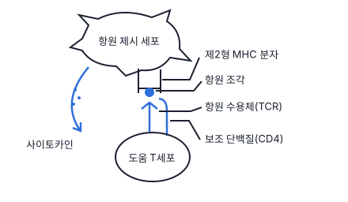
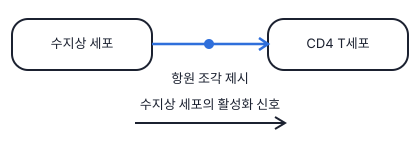
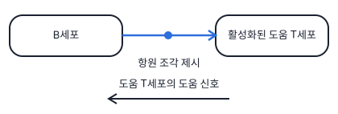
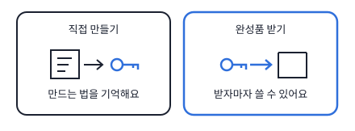
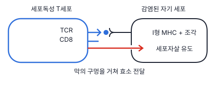
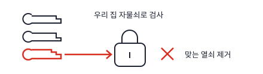
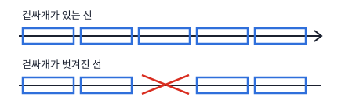
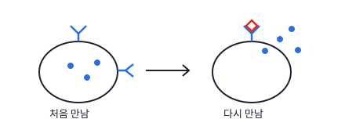
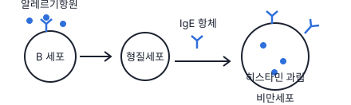

# 면역계 — 5살도 이해하는 정리노트

이영만 교수님 생명과학 · 1126 수업 (14장 면역계)

> `정리노트_1126_Immune_System.html`를 마크다운으로 옮겼어요. 그림은 `figures_1126/` 폴더의 SVG, 위젯은 대표 설정의 정적 그림으로 바꿨어요. 수식은 `$…$` / `$$…$$`라서 GitHub, Obsidian, Typora에서 보여요.

**목차**

- [1. 항원 인식과 수용체](#s0)
  - [지난 수업 복습](#s0-recap)
  - [B세포와 T세포는 항원을 어떻게 읽을까?](#s0-receptors)
- [2. 항원 제시와 도움 T세포](#s1)
  - [항원 제시로 도움 T세포 깨우기](#s1-presentation)
  - [도움 T세포가 맞는 B세포를 찾는 법](#s1-linked-help)
  - [MHC가 항원을 제시하고 이식에 영향을 주는 이유](#s1-mhc)
- [3. 면역을 얻는 방법과 감염세포 제거](#s2)
  - [스스로 만드는 항체와 전달받는 항체](#s2-passive)
  - [세포독성 T세포가 감염된 자기 세포를 제거하는 법](#s2-cytotoxic)
- [4. 면역관용과 면역계의 이상](#s3)
  - [자기 몸을 공격할 세포를 걸러내는 면역관용](#s3-tolerance)
  - [자가면역질환에서 공격받는 표적](#s3-autoimmunity)
  - [알레르겐에 처음 노출될 때와 다시 만날 때](#s3-allergy)
- [5. 요약 · 예고](#s4)
  - [한눈에 다시 보기](#s4-cheatsheet)
  - [여기까지 배웠어요](#s4-next)
  - [연결 자료](#s4-links)

## 1. 항원 인식과 수용체

### 지난 수업 복습

*1126 수업 · 14장 p.1–3*

**정확히 말하면**

- [선천면역과 후천면역](../../1124/정리노트_1124_Respiratory_and_Circulatory_Systems_and_Immune_System.html#s2-two-systems) — 선천면역의 첫 방어선은 피부·점액·위산이에요. 항미생물 펩타이드·염증·보체·인터페론·자연 살상 세포도 선천면역에 속하며, 선천면역은 일반적으로 후천면역 같은 항원 특이적 기억을 남기지 않아요. 후천면역은 특정 항원을 기억하고, 체액성 면역과 세포 매개 면역으로 나뉘어요.
- 보체(complement)는 숙주의 방어 단백질이에요. 자연 살상 세포(natural killer cell)는 선천면역에서 감염된 세포를 직접 제거할 수 있어요.
- [클론 선택(clonal selection)](../../1124/정리노트_1124_Respiratory_and_Circulatory_Systems_and_Immune_System.html#s5-clonal) — 준비된 여러 B세포 중 항원에 맞는 세포가 선택되고, 도움 T세포의 신호를 받으면 증식하고 분화해요.
- [항체의 작용](../../1124/정리노트_1124_Respiratory_and_Circulatory_Systems_and_Immune_System.html#s5-effect) — 형질세포가 분비한 항체(면역글로불린, Ig)는 항원을 중화하거나 응집시켜요. 세균의 실제 제거는 대식세포 등의 식세포나 막에 구멍을 뚫는 보체가 맡을 수 있어요.

**페이지 요약**

선천면역은 공통적인 침입 특징에 반응하고, 후천면역은 특정 항원에 맞는 림프구를 골라 증식시켜요.

*용어*

- **선천면역(innate immunity)** — 피부·점액·위산의 장벽과 항미생물 펩타이드·염증·인터페론·숙주 방어 단백질인 보체가 방어에 참여해요. 일반적으로 후천면역과 같은 항원 특이적 기억을 남기지 않아요. 자연 살상 세포는 감염된 세포를 직접 제거할 수 있어요.
- **후천면역(adaptive immunity)** — 특정 항원을 인식하고 기억해요. 세포 매개 면역과 항체 매개 면역으로 나뉘어요. 항체 매개 면역은 체액성 면역이라고도 해요.
- **클론 선택과 항체** — 이 수업에서 다룬 경로에서는 항원에 맞는 B세포가 도움 T세포의 신호를 받아 증식하고, 형질세포가 분비한 항체(Ig)는 항원을 중화하거나 응집시켜요. 식세포나 보체는 세균을 제거할 수 있어요.

---

### B세포와 T세포는 항원을 어떻게 읽을까?

*1126 수업 · 14장 p.3–4 · 교재 p.315–317*

**쉽게 말하면**

몸은 침입자를 만나기 전에 여러 모양의 집게를 만들어 둬요.

**정확히 말하면**

| 비교 기준 | B 세포 수용체(BCR) | T 세포 수용체(TCR) |
|---|---|---|
| 무엇에 결합하나요? | 세포막에 붙은 Y자형 항체가 가변 영역(V region) 끝으로 처리 전 항원의 특정 부위에 직접 결합 | 이 수업의 T세포에서 펩타이드 조각과 MHC가 이루는 복합체에 결합 |
| 어디서 준비하나요? | 골수에서 분화하며 BCR 유전자 재배열. 성숙해 골수를 빠져나오면 적합한 항원을 만날 수 있는 상태 | 골수에서 생긴 전구세포가 흉선(가슴샘)으로 이동. TCR 유전자를 재배열하고 성숙한 뒤 흉선을 떠남 |

**에피톱(epitope)** = 항원에서 수용체가 구별하는 특정 부위

BCR과 TCR을 암호화하는 유전자는 서로 달라요. 두 수용체는 각각 림프구 표면에 있고, 림프구는 림프조직에서 항원을 만날 수 있어요.

모양이 서로 다른 항원에 대응하려면 여러 수용체가 필요해요. 각 세포가 성숙하는 동안 수용체의 유전자 조각이 무작위로 조합되는 **DNA 재배열**이 일어나요.

1. 가변 영역 DNA 서열이 다른 클론 형성
2. 수용체 아미노산 서열과 결합 부위 모양의 차이
3. 항원이 들어오면 맞는 수용체를 가진 림프구가 선택되고, [활성화 신호](#s1-presentation)를 받은 세포가 분열

**꼭 기억해요**

| 묻는 것 | 틀리기 쉬운 답 | 맞는 답 |
|---|---|---|
| 항원이 도착했을 때 | ~~항원이 그 모양에 맞는 수용체를 만들게 함~~ | 이미 맞는 수용체가 있는 세포의 선택 |
| T세포 수용체의 표적 | ~~BCR처럼 온전한 항원에 직접 결합~~ | 펩타이드–MHC 복합체 |
| TCR 유전자가 재배열되는 세포 | ~~B세포~~ | T세포 |
| T세포가 성숙하는 장소 | ~~태어난 골수~~ | 이동해 간 흉선 |

교수님 말씀

> 항원하고 결합하는 단백질은 무조건 다양해야 돼요.

**페이지 요약**

BCR과 TCR은 항원을 만나기 전에 다양해져요. BCR은 항원에 직접 결합하고, 이 수업에서 다룬 TCR은 펩타이드–MHC 복합체를 인식해요.

*용어*

- **에피톱(epitope)** — 림프조직에서 림프구가 항원을 만나요. BCR과 TCR은 서로 다른 유전자가 만드는 세포막 단백질로, 항원에서 특정 부위를 구별해요.
- **B 세포 수용체(BCR)** — B세포는 골수에서 성숙해요. 세포막에 붙은 Y자형 항체의 가변 영역이 처리 전 항원의 일부에 직접 결합해요.
- **T 세포 수용체(TCR)** — 골수에서 생긴 전구세포는 흉선에서 성숙해요. TCR은 펩타이드–MHC 복합체를 인식해요.
- **DNA 재배열** — 성숙 중 유전자 조각의 무작위 조합으로 가변 영역의 서열과 결합 부위 모양이 달라져요. 항원이 들어오면 그중 이미 맞는 수용체를 지닌 세포가 선택되고, 활성화에 필요한 신호를 받으면 분열해요.

---

## 2. 항원 제시와 도움 T세포

### 항원 제시로 도움 T세포 깨우기

*1126 수업 · 14장 p.4 · 교재 p.316–318*

**쉽게 말하면**

침입자를 삼킨 세포가 겉에 작은 조각을 내걸어요. 그 조각을 알아본 세포에 일을 시작하라는 신호를 줘요.

**정확히 말하면**

**항원 제시 세포(antigen-presenting cell, APC)** = 항원 조각을 MHC에 실어 표면에 내놓고 T세포에 보여 주는 세포

수지상 세포(dendritic cell)는 가지처럼 돌기가 뻗어 있어요. 호중구와 대식세포도 세균을 삼킬 수 있고, 대식세포와 수지상 세포는 삼킨 항원을 제시할 수 있어요.

1. 감염 조직에서 수지상 세포가 세균을 삼켜 가까운 림프절로 이동해요.
2. 들어온 세균의 단백질을 리소좀(lysosome)에서 작은 펩타이드로 분해해요.
3. 펩타이드를 제2형 MHC(II형 MHC)에 실어 세포 표면에 보여 줘요.
4. 맞는 TCR을 이미 지닌 CD4 T세포가 펩타이드–MHC에 결합해요. 수지상 세포의 공자극(costimulation)과 인터루킨 신호가 활성화를 도와요.
5. 활성화된 T세포가 자기 증식을 돕는 사이토카인(cytokine)을 분비해요. 그 결과 클론이 늘어나고 B세포를 도울 수 있는 도움 T세포로 분화해요.

**꼭 기억해요**

| 묻는 것 | 틀리기 쉬운 답 | 맞는 답 |
|---|---|---|
| 포획·분해와 항원 제시 | ~~세균을 삼키기만 하면 항원 제시가 끝남~~ | 포획·분해는 세포 내부에서, 조각의 제시는 세포 표면에서 |
| 수지상 세포가 겉에 내놓는 물질 | ~~삼킨 세균 전체나 펩타이드 단독~~ | 제2형 MHC에 결합한 펩타이드 |
| 처음 만난 T세포의 활성화 조건 | ~~TCR 결합만 있으면 충분~~ | 항원 인식에 공자극과 사이토카인 신호가 더해짐 |
| 첫 만남에서 신호를 누가 주나요? | ~~도움 T세포가 B세포를 자극~~ | 수지상 세포가 T세포를 자극 |

교수님 말씀

침입자를 잡은 뒤 사진을 보여 주듯 항원을 제시하고, 조각을 알아본 T세포에 면허증을 준다고 비유했어요.

> 어, 네가 이 구슬을 알아보는구나. 너에게 자격증을 주마.

**페이지 요약**

수지상 세포는 침입자의 조각을 보여 주고, 맞는 T세포에 활성화 신호를 줘요.

*용어*

- **항원 제시 세포(APC)** — 수지상 세포와 대식세포는 삼킨 항원을 제시할 수 있어요. 수지상 세포는 감염 조직에서 세균을 삼켜 림프절로 이동하고, 리소좀에서 분해한 항원 조각을 제2형 MHC에 실어 표면에 내놓아요.
- **T세포 활성화** — 이미 맞는 TCR을 지닌 CD4 T세포에 공자극과 인터루킨이 더해져요. 활성화된 T세포가 자기 증식을 돕는 사이토카인을 내보내면 클론이 늘어나고 도움 T세포로 분화해요.

---

### 도움 T세포가 맞는 B세포를 찾는 법

*1126 수업 · 14장 p.4 · 교재 p.318–319*

**쉽게 말하면**

첫 만남에서 이미 맞는 집게로 조각을 알아보고 일할 신호를 받아요. 두 번째 만남에서는 같은 조각을 내민 상대에게 도움을 줘요.

**정확히 말하면**

항체 매개 면역의 이 경로에서는 도움 T세포가 먼저 [수지상 세포와 만나 활성화](#s1-presentation)돼요. 같은 항원은 다른 곳에서 B세포에도 붙잡힐 수 있어요. 이 두 세포의 준비가 맞물려야 B세포에 도움 신호가 전달돼요.

1. BCR로 가공 전 항원 결합
2. 항원 흡수·분해 후 B세포 표면에 펩타이드–제2형 MHC 전시
3. 앞서 활성화된 도움 T세포의 TCR이 맞는 펩타이드–MHC 인식
4. 도움 T세포의 접촉 신호와 인터루킨(interleukin)에 따른 B세포 클론 증식
5. 항체를 분비하는 형질세포(plasma cell)와 재노출에 대비하는 기억 B세포(memory B cell)로 분화

가령 BCR이 세균 표면의 단백질을 붙잡으면, B세포는 그 단백질을 들여와 자른 조각을 제시할 수 있어요. BCR은 가공 전 단백질 일부를, TCR은 가공 후 제시된 펩타이드–MHC를 인식하므로 두 수용체가 동일한 형태에 닿을 필요는 없어요.

**꼭 기억해요**

| 묻는 것 | 틀리기 쉬운 답 | 맞는 답 |
|---|---|---|
| 누가 항원을 제시하고 누가 신호를 보내나요? | ~~항상 제시한 쪽이 상대를 활성화~~ | 첫 만남은 수지상 세포가 둘 다 맡고, 두 번째 만남은 B세포가 제시하고 도움 T세포가 도움 신호를 보냄 |
| 두 번째 만남에서 B세포가 겉에 내놓는 물질 | ~~BCR이 붙잡았던 항원 전체~~ | 가공한 펩타이드–제2형 MHC 복합체 |
| 어떤 B세포가 도움을 받나요? | ~~항원을 잡은 B세포라면 모두~~ | 활성화된 도움 T세포가 알아보는 펩타이드–MHC를 제시하는 B세포 |

교수님 말씀

자격증 비유에서 자격증을 받은 쪽은 도움 T세포예요. 두 번째 만남에서 그 세포가 B세포에 신호를 줘요.

> 내가 자격증 있으니까 너한테 분화하라고 하는 신호를 줄게.

**보충 · 수업에서 다루지 않았어요**

사이클로스포린 A(cyclosporin A)는 도움 T세포의 활성화를 억제해요. 그러면 도움 T세포가 보내는 자극이 줄어, 그 신호에 의존하는 B 세포의 활성화도 감소해요.

이러한 면역 억제는 이식 거부를 줄이는 데 쓰이지만 감염에 더 취약해질 수 있어요.

출처: 교재 14장 p.321

#### 직접 해 보기 *(정적 스냅샷 — 직접 조작은 HTML 버전)*

만남 단계를 바꾸며 제시하는 세포와 신호를 보내는 세포를 비교해요.

**첫 만남 · T세포 활성화** 수지상 세포가 항원 조각을 제시하고, 맞는 CD4 T세포에 공자극과 인터루킨 신호를 보내요.

*첫 만남 · T세포 활성화*

*두 번째 만남 · B세포 도움*

| 설정 | 결과 |
|---|---|
| 첫 만남 · T세포 활성화 | 수지상 세포가 항원 조각을 제시하고, 맞는 CD4 T세포에 공자극과 인터루킨 신호를 보내요. |
| 두 번째 만남 · B세포 도움 | B세포가 항원 조각을 제시하고, 이를 알아본 도움 T세포가 B세포에 접촉 신호와 인터루킨을 줘요. |

**페이지 요약**

수지상 세포의 신호로 활성화된 도움 T세포는 자신이 읽을 수 있는 항원 조각을 내건 B세포에 도움 신호를 줘요.

*용어*

- **B세포의 항원 제시** — BCR이 가공 전 항원에 직접 결합하면 B세포가 이를 흡수·분해해 펩타이드–제2형 MHC를 보여 줘요. 도움 T세포는 가공된 조각이 든 복합체를 읽어요.
- **도움 신호와 B세포의 분화** — 앞서 활성화된 도움 T세포가 알맞은 펩타이드–MHC를 만나면 접촉 신호와 인터루킨을 줘요. 그 결과 B세포 클론이 늘고, 항체를 분비하는 형질세포와 재노출에 대비하는 기억 B세포가 생겨요.

- **(보충) 사이클로스포린 A** — 도움 T세포 활성화를 억제해 그 신호에 의존하는 B세포의 활성화도 낮춰요. 이식 거부를 줄이는 데 쓰이며 감염에 취약해질 수 있어요. 교재 14장 p.321.

---

### MHC가 항원을 제시하고 이식에 영향을 주는 이유

*1126 수업 · 14장 p.4 · 교재 p.317–319*

**쉽게 말하면**

우리 몸의 세포는 작은 조각을 자기 이름표에 끼워 내밀어요.

**정확히 말하면**

**주조직적합성복합체(major histocompatibility complex, MHC)** = 항원 조각을 제시하는 단백질을 암호화하는 유전자 집합. 사람의 MHC는 HLA(human leukocyte antigen)라고 불러요.

| 비교 기준 | 수지상 세포와 B세포 | 도움 T세포 |
|---|---|---|
| 역할 | 펩타이드 제시 | 제시된 펩타이드–MHC 판독 |
| 쓰는 단백질 | 펩타이드를 제2형 MHC에 결합 | TCR이 복합체를 인식하고 CD4가 제2형 MHC에 결합해 도움 |

이 단원에서 도움 T세포의 짝은 II형 MHC와 CD4예요. [세포독성 T세포](#s2-cytotoxic)에서는 I형 MHC와 CD8이 짝을 이뤄요.

여러 HLA 유전자마다 대립유전자가 다양해요. 부모에게서 하나씩 물려받은 HLA 유전자 묶음(haplotype)이 **공동우성(codominance)**으로 모두 발현돼 개인별 조합이 다양해요.

다른 사람의 세포에서 이러한 표지가 다르면 면역계가 반응할 수 있어요. 그래서 골수 줄기세포 이식에서는 환자와 기증자의 HLA가 얼마나 잘 맞는지 확인해요.

같은 부모의 두 자녀를 비교할 때, 부모마다 서로 다른 두 묶음 중 하나를 같은 확률로 물려준다고 두면, 한쪽 부모에서 같은 묶음을 받을 확률은 절반이에요. 양쪽 모두에서 같을 확률은 두 절반을 곱한 **4분의 1**이에요.

**꼭 기억해요**

| 묻는 것 | 틀리기 쉬운 답 | 맞는 답 |
|---|---|---|
| 도움 T세포가 읽는 것 | ~~펩타이드 단독 또는 MHC 단독~~ | TCR이 펩타이드–제2형 MHC 복합체를 인식하고 CD4가 보조 |
| HLA 조합이 다양해지는 까닭 | ~~한 유전자에만 다양한 대립유전자가 있어서~~ | 여러 유전자 자리의 대립유전자 조합과 공동우성 발현 |
| 부모와 자녀의 HLA | ~~부모와 자녀의 완전 일치 확률은 항상 0%~~ | 각 부모와 그 부모에게서 받은 묶음을 공유. 완전 일치는 검사하는 HLA 조합에 따라 판단 |

교수님 말씀

학생증을 보여 주며 자신이 아주대 학생임을 알리는 장면을 MHC의 신분증 역할에 비유했어요. ABO 혈액형의 대립유전자 조합을 떠올린 뒤 여러 유전자의 조합인 HLA로 설명을 넓혔어요. 골수 이식 드라마는 기증자와 환자의 조직적합성을 비교하는 예였어요. 두 세포에서 단백질 두 가지씩 관여하는 모습은 ‘이대이 미팅’에 빗댔어요.

> 나 아주대 학생인데 지금 이상한 놈 잡아 가지고 지금 온 거야.

**페이지 요약**

도움 T세포는 MHC에 실린 항원 조각을 읽고, 이식에선 환자와 기증자의 HLA 조합을 비교해요.

*용어*

- **제2형 MHC와 CD4** — 수지상 세포와 B세포는 펩타이드를 제2형 MHC에 실어요. 도움 T세포의 TCR이 그 복합체를 인식하고 CD4가 제2형 MHC에 결합해 보조해요. 세포독성 T세포 쪽은 I형 MHC와 CD8의 짝이에요.
- **공동우성과 HLA 일치** — 사람의 MHC인 HLA는 여러 유전자 자리의 조합이 다양하고, 부모 각각에게서 받은 묶음이 모두 발현돼요. 환자와 기증자의 HLA 조합이 다르면 면역계가 반응할 수 있어요. 부모마다 서로 다른 두 묶음 중 하나가 그대로 같은 확률로 전달된다고 두면, 두 자녀가 한쪽 부모에게서 같은 묶음을 받을 확률은 절반이에요. 양쪽이 모두 일치할 확률은 두 절반을 곱한 4분의 1이에요. 자녀는 각 부모에게서 받은 묶음을 해당 부모와 공유해요.

---

## 3. 면역을 얻는 방법과 감염세포 제거

### 스스로 만드는 항체와 전달받는 항체

*1126 수업 · 14장 p5–6*

**쉽게 말하면**

내가 열쇠 모양을 배워 만드는 방법과, 다른 사람이 만든 열쇠를 빌리는 방법이 있어요.

*직접 만들면 다음에 다시 만들 수 있고, 받아 쓰면 가진 양이 줄어들어요.*

**정확히 말하면**

| 비교 기준 | 능동면역(active immunity) | 수동면역(passive immunity) |
|---|---|---|
| 방어가 시작되는 방식 | 자기 면역계가 항원을 인식하고 스스로 반응 | 다른 곳에서 만들어진 항체가 몸에 들어와 바로 작용 |
| 반응을 기다리는 시간 | 클론 선택과 증식에 시간 필요 | 받은 항체가 바로 표적에 결합할 수 있음 |
| 기억과 지속 | 기억세포가 남아 같은 항원에 더 빠르게 반응 | 항체를 받는 것만으로는 기억세포가 생기지 않아 항체가 줄면 효과가 약해짐 |
| 사례 | 예방접종, 자연 감염 후 생기는 면역 | 회복자 혈장 치료, 항뱀독소, 태반을 통한 모체 항체와 모유 속 항체 |

백신은 항원 자체를 넣거나 몸이 항원을 만들도록 정보를 전달해 자기 면역반응을 시작해요.

혈장에는 피브리노겐 같은 응고 단백질이 들어 있어요. 혈청은 혈액이 응고한 뒤 남은 액체예요.

회복자 혈장 치료는 항체가 들어 있는 혈장 성분을 전달한 사례예요.

**꼭 기억해요**

| 묻는 것 | 틀리기 쉬운 답 | 맞는 답 |
|---|---|---|
| 같은 날 백신과 항체 제제를 각각 받은 경우 | ~~둘 다 주사이므로 같은 종류~~ | 백신은 능동면역, 항체 제제는 수동면역 |
| 감염이나 접종으로 항체가 생긴 모체와 그 항체를 받은 아기 | ~~항체가 같으니 둘 다 능동면역~~ | 항체를 만든 모체는 능동면역, 전달받은 아기는 수동면역 |
| 항뱀독소의 항체가 결합하는 대상 | ~~뱀의 세포~~ | 몸에 들어온 독소를 중화 |

교수님 말씀

> 이렇게 만들어져 있는 항체를 직접 주입받는 거는 수동면역이라고 그래요.

**보충 · 노트에 빠졌던 수업 내용**

태반을 통해 태아에게 전달되는 대표 항체는 IgG, 모유로 전달되어 아기의 점막을 보호하는 대표 항체는 IgA예요. 어느 쪽도 아기가 항체를 직접 만든 사례가 아니에요. 항체 의약품으로 완성된 항체를 투여하는 경우도 이미 형성된 항체를 받는 사례예요. 예방접종에 쓰는 불활성화 독소는 항원으로 작용해 자기 면역반응을 유도해요.

출처: 강의노트 14장 p6 · 교재 14장 p.321 · [CDC Pink Book](https://www.cdc.gov/pinkbook/hcp/table-of-contents/chapter-1-principles-of-vaccination.html)

**페이지 요약**

능동면역은 자기 면역계가 항원에 반응해 생기고, 수동면역은 다른 곳에서 만든 항체를 받아 생겨요.

*용어*

- **능동면역(active immunity)** — 백신이나 감염의 항원에 반응해 클론이 증식해요. 시간은 걸리지만 기억세포가 남으면 재노출에 대응해요.
- **수동면역(passive immunity)** — 받은 항체는 곧바로 작용해요. 항체를 받는 것만으로 수용자의 기억세포가 생기지는 않아서 항체가 줄면 보호가 약해져요. 회복자 혈장, 독소를 중화하는 항뱀독소, 태반·모유로 받은 모체 항체가 사례예요.
- **혈장과 혈청** — 혈장에는 피브리노겐이 들어 있어요. 혈청은 혈액이 응고한 뒤 남은 액체예요.
- **모체와 아기** — 모체가 감염이나 접종에 반응해 항체를 만들면 능동, 그 항체를 받은 아기에게는 수동이에요.
- **백신과 항체 제제를 함께 받은 경우** — 각 제제가 주는 효과를 따로 판별해요. 항원을 통해 자체 반응을 시작하면 능동, 완성 항체를 받으면 수동이에요.

- **(보충) 전달되는 항체** — 태반은 IgG, 모유의 점막 보호는 IgA가 대표예요. 항체 의약품도 완성 항체의 전달 사례예요. 예방용 불활성화 독소는 항원으로 작용해 능동면역을 유도해요.

---

### 세포독성 T세포가 감염된 자기 세포를 제거하는 법

*1126 수업 · 14장 p6*

**쉽게 말하면**

문 밖에 나온 단서로 방 안에 문제가 생긴 걸 알아차려요.

*단서는 조각과 그 조각을 받치는 판이에요. 표적의 막에 통로가 생기면 죽음을 시작시키는 물질이 들어가요.*

**정확히 말하면**

세포 안으로 들어간 병원체에는 체액 속 항체가 바로 닿기 어려워요. **세포매개면역(cell-mediated immunity)**에서는 활성화된 **세포독성 T세포(cytotoxic T cell)**가 감염된 자기 세포를 찾아 제거해요.

1. 감염된 자기 세포가 세포 안 단백질에서 생긴 펩타이드를 I형 MHC에 실어 표면에 제시
2. 활성화된 세포독성 T세포의 TCR이 펩타이드–MHC를 인식하고 CD8이 결합을 도움
3. 세포독성 T세포의 퍼포린이 표적 막에 구멍을 만듦
4. 전달된 효소가 표적 세포의 세포자살을 유도

[도움 T세포](#s1-linked-help)는 B세포 반응과 세포독성 T세포 반응을 모두 지원할 수 있어요. 위 사슬은 세포독성 T세포가 이미 활성화된 뒤 표적을 만나 일어나는 일을 보여 줘요.

**꼭 기억해요**

| 묻는 것 | 틀리기 쉬운 답 | 맞는 답 |
|---|---|---|
| 무엇을 직접 제거할까? | ~~세포 밖을 떠다니는 병원체~~ | 맞는 항원 조각을 표시한 자기 세포 |
| 자연살생세포도 같은 표적 인식 방식을 쓸까? | ~~둘 다 같은 TCR로 표적을 고른다~~ | 퍼포린 등을 쓰는 제거 방식은 비슷해요. TCR을 이용한 특이적 인식은 세포독성 T세포의 특징이에요. |

I형 MHC와 CD8, II형 MHC와 CD4의 대응은 그림을 읽는 데 참고해요. 교수님은 두 유형의 차이를 자세히 구분하는 데까지 요구하지 않았어요.

교수님 말씀

> 구멍을 뚫은 다음에 폭탄을 집어넣는 거라고 그랬죠. 세포 자살을 유도하는 효소를 집어넣는 거예요.

**보충 · 노트에 빠졌던 수업 내용**

세포자살 유도 효소의 예가 그랜자임 B(Granzyme B)예요. 세포독성 T세포는 감염된 세포 외에도 관련 표지를 제시하는 일부 암세포를 표적으로 삼을 수 있어요.

출처: 강의노트 14장 p6 · 교재 14장 pp.321–322

**페이지 요약**

세포독성 T세포는 감염된 자기 세포가 표면에 제시한 펩타이드–MHC를 읽고 그 세포에 죽음 신호를 보내요.

*용어*

- **세포매개면역(cell-mediated immunity)** — 항체가 접근하기 어려운 감염 세포를 활성화된 세포독성 T세포가 직접 제거해요. 도움 T세포는 이 반응도 지원할 수 있어요.
- **I형 MHC · TCR · CD8** — 감염된 숙주 세포는 I형 MHC에 펩타이드를 실어 제시해요. 세포독성 T세포 쪽 TCR이 이를 인식하고 CD8이 결합을 도와요.
- **퍼포린(perforin)** — 표적 막에 구멍을 만들어 세포자살을 유도하는 효소가 전달되게 해요. 자연살생세포와 제거 방식은 비슷하지만 특이적 TCR 인식은 구별해요.

- **(보충) 효소 이름과 다른 표적** — 그랜자임 B는 세포자살 유도 효소의 예예요. 관련 표지를 제시하는 일부 암세포도 제거 표적이 돼요.

---

## 4. 면역관용과 면역계의 이상

### 자기 몸을 공격할 세포를 걸러내는 면역관용

*1126 수업 · 14장 p7 · 교재 p.322–323*

**쉽게 말하면**

여러 모양의 열쇠를 섞어 만들면 우리 집 자물쇠를 여는 열쇠도 생길 수 있어요.

*밖으로 보내기 전에 우리 집에 맞는 열쇠를 걸러요.*

**정확히 말하면**

**면역관용(immunological tolerance)**은 자기 성분에 대한 면역 공격을 막는 상태예요.

1. 성숙 중인 B 세포와 T 세포의 수용체 유전자에서 무작위 DNA 재배열
2. 다양한 모양의 수용체 형성과 그중 일부의 자기 항원 인식
3. 성숙 중 자기 항원에 강하게 반응하는 림프구의 세포자살과 제거

**꼭 기억해요**

| 묻는 것 | 틀리기 쉬운 답 | 맞는 답 |
|---|---|---|
| 성숙 중 검사 장소 | ~~둘 다 골수~~ | B 세포는 골수, T 세포는 흉선(가슴샘) |
| 자기 항원에 반응할 후보의 발생 | ~~그 자체로 자가면역질환~~ | 검사 전에는 생길 수 있는 상태. 실제 자기 조직에 면역 공격이 계속되면 [자가면역질환](#s3-autoimmunity)으로 이어질 수 있음. |

> 재배열되는 과정이 무작위적으로 이루어집니다, 무작위적으로.

교수님 말씀

몽타주의 눈과 코 조각을 무작위로 고르다 보면 자기 얼굴도 나올 수 있어요. 골수와 흉선에서 일어나는 검사는 학교를 떠나기 전 받는 졸업 심사에 비유했어요.

**보충 · 노트에 빠졌던 수업 내용**

자기 성분을 알아보는 림프구가 살아남아도 실제 면역반응을 일으키지 않는 무반응 상태가 될 수 있어요.

출처: 강의노트 14장 p7, 교재 14장 p.322–323

**페이지 요약**

무작위로 만든 수용체 중에는 자기 항원에 맞는 것도 있어서, 성숙하는 동안 반응이 강한 세포를 걸러요.

*용어*

- **DNA 재배열** — B 세포와 T 세포의 수용체에 여러 모양을 만들어요. 자기 항원에 반응할 수 있는 세포가 생기는 것과 실제 자기 조직을 공격하는 것은 다른 단계예요.
- **면역관용** — 자기 성분이 면역 공격을 받지 않는 상태예요. B 세포는 골수, T 세포는 흉선에서 검사받으며 자기 항원에 강하게 반응하는 세포는 세포자살로 제거될 수 있어요.

- **(보충) 무반응 상태** — 살아남은 림프구도 자기 성분에 면역반응을 일으키지 않는 상태가 될 수 있어요.

---

### 자가면역질환에서 공격받는 표적

*1126 수업 · 14장 p7 · 교재 p.323*

**쉽게 말하면**

몸을 지키는 편이 우리 몸의 일부를 공격하면, 공격받은 곳의 일이 어려워져요.

*선을 감싼 겉싸개가 벗겨지면 신호가 잘 이어지지 않아요.*

**정확히 말하면**

**자가면역질환(autoimmune disease)**은 [면역관용](#s3-tolerance)이 실패해 자기 성분을 표적으로 하는 자가면역반응(autoimmune reaction)이 자기 조직을 손상해 생기는 질환이에요.

| 비교 기준 | 제1형 당뇨병 | 전신홍반루푸스(루푸스) | 다발성 경화증 |
|---|---|---|---|
| 공격 표적 | 췌장 베타세포 | 히스톤 등 여러 자기 성분 | 신경을 절연하는 미엘린 수초(myelin sheath) |
| 손상 결과 | 베타세포 파괴에 따른 인슐린 생산 감소 | 여러 조직 손상 가능 | 수초 손상으로 신경 신호의 전도가 느려지거나 차단 |

**꼭 기억해요**

| 묻는 것 | 틀리기 쉬운 답 | 맞는 답 |
|---|---|---|
| 질환을 구별하는 단서 | ~~염증이 있으면 모두 자가면역~~ | 자기 성분이 면역 공격의 표적인지 확인. 외부 알레르겐에 대한 [알레르기](#s3-allergy)가 심해 생기는 과민성 쇼크는 과민반응의 결과. |

교수님 말씀

> 그러면 이제 자기를 공격하는 항체나 T세포가 생기겠죠.

**보충 · 수업에서 다루지 않았어요**

수업에서 말한 관절을 공격하는 자가면역질환의 예는 **류마티스 관절염(rheumatoid arthritis)**이에요. 퇴행성 관절염은 보통 관절 조직이 점차 손상되는 **골관절염(osteoarthritis)**을 뜻해요.

출처: [미국 국립관절염·근골격계·피부질환연구소(NIAMS), Arthritis](https://www.niams.nih.gov/health-topics/arthritis)

**페이지 요약**

자가면역질환은 자기 조직에 대한 면역 공격으로 생기며, 공격받는 조직에 따라 손상 결과가 달라져요.

*용어*

- **제1형 당뇨병** — 췌장의 베타세포가 파괴돼 인슐린 생산이 줄어요.
- **루푸스** — 히스톤을 비롯한 여러 자기 성분에 대한 면역반응이 여러 조직에 영향을 줘요.
- **다발성 경화증** — 미엘린 수초가 손상돼 신경 신호의 전도가 느려지거나 차단돼요.
- **과민반응과 구분** — 외부 알레르겐에 과민하게 반응하면 알레르기예요. 심하면 과민성 쇼크로 이어질 수 있어요.

- **(보충) 관절염의 구분** — 류마티스 관절염은 관절을 공격하는 자가면역질환이에요. 퇴행성 관절염은 보통 관절 조직이 점차 손상되는 골관절염을 가리켜요.

---

### 알레르겐에 처음 노출될 때와 다시 만날 때

*1126 수업 · 14장 p7 · 교재 p.323–324*

**쉽게 말하면**

처음 만났을 때 딱 맞는 집게가 달려요. 같은 것이 또 들어와 집게에 끼면, 안에 쌓여 있던 물질이 밖으로 나와요.

**정확히 말하면**

**알레르겐(allergen)**은 알레르기 과민반응을 일으키는 항원이에요.

면역글로불린(immunoglobulin, Ig)은 항체를 가리켜요. 항체 부류 IgA·IgG·IgE·IgM·IgD 중 이 과정에 관여하는 항체는 IgE예요.

1. **첫 노출**에 알레르겐과 맞는 B 세포 클론 선택
2. 선택된 B 세포가 분화한 형질세포에서 알레르겐 특이적 IgE 분비
3. IgE가 비만세포(mast cell) 표면 수용체에 결합한 상태인 감작(sensitization)
4. **같은 알레르겐에 재노출**되어 비만세포 표면의 IgE에 결합
5. 비만세포 과립에서 히스타민(histamine) 방출
6. 혈관 확장과 투과성 증가에 따른 염증반응

*초기 노출의 감작 과정. 교재 그림 14.11a와 같은 순서로 배치했어요.*

감염 부위에서도 염증반응은 일어날 수 있어요. 알레르기에서는 외부 알레르겐에 대한 과민반응이 불필요한 염증을 일으켜요. 관절염의 구분은 [관절염 보충](#s3-autoimmunity-supp-1)에서 확인할 수 있어요.

가벼운 반응에서는 콧물이나 재채기가 나타날 수 있어요. 기도가 좁아지는 등 생명을 위협할 수 있는 심한 전신 반응은 과민성 쇼크(anaphylactic shock)로 이어질 수 있어요. 에피네프린은 심한 전신 반응에 쓰여요. 꽃가루 알레르기의 콧물이나 재채기처럼 가벼운 증상에는 항히스타민제가 히스타민의 작용을 막아요.

**꼭 기억해요**

| 묻는 것 | 틀리기 쉬운 답 | 맞는 답 |
|---|---|---|
| 첫 노출과 재노출의 역할 | ~~두 단계에서 같은 반응~~ | 전형적인 흐름에서 처음은 감작, 재노출은 비만세포의 히스타민 방출 |
| IgE와 히스타민을 내놓는 곳 | ~~둘 다 비만세포~~ | IgE는 형질세포, 히스타민은 감작된 비만세포 |
| 알레르기에서 반응하는 대상 | ~~자기 조직~~ | 특정 외부 항원. 자기 성분이 표적이면 [자가면역](#s3-autoimmunity). |

> 혈관이 확장되고 투과성 증가하고.

교수님 말씀

굳이 싸울 필요 없는 방문객에게 공격하는 상황에 빗댔어요. 도로가 넓어지는 것은 혈관 확장, 교문이 넓어지는 것은 혈관 투과성 증가에 해당해요.

**페이지 요약**

전형적인 IgE 알레르기에서는 첫 노출이 비만세포를 준비시키고, 같은 알레르겐이 다시 들어오면 히스타민이 나와요.

*용어*

- **알레르겐** — 과민반응을 일으키는 특정 외부 항원이에요.
- **감작** — 선택된 B 세포가 형질세포가 되어 만든 IgE가 비만세포 표면에 붙은 상태예요.
- **재노출과 염증** — 같은 알레르겐이 표면의 IgE에 결합하면 비만세포가 히스타민을 내보내요. 혈관 확장과 투과성 증가가 염증으로 이어져요. 염증은 감염을 막는 정상 방어에서도 일어날 수 있어요.
- **과민성 쇼크** — 기도가 좁아지는 등 생명을 위협할 수 있는 전신 과민반응에서 나타날 수 있어요. 수업에서 에피네프린은 심한 전신 반응에, 항히스타민제는 가벼운 증상에서 히스타민의 작용을 막는다고 설명했어요.

---

## 5. 요약 · 예고

### 한눈에 다시 보기

| 주제 | 시험 직전 한 줄 |
|---|---|
| [항원 인식](#s0-receptors) | BCR은 항원에 직접 결합하고 TCR은 MHC에 실린 펩타이드 항원을 읽어요. 수용체가 다양해지는 재배열은 B세포는 골수, T세포는 흉선에서 일어나요. |
| [도움 T세포 활성화](#s1-presentation) | 수지상 세포가 항원 조각을 MHC에 실어 제시하고 추가 신호를 보내면, 맞는 TCR의 도움 T세포가 활성화돼요. |
| [B세포에 도움 전달](#s1-linked-help) | 항원을 잡은 B세포가 그 조각을 제시해 활성화된 도움 T세포의 신호를 받으면, 증식 후 항체를 분비하는 형질세포와 기억 B세포로 분화해요. |
| [MHC와 조직 적합성](#s1-mhc) | MHC는 펩타이드를 T세포에 보여 줘요. 사람마다 유전적 조합이 달라 조직 이식 시 일치 여부가 중요해요. |
| [능동·수동면역](#s2-passive) | 항원에 반응해 자신이 만들면 능동면역이고, 완성된 항체를 받으면 수동면역이에요. 수동면역은 효과가 빠르고 항체가 줄면 보호도 약해져요. |
| [세포독성 T세포](#s2-cytotoxic) | 활성화된 세포독성 T세포가 감염 세포의 펩타이드–I형 MHC를 인식해요. 퍼포린이 구멍을 내고 전달된 효소가 표적 세포의 자살을 유도해요. |
| [면역관용과 자가면역](#s3-tolerance) | 성숙 과정에서 자기 성분에 강하게 반응하는 림프구를 걸러내요. 관용이 깨져 실제로 자기 조직을 공격하면 자가면역질환이 생길 수 있어요. |
| [IgE 매개 알레르기](#s3-allergy) | 첫 노출 때 형질세포가 만든 IgE가 비만세포에 붙어요. 같은 알레르겐을 다시 만나면 비만세포에서 히스타민이 나와 혈관 확장과 투과성 증가를 일으켜요. |

---

### 여기까지 배웠어요

- 14장 7쪽의 알레르기 설명을 마치고 대면 수업을 끝냈어요. 교수님은 “자 요렇게 하면은 내용은 다 끝이 납니다”라고 정리했어요.
- 항체의 연구·진단 활용(6쪽)과 코로나19·팬데믹 생활 속 이슈(8쪽)는 이번 시간에 별도 주제로 다루지 않았어요.
- 이후 영상 범위에는 15장 일부, 17장과 18장이 있어요. 수업에서는 15장 끝부분을 생략한다고 안내했어요.

---

### 연결 자료

- [1126 면역계 복습문제](복습문제_1126_Immune_System.md)
- [1124 정리노트 · 적응면역의 두 갈래](../../1124/정리노트_1124_Respiratory_and_Circulatory_Systems_and_Immune_System.html#s5-helper)

---

출처: 이영만 교수님 강의노트(14장) · 수업 녹음 전사(1126) · 『생명과학: 기초와 응용』 2판 14장.
