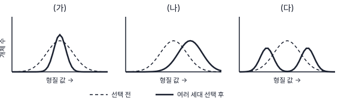

# 생명과학 7장 시험 예상 문제해설

왼쪽 목차로 문항을 고르고, 오른쪽 문제를 보며 해설을 따라가요.

문제의 첫 줄부터 검산까지 설명해요.

**목차**

- [문항별 설명](#problems)
  - [[기출 원문] P1. 라마르크 이론의 핵심](#p1)
  - [[기출 원문] P2. 가뭄 전후 핀치 부리 깊이 분포](#p2)
  - [[기출 원문] P3. 다윈 진화론의 의의](#p3)
  - [[기출 원문] P4. 코끼리 상아 길이 변화](#p4)
  - [[기출 원문] P5. 유전적 부동을 겪은 집단](#p5)
  - [[기출 원문] P6. 새로운 유전자의 원천](#p6)
  - [[기출 원문] P7. 갈라파고스 군도의 관찰](#p7)
  - [[기출 원문] P8. HIV 약물 내성이 빠른 이유](#p8)
  - [[기출 원문] P9. 다윈의 관찰과 추론](#p9)
  - [[기출 원문] P10. 집단 내 진화적 변화의 판별](#p10)
  - [[기출 원문] P11. 진화의 증거로 제시된 진술](#p11)
  - [[기출 원문] P12. DDT 살포 뒤 파리 개체수 회복](#p12)
  - [[기출 원문] P13. 산불과 세균 감염 뒤의 다람쥐 집단](#p13)
  - [[기출 원문] P14. 자연선택을 받는 변이](#p14)
  - [[기출 원문] P15. 기후 변화에 빠르게 적응한 종](#p15)
  - [[기출 원문] P16. 황색포도알균 내성 비율 변화](#p16)
  - [[기출 원문] P17. 섬 생물의 가까운 친척 (다윈의 추리)](#p17)
  - [[기출 원문] P18. 계통수 가지의 의미](#p18)
  - [[기출 원문] P19. 성선택의 조건](#p19)
  - [[기출 원문] P20. 롱아일랜드 도마뱀 집단의 기원](#p20)
  - [[기출 원문] P21. 진화 사상가와 주장](#p21)
  - [[기출 원문] P22. DNA 유사성과 공통조상](#p22)
  - [[기출 원문] P23. 박쥐 날개와 고양이 앞발의 관계](#p23)
  - [[기출 원문] P24. 동굴 가재 눈자루의 해석](#p24)
  - [[기출 원문] P25. 상동 구조의 판단 기준](#p25)
  - [[새 예상문제] P26. 다윈과 라마르크 이론의 비교](#p26)
  - [[새 예상문제] P27. 성선택에 대한 진술](#p27)
  - [[새 예상문제] P28. 유전적 변이의 원천](#p28)
  - [[새 예상문제] P29. 살충제 사용 중단 뒤 내성 빈도](#p29)
  - [[새 예상문제] P30. 불리한 열성 대립유전자가 남는 이유](#p30)
  - [[새 예상문제] P31. 진화 증거 분야의 분류](#p31)
  - [[새 예상문제] P32. 시토크롬 c 아미노산 차이 표 해석](#p32)
  - [[새 예상문제] P33. 구조 유사성의 기원 구분](#p33)
  - [[새 예상문제] P34. 소진화와 대진화의 구분](#p34)
  - [[새 예상문제] P35. 다윈 이전의 진화 사상](#p35)
  - [[새 예상문제] P36. 치타의 낮은 유전적 다양성](#p36)
  - [[새 예상문제] P37. 유전적 부동의 성질](#p37)
  - [[새 예상문제] P38. 이웃 개체군 꽃가루 유입](#p38)
  - [[새 예상문제] P39. 씨앗 크기 변화와 핀치 부리 선택](#p39)
  - [[새 예상문제] P40. 작은 개체군의 유전적 다양성 회복](#p40)
  - [[새 예상문제] P41. 선택 전후 형질 분포 그래프](#p41)
  - [[기출 원문] P42. 새 날개·돼지 다리·고래 지느러미](#p42)
  - [[기출 원문] P43. 다윈 이론의 구성](#p43)
  - [[기출 원문] P44. 우연에 의한 대립유전자 빈도 변화](#p44)
  - [[기출 원문] P45. 진화 연구에 대한 서술](#p45)
  - [[기출 원문] P46. 자연선택의 직접적 결과](#p46)
  - [[기출 원문] P47. 항생제 내성 억제 전략](#p47)
  - [[기출 원문] P48. 소진화의 사례](#p48)
  - [[기출 원문] P49. 하디-바인베르크 원리의 조건](#p49)
  - [[기출 원문] P50. 개체군 유전학의 질문](#p50)
  - [[새 예상문제] P51. 개체군별 평형 여부 판정](#p51)
  - [[새 예상문제] P52. 근친교배가 바꾸는 빈도](#p52)
  - [[새 예상문제] P53. 유전자형 빈도와 대립유전자 빈도](#p53)
  - [[새 예상문제] P54. 열성 표현형 비율로 본 평형 개체군](#p54)
  - [[기출 원문] P55. 다음 세대 유전자형 빈도 예측](#p55)
  - [[새 예상문제] P56. 생물 분포로 얻는 진화의 증거](#p56)
  - [[새 예상문제] P57. 생존·번식에 영향 없는 돌연변이](#p57)
  - [[새 예상문제] P58. 낫모양 적혈구 대립유전자의 유지](#p58)
  - [[새 예상문제] P59. 불연속적인 표현형 변이](#p59)
  - [[새 예상문제] P60. 다윈에게 영향을 준 인구론](#p60)
  - [[새 예상문제] P61. 사람에 의한 육종](#p61)
  - [[새 예상문제] P62. 라이엘의 지질학 이론](#p62)
  - [[새 예상문제] P63. 다윈 진화론과 유전학의 통합](#p63)
  - [[새 예상문제] P64. 자손 수로 구하는 상대적 적응도](#p64)
  - [[새 예상문제] P65. 성선택이 만든 암수 차이](#p65)
  - [[새 예상문제] P66. 개체군 대립유전자의 총체](#p66)
  - [[기출 변형] P67. 대립유전자 빈도를 바꾸는 요인 판별](#p67)
  - [[기출 변형] P68. 맹장 관찰이 보여 주는 증거](#p68)
  - [[새 예상문제] P69. 열성 표현형 수로 우성 대립유전자 빈도 구하기](#p69)
  - [[새 예상문제] P70. 개체군의 대립유전자 개수 세기](#p70)
  - [[새 예상문제] P71. 열성 표현형 비율과 이형접합자 빈도](#p71)
  - [[새 예상문제] P72. 대립유전자 빈도로 열성 동형접합자 수 예측](#p72)
  - [[새 예상문제] P73. 열성 질환 빈도로 보인자 빈도 구하기](#p73)
  - [[새 예상문제] P74. 평형이 아닌 1세대 다음의 유전자형 빈도](#p74)
  - [[새 예상문제] P75. 꽃 개체군의 대립유전자 빈도](#p75)

## 문항별 설명

### [기출 원문] P1. 라마르크 이론의 핵심

past/original · 기출 7강 7 · [연습형 문제 보기](../%EC%8B%9C%ED%97%98%EC%98%88%EC%83%81%EB%AC%B8%EC%A0%9C_7%EC%9E%A5_%EC%97%B0%EC%8A%B5%ED%98%95_v4.html#p1) · [시험형 문제 보기](../%EC%8B%9C%ED%97%98%EC%98%88%EC%83%81%EB%AC%B8%EC%A0%9C_7%EC%9E%A5_v4.html#p1)

지금은 폐기된 라마르크의 이론을 가장 잘 설명한 것은?

- (1) 현존하는 생명체는 과거에 가장 작 적응한 개체의 자손이다
- (2) 모든 생명체는 오늘날 보이는 모습으로 창조되었다
- (3) 생명체는 그들의 생애 동안 새로운 형질을 획득하고 이를 자손에게 물려준다
- (4) 지구의 나이는 매우 많고 그 동안 수 많은 변화를 거쳤다

#### 문제에서 무엇을 묻나요?

네 보기 가운데 **라마르크(Lamarck) 이론**의 핵심을 가장 잘 담은 진술을 골라요. 보기마다 누구의 주장인지 가려내는 문제예요.

**문항 결함:** 보기 A의 “가장 작 적응한”은 “가장 잘 적응한”의 오탈자로 읽어요. 기출 원문 그대로 두었고, 이렇게 읽어도 판정은 바뀌지 않아요.

#### 이 문제를 봤을 때 떠올릴 개념과 공식

‘폐기된 라마르크의 이론’에서 라마르크가 제시한 진화 메커니즘 두 가지를 떠올려요. 용불용설(use and disuse)은 많이 쓰는 기관은 발달하고 안 쓰는 기관은 약해진다는 생각이고, 획득형질의 유전(inheritance of acquired characteristics)은 생애 동안 얻은 형질이 자손에게 전해진다는 생각이에요.

판단 기준은 각 보기가 **개체가 살면서 바뀐 것이 자손에게 전해진다**는 메커니즘을 말하는지예요. 적응한 개체가 남는다는 생각(다윈), 생물이 창조된 모습 그대로라는 생각(다윈 이전 세계관), 지구가 오래되었다는 생각(지질학자)과 구별해요.

관련 정리노트: [라마르크의 용불용설과 획득형질](../../../%EB%B3%B5%EC%8A%B5%EB%85%B8%ED%8A%B8/1027/%EC%A0%95%EB%A6%AC%EB%85%B8%ED%8A%B8_1027_Evolutionary_Thought_and_Microevolution.html#s0-lamarck), [변하지 않는 세계관](../../../%EB%B3%B5%EC%8A%B5%EB%85%B8%ED%8A%B8/1027/%EC%A0%95%EB%A6%AC%EB%85%B8%ED%8A%B8_1027_Evolutionary_Thought_and_Microevolution.html#s0-ladder)

#### 왜 이렇게 푸는지 함께 따라가요

A. (원문 1번) “과거에 가장 잘 적응한 개체의 자손이 지금 남아 있다”는 말은 변이 가운데 환경에 유리한 개체가 더 많이 살아남아 번식한다는 다윈의 자연선택 쪽 설명이에요. 개체가 살면서 얻은 형질의 전달을 말하지 않으므로 라마르크 이론으로는 부적합해요.

B. (원문 2번) 모든 생물이 지금 모습대로 창조되었다는 것은 종이 변하지 않는다고 본 다윈 이전의 창조설 관점이에요. 라마르크는 오히려 종이 시간에 따라 변한다고 주장했으므로 부적합해요.

C. (원문 3번) 생애 동안 새 형질을 얻고 그것을 자손에게 물려준다는 진술은 획득형질의 유전 그 자체예요. 라마르크 메커니즘의 핵심과 일치하고, 오늘날 일반 원리로는 틀렸다고 보기 때문에 ‘폐기된’이라는 발문과도 맞아요. 적합해요.

D. (원문 4번) 지구의 나이가 매우 많고 오랫동안 변해 왔다는 것은 허턴·라이엘 같은 지질학자들의 주장이에요. 생물이 어떻게 변하는지에 대한 메커니즘이 아니므로 부적합해요.

따라서 답은 (3)/C예요.

#### 완성 답과 검산

답 (3)/C. 보기마다 주장한 사람을 붙여 보면 A 다윈, B 다윈 이전 창조설, D 지질학자로 셋이 소거되고 라마르크에 해당하는 보기는 C 하나만 남아요. 강의노트 7장 p.1의 “라마르크의 진화 메커니즘: 용불용설, 획득형질의 유전”과도 같은 내용이에요. 기출 인쇄 정답도 ③이에요.

**페이지 요약**

라마르크 메커니즘 = 용불용설 + 획득형질의 유전 → 생애 중 얻은 형질을 물려준다는 진술, 답 (3)/C. 보기 A “가장 작”은 “가장 잘”의 오탈자.

---

### [기출 원문] P2. 가뭄 전후 핀치 부리 깊이 분포

past/original · 기출 7강 64 · [연습형 문제 보기](../%EC%8B%9C%ED%97%98%EC%98%88%EC%83%81%EB%AC%B8%EC%A0%9C_7%EC%9E%A5_%EC%97%B0%EC%8A%B5%ED%98%95_v4.html#p2) · [시험형 문제 보기](../%EC%8B%9C%ED%97%98%EC%98%88%EC%83%81%EB%AC%B8%EC%A0%9C_7%EC%9E%A5_v4.html#p2)

그림을 참고하였을 때, 1976년에서 1978년으로 변화는 무엇을 나타내는가?

- (1) 방향성 선택
- (2) 지속적으로 사용한 방식에 따라 부리의 모양이 변한다.
- (3) 분단성 선택
- (4) 안정화 선택
- (5) 핀치 개체군은 진화적 변화의 결과로써 급격하게 커졌다.

#### 문제에서 무엇을 묻나요?

가뭄 전(1976년)과 가뭄 뒤 생존자(1978년)의 핀치 부리 깊이 분포를 비교해, 이 변화가 어떤 현상인지 골라요. 그래프에서 **평균선의 위치**와 **분포 모양**을 읽는 것이 핵심이에요.

#### 이 문제를 봤을 때 떠올릴 개념과 공식

‘분포 그래프의 전후 비교’에서 자연선택의 세 양상(그림 7.15)을 떠올려요. 연속으로 이어지는 형질은 평균 근처가 가장 많은 종 모양으로 그려지고, 어느 쪽 표현형이 불리한지에 따라 모양이 달라져요.

판단 기준은 세 가지예요. 평균이 한쪽으로 옮겨 가면 방향성 선택(directional selection), 평균은 그대로이고 폭만 좁아지면 안정화 선택(stabilizing selection), 봉우리가 양 끝 둘로 갈라지면 분단성 선택(disruptive selection)이에요. 세로축이 개체 수라는 점도 함께 확인해요.

관련 정리노트: [상대적 적응도와 자연선택의 세 양상](../../../%EB%B3%B5%EC%8A%B5%EB%85%B8%ED%8A%B8/1029/%EC%A0%95%EB%A6%AC%EB%85%B8%ED%8A%B8_1029_Microevolution_and_Speciation.html#s1-fitness)

#### 왜 이렇게 푸는지 함께 따라가요

A. (원문 1번) 가뭄 전 평균선은 약 9.5mm, 생존자 평균선은 약 10mm에 있어 평균이 깊은 부리 쪽으로 옮겨 갔어요. 봉우리는 여전히 하나예요. ‘평균이 한쪽으로 이동’ 기준에 맞으므로 이 그래프의 설명으로 적합해요.

B. (원문 2번) 부리를 계속 쓴 방식에 따라 모양이 변한다는 것은 개체가 살면서 바뀐다는 라마르크식 용불용 생각이에요. 그래프는 한 개체의 부리 변화가 아니라 가뭄 뒤 살아남은 개체들의 분포를 보여 주므로 부적합해요.

C. (원문 3번) 분단성 선택이면 양 극단이 함께 남아 봉우리가 둘로 나뉘어야 해요. 1978년 분포는 봉우리가 하나이므로 부적합해요.

D. (원문 4번) 안정화 선택이면 평균은 그대로 두고 양 끝이 깎여 폭이 좁아져야 해요. 여기서는 평균선 자체가 옮겨 갔으므로 부적합해요.

E. (원문 5번) 세로축은 개체 수예요. 1976년 봉우리는 60이 넘지만 1978년 봉우리는 10 정도로, 개체군은 커진 것이 아니라 크게 줄었어요. 그래프와 반대되는 진술이라 틀려요.

따라서 답은 (1)/A예요.

#### 완성 답과 검산

답 (1)/A. 세 양상을 ‘평균이 움직였나 → 봉우리가 몇 개인가’ 순서로 다시 걸러 보면, 평균이 움직였으니 안정화(D)가 빠지고 봉우리가 하나이니 분단성(C)이 빠져요. B는 개체의 변화, E는 세로축과 반대라 선택 양상의 답이 될 수 없어요. 기출 인쇄 정답도 ①이에요.

**페이지 요약**

평균 약 9.5mm → 약 10mm로 한쪽 이동, 봉우리 하나 → 방향성 선택, 답 (1)/A.

---

### [기출 원문] P3. 다윈 진화론의 의의

past/original · 기출 7강 63 · [연습형 문제 보기](../%EC%8B%9C%ED%97%98%EC%98%88%EC%83%81%EB%AC%B8%EC%A0%9C_7%EC%9E%A5_%EC%97%B0%EC%8A%B5%ED%98%95_v4.html#p3) · [시험형 문제 보기](../%EC%8B%9C%ED%97%98%EC%98%88%EC%83%81%EB%AC%B8%EC%A0%9C_7%EC%9E%A5_v4.html#p3)

다음 보기 중, 다윈의 진화론이 가지는 의의로 보기 어려운 것은?

- (1) 유리한 형질들이 각 개체들이 선택하여 더 나은 방향으로 진화함을 설명하였다.
- (2) 생물의 다양성의 기원에 대하여 순수하게 물리적인 설명을 제공하였다.
- (3) 진화는 특정 환경에서 다른 생물들보다 더 기능을 잘하기 때문에 일어난다고 이해했다.
- (4) 진화는 여러 단계로 설명하고, 다음 세대에는 성공적인 변이가 유전됨을 보였다.
- (5) 진화는 개체가 아니라 개체군 단위에서 일어남을 인지하였다.

#### 문제에서 무엇을 묻나요?

다섯 보기 가운데 다윈 진화론의 의의로 **보기 어려운 것**을 골라요. 맞는 설명 넷을 걸러 내고 남는 하나를 찾는 부정형이에요.

#### 이 문제를 봤을 때 떠올릴 개념과 공식

‘다윈의 진화론이 가지는 의의’에서 강의노트 7장 p.2의 **다윈 이론의 차별성** 네 가지를 떠올려요. (1) 생물 다양성의 기원을 순수하게 물리적으로 설명했어요. (2) 진화적 변화는 개체가 아니라 개체군 수준에서 일어나요. (3) 진화를 개체군 안의 변이 → 자연선택 → 성공적인 변이의 유전이라는 여러 단계로 설명했어요. (4) 진화는 주어진 환경에서 어떤 생물이 다른 개체보다 기능을 더 잘하기 때문에 일어나요(라마르크와 같은 점).

판단 기준은 각 보기가 이 넷 중 하나와 대응하는지, 그리고 **누가 형질을 고르는지**예요. 자연선택에서 고르는 것은 환경 속 생존·번식의 차이이지 개체의 의도가 아니에요.

관련 정리노트: [다윈 이론의 차별성](../../../%EB%B3%B5%EC%8A%B5%EB%85%B8%ED%8A%B8/1027/%EC%A0%95%EB%A6%AC%EB%85%B8%ED%8A%B8_1027_Evolutionary_Thought_and_Microevolution.html#s1-tree), [자연선택의 논리](../../../%EB%B3%B5%EC%8A%B5%EB%85%B8%ED%8A%B8/1027/%EC%A0%95%EB%A6%AC%EB%85%B8%ED%8A%B8_1027_Evolutionary_Thought_and_Microevolution.html#s1-natural-selection)

#### 왜 이렇게 푸는지 함께 따라가요

A. (원문 1번) “개체들이 유리한 형질을 선택하여 더 나은 방향으로 진화한다”는 진술은 개체가 스스로 형질을 고른다고 말해요. 다윈 이론에서는 이미 있던 변이 가운데 그 환경에서 생존·번식에 유리한 개체가 더 많은 자손을 남길 뿐이고, 정해진 ‘더 나은 방향’이라는 목표도 없어요. 차별성 네 가지 어디에도 대응하지 않는 틀린 진술이라 의의로 보기 어려워요.

B. (원문 2번) 생물 다양성의 기원을 순수하게 물리적으로 설명했다는 것은 차별성 (1)과 같아요. 맞는 의의예요.

C. (원문 3번) 특정 환경에서 다른 생물보다 기능을 더 잘하기 때문에 진화가 일어난다는 것은 차별성 (4)와 같아요. 라마르크와 공통되는 점이지만 강의노트가 차별성 목록에 넣은 항목이라 맞는 의의예요.

D. (원문 4번) 진화를 여러 단계로 설명하고 성공적인 변이가 다음 세대로 유전됨을 보였다는 것은 차별성 (3)과 같아요. 맞는 의의예요.

E. (원문 5번) 진화가 개체가 아니라 개체군 단위에서 일어난다는 것은 차별성 (2)와 같아요. 맞는 의의예요.

따라서 의의로 보기 **어려운** 것은 (1)/A예요.

#### 완성 답과 검산

답 (1)/A. 강의노트의 차별성 1~4를 보기에 하나씩 짝지으면 B↔1, E↔2, D↔3, C↔4로 네 보기가 모두 짝을 얻고, 짝이 없는 보기는 A 하나예요. 기출 인쇄 정답도 ①이에요.

#### 헷갈리기 쉬운 점

C는 ‘라마르크와 같은 점’이라서 다윈의 의의가 아니라고 지우기 쉬워요. 강의노트는 이 항목을 다윈 이론의 차별성 4번으로 적어 두었으므로, 이 문항에서는 맞는 의의로 판정해요.

**페이지 요약**

다윈 이론의 차별성 4가지(물리적 설명·개체군 수준·여러 단계·기능을 더 잘함)에 대응하지 않는 “개체가 형질을 선택해 더 나은 방향으로” → 답 (1)/A.

---

### [기출 원문] P4. 코끼리 상아 길이 변화

past/original · 기출 7강 62 · [연습형 문제 보기](../%EC%8B%9C%ED%97%98%EC%98%88%EC%83%81%EB%AC%B8%EC%A0%9C_7%EC%9E%A5_%EC%97%B0%EC%8A%B5%ED%98%95_v4.html#p4) · [시험형 문제 보기](../%EC%8B%9C%ED%97%98%EC%98%88%EC%83%81%EB%AC%B8%EC%A0%9C_7%EC%9E%A5_v4.html#p4)

코끼리의 상아는 세계에서 가치가 가장 높은 상품 중 하나이다. 그 결과 지난 몇 세기 동안 큰 상아를 가지고 있는 수컷 아프리카 코끼리는 심하게 사냥 당해왔다. 오늘날 완전히 성장한 수컷 코끼리는 1900년대 초의 수컷 코끼리와 비교할 때 상당히 짧은 상아를 가지고 있다. 이것은 무엇에 대한 예시인가?

- (1) 안정화 선택
- (2) 방향성 선택
- (3) 분단성 선택
- (4) 정답이 여러 개이다
- (5) 역진화

#### 문제에서 무엇을 묻나요?

큰 상아를 가진 수컷 코끼리가 오랫동안 사냥당한 뒤, 오늘날 수컷의 상아가 1900년대 초보다 짧아졌어요. 이 변화가 자연선택의 어떤 양상인지 골라요.

#### 이 문제를 봤을 때 떠올릴 개념과 공식

‘큰 상아를 가진 수컷이 집중적으로 제거되었다’와 ‘평균 상아가 짧아졌다’에서 자연선택의 세 양상을 떠올려요. 생존·번식에 불리한 표현형이 어느 쪽인지 보면 양상이 정해져요.

판단 기준은 **불리한 쪽이 한쪽 극단인지, 양 극단인지, 가운데인지**예요. 한쪽 극단만 불리하면 평균이 반대쪽으로 옮겨 가는 방향성 선택, 양 극단이 불리하면 안정화 선택, 가운데가 불리하면 분단성 선택이에요.

관련 정리노트: [자연선택의 세 양상](../../../%EB%B3%B5%EC%8A%B5%EB%85%B8%ED%8A%B8/1029/%EC%A0%95%EB%A6%AC%EB%85%B8%ED%8A%B8_1029_Microevolution_and_Speciation.html#s1-fitness)

#### 왜 이렇게 푸는지 함께 따라가요

A. (원문 1번) 안정화 선택은 중간 길이가 유리하고 아주 짧거나 아주 긴 양 극단이 함께 불리할 때예요. 지문에서는 긴 쪽 극단만 제거되었고 평균이 짧은 쪽으로 옮겨 갔으므로 부적합해요.

B. (원문 2번) 큰 상아라는 한쪽 극단이 사냥으로 제거되어 번식에서 빠지고, 짧은 상아 수컷이 상대적으로 더 많은 자손을 남겨 평균이 짧은 쪽으로 이동했어요. ‘한쪽 극단 불리 → 평균 이동’ 기준에 맞아 적합해요.

C. (원문 3번) 분단성 선택은 양 극단이 함께 유리하고 가운데가 불리해 봉우리가 둘로 갈라질 때예요. 지문에는 아주 긴 상아가 유리하다는 내용이 없으므로 부적합해요.

D. (원문 4번) 양상은 서로 다른 분포 변화를 뜻해요. 이 사례는 평균이 한 방향으로 이동한 경우 하나에만 해당하므로 정답이 여러 개라는 보기는 틀려요.

E. (원문 5번) ‘역진화’는 강의노트의 자연선택 양상에 없는 용어예요. 상아가 짧아진 것도 개체군의 유전적 구성이 한 방향으로 바뀐 진화이므로, 진화를 거슬러 간다는 뜻으로 고를 근거가 없어요. 부적합해요.

따라서 답은 (2)/B예요.

#### 완성 답과 검산

답 (2)/B. 분포 그림으로 다시 그려 보면, 1900년대 초의 종 모양에서 오른쪽(긴 상아) 끝이 깎이고 봉우리 전체가 왼쪽으로 옮겨 간 모양이 돼요. 봉우리가 하나인 채 통째로 옮겨 갔으므로 폭만 좁아지는 안정화나 둘로 갈라지는 분단성과 모양부터 달라요. 기출 인쇄 정답도 ②예요.

**페이지 요약**

큰 상아(한쪽 극단) 제거 → 평균이 짧은 쪽으로 이동 → 방향성 선택, 답 (2)/B.

---

### [기출 원문] P5. 유전적 부동을 겪은 집단

past/original · 기출 7강 6 · [연습형 문제 보기](../%EC%8B%9C%ED%97%98%EC%98%88%EC%83%81%EB%AC%B8%EC%A0%9C_7%EC%9E%A5_%EC%97%B0%EC%8A%B5%ED%98%95_v4.html#p5) · [시험형 문제 보기](../%EC%8B%9C%ED%97%98%EC%98%88%EC%83%81%EB%AC%B8%EC%A0%9C_7%EC%9E%A5_v4.html#p5)

유전적 부동에 의해 변한 집단은 __________

- (1) 강한 성선택을 겪게 된다
- (2) 자연선택의 결과로 원래 형태로 되돌아간다
- (3) 변화는 우연의 결과이기 때문에 실제로 진화적 변화를 겪지 않는다
- (4) 진화한다
- (5) 언제나 작은 창시자 집단으로부터 출발한다

#### 문제에서 무엇을 묻나요?

유전적 부동(genetic drift)으로 대립유전자 빈도가 바뀐 집단에 대해 옳은 설명을 골라 빈칸을 채워요. 핵심은 **원인이 우연이어도 진화라고 할 수 있는지**예요.

#### 이 문제를 봤을 때 떠올릴 개념과 공식

‘유전적 부동에 의해 변한 집단’에서 부동과 소진화의 정의를 함께 떠올려요. 유전적 부동은 우연한 사건 때문에 개체군의 대립유전자 빈도가 예상치 못하게 변하는 현상이고, 작은 개체군에서 강하게 나타나요. 소진화(microevolution)는 개체군의 대립유전자 빈도가 세대에 따라 변하는 것이에요.

판단 기준은 소진화의 정의에 **원인 조건이 없다**는 점이에요. 빈도가 바뀌었다면 원인이 자연선택이든 우연이든 진화한 것이에요. 부동에는 개체 수가 갑자기 줄어드는 병목 현상(population bottleneck)과 소수가 새 지역에 개체군을 세우는 창시자 효과(founder effect)가 모두 포함된다는 점도 확인해요.

관련 정리노트: [유전적 부동: 병목 현상과 창시자 효과](../../../%EB%B3%B5%EC%8A%B5%EB%85%B8%ED%8A%B8/1029/%EC%A0%95%EB%A6%AC%EB%85%B8%ED%8A%B8_1029_Microevolution_and_Speciation.html#s0-drift)

#### 왜 이렇게 푸는지 함께 따라가요

A. (원문 1번) 성선택은 짝을 고르는 과정에서 특정 형질이 선택되는 것이에요. 부동은 우연에 의한 빈도 변화일 뿐 짝 선택을 일으키지 않으므로, 부동을 겪은 집단이 강한 성선택을 겪게 된다는 근거가 없어요. 틀려요.

B. (원문 2번) 부동으로 바뀐 조성은 병목 현상의 설명처럼 개체군이 다시 커져도 그대로 유지될 수 있어요. 자연선택이 원래 형태로 되돌린다는 규칙은 없으므로 틀려요.

C. (원문 3번) “우연의 결과라서 진화가 아니다”는 진화의 정의에 원인 조건을 끼워 넣은 진술이에요. 대립유전자 빈도가 바뀌었으면 원인과 상관없이 소진화이므로 틀려요.

D. (원문 4번) 부동으로 대립유전자 빈도가 바뀐 집단은 소진화의 정의를 그대로 충족해요. 맞아요.

E. (원문 5번) 작은 창시자 집단에서 출발하는 것은 창시자 효과 한 가지 경우예요. 원래 자리에서 개체 수가 갑자기 줄어드는 병목 현상도 부동이므로 “언제나”라는 일반 진술은 틀려요.

따라서 답은 (4)/D예요.

#### 완성 답과 검산

답 (4)/D. 빈칸 문장을 거꾸로 확인해 보면, “유전적 부동에 의해 변한 집단은 진화한다”는 ‘대립유전자 빈도 변화 = 소진화’라는 정의와 같은 말이고, C는 이 문장을 정반대로 부정한 보기예요. 강의노트 7장 p.4~5도 유전적 부동을 ‘소진화를 일으키는 요소’ 안에 넣고 있어요. 기출 인쇄 정답도 ④예요.

**페이지 요약**

소진화 = 대립유전자 빈도 변화(원인 무관) → 부동으로 빈도가 바뀐 집단은 진화한다, 답 (4)/D.

---

### [기출 원문] P6. 새로운 유전자의 원천

past/original · 기출 7강 58 · [연습형 문제 보기](../%EC%8B%9C%ED%97%98%EC%98%88%EC%83%81%EB%AC%B8%EC%A0%9C_7%EC%9E%A5_%EC%97%B0%EC%8A%B5%ED%98%95_v4.html#p6) · [시험형 문제 보기](../%EC%8B%9C%ED%97%98%EC%98%88%EC%83%81%EB%AC%B8%EC%A0%9C_7%EC%9E%A5_v4.html#p6)

한 개체군에서 새롭고 독특한 유전자가 생성될 수 있는 주요 원인은 무엇인가?

- (1) 대진화
- (2) 인위선택
- (3) 돌연변이
- (4) 획득형질
- (5) 바이러스 형질

#### 문제에서 무엇을 묻나요?

한 개체군에 **새롭고 독특한** 유전자(대립유전자)가 처음 생기는 주된 원인을 골라요. 이미 있는 것을 고르거나 섞는 과정과 구별하는 문제예요.

#### 이 문제를 봤을 때 떠올릴 개념과 공식

‘새롭고 독특한 유전자가 생성’에서 유전적 변이의 생성 방식을 떠올려요. 강의노트 7장 p.3은 새로운 대립유전자의 생성(DNA의 소규모 돌연변이)과 이미 있는 대립유전자의 재배열(교차·독립 분배·무작위 수정 같은 유전적 재조합)을 나눠 적어요.

판단 기준은 그 과정이 **DNA 염기서열을 바꿔 새 대립유전자를 만드는지**, 아니면 이미 있는 변이를 고르거나 섞거나 결과로 나타나는 것인지예요.

관련 정리노트: [개체군 안의 변이와 그 원천](../../../%EB%B3%B5%EC%8A%B5%EB%85%B8%ED%8A%B8/1027/%EC%A0%95%EB%A6%AC%EB%85%B8%ED%8A%B8_1027_Evolutionary_Thought_and_Microevolution.html#s3-variation)

#### 왜 이렇게 푸는지 함께 따라가요

A. (원문 1번) 대진화(macroevolution)는 종의 출현과 소멸처럼 종 수준 이상의 대규모 패턴이에요. 오랜 변화의 결과를 가리키는 말이지 새 대립유전자를 만드는 기작이 아니므로 부적합해요.

B. (원문 2번) 인위선택(artificial selection)은 이미 있는 변이 가운데 일부를 고르는 선택이에요. 고를 뿐 DNA에 새 대립유전자를 만들지 않으므로 부적합해요.

C. (원문 3번) 돌연변이(mutation)는 DNA 염기서열이 바뀌는 것이라 이전에 없던 새 대립유전자를 만들어요. ‘새 대립유전자를 만드는가’ 기준을 충족하므로 적합해요.

D. (원문 4번) 획득형질은 생애 동안 얻은 형질이 자손에게 전해진다는 라마르크의 생각이에요. 살면서 얻은 형질은 생식세포의 DNA를 바꾸지 않아 일반적으로 유전되지 않으므로 새 유전자의 원천이 될 수 없어 부적합해요.

E. (원문 5번) ‘바이러스 형질’은 강의노트의 유전적 변이 생성 방식(돌연변이·재조합) 어디에도 없어요. 새 대립유전자의 주요 원인으로 고를 근거가 없어 부적합해요.

따라서 답은 (3)/C예요.

#### 완성 답과 검산

답 (3)/C. 다른 경로로 확인하면, 하디-바인베르크 평형 조건 가운데 ‘돌연변이 없음’이 깨진 경우를 강의노트 7장 p.4는 “돌연변이가 새로운 유전적 변이를 만든다”로 적어요. 다른 소진화 요인(유전자 확산·부동·선택)은 이미 있는 대립유전자를 옮기거나 비율만 바꿔요. 기출 인쇄 정답도 ③이에요.

**페이지 요약**

새 대립유전자를 만드는 것은 DNA 염기서열 변화 → 돌연변이, 답 (3)/C. 인위선택·대진화·획득형질은 새 유전자를 만들지 않음.

---

### [기출 원문] P7. 갈라파고스 군도의 관찰

past/original · 기출 7강 55 · [연습형 문제 보기](../%EC%8B%9C%ED%97%98%EC%98%88%EC%83%81%EB%AC%B8%EC%A0%9C_7%EC%9E%A5_%EC%97%B0%EC%8A%B5%ED%98%95_v4.html#p7) · [시험형 문제 보기](../%EC%8B%9C%ED%97%98%EC%98%88%EC%83%81%EB%AC%B8%EC%A0%9C_7%EC%9E%A5_v4.html#p7)

갈라파고스 군도에서의 어떤 관찰이 찰스 다윈으로 하여금 진화가 일어난다는 사실을 확신하게 했는가?

- (1) 인간 조상의 화석
- (2) 대륙에 따라 서로 다른 종들이 발견 됨
- (3) 군도 내 여러 섬에 사는 핀치새와 바다거북의 각각의 종들간의 유사성과 차이점
- (4) 섬 암석의 방사성 나이
- (5) 린네의 분류체계에 속하지 않는 동물의 존재

#### 문제에서 무엇을 묻나요?

다윈이 진화가 일어난다고 확신하게 된 **갈라파고스 군도에서의** 관찰을 골라요. 관찰한 장소와 관찰 내용이 둘 다 맞아야 해요.

#### 이 문제를 봤을 때 떠올릴 개념과 공식

‘갈라파고스 군도’에서 비글호 항해 중 다윈의 관찰을 떠올려요. 강의노트 7장 p.2는 갈라파고스 군도의 종이 섬마다 약간씩 다르고 가장 가까운 대륙의 종과 닮았다고 적어요(그림 7.6). 다윈은 대륙에서 건너온 한 조상의 후손이 섬마다 다른 환경에서 조금씩 달라졌다고 추론했어요.

판단 기준은 두 가지예요. 관찰 장소가 **갈라파고스 군도 안**인지, 그리고 관찰 내용이 **가까운 종들 사이의 유사성과 차이점**인지 확인해요.

관련 정리노트: [비글호 항해와 갈라파고스의 관찰](../../../%EB%B3%B5%EC%8A%B5%EB%85%B8%ED%8A%B8/1027/%EC%A0%95%EB%A6%AC%EB%85%B8%ED%8A%B8_1027_Evolutionary_Thought_and_Microevolution.html#s1-beagle)

#### 왜 이렇게 푸는지 함께 따라가요

A. (원문 1번) 인간 조상의 화석은 갈라파고스에서 다윈이 관찰한 것이 아니에요. 다윈이 본 화석은 남아메리카의 아르마딜로를 닮은 화석종이었으므로 장소와 내용이 모두 맞지 않아 부적합해요.

B. (원문 2번) 대륙에 따라 다른 종이 발견된다는 것은 비슷한 환경의 서로 다른 대륙을 비교한 관찰이에요. 다윈의 관찰이긴 하지만 군도 안의 섬들을 비교한 것이 아니므로 이 발문의 답으로는 부적합해요.

C. (원문 3번) 군도 안 여러 섬에 사는 핀치새와 바다거북 종들이 서로 닮았으면서도 섬마다 다른 점은, 같은 조상에서 나와 섬마다 달라졌다는 추론으로 이어져요. 장소(군도 안)와 내용(유사성과 차이점) 두 기준을 모두 충족해 적합해요.

D. (원문 4번) 암석의 방사성 나이 측정은 다윈 시대의 근거가 아니고, 강의노트의 다윈 관찰 목록에도 없어요. 부적합해요.

E. (원문 5번) 린네 분류체계에 속하지 않는 동물의 존재는 강의노트의 다윈 관찰에 없어요. 분류체계 밖 동물이 있다는 사실만으로는 종이 변한다는 결론도 나오지 않으므로 부적합해요.

따라서 답은 (3)/C예요.

#### 완성 답과 검산

답 (3)/C. 장소 기준만으로 먼저 거르면 ‘군도 안’을 명시한 보기는 C 하나이고, B는 대륙 사이 비교, A·D·E는 강의노트의 다윈 관찰에 없는 내용이라 소거돼요. 강의노트 7장 p.2의 “섬마다 약간씩 다른 종들”과도 일치해요. 기출 인쇄 정답도 ③이에요.

**페이지 요약**

갈라파고스 군도 안 + 섬마다 닮았으면서도 다른 핀치·바다거북 종 → 답 (3)/C.

---

### [기출 원문] P8. HIV 약물 내성이 빠른 이유

past/original · 기출 7강 5 · [연습형 문제 보기](../%EC%8B%9C%ED%97%98%EC%98%88%EC%83%81%EB%AC%B8%EC%A0%9C_7%EC%9E%A5_%EC%97%B0%EC%8A%B5%ED%98%95_v4.html#p8) · [시험형 문제 보기](../%EC%8B%9C%ED%97%98%EC%98%88%EC%83%81%EB%AC%B8%EC%A0%9C_7%EC%9E%A5_v4.html#p8)

항-HIV 약물의 저항성은 심각한 문제이다. 다음 진술 중 HIV 바이러스의 약물 내성이 매우 빠르게 나타나는 이유로 올바른 것은?

- (1) 바이러스가 혈액에 존재하기 때문에
- (2) 바이러스이기 때문에
- (3) T 세포에서 복제되므로
- (4) 전염성이 높기 때문에
- (5) 돌연변이율이 매우 높고, 한 세대가 짧기 때문에

#### 문제에서 무엇을 묻나요?

HIV에서 약물 내성이 **매우 빠르게** 나타나는 이유를 골라요. 바이러스의 일반적인 특징이 아니라, 개체군 안에서 내성 변이가 빨리 늘어나는 이유를 찾아야 해요.

#### 이 문제를 봤을 때 떠올릴 개념과 공식

‘약물 내성이 빠르게 나타난다’에서 내성 진화의 두 단계를 떠올려요. 먼저 돌연변이(mutation)가 유전체에 새 변이를 만들어 내성 변이가 생기고, 다음으로 약물이 내성 없는 개체를 제거해 내성 개체의 비율이 세대마다 높아져요. 이는 항생제 내성 세균·DDT 내성 모기와 같은 자연선택이에요.

판단 기준은 **새 변이가 생기는 속도**와 **선택이 반복되는 세대 수**예요. 선택은 세대가 바뀔 때마다 한 번씩 쌓이므로, 같은 기간에 세대가 많이 돌수록 빈도가 빨리 바뀌어요. 세대 길이 부분은 강의노트에 직접 적힌 문장은 아니고 이 원리에서 나오는 보충이에요.

관련 정리노트: [돌연변이와 소진화](../../../%EB%B3%B5%EC%8A%B5%EB%85%B8%ED%8A%B8/1029/%EC%A0%95%EB%A6%AC%EB%85%B8%ED%8A%B8_1029_Microevolution_and_Speciation.html#s0-factors), [자연선택에 의한 적응(내성)](../../../%EB%B3%B5%EC%8A%B5%EB%85%B8%ED%8A%B8/1027/%EC%A0%95%EB%A6%AC%EB%85%B8%ED%8A%B8_1027_Evolutionary_Thought_and_Microevolution.html#s2-evidence)

#### 왜 이렇게 푸는지 함께 따라가요

A. (원문 1번) 혈액에 존재한다는 것은 바이러스가 있는 장소예요. 변이 생성 속도나 세대 수와 관련이 없어 내성이 빨리 생기는 이유로 부적합해요.

B. (원문 2번) ‘바이러스이기 때문’은 범주를 말할 뿐이에요. 모든 바이러스에서 내성이 똑같이 빨리 생긴다는 근거가 없고, 어떤 성질 때문인지 밝히지 않으므로 부적합해요.

C. (원문 3번) T 세포에서 복제된다는 것은 숙주 세포에 대한 정보예요. 복제 장소는 돌연변이율이나 세대 길이를 설명하지 않으므로 부적합해요.

D. (원문 4번) 전염성이 높다는 것은 사람 사이로 퍼지는 속도예요. 한 환자 안의 바이러스 개체군에서 내성 변이의 비율이 늘어나는 속도와는 다른 문제이므로 부적합해요.

E. (원문 5번) 돌연변이율이 높으면 내성 변이가 자주 새로 생기고, 한 세대가 짧으면 약물에 의한 선택이 짧은 시간에 여러 세대 쌓여요. 두 판단 기준을 모두 충족하므로 적합해요.

따라서 답은 (5)/E예요.

#### 완성 답과 검산

답 (5)/E. 거꾸로 확인하면, 돌연변이가 드물고 세대가 길면 내성 변이도 드물게 생기고 선택도 느리게 쌓이므로 내성이 늦게 나타날 거예요. 다섯 보기 가운데 이 두 변수(변이 생성·세대 수)를 건드리는 보기는 E 하나뿐이에요. 기출 인쇄 정답도 ⑤예요.

**페이지 요약**

내성이 빨리 생기려면 새 변이가 자주 생기고(높은 돌연변이율) 선택이 많은 세대에 쌓여야 함(짧은 세대) → 답 (5)/E.

---

### [기출 원문] P9. 다윈의 관찰과 추론

past/original · 기출 7강 46 · [연습형 문제 보기](../%EC%8B%9C%ED%97%98%EC%98%88%EC%83%81%EB%AC%B8%EC%A0%9C_7%EC%9E%A5_%EC%97%B0%EC%8A%B5%ED%98%95_v4.html#p9) · [시험형 문제 보기](../%EC%8B%9C%ED%97%98%EC%98%88%EC%83%81%EB%AC%B8%EC%A0%9C_7%EC%9E%A5_v4.html#p9)

다음 보기 중, 자연선택과 진화에 대한 다윈의 관찰과 추론이 올바르게 연결된 것은?

- (1) 음식과 다른 자원들은 대부분의 개체군에게 제한되어 있다 → 유전적 특성들이 특정 개체를 더 오래 생존하고 번식하게 한다.
- (2) 많은 변이들이 다음 세대들에 유전되는 유전적 기반을 가진다 → 개체군 안의 개체들은 제한된 자원을 위해 경쟁한다.
- (3) 대부분의 생물들은 한 마리 또는 두 마리 이상의 자손을 낳는다 → 개체군 안의 개체들은 제한된 자원을 위해 경쟁한다.
- (4) 개체군들은 무한히 크기가 늘어나지 않는다 → 유전적 특성들이 특정 개체를 더 오래 생존하고 번식하게 한다.
- (5) 개체군들 안에서 개체들은 많은 특성들에 있어서 다양성을 나타낸다 → 개체군 안의 개체들은 제한된 자원을 위해 경쟁한다.

#### 문제에서 무엇을 묻나요?

다윈의 **관찰 → 추론** 짝 가운데 올바르게 연결된 것을 골라요. 화살표 앞뒤 문장이 각각 맞는지보다 **그 관찰에서 그 추론이 나오는지**가 핵심이에요.

#### 이 문제를 봤을 때 떠올릴 개념과 공식

‘관찰과 추론이 연결된’에서 교재 표 7.1의 두 짝을 떠올려요.

추론 ① 과잉 생산과 자원 제한 관찰(생물은 자손을 많이 낳아요, 개체군은 무한히 커지지 않아요, 자원은 제한되어 있어요) → 개체군 안의 개체들은 제한된 자원을 두고 **경쟁**해요.

추론 ② 변이와 유전 관찰(개체들은 여러 특성에서 서로 달라요, 많은 변이는 유전돼요) → 유전되는 특성 때문에 어떤 개체가 더 오래 **생존하고 번식**해요.

판단 기준은 각 보기의 화살표 앞 관찰이 ①·② 중 어느 묶음인지 보고, 화살표 뒤 추론이 같은 묶음의 추론인지 확인하는 거예요.

관련 정리노트: [자연선택의 논리(관찰과 추론)](../../../%EB%B3%B5%EC%8A%B5%EB%85%B8%ED%8A%B8/1027/%EC%A0%95%EB%A6%AC%EB%85%B8%ED%8A%B8_1027_Evolutionary_Thought_and_Microevolution.html#s1-natural-selection)

#### 왜 이렇게 푸는지 함께 따라가요

A. (원문 1번) 앞의 ‘자원이 제한되어 있다’는 묶음 ①의 관찰인데, 뒤의 ‘유전적 특성이 특정 개체를 더 오래 생존·번식하게 한다’는 묶음 ②의 추론이에요. 짝이 엇갈려 틀려요.

B. (원문 2번) 앞의 ‘변이가 유전된다’는 묶음 ②의 관찰인데, 뒤의 ‘제한된 자원을 두고 경쟁한다’는 묶음 ①의 추론이에요. 짝이 엇갈려 틀려요.

C. (원문 3번) 앞의 ‘생물은 여러 마리의 자손을 낳는다’는 과잉 생산 관찰로 묶음 ①이고, 뒤의 ‘제한된 자원을 두고 경쟁한다’도 묶음 ①의 추론이에요. 같은 묶음끼리 연결되어 맞아요.

D. (원문 4번) 앞의 ‘개체군은 무한히 커지지 않는다’는 묶음 ①의 관찰인데, 뒤는 묶음 ②의 생존·번식 추론이에요. 짝이 엇갈려 틀려요.

E. (원문 5번) 앞의 ‘개체들이 여러 특성에서 다양하다’는 묶음 ②의 변이 관찰인데, 뒤는 묶음 ①의 경쟁 추론이에요. 짝이 엇갈려 틀려요.

따라서 답은 (3)/C예요.

#### 완성 답과 검산

답 (3)/C. 화살표 뒤 추론으로 거꾸로 세어 보면, 경쟁 추론으로 끝나는 보기는 B·C·E이고 그중 앞의 관찰이 묶음 ①(과잉 생산)인 것은 C뿐이에요. 생존·번식 추론으로 끝나는 A·D는 앞의 관찰이 모두 묶음 ①이라 맞는 짝이 없어요. 기출 인쇄 정답도 ③이에요.

#### 헷갈리기 쉬운 점

다섯 보기의 문장은 화살표 앞뒤를 따로 떼어 보면 모두 다윈이 실제로 쓴 관찰이거나 추론이에요. 그래서 문장이 낯익다는 이유로 고르면 틀리고, 앞 문장이 ‘개체 수·자원’ 이야기인지 ‘변이·유전’ 이야기인지로 묶음을 먼저 나눠야 해요.

**페이지 요약**

과잉 생산·자원 제한 → 경쟁, 변이·유전 → 차등 생존·번식. 같은 묶음끼리 이어진 것은 “자손 많이 낳음 → 경쟁”뿐, 답 (3)/C.

---

### [기출 원문] P10. 집단 내 진화적 변화의 판별

past/original · 기출 7강 42 · [연습형 문제 보기](../%EC%8B%9C%ED%97%98%EC%98%88%EC%83%81%EB%AC%B8%EC%A0%9C_7%EC%9E%A5_%EC%97%B0%EC%8A%B5%ED%98%95_v4.html#p10) · [시험형 문제 보기](../%EC%8B%9C%ED%97%98%EC%98%88%EC%83%81%EB%AC%B8%EC%A0%9C_7%EC%9E%A5_v4.html#p10)

다음 중 집단내의 진화적 변화가 아닌 것은?

- (1) 대기 중 검댕이의 감소로 나방의 색깔이 변하는 것
- (2) 대장암으로 진단되는 사람의 수 증가
- (3) 살충제 저항성을 갖는 모기의 증가
- (4) 노출된 시간이 지날수록 항생제에 의해 죽는 박테리아의 수 감소
- (5) 20년 전보다 더 빠르게 자라는 뿌리를 갖는 건조한 기후의 식물

#### 문제에서 무엇을 묻나요?

다섯 사례 가운데 집단 안의 진화적 변화가 **아닌 것**을 골라요. 각 사례에서 개체군의 유전적 구성이 바뀌었는지 판단해, 해당하지 않는 하나를 찾는 부정형이에요.

#### 이 문제를 봤을 때 떠올릴 개념과 공식

‘집단 내의 진화적 변화’에서 소진화의 정의를 떠올려요. 소진화는 환경 변화 등에 의해 개체군의 대립유전자 빈도, 곧 유전적 구성이 바뀌어 다음 세대로 대물림되는 변화예요.

판단 기준은 **어떤 특성을 가진 개체가 늘었다는 사실**과 **그 특성을 만드는 대립유전자의 비율이 대물림되며 바뀌었다는 것**을 구별하는 거예요. 선택 압력(검댕·살충제·항생제·건조 기후)이 있고 그 아래에서 유리한 유전 형질의 비율이 늘었다면 진화적 변화예요. 진단 기술·생활환경처럼 유전적 구성과 상관없이 숫자만 바뀔 수 있는 경우는 그 자체로 진화적 변화의 근거가 되지 않아요.

관련 정리노트: [소진화와 개체군 안의 진화적 변화 판별](../../../%EB%B3%B5%EC%8A%B5%EB%85%B8%ED%8A%B8/1027/%EC%A0%95%EB%A6%AC%EB%85%B8%ED%8A%B8_1027_Evolutionary_Thought_and_Microevolution.html#s2-synthesis), [살충제·항생제 내성의 진화](../../../%EB%B3%B5%EC%8A%B5%EB%85%B8%ED%8A%B8/1027/%EC%A0%95%EB%A6%AC%EB%85%B8%ED%8A%B8_1027_Evolutionary_Thought_and_Microevolution.html#s2-evidence)

#### 왜 이렇게 푸는지 함께 따라가요

A. (원문 1번) 대기 중 검댕이 줄자 밝은 배경에서 눈에 덜 띄는 색의 나방이 더 많이 살아남아 개체군의 색 비율이 바뀐 사례예요. 환경에 따라 유전되는 색 형질의 비율이 바뀌었으므로 진화적 변화예요.

B. (원문 2번) 대장암으로 진단되는 사람 수의 증가는 진단 기술, 고령화, 식생활 같은 요인으로도 충분히 일어나요. 사람 집단의 대립유전자 빈도가 바뀌었다는 근거가 없고, 진단 수는 형질의 대물림을 보여 주지도 않아요. 진화적 변화로 볼 수 없어요.

C. (원문 3번) 살충제를 뿌리면 저항성 없는 모기는 죽고 저항성 모기만 번식해 저항성 대립유전자의 비율이 커져요. 진화적 변화예요.

D. (원문 4번) 항생제에 노출된 세대가 거듭될수록 덜 죽는다는 것은 내성 세균만 살아남아 분열해 개체군 안 내성 비율이 높아졌다는 뜻이에요. 세균 한 마리가 강해진 것이 아니라 집단 구성이 바뀐 것이므로 진화적 변화예요.

E. (원문 5번) 건조한 기후에서 뿌리가 빨리 자라는 식물이 물을 더 잘 얻어 살아남고 번식해, 20년 사이 그런 식물의 비율이 늘어난 사례예요. 환경에 유리한 유전 형질의 비율이 바뀌었으므로 진화적 변화예요.

따라서 진화적 변화가 **아닌** 것은 (2)/B예요.

#### 완성 답과 검산

답 (2)/B. 사례마다 ‘선택을 받는 집단과 선택 압력’을 짝지어 보면 A 나방–검댕, C 모기–살충제, D 세균–항생제, E 식물–건조 기후로 네 개가 짝을 이루고, B만 생존·번식 차이를 만드는 선택 압력도 유전적 구성 변화도 제시되지 않아요. 강의노트 7장 p.3의 소진화 정의(개체군 내의 소규모 유전적 변화)와도 같은 결론이에요. 기출 인쇄 정답도 ②예요.

**페이지 요약**

진화적 변화 = 개체군의 유전적 구성(대립유전자 빈도)이 대물림되며 바뀜. 선택 압력과 유전 형질 비율 변화가 없는 대장암 진단 수 증가 → 답 (2)/B.

---

### [기출 원문] P11. 진화의 증거로 제시된 진술

past/original · 기출 7강 38 · [연습형 문제 보기](../%EC%8B%9C%ED%97%98%EC%98%88%EC%83%81%EB%AC%B8%EC%A0%9C_7%EC%9E%A5_%EC%97%B0%EC%8A%B5%ED%98%95_v4.html#p11) · [시험형 문제 보기](../%EC%8B%9C%ED%97%98%EC%98%88%EC%83%81%EB%AC%B8%EC%A0%9C_7%EC%9E%A5_v4.html#p11)

진화적 변화에 대한 증거로 적절하지 못한 것은?

- (1) 주요 생물 그룹 안의 다른 종들은 초기 배아의 형태와 발생과정이 유사하다.
- (2) 시토크롬 c는 모든 진핵생물의 미토콘드리아 안에서 발견된다.
- (3) 상사형질은 그들의 공통조상으로부터 형질의 유전자를 함께 물려받았기 때문이다.
- (4) 화석은 조상 생물과 후손들의 상호적인 연속성을 증명한다.
- (5) 매우 관련 있는 종들은 그들의 단백질에서 매우 비슷한 아미노산 서열을 가진다.

#### 문제에서 무엇을 묻나요?

다섯 진술 가운데 진화의 증거로 **적절하지 못한 것**을 골라요. 각 진술이 공통조상에서 이어졌다는 사실을 제대로 뒷받침하는지, 내용 자체가 맞는지를 함께 봐요.

#### 이 문제를 봤을 때 떠올릴 개념과 공식

‘배아’, ‘시토크롬 c’, ‘상사형질’, ‘화석’, ‘아미노산 서열’은 강의노트 PDF p.3의 진화 증거 목록(화석기록·비교형태학·비교발생학·비교분자생물학)에 나오는 단서예요.

판단 기준은 두 가지예요. 첫째, 그 관찰이 공통조상에서 갈라져 나왔다는 설명과 연결되는지 봐요. 둘째, 형질이 닮은 **이유**를 바르게 말했는지 봐요. 상사(analogy)형질은 조상 계열이 달라도 비슷한 환경·기능 때문에 따로 비슷해진 형질이에요. 공통조상에서 유전자를 물려받아 닮은 경우는 상사와 반대쪽 범주예요.

관련 정리노트: [상동과 상사](../../../%EB%B3%B5%EC%8A%B5%EB%85%B8%ED%8A%B8/1027/%EC%A0%95%EB%A6%AC%EB%85%B8%ED%8A%B8_1027_Evolutionary_Thought_and_Microevolution.html#s2-homology), [비교발생학과 비교분자생물학](../../../%EB%B3%B5%EC%8A%B5%EB%85%B8%ED%8A%B8/1027/%EC%A0%95%EB%A6%AC%EB%85%B8%ED%8A%B8_1027_Evolutionary_Thought_and_Microevolution.html#s2-molecular), [적응·화석의 증거](../../../%EB%B3%B5%EC%8A%B5%EB%85%B8%ED%8A%B8/1027/%EC%A0%95%EB%A6%AC%EB%85%B8%ED%8A%B8_1027_Evolutionary_Thought_and_Microevolution.html#s2-evidence).

#### 왜 이렇게 푸는지 함께 따라가요

A. (원문 1번) 한 무리 안의 여러 종이 초기 배아 형태와 발생 과정이 비슷하다는 진술이에요. 비교발생학의 증거로, 배아 단계의 공통 구조가 공통조상을 가리켜요. 맞는 진술이라 고르지 않아요.

B. (원문 2번) 시토크롬 c가 모든 진핵생물의 미토콘드리아에 있다는 진술이에요. 서로 먼 생물이 같은 단백질을 공유한다는 점은 공통조상에서 물려받았다는 분자 수준의 증거가 돼요. 맞는 진술이라 고르지 않아요.

C. (원문 3번) 상사형질이 공통조상에게서 유전자를 함께 물려받아 생겼다는 진술이에요. 상사형질은 정의상 조상이 달라도 환경 때문에 비슷해진 것이라, 닮은 이유를 거꾸로 말했어요. 틀린 진술이므로 ‘적절하지 못한 것’의 답이에요.

D. (원문 4번) 화석이 조상과 후손의 연속성을 보여 준다는 진술이에요. 강의노트의 화석기록(조상새) 증거와 같은 내용이라 맞는 진술이에요. 고르지 않아요.

E. (원문 5번) 가까운 종일수록 단백질 아미노산 서열이 비슷하다는 진술이에요. 최근에 갈라질수록 따로 쌓인 돌연변이가 적어 서열 차이가 작다는 비교분자생물학의 원리와 일치해요. 맞는 진술이라 고르지 않아요.

따라서 적절하지 못한 진술은 (3)/C예요.

#### 완성 답과 검산

답 C. 증거 분야로 다시 분류하면 A는 비교발생학, B·E는 비교분자생물학, D는 화석기록에 각각 들어가요. C만 분야에 들어가지 못하고 상사의 정의(‘조상이 달라도 환경 때문에’)와 충돌해서, 질문 방향에 맞는 보기는 하나뿐이에요. 기출 합본 p.5 38번의 표시 정답 ③과도 같아요.

**페이지 요약**

상사형질 = 조상이 달라도 환경 때문에 닮음 → ‘공통조상에서 물려받음’이라 한 진술이 틀림, 답 (3)/C.

---

### [기출 원문] P12. DDT 살포 뒤 파리 개체수 회복

past/original · 기출 7강 37 · [연습형 문제 보기](../%EC%8B%9C%ED%97%98%EC%98%88%EC%83%81%EB%AC%B8%EC%A0%9C_7%EC%9E%A5_%EC%97%B0%EC%8A%B5%ED%98%95_v4.html#p12) · [시험형 문제 보기](../%EC%8B%9C%ED%97%98%EC%98%88%EC%83%81%EB%AC%B8%EC%A0%9C_7%EC%9E%A5_v4.html#p12)

한 도시에서 독성파리를 잡기 위해 DDT를 집중적으로 살포했다. 파리의 수는 즉시 빠르게 감소했다. 매년마다 그 도시는 반복적으로 살포했지만, 10년이 지난 뒤에 파리의 개체수는 점진적으로 증가했다. 다음 중 이에 대한 설명으로 가장 올바른 설명은?

- (1) DDT는 건조한 해에만 효과가 있다. 결국 건조한 해가 또 올 것이고, DDT는 다시 한번 이 도시의 파리를 대부분을 죽일 것이다.
- (2) DDT에 영향은 받지만 살아남은 몇몇 파리들에게 자손에게 전달되는 DDT 항체가 생겼다.
- (3) 다른 지역에서 파리들이 이주했고, DDT에 죽는 파리들을 대체했다.
- (4) DDT는 살아남은 파리들에서 새로운 돌연변이를 일으켰고 그 결과로 DDT에 저항성이 생겼다.
- (5) DDT가 대부분의 파리들을 죽이나, 자연적으로 저항성이 있는 몇몇 개체는 살아남아서, 그들의 자손에게 이러한 저항성을 물려주었다.

#### 문제에서 무엇을 묻나요?

DDT를 해마다 뿌렸는데도 10년 뒤 파리 수가 점점 늘어난 이유로 **가장 올바른 설명**을 골라요. 핵심은 저항성이 언제, 어떻게 생겼는지예요.

#### 이 문제를 봤을 때 떠올릴 개념과 공식

‘해마다 살포했는데 점진적으로 증가’는 강의노트 PDF p.3의 살충제 내성 진화, 곧 자연선택에 의한 적응 사례예요.

판단 기준은 **변이가 선택보다 먼저 있었는가**예요. 자연선택(natural selection)은 개체군 안에 이미 있던 유전되는 변이 가운데 그 환경에서 더 잘 살아남아 번식하는 쪽을 남겨요. DDT 같은 환경 요인이 필요한 변이를 새로 만들어 주거나, 개체가 살면서 얻은 변화가 자손에게 넘어가는 방식이 아니에요.

관련 정리노트: [DDT 내성과 자연선택에 의한 적응](../../../%EB%B3%B5%EC%8A%B5%EB%85%B8%ED%8A%B8/1027/%EC%A0%95%EB%A6%AC%EB%85%B8%ED%8A%B8_1027_Evolutionary_Thought_and_Microevolution.html#s2-evidence), [자연선택의 논리](../../../%EB%B3%B5%EC%8A%B5%EB%85%B8%ED%8A%B8/1027/%EC%A0%95%EB%A6%AC%EB%85%B8%ED%8A%B8_1027_Evolutionary_Thought_and_Microevolution.html#s1-natural-selection).

#### 왜 이렇게 푸는지 함께 따라가요

A. (원문 1번) DDT가 건조한 해에만 효과가 있다는 설명이에요. 지문에는 날씨 조건이 전혀 없고, 해마다 똑같이 뿌렸는데 점점 늘어난 추세를 설명하지 못해요. 근거 없는 설명이라 고르지 않아요.

B. (원문 2번) 살아남은 파리에게 DDT ‘항체’가 생겨 자손에게 전달된다는 설명이에요. 개체가 살면서 노출 때문에 얻은 변화는 생식세포의 유전자를 바꾸지 않으므로 유전되지 않아요. 변이가 선택 뒤에 생겼다고 보는 점에서 기준에 어긋나 틀린 설명이에요.

C. (원문 3번) 다른 지역 파리가 이주해 죽은 파리를 대체했다는 설명이에요. 새로 들어온 파리도 저항성이 없다면 다음 해 살포에 똑같이 죽어야 해요. 해마다 뿌리는데도 수가 점점 늘어난 이유, 즉 DDT에 견디는 파리가 많아진 이유가 되지 않으므로 가장 올바른 설명이 아니에요.

D. (원문 4번) DDT가 살아남은 파리에서 새 돌연변이를 일으켜 저항성이 생겼다는 설명이에요. 저항성 돌연변이는 살포와 상관없이 그전부터 우연히 있었고, DDT는 그중 누가 살아남을지를 갈랐을 뿐이에요. 환경이 필요한 변이를 만든다고 본 점이 틀려요.

E. (원문 5번) DDT가 대부분을 죽였지만 원래부터 저항성이 있던 몇몇이 살아남아 저항성을 물려주었다는 설명이에요. 이미 있던 변이 → 생존 차이 → 유전 → 세대마다 비율 증가라는 자연선택 순서를 그대로 따라요. 맞는 설명이라 답이에요.

따라서 답은 (5)/E예요.

#### 완성 답과 검산

답 E. 시간 순서로 다시 확인하면, 개체 수가 ‘즉시’ 줄었다가 ‘10년에 걸쳐 점진적으로’ 늘었어요. 원래 있던 소수의 저항성 개체가 세대를 거치며 불어났다면 처음에는 급감하고 이후 서서히 회복하는 모양이 나와요. B·D처럼 살포 뒤에 변화가 생긴다고 보는 설명은 ‘이미 있던 변이’ 기준에서, A·C는 ‘해마다 살포해도 늘어남’을 설명하지 못해 빠져요. 기출 합본 p.5 37번 표시 정답 ⑤와 같아요.

**페이지 요약**

자연선택은 이미 있던 저항성 변이를 고름(DDT가 변이를 만들지 않음) → 답 (5)/E.

---

### [기출 원문] P13. 산불과 세균 감염 뒤의 다람쥐 집단

past/original · 기출 7강 34 · [연습형 문제 보기](../%EC%8B%9C%ED%97%98%EC%98%88%EC%83%81%EB%AC%B8%EC%A0%9C_7%EC%9E%A5_%EC%97%B0%EC%8A%B5%ED%98%95_v4.html#p13) · [시험형 문제 보기](../%EC%8B%9C%ED%97%98%EC%98%88%EC%83%81%EB%AC%B8%EC%A0%9C_7%EC%9E%A5_v4.html#p13)

산불이나 홍수는 숲에 있는 다람쥐 집단의 90%를 죽인다. 남아있는 다람쥐들은 초기와 완전히 다른 집단으로 진화한다. 다른 숲에서는 세균 감염은 다람쥐의 90%를 죽이고, 남은 다람쥐는 또한 구별되는 집단으로 진화한다. 첫 번째 예시는 ( )이고 두 번째는 ( )이다. 괄호에 들어갈 가장 알맞은 용어가 순서대로 짝지어 진 것은?

- (1) 유전전 부동, 자연선택
- (2) 단속평형설, 수렴진화
- (3) 병목현상, 유전적 부동
- (4) 점진주의설, 단속평형설
- (5) 자연선택, 적응방산

#### 문제에서 무엇을 묻나요?

두 숲의 사례에 들어갈 용어를 **순서대로** 골라요. 첫째는 산불·홍수로 90%가 죽은 경우, 둘째는 세균 감염으로 90%가 죽은 경우예요. 둘 다 많이 죽었지만, 누가 살아남았는지가 형질과 관련 있는지가 달라요.

**문항 결함:** 보기 A의 “유전전 부동”은 원문 오탈자로 “유전적 부동”으로 읽어요. 판단에는 영향이 없어요.

#### 이 문제를 봤을 때 떠올릴 개념과 공식

‘90%가 죽고 남은 개체가 다른 집단으로 진화’라는 표현에서 강의노트 PDF p.4~5의 소진화 요인, 특히 유전적 부동과 자연선택의 구별을 떠올려요.

판단 기준은 **생존이 형질과 관련 있는가**예요. 유전적 부동(genetic drift)은 우연한 사건으로 대립유전자 빈도가 바뀌는 것이고, 재해로 그 자리에서 개체 수가 급감하는 병목 현상(bottleneck)이 대표적인 경우예요. 자연선택(natural selection)은 저항성처럼 특정 형질을 가진 개체가 더 많이 살아남아 번식할 때 일어나요.

관련 정리노트: [유전적 부동: 병목 현상과 창시자 효과](../../../%EB%B3%B5%EC%8A%B5%EB%85%B8%ED%8A%B8/1029/%EC%A0%95%EB%A6%AC%EB%85%B8%ED%8A%B8_1029_Microevolution_and_Speciation.html#s0-drift).

#### 왜 이렇게 푸는지 함께 따라가요

A. (원문 1번) 유전적 부동, 자연선택이에요. 산불·홍수는 털 색이나 저항성과 상관없이 무작위로 개체를 죽이므로 첫 칸은 우연에 의한 변화, 곧 유전적 부동이에요. 세균 감염에서는 저항성을 가진 개체가 더 많이 살아남으므로 둘째 칸은 자연선택이에요. 두 칸이 모두 맞아 답이에요.

B. (원문 2번) 단속평형설, 수렴진화예요. 이 두 용어는 8장 범위이고, 첫 칸은 우연에 의한 대립유전자 빈도 변화를 가리켜야 한다는 7장 기준만으로 제외돼요. 첫 칸이 유전적 부동 계열이 아니므로 맞지 않아요.

C. (원문 3번) 병목현상, 유전적 부동이에요. 첫 칸의 병목현상은 재해로 개체 수가 급감한 유전적 부동의 한 경우라 내용상 맞아요. 그러나 둘째 칸의 세균 감염은 저항성이라는 형질에 따라 생존이 갈리므로 우연이 아니라 자연선택이에요. 둘째 칸이 틀려 고르지 않아요.

D. (원문 4번) 점진주의설, 단속평형설이에요. 단속평형설과 짝지어진 점진주의설은 진화 속도를 설명하는 8장의 대진화 모델이에요(7장의 휴튼 지질학적 점진주의와 다른 용어). 두 용어 모두 8장 범위이고, 첫 칸은 우연에 의한 대립유전자 빈도 변화를 가리켜야 한다는 7장 기준만으로 제외돼요.

E. (원문 5번) 자연선택, 적응방산이에요. 첫 칸의 산불·홍수는 형질과 무관한 죽음이라 자연선택이 아니에요. 둘째 칸 용어는 8장 범위이며, 첫 칸 기준에서 이미 제외돼요.

따라서 답은 (1)/A예요.

#### 완성 답과 검산

답 A. 첫 칸만 기준으로 걸러도 ‘우연에 의한 빈도 변화’에 해당하는 용어를 첫 자리에 둔 보기는 A(유전적 부동)와 C(병목현상) 두 개만 남아요. 둘째 칸에서 세균 감염을 자연선택으로 둔 것은 A뿐이라 하나로 좁혀져요. 정리노트의 구별 기준 “산불·홍수·폭풍 → 부동(병목), 세균 감염의 저항성 생존 → 자연선택”과도, 기출 합본 p.5 34번 표시 정답 ①과도 같아요.

**페이지 요약**

생존이 형질과 무관(산불·홍수) → 유전적 부동, 저항성에 따라 생존(세균) → 자연선택, 답 (1)/A. 보기 A “유전전”은 오탈자.

---

### [기출 원문] P14. 자연선택을 받는 변이

past/original · 기출 7강 32 · [연습형 문제 보기](../%EC%8B%9C%ED%97%98%EC%98%88%EC%83%81%EB%AC%B8%EC%A0%9C_7%EC%9E%A5_%EC%97%B0%EC%8A%B5%ED%98%95_v4.html#p14) · [시험형 문제 보기](../%EC%8B%9C%ED%97%98%EC%98%88%EC%83%81%EB%AC%B8%EC%A0%9C_7%EC%9E%A5_v4.html#p14)

다음의 변이 중 자연선택을 받는 것은?

- (1) 갈매기가 사람이 근처에 오면 먹이를 준다는 것을 배우는 것
- (2) 영양실조로 다리가 짧은 강아지가 다른 새끼보다 작은 구멍에 잘 기어들어 간다.
- (3) 점박이 털을 가지고 태어나 다른 새끼들보다 더 잘 숨을 수 있는 하이에나
- (4) 보기 모두 자연선택을 받는다.
- (5) 주인이 아래 가지를 잘라 줘서 땅에 사는 풍뎅이에 의해 피해를 입지 않은 나무

#### 문제에서 무엇을 묻나요?

네 가지 사례 가운데 **자연선택을 받는 변이**를 골라요. 각 차이가 유전되는 원인에서 생긴 것인지, 살면서 환경이나 외부 처치로 생긴 것인지를 가려야 해요. (4)는 다른 보기를 모두 판정한 뒤 판단해요.

#### 이 문제를 봤을 때 떠올릴 개념과 공식

‘배우는 것’, ‘영양실조로’, ‘태어나’, ‘주인이 잘라 줘서’는 차이가 생긴 원인을 알려 주는 단서예요. 강의노트 PDF p.3은 표현형 변이의 원인을 유전적 원인·환경적 요인·유전자와 환경의 상호작용으로 나누고, 이 가운데 **유전적 원인**이 진화에 영향을 준다고 적어요.

판단 기준은 그 차이가 자손에게 유전되는가예요. 자연선택은 유전되는 변이에 생존·번식 차이가 생길 때 다음 세대의 대립유전자 빈도를 바꿔요. 유전되지 않는 차이는 그 개체 한 번의 유불리로 끝나요.

관련 정리노트: [개체군 안의 변이와 그 원천](../../../%EB%B3%B5%EC%8A%B5%EB%85%B8%ED%8A%B8/1027/%EC%A0%95%EB%A6%AC%EB%85%B8%ED%8A%B8_1027_Evolutionary_Thought_and_Microevolution.html#s3-variation), [자연선택의 논리](../../../%EB%B3%B5%EC%8A%B5%EB%85%B8%ED%8A%B8/1027/%EC%A0%95%EB%A6%AC%EB%85%B8%ED%8A%B8_1027_Evolutionary_Thought_and_Microevolution.html#s1-natural-selection).

#### 왜 이렇게 푸는지 함께 따라가요

A. (원문 1번) 갈매기가 사람 근처에서 먹이를 얻는다는 것을 배운 경우예요. 학습으로 얻은 행동이라 유전자에 기록되지 않고 자손에게 그대로 전해지지 않아요. 자연선택을 받는 변이로 부적합해요.

B. (원문 2번) 영양실조로 다리가 짧아진 강아지예요. 짧은 다리가 구멍에 들어가기에 유리하더라도, 원인이 영양 부족이라는 환경 요인이라 자손에게 유전되지 않아요. 부적합해요.

C. (원문 3번) 점박이 털을 가지고 태어나 더 잘 숨는 하이에나예요. 태어날 때부터 가진 형질이라 유전적 원인으로 볼 수 있고, 숨기 쉬워 생존·번식에 유리하면 그 대립유전자가 다음 세대에 늘어요. 자연선택을 받는 변이로 적합해요.

E. (원문 5번) 주인이 아래 가지를 잘라 줘서 풍뎅이 피해를 덜 입은 나무예요. 유리함이 사람의 외부 처치에서 왔고 나무의 유전 형질 차이가 아니므로 부적합해요.

D. (원문 4번) 보기 모두 자연선택을 받는다는 보기예요. 위에서 A·B·E가 유전되지 않는 변이로 판정되었으므로 ‘모두’가 성립하지 않아요. 부적합해요.

따라서 답은 (3)/C예요.

#### 완성 답과 검산

답 C. 원인별로 다시 나누면 A는 학습, B는 영양 환경, E는 외부 처치로 모두 환경 쪽이고, 유전적 원인은 C 하나뿐이에요. 유전적 원인이 하나뿐이므로 ‘모두’를 말한 D도 함께 빠져요. 기출 합본 p.4 32번 표시 정답 ③과 같아요.

**페이지 요약**

진화(자연선택)에 영향을 주는 것은 유전적 원인의 변이 → 태어날 때부터의 점박이 털, 답 (3)/C.

---

### [기출 원문] P15. 기후 변화에 빠르게 적응한 종

past/original · 기출 7강 29 · [연습형 문제 보기](../%EC%8B%9C%ED%97%98%EC%98%88%EC%83%81%EB%AC%B8%EC%A0%9C_7%EC%9E%A5_%EC%97%B0%EC%8A%B5%ED%98%95_v4.html#p15) · [시험형 문제 보기](../%EC%8B%9C%ED%97%98%EC%98%88%EC%83%81%EB%AC%B8%EC%A0%9C_7%EC%9E%A5_v4.html#p15)

갑작스러운 기후변화 이후에, 한 종의 새가 빠르게 적응했지만 다른 종은 그렇지 못했다. 빠르게 적응한 종에 대해 어떤 결론을 내릴 수 있는가?

- (1) 다른 종보다 더 많이 진화가 필요했다.
- (2) 새로운 환경에 적응할 대립유전자르 이미 가지고 있었다.
- (3) 천천히 적응하는 종보다 자손에게 더 많이 DNA를 전달해준다.
- (4) 적응하지 못한 종보다 더 천천히 번식했다.

#### 문제에서 무엇을 묻나요?

갑작스러운 기후 변화 뒤 한 종은 빠르게 적응하고 다른 종은 그러지 못했어요. **빠르게 적응한 종**에 대해 내릴 수 있는 결론을 골라요.

**문항 결함:** 보기 B의 “대립유전자르”는 원문 오탈자로 “대립유전자를”로 읽어요. 판단에는 영향이 없어요.

#### 이 문제를 봤을 때 떠올릴 개념과 공식

‘빠르게 적응’은 자연선택이 짧은 시간에 개체군을 바꾼 결과예요. 강의노트 PDF p.2의 자연선택 메커니즘은 개체군 안의 변이에서 출발해요.

판단 기준은 **선택이 작용할 재료가 미리 있었는가**예요. 자연선택은 새 대립유전자(allele)를 만들지 않고, 이미 있는 유전 변이 가운데 새 환경에 유리한 쪽의 빈도를 높여요. 갑작스러운 변화에 맞는 대립유전자가 이미 있던 종은 그것이 곧바로 늘어나 빨리 적응하고, 없던 종은 돌연변이를 기다려야 해서 느려요.

관련 정리노트: [자연선택의 논리](../../../%EB%B3%B5%EC%8A%B5%EB%85%B8%ED%8A%B8/1027/%EC%A0%95%EB%A6%AC%EB%85%B8%ED%8A%B8_1027_Evolutionary_Thought_and_Microevolution.html#s1-natural-selection), [개체군 안의 변이와 그 원천](../../../%EB%B3%B5%EC%8A%B5%EB%85%B8%ED%8A%B8/1027/%EC%A0%95%EB%A6%AC%EB%85%B8%ED%8A%B8_1027_Evolutionary_Thought_and_Microevolution.html#s3-variation).

#### 왜 이렇게 푸는지 함께 따라가요

A. (원문 1번) 빠르게 적응한 종이 진화가 더 많이 필요했다는 결론이에요. 진화는 필요에 따라 일어나지 않고, 환경 변화를 함께 겪은 두 종의 ‘필요’ 차이로 속도를 설명할 근거도 없어요. 결론으로 부적합해요.

B. (원문 2번) 새 환경에 적응할 대립유전자를 이미 가지고 있었다는 결론이에요. 자연선택이 기존 변이를 고르는 과정이라는 기준과 그대로 맞고, 빠른 속도도 설명해요. 맞는 결론이라 답이에요.

C. (원문 3번) 자손에게 DNA를 더 많이 전달해 준다는 결론이에요. 자손 한 개체가 부모에게 받는 유전체의 양은 종 안에서 정해져 있고, ‘양’이 아니라 어떤 대립유전자를 가졌느냐가 선택을 결정해요. 적응 속도를 설명하지 못해 부적합해요.

D. (원문 4번) 적응하지 못한 종보다 더 천천히 번식했다는 결론이에요. 세대가 느리게 바뀌면 유리한 대립유전자가 퍼질 기회도 줄어 적응은 오히려 느려져요. 관찰과 반대 방향이라 부적합해요.

따라서 답은 (2)/B예요.

#### 완성 답과 검산

답 B. 반대 종에서 거꾸로 생각해 봐도 같아요. 적응하지 못한 종은 새 환경에 맞는 변이가 개체군에 없었거나 아주 적었다고 볼 수 있어요. 두 종의 차이를 ‘선택 재료의 유무’로 설명하는 보기는 B뿐이에요. 기출 합본 p.4 29번 표시 정답 ②와 같아요.

**페이지 요약**

자연선택은 새 변이를 만들지 않고 이미 있는 대립유전자를 고름 → 빠른 적응 = 유리한 대립유전자가 이미 있었음, 답 (2)/B. 보기 B “대립유전자르”는 오탈자.

---

### [기출 원문] P16. 황색포도알균 내성 비율 변화

past/original · 기출 7강 28 · [연습형 문제 보기](../%EC%8B%9C%ED%97%98%EC%98%88%EC%83%81%EB%AC%B8%EC%A0%9C_7%EC%9E%A5_%EC%97%B0%EC%8A%B5%ED%98%95_v4.html#p16) · [시험형 문제 보기](../%EC%8B%9C%ED%97%98%EC%98%88%EC%83%81%EB%AC%B8%EC%A0%9C_7%EC%9E%A5_v4.html#p16)

1980년대, 모든 *Staphylococcus aureus* 의 1 % ~ 5 % 만이 항생제에 강한 내성을 보였다. 현재는 60 % ~ 70 % 가 내성을 보인다. 이것은 무엇에 대한 예시인가?

- (1) 인간의 안정화 선택
- (2) 인간의 방향성 선택
- (3) 세균의 분단성 선택
- (4) 세균의 안정화 선택
- (5) 세균의 방향성 선택

#### 문제에서 무엇을 묻나요?

항생제 내성 *Staphylococcus aureus*의 비율이 1980년대 1~5%에서 현재 60~70%로 늘었어요. 이것이 **누구의** 개체군에서 일어난 **어떤 양상**의 선택인지 두 가지를 함께 골라요.

#### 이 문제를 봤을 때 떠올릴 개념과 공식

‘비율이 늘었다’는 개체군의 형질 빈도 변화, 곧 자연선택의 양상을 묻는 단서예요. 강의노트 PDF p.5는 자연선택의 양상을 방향성·안정화·분단성 선택으로 나눠요(그림 7.15).

먼저 빈도가 바뀐 개체군을 찾아요. 선택은 형질 분포가 바뀌는 개체군에서 일어나요. 다음으로 분포가 어떻게 바뀌었는지 봐요. 방향성 선택(directional selection)은 한쪽 극단이 유리해 분포 전체가 그쪽으로 옮겨 가는 것, 안정화 선택(stabilizing selection)은 중간형이 유리해 분포가 좁아지는 것, 분단성 선택(disruptive selection)은 양쪽 극단이 유리해 둘로 갈라지는 것이에요.

관련 정리노트: [상대적 적응도와 자연선택의 세 양상](../../../%EB%B3%B5%EC%8A%B5%EB%85%B8%ED%8A%B8/1029/%EC%A0%95%EB%A6%AC%EB%85%B8%ED%8A%B8_1029_Microevolution_and_Speciation.html#s1-fitness), [항생제 내성 세균의 자연선택](../../../%EB%B3%B5%EC%8A%B5%EB%85%B8%ED%8A%B8/1027/%EC%A0%95%EB%A6%AC%EB%85%B8%ED%8A%B8_1027_Evolutionary_Thought_and_Microevolution.html#s2-evidence).

#### 왜 이렇게 푸는지 함께 따라가요

A. (원문 1번) 인간의 안정화 선택이에요. 내성 비율이 바뀐 것은 세균 개체군이고, 사람은 항생제를 쓰는 환경 요인일 뿐 사람의 형질 분포가 바뀌지 않았어요. 대상부터 맞지 않아요.

B. (원문 2번) 인간의 방향성 선택이에요. ‘방향성’은 맞는 양상이지만 대상이 A와 같은 이유로 틀려요. 부적합해요.

C. (원문 3번) 세균의 분단성 선택이에요. 대상은 맞지만, 양쪽 극단이 함께 늘어나는 변화가 아니라 내성이라는 한쪽 형질만 늘었어요. 양상이 맞지 않아요.

D. (원문 4번) 세균의 안정화 선택이에요. 안정화 선택이면 기존 평균형이 유지되고 극단이 줄어야 하지만, 여기서는 드물던 내성형이 다수가 되며 분포 자체가 옮겨 갔어요. 양상이 맞지 않아요.

E. (원문 5번) 세균의 방향성 선택이에요. 세균 개체군에서 항생제가 있는 환경에 유리한 내성형 쪽으로 비율이 한 방향으로 크게 이동했으므로 대상과 양상이 모두 맞아요. 답이에요.

따라서 답은 (5)/E예요.

#### 완성 답과 검산

답 E. 두 기준을 표처럼 교차해 확인하면 ‘인간’이 들어간 A·B는 대상 기준에서, 세균 보기 C·D·E 가운데 C·D는 양상 기준에서 빠지고, 두 기준을 모두 통과하는 것은 E 하나예요. 수치로도 1~5% → 60~70%는 한쪽 형질이 소수에서 다수로 바뀐 이동이라 방향성 선택의 모양과 같아요. 기출 합본 p.4 28번 표시 정답 ⑤와 같아요.

**페이지 요약**

빈도가 바뀐 대상 = 세균, 변화 모양 = 내성 쪽 한 방향 이동 → 세균의 방향성 선택, 답 (5)/E.

---

### [기출 원문] P17. 섬 생물의 가까운 친척 (다윈의 추리)

past/original · 기출 7강 22 · [연습형 문제 보기](../%EC%8B%9C%ED%97%98%EC%98%88%EC%83%81%EB%AC%B8%EC%A0%9C_7%EC%9E%A5_%EC%97%B0%EC%8A%B5%ED%98%95_v4.html#p17) · [시험형 문제 보기](../%EC%8B%9C%ED%97%98%EC%98%88%EC%83%81%EB%AC%B8%EC%A0%9C_7%EC%9E%A5_v4.html#p17)

바하마는 대서양에 있는 군도인데, 대부분이 산호초로 이루어져 있다. 가장 가까운 대륙은 북아메리카이다. 그러나 정치적으로는 영국에 속한다. 다윈의 추리를 따르자면, 이들 섬에 살고 있는 조류와 다른 종들은 가장 가까운 친척이 다음 어디에 존재해야 한다고 했는가?

- (1) 북아메리카
- (2) 태평양 내에 비슷한 구성을 보이는 다른 섬
- (3) 영국
- (4) 대서양 내에 비슷한 위도에 존재하는 카나리아 제도 같은 섬

#### 문제에서 무엇을 묻나요?

대서양의 산호초 군도인 바하마에 사는 생물의 가장 가까운 친척이 어디에 있어야 하는지를 **다윈의 추리**에 따라 골라요. 지문에는 지리 정보(가장 가까운 대륙은 북아메리카)와 정치 정보(영국 소속)가 함께 주어져요.

#### 이 문제를 봤을 때 떠올릴 개념과 공식

‘섬’, ‘가장 가까운 대륙’, ‘다윈’은 비글호 항해에서 갈라파고스 생물을 관찰한 내용을 떠올리게 해요. 강의노트 PDF p.1~2에 따르면 갈라파고스의 종은 섬마다 조금씩 다르면서 가장 가까운 대륙(남아메리카)의 종과 닮았어요.

다윈은 이를 섬 생물이 가까운 대륙에서 건너온 조상의 후손이라서라고 추론했어요. 그래서 판단 기준은 **그 섬에서 지리적으로 가장 가까운 대륙**이에요. 환경이 비슷한 먼 곳이나 행정상 소속은 기준이 아니에요.

관련 정리노트: [비글호 항해와 갈라파고스의 관찰](../../../%EB%B3%B5%EC%8A%B5%EB%85%B8%ED%8A%B8/1027/%EC%A0%95%EB%A6%AC%EB%85%B8%ED%8A%B8_1027_Evolutionary_Thought_and_Microevolution.html#s1-beagle).

#### 왜 이렇게 푸는지 함께 따라가요

A. (원문 1번) 북아메리카예요. 지문이 바하마에서 가장 가까운 대륙을 북아메리카라고 밝혔으므로, 조상이 건너왔을 가능성이 가장 큰 곳이 여기예요. 기준과 일치해 답이에요.

B. (원문 2번) 태평양에 있는 구성이 비슷한 다른 섬이에요. 지형·구성이 비슷해도 다른 대양에 멀리 떨어진 섬은 바하마 생물의 조상이 건너온 곳이 될 수 없어요. 다윈의 관찰처럼 비슷한 환경이라도 다른 지역에는 서로 다른 종이 살아요. 부적합해요.

C. (원문 3번) 영국이에요. 영국은 정치적 소속일 뿐이고, 생물의 이동과 혈통은 국경이 아니라 지리적 거리와 관련 있어요. 부적합해요.

D. (원문 4번) 같은 대서양에서 위도가 비슷한 카나리아 제도 같은 섬이에요. 위도가 비슷해 기후가 닮았더라도 대서양 반대편 아프리카 쪽 섬이라 가까운 대륙 기준과 맞지 않아요. 부적합해요.

따라서 답은 (1)/A예요.

#### 완성 답과 검산

답 A. 갈라파고스 사례에 그대로 대입해 확인하면, 갈라파고스 ↔ 가장 가까운 대륙 남아메리카처럼 바하마 ↔ 가장 가까운 대륙 북아메리카가 대응해요. 나머지 보기는 각각 비슷한 구성(B), 정치 소속(C), 비슷한 위도(D)라는, 다윈이 기준으로 쓰지 않은 정보에 기대요. 기출 합본 p.3 22번 표시 정답 ①과 같아요.

**페이지 요약**

다윈: 섬 생물은 가장 가까운 대륙의 종과 닮음(그곳에서 건너온 조상) → 바하마는 북아메리카, 답 (1)/A.

---

### [기출 원문] P18. 계통수 가지의 의미

past/original · 기출 7강 19 · [연습형 문제 보기](../%EC%8B%9C%ED%97%98%EC%98%88%EC%83%81%EB%AC%B8%EC%A0%9C_7%EC%9E%A5_%EC%97%B0%EC%8A%B5%ED%98%95_v4.html#p18) · [시험형 문제 보기](../%EC%8B%9C%ED%97%98%EC%98%88%EC%83%81%EB%AC%B8%EC%A0%9C_7%EC%9E%A5_v4.html#p18)

아래 계통수에서 꼭대기까지 다다르지 않는 가지들이 나타내는 것은?

- (1) 1000년의 경과
- (2) 조상으로부터의 새로운 종의 기원
- (3) 현존하는 종들의 공통 조상
- (4) 현존하는 종
- (5) 멸절 종

#### 문제에서 무엇을 묻나요?

계통수 그림에서 꼭대기(Organisms observed today)까지 닿지 못하고 중간에 끝난 가지가 무엇을 뜻하는지 골라요.

#### 이 문제를 봤을 때 떠올릴 개념과 공식

‘계통수’, ‘Common ancestor’, ‘Time’, ‘Organisms observed today’는 강의노트 PDF p.2의 다윈의 계통수(그림 7.7)를 읽는 단서예요.

읽는 기준은 그림의 위치와 의미의 대응이에요. 세로축은 아래가 과거, 위가 현재예요. 맨 아래 뿌리는 공통조상, 가지가 갈라지는 점은 한 계통에서 새 계통이 나뉜 곳, 꼭대기 선까지 닿은 가지 끝은 지금 사는 종, 도중에 끊긴 가지는 현재까지 이어지지 못한 계통이에요.

관련 정리노트: [변형 혈통과 계통수](../../../%EB%B3%B5%EC%8A%B5%EB%85%B8%ED%8A%B8/1027/%EC%A0%95%EB%A6%AC%EB%85%B8%ED%8A%B8_1027_Evolutionary_Thought_and_Microevolution.html#s1-tree).

#### 왜 이렇게 푸는지 함께 따라가요

A. (원문 1번) 1000년의 경과예요. 세로축 눈금이 ‘천 세대’ 단위의 시간이지만, 이는 축 전체의 의미이고 특정 가지가 끝났다는 사실이 시간 경과를 나타내지는 않아요. 부적합해요.

B. (원문 2번) 조상으로부터의 새로운 종의 기원이에요. 새 계통의 출발은 가지가 갈라지는 분기점에서 읽어요. 가지 끝이 끊긴 모양과는 대응하지 않아 부적합해요.

C. (원문 3번) 현존하는 종들의 공통조상이에요. 공통조상은 맨 아래 줄기와 분기점에 해당해요. 위쪽에서 끝난 가지 끝은 조상이 아니라 그 계통의 마지막 모습이라 부적합해요.

D. (원문 4번) 현존하는 종이에요. 현존 종은 꼭대기 ‘Organisms observed today’ 선까지 이어진 가지 끝이에요. 문제의 가지는 그 선에 닿지 않았으므로 정반대예요. 부적합해요.

E. (원문 5번) 멸절 종이에요. 현재까지 이어지지 못하고 중간에서 끝났다는 것은 그 시점에 계통이 사라졌다는 뜻이에요. 그림 대응과 일치해 답이에요.

따라서 답은 (5)/E예요.

#### 완성 답과 검산

답 E. 그림의 각 부분에 보기를 하나씩 붙여 보면 뿌리·분기점 → C(공통조상), 분기점 → B(새 종의 기원), 꼭대기에 닿은 끝 → D(현존 종), 세로축 → A(시간)가 각자 자리를 차지하고, ‘중간에 끝난 가지’에 남는 보기는 E뿐이에요. 기출 합본 p.3 19번 표시 정답 ⑤와 같아요.

**페이지 요약**

계통수 위쪽 선 = 현재, 거기 닿지 못하고 끊긴 가지 = 사라진 계통 → 멸절 종, 답 (5)/E.

---

### [기출 원문] P19. 성선택의 조건

past/original · 기출 7강 16 · [연습형 문제 보기](../%EC%8B%9C%ED%97%98%EC%98%88%EC%83%81%EB%AC%B8%EC%A0%9C_7%EC%9E%A5_%EC%97%B0%EC%8A%B5%ED%98%95_v4.html#p19) · [시험형 문제 보기](../%EC%8B%9C%ED%97%98%EC%98%88%EC%83%81%EB%AC%B8%EC%A0%9C_7%EC%9E%A5_v4.html#p19)

성선택이 일어나기 위한 특징은?

- (1) 생존률이 증가해야 한다
- (2) 안정화 선택이 일어나야 한다
- (3) 생식력이 증가해야 한다
- (4) 수컷이어야 한다
- (5) 이성 중의 한 쪽이 결정한 선택으로 짝짓기에 영향을 미쳐야 한다

#### 문제에서 무엇을 묻나요?

성선택(sexual selection)이 일어나기 위해 필요한 특징을 골라요. 결과로 흔히 나타나는 모습이 아니라 **일어나기 위한 조건**을 묻는다는 점을 봐요.

#### 이 문제를 봤을 때 떠올릴 개념과 공식

‘성선택’은 강의노트 PDF p.5의 자연선택 양상 뒤에 나오는 항목이에요. 강의노트는 예로 수컷과 암컷 사이의 선택(공작의 꼬리)과 같은 성 사이의 선택(사슴의 뿔)을 들어요.

판단 기준은 **짝짓기 성공의 차이**가 생기는가예요. 이성 한쪽이 특정 형질의 짝을 고르면, 선택받은 개체는 자손을 더 많이 남기고 그 형질의 대립유전자가 다음 세대에 늘어요. 생존률·생식력의 증가나 특정 성별은 조건이 아니에요.

관련 정리노트: [성선택의 조건](../../../%EB%B3%B5%EC%8A%B5%EB%85%B8%ED%8A%B8/1029/%EC%A0%95%EB%A6%AC%EB%85%B8%ED%8A%B8_1029_Microevolution_and_Speciation.html#s1-sexual), [상대적 적응도와 자연선택의 세 양상](../../../%EB%B3%B5%EC%8A%B5%EB%85%B8%ED%8A%B8/1029/%EC%A0%95%EB%A6%AC%EB%85%B8%ED%8A%B8_1029_Microevolution_and_Speciation.html#s1-fitness).

#### 왜 이렇게 푸는지 함께 따라가요

A. (원문 1번) 생존률이 증가해야 한다는 진술이에요. 공작 수컷의 큰 깃처럼 성선택 형질은 포식자 눈에 띄어 생존에 불리할 수도 있어요. 그래도 짝짓기 성공이 높으면 퍼지므로 생존률 증가는 조건이 아니에요. 틀린 진술이에요.

B. (원문 2번) 안정화 선택이 일어나야 한다는 진술이에요. 안정화 선택은 중간형이 유리해 분포가 좁아지는 자연선택의 한 양상이고, 성선택이 일어나기 위한 전제 조건과 관계없어요. 틀린 진술이에요.

C. (원문 3번) 생식력이 증가해야 한다는 진술이에요. 성선택은 한 개체가 낳을 수 있는 능력이 아니라 짝으로 선택되느냐에 따른 짝짓기 기회의 차이에서 생겨요. 조건을 잘못 짚은 진술이에요.

D. (원문 4번) 수컷이어야 한다는 진술이에요. 자연계에서 암컷이 수컷을 고르는 경우가 흔할 뿐이고, 판별의 핵심은 고르는 쪽과 선택받는 쪽의 관계예요. 성별 규칙은 조건이 아니라 틀린 진술이에요.

E. (원문 5번) 이성 중 한쪽이 결정한 선택이 짝짓기에 영향을 미쳐야 한다는 진술이에요. 고르는 쪽의 선호가 짝짓기 성공의 차이를 만든다는 기준과 일치해 맞는 진술이고 답이에요.

따라서 답은 (5)/E예요.

#### 완성 답과 검산

답 E. 대립유전자 빈도가 어떻게 바뀌는지 거꾸로 따라가도 같아요. 성선택으로 빈도가 바뀌려면 선택받은 개체가 더 많은 자손을 남겨야 하고, 그 차이를 만드는 것은 상대 성의 선택이에요. 강의노트의 같은 성 사이 경쟁(사슴의 뿔)도 결국 짝짓기 기회의 차이를 만든다는 점에서 같은 축이에요. A의 생존율은 성선택과 무관하거나 공작 꼬리처럼 오히려 낮아질 수 있고, C의 생식력 자체는 짝짓기 기회의 차이가 아니므로 둘 다 조건이 아니에요. B는 자연선택의 다른 양상, D는 흔한 경우를 조건으로 바꾼 것이라 빠져요. 기출 합본 p.2 16번 표시 정답 ⑤와 같아요.

**페이지 요약**

성선택 조건 = 한쪽 성의 선택이 짝짓기 성공의 차이를 만듦(생존률·생식력·성별 아님) → 답 (5)/E.

---

### [기출 원문] P20. 롱아일랜드 도마뱀 집단의 기원

past/original · 기출 7강 15 · [연습형 문제 보기](../%EC%8B%9C%ED%97%98%EC%98%88%EC%83%81%EB%AC%B8%EC%A0%9C_7%EC%9E%A5_%EC%97%B0%EC%8A%B5%ED%98%95_v4.html#p20) · [시험형 문제 보기](../%EC%8B%9C%ED%97%98%EC%98%88%EC%83%81%EB%AC%B8%EC%A0%9C_7%EC%9E%A5_v4.html#p20)

뉴욕의 롱 아일랜드에 있는 한 도마뱀 개체군은 이탈리아에 있는 한 집단으로부터 유래되었다. 수십 년 전에 애완동물로 팔려서 유입되었고, 이 중 몇몇은 교외에서 탈출하여 새로운 집단을 형성했다. 이는 무엇에 대한 예시인가?

- (1) 창시자 효과
- (2) 집단 병목현상
- (3) 돌연변이
- (4) 자연선택
- (5) 유전자 확산

#### 문제에서 무엇을 묻나요?

이탈리아의 한 도마뱀 집단에서 애완동물로 팔려 온 몇 마리가 롱아일랜드 교외로 탈출해 새 집단을 만들었어요. 이것이 **어떤 소진화 요인**의 예시인지 골라요.

#### 이 문제를 봤을 때 떠올릴 개념과 공식

‘몇몇이 탈출해 새로운 집단을 형성’은 소수의 개체에서 새 개체군이 시작되었다는 단서예요. 강의노트 PDF p.5는 유전적 부동의 두 경우로 병목 현상과 창시자 효과를 구별해요.

판단 기준은 **같은 자리에서 시간적으로 줄었는가, 소수가 공간적으로 떨어져 나가 새로 시작했는가**예요. 병목 현상(population bottleneck)은 한 개체군이 그 자리에서 급감하는 것이고, 창시자 효과(founder effect)는 소수가 멀리 떨어진 새 지역에서 새 개체군을 시작해 창시자들의 유전적 조성이 그대로 이어지는 것이에요.

관련 정리노트: [유전적 부동: 병목 현상과 창시자 효과](../../../%EB%B3%B5%EC%8A%B5%EB%85%B8%ED%8A%B8/1029/%EC%A0%95%EB%A6%AC%EB%85%B8%ED%8A%B8_1029_Microevolution_and_Speciation.html#s0-drift), [돌연변이와 유전자 확산](../../../%EB%B3%B5%EC%8A%B5%EB%85%B8%ED%8A%B8/1029/%EC%A0%95%EB%A6%AC%EB%85%B8%ED%8A%B8_1029_Microevolution_and_Speciation.html#s0-factors).

#### 왜 이렇게 푸는지 함께 따라가요

A. (원문 1번) 창시자 효과예요. 원래 이탈리아 집단은 그대로 있고, 그중 몇 마리가 대서양 건너 새 지역에서 새 집단을 시작했어요. ‘소수가 공간적으로 떨어져 새로 시작’ 기준에 들어맞아 답이에요.

B. (원문 2번) 집단 병목현상이에요. 병목은 같은 개체군의 크기가 재해 등으로 그 자리에서 급감하는 경우예요. 이 사례에서는 원래 집단이 줄어든 것이 아니라 일부가 다른 장소로 옮겨 갔으므로 부적합해요.

C. (원문 3번) 돌연변이예요. 돌연변이는 DNA가 바뀌어 새 대립유전자가 생기는 것인데, 지문에는 새 대립유전자가 생겼다는 정보가 없어요. 부적합해요.

D. (원문 4번) 자연선택이에요. 탈출한 개체가 특정 형질 덕분에 살아남았다는 정보가 없고, 어떤 개체가 팔려 오고 탈출했는지는 우연에 가까워요. 부적합해요.

E. (원문 5번) 유전자 확산이에요. 유전자 확산(gene flow)은 이미 있는 개체군 사이에서 개체나 꽃가루가 오가 대립유전자가 들어오거나 나가는 것이에요. 이 사례에는 섞일 상대 개체군이 없고, 핵심은 소수에 의한 새 집단의 출발이라 부적합해요.

따라서 답은 (1)/A예요.

#### 완성 답과 검산

답 A. 두 축으로 다시 확인하면, 변화의 원인이 형질이 아닌 우연이므로 C·D(새 변이, 형질에 따른 생존)가 빠지고 유전적 부동 쪽에 남아요. 그 안에서 개체 수가 줄어든 곳이 ‘원래 장소’가 아니라 ‘새 장소의 출발 집단’이므로 병목(B)이 아니라 창시자 효과예요. 기출 합본 p.2 15번 표시 정답 ①과 같아요.

**페이지 요약**

소수가 원래 집단에서 떨어져 새 지역에서 새 집단 시작 → 창시자 효과(병목은 같은 자리 급감), 답 (1)/A.

---

### [기출 원문] P21. 진화 사상가와 주장

past/original · 기출 7강 14 · [연습형 문제 보기](../%EC%8B%9C%ED%97%98%EC%98%88%EC%83%81%EB%AC%B8%EC%A0%9C_7%EC%9E%A5_%EC%97%B0%EC%8A%B5%ED%98%95_v4.html#p21) · [시험형 문제 보기](../%EC%8B%9C%ED%97%98%EC%98%88%EC%83%81%EB%AC%B8%EC%A0%9C_7%EC%9E%A5_v4.html#p21)

다음은 진화사상을 발전시킨 인물들에 대한 설명이다. 설명이 잘못 연결된 것은?

- (1) 허튼 – 특정 사건에 의해 큰 변화를 겪는 격변설을 주장
- (2) 퀴비에 – 각 화석들은 홍수나 지진과 같은 사건으로 죽은 생물들의 잔유물이라고 주장
- (3) 라마르크 – 획득형질의 유전을 주장
- (4) 뷔퐁 – 현재 사용하지 않는 흔적기관들이 과거에는 기능을 했었을 것이라고 언급
- (5) 러셀 윌리스 – 자연선택의 메커니즘을 독자적으로 발견

#### 문제에서 무엇을 묻나요?

다섯 인물과 주장의 짝 가운데 **잘못 연결된 것**을 골라요. 내용이 맞는 짝은 답이 아니에요.

#### 이 문제를 봤을 때 떠올릴 개념과 공식

‘격변설’, ‘홍수나 지진으로 죽은 생물의 잔해’라는 표현에서 지질학 논쟁을 떠올려요. 격변설(catastrophism)은 퀴비에(Cuvier)가 화석을 설명하려고 내세운, 큰 사건으로 지질이 갑자기 바뀌었다는 생각이에요. 휴튼(Hutton, 허튼)은 이와 대조되는 점진주의(gradualism), 즉 지구가 오랜 시간 천천히 변한다고 주장했어요(강의노트 7장 p.1).

판단 기준은 각 보기의 인물이 실제로 그 주장을 했는지예요. 라마르크(Lamarck)는 용불용설과 획득형질의 유전을 진화 메커니즘으로 제시했어요.

관련 정리노트: [격변설과 점진주의](../../../%EB%B3%B5%EC%8A%B5%EB%85%B8%ED%8A%B8/1027/%EC%A0%95%EB%A6%AC%EB%85%B8%ED%8A%B8_1027_Evolutionary_Thought_and_Microevolution.html#s0-geology), [라마르크의 용불용설과 획득형질](../../../%EB%B3%B5%EC%8A%B5%EB%85%B8%ED%8A%B8/1027/%EC%A0%95%EB%A6%AC%EB%85%B8%ED%8A%B8_1027_Evolutionary_Thought_and_Microevolution.html#s0-lamarck).

#### 왜 이렇게 푸는지 함께 따라가요

A. (원문 1번) 허튼에게 격변설을 붙였어요. 허튼(휴튼)은 지구가 천천히 변한다는 점진주의를 주장했고, 강의노트도 이를 ‘퀴비에의 격변설과 대조’라고 적어요. 주장의 주인이 바뀐 잘못된 연결이라 이 문제의 답이에요.

B. (원문 2번) 화석을 홍수·지진 같은 사건으로 죽은 생물의 잔해로 본 것은 퀴비에의 격변설 내용 그대로예요. 옳은 연결이라 답이 아니에요.

C. (원문 3번) 획득형질의 유전은 라마르크가 제시한 진화 메커니즘이에요. 옳은 연결이라 답이 아니에요.

D. (원문 4번) 수업 밖이지만 맞는 진술이에요. 교재 7장 p.140은 뷔퐁(Buffon)이 지금은 쓰이지 않는 흔적기관이 과거에는 기능했을 것이라고 언급했다고 적어요. 옳은 연결이라 답이 아니에요.

E. (원문 5번) 수업 밖이지만 맞는 진술이에요. 교재 7장 p.141은 월리스(Wallace)가 다윈과 독립적으로 자연선택의 메커니즘을 생각해 냈다고 적어요. 옳은 연결이라 답이 아니에요.

따라서 잘못 연결된 것은 (1)/A예요.

#### 완성 답과 검산

답 (1)/A. 반대로 짝지어 확인하면 격변설의 주인은 B에 나온 퀴비에예요. 한 이론이 두 인물에게 동시에 붙을 수 없으므로 A와 B 중 하나만 맞고, 강의노트 p.1이 휴튼에게 점진주의를 붙였으니 틀린 쪽은 A예요. 잘못된 연결은 A 하나뿐이에요.

#### 헷갈리기 쉬운 점

D·E처럼 수업에서 다루지 않은 인물이 나오면 낯설어서 틀린 것으로 고르기 쉬워요. 낯선 보기는 판단을 미루고, 수업 내용으로 확실히 틀린 보기(A)를 먼저 찾아요.

**페이지 요약**

격변설=퀴비에, 휴튼(허튼)=점진주의 → 허튼–격변설이 잘못된 연결, 답 (1)/A.

---

### [기출 원문] P22. DNA 유사성과 공통조상

past/original · 기출 7강 13 · [연습형 문제 보기](../%EC%8B%9C%ED%97%98%EC%98%88%EC%83%81%EB%AC%B8%EC%A0%9C_7%EC%9E%A5_%EC%97%B0%EC%8A%B5%ED%98%95_v4.html#p22) · [시험형 문제 보기](../%EC%8B%9C%ED%97%98%EC%98%88%EC%83%81%EB%AC%B8%EC%A0%9C_7%EC%9E%A5_v4.html#p22)

개와 고양이의 DNA는 고양이와 햄스터의 DNA 보다 더 유사하다. 이유는?

- (1) 고양이와 개는 햄스터보다 자식의 수가 적어서 DNA가 천천히 변한다
- (2) 고양이와 개의 공통 조상은 고양이와 햄스터의 공통 조상보다 더 최근에 생겼다
- (3) 고양이와 개는 육식동물로 유사한 영양을 섭취한다
- (4) 고양이의 후손과 개의 후손은 유사한 환경에서 진화하였다
- (5) 고양이와 개는 사람과 오랫동안 같이 살아와서 서로 유사하다

#### 문제에서 무엇을 묻나요?

개–고양이 DNA가 고양이–햄스터 DNA보다 더 비슷한 **이유**를 골라요. 두 쌍의 DNA 유사성 차이를 설명하는 원인을 찾는 문제예요.

#### 이 문제를 봤을 때 떠올릴 개념과 공식

‘DNA가 더 유사하다’에서 비교분자생물학(comparative molecular biology)의 증거를 떠올려요. 한 조상 무리가 두 종으로 갈라지면 서로 유전자를 교환하지 않아, 각 계통에 생긴 돌연변이가 따로 쌓여요. 그래서 갈라진 시점이 오래될수록 서열 차이가 커지고, 공통조상이 더 최근일수록 서열이 비슷해요(강의노트 7장 p.3, 그림 7.12).

판단 기준은 보기가 ‘언제 갈라졌는가(공통조상의 시점)’로 DNA 유사성을 설명하는지예요. 먹이·환경·사람과의 생활은 DNA 서열 전반을 비슷하게 만드는 원인이 아니에요.

관련 정리노트: [비교분자생물학의 서열 비교](../../../%EB%B3%B5%EC%8A%B5%EB%85%B8%ED%8A%B8/1027/%EC%A0%95%EB%A6%AC%EB%85%B8%ED%8A%B8_1027_Evolutionary_Thought_and_Microevolution.html#s2-molecular).

#### 왜 이렇게 푸는지 함께 따라가요

A. (원문 1번) 자식 수가 적어 DNA가 천천히 변한다고 해요. 수업은 서열 차이를 갈라진 뒤 흐른 시간으로 설명하고, 자식 수로 변화 속도를 비교하지 않아요. 설령 두 종이 천천히 변해도 그것은 각자 덜 변했다는 뜻일 뿐, 개와 고양이가 서로 더 닮은 이유는 되지 않아요. 이유로 부적합해요.

B. (원문 2번) 개–고양이의 공통조상이 고양이–햄스터의 공통조상보다 더 최근이라고 해요. 더 최근에 갈라졌으면 각자 쌓인 돌연변이가 적어 서열 차이가 작아요. 기준에 맞는 이유예요.

C. (원문 3번) 육식으로 비슷한 영양을 섭취한다는 것은 먹이의 공통점이에요. 먹는 것이 DNA 서열을 바꾸지 않으므로 이유로 부적합해요.

D. (원문 4번) 비슷한 환경에서 진화했다는 것은 상사처럼 겉모양이 닮는 이유는 될 수 있어도, 공통조상의 시점과 관계없이 DNA 서열 전반이 비슷해지는 이유는 아니에요. 부적합해요.

E. (원문 5번) 사람과 오래 같이 살았다는 것은 생활 환경의 공통점일 뿐 분기 시점과 무관해요. 부적합해요.

따라서 답은 (2)/B예요.

#### 완성 답과 검산

답 (2)/B. 수업의 사이토크롬 c 표로 같은 방향을 확인하면, 사람과 차이가 침팬지 0 → 개 13 → 효모 56 순으로 커지고 갈라진 시점도 이 순서로 오래돼요. ‘차이가 적다 → 최근에 갈라졌다’는 읽는 방향이 B와 일치해요.

**페이지 요약**

DNA가 더 비슷함 = 더 최근에 갈라져 돌연변이가 덜 쌓임 → 공통조상이 더 최근, 답 (2)/B.

---

### [기출 원문] P23. 박쥐 날개와 고양이 앞발의 관계

past/original · 기출 7강 11 · [연습형 문제 보기](../%EC%8B%9C%ED%97%98%EC%98%88%EC%83%81%EB%AC%B8%EC%A0%9C_7%EC%9E%A5_%EC%97%B0%EC%8A%B5%ED%98%95_v4.html#p23) · [시험형 문제 보기](../%EC%8B%9C%ED%97%98%EC%98%88%EC%83%81%EB%AC%B8%EC%A0%9C_7%EC%9E%A5_v4.html#p23)

박쥐의 날개는 고양이의 앞발과 상동적이다. 상동적이라는 말의 의미는 무엇인가?

- (1) 박쥐와 고양이의 공통조상은 고양이 다리와 박쥐 날개에서 발견되는 유사한 골격 구조를 갖는 사지를 갖는다.
- (2) 박쥐와 고양이의 공통조상은 날개의 기능을 갖는 사지(limbs)를 갖는다
- (3) 박쥐와 고양이는 공통조상을 갖지 않는다
- (4) 두 구조는 같은 목적으로 사용된다
- (5) 박쥐 날개는 퇴화한 다리이다

#### 문제에서 무엇을 묻나요?

박쥐 날개와 고양이 앞발이 ‘상동적’이라는 말이 **무엇을 뜻하는지** 골라요.

#### 이 문제를 봤을 때 떠올릴 개념과 공식

‘상동적’에서 비교형태학(comparative morphology)의 상동(homology)을 떠올려요. 상동은 공통조상을 공유해 그 구조를 물려받았기 때문에 비슷한 것이에요. 박쥐 날개·고양이 앞발은 기능이 달라도 상완골–척골·요골–수근골–손가락이라는 같은 골격 배열을 가져요.

판단 기준은 두 가지예요. 공통조상이 있다고 보는지, 그리고 닮음의 근거를 기능이 아니라 물려받은 골격 구조에 두는지예요. 조상이 달라도 환경 때문에 비슷해진 것은 상사(analogy)예요.

관련 정리노트: [상동과 상사](../../../%EB%B3%B5%EC%8A%B5%EB%85%B8%ED%8A%B8/1027/%EC%A0%95%EB%A6%AC%EB%85%B8%ED%8A%B8_1027_Evolutionary_Thought_and_Microevolution.html#s2-homology).

#### 왜 이렇게 푸는지 함께 따라가요

A. (원문 1번) 공통조상이 박쥐 날개·고양이 다리와 비슷한 골격 구조의 사지를 가졌다고 해요. 공통조상이 있고, 두 종이 그 골격 구조를 물려받았다는 두 기준을 모두 충족해요. 상동의 뜻에 맞아요.

B. (원문 2번) 공통조상의 사지가 날개 기능을 가졌다고 해요. 상동은 구조의 기원이 같다는 뜻이지 조상의 기능을 정하지 않아요. 고양이 앞발은 날개로 쓰이지 않으므로 조상 기능을 날개로 볼 근거도 없어요. 부적합해요.

C. (원문 3번) 공통조상을 갖지 않는다고 해요. 상동은 공통조상을 전제하는 개념이라 정반대예요. 부적합해요.

D. (원문 4번) 두 구조가 같은 목적으로 쓰인다고 해요. 날기와 걷기로 목적이 다르고, 기능이 같은지는 상동의 기준도 아니에요. 부적합해요.

E. (원문 5번) 박쥐 날개가 퇴화한 다리라고 해요. 박쥐 날개는 비행이라는 기능을 하는 구조라서 기능을 잃은 흔적이 아니에요. 부적합해요.

따라서 답은 (1)/A예요.

#### 완성 답과 검산

답 (1)/A. 상사의 대표 예인 펭귄·상어·돌고래의 유선형과 대조하면, 상사는 ‘조상이 달라도 같은 환경 때문에 닮음’이에요. 기능·목적을 근거로 드는 B·D는 이 상사 쪽 설명에 가깝고, 공통조상의 구조를 근거로 드는 보기는 A뿐이에요.

**페이지 요약**

상동 = 공통조상에게서 같은 골격 구조를 물려받음(기능 무관) → 답 (1)/A.

---

### [기출 원문] P24. 동굴 가재 눈자루의 해석

past/original · 기출 7강 4 · [연습형 문제 보기](../%EC%8B%9C%ED%97%98%EC%98%88%EC%83%81%EB%AC%B8%EC%A0%9C_7%EC%9E%A5_%EC%97%B0%EC%8A%B5%ED%98%95_v4.html#p24) · [시험형 문제 보기](../%EC%8B%9C%ED%97%98%EC%98%88%EC%83%81%EB%AC%B8%EC%A0%9C_7%EC%9E%A5_v4.html#p24)

어두운 동굴에 사는 가재의 한 종은 일반적인 하천에 서식하는 유연관계의 다른 종처럼 눈자루를 가지고 있으나 눈은 없다. 그러므로 동굴에 거주하는 가재의 눈자루는 ( ).

- (1) 진화적 오류이다
- (2) 우성 돌연변이이다
- (3) 상사기관이다
- (4) 진화론이 부정확함을 드러내는 증거이다
- (5) 흔적기관이다

#### 문제에서 무엇을 묻나요?

하천의 친척 종처럼 눈자루는 있지만 눈은 없는 동굴 가재에서, 그 **눈자루가 어떤 구조인지** 빈칸에 알맞은 것을 골라요.

#### 이 문제를 봤을 때 떠올릴 개념과 공식

‘유연관계의 다른 종처럼 ~를 가지고 있으나’에서 공통조상에게서 물려받은 구조를, ‘눈은 없다’에서 그 구조가 원래 기능(눈을 받침)을 잃었다는 점을 읽어요. 강의노트 7장 p.1은 비교해부학의 질문으로 ‘왜 쓸데없는 구조(흔적기관 등)가 존재하는가’를 들어요.

판단 기준은 (1) 친척 종과 같은 기원의 구조인지, (2) 지금은 원래 기능을 하지 않는지예요. 둘 다 맞으면 흔적기관(vestigial organ)이에요. 상사기관은 조상이 다른데 환경 때문에 닮은 구조라 (1)과 맞지 않아요.

관련 정리노트: [상동·상사와 흔적기관](../../../%EB%B3%B5%EC%8A%B5%EB%85%B8%ED%8A%B8/1027/%EC%A0%95%EB%A6%AC%EB%85%B8%ED%8A%B8_1027_Evolutionary_Thought_and_Microevolution.html#s2-homology).

#### 왜 이렇게 푸는지 함께 따라가요

A. (원문 1번) ‘진화적 오류’는 수업에서 쓰는 진화 개념이 아니에요. 눈자루는 실수로 생긴 것이 아니라 조상에게 물려받은 구조가 남은 것이라 부적합해요.

B. (원문 2번) 지문에는 눈자루가 우성인지 열성인지 판단할 교배 정보가 없고, 빈칸은 구조의 성격을 물어요. 부적합해요.

C. (원문 3번) 상사기관은 조상이 달라도 비슷한 기능·환경 때문에 닮은 구조예요. 동굴 가재의 눈자루는 유연관계인 하천 종과 같은 기원이고, 기능도 같지 않으므로 부적합해요.

D. (원문 4번) 기능을 잃은 구조가 남아 있다는 것은 오히려 조상에서 변해 왔다는 증거로 쓰여요. 진화론이 부정확하다는 증거라는 해석은 반대 방향이라 부적합해요.

E. (원문 5번) 친척 종과 같은 기원의 눈자루가 눈이 없어져 원래 기능 없이 남아 있으므로 두 기준을 모두 충족해요. 흔적기관이 맞아요.

따라서 답은 (5)/E예요.

#### 완성 답과 검산

답 (5)/E. 소거로 확인하면 A·D는 진화를 부정하거나 오류로 보는 해석, B는 유전 방식 질문, C는 기원이 다른 구조라 모두 지문 조건과 맞지 않아요. 남는 E가 강의노트 p.1의 ‘쓸데없는 구조(흔적기관)’ 질문과 같은 사례예요.

**페이지 요약**

친척 종과 같은 기원 + 원래 기능 상실 → 흔적기관, 답 (5)/E.

---

### [기출 원문] P25. 상동 구조의 판단 기준

past/original · 기출 7강 1 · [연습형 문제 보기](../%EC%8B%9C%ED%97%98%EC%98%88%EC%83%81%EB%AC%B8%EC%A0%9C_7%EC%9E%A5_%EC%97%B0%EC%8A%B5%ED%98%95_v4.html#p25) · [시험형 문제 보기](../%EC%8B%9C%ED%97%98%EC%98%88%EC%83%81%EB%AC%B8%EC%A0%9C_7%EC%9E%A5_v4.html#p25)

두 생물의 구조가 상동적인지 판단할 때 찾아야 하는 것은 무엇인가?

- (1) 그 구조는 두 생물에서 동일한 기능을 가져야 한다
- (2) 그 구조는 그 생물의 어떤 가까운 관계도 나타내지 말아야 한다
- (3) 그 구조는 뼈를 포함해야 한다
- (4) 그 구조는 두 생물에서 다른 위치에 있어야 한다
- (5) 그 구조는 두 생물에서 해부학적, 형태적으로 비슷해야 한다

#### 문제에서 무엇을 묻나요?

두 생물의 구조가 상동적인지 **판단할 때 찾아야 할 기준**을 골라요.

#### 이 문제를 봤을 때 떠올릴 개념과 공식

‘상동적인지 판단’에서 상동(homology)의 정의를 떠올려요. 상동은 공통조상에게서 물려받아 비슷한 것이므로, 두 생물의 대응하는 위치에 있는 구조가 해부학적·형태적으로 같은 구성 요소를 같은 순서로 가지는지 봐요(강의노트 7장 p.3 비교형태학, 그림 7.10).

판단 기준은 ‘기능’이 아니라 ‘구조의 대응’이에요. 돼지 앞다리·박쥐 날개·사람 팔은 쓰임이 달라도 같은 골격 배열이라 상동이에요.

관련 정리노트: [상동과 상사](../../../%EB%B3%B5%EC%8A%B5%EB%85%B8%ED%8A%B8/1027/%EC%A0%95%EB%A6%AC%EB%85%B8%ED%8A%B8_1027_Evolutionary_Thought_and_Microevolution.html#s2-homology).

#### 왜 이렇게 푸는지 함께 따라가요

A. (원문 1번) 두 생물에서 같은 기능을 가져야 한다고 해요. 박쥐 날개(날기)와 사람 팔처럼 기능이 달라도 상동이므로 기능은 기준이 아니에요. 부적합해요.

B. (원문 2번) 가까운 관계를 나타내지 말아야 한다고 해요. 상동은 공통조상에서 물려받은 닮음이라 오히려 유연관계를 보여 줘요. 반대 방향이라 부적합해요.

C. (원문 3번) 뼈를 포함해야 한다고 해요. 수업 예가 골격이었을 뿐, 판단의 핵심은 구성 요소의 배열이 대응하는지예요. 뼈 유무는 정의 조건이 아니라 부적합해요.

D. (원문 4번) 다른 위치에 있어야 한다고 해요. 상동 구조는 앞다리 자리처럼 몸에서 대응하는 위치에 있어요. 반대라 부적합해요.

E. (원문 5번) 해부학적·형태적으로 비슷해야 한다고 해요. 상완골–척골·요골–수근골–손가락처럼 구성 요소의 배열이 대응하는지를 보는 기준과 맞아요. 적합해요.

따라서 답은 (5)/E예요.

#### 완성 답과 검산

답 (5)/E. 상사와 비교해 거꾸로 확인하면, 펭귄·상어·돌고래의 유선형은 기능(헤엄)이 같아도 조상이 달라 상사예요. 기능이 같다는 A로는 상동과 상사를 구별할 수 없고, 구조의 해부학적 대응을 보는 E만 두 개념을 가를 수 있어요.

**페이지 요약**

상동 판단 = 기능이 아니라 해부학적·형태적 구조의 대응 → 답 (5)/E.

---

### [새 예상문제] P26. 다윈과 라마르크 이론의 비교

new/generated · exam7-m20 · [연습형 문제 보기](../%EC%8B%9C%ED%97%98%EC%98%88%EC%83%81%EB%AC%B8%EC%A0%9C_7%EC%9E%A5_%EC%97%B0%EC%8A%B5%ED%98%95_v4.html#p26) · [시험형 문제 보기](../%EC%8B%9C%ED%97%98%EC%98%88%EC%83%81%EB%AC%B8%EC%A0%9C_7%EC%9E%A5_v4.html#p26)

라마르크와 다윈의 진화 이론을 비교한 설명으로 옳은 것은?

- 라마르크는 진화가 개체가 아니라 개체군 수준에서 일어난다고 보았다.
- 다윈은 생애 동안 사용하여 발달한 기관이 자손에게 전해져 진화가 일어난다고 설명했다.
- 다윈은 생물 다양성의 기원을 초자연적인 창조로 설명했다.
- 두 사람 모두 생물이 시간이 지나며 환경과 관련하여 변한다고 보았다.
- 라마르크는 개체 간 변이와 생존·번식의 차이를 진화의 핵심 단계로 제시했다.

#### 문제에서 무엇을 묻나요?

라마르크와 다윈의 이론을 비교한 설명 가운데 **옳은 것**을 골라요. 보기마다 그 주장이 누구의 것인지, ‘두 사람 모두’라면 실제 공통점인지 확인해요.

#### 이 문제를 봤을 때 떠올릴 개념과 공식

‘라마르크와 다윈의 비교’에서 강의노트 7장 p.1~2의 두 목록을 떠올려요. 라마르크의 메커니즘은 용불용설과, 살면서 얻은 형질이 자손에게 전해진다는 생각이에요. 기여는 ‘모든 종은 시간에 따라 변화, 생물이 환경에 의해 변화함’이에요.

다윈 이론의 차별성은 (1) 순수한 물리적 설명, (2) 개체가 아니라 개체군 수준의 진화, (3) 변이 → 자연선택 → 성공적인 변이의 유전이라는 여러 단계 설명, (4) 주어진 환경에서 더 기능을 잘하는 생물 때문에 진화가 일어남(라마르크와 동일)이에요.

판단 기준은 보기의 주장을 이 목록에 대응시켜 주인이 맞는지예요. 차별성 1~3은 다윈만의 것이고, 4만 두 사람의 공통점이에요.

관련 정리노트: [라마르크의 용불용설과 기여](../../../%EB%B3%B5%EC%8A%B5%EB%85%B8%ED%8A%B8/1027/%EC%A0%95%EB%A6%AC%EB%85%B8%ED%8A%B8_1027_Evolutionary_Thought_and_Microevolution.html#s0-lamarck), [자연선택의 논리](../../../%EB%B3%B5%EC%8A%B5%EB%85%B8%ED%8A%B8/1027/%EC%A0%95%EB%A6%AC%EB%85%B8%ED%8A%B8_1027_Evolutionary_Thought_and_Microevolution.html#s1-natural-selection).

#### 왜 이렇게 푸는지 함께 따라가요

A. 라마르크가 개체군 수준의 진화를 보았다고 해요. 개체군 수준의 진화는 다윈 이론의 차별성 2번이고, 라마르크는 한 개체가 살면서 바뀐다고 설명했어요. 주인이 바뀌어 틀린 진술이에요.

B. 다윈이 사용으로 발달한 기관의 유전을 설명했다고 해요. 많이 쓰는 기관이 발달해 자손에게 전해진다는 것은 라마르크의 용불용설 쪽 설명이에요. 틀린 진술이에요.

C. 다윈이 생물 다양성의 기원을 초자연적 창조로 설명했다고 해요. 다윈 이론의 차별성 1번은 ‘순수한 물리적인 설명’이라 정반대예요. 틀린 진술이에요.

D. 두 사람 모두 생물이 시간이 지나며 환경과 관련해 변한다고 보았다고 해요. 라마르크의 기여에 ‘모든 종은 시간에 따라 변화, 생물이 환경에 의해 변화함’이 있고, 다윈 차별성 4번에 ‘주어진 환경에서 더 기능을 잘하기 때문에 진화가 일어남(라마르크와 동일)’이 있어요. 실제 공통점이라 옳은 진술이에요.

E. 라마르크가 개체 간 변이와 생존·번식의 차이를 핵심 단계로 제시했다고 해요. 변이 → 선택 → 유전이라는 여러 단계 설명은 다윈 차별성 3번이에요. 틀린 진술이에요.

따라서 답은 D예요.

#### 완성 답과 검산

답 D. 강의노트 다윈 차별성 네 항목을 하나씩 대조하면, 1번은 C, 2번은 A, 3번은 E에서 각각 주인이 바뀌거나 뒤집혀 나왔고, ‘라마르크와 동일’이라고 표시된 4번만 D와 대응해요. 옳은 보기는 하나뿐이에요.

**페이지 요약**

다윈 차별성 1~3(물리적 설명·개체군 수준·여러 단계)은 다윈만, 4(환경에서 더 잘 기능)는 라마르크와 동일 → 답 D.

---

### [새 예상문제] P27. 성선택에 대한 진술

new/generated · exam7-m19 · [연습형 문제 보기](../%EC%8B%9C%ED%97%98%EC%98%88%EC%83%81%EB%AC%B8%EC%A0%9C_7%EC%9E%A5_%EC%97%B0%EC%8A%B5%ED%98%95_v4.html#p27) · [시험형 문제 보기](../%EC%8B%9C%ED%97%98%EC%98%88%EC%83%81%EB%AC%B8%EC%A0%9C_7%EC%9E%A5_v4.html#p27)

성선택에 대한 설명으로 옳지 않은 것은?

- 공작 수컷의 화려한 꼬리는 암컷의 선택으로 설명된다.
- 수사슴의 큰 뿔은 수컷 사이의 경쟁으로 설명된다.
- 성선택은 과장된 구조나 행동의 진화를 촉진할 수 있다.
- 성선택으로 선택된 형질은 언제나 개체의 생존율도 함께 높인다.
- 성선택은 대립유전자 빈도를 바꾸어 소진화를 일으킬 수 있다.

#### 문제에서 무엇을 묻나요?

성선택에 대한 설명 가운데 **옳지 않은 것**을 골라요. 내용이 맞는 보기는 답이 아니에요.

#### 이 문제를 봤을 때 떠올릴 개념과 공식

‘공작 꼬리’, ‘수사슴 뿔’에서 강의노트 7장 p.5의 성선택(sexual selection)을 떠올려요. 성선택은 짝짓기 성공의 차이에서 생기는 선택이고, 수컷과 암컷 사이의 선택(공작의 꼬리)과 같은 성 사이의 선택(사슴의 뿔) 두 방식이 있어요.

판단 기준은 ‘무엇을 높이는 선택인가’예요. 성선택은 생존율이 아니라 짝짓기 성공을 높이는 형질을 퍼뜨려요. 공작 수컷의 큰 꼬리처럼 포식자 눈에 잘 띄어 생존에는 불리한 형질도, 짝짓기 성공으로 자식을 더 남기면 그 대립유전자가 다음 세대에 많아져요(STT 1029).

관련 정리노트: [성선택](../../../%EB%B3%B5%EC%8A%B5%EB%85%B8%ED%8A%B8/1029/%EC%A0%95%EB%A6%AC%EB%85%B8%ED%8A%B8_1029_Microevolution_and_Speciation.html#s1-sexual), [상대적 적응도](../../../%EB%B3%B5%EC%8A%B5%EB%85%B8%ED%8A%B8/1029/%EC%A0%95%EB%A6%AC%EB%85%B8%ED%8A%B8_1029_Microevolution_and_Speciation.html#s1-fitness).

#### 왜 이렇게 푸는지 함께 따라가요

A. 공작 수컷의 화려한 꼬리를 암컷의 선택으로 설명해요. 강의노트의 ‘수컷과 암컷 사이의 선택(공작의 꼬리)’과 같아요. 옳은 진술이라 답이 아니에요.

B. 수사슴의 큰 뿔을 수컷 사이의 경쟁으로 설명해요. 강의노트의 ‘같은 성 사이의 선택(사슴의 뿔)’과 같아요. 옳은 진술이라 답이 아니에요.

C. 수업 밖이지만 맞는 진술이에요. 교재 7장 p.154 복습은 성선택이 과장된 구조와 행동의 진화를 촉진한다고 적어요. 공작의 큰 꼬리가 그런 예예요. 옳은 진술이라 답이 아니에요.

D. 성선택으로 선택된 형질이 언제나 생존율도 높인다고 해요. 공작 꼬리는 거추장스럽고 포식자 눈에 띄어 생존에 불리할 수 있는데도 짝짓기 성공 때문에 선택돼요. 반례가 있으므로 틀린 진술이고, 이 문제의 답이에요.

E. 성선택이 대립유전자 빈도를 바꾸어 소진화를 일으킬 수 있다고 해요. 선택받은 개체가 자식을 더 남기면 그 형질을 만드는 대립유전자가 다음 세대에 많아지므로 빈도가 바뀌어요. 옳은 진술이라 답이 아니에요.

따라서 옳지 않은 것은 D예요.

#### 완성 답과 검산

답 D. 상대적 적응도의 정의로 다시 확인하면, 적응도는 남긴 생존한 자식 수로 매겨요. 오래 살지 못해도 자식을 많이 남기면 적응도가 높으므로, 성선택 형질이 생존율까지 반드시 높일 필요가 없어요. D의 ‘언제나’가 이 정의와 맞지 않고, 나머지 넷은 강의노트·교재 문장과 대응해요.

**페이지 요약**

성선택 = 짝짓기 성공을 높이는 선택, 생존에는 불리할 수 있음(공작 꼬리) → 옳지 않은 것 D.

---

### [새 예상문제] P28. 유전적 변이의 원천

new/generated · exam7-m18 · [연습형 문제 보기](../%EC%8B%9C%ED%97%98%EC%98%88%EC%83%81%EB%AC%B8%EC%A0%9C_7%EC%9E%A5_%EC%97%B0%EC%8A%B5%ED%98%95_v4.html#p28) · [시험형 문제 보기](../%EC%8B%9C%ED%97%98%EC%98%88%EC%83%81%EB%AC%B8%EC%A0%9C_7%EC%9E%A5_v4.html#p28)

개체군 안의 유전적 변이를 만들거나 대립유전자를 새롭게 조합하는 과정이 아닌 것은?

- 감수분열 때 상동염색체 사이의 교차
- 감수분열 때 비상동염색체의 독립적인 분배
- 정자와 난자의 무작위 수정
- 염색체 구조나 수의 큰 변화
- 같은 유전자형을 가진 묘목들이 서로 다른 토양에서 자라 키가 달라지는 것

#### 문제에서 무엇을 묻나요?

개체군 안의 유전적 변이를 만들거나 대립유전자를 새로 조합하는 과정이 **아닌 것**을 골라요. 유전적 변이의 원천에 해당하는 보기는 답이 아니에요.

#### 이 문제를 봤을 때 떠올릴 개념과 공식

‘유전적 변이를 만들거나 새롭게 조합’에서 강의노트 7장 p.3~4의 두 목록을 떠올려요. 표현형 변이의 원인은 유전적 원인(진화에 영향), 환경적 요인, 둘의 상호작용이에요. 유전적 변이의 생성은 새 대립유전자의 생성(돌연변이)과 현존 대립유전자의 재배열이고, 재배열에는 염색체 구조·수의 대규모 변화, 상동염색체 사이의 교차, 비상동염색체의 독립적인 분배, 정자와 난자의 무작위 수정이 있어요.

판단 기준은 그 과정이 유전자형(대립유전자나 그 조합)을 바꾸는지예요. 유전자형은 그대로이고 환경 때문에 표현형만 달라지면 유전적 변이가 아니에요.

관련 정리노트: [개체군 안의 변이와 그 원천](../../../%EB%B3%B5%EC%8A%B5%EB%85%B8%ED%8A%B8/1027/%EC%A0%95%EB%A6%AC%EB%85%B8%ED%8A%B8_1027_Evolutionary_Thought_and_Microevolution.html#s3-variation).

#### 왜 이렇게 푸는지 함께 따라가요

A. 감수분열 때 상동염색체 사이의 교차는 상동염색체가 조각을 맞바꿔 이미 있는 대립유전자를 새 조합으로 섞어요. 강의노트 재배열 목록에 있는 유전적 변이의 원천이라 답이 아니에요.

B. 비상동염색체의 독립적인 분배는 생식세포마다 염색체 조합을 다르게 만들어요. 재배열 목록에 있어 답이 아니에요.

C. 정자와 난자의 무작위 수정은 두 부모의 대립유전자를 새로운 조합으로 합쳐요. 재배열 목록에 있어 답이 아니에요.

D. 염색체 구조나 수의 큰 변화는 유전 정보의 배치를 바꿔요. 강의노트에 ‘염색체 구조 또는 수의 대규모 변화’로 있어 답이 아니에요.

E. 같은 유전자형의 묘목이 토양이 달라 키가 달라졌어요. 유전자형은 바뀌지 않고 환경 때문에 표현형만 달라진 환경적 변이라, 유전되지 않아 진화에 영향을 주지 않아요. 유전적 변이를 만드는 과정이 아니므로 이 문제의 답이에요.

따라서 유전적 변이의 원천이 아닌 것은 E예요.

#### 완성 답과 검산

답 E. 다음 세대로 이어지는지로 거꾸로 확인해요. A~D는 생식세포나 수정란의 유전자 조합을 바꾸므로 자손에게 전해질 수 있어요. E의 묘목에서 씨앗을 받아 같은 토양에 심으면 키 차이는 사라질 것이라, 자손에게 전해지는 차이가 아니에요. 원천이 아닌 보기는 E 하나예요.

**페이지 요약**

유전적 변이 = 대립유전자 생성·재배열(교차·독립 분배·무작위 수정·염색체 변화), 같은 유전자형+다른 환경은 환경적 변이 → 답 E.

---

### [새 예상문제] P29. 살충제 사용 중단 뒤 내성 빈도

new/generated · exam7-m17 · [연습형 문제 보기](../%EC%8B%9C%ED%97%98%EC%98%88%EC%83%81%EB%AC%B8%EC%A0%9C_7%EC%9E%A5_%EC%97%B0%EC%8A%B5%ED%98%95_v4.html#p29) · [시험형 문제 보기](../%EC%8B%9C%ED%97%98%EC%98%88%EC%83%81%EB%AC%B8%EC%A0%9C_7%EC%9E%A5_v4.html#p29)

어느 모기 개체군에서 살충제 내성 대립유전자 R은 살충제가 있을 때 유리하지만, 살충제가 없을 때는 R을 가진 개체의 번식률이 다소 낮다. 여러 해 동안 뿌리던 살충제를 더 이상 사용하지 않을 때 예상되는 변화로 가장 적절한 것은?

- 여러 세대에 걸쳐 R의 빈도가 점차 감소한다.
- 살충제가 없으므로 R 대립유전자가 다음 세대에 즉시 모두 사라진다.
- 모기들이 살충제가 더 이상 필요 없음을 알고 R을 스스로 비활성화한다.
- R의 빈도는 이미 높아졌으므로 더 이상 변하지 않는다.
- 살충제 사용 중단이 새로운 R 돌연변이를 일으켜 R의 빈도가 증가한다.

#### 문제에서 무엇을 묻나요?

살충제가 있을 때만 유리하고, 없을 때는 번식률이 조금 낮은 내성 대립유전자 R이 있어요. 살충제를 **끊은 뒤** R의 빈도가 어떻게 변할지 가장 적절한 예상을 골라요.

#### 이 문제를 봤을 때 떠올릴 개념과 공식

‘번식률이 다소 낮다’에서 상대적 적응도(relative fitness)를 떠올려요. 적응도는 남긴 자식 수를 다른 개체와 비교한 값이고, 적응도가 낮은 개체가 가진 대립유전자는 다음 세대의 비율이 줄어요. 강의노트 7장 p.3은 살충제 내성의 진화(그림 7.8)를 자연선택에 의한 적응의 예로 들어요.

판단 기준은 세 가지예요. 유리한 형질은 환경이 정하므로 환경이 바뀌면 유리·불리도 바뀌는지, 선택은 자손 수의 차이로 세대를 거치며 작용하는지, 개체가 필요에 따라 대립유전자를 바꾸거나 환경이 필요한 돌연변이를 만들지 않는지예요.

관련 정리노트: [상대적 적응도](../../../%EB%B3%B5%EC%8A%B5%EB%85%B8%ED%8A%B8/1029/%EC%A0%95%EB%A6%AC%EB%85%B8%ED%8A%B8_1029_Microevolution_and_Speciation.html#s1-fitness), [자연선택의 논리](../../../%EB%B3%B5%EC%8A%B5%EB%85%B8%ED%8A%B8/1027/%EC%A0%95%EB%A6%AC%EB%85%B8%ED%8A%B8_1027_Evolutionary_Thought_and_Microevolution.html#s1-natural-selection).

#### 왜 이렇게 푸는지 함께 따라가요

A. 여러 세대에 걸쳐 R의 빈도가 점차 감소한다고 해요. 살충제가 없어지면 R을 가진 개체의 번식률이 낮아 적응도가 낮으므로, R이 세대마다 조금씩 덜 전해져요. 환경 변화와 선택의 속도를 모두 맞게 반영해 가장 적절해요.

B. R이 다음 세대에 즉시 모두 사라진다고 해요. R을 가진 개체도 번식률이 ‘다소’ 낮을 뿐 자손을 남기므로, 한 세대 만에 0이 되지 않아요. 부적합해요.

C. 모기가 필요 없음을 알고 R을 스스로 비활성화한다고 해요. 개체가 필요에 따라 자기 대립유전자를 바꾸는 것은 자연선택의 설명이 아니에요. 빈도는 자손 수의 차이로 바뀌어요. 부적합해요.

D. R의 빈도가 이미 높아 더 이상 변하지 않는다고 해요. 빈도가 높아도 R과 다른 대립유전자 사이에 적응도 차이가 생기면 선택이 다시 작용해 빈도가 변해요. 부적합해요.

E. 사용 중단이 새 R 돌연변이를 일으켜 빈도가 증가한다고 해요. 환경이 필요한 돌연변이를 만들지 않고, 지금 환경에서 R은 오히려 불리해 증가할 이유도 없어요. 부적합해요.

따라서 답은 A예요.

#### 완성 답과 검산

답 A. 살충제를 뿌릴 때의 방향과 대칭으로 확인해요. 그때는 R을 가진 개체가 살아남아 자손을 더 남겼기 때문에 R이 여러 세대에 걸쳐 늘었어요. 환경이 바뀌어 적응도 순서가 뒤집히면 같은 기작이 반대 방향으로 작용해, 세대를 거치며 점차 줄어요.

**페이지 요약**

살충제 없음 → R의 적응도 낮음 → 자손 수 차이로 세대에 걸쳐 R 빈도 점차 감소, 답 A.

---

### [새 예상문제] P30. 불리한 열성 대립유전자가 남는 이유

new/generated · exam7-m15 · [연습형 문제 보기](../%EC%8B%9C%ED%97%98%EC%98%88%EC%83%81%EB%AC%B8%EC%A0%9C_7%EC%9E%A5_%EC%97%B0%EC%8A%B5%ED%98%95_v4.html#p30) · [시험형 문제 보기](../%EC%8B%9C%ED%97%98%EC%98%88%EC%83%81%EB%AC%B8%EC%A0%9C_7%EC%9E%A5_v4.html#p30)

열성 동형접합자(aa)가 생존에 불리한데도 대립유전자 a가 자연선택에 의해 개체군에서 쉽게 완전히 사라지지 않는 이유로 옳은 것만을 &lt;보기&gt;에서 있는 대로 고른 것은? (단, A는 a에 대해 완전 우성이다.)

**&lt;보기&gt;**

ㄱ. 2배체 생물에서 a는 이형접합자(Aa) 안에 있으면 우성 동형접합자와 같은 표현형을 나타낸다.

ㄴ. 자연선택은 유전자형 자체가 아니라 표현형에 작용한다.

ㄷ. 열성 대립유전자는 동형접합 상태로만 존재할 수 있다.

- ㄱ
- ㄷ
- ㄱ, ㄴ
- ㄴ, ㄷ
- ㄱ, ㄴ, ㄷ

#### 문제에서 무엇을 묻나요?

aa가 생존에 불리한데도 a가 쉽게 완전히 사라지지 않는 이유로 **옳은 진술만** 고른 조합을 찾아요. A는 a에 대해 완전 우성이라는 조건이 있어요.

#### 이 문제를 봤을 때 떠올릴 개념과 공식

이 근거는 강의노트 PDF가 아니라 STT 1029(수업 설명)와 교재 7장 p.154 복습 ‘2배체성’ 항목이에요.

‘완전 우성’, ‘이형접합자(Aa)’에서 2배체(diploid)의 유전자형과 표현형 관계를 떠올려요. 2배체는 한 유전자좌에 대립유전자가 두 개 있어요. 완전 우성이면 Aa의 표현형은 AA와 같아요. 자연선택은 유전자를 직접 보지 않고 개체의 표현형에 작용해요.

판단 기준은 a가 어디에 있는가예요. a가 불리한 표현형으로 드러나는 것은 aa일 때뿐이고, Aa 안의 a는 우성 대립유전자에 가려져 선택을 받지 않아요.

관련 정리노트: [불리한 대립유전자가 남는 이유](../../../%EB%B3%B5%EC%8A%B5%EB%85%B8%ED%8A%B8/1029/%EC%A0%95%EB%A6%AC%EB%85%B8%ED%8A%B8_1029_Microevolution_and_Speciation.html#s1-balanced), [자연선택이 작용하는 대상](../../../%EB%B3%B5%EC%8A%B5%EB%85%B8%ED%8A%B8/1029/%EC%A0%95%EB%A6%AC%EB%85%B8%ED%8A%B8_1029_Microevolution_and_Speciation.html#s1-fitness).

#### 왜 이렇게 푸는지 함께 따라가요

ㄱ. 2배체에서 a가 이형접합자(Aa) 안에 있으면 우성 동형접합자와 같은 표현형이 된다고 해요. 완전 우성 조건에서 Aa는 AA와 표현형이 같으므로 맞아요. a가 선택을 피해 남는 직접 이유예요.

ㄴ. 자연선택이 유전자형 자체가 아니라 표현형에 작용한다고 해요. 수업 설명과 같아 맞아요. 이 원리 때문에 표현형이 정상인 Aa 속 a는 제거되지 않아요.

ㄷ. 열성 대립유전자는 동형접합 상태로만 존재할 수 있다고 해요. a는 Aa처럼 이형접합 상태로도 존재해요. 틀린 진술이에요. 게다가 이 진술이 맞다면 a는 모두 불리한 aa에 들어 있어 선택으로 오히려 쉽게 사라질 거예요.

A. ㄱ만 고른 조합이에요. ㄴ도 맞으므로 옳은 진술을 모두 고르지 못해 부적합해요.

B. ㄷ만 고른 조합이에요. ㄷ은 틀린 진술이라 부적합해요.

C. ㄱ, ㄴ을 고른 조합이에요. 맞는 진술 ㄱ·ㄴ과 정확히 일치해 적합해요.

D. ㄴ, ㄷ을 고른 조합이에요. 틀린 ㄷ이 들어 있어 부적합해요.

E. ㄱ, ㄴ, ㄷ을 모두 고른 조합이에요. 틀린 ㄷ이 들어 있어 부적합해요.

따라서 답은 C(ㄱ, ㄴ)예요.

#### 완성 답과 검산

답 C. 수업의 열성 질환 수치로 확인하면, 평형을 가정할 때 aa가 1만 명 중 1명이면 $q = 0.01$, Aa 빈도는 $2pq = 2 \times 0.99 \times 0.01 \approx 0.0198$이에요. a의 개수로 비교하면 Aa 쪽이 $0.0198$, aa 쪽이 $2 \times 0.0001 = 0.0002$라 a의 약 99%가 표현형이 정상인 Aa 안에 있어요. 선택이 aa를 줄여도 a 대부분은 남으므로 ㄱ·ㄴ이 이유가 돼요.

**페이지 요약**

선택은 표현형에 작용 + 완전 우성에서 Aa는 AA와 같은 표현형 → a가 Aa 안에 숨어 남음(ㄷ은 틀림), 답 C(ㄱ, ㄴ).

---

### [새 예상문제] P31. 진화 증거 분야의 분류

new/generated · exam7-m13 · [연습형 문제 보기](../%EC%8B%9C%ED%97%98%EC%98%88%EC%83%81%EB%AC%B8%EC%A0%9C_7%EC%9E%A5_%EC%97%B0%EC%8A%B5%ED%98%95_v4.html#p31) · [시험형 문제 보기](../%EC%8B%9C%ED%97%98%EC%98%88%EC%83%81%EB%AC%B8%EC%A0%9C_7%EC%9E%A5_v4.html#p31)

다음은 진화의 증거 (가)~(다)이다. 각 증거가 속하는 연구 분야를 옳게 짝지은 것은?

(가) 시조새(조상새) 화석이 파충류와 조류의 특징을 함께 가진다.

(나) 어류와 포유류의 초기 배아가 모두 척삭 등 비슷한 구조를 가진다.

(다) 가까운 종일수록 단백질의 아미노산 서열이 비슷하다.

- (가) 화석기록, (나) 비교발생학, (다) 비교분자생물학
- (가) 화석기록, (나) 비교분자생물학, (다) 비교발생학
- (가) 비교발생학, (나) 화석기록, (다) 비교분자생물학
- (가) 비교분자생물학, (나) 비교발생학, (다) 화석기록
- (가) 비교발생학, (나) 비교분자생물학, (다) 화석기록

#### 문제에서 무엇을 묻나요?

증거 (가)~(다)가 각각 **무엇을 비교하는지**(화석, 배아, 단백질 서열)를 보고 알맞은 연구 분야 세 개를 순서대로 짝지은 보기를 골라요.

#### 이 문제를 봤을 때 떠올릴 개념과 공식

강의노트 7.1.3은 진화의 증거를 분야별로 나눠요. 분야를 가르는 기준은 **비교하는 대상**이에요.

화석기록(fossil record)은 지층 속 옛 생물의 화석을 보고, 두 무리의 중간 형질을 가진 화석(조상새, 시조새)으로 변해 온 과정을 추론해요. 비교발생학(comparative embryology)은 발생 초기 배아의 구조(척삭 등)를, 비교분자생물학(comparative molecular biology)은 DNA 염기서열·단백질 아미노산 서열을 비교해요.

관련 정리노트: [화석 기록의 증거(시조새)](../../../%EB%B3%B5%EC%8A%B5%EB%85%B8%ED%8A%B8/1027/%EC%A0%95%EB%A6%AC%EB%85%B8%ED%8A%B8_1027_Evolutionary_Thought_and_Microevolution.html#s2-evidence), [비교발생학과 비교분자생물학](../../../%EB%B3%B5%EC%8A%B5%EB%85%B8%ED%8A%B8/1027/%EC%A0%95%EB%A6%AC%EB%85%B8%ED%8A%B8_1027_Evolutionary_Thought_and_Microevolution.html#s2-molecular)

#### 왜 이렇게 푸는지 함께 따라가요

A. (가) 시조새는 화석이라 화석기록, (나) 초기 배아의 척삭 비교는 비교발생학, (다) 아미노산 서열 비교는 비교분자생물학이에요. 세 짝이 모두 비교 대상과 맞으므로 정답으로 적합해요.

B. (가) 화석기록은 맞지만 (나)를 비교분자생물학, (다)를 비교발생학으로 서로 바꿔 놓았어요. (나)는 배아 구조, (다)는 분자 서열을 비교하므로 틀린 짝이에요.

C. (가)를 비교발생학으로 놓았지만 (가)는 배아가 아니라 화석을 보므로 화석기록이에요. (나)를 화석기록으로 놓은 것도 배아 비교와 맞지 않아 틀려요.

D. (가)를 비교분자생물학, (다)를 화석기록으로 놓아 두 증거를 맞바꿨어요. 화석은 화석기록, 아미노산 서열은 비교분자생물학이므로 틀려요. (나) 비교발생학만 맞아요.

E. (가) 비교발생학, (나) 비교분자생물학, (다) 화석기록으로 세 짝이 모두 비교 대상과 어긋나요. 틀린 짝이에요.

따라서 답은 A예요.

#### 완성 답과 검산

답 A. 거꾸로 분야에서 출발해 강의노트 7.1.3의 예와 맞춰 보면, 화석기록 → 조상새(그림 7.9), 비교발생학 → 발생 초기 배아의 유사성(그림 7.11), 비교분자생물학 → 단백질 아미노산 서열의 유사성(그림 7.12)이에요. (가)·(나)·(다) 순서가 이 대응과 그대로 일치하는 보기는 A 하나예요.

**페이지 요약**

비교 대상: 화석 → 화석기록, 배아 → 비교발생학, 서열 → 비교분자생물학, 답 A.

---

### [새 예상문제] P32. 시토크롬 c 아미노산 차이 표 해석

new/generated · exam7-m12 · [연습형 문제 보기](../%EC%8B%9C%ED%97%98%EC%98%88%EC%83%81%EB%AC%B8%EC%A0%9C_7%EC%9E%A5_%EC%97%B0%EC%8A%B5%ED%98%95_v4.html#p32) · [시험형 문제 보기](../%EC%8B%9C%ED%97%98%EC%98%88%EC%83%81%EB%AC%B8%EC%A0%9C_7%EC%9E%A5_v4.html#p32)

표는 사람의 시토크롬 c 단백질과 네 생물 (가)~(라)의 시토크롬 c를 비교했을 때 서로 다른 아미노산의 수를 나타낸 것이다. 이 자료에 대한 해석으로 옳은 것은?

| 생물 | 사람과 다른 아미노산 수 |
|---|---|
| (가) | 13 |
| (나) | 56 |
| (다) | 1 |
| (라) | 21 |

- (가)는 사람과 공통조상을 가장 최근에 공유했다.
- 아미노산 차이가 클수록 사람과 더 최근에 갈라졌다.
- (라)와 사람의 시토크롬 c가 비슷한 것은 서로 다른 조상에서 따로 비슷해졌기 때문이다.
- (가)~(라) 중 사람과 가장 오래 전에 갈라진 생물은 (나)이다.
- 이 자료는 화석기록에 해당하는 진화의 증거이다.

#### 문제에서 무엇을 묻나요?

사람과 (가)~(라)의 시토크롬 c(cytochrome c)에서 서로 다른 아미노산 수(13, 56, 1, 21)를 읽고, 그 수가 **갈라진 시점의 순서**에 대해 무엇을 말하는지 옳게 해석한 보기를 골라요.

#### 이 문제를 봤을 때 떠올릴 개념과 공식

단백질 아미노산 서열을 종끼리 비교하는 것은 비교분자생물학의 증거예요. 한 조상 무리가 두 종으로 갈라지면 서로 유전자를 교환하지 않으므로, 각 계통에 생긴 돌연변이가 따로따로 쌓여요.

그래서 판단 기준은 **차이 수가 적을수록 최근에 갈라졌고(공통조상이 더 최근), 많을수록 오래전에 갈라졌다**예요. 같은 단백질의 서열이 비슷한 것은 공통조상에게서 물려받았기 때문이에요.

관련 정리노트: [비교분자생물학과 사이토크롬 c 비교](../../../%EB%B3%B5%EC%8A%B5%EB%85%B8%ED%8A%B8/1027/%EC%A0%95%EB%A6%AC%EB%85%B8%ED%8A%B8_1027_Evolutionary_Thought_and_Microevolution.html#s2-molecular)

#### 왜 이렇게 푸는지 함께 따라가요

A. (가)가 공통조상을 가장 최근에 공유했다고 해요. 가장 최근에 공유한 생물은 차이가 가장 적은 생물인데, 표에서 가장 적은 것은 (다)의 1이고 (가)는 13이에요. 틀린 해석이에요.

B. 차이가 클수록 더 최근에 갈라졌다고 해요. 갈라진 뒤 시간이 길수록 각 계통에 돌연변이가 더 많이 쌓이므로 방향이 반대예요. 틀린 해석이에요.

C. (라)와 사람의 시토크롬 c가 비슷한 이유를 서로 다른 조상에서 따로 비슷해졌기 때문이라고 해요. 같은 단백질의 서열 유사성은 공통조상에게서 물려받은 서열이 남아 있기 때문이고, 이 자료도 그 공통조상의 증거로 쓰여요. 틀린 해석이에요.

D. (나)가 사람과 가장 오래전에 갈라졌다고 해요. 네 생물의 차이 수 13, 56, 1, 21 중 최댓값이 (나)의 56이므로, 기준에 따라 분기 시점이 가장 오래되었어요. 옳은 해석이라 정답으로 적합해요.

E. 이 자료가 화석기록이라고 해요. 이 자료는 화석이 아니라 단백질 아미노산 서열을 비교하므로 비교분자생물학의 증거예요. 틀린 분류예요.

따라서 답은 D예요.

#### 완성 답과 검산

답 D. 차이 수를 작은 것부터 늘어놓으면 (다) 1 → (가) 13 → (라) 21 → (나) 56이고, 이것이 사람과 갈라진 시점이 최근 → 오래전인 순서예요. 수업에서 말한 값(원숭이 1, 개 13, 거북 21, 효모 56)과 같은 배열이라, 맨 끝인 (나)가 가장 오래전에 갈라졌다는 결론이 다시 확인돼요. 옳은 보기는 D 하나예요.

**페이지 요약**

아미노산 차이가 클수록 오래전에 분기 → 최댓값 56인 (나), 답 D.

---

### [새 예상문제] P33. 구조 유사성의 기원 구분

new/generated · exam7-m11 · [연습형 문제 보기](../%EC%8B%9C%ED%97%98%EC%98%88%EC%83%81%EB%AC%B8%EC%A0%9C_7%EC%9E%A5_%EC%97%B0%EC%8A%B5%ED%98%95_v4.html#p33) · [시험형 문제 보기](../%EC%8B%9C%ED%97%98%EC%98%88%EC%83%81%EB%AC%B8%EC%A0%9C_7%EC%9E%A5_v4.html#p33)

다음 중 공통조상에서 물려받은 것이 아니라, 비슷한 환경에서 살면서 따로 비슷해진 상사의 예로 가장 적절한 것은?

- 사람의 팔과 박쥐의 날개에 있는 뼈의 배열
- 고양이의 앞발과 고래의 앞지느러미의 골격
- 말의 앞다리와 사람의 팔에 있는 뼈의 배열
- 펭귄, 상어, 돌고래의 유선형 몸
- 도마뱀의 앞다리와 새의 날개에 있는 뼈의 배열

#### 문제에서 무엇을 묻나요?

다섯 쌍의 닮은 구조 가운데, 공통조상에게서 물려받은 닮음이 **아니라** 비슷한 환경 때문에 따로 비슷해진 상사(analogy)의 예를 골라요.

#### 이 문제를 봤을 때 떠올릴 개념과 공식

닮은 구조를 보면 **왜 닮았는지**를 물어요. 상사는 계열(조상)이 다른데 같은 환경에서 같은 일을 하다 보니 겉모양이 비슷해진 경우예요(수업 예: 펭귄·상어·돌고래의 유선형).

반대로 앞다리 자리 구조에 상완골 1개 → 척골·요골 2개 → 수근골 → 여러 갈래 손가락이라는 같은 골격 배열이 있으면, 기능(걷기·날기·헤엄)이 달라도 그 배열을 가진 공통조상에게서 물려받은 닮음이에요. 판단 기준은 기능이 아니라 **같은 구성 요소의 배치를 공유하는지, 계열이 같은지**예요.

관련 정리노트: [상동과 상사](../../../%EB%B3%B5%EC%8A%B5%EB%85%B8%ED%8A%B8/1027/%EC%A0%95%EB%A6%AC%EB%85%B8%ED%8A%B8_1027_Evolutionary_Thought_and_Microevolution.html#s2-homology)

#### 왜 이렇게 푸는지 함께 따라가요

A. 사람의 팔과 박쥐의 날개는 기능이 다르지만, 둘 다 같은 앞다리 골격 배열을 공유하는 척추동물(포유류)이에요. 공통조상에게서 물려받은 닮음이라 상사의 예로는 부적합해요.

B. 고양이의 앞발과 고래의 앞지느러미도 같은 앞다리 뼈 배열을 가져요. 걷기와 헤엄이라는 기능 차이는 기준이 아니므로, 공통조상에서 온 닮음이라 부적합해요.

C. 말의 앞다리와 사람의 팔은 같은 골격 배열을 가진 대응 위치의 구조예요. 공통조상에서 온 닮음이라 부적합해요.

D. 펭귄(조류), 상어(어류), 돌고래(포유류)는 서로 다른 계열이고, 비교 대상도 같은 뼈 배열이 아니라 몸 전체의 겉모양이에요. 물속에서 헤엄치는 같은 환경 때문에 따로 유선형이 되었으므로 상사의 예로 적합해요.

E. 도마뱀의 앞다리와 새의 날개도 같은 앞다리 골격 배열을 공유해요. 날기라는 기능이 달라도 공통조상에서 물려받은 닮음이라 부적합해요.

따라서 답은 D예요.

#### 완성 답과 검산

답 D. 보기를 비교 대상으로 다시 묶어 보면 A·B·C·E 네 개는 모두 ‘앞다리 자리의 뼈 배열’을 비교하고, D만 ‘몸 전체의 모양’을 비교해요. 같은 골격 배열이라는 공통조상의 흔적이 없는 것은 D 하나뿐이라, 소거 결과도 D예요. 강의노트 7.1.3의 비교형태학 항목과 STT 1027의 유선형 예와도 같아요.

**페이지 요약**

같은 뼈 배열 공유 = 공통조상 닮음, 계열이 다른데 환경 때문에 같은 모양 = 상사 → 유선형 몸, 답 D.

---

### [새 예상문제] P34. 소진화와 대진화의 구분

new/generated · exam7-m10 · [연습형 문제 보기](../%EC%8B%9C%ED%97%98%EC%98%88%EC%83%81%EB%AC%B8%EC%A0%9C_7%EC%9E%A5_%EC%97%B0%EC%8A%B5%ED%98%95_v4.html#p34) · [시험형 문제 보기](../%EC%8B%9C%ED%97%98%EC%98%88%EC%83%81%EB%AC%B8%EC%A0%9C_7%EC%9E%A5_v4.html#p34)

다음 중 소진화가 아니라 대진화에 해당하는 것은?

- 항생제를 쓴 뒤 세균 개체군에서 내성 세균의 비율이 높아졌다.
- 가뭄 뒤 핀치 개체군의 평균 부리 깊이가 커졌다.
- 살충제를 뿌린 뒤 모기 개체군에서 내성 대립유전자의 빈도가 높아졌다.
- 수억 년에 걸쳐 여러 종이 새로 나타나고 사라진 패턴이 나타났다.
- 산업화 뒤 나방 개체군에서 어두운 색 개체의 비율이 달라졌다.

#### 문제에서 무엇을 묻나요?

다섯 가지 변화 가운데 소진화가 **아니라 대진화**에 해당하는 것을 골라요. 변화가 한 개체군 안에서 일어났는지, 종 수준 이상에서 일어났는지 봐요.

#### 이 문제를 봤을 때 떠올릴 개념과 공식

강의노트 7.1.3은 소진화(microevolution)를 환경 변화에 의한 **개체군 내**의 소규모 유전적 변화로, 대진화(macroevolution)를 생명의 역사에서 **종의 출현과 소멸** 같은 대규모 패턴으로 정의해요.

판단 기준은 걸린 시간이나 변화 크기의 느낌이 아니라 **종이 새로 생기거나 사라졌는지**예요. 한 종의 개체군 안에서 비율·빈도·평균이 바뀌면 소진화예요.

관련 정리노트: [소진화와 대진화](../../../%EB%B3%B5%EC%8A%B5%EB%85%B8%ED%8A%B8/1027/%EC%A0%95%EB%A6%AC%EB%85%B8%ED%8A%B8_1027_Evolutionary_Thought_and_Microevolution.html#s2-synthesis)

#### 왜 이렇게 푸는지 함께 따라가요

A. 항생제를 쓴 뒤 한 세균 개체군에서 내성 세균의 비율이 높아졌어요. 같은 종 안에서 구성 비율이 바뀐 것이고 새 종이 생기지 않았으므로 소진화예요. 대진화의 답으로는 부적합해요.

B. 가뭄 뒤 한 핀치 개체군의 평균 부리 깊이가 커졌어요. 개체군 안 형질 분포의 변화이므로 소진화예요. 부적합해요.

C. 살충제를 뿌린 뒤 한 모기 개체군에서 내성 대립유전자의 빈도가 높아졌어요. 개체군 안의 대립유전자 빈도 변화는 소진화의 전형이에요. 부적합해요.

D. 수억 년에 걸쳐 여러 종이 새로 나타나고 사라진 패턴이에요. 한 개체군 안의 빈도 변화가 아니라 종의 출현과 소멸이라는 종 수준 이상의 패턴이므로 대진화에 해당해요. 정답으로 적합해요.

E. 산업화 뒤 한 나방 개체군에서 어두운 색 개체의 비율이 달라졌어요. 같은 종 안의 비율 변화이므로 소진화예요. 부적합해요.

따라서 답은 D예요.

#### 완성 답과 검산

답 D. 각 보기에 ‘새 종이 생기거나 사라졌나?’를 물으면 A·B·C·E는 모두 ‘아니요’(한 개체군 안의 비율·평균·빈도 변화)이고 D만 ‘예’예요. 정리노트의 수업 예(소진화: 핀치 부리 변화·세균의 항생제 내성 / 대진화: 새로운 종의 탄생·공룡 멸종)와 대조해도 D만 대진화 쪽이에요.

**페이지 요약**

종의 출현·소멸 = 대진화, 개체군 안의 빈도 변화 = 소진화 → 답 D.

---

### [새 예상문제] P35. 다윈 이전의 진화 사상

new/generated · exam7-m09 · [연습형 문제 보기](../%EC%8B%9C%ED%97%98%EC%98%88%EC%83%81%EB%AC%B8%EC%A0%9C_7%EC%9E%A5_%EC%97%B0%EC%8A%B5%ED%98%95_v4.html#p35) · [시험형 문제 보기](../%EC%8B%9C%ED%97%98%EC%98%88%EC%83%81%EB%AC%B8%EC%A0%9C_7%EC%9E%A5_v4.html#p35)

다윈 이전의 생물·지구에 대한 생각과 질문에 대한 설명으로 옳지 않은 것은?

- 아리스토텔레스는 무기물–식물–동물–인간–신으로 이어지는 자연의 사다리를 제시했다.
- 14세기 무렵까지 유럽인들은 생물이 창조된 뒤 변하거나 사라지지 않는다고 여겼다.
- 비교해부학은 쓸모없어 보이는 구조가 왜 존재하는지 물었다.
- 화석학은 지층마다 서로 다른 종류의 화석이 발견되는 이유를 물었다.
- 라이엘은 지구의 나이가 수천 년에 불과하다고 보았다.

#### 문제에서 무엇을 묻나요?

다윈 이전의 생물관과 지구관에 대한 다섯 설명 가운데 **옳지 않은** 것을 골라요. 각 설명이 강의노트 7.1.1의 내용과 맞는지 하나씩 대조해요.

#### 이 문제를 봤을 때 떠올릴 개념과 공식

강의노트 7.1.1은 세 갈래로 정리돼요. 첫째, 아리스토텔레스의 자연의 사다리(무기물–식물–동물–인간–신)와 성경의 창조설이 합쳐져 14세기까지 유럽인은 생물이 변하거나 사라지지 않는다고 믿었어요. 둘째, 과학자들이 질문을 던지기 시작했어요(종의 분포에 대한 질문, 비교해부학의 ‘왜 쓸데없는 구조가 있나’, 화석학의 ‘왜 지층마다 화석이 다른가’). 셋째, 지질학자들이 지구가 오랜 시간에 걸쳐 변한다는 것을 깨달았어요.

라이엘(Lyell) 항목에서 확인할 것은 **지구의 나이를 얼마로 보았는지**예요. 강의노트는 “지구는 수백만년 이상의 나이”라고 적어요.

관련 정리노트: [자연의 사다리와 종 불변의 생물관](../../../%EB%B3%B5%EC%8A%B5%EB%85%B8%ED%8A%B8/1027/%EC%A0%95%EB%A6%AC%EB%85%B8%ED%8A%B8_1027_Evolutionary_Thought_and_Microevolution.html#s0-ladder), [다윈 이전의 지질학 이론](../../../%EB%B3%B5%EC%8A%B5%EB%85%B8%ED%8A%B8/1027/%EC%A0%95%EB%A6%AC%EB%85%B8%ED%8A%B8_1027_Evolutionary_Thought_and_Microevolution.html#s0-geology)

#### 왜 이렇게 푸는지 함께 따라가요

A. 아리스토텔레스가 무기물–식물–동물–인간–신의 자연의 사다리를 제시했다고 해요. 강의노트의 순서와 그대로 같으므로 옳은 진술이고, 답으로는 고르지 않아요.

B. 14세기 무렵까지 유럽인이 생물은 창조된 뒤 변하거나 사라지지 않는다고 여겼다고 해요. 강의노트의 “생물은 신에 의해 창조되었고 변하거나 사라지지 않음”과 맞아 옳은 진술이에요.

C. 비교해부학이 쓸모없어 보이는 구조가 왜 존재하는지 물었다고 해요. 강의노트의 비교해부학 질문(흔적기관 등 쓸데없는 구조)과 맞아 옳은 진술이에요.

D. 화석학이 지층마다 다른 화석이 나오는 이유를 물었다고 해요. 강의노트의 화석학 질문과 맞아 옳은 진술이에요.

E. 라이엘이 지구의 나이를 수천 년에 불과하다고 보았다고 해요. 라이엘은 지구가 수백만 년 이상의 나이를 가졌다고 보았으므로 내용이 틀린 진술이에요. 이 문항의 답으로 적합해요.

따라서 **옳지 않은** 것은 E예요.

#### 완성 답과 검산

답 E. 옳은 진술이 A·B·C·D 네 개, 틀린 진술이 E 하나라 부정형 질문의 답이 하나로 정해져요. E를 다른 방향에서 확인하면, 라이엘의 생각은 지층이 오랜 시간 서서히 쌓이고 깎인다는 쪽이고 그런 과정에는 수천 년보다 훨씬 긴 시간이 필요해요. ‘수천 년’은 그 생각과도 맞지 않아요.

**페이지 요약**

강의노트 7.1.1 대조: 라이엘은 지구 나이를 수백만 년 이상으로 봄 → “수천 년”이 틀림, 답 E(옳지 않은 것).

---

### [새 예상문제] P36. 치타의 낮은 유전적 다양성

new/generated · exam7-m08 · [연습형 문제 보기](../%EC%8B%9C%ED%97%98%EC%98%88%EC%83%81%EB%AC%B8%EC%A0%9C_7%EC%9E%A5_%EC%97%B0%EC%8A%B5%ED%98%95_v4.html#p36) · [시험형 문제 보기](../%EC%8B%9C%ED%97%98%EC%98%88%EC%83%81%EB%AC%B8%EC%A0%9C_7%EC%9E%A5_v4.html#p36)

아프리카 치타는 약 1만 년 전 같은 지역에서 개체 수가 매우 적은 수로 급격히 줄었다가 다시 늘어난 것으로 추정된다. 오늘날 치타 개체들은 서로 유전적으로 매우 비슷하다. 이 현상을 설명하는 용어로 가장 적절한 것은?

- 창시자 효과
- 병목 현상
- 돌연변이
- 성선택
- 방향성 선택

#### 문제에서 무엇을 묻나요?

치타가 **같은 지역에서** 개체 수가 아주 적게 급감했다가 다시 늘었는데도 오늘날 개체들이 유전적으로 매우 비슷해요. 이 현상에 가장 알맞은 용어를 골라요.

#### 이 문제를 봤을 때 떠올릴 개념과 공식

‘개체 수 급감 → 회복 뒤에도 다양성이 낮음’에서 유전적 부동(genetic drift)을 떠올려요. 소수만 우연히 살아남으면 일부 대립유전자가 사라지고, 개체 수가 다시 커져도 사라진 대립유전자는 돌아오지 않아요.

유전적 부동의 두 경우는 **시간과 공간**으로 갈라요. 병목 현상(population bottleneck)은 그 자리에서 개체군 크기가 시간적으로 급감한 경우이고, 창시자 효과(founder effect)는 소수가 공간적으로 떨어져 나와 멀리 새 지역에서 새 개체군을 시작한 경우예요.

관련 정리노트: [병목 현상과 창시자 효과](../../../%EB%B3%B5%EC%8A%B5%EB%85%B8%ED%8A%B8/1029/%EC%A0%95%EB%A6%AC%EB%85%B8%ED%8A%B8_1029_Microevolution_and_Speciation.html#s0-drift)

#### 왜 이렇게 푸는지 함께 따라가요

A. 창시자 효과는 소수가 원래 집단에서 떨어져 새 지역에서 새 개체군을 시작할 때예요. 지문은 이동 없이 같은 지역에서 개체 수가 줄었다고 하므로 이 사례의 답으로 부적합해요.

B. 병목 현상은 같은 개체군의 크기가 시간적으로 급감해 일부 대립유전자가 사라지고, 다시 커져도 바뀐 유전적 조성이 유지되는 현상이에요. ‘같은 지역에서 급감 → 회복 → 유전적으로 매우 비슷함’이 모두 맞아 정답으로 적합해요.

C. 돌연변이는 DNA에 새 대립유전자를 만들어 변이를 늘리는 쪽이에요. 지문은 다양성이 낮아진 현상을 묻고, 새 변이가 생겼다는 정보도 없으므로 부적합해요.

D. 성선택은 짝으로 더 선택되는 형질에 따라 자손 수가 달라지는 것이에요. 지문에는 짝 선택이나 특정 형질에 대한 정보가 없어 부적합해요.

E. 방향성 선택은 한쪽 극단의 표현형이 유리해 평균이 그쪽으로 옮겨 가는 자연선택이에요. 지문에는 어떤 형질이 유리했다는 정보 없이 개체 수 급감만 있어 부적합해요.

따라서 답은 B예요.

#### 완성 답과 검산

답 B. 보기를 원인별로 나누면 C는 새 변이를 만드는 요인, D·E는 형질에 따른 선택, A·B는 우연에 의한 부동이에요. 지문에 형질 정보가 없으니 A·B만 남고, ‘같은 지역·시간적 급감’이라는 조건으로 A가 빠져 B 하나가 남아요. 강의노트 7.2.3의 병목현상 정의(“이후 개체군 크기가 다시 커지더라도 변화된 유전적 조성이 그대로 유지됨”)와 STT 1029의 치타 언급도 이와 맞아요.

**페이지 요약**

같은 지역에서 시간적으로 급감 → 회복 뒤에도 다양성 낮음 = 병목 현상(공간 이동인 창시자 효과와 구별), 답 B.

---

### [새 예상문제] P37. 유전적 부동의 성질

new/generated · exam7-m07 · [연습형 문제 보기](../%EC%8B%9C%ED%97%98%EC%98%88%EC%83%81%EB%AC%B8%EC%A0%9C_7%EC%9E%A5_%EC%97%B0%EC%8A%B5%ED%98%95_v4.html#p37) · [시험형 문제 보기](../%EC%8B%9C%ED%97%98%EC%98%88%EC%83%81%EB%AC%B8%EC%A0%9C_7%EC%9E%A5_v4.html#p37)

유전적 부동에 대한 설명으로 옳지 않은 것은?

- 개체군 크기가 작을수록 그 효과가 크게 나타난다.
- 대개 개체군의 유전적 다양성을 감소시킨다.
- 병목 현상과 창시자 효과가 그 예이다.
- 생존과 번식에 유리한 대립유전자의 빈도를 선택적으로 높인다.
- 대립유전자 빈도를 바꾸므로 소진화의 요인이 된다.

#### 문제에서 무엇을 묻나요?

유전적 부동(genetic drift)에 대한 다섯 설명 가운데 **옳지 않은** 것을 골라요. 특히 빈도 변화의 원인이 우연인지, 형질의 유리함인지를 봐요.

#### 이 문제를 봤을 때 떠올릴 개념과 공식

유전적 부동은 우연한 사건 때문에 개체군의 대립유전자 빈도가 예상치 못하게 변하는 현상이에요. 다음 세대는 부모 세대의 대립유전자 중 일부만 뽑혀 이어지므로, 개체군이 작을수록 우연한 치우침이 커지고, 뽑히지 않은 대립유전자가 사라져 유전적 다양성이 대개 줄어요. 병목 현상과 창시자 효과가 대표적인 예예요.

자연선택과 가르는 기준은 **누가 살아남고 번식했는지가 형질과 관련 있는가**예요. 형질 때문에 자손을 더 남기면 자연선택, 형질과 상관없이 운으로 바뀌면 부동이에요. 원인이 무엇이든 대립유전자 빈도가 세대에 따라 변하면 소진화예요.

관련 정리노트: [유전적 부동과 자연선택의 구분](../../../%EB%B3%B5%EC%8A%B5%EB%85%B8%ED%8A%B8/1029/%EC%A0%95%EB%A6%AC%EB%85%B8%ED%8A%B8_1029_Microevolution_and_Speciation.html#s0-drift), [상대적 적응도와 자연선택](../../../%EB%B3%B5%EC%8A%B5%EB%85%B8%ED%8A%B8/1029/%EC%A0%95%EB%A6%AC%EB%85%B8%ED%8A%B8_1029_Microevolution_and_Speciation.html#s1-fitness)

#### 왜 이렇게 푸는지 함께 따라가요

A. 개체군 크기가 작을수록 효과가 크다고 해요. 적은 수에서 다음 세대를 뽑을수록 원래 비율에서 크게 벗어나기 쉬우므로 옳은 진술이에요(STT 1029의 50명 반과 5,000명 수업 비유). 답으로는 고르지 않아요.

B. 대개 유전적 다양성을 감소시킨다고 해요. 우연히 뽑히지 않은 대립유전자가 사라지고, 돌연변이나 유전자 확산 없이는 돌아오지 않으므로 옳은 진술이에요.

C. 병목 현상과 창시자 효과가 부동의 예라고 해요. 강의노트 7.2.3이 두 현상을 유전적 부동 아래에 두므로 옳은 진술이에요.

D. 생존과 번식에 유리한 대립유전자의 빈도를 선택적으로 높인다고 해요. 유리한 형질을 가진 개체가 자손을 더 남겨 그 대립유전자가 늘어나는 것은 자연선택의 설명이에요. 부동은 유리함과 상관없이 우연으로 빈도가 바뀌므로 틀린 진술이고, 이 문항의 답으로 적합해요.

E. 대립유전자 빈도를 바꾸므로 소진화의 요인이라고 해요. 하디-바인베르크 조건 중 ‘개체군 크기 무한’이 깨진 경우이고, 빈도가 변했으면 원인이 우연이어도 소진화이므로 옳은 진술이에요.

따라서 **옳지 않은** 것은 D예요.

#### 완성 답과 검산

답 D. 옳은 진술 A·B·C·E 네 개, 틀린 진술 D 하나로 답이 하나로 정해져요. D를 거꾸로 확인하면, 강의노트 7.2.3은 자연선택을 “적응도가 높은 개체를 선택 → 그 개체의 대립유전자의 빈도가 증가”로, 유전적 부동을 “예상치 못한 변화”로 따로 적어요. D의 ‘유리한 대립유전자를 선택적으로’는 앞쪽 정의의 표현이에요.

**페이지 요약**

부동 = 우연에 의한 빈도 변화(작은 집단에서 강함, 다양성 감소), 유리한 대립유전자를 고르는 것은 자연선택 → 답 D(옳지 않은 것).

---

### [새 예상문제] P38. 이웃 개체군 꽃가루 유입

new/generated · exam7-m06 · [연습형 문제 보기](../%EC%8B%9C%ED%97%98%EC%98%88%EC%83%81%EB%AC%B8%EC%A0%9C_7%EC%9E%A5_%EC%97%B0%EC%8A%B5%ED%98%95_v4.html#p38) · [시험형 문제 보기](../%EC%8B%9C%ED%97%98%EC%98%88%EC%83%81%EB%AC%B8%EC%A0%9C_7%EC%9E%A5_v4.html#p38)

어느 초원의 꽃 개체군에는 원래 흰색 꽃 대립유전자만 있었다. 그런데 강 건너 다른 개체군에서 붉은색 꽃의 꽃가루가 바람에 날려 와 수분되면서, 이 개체군에 붉은색 꽃 대립유전자가 나타나 빈도가 조금씩 늘었다. 이 대립유전자 빈도 변화를 일으킨 요인으로 가장 적절한 것은?

- 유전적 부동
- 유전자 흐름
- 돌연변이
- 근친교배
- 창시자 효과

#### 문제에서 무엇을 묻나요?

흰 꽃 대립유전자만 있던 개체군에 붉은 꽃 대립유전자가 나타났어요. 그 대립유전자가 **어디에서 왔는지**(이 개체군 안에서 생겼는지, 다른 개체군에서 들어왔는지)를 보고 빈도 변화의 요인을 골라요.

#### 이 문제를 봤을 때 떠올릴 개념과 공식

‘강 건너 다른 개체군의 꽃가루가 날아와 수분’이라는 표현에서 개체군 사이의 대립유전자 이동을 떠올려요. 강의노트 7.2.3은 이것을 유전자 확산(gene flow)이라 하고 예로 “꽃가루나 씨앗의 확산, 개체의 이주”를 들어요. 유전자 흐름은 gene flow의 다른 번역으로 같은 개념이에요. 하디-바인베르크 조건 중 ‘다른 개체군으로부터의 유입 없음’이 깨진 경우예요.

판단 기준은 **새 대립유전자의 출처**예요. 개체군 안의 DNA가 바뀌어 생겼으면 돌연변이, 밖에서 들어왔으면 유전자 흐름이에요.

관련 정리노트: [돌연변이와 유전자 확산](../../../%EB%B3%B5%EC%8A%B5%EB%85%B8%ED%8A%B8/1029/%EC%A0%95%EB%A6%AC%EB%85%B8%ED%8A%B8_1029_Microevolution_and_Speciation.html#s0-factors)

#### 왜 이렇게 푸는지 함께 따라가요

A. 유전적 부동은 개체군 안에서 우연한 사건으로 빈도가 바뀌는 것이에요. 원래 없던 붉은 꽃 대립유전자는 우연한 표본 치우침으로 생길 수 없고, 지문은 밖에서 들어왔다고 하므로 부적합해요.

B. 유전자 흐름은 다른 개체군의 대립유전자가 꽃가루·씨앗·개체 이동으로 들어오거나 나가는 것이에요. 강 건너 개체군의 꽃가루가 수분되어 붉은 꽃 대립유전자가 들어왔으므로 정답으로 적합해요.

C. 돌연변이는 그 개체군 안에서 DNA 염기서열이 바뀌어 새 대립유전자가 생기는 것이에요. 지문의 대립유전자는 이 개체군 안에서 새로 생긴 것이 아니라 다른 개체군의 꽃가루로 들어왔으므로 부적합해요.

D. 근친교배는 가까운 친척끼리의 교배로, 누구와 교배하느냐가 치우쳐 유전자형 빈도(동형접합자 증가)를 바꿔요. 개체군에 없던 대립유전자를 들여오지 않으므로 부적합해요.

E. 창시자 효과는 소수가 원래 집단에서 떨어져 새 지역에서 새 개체군을 시작할 때 생기는 부동이에요. 지문의 개체군은 원래 있던 개체군이고, 새 개체군을 세운 일이 없으므로 부적합해요.

따라서 답은 B예요.

#### 완성 답과 검산

답 B. ‘새 대립유전자를 개체군에 들여올 수 있는 요인’만 남기면 돌연변이(C)와 유전자 흐름(B)이에요. 부동(A·E)과 근친교배(D)는 이미 있는 대립유전자의 빈도나 조합만 바꿔요. 남은 둘 중 출처가 ‘다른 개체군’인 것은 B예요. 강의노트 7.2.3의 소제목 “유전자 확산은 새로운 유전적 변이를 개체군에 도입한다”와도 맞아요.

**페이지 요약**

새 대립유전자의 출처가 다른 개체군(꽃가루 유입) → 유전자 흐름(= 유전자 확산), 답 B.

---

### [새 예상문제] P39. 씨앗 크기 변화와 핀치 부리 선택

new/generated · exam7-m03 · [연습형 문제 보기](../%EC%8B%9C%ED%97%98%EC%98%88%EC%83%81%EB%AC%B8%EC%A0%9C_7%EC%9E%A5_%EC%97%B0%EC%8A%B5%ED%98%95_v4.html#p39) · [시험형 문제 보기](../%EC%8B%9C%ED%97%98%EC%98%88%EC%83%81%EB%AC%B8%EC%A0%9C_7%EC%9E%A5_v4.html#p39)

어느 섬의 핀치 개체군에서 중간 크기의 씨앗이 사라지고 아주 작은 씨앗과 아주 큰 씨앗만 남았다. 그 뒤 부리가 아주 작은 개체와 아주 큰 개체가 중간 크기 부리의 개체보다 더 많은 자손을 남겼다. 이 선택에 대한 설명으로 옳은 것은?

- 평균 부리 크기가 한쪽 방향으로만 계속 이동하는 방향성 선택이다.
- 극단형이 줄고 중간형이 늘어나는 안정화 선택이다.
- 핀치가 씨앗에 맞추어 부리를 쓰면서 생애 동안 부리가 변한 것이다.
- 중간형이 불리하고 양 극단형이 유리한 다양화 선택이다.
- 우연히 살아남은 개체들에 의해 일어난 유전적 부동이다.

#### 문제에서 무엇을 묻나요?

중간 크기 씨앗이 사라진 뒤 **부리가 아주 작은 개체와 아주 큰 개체**가 중간 크기 부리의 개체보다 자손을 더 많이 남겼어요. 어느 표현형이 유리하고 불리했는지를 보고 이 선택을 옳게 설명한 보기를 골라요.

#### 이 문제를 봤을 때 떠올릴 개념과 공식

‘부리 크기에 따라 자손 수가 달라졌다’는 형질에 따른 상대적 적응도(relative fitness)의 차이이므로 자연선택이에요. 정량적 형질의 분포는 어느 쪽 표현형의 적응도가 낮은지에 따라 세 양상으로 나뉘어요.

방향성 선택(directional selection)은 한쪽 극단이 불리해 평균이 반대쪽으로 이동하고, 안정화 선택(stabilizing selection)은 양 극단이 불리해 폭이 좁아져요. 분단성 선택(disruptive selection)은 **중간형이 불리하고 양 극단이 유리**해 봉우리가 둘로 나뉘며, 수업에서는 다형화 선택이라고도 불렀고 다양화 선택도 같은 말이에요.

관련 정리노트: [자연선택의 세 양상](../../../%EB%B3%B5%EC%8A%B5%EB%85%B8%ED%8A%B8/1029/%EC%A0%95%EB%A6%AC%EB%85%B8%ED%8A%B8_1029_Microevolution_and_Speciation.html#s1-fitness)

#### 왜 이렇게 푸는지 함께 따라가요

A. 평균 부리 크기가 한쪽 방향으로만 계속 이동하는 방향성 선택이라고 해요. 지문은 아주 작은 쪽과 아주 큰 쪽이 함께 유리하므로 평균이 한쪽으로만 옮겨 가지 않아요. 틀린 설명이에요.

B. 극단형이 줄고 중간형이 늘어나는 안정화 선택이라고 해요. 지문은 중간형이 자손을 덜 남기고 극단형이 더 남겨 정반대예요. 틀린 설명이에요.

C. 핀치가 씨앗에 맞추어 부리를 쓰면서 생애 동안 부리가 변했다고 해요. 지문은 개체의 몸이 바뀐 것이 아니라 이미 부리 크기가 다른 개체들 사이에서 자손 수가 달라졌다고 하고, 쓰임으로 생애 동안 생긴 변화는 다음 세대로 유전되지 않아요. 틀린 설명이에요.

D. 중간형이 불리하고 양 극단형이 유리한 다양화 선택이라고 해요. 지문의 ‘아주 작은·아주 큰 부리가 중간 부리보다 자손을 더 남김’과 정확히 맞고, 다양화 선택은 분단성 선택의 다른 이름이에요. 옳은 설명이라 정답으로 적합해요.

E. 우연히 살아남은 개체들에 의한 유전적 부동이라고 해요. 지문은 남은 씨앗 크기에 맞는 부리라는 형질 때문에 자손 수가 달라졌으므로 우연이 아니라 선택이에요. 틀린 설명이에요.

따라서 답은 D예요.

#### 완성 답과 검산

답 D. 먼저 ‘형질 때문에 자손 수가 달라졌나?’로 C(생애 중 변화)와 E(우연)를 빼면 선택의 세 양상 A·B·D가 남아요. 그다음 ‘불리한 쪽이 어디인가?’를 물으면 한쪽 극단(A), 양 극단(B), 가운데(D) 가운데 지문은 가운데이므로 D만 남아요. 선택 뒤 분포를 그려 보면 아주 작은 부리와 아주 큰 부리에 봉우리가 하나씩 생기는 두 봉우리 모양이에요.

**페이지 요약**

중간형 불리·양 극단 유리 → 봉우리 둘 = 분단성(다양화) 선택, 답 D.

---

### [새 예상문제] P40. 작은 개체군의 유전적 다양성 회복

new/generated · exam7-m02 · [연습형 문제 보기](../%EC%8B%9C%ED%97%98%EC%98%88%EC%83%81%EB%AC%B8%EC%A0%9C_7%EC%9E%A5_%EC%97%B0%EC%8A%B5%ED%98%95_v4.html#p40) · [시험형 문제 보기](../%EC%8B%9C%ED%97%98%EC%98%88%EC%83%81%EB%AC%B8%EC%A0%9C_7%EC%9E%A5_v4.html#p40)

어떤 새의 개체군이 서식지 파괴로 40마리까지 줄었다가 보호 활동으로 2,000마리까지 늘어났다. 그러나 이 개체군은 줄어들기 전보다 유전적 다양성이 매우 낮다. 이 개체군의 유전적 다양성을 높이는 방법으로 가장 적절한 것은?

- 다른 지역에 사는 같은 종 개체군의 개체를 데려와 함께 번식시킨다.
- 남아 있는 개체들끼리만 계속 번식시켜 개체 수를 더 늘린다.
- 가장 몸집이 큰 개체들만 골라 번식시킨다.
- 개체 수가 충분히 늘었으므로 유전적 다양성은 저절로 회복된다고 보고 그대로 둔다.
- 가까운 친척 관계인 개체끼리 짝짓게 하여 형질을 고정한다.

#### 문제에서 무엇을 묻나요?

40마리로 줄었다가 2,000마리로 회복한 새 개체군이 **개체 수는 늘었지만 유전적 다양성은 여전히 낮아요**. 유전적 다양성을 높이는 데 가장 알맞은 방법을 골라요.

#### 이 문제를 봤을 때 떠올릴 개념과 공식

‘급감 뒤 회복했는데 다양성이 낮음’은 병목 현상, 곧 유전적 부동의 결과예요. 소수만 남을 때 우연히 사라진 대립유전자는 개체 수가 다시 늘어도 돌아오지 않아요. 강의노트 7.2.3은 그래서 멸종위기종을 보존할 때 개체 수뿐 아니라 유전적 다양성도 회복시켜야 한다고 적어요.

판단 기준은 **이 개체군에 없는 대립유전자를 새로 들여오는 방법인가**예요. 새 대립유전자를 들여오는 요인은 돌연변이와 유전자 확산(gene flow)이고, 수업(STT 1029)에서는 다른 지역의 개체를 데려와 교배시키는 방법을 들었어요.

관련 정리노트: [유전적 부동과 보전의 의미](../../../%EB%B3%B5%EC%8A%B5%EB%85%B8%ED%8A%B8/1029/%EC%A0%95%EB%A6%AC%EB%85%B8%ED%8A%B8_1029_Microevolution_and_Speciation.html#s0-drift), [유전자 확산](../../../%EB%B3%B5%EC%8A%B5%EB%85%B8%ED%8A%B8/1029/%EC%A0%95%EB%A6%AC%EB%85%B8%ED%8A%B8_1029_Microevolution_and_Speciation.html#s0-factors)

#### 왜 이렇게 푸는지 함께 따라가요

A. 다른 지역의 같은 종 개체군에서 개체를 데려와 함께 번식시켜요. 그 개체들이 가진, 이 개체군에서 사라졌거나 없던 대립유전자가 들어오므로 유전적 다양성이 높아져요. 정답으로 적합해요.

B. 남은 개체들끼리만 계속 번식시켜 개체 수를 더 늘려요. 개체 수가 늘어도 이 개체군에 남아 있는 대립유전자 구성 안에서만 번식하므로 사라진 대립유전자가 돌아오지 않아요. 부적합해요.

C. 몸집이 가장 큰 개체들만 골라 번식시켜요. 특정 형질을 가진 일부만 다음 세대를 남기므로 남은 변이마저 더 줄어들어요. 부적합해요.

D. 개체 수가 충분하니 다양성이 저절로 회복된다고 보고 그대로 둬요. 병목 뒤에는 개체군 크기가 다시 커지더라도 변화된 유전적 조성이 그대로 유지되고, 지문도 2,000마리인데 다양성이 낮다고 하므로 부적합해요.

E. 가까운 친척끼리 짝짓게 해 형질을 고정해요. 근친교배는 동형접합자를 늘리고, ‘형질 고정’ 자체가 변이를 줄이는 방향이라 다양성을 더 낮출 수 있어요. 부적합해요.

따라서 답은 A예요.

#### 완성 답과 검산

답 A. 각 방법이 ‘개체군 밖의 대립유전자’를 들여오는지 물으면, B·C·D·E는 모두 이미 있는 40마리의 후손 안에서만 번식하거나 그중 일부를 더 고르므로 ‘아니요’이고 A만 ‘예’예요. A는 일부러 유전자 확산을 일으키는 셈이며, STT 1029의 “다른 지역에 있는 개체들을 데려와 … 유전자 다양성을 높여 준다”는 설명과 일치해요.

**페이지 요약**

병목 뒤 사라진 대립유전자는 개체 수 회복만으로 돌아오지 않음 → 다른 개체군 개체를 들여와 유전자 확산, 답 A.

---

### [새 예상문제] P41. 선택 전후 형질 분포 그래프

new/generated · exam7-m01 · [연습형 문제 보기](../%EC%8B%9C%ED%97%98%EC%98%88%EC%83%81%EB%AC%B8%EC%A0%9C_7%EC%9E%A5_%EC%97%B0%EC%8A%B5%ED%98%95_v4.html#p41) · [시험형 문제 보기](../%EC%8B%9C%ED%97%98%EC%98%88%EC%83%81%EB%AC%B8%EC%A0%9C_7%EC%9E%A5_v4.html#p41)

그림은 어떤 양적 형질에 대해 세 개체군 (가)~(다)에서 여러 세대 동안 자연선택이 일어나기 전(점선)과 후(실선)의 분포를 나타낸 것이다. (가)~(다)에 일어난 자연선택의 양상을 옳게 짝지은 것은?

- (가) 방향성 선택, (나) 안정화 선택, (다) 분단성 선택
- (가) 안정화 선택, (나) 방향성 선택, (다) 분단성 선택
- (가) 안정화 선택, (나) 분단성 선택, (다) 방향성 선택
- (가) 분단성 선택, (나) 방향성 선택, (다) 안정화 선택
- (가) 방향성 선택, (나) 분단성 선택, (다) 안정화 선택

#### 문제에서 무엇을 묻나요?

세 그래프 (가)~(다)에서 점선(선택 전)과 실선(여러 세대 선택 후)을 비교해, 각 개체군에 일어난 자연선택의 양상 세 개를 옳게 짝지은 보기를 골라요.

#### 이 문제를 봤을 때 떠올릴 개념과 공식

‘양적 형질의 분포’와 ‘선택 전후’라는 단서에서 자연선택의 세 양상을 떠올려요. 양적 형질(정량적 형질)은 값이 연속으로 이어져, 개체 수를 그리면 평균이 가장 많은 종 모양이 돼요. 어느 쪽 표현형의 적응도가 낮은지에 따라 이 모양이 다르게 바뀌어요.

판단 기준은 실선의 세 가지 성질이에요. 봉우리가 통째로 한쪽으로 옮겨 가 평균이 이동하면 방향성 선택(directional selection), 평균 위치는 그대로인데 양 극단이 줄어 폭이 좁고 높아지면 안정화 선택(stabilizing selection), 가운데가 줄고 양 극단 쪽에 봉우리가 둘 생기면 분단성 선택(disruptive selection)이에요. 즉 평균 위치·폭·봉우리 수를 차례로 확인해요.

관련 정리노트: [상대적 적응도와 자연선택의 세 양상](../../../%EB%B3%B5%EC%8A%B5%EB%85%B8%ED%8A%B8/1029/%EC%A0%95%EB%A6%AC%EB%85%B8%ED%8A%B8_1029_Microevolution_and_Speciation.html#s1-fitness)

#### 왜 이렇게 푸는지 함께 따라가요

먼저 그래프를 읽으면, (가)의 실선은 점선과 같은 가운데에 봉우리 하나가 있고 폭만 좁고 높아요 → 안정화. (나)의 실선은 봉우리 하나가 모양을 유지한 채 오른쪽으로 옮겨 갔어요 → 방향성. (다)의 실선은 가운데가 낮아지고 왼쪽·오른쪽에 봉우리가 둘이에요 → 분단성.

A. (가)를 방향성 선택이라 했어요. (가)는 평균 위치가 그대로라 ‘평균 이동’ 기준을 충족하지 않으므로 틀린 짝이에요.

B. (가) 안정화, (나) 방향성, (다) 분단성이에요. 평균 유지·폭 감소, 봉우리 이동, 두 봉우리라는 세 판독과 모두 일치하므로 옳은 짝이에요.

C. (가) 안정화는 맞지만 (나)를 분단성이라 했어요. (나)는 봉우리가 하나인 채로 이동했으므로 분단성이 아니고, (다)도 두 봉우리라 방향성이 아니에요. 틀린 짝이에요.

D. (가)를 분단성이라 했어요. (가)는 봉우리가 하나이고 좁아졌을 뿐이라 분단성이 아니며, (다)도 봉우리가 둘이라 안정화가 아니에요. 틀린 짝이에요.

E. (가) 방향성, (다) 안정화라 했어요. (가)는 평균이 그대로이고, (다)는 양 극단이 늘어 봉우리가 둘이라 안정화(극단 감소)와 정반대예요. 틀린 짝이에요.

따라서 답은 B예요.

#### 완성 답과 검산

답 B. 적응도가 낮은 쪽으로 거꾸로 확인해요. (가)는 양 극단이 줄었으니 극단이 불리(안정화), (나)는 왼쪽 끝이 줄었으니 한쪽 극단이 불리(방향성), (다)는 가운데가 줄었으니 중간이 불리(분단성)예요. 세 양상이 한 번씩 쓰이는 조합은 B뿐이고, 강의노트 7.2.3 그림 7.15의 세 양상과도 같은 대응이에요.

**페이지 요약**

평균 유지·폭 감소 = 안정화, 봉우리 이동 = 방향성, 두 봉우리 = 분단성 → (가) 안정화·(나) 방향성·(다) 분단성, 답 B.

---

### [기출 원문] P42. 새 날개·돼지 다리·고래 지느러미

past/original · 기출 7강 67 · [연습형 문제 보기](../%EC%8B%9C%ED%97%98%EC%98%88%EC%83%81%EB%AC%B8%EC%A0%9C_7%EC%9E%A5_%EC%97%B0%EC%8A%B5%ED%98%95_v4.html#p42) · [시험형 문제 보기](../%EC%8B%9C%ED%97%98%EC%98%88%EC%83%81%EB%AC%B8%EC%A0%9C_7%EC%9E%A5_v4.html#p42)

새들의 날개, 돼지의 다리, 고래의 지느러미는 어떤 예들인가?

- (1) 흔적기관
- (2) 상동기관
- (3) 획득형질
- (4) 인위선택
- (5) 동일과정설

#### 문제에서 무엇을 묻나요?

날기·걷기·헤엄치기처럼 쓰임이 다른 새의 날개, 돼지의 다리, 고래의 지느러미를 한데 묶을 때 어떤 예에 해당하는지 골라요.

#### 이 문제를 봤을 때 떠올릴 개념과 공식

서로 다른 척추동물의 ‘앞다리 자리’ 구조를 나란히 놓은 것에서 비교형태학(comparative morphology, 비교해부학)의 구조 비교를 떠올려요. 공통조상에서 물려받아 같은 구성 요소가 같은 순서로 배치된 구조가 상동기관(homologous structure)이에요.

판단 기준은 기능이 아니라 기본 골격 배열이에요. 상완골 1개 → 척골·요골 2개 → 수근골 → 여러 갈래의 손가락 순서를 공유하면 기능이 달라도 상동기관이에요. 반대로 기능을 잃고 남은 구조인지, 생물 구조가 아닌 다른 개념(형질의 유전 방식, 사람의 선택, 지질 이론)인지도 보기마다 구별해요.

관련 정리노트: [상동과 상사](../../../%EB%B3%B5%EC%8A%B5%EB%85%B8%ED%8A%B8/1027/%EC%A0%95%EB%A6%AC%EB%85%B8%ED%8A%B8_1027_Evolutionary_Thought_and_Microevolution.html#s2-homology)

#### 왜 이렇게 푸는지 함께 따라가요

A. (원문 1번) 흔적기관은 조상에서는 기능했지만 지금은 기능이 거의 없어진 채 남은 구조예요. 날개·다리·지느러미는 모두 날기·걷기·헤엄치기에 실제로 쓰이므로 이 사례의 답으로 부적합해요.

B. (원문 2번) 세 구조는 기능이 다르지만 같은 앞다리 골격 배열을 공통조상에게서 물려받았어요. 상동기관의 기준을 충족하므로 이 사례에 적합해요.

C. (원문 3번) 획득형질은 한 개체가 살아 있는 동안 얻은 형질이에요. 세 구조는 태어날 때부터 유전으로 갖는 구조이고, 지문도 살면서 얻은 변화를 말하지 않으므로 부적합해요.

D. (원문 4번) 인위선택은 선택 과정의 한 종류를 가리키는 이름이지, 공통조상에서 물려받은 구조를 묶는 이름이 아니므로 부적합해요.

E. (원문 5번) 동일과정설은 지질 변화를 설명하는 이론이지 생물 구조를 묶는 이름이 아니에요. 부적합해요.

따라서 답은 (2)/B, 상동기관이에요.

#### 완성 답과 검산

답 (2)/B. 보기의 종류로 소거하면, 구조를 분류하는 이름은 A와 B 둘뿐이고(C는 형질의 유전 방식, D는 선택 과정, E는 지질 이론), 그중 기능이 남아 있는 구조에 맞는 것은 B예요. 강의노트 7.1.3 비교형태학(그림 7.10)과 기출 합본 67번 인쇄 정답 ②와도 같아요.

**페이지 요약**

기능은 달라도 같은 골격 배열을 공통조상에서 물려받음 → 상동기관, 답 (2)/B.

---

### [기출 원문] P43. 다윈 이론의 구성

past/original · 기출 7강 57 · [연습형 문제 보기](../%EC%8B%9C%ED%97%98%EC%98%88%EC%83%81%EB%AC%B8%EC%A0%9C_7%EC%9E%A5_%EC%97%B0%EC%8A%B5%ED%98%95_v4.html#p43) · [시험형 문제 보기](../%EC%8B%9C%ED%97%98%EC%98%88%EC%83%81%EB%AC%B8%EC%A0%9C_7%EC%9E%A5_v4.html#p43)

다음 중 다윈의 이론에 포함되지 않는 것은?

- (1) 자연선택은 어떤 진화적 변화를 일으킨다.
- (2) 현존하는 모든 생물들은 조상종들로부터의 진화적 변이를 통하여 나타났다.
- (3) 자연선택은 적응형질들을 제거한다.
- (4) 자연선택은 선호형질들을 보존한다.
- (5) 오늘날 살아 있는 매우 많은 종들은 조상종들의 다양화가 원인이었다.

#### 문제에서 무엇을 묻나요?

다섯 진술 가운데 다윈의 이론에 **포함되지 않는 것**을 골라요. 다윈의 주장과 어긋나는 진술을 찾는 부정형이에요.

#### 이 문제를 봤을 때 떠올릴 개념과 공식

‘자연선택’, ‘조상종’, ‘다양화’라는 단서에서 다윈 이론의 두 축을 떠올려요. 첫째, 자연선택(natural selection)은 적응형질(adaptive trait), 곧 적응도(생존 × 번식)를 높이는 형질을 선호해 보존하고, 그 결과 개체군이 변해요. 둘째, 현재 모든 생물은 공통조상에서 조금씩 바뀌며 이어진 혈통, 곧 변형 혈통(descent with modification)으로 생겼고, 갈라져 나오면서 종이 다양해졌어요(진화적 분기, evolutionary divergence).

판단 기준은 각 진술이 자연선택의 ‘방향’(유리한 형질을 남기는가)과 공통조상에서의 갈라짐을 다윈과 같게 말하는지예요.

관련 정리노트: [자연선택의 논리](../../../%EB%B3%B5%EC%8A%B5%EB%85%B8%ED%8A%B8/1027/%EC%A0%95%EB%A6%AC%EB%85%B8%ED%8A%B8_1027_Evolutionary_Thought_and_Microevolution.html#s1-natural-selection), [변형 혈통과 계통수](../../../%EB%B3%B5%EC%8A%B5%EB%85%B8%ED%8A%B8/1027/%EC%A0%95%EB%A6%AC%EB%85%B8%ED%8A%B8_1027_Evolutionary_Thought_and_Microevolution.html#s1-tree)

#### 왜 이렇게 푸는지 함께 따라가요

A. (원문 1번) 자연선택이 진화적 변화를 일으킨다는 진술이에요. 다윈은 자연선택을 진화를 일으키는 원리로 제시했으므로 맞는 진술이고, 이론에 포함되니 답이 아니에요.

B. (원문 2번) 현존 생물이 조상종으로부터 변화를 거쳐 나타났다는 진술이에요. 변형 혈통의 내용과 같으므로 포함돼요. 답이 아니에요.

C. (원문 3번) 자연선택이 적응형질을 ‘제거한다’고 했어요. 적응형질은 적응도를 높이는 형질이라 그런 형질을 가진 개체가 더 많이 살아남아 번식해요. 자연선택은 이 형질을 보존하므로 방향이 정반대인 틀린 진술이고, 다윈 이론에 포함되지 않아요. 답으로 적합해요.

D. (원문 4번) 자연선택이 선호형질을 보존한다는 진술이에요. 유리한 형질이 세대를 거쳐 보편화된다는 다윈의 추론과 같으므로 포함돼요. 답이 아니에요.

E. (원문 5번) 많은 종이 조상종의 다양화에서 비롯되었다는 진술이에요. 한 조상에서 여러 갈래로 갈라지는 진화적 분기와 같으므로 포함돼요. 답이 아니에요.

따라서 다윈의 이론에 포함되지 않는 것은 (3)/C예요.

#### 완성 답과 검산

답 (3)/C. C와 D는 같은 대상(유리한 형질)에 대해 ‘제거’와 ‘보존’으로 정반대를 말하므로 둘 중 하나만 다윈 이론일 수 있어요. 강의노트 7.1.2의 “자연선택은 적응형질을 선호”가 D 쪽이므로 C가 빠져요. 포함되는 진술이 넷, 포함되지 않는 진술이 하나로 부정형 답이 하나 남고, 기출 합본 57번 인쇄 정답 ③과 같아요.

**페이지 요약**

자연선택은 적응형질을 보존 → “제거한다”는 반대, 다윈 이론에 포함되지 않는 것 (3)/C.

---

### [기출 원문] P44. 우연에 의한 대립유전자 빈도 변화

past/original · 기출 7강 44 · [연습형 문제 보기](../%EC%8B%9C%ED%97%98%EC%98%88%EC%83%81%EB%AC%B8%EC%A0%9C_7%EC%9E%A5_%EC%97%B0%EC%8A%B5%ED%98%95_v4.html#p44) · [시험형 문제 보기](../%EC%8B%9C%ED%97%98%EC%98%88%EC%83%81%EB%AC%B8%EC%A0%9C_7%EC%9E%A5_v4.html#p44)

우연한 일들이 대립유전자의 빈도에 예상치 못한 변화를 초래하는 현상을 무엇이라고 부르는가?

- (1) 유전자 확산
- (2) 근친교배
- (3) 평형다형성
- (4) 유전적 부동
- (5) 안정화 선택

#### 문제에서 무엇을 묻나요?

‘우연한 일’ 때문에 대립유전자 빈도가 ‘예상치 못하게’ 바뀌는 현상의 이름을 골라요.

#### 이 문제를 봤을 때 떠올릴 개념과 공식

‘우연’과 ‘예상치 못한 변화’라는 단서에서 유전적 부동(genetic drift)을 떠올려요. 강의노트는 유전적 부동을 “개체군 내 대립유전자 빈도의 예상치 못한 변화”로 정의해요. 다음 세대가 부모 대립유전자 중 일부만 우연히 뽑혀 이어지므로, 개체군이 작을수록 크게 흔들려요(하디-바인베르크 조건 ‘개체군 크기 무한’이 깨진 경우).

판단 기준은 빈도 변화의 원인이에요. 원인이 우연이면 부동, 다른 개체군과의 이동이면 유전자 확산, 표현형에 따른 생존·번식 차이면 자연선택, 교배 상대가 치우친 것이면 비무작위 교배예요.

관련 정리노트: [유전적 부동](../../../%EB%B3%B5%EC%8A%B5%EB%85%B8%ED%8A%B8/1029/%EC%A0%95%EB%A6%AC%EB%85%B8%ED%8A%B8_1029_Microevolution_and_Speciation.html#s0-drift), [돌연변이와 유전자 확산](../../../%EB%B3%B5%EC%8A%B5%EB%85%B8%ED%8A%B8/1029/%EC%A0%95%EB%A6%AC%EB%85%B8%ED%8A%B8_1029_Microevolution_and_Speciation.html#s0-factors)

#### 왜 이렇게 푸는지 함께 따라가요

A. (원문 1번) 유전자 확산(유전자 흐름, gene flow)은 개체 이동으로 대립유전자가 개체군에 들어오거나 나가는 것이에요. 원인이 우연이 아니라 이동이므로 이 현상의 이름으로 부적합해요.

B. (원문 2번) 근친교배는 가까운 친척끼리 교배하는, 교배 상대가 치우친 방식이에요. 무작위 교배 조건이 깨진 경우일 뿐 우연한 빈도 변화의 이름이 아니므로 부적합해요.

C. (원문 3번) 평형다형성은 여러 대립유전자가 개체군에 유지되는 상태를 가리키는 말이에요. 우연에 의한 빈도 ‘변화’ 현상의 이름이 아니므로 부적합해요.

D. (원문 4번) 유전적 부동은 우연한 사건으로 대립유전자 빈도가 예상치 못하게 변하는 현상이에요. 발문의 두 단서(우연, 예상치 못한 변화)와 정의가 일치하므로 적합해요.

E. (원문 5번) 안정화 선택은 중간 표현형이 유리해 양 극단이 줄어드는 자연선택의 양상이에요. 원인이 우연이 아니라 표현형에 따른 적응도 차이이므로 부적합해요.

따라서 답은 (4)/D, 유전적 부동이에요.

#### 완성 답과 검산

답 (4)/D. 원인별로 다시 분류하면 A는 이동, B는 교배 방식, E는 선택이고, C는 변화가 아닌 유지 상태라 ‘우연’에 해당하는 보기는 D 하나예요. 강의노트 7.2.3의 유전적 부동 정의와 기출 합본 44번 인쇄 정답 ④와 같아요.

**페이지 요약**

우연한 사건 → 예상치 못한 대립유전자 빈도 변화 = 유전적 부동, 답 (4)/D.

---

### [기출 원문] P45. 진화 연구에 대한 서술

past/original · 기출 7강 31 · [연습형 문제 보기](../%EC%8B%9C%ED%97%98%EC%98%88%EC%83%81%EB%AC%B8%EC%A0%9C_7%EC%9E%A5_%EC%97%B0%EC%8A%B5%ED%98%95_v4.html#p45) · [시험형 문제 보기](../%EC%8B%9C%ED%97%98%EC%98%88%EC%83%81%EB%AC%B8%EC%A0%9C_7%EC%9E%A5_v4.html#p45)

다음의 진화연구들에 대한 설명 중 틀린 것은?

- (1) 생물학자들은 짧은 기간 동안 작동하는 진화과정을 조사하기 위하여 분자실험을 설계한다.
- (2) 생물학자들은 진화의 과정을 이해하기 위하여 진화의 결과물을 연구한다.
- (3) 생물학자들은 많은 종류의 종들이 작은 섬에 집단 서식하는 이유를 조사한다.
- (4) 생물학자들은 연관 생물들 사이의 상동기관의 변이를 연구한다.
- (5) 생물학자들은 부모가 생애 동안 획득한 특성들의 유전적 성질을 연구한다.

#### 문제에서 무엇을 묻나요?

생물학자들이 하는 진화 연구라고 소개된 다섯 진술 가운데 **틀린 것**, 곧 오늘날 진화 연구의 대상이 될 수 없는 것을 골라요.

#### 이 문제를 봤을 때 떠올릴 개념과 공식

‘분자 실험’, ‘진화의 결과물’, ‘작은 섬’, ‘상동기관’이라는 단서에서 다윈 이후 진화를 뒷받침한 여러 분야의 증거를 떠올려요. 짧은 기간의 적응 관찰, 화석, 생물의 지리적 분포, 비교형태학(상동형질 비교), 비교분자생물학 등이 모두 진화 연구예요.

‘부모가 생애 동안 획득한 특성의 유전’이라는 단서에서는 라마르크의 주장을 떠올려요. 살면서 얻은 형질은 부모가 물려주는 유전자를 바꾸지 않으므로 자손에게 유전되지 않고, 이 생각은 오늘날 진화의 원리로 쓰이지 않아요.

판단 기준은 각 연구가 현재 받아들여지는 진화 증거·원리를 다루는지, 폐기된 전제를 연구 대상으로 삼는지예요.

관련 정리노트: [적응·화석 등 진화의 증거](../../../%EB%B3%B5%EC%8A%B5%EB%85%B8%ED%8A%B8/1027/%EC%A0%95%EB%A6%AC%EB%85%B8%ED%8A%B8_1027_Evolutionary_Thought_and_Microevolution.html#s2-evidence), [상동과 상사](../../../%EB%B3%B5%EC%8A%B5%EB%85%B8%ED%8A%B8/1027/%EC%A0%95%EB%A6%AC%EB%85%B8%ED%8A%B8_1027_Evolutionary_Thought_and_Microevolution.html#s2-homology), [라마르크의 용불용설](../../../%EB%B3%B5%EC%8A%B5%EB%85%B8%ED%8A%B8/1027/%EC%A0%95%EB%A6%AC%EB%85%B8%ED%8A%B8_1027_Evolutionary_Thought_and_Microevolution.html#s0-lamarck)

#### 왜 이렇게 푸는지 함께 따라가요

A. (원문 1번) 짧은 기간 동안 작동하는 진화 과정을 분자 실험으로 조사한다고 했어요. 살충제·항생제 내성처럼 자연선택은 비교적 짧은 시간에도 관찰되고 실험할 수 있으므로 맞는 진술이에요. 답이 아니에요.

B. (원문 2번) 진화의 결과물을 연구해 진화 과정을 이해한다고 했어요. 화석·현존 생물의 구조·분자 서열 같은 결과물을 비교해 과정을 추론하는 것이 진화 증거 연구의 방식이므로 맞는 진술이에요. 답이 아니에요.

C. (원문 3번) 많은 종이 작은 섬에 모여 사는 이유를 조사한다고 했어요. 생물이 어디에 어떻게 분포하는지는 진화 증거 분야의 하나이고, 다윈도 섬의 생물에서 출발했으므로 맞는 진술이에요. 답이 아니에요.

D. (원문 4번) 연관 생물 사이 상동기관의 변이를 연구한다고 했어요. 공통조상에서 물려받은 구조를 비교하는 비교형태학 연구이므로 맞는 진술이에요. 답이 아니에요.

E. (원문 5번) 부모가 생애 동안 획득한 특성의 유전적 성질을 연구한다고 했어요. 살면서 얻은 특성은 유전자를 바꾸지 않아 자손에게 전해지지 않는다는 것이 현재의 이해이므로, 이를 진화 연구의 대상으로 삼는다는 진술은 틀려요. 답으로 적합해요.

따라서 틀린 것은 (5)/E예요.

#### 완성 답과 검산

답 (5)/E. A~D는 강의노트 7.1.3 “다양한 분야의 연구가 진화적 변화에 대한 증거를 제공”의 항목(자연선택에 의한 적응, 생물의 분포, 비교형태학 등)에 각각 대응하지만, E는 7.1.1의 라마르크 이론에만 대응해요. 맞는 진술 넷, 틀린 진술 하나로 부정형 답이 하나 남고, 기출 합본 31번 인쇄 정답 ⑤와 같아요.

**페이지 요약**

A~D는 진화 증거 분야의 연구, E는 폐기된 라마르크식 ‘살면서 얻은 특성의 유전’ → 틀린 것 (5)/E.

---

### [기출 원문] P46. 자연선택의 직접적 결과

past/original · 기출 7강 25 · [연습형 문제 보기](../%EC%8B%9C%ED%97%98%EC%98%88%EC%83%81%EB%AC%B8%EC%A0%9C_7%EC%9E%A5_%EC%97%B0%EC%8A%B5%ED%98%95_v4.html#p46) · [시험형 문제 보기](../%EC%8B%9C%ED%97%98%EC%98%88%EC%83%81%EB%AC%B8%EC%A0%9C_7%EC%9E%A5_v4.html#p46)

다음 중 한 개체군에서 자연선택의 가장 직접적인 결과는 무엇인가?

- (1) 어떤 대립유전자의 빈도가 변한다.
- (2) 그 개체군의 구성원들이 더 빠르게 번식하기 시작한다.
- (3) 환경이 변한다.
- (4) 새로운 대립유전자가 만들어진다.
- (5) 단백질이 기능을 잃는다.

#### 문제에서 무엇을 묻나요?

한 개체군에서 자연선택이 일어났을 때 나타나는 **가장 직접적인 결과**를 골라요. 원인이나 다른 과정의 결과와 구별해야 해요.

#### 이 문제를 봤을 때 떠올릴 개념과 공식

‘개체군’과 ‘자연선택의 결과’라는 단서에서 상대적 적응도(relative fitness)를 떠올려요. 자연선택은 다른 개체보다 생존한 자식을 더 많이 남기는, 적응도가 높은 개체를 선택하고, 그 결과 그 개체가 가진 대립유전자의 빈도가 다음 세대에 높아져요.

판단 기준은 인과 순서예요. 환경 → (원인) → 표현형에 따른 생존·번식 차이(자연선택) → (결과) → 대립유전자 빈도 변화. 새 대립유전자는 이 과정 이전에 돌연변이로 생기며, 자연선택은 이미 있는 변이 가운데 고를 뿐이에요.

관련 정리노트: [상대적 적응도](../../../%EB%B3%B5%EC%8A%B5%EB%85%B8%ED%8A%B8/1029/%EC%A0%95%EB%A6%AC%EB%85%B8%ED%8A%B8_1029_Microevolution_and_Speciation.html#s1-fitness), [평형이 깨지면 소진화](../../../%EB%B3%B5%EC%8A%B5%EB%85%B8%ED%8A%B8/1027/%EC%A0%95%EB%A6%AC%EB%85%B8%ED%8A%B8_1027_Evolutionary_Thought_and_Microevolution.html#s3-null)

#### 왜 이렇게 푸는지 함께 따라가요

A. (원문 1번) 어떤 대립유전자의 빈도가 변한다고 했어요. 적응도가 높은 개체의 대립유전자가 다음 세대에 더 많이 전달되므로 자연선택이 바로 일으키는 결과와 일치해요. 답으로 적합해요.

B. (원문 2번) 개체군 구성원이 더 빠르게 번식하기 ‘시작한다’고 했어요. 자연선택은 개체의 번식 방식을 바꾸는 것이 아니라 이미 다르게 번식하는 개체들 가운데 누구의 대립유전자가 많아지는지를 정해요. 직접 결과가 아니므로 부적합해요.

C. (원문 3번) 환경이 변한다고 했어요. 환경 변화는 어떤 표현형이 유리한지를 바꾸는 선택의 원인이 될 수 있지만, 인과 순서상 결과가 아니에요. 부적합해요.

D. (원문 4번) 새로운 대립유전자가 만들어진다고 했어요. 새 대립유전자는 DNA가 바뀌는 돌연변이로 생기고, 자연선택은 이미 있는 대립유전자의 비율만 바꿔요. 부적합해요.

E. (원문 5번) 단백질이 기능을 잃는다고 했어요. 이것은 돌연변이가 단백질에 미치는 결과일 수 있지만 개체군 수준의 선택 결과가 아니에요. 부적합해요.

따라서 답은 (1)/A예요.

#### 완성 답과 검산

답 (1)/A. 보기를 인과 순서에 놓아 보면 C는 선택 이전의 원인, D·E는 돌연변이 쪽의 사건, B는 개체 행동의 변화이고, 선택 ‘다음’에 오는 개체군 수준의 변화는 A뿐이에요. 강의노트 7.2.3 “자연선택은 적응도가 높은 개체를 선택 → 그 개체의 대립유전자의 빈도가 증가”, 기출 합본 25번 인쇄 정답 ①과 같아요.

**페이지 요약**

자연선택 → 적응도 높은 개체의 대립유전자가 더 많이 전달 → 대립유전자 빈도 변화, 답 (1)/A.

---

### [기출 원문] P47. 항생제 내성 억제 전략

past/original · 기출 7강 2 · [연습형 문제 보기](../%EC%8B%9C%ED%97%98%EC%98%88%EC%83%81%EB%AC%B8%EC%A0%9C_7%EC%9E%A5_%EC%97%B0%EC%8A%B5%ED%98%95_v4.html#p47) · [시험형 문제 보기](../%EC%8B%9C%ED%97%98%EC%98%88%EC%83%81%EB%AC%B8%EC%A0%9C_7%EC%9E%A5_v4.html#p47)

여러 인간 질병을 일으키는 생물들 중에 세균의 항생제 내성은 이제 흔히 관찰된다. 다음 보기 중 이들 생물의 항생제 내성을 줄이는데 좋은 전략이 아닌 것은?

- (1) 지시한 대로 항생제를 사용하고, 약은 처방 받은 기간 내에 모두 먹는다
- (2) 병원체가 일으킬 수 있는 진화과정을 막아 자연선택을 방지한다
- (3) 전문적인 처방을 받지 않은 경우에는 항생제 사용을 자제한다
- (4) 세균 감염이 치료되지 않는 상황처럼 꼭 필요할 때에만 항생제를 사용한다
- (5) 질병을 치료하기 어려운 경우에는 한 가지 이상의 항생제를 사용할 수 있다

#### 문제에서 무엇을 묻나요?

세균의 항생제 내성을 줄이는 전략 다섯 가지 가운데 **좋은 전략이 아닌 것**을 골라요.

#### 이 문제를 봤을 때 떠올릴 개념과 공식

‘항생제 내성’이라는 단서에서 자연선택에 의한 적응을 떠올려요. 항생제를 쓰기 전에도 돌연변이로 생긴 내성 세균이 극소수 있어요. 항생제를 쓰면 내성 없는 세균은 죽고 내성 세균만 살아남아 분열하므로, 쓸수록 집단에서 내성 세균의 비율이 늘어요. 항생제는 내성을 만드는 것이 아니라 이미 있던 내성 세균을 골라 남겨요.

판단 기준은 두 가지예요. 좋은 전략은 내성 세균을 고르는 선택압을 줄이거나(불필요한 사용 자제), 내성 세균이 살아남을 틈을 줄여요(끝까지 복용, 함께 사용). 또한 항생제를 쓰는 한 선택은 일어나므로, 자연선택 자체를 막는다는 것은 실현 가능한 전략이 아니에요.

관련 정리노트: [자연선택에 의한 적응(살충제·항생제 내성)](../../../%EB%B3%B5%EC%8A%B5%EB%85%B8%ED%8A%B8/1027/%EC%A0%95%EB%A6%AC%EB%85%B8%ED%8A%B8_1027_Evolutionary_Thought_and_Microevolution.html#s2-evidence)

#### 왜 이렇게 푸는지 함께 따라가요

A. (원문 1번) 지시대로 쓰고 처방 기간 안에 모두 먹는다고 했어요. 중간에 멈추면 덜 죽은 세균, 특히 내성이 강한 세균이 살아남아 늘 수 있으므로, 끝까지 복용하면 그 틈이 줄어요. 좋은 전략이라 답이 아니에요.

B. (원문 2번) 병원체의 진화 과정을 막아 자연선택을 방지한다고 했어요. 세균 집단에 이미 변이가 있고 항생제가 생존 차이를 만드는 한 내성 세균이 남는 선택은 일어나요. 선택압을 ‘줄이는’ 것은 가능해도 자연선택 자체를 ‘방지’하는 것은 불가능하므로 좋은 전략이 아니에요. 답으로 적합해요.

C. (원문 3번) 전문적인 처방 없이는 항생제 사용을 자제한다고 했어요. 불필요한 사용이 줄면 내성 세균을 고르는 기회가 줄므로 좋은 전략이에요. 답이 아니에요.

D. (원문 4번) 꼭 필요할 때에만 항생제를 쓴다고 했어요. C와 같은 이유로 선택압을 줄이는 좋은 전략이에요. 답이 아니에요.

E. (원문 5번) 치료가 어려우면 한 가지 이상의 항생제를 쓸 수 있다고 했어요. 여러 항생제에 동시에 내성인 세균은 드물어 함께 쓰면 살아남는 세균이 줄 수 있으므로, 이 문항에서는 좋은 전략으로 제시돼요. 답이 아니에요.

따라서 좋은 전략이 아닌 것은 (2)/B예요.

#### 완성 답과 검산

답 (2)/B. 전략의 종류로 다시 나누면 A·E는 살아남는 세균을 줄이고 C·D는 사용 횟수를 줄여 모두 ‘선택압을 낮추는’ 방향인데, B만 선택이 일어나지 않게 한다는 불가능한 목표를 말해요. 강의노트 7.1.3 “자연선택에 의한 적응: 살충제 내성의 진화(그림 7.8)”와 같은 원리이고, 기출 합본 2번 인쇄 정답 ②와 같아요.

**페이지 요약**

항생제를 쓰는 한 내성 세균이 남는 선택은 일어남 → 선택압은 줄일 수 있어도 자연선택 ‘방지’는 불가능, 좋은 전략이 아닌 것 (2)/B.

---

### [기출 원문] P48. 소진화의 사례

past/original · 기출 7강 12 · [연습형 문제 보기](../%EC%8B%9C%ED%97%98%EC%98%88%EC%83%81%EB%AC%B8%EC%A0%9C_7%EC%9E%A5_%EC%97%B0%EC%8A%B5%ED%98%95_v4.html#p48) · [시험형 문제 보기](../%EC%8B%9C%ED%97%98%EC%98%88%EC%83%81%EB%AC%B8%EC%A0%9C_7%EC%9E%A5_v4.html#p48)

소진화의 예가 될 수 있는 것은?

- (1) 개체군 안에서의 작은 유전적 변화로 인한 새 개체군 색깔의 작은 변화
- (2) 살아 있는 영장류와 인간 사이의 직접적인 진화연결고리
- (3) 갑작스러운 종의 절멸
- (4) 지표 근처와 깊은 암석층에서 발견된 화석들 사이의 형태적인 차이
- (5) 개체군의 모든 구성원을 제거하는 홍수

#### 문제에서 무엇을 묻나요?

다섯 사례 가운데 소진화(microevolution)의 예가 될 수 있는 것을 골라요. 대진화의 사례나 진화가 아닌 사건과 구별해야 해요.

#### 이 문제를 봤을 때 떠올릴 개념과 공식

‘소진화’라는 단어에서 소진화와 대진화의 구분을 떠올려요. 강의노트는 소진화를 “환경변화에 의한 개체군 내의 소규모 유전적 변화”, 대진화(macroevolution)를 “종의 출현과 소멸과 같은 대규모 패턴”으로 적어요. 소진화는 한 개체군의 대립유전자 빈도가 세대에 따라 변하는 것이에요.

판단 기준은 두 질문이에요. 첫째, 변화가 같은 종의 한 개체군 안에서 일어났는지, 종이 새로 생기거나 사라지는 종 수준 이상의 변화인지. 둘째, 개체군이 남아 있으면서 그 안의 유전적 구성이 바뀌었는지예요. 개체군이 통째로 사라지면 빈도가 변할 대상이 남지 않아요.

관련 정리노트: [소진화와 대진화](../../../%EB%B3%B5%EC%8A%B5%EB%85%B8%ED%8A%B8/1027/%EC%A0%95%EB%A6%AC%EB%85%B8%ED%8A%B8_1027_Evolutionary_Thought_and_Microevolution.html#s2-synthesis)

#### 왜 이렇게 푸는지 함께 따라가요

A. (원문 1번) 개체군 안의 작은 유전적 변화로 개체군의 색이 조금 달라졌다고 했어요. 같은 개체군 안에서 유전적 구성이 바뀐 소규모 변화이므로 소진화 기준을 충족해요. 답으로 적합해요.

B. (원문 2번) 살아 있는 영장류와 인간 사이의 진화 연결고리를 말해요. 서로 다른 종 사이의 계통 관계는 종 수준을 넘는 문제라 대진화 쪽이에요. 부적합해요.

C. (원문 3번) 종의 갑작스러운 절멸을 말해요. 종이 사라지는 것은 대진화의 ‘종의 소멸’에 해당하므로 소진화의 예로 부적합해요.

D. (원문 4번) 얕은 지층과 깊은 암석층 화석 사이의 형태 차이를 말해요. 오랜 시간에 걸친 종 수준 이상의 대규모 변화를 보여 주는 화석 증거라 대진화 쪽이에요. 부적합해요.

E. (원문 5번) 홍수가 개체군의 모든 구성원을 제거했다고 했어요. 구성원이 모두 사라지면 다음 세대가 없어 개체군 안의 대립유전자 빈도 변화를 말할 수 없어요. 일부만 우연히 남는 경우와 달리 개체군의 소멸이므로 부적합해요.

따라서 답은 (1)/A예요.

#### 완성 답과 검산

답 (1)/A. 거꾸로 ‘개체군이 남아 있고 그 안의 유전적 구성이 바뀌었나’만 물어 소거하면, B·D는 종 사이 비교, C는 종의 소멸, E는 개체군 소멸이라 조건을 충족하는 것은 A 하나예요. 기출 합본 12번 인쇄 정답 ①과 같아요.

**페이지 요약**

소진화 = 한 개체군 안의 소규모 유전적 변화, 종의 출현·소멸·종 사이 비교는 대진화 → 답 (1)/A.

---

### [기출 원문] P49. 하디-바인베르크 원리의 조건

past/original · 기출 7강 3 · [연습형 문제 보기](../%EC%8B%9C%ED%97%98%EC%98%88%EC%83%81%EB%AC%B8%EC%A0%9C_7%EC%9E%A5_%EC%97%B0%EC%8A%B5%ED%98%95_v4.html#p49) · [시험형 문제 보기](../%EC%8B%9C%ED%97%98%EC%98%88%EC%83%81%EB%AC%B8%EC%A0%9C_7%EC%9E%A5_v4.html#p49)

다음 중 하디-바인베르그 원리의 조건으로 틀린 것은?

- (1) 개체군의 크기는 무한하다
- (2) 다른 개체군으로부터의 유입은 차단된다
- (3) 자연선택이 존재한다
- (4) 개체군 내의 개체들은 무작위로 교배한다
- (5) 돌연변이가 일어나지 않는다

#### 문제에서 무엇을 묻나요?

다섯 진술 가운데 하디-바인베르크 원리(Hardy–Weinberg principle)의 조건으로 **틀린 것**, 곧 평형 조건과 반대인 것을 골라요.

#### 이 문제를 봤을 때 떠올릴 개념과 공식

‘하디-바인베르크 원리의 조건’이라는 단서에서 대립유전자 빈도와 유전자형 빈도가 세대가 지나도 바뀌지 않는 유전적 평형(genetic equilibrium)의 다섯 조건을 떠올려요. 강의노트 순서로 ① 돌연변이 없음, ② 다른 개체군으로부터의 유입 없음, ③ 개체군 크기 무한, ④ 자연선택 없음(모든 유전자형이 똑같이 생존하고 번식), ⑤ 무작위 교배예요.

평형은 진화가 일어나지 않는 기준선이라, 조건은 모두 ‘빈도를 바꾸는 일이 없다’는 방향이에요. 판단 기준은 각 진술이 이 다섯 조건과 같은 방향인지, 하나를 뒤집었는지예요.

관련 정리노트: [하디-바인베르크 원리와 다섯 조건](../../../%EB%B3%B5%EC%8A%B5%EB%85%B8%ED%8A%B8/1027/%EC%A0%95%EB%A6%AC%EB%85%B8%ED%8A%B8_1027_Evolutionary_Thought_and_Microevolution.html#s3-hardy-weinberg)

#### 왜 이렇게 푸는지 함께 따라가요

A. (원문 1번) 개체군 크기가 무한하다고 했어요. 조건 ③과 같아요. 크기가 유한하면 우연한 빈도 변화가 생기므로 이를 막는 조건이에요. 맞는 조건이라 답이 아니에요.

B. (원문 2번) 다른 개체군으로부터의 유입이 차단된다고 했어요. 조건 ②와 같으므로 맞는 조건이에요. 답이 아니에요.

C. (원문 3번) 자연선택이 ‘존재한다’고 했어요. 조건 ④는 자연선택이 ‘없음’, 곧 모든 유전자형이 똑같이 생존·번식하는 것이에요. 선택이 있으면 유전자형마다 다음 세대로 가는 대립유전자 비율이 달라져 평형이 깨지므로 조건과 반대인 틀린 진술이에요. 답으로 적합해요.

D. (원문 4번) 개체들이 무작위로 교배한다고 했어요. 조건 ⑤와 같으므로 맞는 조건이에요. 답이 아니에요.

E. (원문 5번) 돌연변이가 일어나지 않는다고 했어요. 조건 ①과 같으므로 맞는 조건이에요. 답이 아니에요.

따라서 조건으로 틀린 것은 (3)/C예요.

#### 완성 답과 검산

답 (3)/C. 다섯 보기를 강의노트 7.2.2 조건 1~5에 하나씩 짝지으면 A=3, B=2, D=5, E=1이 같은 방향으로 맞고, C만 조건 4를 뒤집은 형태예요. 그래서 남는 부정형 답은 하나이고, 기출 합본 3번 인쇄 정답 ③과 같아요.

**페이지 요약**

평형 조건은 모두 ‘빈도를 바꾸는 일이 없음’ → 자연선택 ‘존재’는 조건 4(선택 없음)의 반대, 틀린 것 (3)/C.

---

### [기출 원문] P50. 개체군 유전학의 질문

past/original · 기출 7강 18 · [연습형 문제 보기](../%EC%8B%9C%ED%97%98%EC%98%88%EC%83%81%EB%AC%B8%EC%A0%9C_7%EC%9E%A5_%EC%97%B0%EC%8A%B5%ED%98%95_v4.html#p50) · [시험형 문제 보기](../%EC%8B%9C%ED%97%98%EC%98%88%EC%83%81%EB%AC%B8%EC%A0%9C_7%EC%9E%A5_v4.html#p50)

하디-바인베르그 법칙은 집단유전학의 일부로 이용된다. 다음 중 집단 유전학에 대한 질문으로 적합한 것은?

- (1) 두 집단의 구성원이 짝짓기 할 확률은 어떻게 되는가?
- (2) 품종의 범주에 대한 유전적 기초는 무엇인가?
- (3) 두 집단에서 생식력 있는 자손을 생산하는데 방해하는 것은 무엇인가?
- (4) 미래 세대에서 특정 유전형의 빈도는 어떻게 될 것인가?
- (5) 대립 유전자가 우성 또는 열성인가?

#### 문제에서 무엇을 묻나요?

하디-바인베르크 법칙을 쓰는 개체군 유전학(population genetics, 집단유전학)이 다루기에 알맞은 질문을 골라요.

#### 이 문제를 봤을 때 떠올릴 개념과 공식

‘하디-바인베르크 법칙’과 ‘집단유전학’이라는 단서에서 개체군의 유전적 구조를 떠올려요. 개체군 유전학은 한 개체군 안의 유전자형 빈도(그 유전자형을 가진 개체의 비율)와 대립유전자 빈도(전체 대립유전자 가운데 한 대립유전자의 비율)를 다뤄요. 하디-바인베르크 원리는 조건이 성립할 때 이 빈도로 다음 세대의 유전자형 빈도($p^2$, $2pq$, $q^2$)를 예측하게 해 줘요.

판단 기준은 질문의 대상이 ‘한 개체군 안의 빈도와 그 세대 간 변화’인지예요. 개체 하나의 유전 방식, 두 집단 사이의 관계, 분류·품종의 문제는 이 기준에 맞지 않아요.

관련 정리노트: [유전자형 빈도와 대립유전자 빈도](../../../%EB%B3%B5%EC%8A%B5%EB%85%B8%ED%8A%B8/1027/%EC%A0%95%EB%A6%AC%EB%85%B8%ED%8A%B8_1027_Evolutionary_Thought_and_Microevolution.html#s3-frequency), [하디-바인베르크 원리](../../../%EB%B3%B5%EC%8A%B5%EB%85%B8%ED%8A%B8/1027/%EC%A0%95%EB%A6%AC%EB%85%B8%ED%8A%B8_1027_Evolutionary_Thought_and_Microevolution.html#s3-hardy-weinberg)

#### 왜 이렇게 푸는지 함께 따라가요

A. (원문 1번) 두 집단의 구성원이 짝짓기할 확률을 물어요. 대상이 한 개체군 안의 빈도가 아니라 두 집단 사이의 교배 가능성이라 기준에 맞지 않아요. 부적합해요.

B. (원문 2번) 품종의 범주에 대한 유전적 기초를 물어요. 품종을 나누는 분류·육종의 질문이고 개체군 안의 빈도를 묻지 않으므로 부적합해요.

C. (원문 3번) 두 집단이 생식력 있는 자손을 낳는 것을 방해하는 요인을 물어요. 두 집단 사이를 가르는 장벽에 대한 질문이라 한 개체군 안의 빈도 변화와 대상이 달라요. 부적합해요.

D. (원문 4번) 미래 세대에서 특정 유전형의 빈도가 어떻게 될지를 물어요. 한 개체군의 유전자형 빈도와 그 세대 간 변화를 묻고, 하디-바인베르크 원리로 계산하는 바로 그 질문이므로 적합해요.

E. (원문 5번) 대립유전자가 우성인지 열성인지를 물어요. 한 유전자의 대립유전자가 개체에서 어떻게 표현되는지에 대한 개체 수준의 유전 방식 질문이고, 개체군 안의 빈도를 묻지 않으므로 부적합해요.

따라서 답은 (4)/D예요.

#### 완성 답과 검산

답 (4)/D. 각 질문의 답이 ‘빈도(비율)’로 나오는지로 다시 확인하면, A는 확률이지만 두 집단 간 교배 문제이고, B·C·E의 답은 범주·요인·우열 관계라 빈도가 아니에요. 한 개체군의 빈도가 답이 되는 질문은 D뿐이고, 기출 합본 18번 인쇄 정답 ④와 같아요.

**페이지 요약**

개체군 유전학 = 한 개체군 안의 유전자형·대립유전자 빈도와 세대 간 변화 → 미래 세대 유전형 빈도 질문, 답 (4)/D.

---

### [새 예상문제] P51. 개체군별 평형 여부 판정

new/generated · exam7-m16 · [연습형 문제 보기](../%EC%8B%9C%ED%97%98%EC%98%88%EC%83%81%EB%AC%B8%EC%A0%9C_7%EC%9E%A5_%EC%97%B0%EC%8A%B5%ED%98%95_v4.html#p51) · [시험형 문제 보기](../%EC%8B%9C%ED%97%98%EC%98%88%EC%83%81%EB%AC%B8%EC%A0%9C_7%EC%9E%A5_v4.html#p51)

표는 한 유전자에 대한 네 개체군 (가)~(라)의 유전자형 빈도를 나타낸 것이다. (가)~(라) 중 하디-바인베르크 평형 상태인 개체군만을 있는 대로 고른 것은?

| 개체군 | AA | Aa | aa |
|---|---|---|---|
| (가) | 0.25 | 0.50 | 0.25 |
| (나) | 0.40 | 0.20 | 0.40 |
| (다) | 0.5625 | 0.375 | 0.0625 |
| (라) | 0.50 | 0.30 | 0.20 |

- (가)
- (가), (다)
- (나), (라)
- (가), (나), (다)
- (다), (라)

#### 문제에서 무엇을 묻나요?

네 개체군 (가)~(라)의 AA·Aa·aa 빈도 표를 보고, 하디-바인베르크 평형(Hardy–Weinberg equilibrium)인 개체군을 **있는 대로 모두** 골라요.

#### 이 문제를 봤을 때 떠올릴 개념과 공식

‘평형 상태인 개체군’이라는 말에서 평형 개체군의 유전자형 빈도가 대립유전자 빈도만으로 정해진다는 원리를 떠올려요. A의 빈도를 $p$, a의 빈도를 $q$라 하면 평형일 때 AA $=p^2$, Aa $=2pq$, aa $=q^2$예요.

판단 기준은 각 개체군마다 표에서 $p=\text{AA}+\tfrac{1}{2}\text{Aa}$를 먼저 구하고, 그 $p$로 계산한 세 기대 빈도가 표의 세 값과 모두 같은지예요. 세 빈도의 합이 1이라는 것만으로는 평형이 아니에요.

관련 정리노트: [하디-바인베르크 원리와 유전적 평형](../../../%EB%B3%B5%EC%8A%B5%EB%85%B8%ED%8A%B8/1027/%EC%A0%95%EB%A6%AC%EB%85%B8%ED%8A%B8_1027_Evolutionary_Thought_and_Microevolution.html#s3-hardy-weinberg), [평형 계산의 함정](../../../%EB%B3%B5%EC%8A%B5%EB%85%B8%ED%8A%B8/1029/%EC%A0%95%EB%A6%AC%EB%85%B8%ED%8A%B8_1029_Microevolution_and_Speciation.html#s0-hw-practice)

#### 첫 줄

(가) $p=0.25+0.25=0.5$, (나) $p=0.40+0.10=0.5$, (다) $p=0.5625+0.1875=0.75$, (라) $p=0.50+0.15=0.65$예요.

#### 왜 이렇게 푸는지 함께 따라가요

개체군별 판정: (가)는 $p=q=0.5$라 기대값이 $0.25, 0.50, 0.25$로 표와 같아 평형이에요. (나)도 $p=0.5$인데 표는 $0.40, 0.20, 0.40$이라 이형접합자가 기대값 0.50보다 훨씬 적어 평형이 아니에요. (다)는 $p=0.75$, $q=0.25$라 $p^2=0.5625$, $2pq=0.375$, $q^2=0.0625$로 표와 같아 평형이에요. (라)는 $p=0.65$, $q=0.35$라 기대값이 약 $0.4225, 0.455, 0.1225$인데 표는 $0.50, 0.30, 0.20$이라 평형이 아니에요.

A. (가)만 고른 조합이에요. (가)는 평형이 맞지만 (다)도 평형이므로 ‘있는 대로’ 고른 답이 아니에요. 부적합해요.

B. (가), (다)를 고른 조합이에요. 두 개체군 모두 기대 빈도와 표가 일치하고, 평형이 아닌 (나)·(라)는 빠져 있어요. 적합해요.

C. (나), (라)를 고른 조합이에요. 두 개체군 모두 $p$로 계산한 기대 빈도와 표가 달라 평형이 아니에요. 부적합해요.

D. (가), (나), (다)를 고른 조합이에요. (나)는 $p=0.5$로 (가)와 대립유전자 빈도가 같지만 유전자형 빈도가 $0.25, 0.50, 0.25$가 아니어서 평형이 아니에요. 부적합해요.

E. (다), (라)를 고른 조합이에요. (라)가 평형이 아니고 (가)가 빠졌어요. 부적합해요.

따라서 답은 B, (가)와 (다)예요.

#### 완성 답과 검산

답 B. 다른 경로로, 평형이면 $\sqrt{\text{AA}}=p$, $\sqrt{\text{aa}}=q$이므로 두 제곱근의 합이 1이어야 해요. (가) $0.5+0.5=1$, (다) $0.75+0.25=1$로 맞고, (나) $\sqrt{0.40}+\sqrt{0.40}\approx1.26$, (라) $\sqrt{0.50}+\sqrt{0.20}\approx1.16$으로 1이 아니어서 평형이 아니에요. 평형인 개체군이 둘이므로 그 둘을 정확히 고른 조합은 B 하나예요.

#### 헷갈리기 쉬운 점

(가)와 (나)는 대립유전자 빈도가 둘 다 0.5예요. 대립유전자 빈도가 같아도 유전자형 빈도가 $p^2$, $2pq$, $q^2$ 모양이 아니면 평형이 아니에요.

**페이지 요약**

각 개체군에서 $p$를 구해 $p^2$, $2pq$, $q^2$와 표를 비교 → 일치하는 것은 (가)·(다), 답 B.

---

### [새 예상문제] P52. 근친교배가 바꾸는 빈도

new/generated · exam7-m14 · [연습형 문제 보기](../%EC%8B%9C%ED%97%98%EC%98%88%EC%83%81%EB%AC%B8%EC%A0%9C_7%EC%9E%A5_%EC%97%B0%EC%8A%B5%ED%98%95_v4.html#p52) · [시험형 문제 보기](../%EC%8B%9C%ED%97%98%EC%98%88%EC%83%81%EB%AC%B8%EC%A0%9C_7%EC%9E%A5_v4.html#p52)

어떤 개체군에서 여러 세대 동안 가까운 친척끼리만 교배(근친교배)가 일어났다. 돌연변이·이주·자연선택·유전적 부동은 없다고 할 때, 이 개체군의 변화로 옳은 것은?

- 이형접합자의 빈도는 감소하고 동형접합자의 빈도는 증가한다.
- 대립유전자 빈도가 한쪽으로 빠르게 변해 한 대립유전자가 곧 사라진다.
- 이형접합자의 빈도가 증가한다.
- 유전자형 빈도는 변하지 않고 대립유전자 빈도만 변한다.
- 하디-바인베르크 평형이 유지되므로 아무 변화도 일어나지 않는다.

#### 문제에서 무엇을 묻나요?

돌연변이·이주·자연선택·유전적 부동은 없고 **근친교배만** 여러 세대 일어날 때, 개체군에서 무엇이 바뀌는지 골라요. 대립유전자 빈도와 유전자형 빈도 중 어느 쪽이 어떻게 변하는지가 핵심이에요.

#### 이 문제를 봤을 때 떠올릴 개념과 공식

‘가까운 친척끼리만 교배’에서 하디-바인베르크의 다섯 조건 중 **무작위 교배**가 깨졌다는 것을 떠올려요. 강의노트 7장 p.5는 근친교배(inbreeding)를 선택적 교배의 특별한 형태로 두고, 동형접합자 빈도 증가·이형접합자 빈도 감소를 결과로 적어요.

판단 기준은 두 가지예요. 돌연변이·이동·개체군 크기·자연선택 조건은 대립유전자 빈도를 지키는 조건이고, 무작위 교배는 대립유전자들이 **어떻게 짝지어지는지**(유전자형)를 정하는 조건이에요. 그래서 다른 요인이 없을 때 근친교배는 대립유전자 수는 그대로 두고 유전자형 빈도를 바꿔요.

관련 정리노트: [영가설: 평형이 깨지면 소진화](../../../%EB%B3%B5%EC%8A%B5%EB%85%B8%ED%8A%B8/1027/%EC%A0%95%EB%A6%AC%EB%85%B8%ED%8A%B8_1027_Evolutionary_Thought_and_Microevolution.html#s3-null), [조건이 깨지면 소진화](../../../%EB%B3%B5%EC%8A%B5%EB%85%B8%ED%8A%B8/1029/%EC%A0%95%EB%A6%AC%EB%85%B8%ED%8A%B8_1029_Microevolution_and_Speciation.html#s0-factors)

#### 왜 이렇게 푸는지 함께 따라가요

A. 이형접합자 감소·동형접합자 증가라는 주장이에요. 근친교배는 비슷한 유전자형끼리 짝짓게 해 이형접합자가 다음 세대에 줄고 동형접합자가 늘어나므로 강의노트의 결과와 같아요. 맞는 진술이고 답으로 적합해요.

B. 대립유전자 빈도가 빠르게 변해 한 대립유전자가 사라진다는 주장이에요. 문제는 자연선택과 유전적 부동을 없앴으므로 특정 대립유전자를 줄이는 원인이 없어요. 근친교배는 같은 대립유전자들을 다른 조합으로 묶을 뿐이에요. 틀린 진술이에요.

C. 이형접합자의 빈도가 증가한다는 주장이에요. 근친교배의 결과와 방향이 반대예요. 틀린 진술이에요.

D. 유전자형 빈도는 그대로이고 대립유전자 빈도만 변한다는 주장이에요. 근친교배가 바꾸는 쪽은 유전자형 빈도이고, 다른 요인이 없으니 대립유전자 빈도는 유지돼요. 두 단위를 거꾸로 적은 틀린 진술이에요.

E. 평형이 유지되어 아무 변화가 없다는 주장이에요. 무작위 교배 조건이 깨졌으므로 유전자형 빈도가 $p^2$, $2pq$, $q^2$에서 벗어나요. 틀린 진술이에요.

따라서 답은 A예요.

#### 완성 답과 검산

답 A. 극단적인 예로 확인해요. 모든 개체가 같은 유전자형끼리만 교배하면 AA×AA는 AA만, aa×aa는 aa만 낳고, Aa×Aa는 자손의 절반만 Aa예요. 세대마다 Aa가 절반씩 줄지만 AA와 aa가 같은 양만큼 늘어 A와 a의 개수는 바뀌지 않아요. 보기 중 이 결과와 맞는 것은 A 하나예요.

**페이지 요약**

근친교배 = 무작위 교배 위배 → 대립유전자 빈도는 유지, 동형접합자 증가·이형접합자 감소, 답 A.

---

### [새 예상문제] P53. 유전자형 빈도와 대립유전자 빈도

new/generated · exam7-m05 · [연습형 문제 보기](../%EC%8B%9C%ED%97%98%EC%98%88%EC%83%81%EB%AC%B8%EC%A0%9C_7%EC%9E%A5_%EC%97%B0%EC%8A%B5%ED%98%95_v4.html#p53) · [시험형 문제 보기](../%EC%8B%9C%ED%97%98%EC%98%88%EC%83%81%EB%AC%B8%EC%A0%9C_7%EC%9E%A5_v4.html#p53)

100마리로 이루어진 어떤 개체군에서 한 유전자의 유전자형이 AA 30마리, Aa 40마리, aa 30마리이다. 이 개체군에 대한 설명으로 옳은 것은?

- aa의 유전자형 빈도는 0.5이다.
- a의 대립유전자 빈도는 0.3이다.
- 이 개체군이 가진 이 유전자의 대립유전자는 모두 100개이다.
- a의 대립유전자 빈도는 0.5이다.
- 이 개체군은 하디-바인베르크 평형 상태이다.

#### 문제에서 무엇을 묻나요?

100마리 개체군의 AA 30, Aa 40, aa 30마리로 유전자형 빈도와 대립유전자 빈도를 각각 구해, 옳은 설명을 골라요. 보기마다 **개체를 세는지, 대립유전자를 세는지**를 구별해야 해요.

#### 이 문제를 봤을 때 떠올릴 개념과 공식

‘유전자형’과 ‘대립유전자 빈도’가 함께 나오면 분모가 다른 두 빈도를 떠올려요. 유전자형 빈도(genotype frequency)는 개체 수(100)가 분모이고, 대립유전자 빈도(allele frequency)는 한 개체가 대립유전자를 2개씩 가지므로 대립유전자 총수($2\times100=200$)가 분모예요.

a의 개수는 aa 한 마리당 2개, Aa 한 마리당 1개로 세요. 평형 여부는 구한 $p$, $q$로 계산한 $p^2$, $2pq$, $q^2$와 실제 유전자형 빈도를 비교해 판단해요.

관련 정리노트: [유전자형 빈도와 대립유전자 빈도](../../../%EB%B3%B5%EC%8A%B5%EB%85%B8%ED%8A%B8/1027/%EC%A0%95%EB%A6%AC%EB%85%B8%ED%8A%B8_1027_Evolutionary_Thought_and_Microevolution.html#s3-frequency), [하디-바인베르크 평형](../../../%EB%B3%B5%EC%8A%B5%EB%85%B8%ED%8A%B8/1027/%EC%A0%95%EB%A6%AC%EB%85%B8%ED%8A%B8_1027_Evolutionary_Thought_and_Microevolution.html#s3-hardy-weinberg)

#### 첫 줄

a 개수 $=2\times30+40=100$, 전체 대립유전자 $=200$이므로 $q=100/200=0.5$, $p=0.5$예요.

#### 왜 이렇게 푸는지 함께 따라가요

A. aa 유전자형 빈도가 0.5라는 주장이에요. 유전자형 빈도는 개체 수 기준이라 $30/100=0.3$이에요. 틀린 진술이에요.

B. a의 대립유전자 빈도가 0.3이라는 주장이에요. 0.3은 aa 유전자형 빈도이고, Aa 안의 a를 빠뜨린 값이에요. 대립유전자로 세면 0.5예요. 틀린 진술이에요.

C. 대립유전자가 모두 100개라는 주장이에요. 100은 개체 수예요. 한 개체가 이 유전자의 대립유전자를 2개 가지므로 총수는 200개예요. 틀린 진술이에요.

D. a의 대립유전자 빈도가 0.5라는 주장이에요. 첫 줄에서 구한 $q=100/200=0.5$와 같아요. 맞는 진술이고 답으로 적합해요.

E. 이 개체군이 평형 상태라는 주장이에요. $p=q=0.5$이면 평형일 때 유전자형 빈도는 $0.25, 0.50, 0.25$여야 하는데 실제는 $0.3, 0.4, 0.3$이에요. 이형접합자가 기대보다 적어 평형이 아니에요. 틀린 진술이에요.

따라서 답은 D예요.

#### 완성 답과 검산

답 D. 유전자형 빈도로 다시 구하면 $q=\text{aa}+\tfrac{1}{2}\text{Aa}=0.3+0.2=0.5$로 같아요. A도 같은 방식으로 $p=0.3+0.2=0.5$이고 $p+q=1$이 맞아요. 다섯 보기 중 맞는 진술은 D 하나예요.

**페이지 요약**

유전자형 빈도는 ÷개체 수, 대립유전자 빈도는 ÷(2×개체 수) → $q=(60+40)/200=0.5$, 답 D.

---

### [새 예상문제] P54. 열성 표현형 비율로 본 평형 개체군

new/generated · exam7-m04 · [연습형 문제 보기](../%EC%8B%9C%ED%97%98%EC%98%88%EC%83%81%EB%AC%B8%EC%A0%9C_7%EC%9E%A5_%EC%97%B0%EC%8A%B5%ED%98%95_v4.html#p54) · [시험형 문제 보기](../%EC%8B%9C%ED%97%98%EC%98%88%EC%83%81%EB%AC%B8%EC%A0%9C_7%EC%9E%A5_v4.html#p54)

하디-바인베르크 평형 상태인 어떤 개체군에서 열성 표현형(aa)인 개체의 비율이 64%이다. 이 개체군에 대한 설명으로 옳은 것만을 &lt;보기&gt;에서 있는 대로 고른 것은? (단, A는 a에 대해 완전 우성이다.)

**&lt;보기&gt;**

ㄱ. A의 대립유전자 빈도는 0.2이다.

ㄴ. 이형접합자(Aa)의 빈도는 0.32이다.

ㄷ. 우성 표현형인 개체 중 이형접합자의 비율은 1/2이다.

- ㄱ
- ㄷ
- ㄱ, ㄴ
- ㄴ, ㄷ
- ㄱ, ㄴ, ㄷ

#### 문제에서 무엇을 묻나요?

평형 개체군에서 열성 표현형 aa가 64%일 때 ㄱ(A의 빈도), ㄴ(Aa 빈도), ㄷ(우성 표현형 중 이형접합자 비율)이 맞는지 판정하고 맞는 것을 모두 골라요. ㄷ은 전체가 아니라 **우성 표현형 개체 중**의 비율이에요.

#### 이 문제를 봤을 때 떠올릴 개념과 공식

‘평형 상태’와 ‘열성 표현형 비율’이 함께 주어지면 열성 질환 역산을 떠올려요. 완전 우성이면 열성 표현형은 aa뿐이라 aa 빈도 $=q^2$이고, 평형이므로 $q=\sqrt{q^2}$, $p=1-q$로 구해요.

그다음 AA $=p^2$, Aa $=2pq$를 계산해요. 우성 표현형은 AA와 Aa를 합한 것이므로 ‘우성 표현형 중 이형접합자’는 $2pq\div(p^2+2pq)$예요. 분모가 전체 1이 아니라는 점이 기준이에요.

관련 정리노트: [평형 계산의 함정과 열성 질환 역산](../../../%EB%B3%B5%EC%8A%B5%EB%85%B8%ED%8A%B8/1029/%EC%A0%95%EB%A6%AC%EB%85%B8%ED%8A%B8_1029_Microevolution_and_Speciation.html#s0-hw-practice)

#### 첫 줄

$q^2=0.64$ → $q=0.8$, $p=0.2$. AA $=0.04$, Aa $=2\times0.2\times0.8=0.32$, 우성 표현형 $=0.04+0.32=0.36$이에요.

#### 왜 이렇게 푸는지 함께 따라가요

ㄱ. A의 빈도가 0.2라는 진술이에요. $q=0.8$이므로 $p=1-0.8=0.2$예요. 맞아요.

ㄴ. Aa 빈도가 0.32라는 진술이에요. $2pq=2\times0.2\times0.8=0.32$예요. 맞아요.

ㄷ. 우성 표현형 중 이형접합자가 1/2이라는 진술이에요. 우성 표현형 0.36 중 Aa가 0.32이므로 $0.32/0.36=8/9$예요. 틀려요.

맞는 진술의 조합은 ㄱ, ㄴ이에요.

A. ㄱ만 고른 조합이에요. ㄴ도 맞으므로 빠진 진술이 있어요. 부적합해요.

B. ㄷ만 고른 조합이에요. ㄷ은 8/9라서 틀린 진술이에요. 부적합해요.

C. ㄱ, ㄴ 조합이에요. 맞는 진술 둘과 정확히 일치해요. 적합해요.

D. ㄴ, ㄷ 조합이에요. 틀린 ㄷ이 들어가고 맞는 ㄱ이 빠졌어요. 부적합해요.

E. ㄱ, ㄴ, ㄷ 조합이에요. 틀린 ㄷ이 들어 있어요. 부적합해요.

따라서 답은 C, ㄱ과 ㄴ이에요.

#### 완성 답과 검산

답 C. 세 유전자형 빈도의 합으로 확인하면 $0.04+0.32+0.64=1.00$이에요. ㄷ을 개수로 다시 세어 보면 1,000마리 중 AA 40마리, Aa 320마리이므로 우성 표현형 360마리 중 320마리, 즉 $8/9$로 1/2이 아니에요.

#### 헷갈리기 쉬운 점

64%를 그대로 $q$로 쓰거나 $1-0.64=0.36$을 $p$로 쓰면 안 돼요. 0.64는 유전자형 aa의 빈도 $q^2$이고, 0.36은 $p$가 아니라 우성 표현형 전체의 비율이에요.

**페이지 요약**

aa $=q^2=0.64$ → $q=0.8$, $p=0.2$, Aa $=0.32$, 우성 중 Aa $=8/9$ → 옳은 것 ㄱ·ㄴ, 답 C.

---

### [기출 원문] P55. 다음 세대 유전자형 빈도 예측

past/original · 기출 7강 68 · [연습형 문제 보기](../%EC%8B%9C%ED%97%98%EC%98%88%EC%83%81%EB%AC%B8%EC%A0%9C_7%EC%9E%A5_%EC%97%B0%EC%8A%B5%ED%98%95_v4.html#p55) · [시험형 문제 보기](../%EC%8B%9C%ED%97%98%EC%98%88%EC%83%81%EB%AC%B8%EC%A0%9C_7%EC%9E%A5_v4.html#p55)

개체군의 유전자형 빈도가 0.60 AA, 0.20 Aa, 0.20 aa이고 하디-바인베르그의 원리의 요구사항들이 적용된다면, 자손세대의 유전자형 빈도는 어떻게 될 것인가?

- (1) 0.60 AA, 0.20 Aa, 0.20 aa
- (2) 0.36 AA, 0.60 Aa, 0.04 aa
- (3) 0.49 AA, 0.42 Aa, 0.09 aa
- (4) 0.70 AA, 0.00 Aa, 0.30 aa
- (5) 0.64 AA, 0.32 Aa, 0.04 aa

#### 문제에서 무엇을 묻나요?

현재 세대가 AA 0.60, Aa 0.20, aa 0.20이고 하디-바인베르크 조건이 적용될 때, **자손 세대**의 유전자형 빈도를 골라요.

#### 이 문제를 봤을 때 떠올릴 개념과 공식

‘요구사항들이 적용된다면 자손 세대는?’에서 다음 세대로 넘어가는 것은 유전자형 빈도가 아니라 대립유전자 빈도($p$, $q$)라는 원리를 떠올려요. 다섯 조건 아래 무작위 교배가 일어나면 자손 세대 유전자형 빈도는 부모 세대의 $p$, $q$만으로 $p^2$, $2pq$, $q^2$가 돼요.

판단 기준은 순서예요. 먼저 $p=\text{AA}+\tfrac{1}{2}\text{Aa}$를 구하고, 그 $p$, $q$로 세 값을 계산해요. 주어진 현재 세대가 $p^2$, $2pq$, $q^2$ 모양이라는 보장은 없어요(STT 1029: 1세대는 평형이 깨진 상태로 출발).

관련 정리노트: [평형 계산의 함정](../../../%EB%B3%B5%EC%8A%B5%EB%85%B8%ED%8A%B8/1029/%EC%A0%95%EB%A6%AC%EB%85%B8%ED%8A%B8_1029_Microevolution_and_Speciation.html#s0-hw-practice), [하디-바인베르크 원리](../../../%EB%B3%B5%EC%8A%B5%EB%85%B8%ED%8A%B8/1027/%EC%A0%95%EB%A6%AC%EB%85%B8%ED%8A%B8_1027_Evolutionary_Thought_and_Microevolution.html#s3-hardy-weinberg)

#### 첫 줄

$p=0.60+0.20\div2=0.70$, $q=0.20+0.20\div2=0.30$이에요.

#### 왜 이렇게 푸는지 함께 따라가요

A. (원문 1번) 현재 세대 0.60, 0.20, 0.20을 그대로 둔 값이에요. 조건이 성립하면 $p$, $q$는 유지되지만, 유전자형 빈도는 한 세대의 무작위 교배 뒤 $p^2$, $2pq$, $q^2$로 바뀌어요. 현재 세대가 그 모양이 아니므로 그대로 유지되지 않아요. 부적합해요.

B. (원문 2번) 0.36과 0.04는 AA 빈도 0.60과 aa 빈도 0.20을 각각 제곱한 값이고, Aa는 나머지를 채운 값이에요. 유전자형 빈도를 대립유전자 빈도로 착각한 계산이라 부적합해요.

C. (원문 3번) $p^2=0.49$, $2pq=2\times0.70\times0.30=0.42$, $q^2=0.09$로 계산값과 같아요. 적합해요.

D. (원문 4번) 0.70과 0.30은 $p$, $q$ 자체이고 Aa를 0으로 둔 값이에요. 무작위 교배에서는 A와 a가 만나는 Aa가 $2pq$만큼 생기므로 0이 될 수 없어요. 부적합해요.

E. (원문 5번) $p=0.8$, $q=0.2$일 때의 값이에요. 이 문제의 $p=0.70$과 맞지 않아요. 부적합해요.

따라서 답은 (3)/C예요.

#### 완성 답과 검산

답 (3)/C. 다른 경로로 C의 대립유전자 빈도를 역산하면 $p=0.49+0.42\div2=0.70$으로 부모 세대의 $p$와 같아요. 조건이 성립하면 $p$가 유지되어야 하므로 맞아요. B를 역산하면 $p=0.36+0.30=0.66$, E는 $p=0.80$이라 부모의 0.70과 달라 소거돼요. A와 D는 $p=0.70$이 유지되지만 Aa가 $2pq=0.42$가 아니어서 무작위 교배 결과의 모양이 아니에요. 기출 합본 7강 68번의 인쇄 정답도 ③이에요.

**페이지 요약**

부모 세대에서 $p=0.70$, $q=0.30$ 먼저 → 자손 $0.49, 0.42, 0.09$, 답 (3)/C.

---

### [새 예상문제] P56. 생물 분포로 얻는 진화의 증거

new/generated · exam7-s17 · [연습형 문제 보기](../%EC%8B%9C%ED%97%98%EC%98%88%EC%83%81%EB%AC%B8%EC%A0%9C_7%EC%9E%A5_%EC%97%B0%EC%8A%B5%ED%98%95_v4.html#p56) · [시험형 문제 보기](../%EC%8B%9C%ED%97%98%EC%98%88%EC%83%81%EB%AC%B8%EC%A0%9C_7%EC%9E%A5_v4.html#p56)

왜 지역마다 서로 다른 종이 발견되는지, 왜 어떤 종은 특정 지역에서만 발견되는지처럼 생물의 지리적 분포를 연구하여 진화의 증거를 얻는 분야를 무엇이라 하는가?

#### 문제에서 무엇을 묻나요?

‘왜 지역마다 다른 종이 있나’, ‘왜 어떤 종은 특정 지역에만 있나’처럼 생물의 **지리적 분포**를 연구해 진화의 증거를 얻는 분야의 이름을 써요.

#### 이 문제를 봤을 때 떠올릴 개념과 공식

발문의 두 질문은 강의노트 7장 p.1 7.1.1에서 분야별로 나눈 질문 가운데 ‘어디에 어떤 생물이 사는가’에 해당해요. 같은 쪽에서 비교해부학은 흔적기관 같은 구조를, 화석학은 지층별 화석을 물어요. p.3의 진화 증거 목록에서는 이 분야가 ‘역사’를 붙인 이름으로 다시 나와요.

판단 기준은 연구 대상이 **몸의 구조·화석이 아니라 분포(장소)**인지예요. 같은 지역의 생물이 서로 닮은 것은 그 지역의 공통조상에서 갈라졌기 때문이라는 해석이 증거가 돼요.

관련 정리노트: [적응·화석·생물지리학의 증거](../../../%EB%B3%B5%EC%8A%B5%EB%85%B8%ED%8A%B8/1027/%EC%A0%95%EB%A6%AC%EB%85%B8%ED%8A%B8_1027_Evolutionary_Thought_and_Microevolution.html#s2-evidence)

#### 왜 이렇게 푸는지 함께 따라가요

발문은 종의 분포 지역을 묻는 질문을 연구하는 분야를 요구하므로 답은 **생물지리학**(biogeography)이에요.

등록된 허용답은 ‘생물지리학’, 강의노트 증거 목록의 이름인 ‘역사 생물지리학’(띄어 쓰거나 붙여 써도 됨), 영어 ‘biogeography’(대소문자 무관)예요. 용어 하나만 써요.

대표 오답: ‘화석학’은 지층마다 다른 화석을 다루고, ‘비교해부학’은 생물 사이의 구조를 비교해요. 둘 다 진화의 증거 분야지만 발문의 대상인 지리적 분포를 다루지 않아요. 허용답 목록에 없는 다른 표현은 자동 채점되지 않고 자기채점 대기로 넘어가요.

#### 완성 답과 검산

답 생물지리학. 강의노트 p.1의 ‘생물지리학의 발전’ 항목 아래에 발문의 두 질문(그림 7.1 날지 못하는 조류의 분포)이 그대로 적혀 있어요. 갈라파고스 섬마다 조금씩 다르면서 가까운 대륙 종과 닮은 핀치도 같은 분야의 관찰이에요.

**페이지 요약**

지리적 분포를 연구하는 진화 증거 분야 → 생물지리학(역사 생물지리학, biogeography).

#### 단답형 정답과 허용답

생물지리학 · 허용답: 생물지리학, 역사 생물지리학, 역사생물지리학, biogeography · 대소문자 구별: 아니요

---

### [새 예상문제] P57. 생존·번식에 영향 없는 돌연변이

new/generated · exam7-s16 · [연습형 문제 보기](../%EC%8B%9C%ED%97%98%EC%98%88%EC%83%81%EB%AC%B8%EC%A0%9C_7%EC%9E%A5_%EC%97%B0%EC%8A%B5%ED%98%95_v4.html#p57) · [시험형 문제 보기](../%EC%8B%9C%ED%97%98%EC%98%88%EC%83%81%EB%AC%B8%EC%A0%9C_7%EC%9E%A5_v4.html#p57)

돌연변이 가운데 생물의 생존이나 번식에 이롭지도 해롭지도 않은 돌연변이를 무엇이라 하는가? 용어를 쓰시오.

#### 문제에서 무엇을 묻나요?

돌연변이를 효과에 따라 나눌 때, 생존·번식에 **이롭지도 해롭지도 않은** 돌연변이의 이름을 써요.

#### 이 문제를 봤을 때 떠올릴 개념과 공식

‘생존이나 번식에 이롭다/해롭다’는 강의노트 7장 p.4 7.2.3에서 돌연변이(mutation)를 생존·생식 효과로 세 가지로 나눈 기준이에요. 해로운 쪽(치사돌연변이 포함, 집단 내 빈도 감소), 득도 실도 없는 쪽, 자연선택에 의해 유리한 쪽이 있어요.

판단 기준은 효과의 **방향**이에요. 발문은 해로움과 이로움을 모두 부정하므로 가운데 범주를 찾아요.

관련 정리노트: [돌연변이와 유전자 확산](../../../%EB%B3%B5%EC%8A%B5%EB%85%B8%ED%8A%B8/1029/%EC%A0%95%EB%A6%AC%EB%85%B8%ED%8A%B8_1029_Microevolution_and_Speciation.html#s0-factors)

#### 왜 이렇게 푸는지 함께 따라가요

이롭지도 해롭지도 않다는 것은 세 범주 중 가운데이므로 답은 **중립돌연변이**(neutral mutation)예요.

등록된 허용답은 ‘중립돌연변이’, ‘중립 돌연변이’(띄어쓰기 무관), 영어 ‘neutral mutation’(대소문자 무관)이에요.

대표 오답: ‘유해돌연변이’는 생존·번식에 해로운 쪽이고, ‘유익돌연변이’는 자연선택에서 유리한 쪽이에요. 발문의 ‘이롭지도 해롭지도 않은’과 방향이 맞지 않아요. 등록되지 않은 표현은 자기채점 대기로 넘어가요.

#### 완성 답과 검산

답 중립돌연변이. 강의노트의 세 항목 순서(유해 → 중립 → 유익)를 대조하면 유해 항목에는 ‘빈도 감소’, 유익 항목에는 ‘자연선택에 의해 유리’라는 효과가 붙어 있고, 효과 설명이 없는 가운데 항목이 중립돌연변이예요.

**페이지 요약**

생존·번식 효과가 없는 돌연변이 → 중립돌연변이(neutral mutation).

#### 단답형 정답과 허용답

중립돌연변이 · 허용답: 중립돌연변이, 중립 돌연변이, neutral mutation · 대소문자 구별: 아니요

---

### [새 예상문제] P58. 낫모양 적혈구 대립유전자의 유지

new/generated · exam7-s15 · [연습형 문제 보기](../%EC%8B%9C%ED%97%98%EC%98%88%EC%83%81%EB%AC%B8%EC%A0%9C_7%EC%9E%A5_%EC%97%B0%EC%8A%B5%ED%98%95_v4.html#p58) · [시험형 문제 보기](../%EC%8B%9C%ED%97%98%EC%98%88%EC%83%81%EB%AC%B8%EC%A0%9C_7%EC%9E%A5_v4.html#p58)

낫모양 적혈구 빈혈증 대립유전자 S에 대해 SS는 심한 빈혈을 겪고 AA는 말라리아에 잘 걸린다. 말라리아가 흔한 지역에서는 AS 개체가 AA나 SS 개체보다 더 잘 살아남아 자손을 남기므로 S가 사라지지 않고 유지된다. S가 유지되는 결과 상태가 아니라, 그 원인인 'AS 개체가 두 동형접합자보다 유리한 현상'의 이름을 쓰시오.

#### 문제에서 무엇을 묻나요?

말라리아 지역에서 AS가 AA·SS보다 더 잘 살아남는 현상의 이름을 써요. S가 유지되는 **결과 상태가 아니라, 그 원인인 현상**을 요구해요.

#### 이 문제를 봤을 때 떠올릴 개념과 공식

‘이형접합자 AS가 두 동형접합자보다 유리’에서 상대적 적응도가 이형접합자에서 가장 높은 경우를 떠올려요. SS는 빈혈로, AA는 말라리아로 적응도가 낮아지고, 두 위험을 모두 피하는 AS가 자손을 가장 많이 남겨요. 그래서 불리한 S도 AS 안에 실려 다음 세대로 계속 전해져요.

판단 기준은 **누가 가장 유리한가**예요. 한쪽 동형접합자가 가장 유리하면 한 대립유전자가 늘어나는 쪽으로 가지만, 이형접합자가 가장 유리하면 두 대립유전자가 함께 남아요.

근거 위치: 이 내용(변이 유지)은 강의노트 PDF에는 없고 STT 1029 수업 설명과 교재 7장 p.154 복습에 근거해요.

관련 정리노트: [불리한 대립유전자가 남는 이유](../../../%EB%B3%B5%EC%8A%B5%EB%85%B8%ED%8A%B8/1029/%EC%A0%95%EB%A6%AC%EB%85%B8%ED%8A%B8_1029_Microevolution_and_Speciation.html#s1-balanced)

#### 왜 이렇게 푸는지 함께 따라가요

발문은 AS가 AA·SS보다 유리한 현상 자체를 묻고, 수업에서는 이를 이형접합자가 어드밴티지(advantage)를 가진다고 설명했으므로 답은 **이형접합자 이점**(heterozygote advantage)이에요.

등록된 허용답은 ‘이형접합자 이점’, ‘이형접합자이점’, ‘이형접합자의 이점’, ‘이형접합자 우위’, ‘이형접합체 이점’, 영어 ‘heterozygote advantage’(대소문자 무관)예요.

대표 오답: ‘자연선택’은 이 현상을 포함하는 상위 범주라 발문이 요구하는 특정 현상의 이름이 아니에요. 여러 대립유전자가 한쪽으로 쏠리지 않고 함께 유지되는 상태를 가리키는 이름은 발문이 제외한 ‘결과 상태’에 해당해요. 등록되지 않은 표현은 자기채점 대기로 넘어가요.

#### 완성 답과 검산

답 이형접합자 이점. 수업에서 든 확인 방법으로 대조하면, 말라리아가 흔한 지역과 S 대립유전자 빈도가 높은 지역이 겹쳐요. 말라리아가 없는 곳에서는 AS의 유리함이 사라져 S가 선택으로 줄어들 것이므로, S를 남기는 원인이 말라리아 지역에서의 AS의 유리함이라는 해석과 맞아요.

**페이지 요약**

AS가 AA·SS보다 적응도가 높은 원인 현상 → 이형접합자 이점(heterozygote advantage).

#### 단답형 정답과 허용답

이형접합자 이점 · 허용답: 이형접합자 이점, 이형접합자이점, 이형접합자의 이점, 이형접합자 우위, 이형접합체 이점, heterozygote advantage · 대소문자 구별: 아니요

---

### [새 예상문제] P59. 불연속적인 표현형 변이

new/generated · exam7-s14 · [연습형 문제 보기](../%EC%8B%9C%ED%97%98%EC%98%88%EC%83%81%EB%AC%B8%EC%A0%9C_7%EC%9E%A5_%EC%97%B0%EC%8A%B5%ED%98%95_v4.html#p59) · [시험형 문제 보기](../%EC%8B%9C%ED%97%98%EC%98%88%EC%83%81%EB%AC%B8%EC%A0%9C_7%EC%9E%A5_v4.html#p59)

개체군 안의 표현형 변이 중, 사람의 키처럼 연속적으로 나타나지 않고 두 개 이상의 불연속적인 형태로 뚜렷이 나뉘는 변이를 무엇이라 하는가? 용어를 쓰시오.

#### 문제에서 무엇을 묻나요?

개체군 안의 표현형 변이 중, 키처럼 연속적이지 않고 **두 개 이상의 불연속적인 형태**로 뚜렷이 나뉘는 변이의 이름을 써요.

#### 이 문제를 봤을 때 떠올릴 개념과 공식

‘사람의 키처럼’과 ‘불연속적인’이 대비되면 강의노트 7장 p.3 7.2.1의 표현형 변이 두 종류를 떠올려요. 한쪽은 개체 사이의 점진적인 변이(예: 사람의 키)인 정량적 변이이고, 다른 쪽은 두 개 또는 그 이상의 불연속적인 형질이에요.

판단 기준은 값이 **이어지는지, 몇 가지 종류로 끊기는지**예요. 혈액형 A·B형이나 꽃 색 빨강·노랑처럼 종류로 나뉘면 불연속 쪽이에요.

관련 정리노트: [개체군 안의 변이와 그 원천](../../../%EB%B3%B5%EC%8A%B5%EB%85%B8%ED%8A%B8/1027/%EC%A0%95%EB%A6%AC%EB%85%B8%ED%8A%B8_1027_Evolutionary_Thought_and_Microevolution.html#s3-variation)

#### 왜 이렇게 푸는지 함께 따라가요

발문은 연속적인 키와 대비되는 불연속 변이를 요구하므로 답은 **다형성**(polymorphism)이에요.

등록된 허용답은 ‘다형성’, 영어 ‘polymorphism’(대소문자 무관), 정리노트의 구분 이름인 ‘정성적 변이’(띄어쓰기 무관)예요.

대표 오답: ‘정량적 변이’는 사람의 키처럼 연속적인 변이라 발문이 제외한 쪽이에요. 암수 사이의 차이만 가리키는 용어도 개체군 전체의 불연속 변이를 뜻하지 않아 답이 아니에요. 등록되지 않은 표현은 자기채점 대기로 넘어가요.

#### 완성 답과 검산

답 다형성. 이름의 뜻으로 거꾸로 확인하면 ‘여러(多) 형태(形)’로 나뉜다는 뜻이라 불연속적인 형태 조건과 맞고, 강의노트 p.3에서도 정량적 변이 바로 다음 줄에 대비되어 적혀 있어요.

**페이지 요약**

연속(키) = 정량적 변이 / 두 개 이상 불연속 형태 → 다형성(polymorphism).

#### 단답형 정답과 허용답

다형성 · 허용답: 다형성, polymorphism, 정성적 변이, 정성적변이 · 대소문자 구별: 아니요

---

### [새 예상문제] P60. 다윈에게 영향을 준 인구론

new/generated · exam7-s13 · [연습형 문제 보기](../%EC%8B%9C%ED%97%98%EC%98%88%EC%83%81%EB%AC%B8%EC%A0%9C_7%EC%9E%A5_%EC%97%B0%EC%8A%B5%ED%98%95_v4.html#p60) · [시험형 문제 보기](../%EC%8B%9C%ED%97%98%EC%98%88%EC%83%81%EB%AC%B8%EC%A0%9C_7%EC%9E%A5_v4.html#p60)

인구가 농업 생산량보다 훨씬 빠르게 늘어난다는 인구론을 써서, 다윈이 자신의 이론을 발전시키는 데 영향을 준 사람은 누구인가? 성을 쓰시오.

#### 문제에서 무엇을 묻나요?

‘인구가 농업 생산량보다 훨씬 빠르게 늘어난다’는 인구론으로 다윈에게 영향을 준 사람의 **성**을 써요.

#### 이 문제를 봤을 때 떠올릴 개념과 공식

‘인구’와 ‘농업 생산량’에서 강의노트 7장 p.2 7.1.2의 ‘생존경쟁’ 항목을 떠올려요. 인구는 2의 거듭제곱처럼 늘어나려 하지만 먹을 것은 그만큼 늘지 않아, 사람들이 제한된 자원을 두고 경쟁한다는 생각이에요.

다윈은 이 생각을 생물에 적용했어요. 생물은 자손을 많이 낳지만 자원이 제한되어 모두 살아남지 못하고 경쟁하며, 이것이 자연선택 논리의 출발점이 돼요. 판단 기준은 그 사람이 다윈에게 준 생각이 **인구와 자원의 경쟁**인지예요.

관련 정리노트: [다윈에게 영향을 준 생각과 맬서스의 인구론](../../../%EB%B3%B5%EC%8A%B5%EB%85%B8%ED%8A%B8/1027/%EC%A0%95%EB%A6%AC%EB%85%B8%ED%8A%B8_1027_Evolutionary_Thought_and_Microevolution.html#s1-influences)

#### 왜 이렇게 푸는지 함께 따라가요

인구 증가가 식량 생산을 앞질러 경쟁이 생긴다는 인구론을 쓴 사람이므로 답은 **맬서스**(Malthus)예요.

등록된 허용답은 ‘맬서스’, 강의노트 표기 ‘맬더스’, ‘멜서스’, ‘맬서스(Malthus)’, 영어 ‘Malthus’(대소문자 무관)예요. 성만 써요.

대표 오답: ‘라이엘’은 다윈에게 영향을 준 지질학자이고, ‘라마르크’는 다윈보다 먼저 종이 변한다는 생각을 내놓은 사람이에요. 둘 다 인구와 식량의 경쟁을 말하지 않았어요. 등록되지 않은 표현은 자기채점 대기로 넘어가요.

#### 완성 답과 검산

답 맬서스. 강의노트 p.2에서 다윈의 추론 재료를 ‘선택적 번식과 유전’과 ‘생존경쟁’으로 나누는데, 사람 이름이 붙은 이론은 생존경쟁 쪽의 ‘맬더스의 인구론’이고 바로 아래에 다윈이 그 이론을 생물에 적용했다고 적혀 있어요.

**페이지 요약**

인구 증가 &gt; 농업 생산 → 경쟁, 다윈이 생물에 적용 → 맬서스(Malthus).

#### 단답형 정답과 허용답

맬서스 · 허용답: 맬서스, 맬더스, 멜서스, 맬서스(Malthus), Malthus · 대소문자 구별: 아니요

---

### [새 예상문제] P61. 사람에 의한 육종

new/generated · exam7-s12 · [연습형 문제 보기](../%EC%8B%9C%ED%97%98%EC%98%88%EC%83%81%EB%AC%B8%EC%A0%9C_7%EC%9E%A5_%EC%97%B0%EC%8A%B5%ED%98%95_v4.html#p61) · [시험형 문제 보기](../%EC%8B%9C%ED%97%98%EC%98%88%EC%83%81%EB%AC%B8%EC%A0%9C_7%EC%9E%A5_v4.html#p61)

사람이 원하는 형질을 가진 식물이나 동물을 골라 교배시켜 품종을 개량하는 것을 다윈은 자연에서 일어나는 선택과 비교하였다. 사람에 의한 이 선택을 무엇이라 하는가?

#### 문제에서 무엇을 묻나요?

품종을 개량할 때 **누가 고르는지**가 핵심 조건이에요. 사람이 원하는 형질을 골라 교배시키는 선택의 이름을 용어로 써요.

#### 이 문제를 봤을 때 떠올릴 개념과 공식

‘사람이 원하는 형질을 가진 개체를 골라 교배’라는 표현에서 다윈 이론에 영향을 준 육종(breeding)을 떠올려요. 강의노트 7.1.2(PDF p.2)는 사람에 의한 식물과 동물의 육종을 인위선택(artificial selection)이라고 적었어요.

판단 기준은 **고르는 주체**예요. 사람이 고르면 인위선택, 사는 곳의 환경이 생존·번식 차이로 고르면 자연선택(natural selection), 짝을 고르는 쪽의 선호가 고르면 성선택(sexual selection)이에요. 고른 형질이 다음 세대에 많아진다는 결과는 셋이 같으므로 결과만 보고 구별하지 않아요.

관련 정리노트: [인위선택과 자연선택의 비교](../../../%EB%B3%B5%EC%8A%B5%EB%85%B8%ED%8A%B8/1027/%EC%A0%95%EB%A6%AC%EB%85%B8%ED%8A%B8_1027_Evolutionary_Thought_and_Microevolution.html#s1-influences).

#### 왜 이렇게 푸는지 함께 따라가요

지문에서 형질을 고르는 것은 사람이고, 목적은 품종 개량이에요. 고르는 주체가 사람이라는 기준을 충족하므로 답은 **인위선택**이에요.

답은 용어로 써요. 등록된 허용답은 ‘인위선택’, ‘인위 선택’, ‘artificial selection’이고 대소문자는 구분하지 않아요. 목록에 없는 표현은 자동 정답 처리되지 않고 자기채점 대기로 넘어가요.

대표 오답 ‘자연선택’은 다윈이 이 육종과 *비교한* 자연 쪽의 선택이라 고르는 주체가 환경이에요. ‘성선택’은 짝짓기 상대를 고르는 선택이라 사람의 육종과 주체가 달라요.

#### 완성 답과 검산

답: 인위선택. 거꾸로 확인하면, 발문은 이 선택을 “자연에서 일어나는 선택과 비교”했다고 했으므로 답은 자연선택이 될 수 없어요. 비교 대상의 반대편인 사람 쪽 선택이 강의노트 p.2의 ‘선택적 번식과 유전’ 항목과 일치해요.

**페이지 요약**

고르는 주체가 사람(육종) → 인위선택, 답 인위선택.

#### 단답형 정답과 허용답

인위선택 · 허용답: 인위선택, 인위 선택, artificial selection · 대소문자 구별: 아니요

---

### [새 예상문제] P62. 라이엘의 지질학 이론

new/generated · exam7-s11 · [연습형 문제 보기](../%EC%8B%9C%ED%97%98%EC%98%88%EC%83%81%EB%AC%B8%EC%A0%9C_7%EC%9E%A5_%EC%97%B0%EC%8A%B5%ED%98%95_v4.html#p62) · [시험형 문제 보기](../%EC%8B%9C%ED%97%98%EC%98%88%EC%83%81%EB%AC%B8%EC%A0%9C_7%EC%9E%A5_v4.html#p62)

라이엘은 과거에 지구를 변화시킨 지질학적 과정이 현재 관찰되는 과정과 같다고 주장했다. 이 학설의 이름을 쓰시오.

#### 문제에서 무엇을 묻나요?

라이엘이 주장한 지질학 학설의 이름을 써요. 핵심 조건은 **과거의 지질 과정 = 현재 관찰되는 과정**이라는 주장 내용이에요.

#### 이 문제를 봤을 때 떠올릴 개념과 공식

‘라이엘’, ‘과거와 현재의 지질학적 과정이 같다’에서 7.1.1의 지질학자들을 떠올려요. 강의노트(PDF p.1)는 세 주장을 인물과 함께 적었어요. 퀴비에의 격변설(catastrophism)은 큰 사건으로 지질이 갑자기 바뀌었다고 보고, 휴튼의 점진주의(gradualism)는 지구가 천천히 변한다고 봐요. 라이엘은 이를 발전시켜 지질 과정이 과거와 현재에 동일하다는 동일과정설(uniformitarianism)을 주장했어요.

판단 기준은 두 가지예요. 주장한 **인물**이 누구인지, 주장의 핵심이 ‘천천히’인지 ‘과거와 현재가 같다’인지를 확인해요.

관련 정리노트: [격변설·점진주의·동일과정설](../../../%EB%B3%B5%EC%8A%B5%EB%85%B8%ED%8A%B8/1027/%EC%A0%95%EB%A6%AC%EB%85%B8%ED%8A%B8_1027_Evolutionary_Thought_and_Microevolution.html#s0-geology).

#### 왜 이렇게 푸는지 함께 따라가요

지문의 인물은 라이엘이고, 주장의 핵심은 과거와 현재의 지질 과정이 같다는 것이에요. 두 기준이 모두 동일과정설과 맞으므로 답은 **동일과정설**이에요.

답은 학설 이름(용어)으로 써요. 허용답은 ‘동일과정설’, ‘동일 과정설’, ‘균일설’, ‘uniformitarianism’이고 대소문자는 구분하지 않아요. 등록되지 않은 표현은 자기채점 대기로 넘어가요.

대표 오답 ‘점진주의’는 휴튼의 주장으로 “지구가 천천히 변한다”까지만 말해요. 라이엘이 이 생각을 옹호하긴 했지만, 과거와 현재의 과정이 같다는 주장의 이름은 아니에요. ‘격변설’은 퀴비에의 주장이고 갑작스런 큰 사건을 강조해서 내용이 정반대예요.

#### 완성 답과 검산

답: 동일과정설. 학설 이름의 글자 뜻으로도 확인돼요. ‘동일(같은) 과정’이 발문의 “과거 과정이 현재 과정과 같다”를 그대로 옮긴 말이에요. 강의노트 p.1에서도 라이엘 항목 아래에 동일과정설과 ‘지구는 수백만 년 이상의 나이’가 함께 적혀 있어요.

**페이지 요약**

라이엘 + 과거와 현재의 지질 과정이 같음 → 동일과정설(점진주의는 휴튼, 격변설은 퀴비에), 답 동일과정설.

#### 단답형 정답과 허용답

동일과정설 · 허용답: 동일과정설, 동일 과정설, 균일설, uniformitarianism · 대소문자 구별: 아니요

---

### [새 예상문제] P63. 다윈 진화론과 유전학의 통합

new/generated · exam7-s10 · [연습형 문제 보기](../%EC%8B%9C%ED%97%98%EC%98%88%EC%83%81%EB%AC%B8%EC%A0%9C_7%EC%9E%A5_%EC%97%B0%EC%8A%B5%ED%98%95_v4.html#p63) · [시험형 문제 보기](../%EC%8B%9C%ED%97%98%EC%98%88%EC%83%81%EB%AC%B8%EC%A0%9C_7%EC%9E%A5_v4.html#p63)

다윈은 멘델 유전학을 알지 못했다. 이후 개체군 유전학을 중심으로 비교형태학·비교발생학·분류학 등 여러 분야를 결합하여 다윈의 진화론과 유전학을 통합한 이론을 무엇이라 하는가?

#### 문제에서 무엇을 묻나요?

다윈의 진화론과 유전학을 **하나로 통합한 이론**의 이름을 써요. 중심 분야(개체군 유전학)가 아니라 통합 결과인 이론의 이름을 묻는 점을 구별해요.

#### 이 문제를 봤을 때 떠올릴 개념과 공식

‘다윈은 멘델 유전학을 알지 못했다’, ‘여러 분야를 결합’, ‘통합한 이론’에서 7.1.3 다윈 이후의 진화생물학을 떠올려요. 다윈은 자연선택을 제시했지만 변이가 자손에게 어떻게 전달되는지는 설명하지 못했어요. 이후 개체군 유전학(population genetics)을 중심으로 생물지리학·비교형태학·비교발생학·분류학 등을 합쳐 진화론을 다시 세운 것이 현대적 종합론(modern synthesis)이에요(강의노트 PDF p.3).

판단 기준은 답이 **여러 분야를 합친 이론 전체**의 이름인지, 그 안의 한 분야 이름인지예요.

관련 정리노트: [현대적 종합론](../../../%EB%B3%B5%EC%8A%B5%EB%85%B8%ED%8A%B8/1027/%EC%A0%95%EB%A6%AC%EB%85%B8%ED%8A%B8_1027_Evolutionary_Thought_and_Microevolution.html#s2-synthesis).

#### 왜 이렇게 푸는지 함께 따라가요

발문은 개체군 유전학을 “중심으로” 여러 분야를 결합해 진화론과 유전학을 통합한 이론을 물어요. 통합한 이론 전체의 이름이므로 답은 **현대적 종합론**이에요.

답은 용어로 써요. 허용답은 ‘현대적 종합론’, ‘현대 종합설’, ‘현대적 종합설’, ‘현대종합론’, ‘현대적종합론’, ‘modern synthesis’이고 대소문자는 구분하지 않아요. 등록되지 않은 표현은 자기채점 대기로 넘어가요.

대표 오답 ‘개체군 유전학’은 발문에서 중심 분야로 이미 제시된 재료예요. 통합에 쓰인 한 분야이지 통합된 이론의 이름이 아니므로 답이 될 수 없어요.

#### 완성 답과 검산

답: 현대적 종합론. 강의노트 p.3의 구조로 대조하면, ‘현대적 종합론’ 제목 아래에 개체군 유전학과 생물지리학·비교형태학·비교발생학·분류학이 구성 요소로 나열되고 소진화와 대진화의 결합이 이어져요. 발문의 분야 목록이 이 구성 요소와 같으므로 그 상위 이름이 답이에요.

**페이지 요약**

다윈 진화론 + 유전학(개체군 유전학 중심의 여러 분야) 통합 이론 → 현대적 종합론, 답 현대적 종합론.

#### 단답형 정답과 허용답

현대적 종합론 · 허용답: 현대적 종합론, 현대 종합설, 현대적 종합설, 현대종합론, 현대적종합론, modern synthesis · 대소문자 구별: 아니요

---

### [새 예상문제] P64. 자손 수로 구하는 상대적 적응도

new/generated · exam7-s09 · [연습형 문제 보기](../%EC%8B%9C%ED%97%98%EC%98%88%EC%83%81%EB%AC%B8%EC%A0%9C_7%EC%9E%A5_%EC%97%B0%EC%8A%B5%ED%98%95_v4.html#p64) · [시험형 문제 보기](../%EC%8B%9C%ED%97%98%EC%98%88%EC%83%81%EB%AC%B8%EC%A0%9C_7%EC%9E%A5_v4.html#p64)

어느 개체군에서 유전자형 X, Y, Z인 개체가 평균적으로 각각 8마리, 6마리, 2마리의 생존한 자손을 남긴다. 자손을 가장 많이 남기는 유전자형의 상대적 적응도를 1로 할 때, Z의 상대적 적응도를 소수로 쓰시오.

#### 문제에서 무엇을 묻나요?

X, Y, Z가 남긴 생존한 자손 수 8, 6, 2를 비교해요. 조건은 **자손을 가장 많이 남긴 유전자형을 1**로 놓는 것이고, 구할 것은 Z의 상대적 적응도를 소수로 쓴 값이에요.

#### 이 문제를 봤을 때 떠올릴 개념과 공식

‘생존한 자손’, ‘상대적 적응도를 1로 할 때’에서 상대적 적응도(relative fitness)를 떠올려요. 강의노트 7.2.3(PDF p.5)은 이를 한 개체에서 나온 생존한 개체 수의 상대적 비라고 적고, 생존과 생식의 두 요소로 이루어진다고 했어요. 수업에서는 자식 10명인 흥부를 1.0으로 두면 자식 1명인 놀부가 0.1이라고 설명했어요(STT 1029).

공식은 $\text{상대적 적응도} = \dfrac{\text{그 유전자형의 생존 자손 수}}{\text{가장 많은 생존 자손 수}}$예요. 분모가 전체 합이 아니라 **최댓값**인지 확인해요.

관련 정리노트: [상대적 적응도](../../../%EB%B3%B5%EC%8A%B5%EB%85%B8%ED%8A%B8/1029/%EC%A0%95%EB%A6%AC%EB%85%B8%ED%8A%B8_1029_Microevolution_and_Speciation.html#s1-fitness).

#### 첫 줄

자손을 가장 많이 남긴 유전자형은 X(8마리)이므로 분모는 8이에요: X $= 8/8 = 1$.

#### 왜 이렇게 푸는지 함께 따라가요

같은 분모 8로 나머지를 나눠요. Y $= 6/8 = 0.75$, Z $= 2/8 = 0.25$예요. 따라서 Z의 상대적 적응도는 **0.25**예요.

답은 소수로 써요. 허용답은 ‘0.25’와 분수 ‘1/4’이에요. ‘.25’나 ‘25%’처럼 등록되지 않은 표현은 자동 정답 처리되지 않고 자기채점 대기로 넘어가요.

대표 오답: ‘2’는 자손 수를 그대로 쓴 것으로 최댓값과 비교하는 단계가 빠졌어요. ‘0.75’는 Y의 값이라 대상 유전자형을 잘못 읽은 것이에요. 전체 합으로 나눈 $2/16 = 0.125$는 Z가 자손 전체에서 차지하는 비율이지, 가장 많이 남긴 유전자형에 견준 값이 아니에요.

#### 완성 답과 검산

답: 0.25. 역산하면 기준 X의 자손 수 8에 0.25를 곱해 $8 \times 0.25 = 2$로 Z의 자손 수가 돌아와요. 또 세 값의 순서가 X(1) &gt; Y(0.75) &gt; Z(0.25)로 자손 수 순서 8 &gt; 6 &gt; 2와 같고, 최댓값인 X만 1이므로 기준 설정도 맞아요.

**페이지 요약**

상대적 적응도 = 자손 수 ÷ 최대 자손 수(8) → Z = 2/8, 답 0.25.

#### 단답형 정답과 허용답

0.25 · 허용답: 0.25, 1/4 · 대소문자 구별: 아니요

---

### [새 예상문제] P65. 성선택이 만든 암수 차이

new/generated · exam7-s08 · [연습형 문제 보기](../%EC%8B%9C%ED%97%98%EC%98%88%EC%83%81%EB%AC%B8%EC%A0%9C_7%EC%9E%A5_%EC%97%B0%EC%8A%B5%ED%98%95_v4.html#p65) · [시험형 문제 보기](../%EC%8B%9C%ED%97%98%EC%98%88%EC%83%81%EB%AC%B8%EC%A0%9C_7%EC%9E%A5_v4.html#p65)

공작이나 사자처럼 성선택의 결과로 같은 종의 암컷과 수컷의 모양이 뚜렷이 달라지는 현상을 무엇이라 하는가? 용어를 쓰시오.

#### 문제에서 무엇을 묻나요?

성선택이 **원인**으로 주어지고, 그 **결과**로 같은 종의 암컷과 수컷 모양이 뚜렷이 달라지는 현상의 이름을 용어로 써요.

#### 이 문제를 봤을 때 떠올릴 개념과 공식

‘공작이나 사자’, ‘성선택의 결과’, ‘암컷과 수컷의 모양이 달라짐’에서 7.2.3의 성선택(sexual selection) 항목을 떠올려요. 강의노트(PDF p.5)는 “성선택은 성적이형성(암수의 모양이 달라짐)의 원인”이라고 적었어요. 성적이형성(sexual dimorphism)의 di는 ‘둘’, morphism은 ‘형태’라는 뜻이에요.

판단 기준은 **원인과 결과 중 어느 쪽의 이름**을 묻는지예요. 짝을 고르는 과정이 원인(성선택)이고, 그 결과 생긴 암수의 형태 차이가 묻는 현상이에요.

관련 정리노트: [성선택과 성적이형성](../../../%EB%B3%B5%EC%8A%B5%EB%85%B8%ED%8A%B8/1029/%EC%A0%95%EB%A6%AC%EB%85%B8%ED%8A%B8_1029_Microevolution_and_Speciation.html#s1-sexual).

#### 왜 이렇게 푸는지 함께 따라가요

발문은 성선택을 이미 원인으로 제시하고, 결과인 ‘암컷과 수컷의 모양 차이’의 이름을 물어요. 수사자의 갈기나 수컷 공작의 화려한 깃처럼 한쪽 성에만 쌓인 형질이 이 차이예요. 따라서 답은 **성적이형성**이에요.

답은 용어로 써요. 허용답은 ‘성적이형성’, ‘성적 이형성’, ‘암수이형성’, ‘암수 이형성’, ‘sexual dimorphism’이고 대소문자는 구분하지 않아요. 등록되지 않은 표현은 자기채점 대기로 넘어가요.

대표 오답 ‘성선택’은 발문에 주어진 원인의 이름이라 결과인 형태 차이의 이름으로는 부적합해요. 암수 비교가 아니라 한 개체군 안에서 형질이 여러 형태로 나뉘는 것을 가리키는 용어도 같은 종의 *암수 사이* 차이라는 조건을 담지 못하므로 답이 아니에요.

#### 완성 답과 검산

답: 성적이형성. 용어를 풀어 확인하면 ‘성적(암수에 따른) + 이형(두 가지 형태) + 성’이라 발문의 “암컷과 수컷의 모양이 뚜렷이 달라지는 현상”과 글자 단위로 대응해요. 강의노트 p.5에서도 성선택 항목의 마지막 줄이 이 원인→결과 관계예요.

**페이지 요약**

성선택(원인) → 암수의 형태 차이(결과) = 성적이형성, 답 성적이형성.

#### 단답형 정답과 허용답

성적이형성 · 허용답: 성적이형성, 성적 이형성, 암수이형성, 암수 이형성, sexual dimorphism · 대소문자 구별: 아니요

---

### [새 예상문제] P66. 개체군 대립유전자의 총체

new/generated · exam7-s06 · [연습형 문제 보기](../%EC%8B%9C%ED%97%98%EC%98%88%EC%83%81%EB%AC%B8%EC%A0%9C_7%EC%9E%A5_%EC%97%B0%EC%8A%B5%ED%98%95_v4.html#p66) · [시험형 문제 보기](../%EC%8B%9C%ED%97%98%EC%98%88%EC%83%81%EB%AC%B8%EC%A0%9C_7%EC%9E%A5_v4.html#p66)

한 개체군에 속한 모든 개체가 가지고 있는, 모든 유전자위의 대립유전자 전체를 무엇이라 하는가? 용어를 쓰시오.

#### 문제에서 무엇을 묻나요?

범위가 핵심이에요. **한 개체군의 모든 개체**가 가진 **모든 유전자위의 대립유전자 전체**를 가리키는 용어를 써요. 비율이 아니라 ‘전체 묶음’의 이름이에요.

#### 이 문제를 봤을 때 떠올릴 개념과 공식

‘개체군’, ‘모든 유전자위의 대립유전자 전체’에서 7.2.2 개체군 유전학의 ‘개체군의 유전적 구조’를 떠올려요. 강의노트(PDF p.4)는 이를 세 용어로 나눠 적었어요. 유전자 풀(gene pool)은 모든 유전자위의 대립유전자의 총량, 유전자형 빈도(genotype frequency)는 각 유전자형이 가지는 비율, 대립유전자 빈도(allele frequency)는 서로 다른 대립유전자의 상대적인 양이에요.

판단 기준은 묻는 것이 **모아 놓은 전체(총량)**인지, 그 안에서 계산한 **비율**인지예요. 정리노트는 두 빈도를 계산과 함께 다루고 유전자 풀의 정의는 따로 적지 않았으므로, 정의는 강의노트 p.4를 근거로 해요.

관련 정리노트: [유전자형 빈도와 대립유전자 빈도](../../../%EB%B3%B5%EC%8A%B5%EB%85%B8%ED%8A%B8/1027/%EC%A0%95%EB%A6%AC%EB%85%B8%ED%8A%B8_1027_Evolutionary_Thought_and_Microevolution.html#s3-frequency).

#### 왜 이렇게 푸는지 함께 따라가요

발문의 대상은 개체 하나가 아니라 개체군 전체이고, 한 유전자위가 아니라 모든 유전자위이며, 비율이 아니라 대립유전자 ‘전체’예요. 세 조건이 강의노트의 ‘모든 유전자위의 대립유전자의 총량’과 일치하므로 답은 **유전자 풀**이에요.

답은 용어로 써요. 허용답은 ‘유전자 풀’, ‘유전자풀’, ‘gene pool’이고 대소문자는 구분하지 않아요. 등록되지 않은 표현은 자기채점 대기로 넘어가요.

대표 오답 ‘대립유전자 빈도’는 한 대립유전자가 차지하는 상대적인 양, 곧 비율이라 ‘전체’를 가리키지 않아요. ‘유전체(genome)’는 한 개체(또는 종)가 가진 전체 DNA를 뜻해 개체군 모든 개체의 대립유전자를 모은 범위와 달라요.

#### 완성 답과 검산

답: 유전자 풀. 관계로 다시 확인하면, 대립유전자 빈도를 계산할 때 분모로 쓰는 ‘개체군이 가진 그 유전자의 대립유전자 전체’가 유전자 풀의 한 유전자위 부분이에요. 빈도는 이 묶음에서 뽑아낸 비율이므로, 묶음 자체의 이름은 빈도가 아닌 유전자 풀이에요.

**페이지 요약**

개체군 전체 · 모든 유전자위 · 대립유전자 총량(비율 아님) → 유전자 풀, 답 유전자 풀.

#### 단답형 정답과 허용답

유전자 풀 · 허용답: 유전자 풀, 유전자풀, gene pool · 대소문자 구별: 아니요

---

### [기출 변형] P67. 대립유전자 빈도를 바꾸는 요인 판별

past/variant · 기출 7강 33 단답 · [연습형 문제 보기](../%EC%8B%9C%ED%97%98%EC%98%88%EC%83%81%EB%AC%B8%EC%A0%9C_7%EC%9E%A5_%EC%97%B0%EC%8A%B5%ED%98%95_v4.html#p67) · [시험형 문제 보기](../%EC%8B%9C%ED%97%98%EC%98%88%EC%83%81%EB%AC%B8%EC%A0%9C_7%EC%9E%A5_v4.html#p67)

다음 다섯 가지 중 개체군의 대립유전자 빈도를 변화시키는 요인이 아닌 것을 하나 골라 그 이름을 그대로 쓰시오. 유전적 부동 · 돌연변이 · 획득형질 · 자연선택 · 유전자 확산

#### 문제에서 무엇을 묻나요?

다섯 가지 중 개체군의 대립유전자 빈도를 변화시키는 요인이 **아닌** 것 하나를 골라, 보기에 적힌 이름 그대로 써요. 원 기출 7강 33번의 ‘선택적 교배’ 보기를 ‘유전자 확산’으로 바꾼 변형이에요.

#### 이 문제를 봤을 때 떠올릴 개념과 공식

‘대립유전자 빈도를 변화시키는 요인’에서 하디-바인베르크 원리의 조건 위배를 떠올려요. 강의노트 7.2.3(PDF p.4, 표 7.3)은 조건이 깨지면 대립유전자 빈도가 변해 소진화가 일어난다고 적었어요. 돌연변이 없음이 깨지면 돌연변이, 유입 없음이 깨지면 유전자 확산(gene flow), 무한한 크기가 깨지면 유전적 부동(genetic drift), 자연선택 없음이 깨지면 자연선택이에요.

판단 기준은 그 요인이 **다음 세대로 전해지는 대립유전자의 구성**을 바꾸는지예요. 다음 세대로 가는 것은 부모가 물려준 유전자이므로, 유전자를 바꾸지 않는 변화는 빈도를 바꾸지 못해요. 라마르크의 획득형질(acquired characteristics)은 생물이 살아 있는 동안 얻은 형질이에요(강의노트 PDF p.1).

관련 정리노트: [소진화를 일으키는 요인](../../../%EB%B3%B5%EC%8A%B5%EB%85%B8%ED%8A%B8/1029/%EC%A0%95%EB%A6%AC%EB%85%B8%ED%8A%B8_1029_Microevolution_and_Speciation.html#s0-factors), [라마르크의 용불용설과 획득형질](../../../%EB%B3%B5%EC%8A%B5%EB%85%B8%ED%8A%B8/1027/%EC%A0%95%EB%A6%AC%EB%85%B8%ED%8A%B8_1027_Evolutionary_Thought_and_Microevolution.html#s0-lamarck).

#### 왜 이렇게 푸는지 함께 따라가요

유전적 부동: 작은 개체군에서 우연한 사건으로 대립유전자 빈도가 흔들려요. ‘무한한 개체군 크기’ 조건 위배라 빈도를 바꾸는 요인이에요.

돌연변이: DNA에 새 대립유전자가 생겨요. ‘돌연변이 없음’ 조건 위배라 빈도를 바꾸는 요인이에요.

획득형질: 목을 늘이는 행동처럼 살면서 얻은 형질은 생식세포의 유전자를 바꾸지 않아 자손에게 전해지지 않아요. 표 7.3의 조건 위배 어디에도 해당하지 않으므로 빈도를 바꾸는 요인이 **아니에요**.

자연선택: 생존·번식을 잘하는 개체의 대립유전자가 다음 세대에 많아져요. ‘자연선택 없음’ 조건 위배라 빈도를 바꾸는 요인이에요.

유전자 확산: 꽃가루·씨앗의 확산이나 개체의 이주로 대립유전자가 들어오거나 나가요. ‘다른 개체군으로부터의 유입 없음’ 조건 위배라 빈도를 바꾸는 요인이에요.

질문이 ‘아닌 것’이므로 빈도를 바꾸지 못하는 하나를 골라 답은 **획득형질**이에요. 답은 보기의 이름 그대로 쓰며, 허용답은 ‘획득형질’, ‘획득 형질’이에요. ‘획득형질의 유전’, ‘용불용설’처럼 등록되지 않은 표현은 자기채점 대기로 넘어가요.

원 기출의 ‘선택적 교배’는 이 변형에 없어요. 강의노트는 선택적 교배가 유전자형 빈도에 영향을 준다고 적어 ‘대립유전자 빈도를 바꾸지 않는 것’으로도 읽힐 여지가 있었기 때문에 빼고 유전자 확산으로 바꿨어요. 그래서 이 문항에서는 답이 하나로 정해져요.

#### 완성 답과 검산

답: 획득형질. 소거로 확인하면, 표 7.3의 다섯 조건 중 ‘무작위 교배’를 뺀 네 조건의 위배가 보기의 유전적 부동·돌연변이·자연선택·유전자 확산과 하나씩 짝지어지고, 남는 보기는 획득형질 하나예요. 원 기출 7강 33번의 정답도 획득형질이에요.

**페이지 요약**

하디-바인베르크 조건 위배(부동·돌연변이·자연선택·유전자 확산) = 빈도 변화 요인, 살면서 얻은 형질은 유전되지 않음 → ‘아닌 것’ 답 획득형질.

#### 단답형 정답과 허용답

획득형질 · 허용답: 획득형질, 획득 형질 · 대소문자 구별: 아니요

---

### [기출 변형] P68. 맹장 관찰이 보여 주는 증거

past/variant · 기출 7강 17 단답 · [연습형 문제 보기](../%EC%8B%9C%ED%97%98%EC%98%88%EC%83%81%EB%AC%B8%EC%A0%9C_7%EC%9E%A5_%EC%97%B0%EC%8A%B5%ED%98%95_v4.html#p68) · [시험형 문제 보기](../%EC%8B%9C%ED%97%98%EC%98%88%EC%83%81%EB%AC%B8%EC%A0%9C_7%EC%9E%A5_v4.html#p68)

"사람과 침팬지 모두 흔적형질인 맹장을 가지고 있다." 이 관찰은 두 종이 공통조상에게서 같은 구조를 물려받았음을 보여 준다. 이 관찰이 해당하는 진화의 증거를 '○○성'의 형태로 쓰시오.

#### 문제에서 무엇을 묻나요?

사람과 침팬지가 같은 흔적형질(맹장)을 가진 관찰이 **어떤 종류의 진화 증거**인지를 ‘○○성’ 형태로 써요. 조건으로 “공통조상에게서 같은 구조를 물려받았다”가 주어졌어요. 원 기출 7강 17번을 단답형으로 바꾼 변형이에요.

#### 이 문제를 봤을 때 떠올릴 개념과 공식

‘흔적형질’, ‘공통조상에게서 같은 구조를 물려받음’에서 비교형태학(비교해부학)의 증거를 떠올려요. 강의노트(PDF p.3)는 상동형질을 비교한다고 적고 상사형질과 대비했어요. 상동(homology)은 공통조상을 공유하기 때문에 비슷한 것이고, 상사(analogy)는 조상이 달라도 비슷한 환경 때문에 비슷해진 것이에요.

판단 기준은 기능이나 겉모양이 아니라 **닮은 이유가 같은 조상인지**예요. 흔적기관은 지금 기능이 거의 없어도 조상에게서 물려받은 구조의 흔적이라, 두 종이 같은 흔적 구조를 공유하면 상동의 증거로 판단해요.

관련 정리노트: [상동과 상사(흔적기관 보충 포함)](../../../%EB%B3%B5%EC%8A%B5%EB%85%B8%ED%8A%B8/1027/%EC%A0%95%EB%A6%AC%EB%85%B8%ED%8A%B8_1027_Evolutionary_Thought_and_Microevolution.html#s2-homology).

#### 왜 이렇게 푸는지 함께 따라가요

발문은 두 종의 맹장이 공통조상에게서 물려받은 같은 구조라고 밝혔어요. 닮은 이유가 같은 조상이라는 기준을 충족하므로 이 관찰은 상동의 증거이고, ‘○○성’ 형태로 쓰면 답은 **상동성**이에요. 맹장이 지금 쓸모가 줄었다는 점은 판단을 바꾸지 않아요. 기능은 상동의 판단 기준이 아니기 때문이에요.

답은 ‘○○성’ 형태의 용어로 써요. 허용답은 ‘상동성’, ‘상동’, ‘상동형질’이에요. 등록되지 않은 표현은 자기채점 대기로 넘어가요.

대표 오답 ‘상사성’은 조상이 다른 생물이 환경 때문에 닮은 경우라, 공통조상에게서 물려받았다는 발문 조건과 맞지 않아요. ‘흔적기관’은 맹장이 어떤 구조인지를 말하는 관찰 대상의 성격이지, 발문이 요구한 증거의 종류(○○성)가 아니에요.

#### 완성 답과 검산

답: 상동성. 원 기출로 대조하면, 7강 합본 17번은 같은 관찰 문장에 생물지리학·화석기록·DNA의 유사성·상동성을 보기로 주었고 정답은 ④ 상동성이에요. 관찰은 두 생물의 해부 구조 비교이므로 분포·화석·분자 서열 증거가 아니라 형태 비교 증거라는 점에서도 같은 답이 남아요.

**페이지 요약**

같은 흔적 구조를 공통조상에게서 물려받음 → 상동(상사는 조상이 다름), 답 상동성.

#### 단답형 정답과 허용답

상동성 · 허용답: 상동성, 상동, 상동형질 · 대소문자 구별: 아니요

---

### [새 예상문제] P69. 열성 표현형 수로 우성 대립유전자 빈도 구하기

new/generated · exam7-s18 · [연습형 문제 보기](../%EC%8B%9C%ED%97%98%EC%98%88%EC%83%81%EB%AC%B8%EC%A0%9C_7%EC%9E%A5_%EC%97%B0%EC%8A%B5%ED%98%95_v4.html#p69) · [시험형 문제 보기](../%EC%8B%9C%ED%97%98%EC%98%88%EC%83%81%EB%AC%B8%EC%A0%9C_7%EC%9E%A5_v4.html#p69)

하디-바인베르크 평형 상태인 1,000개체의 개체군에서 열성 표현형(aa)인 개체가 360개체이다. 우성 대립유전자 A의 빈도를 소수로 쓰시오. (단, A는 a에 대해 완전 우성이다.)

#### 문제에서 무엇을 묻나요?

평형 상태인 1,000개체 중 열성 표현형(aa)이 360개체예요. 구할 것은 **우성 대립유전자 A의 빈도 p**이고, 답은 소수로 써요. a의 빈도 q가 아니라는 점을 먼저 확인해요.

#### 이 문제를 봤을 때 떠올릴 개념과 공식

‘하디-바인베르크 평형(Hardy–Weinberg equilibrium)’이라는 단서가 있으면 유전자형 빈도를 $p^2$(AA), $2pq$(Aa), $q^2$(aa)로 놓을 수 있어요. 여기서 p는 A, q는 a의 대립유전자 빈도이고 $p + q = 1$이에요.

A가 완전 우성이라 AA와 Aa는 같은 우성 표현형으로 보여서 둘을 따로 셀 수 없어요. 따로 셀 수 있는 것은 열성 표현형뿐이고, 그 비율이 곧 $q^2$예요. 그래서 열성 표현형 비율 → 제곱근으로 q → $1 - q$로 p 순서로 확인해요. 이 역산은 평형이라는 가정이 있을 때만 성립해요.

관련 정리노트: [하디-바인베르크 원리와 유전적 평형](../../../%EB%B3%B5%EC%8A%B5%EB%85%B8%ED%8A%B8/1027/%EC%A0%95%EB%A6%AC%EB%85%B8%ED%8A%B8_1027_Evolutionary_Thought_and_Microevolution.html#s3-hardy-weinberg), [평형 계산의 함정과 열성 표현형 역산](../../../%EB%B3%B5%EC%8A%B5%EB%85%B8%ED%8A%B8/1029/%EC%A0%95%EB%A6%AC%EB%85%B8%ED%8A%B8_1029_Microevolution_and_Speciation.html#s0-hw-practice)

#### 첫 줄을 써 봐요

$q^2 = 360 / 1{,}000 = 0.36$

#### 왜 이렇게 푸는지 함께 따라가요

열성 표현형 비율 0.36이 $q^2$이므로 $q = \sqrt{0.36} = 0.6$이에요. 대립유전자는 A와 a 두 가지뿐이라 $p = 1 - 0.6 = 0.4$예요.

0.6은 a의 빈도 q라서 묻는 대상이 달라요. 0.64는 우성 표현형 비율($1 - q^2 = p^2 + 2pq$)이라 개체 비율일 뿐 대립유전자 빈도가 아니에요. $\sqrt{0.64} = 0.8$처럼 우성 표현형 비율에 제곱근을 씌우는 것도 틀려요. 우성 표현형에는 $p^2$와 $2pq$가 섞여 있어서 $p^2$ 하나가 아니기 때문이에요.

따라서 답은 **0.4**예요. 0.4, 0.40, 2/5를 정답으로 받고 대소문자는 상관없어요. 목록에 없는 표현(예: 40%)은 자동 채점되지 않고 자기채점 대기로 넘어가요.

#### 완성 답과 검산

답 0.4. 거꾸로 넣어 보면 $p^2 = 0.16$, $2pq = 2 \times 0.4 \times 0.6 = 0.48$, $q^2 = 0.36$이고 합이 1이에요. 1,000개체로 바꾸면 AA 160, Aa 480, aa 360이라 문제의 aa 360개체와 맞아요.

**페이지 요약**

평형이면 열성 표현형 비율 = $q^2$ = 0.36 → q = 0.6 → p = 0.4, 답 0.4.

#### 단답형 정답과 허용답

0.4 · 허용답: 0.4, 0.40, 2/5 · 대소문자 구별: 아니요

---

### [새 예상문제] P70. 개체군의 대립유전자 개수 세기

new/generated · exam7-s07 · [연습형 문제 보기](../%EC%8B%9C%ED%97%98%EC%98%88%EC%83%81%EB%AC%B8%EC%A0%9C_7%EC%9E%A5_%EC%97%B0%EC%8A%B5%ED%98%95_v4.html#p70) · [시험형 문제 보기](../%EC%8B%9C%ED%97%98%EC%98%88%EC%83%81%EB%AC%B8%EC%A0%9C_7%EC%9E%A5_v4.html#p70)

100마리로 이루어진 어떤 개체군의 유전자형이 AA 45마리, Aa 30마리, aa 25마리이다. 이 개체군 전체에 있는 A 대립유전자는 모두 몇 개인지 숫자로 쓰시오.

#### 문제에서 무엇을 묻나요?

100마리의 유전자형별 개체 수(AA 45, Aa 30, aa 25)가 주어졌어요. 구할 것은 빈도가 아니라 개체군 전체의 **A 대립유전자 개수**이고, 답은 숫자로 써요.

#### 이 문제를 봤을 때 떠올릴 개념과 공식

‘대립유전자는 모두 몇 개’라는 말에서 세는 단위가 개체가 아니라 대립유전자(allele)라는 점을 봐요. 2배체 개체는 한 유전자 자리에 대립유전자를 두 개 가져요. 그래서 동형접합자 AA는 A를 2개, 이형접합자 Aa는 1개, aa는 0개 가져요.

유전자형마다 개체 수 × 그 유전자형이 가진 A의 수를 확인해요. 이 개수를 대립유전자 총수(개체 수 × 2)로 나누면 대립유전자 빈도가 되지만, 이 문제는 나누기 전의 개수까지만 물어요.

관련 정리노트: [유전자형 빈도와 대립유전자 빈도](../../../%EB%B3%B5%EC%8A%B5%EB%85%B8%ED%8A%B8/1027/%EC%A0%95%EB%A6%AC%EB%85%B8%ED%8A%B8_1027_Evolutionary_Thought_and_Microevolution.html#s3-frequency)

#### 왜 이렇게 푸는지 함께 따라가요

AA 45마리는 $2 \times 45 = 90$개, Aa 30마리는 $1 \times 30 = 30$개, aa 25마리는 0개의 A를 가져요. 합하면 $90 + 30 = 120$개예요.

75는 AA와 Aa의 마리 수를 더한 값이에요. ‘A를 가진 개체 수’일 뿐이고, AA 한 마리가 A를 두 개 가진다는 점을 빠뜨렸어요. 0.6은 $120 / 200$으로 구한 A의 빈도라서 개수를 묻는 이 문제의 답 형식과 달라요.

따라서 답은 **120**이에요. 120, 120개를 정답으로 받아요. 목록에 없는 표현은 자기채점 대기로 넘어가요.

#### 완성 답과 검산

답 120. a 쪽을 세어 보면 $2 \times 25 + 30 = 80$개이고, $120 + 80 = 200$이 대립유전자 총수 $100 \times 2$와 맞아요.

**페이지 요약**

AA는 A 2개, Aa는 1개 → $2 \times 45 + 30 = 120$, 답 120.

#### 단답형 정답과 허용답

120 · 허용답: 120, 120개 · 대소문자 구별: 아니요

---

### [새 예상문제] P71. 열성 표현형 비율과 이형접합자 빈도

new/generated · exam7-s05 · [연습형 문제 보기](../%EC%8B%9C%ED%97%98%EC%98%88%EC%83%81%EB%AC%B8%EC%A0%9C_7%EC%9E%A5_%EC%97%B0%EC%8A%B5%ED%98%95_v4.html#p71) · [시험형 문제 보기](../%EC%8B%9C%ED%97%98%EC%98%88%EC%83%81%EB%AC%B8%EC%A0%9C_7%EC%9E%A5_v4.html#p71)

하디-바인베르크 평형 상태인 어떤 개체군에서 열성 표현형(aa)인 개체의 비율이 1%이다. 이 개체군에서 이형접합자(Aa)의 빈도를 소수로 쓰시오. (단, A는 a에 대해 완전 우성이다.)

#### 문제에서 무엇을 묻나요?

평형 상태 개체군에서 열성 표현형(aa) 비율이 1%예요. 구할 것은 **이형접합자 Aa의 유전자형 빈도**이고, 답은 소수로 써요.

#### 이 문제를 봤을 때 떠올릴 개념과 공식

‘하디-바인베르크 평형’과 ‘완전 우성’이 함께 나오면, 따로 보이는 열성 표현형 비율을 $q^2$로 놓고 거꾸로 q와 p를 구해요. 우성 표현형에는 AA와 Aa가 섞여 있어서 바로 쓸 수 없기 때문이에요.

Aa 빈도는 $2pq$예요. A를 먼저 받고 a를 나중에 받는 경우($pq$)와 그 반대($qp$)가 모두 Aa라서 2가 붙어요. $q^2$ → q → p → $2pq$ 순서로 확인해요.

관련 정리노트: [하디-바인베르크 원리와 유전적 평형](../../../%EB%B3%B5%EC%8A%B5%EB%85%B8%ED%8A%B8/1027/%EC%A0%95%EB%A6%AC%EB%85%B8%ED%8A%B8_1027_Evolutionary_Thought_and_Microevolution.html#s3-hardy-weinberg), [열성 표현형에서 거꾸로 구하기](../../../%EB%B3%B5%EC%8A%B5%EB%85%B8%ED%8A%B8/1029/%EC%A0%95%EB%A6%AC%EB%85%B8%ED%8A%B8_1029_Microevolution_and_Speciation.html#s0-hw-practice)

#### 첫 줄을 써 봐요

1% = 0.01이므로 $q^2 = 0.01$

#### 왜 이렇게 푸는지 함께 따라가요

$q = \sqrt{0.01} = 0.1$, $p = 1 - 0.1 = 0.9$예요. 이형접합자 빈도는 $2pq = 2 \times 0.9 \times 0.1 = 0.18$이에요.

0.1은 q만 구하고 멈춘 값이라 대립유전자 빈도예요. 0.09는 $pq$에서 두 가지 순서를 더하지 않아 2를 빠뜨린 값이에요. 0.99는 우성 표현형(AA + Aa) 비율이라 Aa 하나의 빈도가 아니에요.

따라서 답은 **0.18**이에요. 0.18, 9/50을 정답으로 받아요. 18% 같은 목록 밖 표현은 자기채점 대기로 넘어가요.

#### 완성 답과 검산

답 0.18. 세 유전자형을 모두 구하면 AA 0.81, Aa 0.18, aa 0.01이고 합이 1이에요. 우성 표현형 $0.81 + 0.18 = 0.99$가 $1 - 0.01$과도 맞아요.

**페이지 요약**

$q^2 = 0.01$ → q = 0.1, p = 0.9 → Aa = $2pq$ = 0.18, 답 0.18.

#### 단답형 정답과 허용답

0.18 · 허용답: 0.18, 9/50 · 대소문자 구별: 아니요

---

### [새 예상문제] P72. 대립유전자 빈도로 열성 동형접합자 수 예측

new/generated · exam7-s04 · [연습형 문제 보기](../%EC%8B%9C%ED%97%98%EC%98%88%EC%83%81%EB%AC%B8%EC%A0%9C_7%EC%9E%A5_%EC%97%B0%EC%8A%B5%ED%98%95_v4.html#p72) · [시험형 문제 보기](../%EC%8B%9C%ED%97%98%EC%98%88%EC%83%81%EB%AC%B8%EC%A0%9C_7%EC%9E%A5_v4.html#p72)

하디-바인베르크 평형 상태인 10,000명의 개체군에서 우성 대립유전자 A의 빈도가 0.3이다. 이 개체군에서 열성 동형접합자(aa)는 몇 명으로 예상되는지 숫자로 쓰시오.

#### 문제에서 무엇을 묻나요?

평형 상태인 10,000명 개체군에서 주어진 값은 **우성** 대립유전자 A의 빈도 0.3이에요. 구할 것은 **열성 동형접합자 aa의 예상 인원**이고, 답은 숫자로 써요.

#### 이 문제를 봤을 때 떠올릴 개념과 공식

평형이면 유전자형 빈도를 대립유전자 빈도만으로 계산할 수 있어요. AA는 $p^2$, Aa는 $2pq$, aa는 $q^2$예요. 대립유전자는 A와 a 두 가지라 $q = 1 - p$예요.

두 가지를 확인해요. 주어진 0.3이 p(A)인지 q(a)인지, 그리고 답이 빈도가 아니라 인원이라 마지막에 전체 인원을 곱해야 한다는 점이에요.

관련 정리노트: [하디-바인베르크 원리와 유전적 평형](../../../%EB%B3%B5%EC%8A%B5%EB%85%B8%ED%8A%B8/1027/%EC%A0%95%EB%A6%AC%EB%85%B8%ED%8A%B8_1027_Evolutionary_Thought_and_Microevolution.html#s3-hardy-weinberg)

#### 왜 이렇게 푸는지 함께 따라가요

$q = 1 - 0.3 = 0.7$이에요. aa 빈도는 $q^2 = 0.7 \times 0.7 = 0.49$이고, 인원으로 바꾸면 $0.49 \times 10{,}000 = 4{,}900$명이에요.

900명은 $p^2 = 0.09$로 AA 인원을 구한 값이에요. 0.3을 a의 빈도로 잘못 읽으면 이렇게 돼요. 3,000명은 $p \times 10{,}000$이라 제곱도 하지 않았고 대상도 A라서 틀려요. 0.49는 빈도에서 멈춘 값이라 인원을 묻는 답 형식과 달라요.

따라서 답은 **4900**이에요. 4900, 4,900, 4900명, 4,900명을 정답으로 받아요. 목록 밖 표현은 자기채점 대기로 넘어가요.

#### 완성 답과 검산

답 4,900명. 나머지 유전자형도 인원으로 구하면 AA $0.09 \times 10{,}000 = 900$명, Aa $2 \times 0.3 \times 0.7 \times 10{,}000 = 4{,}200$명이고 $900 + 4{,}200 + 4{,}900 = 10{,}000$명이 전체와 맞아요.

**페이지 요약**

p = 0.3 → q = 0.7 → aa = $q^2$ = 0.49 × 10,000, 답 4900.

#### 단답형 정답과 허용답

4900 · 허용답: 4900, 4,900, 4900명, 4,900명 · 대소문자 구별: 아니요

---

### [새 예상문제] P73. 열성 질환 빈도로 보인자 빈도 구하기

new/generated · exam7-s03 · [연습형 문제 보기](../%EC%8B%9C%ED%97%98%EC%98%88%EC%83%81%EB%AC%B8%EC%A0%9C_7%EC%9E%A5_%EC%97%B0%EC%8A%B5%ED%98%95_v4.html#p73) · [시험형 문제 보기](../%EC%8B%9C%ED%97%98%EC%98%88%EC%83%81%EB%AC%B8%EC%A0%9C_7%EC%9E%A5_v4.html#p73)

어떤 열성 유전 질환은 열성 동형접합자(aa)만 걸리며, 하디-바인베르크 평형 상태인 개체군에서 2,500명 중 1명꼴로 나타난다. 이 개체군에서 보인자(Aa)의 빈도를 소수로 쓰시오.

#### 문제에서 무엇을 묻나요?

열성 질환은 aa만 걸리고, 평형 개체군에서 2,500명 중 1명꼴로 나타나요. 구할 것은 환자가 아닌 **보인자(carrier) Aa의 빈도**이고, 답은 소수로 써요.

#### 이 문제를 봤을 때 떠올릴 개념과 공식

‘aa만 걸리는 열성 질환’과 ‘평형’이 함께 나오면 환자 비율이 곧 $q^2$예요. AA와 Aa는 둘 다 환자가 아니라서 겉으로 구별되지 않아요. 보인자는 열성 대립유전자 a를 가졌지만 증상이 없는 이형접합자예요.

환자 비율 → $q = \sqrt{q^2}$ → $p = 1 - q$ → 보인자 $2pq$ 순서로 확인해요. 환자 비율에서 q를 구하는 단계는 평형 가정이 있어야만 성립해요.

관련 정리노트: [열성 질환에서 거꾸로 구하기](../../../%EB%B3%B5%EC%8A%B5%EB%85%B8%ED%8A%B8/1029/%EC%A0%95%EB%A6%AC%EB%85%B8%ED%8A%B8_1029_Microevolution_and_Speciation.html#s0-hw-practice)

#### 첫 줄을 써 봐요

$q^2 = 1 / 2{,}500 = 0.0004$

#### 왜 이렇게 푸는지 함께 따라가요

$q = \sqrt{0.0004} = 0.02$, $p = 1 - 0.02 = 0.98$이에요. 보인자 빈도는 $2pq = 2 \times 0.98 \times 0.02 = 0.0392$예요.

0.0004는 환자 비율 $q^2$를 그대로 옮긴 값이에요. 0.02는 q에서 멈춘 대립유전자 빈도예요. 0.04는 p를 1로 보고 $2q$로 근사한 값이에요. q가 작으면 비슷하지만, 문제는 정확한 소수를 요구하므로 $p = 0.98$을 곱한 0.0392가 답이에요.

따라서 답은 **0.0392**예요. 0.0392, 49/1250을 정답으로 받아요. 3.92%나 약 0.04 같은 목록 밖 표현은 자기채점 대기로 넘어가요.

#### 완성 답과 검산

답 0.0392. 세 빈도를 모두 구하면 AA $0.98^2 = 0.9604$, Aa 0.0392, aa 0.0004이고 합이 1이에요. 2,500명으로 바꾸면 환자 1명, 보인자 98명이라 환자보다 보인자가 훨씬 많다는 수업 결론과도 맞아요.

**페이지 요약**

환자 비율 = $q^2$ = 0.0004 → q = 0.02, p = 0.98 → 보인자 $2pq$ = 0.0392, 답 0.0392.

#### 단답형 정답과 허용답

0.0392 · 허용답: 0.0392, 49/1250 · 대소문자 구별: 아니요

---

### [새 예상문제] P74. 평형이 아닌 1세대 다음의 유전자형 빈도

new/generated · exam7-s02 · [연습형 문제 보기](../%EC%8B%9C%ED%97%98%EC%98%88%EC%83%81%EB%AC%B8%EC%A0%9C_7%EC%9E%A5_%EC%97%B0%EC%8A%B5%ED%98%95_v4.html#p74) · [시험형 문제 보기](../%EC%8B%9C%ED%97%98%EC%98%88%EC%83%81%EB%AC%B8%EC%A0%9C_7%EC%9E%A5_v4.html#p74)

어떤 개체군의 1세대 1,000개체는 AA 500개체, Aa 200개체, aa 300개체이다. 이후 하디-바인베르크 원리의 다섯 조건이 모두 성립한다면, 2세대에서 Aa의 유전자형 빈도는 얼마인지 소수로 쓰시오.

#### 문제에서 무엇을 묻나요?

1세대 1,000개체(AA 500, Aa 200, aa 300)가 주어지고, 이후 다섯 조건이 모두 성립해요. 구할 것은 **2세대**의 Aa 유전자형 빈도이고, 답은 소수로 써요. 1세대의 Aa 빈도를 묻는 것이 아니에요.

#### 이 문제를 봤을 때 떠올릴 개념과 공식

‘이후 다섯 조건이 성립한다’는 말은 2세대부터 평형이 된다는 뜻이에요. 1세대는 평형이 깨진 상태에서 출발한다고 봐요. 그래서 1세대 유전자형 빈도가 $p^2$, $2pq$, $q^2$ 모양이라는 보장이 없어요.

다음 세대로 그대로 넘어가는 것은 유전자형 빈도가 아니라 대립유전자 빈도(p, q)예요. 무작위 교배는 집단 전체의 대립유전자에서 두 개씩 무작위로 짝을 짓는 일이라, 2세대 Aa 빈도는 1세대의 p, q로 계산한 $2pq$예요. 1세대 개체 수 → p, q → 2세대 $2pq$ 순서로 확인해요.

관련 정리노트: [평형 계산의 함정(1세대는 평형이 아님)](../../../%EB%B3%B5%EC%8A%B5%EB%85%B8%ED%8A%B8/1029/%EC%A0%95%EB%A6%AC%EB%85%B8%ED%8A%B8_1029_Microevolution_and_Speciation.html#s0-hw-practice), [유전자형 빈도와 대립유전자 빈도](../../../%EB%B3%B5%EC%8A%B5%EB%85%B8%ED%8A%B8/1027/%EC%A0%95%EB%A6%AC%EB%85%B8%ED%8A%B8_1027_Evolutionary_Thought_and_Microevolution.html#s3-frequency)

#### 첫 줄을 써 봐요

$p = (2 \times 500 + 200) / 2{,}000$

#### 왜 이렇게 푸는지 함께 따라가요

A의 개수는 $2 \times 500 + 200 = 1{,}200$개, 대립유전자 총수는 $1{,}000 \times 2 = 2{,}000$개라 $p = 0.6$, $q = 0.4$예요. 2세대 Aa 빈도는 $2pq = 2 \times 0.6 \times 0.4 = 0.48$이에요.

0.2는 1세대 Aa 빈도($200 / 1{,}000$)를 그대로 옮긴 값이에요. 조건이 성립한다고 1세대 값이 유지되는 것은 아니라서 이 함정에 걸리면 틀려요. 0.24는 $pq$에서 2를 빠뜨린 값이에요.

따라서 답은 **0.48**이에요. 0.48, 12/25를 정답으로 받아요. 목록 밖 표현은 자기채점 대기로 넘어가요.

#### 완성 답과 검산

답 0.48. p를 유전자형 빈도로 다시 구해도 $0.5 + 0.2 / 2 = 0.6$으로 같아요. 2세대 전체는 AA 0.36, Aa 0.48, aa 0.16으로 합이 1이고, 1세대(0.5, 0.2, 0.3)와 달라서 1세대가 평형이 아니었음을 확인해요. 2세대에서 다시 세어도 $p = 0.36 + 0.48 / 2 = 0.6$이라 대립유전자 빈도는 그대로예요.

**페이지 요약**

1세대 값을 옮기지 않고 p = 0.6, q = 0.4를 구해 2세대 Aa = $2pq$ = 0.48, 답 0.48.

#### 단답형 정답과 허용답

0.48 · 허용답: 0.48, 12/25 · 대소문자 구별: 아니요

---

### [새 예상문제] P75. 꽃 개체군의 대립유전자 빈도

new/generated · exam7-s01 · [연습형 문제 보기](../%EC%8B%9C%ED%97%98%EC%98%88%EC%83%81%EB%AC%B8%EC%A0%9C_7%EC%9E%A5_%EC%97%B0%EC%8A%B5%ED%98%95_v4.html#p75) · [시험형 문제 보기](../%EC%8B%9C%ED%97%98%EC%98%88%EC%83%81%EB%AC%B8%EC%A0%9C_7%EC%9E%A5_v4.html#p75)

어떤 꽃 개체군 1,000개체의 유전자형이 CRCR 640개체, CRCW 320개체, CWCW 40개체이다. 이 개체군에서 CW 대립유전자의 빈도를 소수로 쓰시오.

#### 문제에서 무엇을 묻나요?

꽃 1,000개체의 유전자형별 개체 수($C^RC^R$ 640, $C^RC^W$ 320, $C^WC^W$ 40)가 주어졌어요. 구할 것은 **$C^W$ 대립유전자의 빈도**이고, 답은 소수로 써요. 평형 여부는 주어지지 않았고, 이 계산에는 필요하지 않아요.

#### 이 문제를 봤을 때 떠올릴 개념과 공식

‘대립유전자의 빈도’라는 말에서 분모가 개체 수가 아니라 대립유전자 총수라는 점을 봐요. 한 개체는 대립유전자를 두 개 가지므로 총수는 개체 수 × 2예요. $C^WC^W$은 $C^W$를 2개, $C^RC^W$은 1개 가져요.

유전자형 빈도(genotype frequency)는 그 유전자형을 가진 개체의 비율이고, 대립유전자 빈도(allele frequency)는 대립유전자 개수의 비율이에요. 지금 세대를 직접 세어 구하므로 평형 가정 없이 계산할 수 있어요.

관련 정리노트: [유전자형 빈도와 대립유전자 빈도](../../../%EB%B3%B5%EC%8A%B5%EB%85%B8%ED%8A%B8/1027/%EC%A0%95%EB%A6%AC%EB%85%B8%ED%8A%B8_1027_Evolutionary_Thought_and_Microevolution.html#s3-frequency)

#### 왜 이렇게 푸는지 함께 따라가요

대립유전자 총수는 $1{,}000 \times 2 = 2{,}000$개예요. $C^W$의 개수는 $2 \times 40 + 320 = 400$개라 빈도는 $400 / 2{,}000 = 0.2$예요.

0.04는 $C^WC^W$ 개체 비율($40 / 1{,}000$)로, 유전자형 빈도를 대립유전자 빈도로 혼동한 값이에요. 0.8은 $C^R$의 빈도라 묻는 대립유전자가 달라요. 0.36은 $C^W$를 가진 개체 비율 $(40 + 320) / 1{,}000$으로, 개체와 대립유전자 단위를 섞은 값이에요.

따라서 답은 **0.2**예요. 0.2, 0.20, 1/5를 정답으로 받아요. 20% 같은 목록 밖 표현은 자기채점 대기로 넘어가요.

#### 완성 답과 검산

답 0.2. 유전자형 빈도로 다시 구하면 $q = 0.04 + 0.32 / 2 = 0.2$로 같아요. $C^R$은 $2 \times 640 + 320 = 1{,}600$개, 빈도 0.8이고 $0.8 + 0.2 = 1$이에요.

**페이지 요약**

$C^W$ = $2 \times 40 + 320$ = 400개 ÷ 대립유전자 총수 2,000 = 0.2, 답 0.2.

#### 단답형 정답과 허용답

0.2 · 허용답: 0.2, 0.20, 1/5 · 대소문자 구별: 아니요

---

원 문제·정리노트·PDF는 보존해요.
