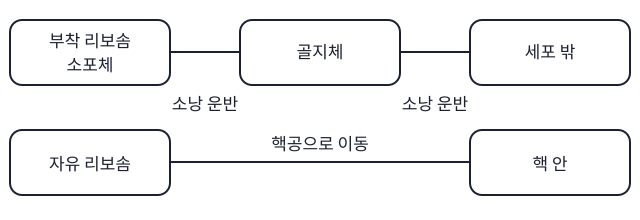
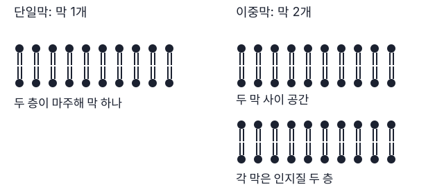

# 감으로 고르던 세포 문제, 기준으로 다시 보기

0908 공부 기록 기반 맞춤 약점노트 · 다섯 가지 구분 · 자기교정 재확인 포함

> `정리노트_0908_Weakness_Cells.html`를 마크다운으로 옮겼어요. 그림은 `figures_0908/` 폴더의 SVG, 위젯은 대표 설정의 정적 그림으로 바꿨어요. 수식은 `$…$` / `$$…$$`라서 GitHub, Obsidian, Typora에서 보여요.

**목차**

- [1. 핵이 없다는 말과 DNA가 없다는 말은 달라요](#s0)
  - [핵이 없다는 말과 DNA가 없다는 말은 달라요](#s0-cell-types)
- [2. 세포소기관인가, 내막계인가를 따로 물어요](#s1)
  - [세포소기관인가, 내막계인가를 따로 물어요](#s1-endomembrane)
- [3. 거친 표면의 원인을 떠올리면 이름이 연결돼요](#s2)
  - [거친 표면의 원인을 떠올리면 이름이 연결돼요](#s2-er)
- [4. 단백질의 목적지에서 길을 거꾸로 찾아요](#s3)
  - [단백질의 목적지에서 길을 거꾸로 찾아요](#s3-protein-route)
- [5. 막을 세는지, 인지질 층을 세는지 먼저 정해요](#s4)
  - [막을 세는지, 인지질 층을 세는지 먼저 정해요](#s4-membrane)
- [6. 요약 · 다시 확인할 기준](#s5)
  - [다섯 가지 기준](#s5-cheatsheet)
  - [다음 확인](#s5-next)
  - [연결 자료](#s5-links)

## 1. 핵이 없다는 말과 DNA가 없다는 말은 달라요

### 핵이 없다는 말과 DNA가 없다는 말은 달라요

*0908 공부 · 새로 확인한 개념 · 재확인*

**쉽게 말하면**

설명서를 방 안에 넣어 둔 집도 있고, 별도 방 없이 놓아둔 집도 있어요. 방이 없다고 설명서까지 없는 건 아니에요.

**정확히 말하면**

**원핵세포(prokaryotic cell)**는 핵막으로 둘러싸인 핵이 없고, DNA가 모인 영역을 **핵양체(nucleoid)**라고 해요. 세균은 원핵생물이에요. **진핵세포(eukaryotic cell)**는 핵막으로 둘러싸인 핵을 가져요.

| 비교 기준 | 원핵세포 | 전형적인 진핵세포 |
|---|---|---|
| 세포막·DNA·리보솜 | 있어요 | 있어요 |
| 핵막으로 둘러싸인 핵 | 없어요 | 있어요 |
| 미토콘드리아·소포체 같은 막성 소기관 | 없어요 | 있어요 |
| 세포벽 | 많은 세균에 있어요 | 식물세포에는 있고 동물세포에는 없어요 |

작은 사례: DNA와 리보솜이 있다는 정보만으로는 둘을 구별하지 못해요. 핵막으로 둘러싸인 핵이 있는지를 확인하면 구별할 수 있어요. 세포벽은 원핵세포에만 있는 구조도, 모든 진핵세포에 있는 구조도 아니에요.

확인 자료: 교재 p.17·18·22, 강의노트 p.1·5·6.

**꼭 기억해요**

**당시의 생각:** 세균이 원핵세포임을 새로 확인했고, 핵막에 관한 첫 발언은 곧 스스로 정정했어요.

핵양체를 작은 핵으로 생각하면 핵막의 유무가 흐려져요. 핵양체는 막으로 둘러싸인 핵이 아닌 DNA 영역이에요. 또 원핵세포에 막성 소기관이 없다는 말을 리보솜도 없다는 뜻으로 바꾸지 않아요.

**페이지 요약**

핵막으로 둘러싸인 핵을 기준으로 구분하고, DNA·리보솜·세포벽의 유무와 섞지 않아요.

*용어*

- **핵양체** — 핵막으로 둘러싸인 핵을 기준으로 구분하고, DNA·리보솜·세포벽의 유무와 섞지 않아요.

---

## 2. 세포소기관인가, 내막계인가를 따로 물어요

### 세포소기관인가, 내막계인가를 따로 물어요

*0908 공부 · 자기교정 후 재확인*

**쉽게 말하면**

건물 안에 있는 방이라고 모두 같은 배달망에 연결된 것은 아니에요. 방의 존재와 배달망의 연결은 서로 다른 질문이에요.

**정확히 말하면**

**막성 세포소기관**은 막으로 구획된 구조인지 보는 분류예요. **내막계(endomembrane system)**는 서로 직접 이어지거나 소낭으로 연결되는 막들의 체계예요. 막이 있다는 사실만으로 내막계라고 결론 내릴 수 없어요.

| 구조 | 막으로 구획되는가 | 내막계인가 |
|---|---|---|
| 소포체·골지체·리소좀 | 예 | 예 |
| 미토콘드리아 | 예 | 아니요 |
| 리보솜 | 아니요 | 아니요 |

핵막·소포체·골지체·리소좀·소낭·세포막은 내막계에 포함돼요. 미토콘드리아는 막성 소기관이지만, 소포체와 골지체 사이의 소낭 운반망에 속하는 막은 아니에요.

**리보솜(ribosome)**은 단백질을 만들고, **리소좀(lysosome)**은 가수분해효소로 물질을 분해해요. 낡은 소기관이 리소좀에서 분해·재활용될 수 있어도, 그 소기관 자체가 내막계 구성원이 되는 것은 아니에요.

확인 자료: 교재 p.19–20, 강의노트 p.5.

**꼭 기억해요**

**당시의 생각:** 미토콘드리아는 세포소기관이지만 내막계는 아니라고 스스로 바로잡았어요.

원핵세포에 없는 구조를 고를 때는 막성 소기관인지 확인해요. 내막계에 속하지 않는 것을 고를 때는 별도로 운반망 소속을 확인해요. “소낭이 등장한다”는 단서만으로 운반 대상까지 내막계에 넣지 않아요.

**페이지 요약**

미토콘드리아는 막성 소기관이지만 내막계는 아니에요. 분해 대상과 분해를 맡는 구조를 구별해요.

*용어*

- **내막계** — 미토콘드리아는 막성 소기관이지만 내막계는 아니에요. 분해 대상과 분해를 맡는 구조를 구별해요.

---

## 3. 거친 표면의 원인을 떠올리면 이름이 연결돼요

### 거친 표면의 원인을 떠올리면 이름이 연결돼요

*0908 공부 · 처음의 이름 혼동 · 뒤의 정정 함께 반영*

**쉽게 말하면**

작은 알갱이가 붙은 표면은 울퉁불퉁하고, 없는 표면은 매끈해요. 이름을 외우기 전에 무엇이 표면에 붙었는지 보세요.

**정확히 말하면**

**조면소포체(rough ER)**는 바깥 표면에 리보솜이 붙어 있어 거칠게 보여요. 붙어 있는 리보솜이 단백질을 만들고, 소포체는 그 단백질의 접힘·가공과 운반에 관여해요. **활면소포체(smooth ER)**는 표면에 리보솜이 붙어 있지 않으며 지질 합성과 해독 등에 관여해요.

| 단서 | 대응하는 구조 | 연결할 기능 |
|---|---|---|
| 리보솜이 붙은 거친 표면 | 조면소포체 | 분비 경로로 들어갈 단백질의 합성·가공 |
| 리보솜 없는 매끈한 표면 | 활면소포체 | 지질 합성·해독 |

이름에서 기능으로: rough는 거친 표면, 그 원인은 붙은 리보솜이에요. 기능에서 이름으로: 지질 합성과 해독이 특히 활발하다는 단서는 활면소포체로 연결해요. 두 소포체를 “한쪽만 일을 한다”로 구분하지 않아요.

확인 자료: 교재 p.19, 강의노트 p.5.

**꼭 기억해요**

**당시의 생각:** 처음에는 리보솜이 붙은 소포체를 활면이라고 말했지만, 뒤에서는 활면의 지질 합성과 조면의 부착 리보솜을 바르게 설명했어요.

단백질을 직접 이어 만드는 것은 리보솜이에요. 조면소포체의 막 자체가 단백질을 조립하는 것처럼 이해하지 않아요. 표면의 리보솜 유무와 대표 기능을 한 쌍으로 기억해요.

**페이지 요약**

조면은 부착 리보솜과 단백질 경로, 활면은 리보솜 없는 표면과 지질 합성·해독으로 연결해요.

*용어*

- **조면소포체** — 조면은 부착 리보솜과 단백질 경로, 활면은 리보솜 없는 표면과 지질 합성·해독으로 연결해요.

---

## 4. 단백질의 목적지에서 길을 거꾸로 찾아요

### 단백질의 목적지에서 길을 거꾸로 찾아요

*0908 공부 · 경로 설명 후 적용을 망설임*

**쉽게 말하면**

밖으로 보내는 택배와 집 안에서 쓰는 물건은 배달 경로가 달라요. 어디서 일할 물건인지 먼저 정하면 필요한 길이 보여요.

**정확히 말하면**

먼저 **단백질이 일할 목적지**를 확인해요. 전형적인 분비 단백질은 조면소포체의 부착 리보솜에서 만들어져 소포체 안으로 들어간 뒤, 소낭과 골지체를 거쳐 밖으로 나가요. 골지체는 받은 단백질을 가공·분류해요.

1. 분비 단백질: 부착 리보솜에서 합성하며 소포체 안으로 들어가요.
2. 소낭으로 골지체에 전달하고, 가공·분류한 뒤 다시 소낭에 담아요.
3. 소낭이 세포막과 융합하면 내용물이 세포 밖으로 나가요.

**자유 리보솜**이 만든 단백질은 시토졸에 남아 일할 수도 있고, 핵공을 통해 핵으로 들어갈 수도 있어요. 핵으로 가는 단백질이 골지체를 거쳐야 하는 것은 아니에요. 따라서 “세포 밖으로 안 나감”만으로 자유 리보솜이라고 단정하지 않아요. 리소좀에서 일하는 효소처럼 세포 안에서 쓰여도 소포체·골지체 경로를 타는 단백질이 있어요.

| 목적지·용도 | 이 노트에서 비교할 대표 경로 |
|---|---|
| 시토졸에서 일하는 단백질 | 자유 리보솜에서 합성해 시토졸에서 기능 |
| 핵 안에서 일하는 단백질 | 자유 리보솜에서 합성한 뒤 핵공으로 이동 |
| 전형적인 분비 단백질·리소좀 효소 | 부착 리보솜, 소포체·골지체 경로 |

*위는 전형적인 분비 단백질, 아래는 핵에서 일하는 단백질의 경로예요. 선은 단백질의 이동을 나타내요.*

확인 자료: 교재 p.17·19, 강의노트 p.5.

**꼭 기억해요**

**당시의 생각:** 소포체·골지체 경로와 자유 리보솜 경로를 구분해 설명했지만, 핵으로 가는 단백질을 고를 때는 확신하지 못했어요.

자유·부착 리보솜은 영구적으로 다른 종류의 기계라는 뜻이 아니라 위치에 따른 구분이에요. “핵에서 일함”을 “핵 안에서 리보솜이 합성함”으로 바꾸지 않아요. 시토졸은 소기관 사이의 액체 부분을 가리켜요.

**페이지 요약**

핵으로 가는 단백질은 자유 리보솜에서 합성한 뒤 핵공으로 들어갈 수 있어요. 세포 안팎보다 실제 이동 경로를 확인해요.

*용어*

- **자유 리보솜** — 핵으로 가는 단백질은 자유 리보솜에서 합성한 뒤 핵공으로 들어갈 수 있어요. 세포 안팎보다 실제 이동 경로를 확인해요.

---

## 5. 막을 세는지, 인지질 층을 세는지 먼저 정해요

### 막을 세는지, 인지질 층을 세는지 먼저 정해요

*0908 공부 · 관계 설명 후 용어 재확인*

**쉽게 말하면**

두 장을 맞붙여 만든 벽 하나와, 그런 벽 두 개는 달라요. 종이 장수를 세는지 벽 개수를 세는지 먼저 정해요.

**정확히 말하면**

**인지질 이중층(phospholipid bilayer)**은 인지질 두 층이 마주한 **막 한 개**의 기본 구조예요. **이중막(double membrane)**은 외막과 내막이라는 **막 두 개**를 뜻해요. 각 막이 인지질 이중층이므로, 인지질 층을 세면 합계 네 층이에요.

| 대상 | 막의 수 | 인지질 층의 수 |
|---|---|---|
| 세포막 | 1개 | 2층 |
| 핵막의 외막과 내막 | 2개 | 합계 4층 |
| 미토콘드리아의 외막과 내막 | 2개 | 합계 4층 |

단면 모식도에서 막 하나 안의 두 층은 소수성 꼬리끼리 마주해요. 이중막에서는 두 막 사이에 별도 공간이 있어요. 그래서 한 덩어리의 “인지질 4중층 막”으로 부르기보다 “인지질 이중층으로 된 막 두 개”라고 설명해요.

*동그란 부분은 인지질의 머리, 짧은 선은 꼬리예요. 실제 크기 비율을 나타내는 그림은 아니에요.*

확인 자료: 교재 p.17·20·22, 강의노트 p.3·5·6.

**꼭 기억해요**

**당시의 생각:** 이중층 두 개가 이중막이라는 관계는 떠올렸어요. 다만 “4중층”이라는 말보다 막의 수와 인지질 층의 수를 따로 쓰면 더 정확해져요.

강의노트에는 생체막의 인지질 이중층을 “인지질 이중막”으로 적은 곳도 있어요. 여기서는 bilayer와 double membrane을 구분해 표기해요. 두 표현이 나오면 막 두 개를 뜻하는지 인지질 두 층을 뜻하는지 문맥을 확인해요.

**페이지 요약**

이중층은 막 1개·인지질 2층, 이중막은 막 2개·인지질 합계 4층이에요.

*용어*

- **인지질 이중층** — 이중층은 막 1개·인지질 2층, 이중막은 막 2개·인지질 합계 4층이에요.

---

## 6. 요약 · 다시 확인할 기준

### 다섯 가지 기준

이 자료는 녹음 당시의 학습 신호를 바탕으로 만들었어요. 자기교정은 반영했지만 현재 숙련도나 장기 기억을 확인한 결과는 아니에요.

| 주제 | 시험 직전 한 줄 |
|---|---|
| 1 원핵·진핵 | 핵막으로 둘러싸인 핵을 기준으로 구분하고, DNA·리보솜·세포벽의 유무와 섞지 않아요. |
| 2 소기관·내막계 | 미토콘드리아는 막성 소기관이지만 내막계는 아니에요. 분해 대상과 분해를 맡는 구조를 구별해요. |
| 3 조면·활면 | 조면은 부착 리보솜과 단백질 경로, 활면은 리보솜 없는 표면과 지질 합성·해독으로 연결해요. |
| 4 단백질 경로 | 핵으로 가는 단백질은 자유 리보솜에서 합성한 뒤 핵공으로 들어갈 수 있어요. 세포 안팎보다 실제 이동 경로를 확인해요. |
| 5 이중층·이중막 | 이중층은 막 1개·인지질 2층, 이중막은 막 2개·인지질 합계 4층이에요. |

---

### 다음 확인

- 자기교정한 내막계·조면소포체·막의 수 구분을 설명 없이 재확인해요.
- 맞힌 문제라도 판단 이유가 불분명하면 애매함으로 표시해요.
- 해설을 읽은 뒤의 성공과, 시간이 지난 뒤 혼자 설명한 성공을 구분해요.

---

### 연결 자료

- [맞춤 복습문제 10선](복습문제_0908_Weakness_Cells.md)
- [기존 0908 전체 정리노트](../../../복습노트/0908/정리노트_0908_Biomolecules_and_Cells.html)

---

출처: SSTT/0908 공부.md(학습 신호) · 강의노트 1장 p.1·3·5·6 · 『생명과학: 기초와 응용』 2판 1장 p.17–20·22(내용 검증).
