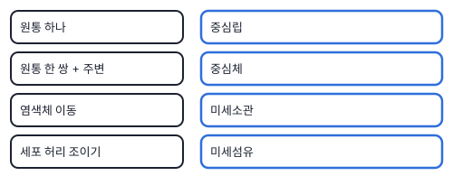
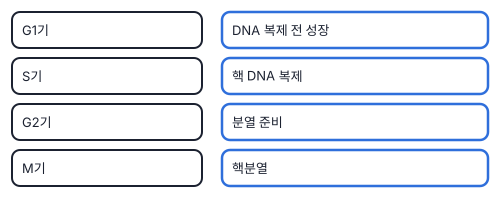
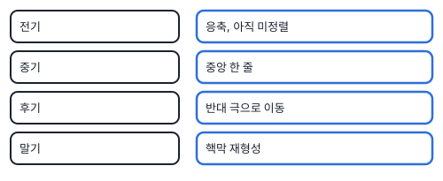
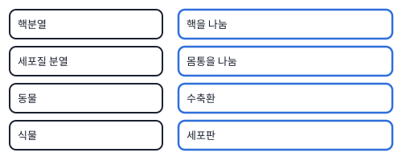
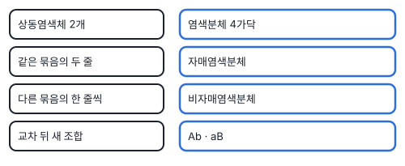
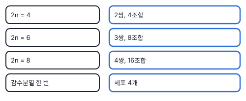
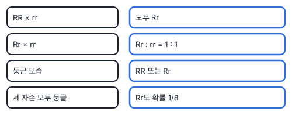
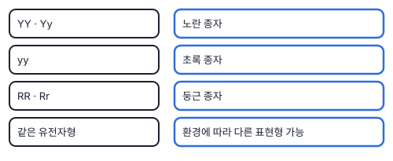

# 0922 맞춤 약점노트 — 구분 기준부터 다시

0922 공부 기록 기반 · 세포분열과 유전의 혼동 보완

> `정리노트_0922_Weakness_0922_v1.html`를 마크다운으로 옮겼어요. 그림은 `figures_0922/` 폴더의 SVG, 위젯은 대표 설정의 정적 그림으로 바꿨어요. 수식은 `$…$` / `$$…$$`라서 GitHub, Obsidian, Typora에서 보여요.

**목차**

- [1. 구조와 복제 대상을 구분해요](#s0)
  - [중심립·중심체·방추사·수축환](#s0-tools)
  - [S기에 복제되는 것은 핵 전체가 아니라 DNA](#s0-cycle)
- [2. 분열을 모양과 시간으로 읽어요](#s1)
  - [모양으로 전기·중기·후기·말기 가르기](#s1-phases)
  - [핵분열과 세포질 분열은 겹칠 수 있어요](#s1-cytoplasm)
- [3. 감수분열의 가닥과 수를 구분해요](#s2)
  - [네 가닥의 정체와 교차의 기준](#s2-cross)
  - [염색체 개수에서 쌍 수를 먼저 구해요](#s2-count)
- [4. 유전 실험의 조건을 확인해요](#s3)
  - [순계는 교배 결과를 해석하는 출발 조건이에요](#s3-pure)
  - [우성은 좋다는 뜻이 아니고, 표현형에는 환경도 작용해요](#s3-phenotype)
- [5. 요약 · 예고](#s4)
  - [조건을 남긴 한 줄 요약](#s4-cheatsheet)
  - [다음 재확인](#s4-next)
  - [관련 자료](#s4-links)

## 1. 구조와 복제 대상을 구분해요

### 중심립·중심체·방추사·수축환

*0922 공부 보완*

**쉽게 말하면**

나누는 실과 허리를 조이는 끈은 맡은 일이 달라요.

*왼쪽 대상과 오른쪽 기준을 짝지어 읽어요.*

**정확히 말하면**

중심립(centriole)은 작은 원통 하나예요. 동물세포의 중심체(centrosome)는 보통 직각으로 놓인 중심립 두 개와 주변 물질로 이루어진 미세소관 조직 중심이에요. 중심립 하나와 중심체 전체를 같은 말로 쓰지 않아요.

방추체(spindle)는 분열 때 염색체를 배열하고 나누는 미세소관(microtubule) 장치예요. 방추사(spindle fiber)는 그 실을 가리켜요. 수업에서는 두 말을 비슷하게 쓰지만, 장치 전체와 개별 실이라는 범위를 구분하면 좋아요. 동원체 부근의 키네토코어(kinetochore)에 붙는 것은 동원체 미세소관이에요. 방추체의 모든 미세소관이 염색체에 붙는 것은 아니에요.

동물세포의 세포질을 조이는 수축환(contractile ring)은 액틴 미세섬유(microfilament)를 중심으로 작동해요. 역할로 거꾸로 떠올리면 염색체 이동은 미세소관, 세포 허리 조이기는 미세섬유예요.

**꼭 기억해요**

공부 기록에서 중심립 명칭과 방추체·방추사의 관계를 다시 확인하려 했고, 수축환의 재료를 뒤에서 정리했어요. 그 정정이 독립 추론이었는지는 기록으로 확인되지 않아요.

원래 설명: [중심립·중심체·방추사·수축환 관련 토픽](../../../복습노트/0922/정리노트_0922_Cell_Division_and_Heredity.html#s1-interphase)

**페이지 요약**

원통 하나: 중심립.

*용어*

- **원통 하나** — 중심립
- **원통 한 쌍 + 주변** — 중심체
- **염색체 이동** — 미세소관
- **세포 허리 조이기** — 미세섬유

---

### S기에 복제되는 것은 핵 전체가 아니라 DNA

*0922 공부 보완*

**쉽게 말하면**

설명서를 복사하는 일과 방을 둘로 나누는 일은 달라요.

*왼쪽 대상과 오른쪽 기준을 짝지어 읽어요.*

**정확히 말하면**

간기(interphase)는 G1기·S기·G2기예요. G1기는 DNA 복제 전의 성장 단계로 단백질과 다른 분자 합성이 활발해요. S기(synthesis phase)에는 핵 DNA가 복제돼요. G2기에도 성장과 단백질 합성이 이어지며 분열을 준비해요.

“핵이 S기에 복제된다”보다 “핵 안의 DNA가 S기에 복제된다”가 정확해요. 핵 두 개를 만드는 핵분열은 M기에 일어나요. S기를 지난 한 세포는 DNA 양이 늘었지만 아직 핵분열을 마친 두 핵이 생긴 상태가 아니에요.

**꼭 기억해요**

공부 중 G1기와 S기를 구분하면서 “핵은 S기에 복제”라고 말했어요. 뜻이 DNA 복제였을 수 있어 확정 오답으로 세지 않고, 복제 대상과 핵분열 시점을 재확인해요. 단백질 합성이 G1기에만 일어나는 것도 아니에요.

원래 설명: [S기에 복제되는 것은 핵 전체가 아니라 DNA 관련 토픽](../../../복습노트/0922/정리노트_0922_Cell_Division_and_Heredity.html#s1-interphase)

**페이지 요약**

G1기: DNA 복제 전 성장.

*용어*

- **G1기** — DNA 복제 전 성장
- **S기** — 핵 DNA 복제
- **G2기** — 분열 준비
- **M기** — 핵분열

---

## 2. 분열을 모양과 시간으로 읽어요

### 모양으로 전기·중기·후기·말기 가르기

*0922 공부 보완*

**쉽게 말하면**

뭉쳤는지, 가운데 섰는지, 양쪽으로 가는지, 새 방이 생겼는지 순서대로 봐요.

*왼쪽 대상과 오른쪽 기준을 짝지어 읽어요.*

**정확히 말하면**

전기(prophase)에는 염색체가 응축돼 보이기 시작해요. 응축된 염색체는 중기·후기에도 보이므로 “응축됨” 하나만으로 전기를 확정하지 않아요. 아직 중앙 정렬·두 무리 분리가 없다는 조건을 함께 봐요.

중기(metaphase)는 중앙의 중기판에 정렬된 모습, 후기(anaphase)는 자매염색분체가 떨어져 반대 극으로 이동하는 모습이에요. 말기(telophase)는 양극의 염색체가 풀리며 그 주위로 핵막이 재형성되는 모습이에요. 핵막이 있다는 사실만으로 말기라 할 수는 없어요. 간기에도 핵막이 있어요.

방추체는 분열을 시작하면서 형성되고 말기에 해체돼요. 간기에도 미세소관은 다른 세포 기능에 쓰여요. “분열이 끝나면 방추체가 해체”와 “세포에 미세소관이 전혀 없음”은 달라요. 핵막 소실·방추사 부착은 엄밀히 전중기(prometaphase)이며 수업의 네 단계 모형에서는 전기에 포함해요.

**꼭 기억해요**

양파 사진을 보며 처음 막혔다가 배열·분리를 기준으로 정리했어요. 해설을 참고했는지 확인되지 않아 공부 중 정정으로 다뤄요. 방추사가 다시 생기는 때도 모형을 본 뒤 정리했어요.

원래 설명: [모양으로 전기·중기·후기·말기 가르기 관련 토픽](../../../복습노트/0922/정리노트_0922_Cell_Division_and_Heredity.html#s1-phases)

**페이지 요약**

전기: 응축, 아직 미정렬.

*용어*

- **전기** — 응축, 아직 미정렬
- **중기** — 중앙 한 줄
- **후기** — 반대 극으로 이동
- **말기** — 핵막 재형성

---

### 핵분열과 세포질 분열은 겹칠 수 있어요

*0922 공부 보완*

**쉽게 말하면**

방 두 개가 생기는 과정과 집 몸통이 갈라지는 과정은 일부 겹쳐요.

*왼쪽 대상과 오른쪽 기준을 짝지어 읽어요.*

**정확히 말하면**

핵분열은 염색체를 두 핵으로 나누고, 세포질 분열(cytokinesis)은 세포질을 나눠 두 딸세포를 완성해요. 두 과정은 구별되지만 시간을 완전히 따로 떼어 놓는 것은 아니에요.

수업의 단계 모형에서는 말기에 세포질 분열이 시작된다고 정리해요. 교재 그림 3.2는 보통 유사분열 진행 중에 시작해 끝날 무렵 완결된다고 설명해요. 따라서 “말기가 완전히 끝나야만 시작”이라고 외우지 않아요. 단계 선택 문제는 제시된 모형과 조건을 먼저 봐요.

동물은 미세섬유 수축환이 세포막을 안쪽으로 조여 분열홈을 만들어요. 식물은 가운데의 세포판(cell plate)이 자라 새 세포벽을 만들어요.

**꼭 기억해요**

처음에는 말기 뒤인지 말기와 함께인지 물었고, 뒤에서 “말기부터”로 정리했어요. 정정은 확인되지만 참고 경로는 불명확해요.

원래 설명: [핵분열과 세포질 분열은 겹칠 수 있어요 관련 토픽](../../../복습노트/0922/정리노트_0922_Cell_Division_and_Heredity.html#s1-cytokinesis)

**페이지 요약**

핵분열: 핵을 나눔.

*용어*

- **핵분열** — 핵을 나눔
- **세포질 분열** — 몸통을 나눔
- **동물** — 수축환
- **식물** — 세포판

---

## 3. 감수분열의 가닥과 수를 구분해요

### 네 가닥의 정체와 교차의 기준

*0922 공부 보완*

**쉽게 말하면**

부모에게서 받은 두 묶음이 나란히 붙고, 서로 다른 묶음의 줄이 조각을 바꿔요.

*왼쪽 대상과 오른쪽 기준을 짝지어 읽어요.*

**정확히 말하면**

감수분열 전기 I에 복제된 상동염색체 한 쌍이 접합하면 4분체(tetrad), 곧 2가염색체(bivalent)가 돼요. 4는 염색분체 네 가닥, 2는 염색체 두 개를 세요. 유사분열 중기에는 상동염색체가 이렇게 접합하지 않으므로, 복제된 염색체 하나의 X자 모양을 4분체라 부르지 않아요.

교차(crossing over)의 기준은 상동염색체의 비자매염색분체(nonsister chromatids) 사이 교환이에요. 한 상동염색체에서 한 가닥, 다른 상동염색체에서 한 가닥이 참여해요. 그림의 안쪽 두 가닥은 한 사례의 배치일 뿐이에요. 교재는 네 가닥 중 어느 두 비자매 가닥이든 참여할 수 있다고 설명해요. 위치가 안쪽인지보다 어느 염색체에 속하는지 확인해요.

AB와 ab가 있는 상동염색체에서 A와 B 사이에 한 번 교차하면 네 가닥의 조합은 AB·Ab·aB·ab가 돼요. Ab와 aB가 재조합형이에요. 교차는 물리적 교환, 이 예의 재조합(recombination)은 새로운 대립유전자 조합이 생긴 결과예요. 교차 후에는 자매염색분체도 해당 구간의 대립유전자 조합이 달라질 수 있어요.

**꼭 기억해요**

“무조건 안쪽”이라는 해석에는 기존 모형의 안쪽 가닥 설명도 영향을 줄 수 있어요. 그림의 한 배치를 일반 규칙으로 바꾸지 않아요. 유사분열의 4분염색체 발언은 뒤에서 정정했지만 정정 경로는 불명확해요.

원래 설명: [네 가닥의 정체와 교차의 기준 관련 토픽](../../../복습노트/0922/정리노트_0922_Cell_Division_and_Heredity.html#s3-crossover)

**페이지 요약**

상동염색체 2개: 염색분체 4가닥.

*용어*

- **상동염색체 2개** — 염색분체 4가닥
- **같은 묶음의 두 줄** — 자매염색분체
- **다른 묶음의 한 줄씩** — 비자매염색분체
- **교차 뒤 새 조합** — Ab · aB

---

### 염색체 개수에서 쌍 수를 먼저 구해요

*0922 공부 보완*

**쉽게 말하면**

카드가 여섯 장이어도 짝은 세 쌍이에요.

*왼쪽 대상과 오른쪽 기준을 짝지어 읽어요.*

**정확히 말하면**

2배체 세포의 염색체 수를 2n이라고 쓰면 상동염색체 쌍 수는 n이에요. 2n=8이면 8개·4쌍이고, 2n=4이면 4개·2쌍이에요. “4개”와 “4쌍”을 구별해요.

교차·돌연변이를 빼고 모계·부계 염색체의 분배만 세면, 한 개체가 여러 감수분열을 통해 만들 수 있는 배우자의 염색체 조합은 2ⁿ가지예요. 쌍마다 두 선택을 곱해요. 2n=6이면 n=3이므로 2×2×2=8가지예요.

이것은 감수분열 한 번에서 나오는 세포 수가 아니에요. 한 번의 감수분열은 네 세포를 만들어요. 교차가 없는 한 번의 분열에서는 상보적인 두 조합이 각각 복제되어 나올 수 있어요. 2ⁿ은 가능한 전체 분배 조합 수예요.

**꼭 기억해요**

기록에서는 지수는 쌍 수라고 정리했지만, 뒤에서 “염색체 4개”와 “4쌍”을 섞어 말했어요. 해당 원문항은 2n=8이라 답 16은 맞아요. 표현 혼동과 실제 오답을 구별해 재확인해요.

원래 설명: [염색체 개수에서 쌍 수를 먼저 구해요 관련 토픽](../../../복습노트/0922/정리노트_0922_Cell_Division_and_Heredity.html#s3-assortment)

**페이지 요약**

2n = 4: 2쌍, 4조합.

*용어*

- **2n = 4** — 2쌍, 4조합
- **2n = 6** — 3쌍, 8조합
- **2n = 8** — 4쌍, 16조합
- **감수분열 한 번** — 세포 4개

---

## 4. 유전 실험의 조건을 확인해요

### 순계는 교배 결과를 해석하는 출발 조건이에요

*0922 공부 보완*

**쉽게 말하면**

겉모습만 같은지 보는 것과, 자손도 계속 같은지 확인하는 일은 달라요.

*왼쪽 대상과 오른쪽 기준을 짝지어 읽어요.*

**정확히 말하면**

순계(true-breeding)는 조사하는 형질이 자가수분 후 자손에서도 계속 같은 모습으로 이어지는 계통이에요. 멘델은 이처럼 확인·유지한 부모 계통을 교배했어요. 자가수분(self-pollination)은 같은 개체의 꽃가루를 쓰고, 타가수분(cross-pollination)은 다른 개체의 꽃가루를 쓰는 방식이에요. 수술을 제거하면 받는 꽃의 자가수분을 막고 원하는 다른 꽃가루를 줄 수 있어요.

둥근 대립유전자 R이 완전히 우성일 때 둥근 개체의 유전자형은 RR 또는 Rr이에요. 따라서 겉모습만으로 동형접합을 확정할 수 없다는 의문은 타당해요. 조건이 RR×rr이면 F1은 모두 Rr로 둥글어요. Rr×rr이면 각 자손은 Rr과 rr이 1/2씩 예상돼요.

적은 수의 자손이 모두 둥글었다는 사실만으로 RR을 증명하지는 못해요. Rr×rr에서도 자손 3개가 우연히 모두 둥글 확률은 1/2×1/2×1/2=1/8이에요. 반복 관찰로 순계를 확인하는 설계와, 한 번의 결과를 보고 부모를 추측하는 일을 구별해요.

**꼭 기억해요**

기록의 “동형접합인지 겉으로 알 수 없다”는 좋은 질문이에요. 다만 자손이 모두 둥글면 무조건 동형접합이라는 결론은 표본 수와 사전 조건을 확인해야 해요. 기존 노트의 “충분히 많으면 PP”도 확정 증명보다 강한 지지로 읽어야 해요.

원래 설명: [순계는 교배 결과를 해석하는 출발 조건이에요 관련 토픽](../../../복습노트/0922/정리노트_0922_Cell_Division_and_Heredity.html#s4-mendel-design)

**페이지 요약**

RR × rr: 모두 Rr.

*용어*

- **RR × rr** — 모두 Rr
- **Rr × rr** — Rr : rr = 1 : 1
- **둥근 모습** — RR 또는 Rr
- **세 자손 모두 둥글** — Rr도 확률 1/8

---

### 우성은 좋다는 뜻이 아니고, 표현형에는 환경도 작용해요

*0922 공부 보완*

**쉽게 말하면**

같은 씨앗도 햇빛을 받는 조건이 다르면 보이는 모습이 달라질 수 있어요.

*왼쪽 대상과 오른쪽 기준을 짝지어 읽어요.*

**정확히 말하면**

유전자형(genotype)은 가진 대립유전자 구성, 표현형(phenotype)은 실제로 드러난 특성이에요. 같은 유전자형이라도 환경에 따라 표현형이 달라질 수 있어요. 교재는 같은 유전자형에서도 일조량에 따라 피부색이 달라질 수 있다고 설명해요.

완전우성에서 우성(dominant)은 이형접합자에서 드러나는 대립유전자의 효과를 뜻해요. 유익함·품질·흔함을 뜻하지 않아요. 멘델의 완두 종자색은 노랑 Y가 초록 y에, 종자 모양은 둥근 R이 주름 r에 우성이에요. Yy는 노랑, Rr은 둥근 모습이에요. 각각 다른 형질의 관계이므로 노랑 꽃 등으로 대상을 바꾸어 외우지 않아요.

**꼭 기억해요**

같은 유전자형의 환경 효과는 뒤에서 받아들였지만 참고 경로는 미확인이라 짧게 재확인해요. “둥근 게 더 좋으니까 우성”이라는 기억법은 우성의 정의와 분리해요.

원래 설명: [우성은 좋다는 뜻이 아니고, 표현형에는 환경도 작용해요 관련 토픽](../../../복습노트/0922/정리노트_0922_Cell_Division_and_Heredity.html#s4-terms)

**페이지 요약**

YY · Yy: 노란 종자.

*용어*

- **YY · Yy** — 노란 종자
- **yy** — 초록 종자
- **RR · Rr** — 둥근 종자
- **같은 유전자형** — 환경에 따라 다른 표현형 가능

---

## 5. 요약 · 예고

### 조건을 남긴 한 줄 요약

| 주제 | 판별 기준 |
|---|---|
| 중심립·중심체·방추사·수축환 | 원통 하나: 중심립 / 원통 한 쌍 + 주변: 중심체 |
| S기에 복제되는 것은 핵 전체가 아니라 DNA | G1기: DNA 복제 전 성장 / S기: 핵 DNA 복제 |
| 모양으로 전기·중기·후기·말기 가르기 | 전기: 응축, 아직 미정렬 / 중기: 중앙 한 줄 |
| 핵분열과 세포질 분열은 겹칠 수 있어요 | 핵분열: 핵을 나눔 / 세포질 분열: 몸통을 나눔 |
| 네 가닥의 정체와 교차의 기준 | 상동염색체 2개: 염색분체 4가닥 / 같은 묶음의 두 줄: 자매염색분체 |
| 염색체 개수에서 쌍 수를 먼저 구해요 | 2n = 4: 2쌍, 4조합 / 2n = 6: 3쌍, 8조합 |
| 순계는 교배 결과를 해석하는 출발 조건이에요 | RR × rr: 모두 Rr / Rr × rr: Rr : rr = 1 : 1 |
| 우성은 좋다는 뜻이 아니고, 표현형에는 환경도 작용해요 | YY · Yy: 노란 종자 / yy: 초록 종자 |

2ⁿ의 n은 상동염색체 쌍 수이며 교차·돌연변이를 뺀 분배 조합이에요. 순계 추정은 조건과 표본 수를 확인해요. 교차의 기준은 위치가 아니라 비자매 관계예요.

---

### 다음 재확인

- 설명을 닫고 총 염색체 수에서 쌍 수와 조합 수를 각각 말해 봐요.
- 네 가닥을 다시 배치해도 교차할 수 있는 비자매 쌍을 골라 봐요.
- 사진의 단계는 한 표지만 보지 말고 정렬·이동·핵막을 함께 확인해요.
- 공부 중 정정은 현재 독립 회상 성공을 뜻하지 않아요. 새 문항으로 다시 확인해요.

---

### 관련 자료

- [맞춤 복습문제](복습문제_0922_Weakness_0922_v1.md)
- [원래 0922 문제설명](../../../복습노트/0922/문제설명_0922_Cell_Division_and_Heredity.html)

---

출처: SSTT/0922 공부.md · 0922 기존 복습자료 3종 · 강의노트 3·4장 · 교재 3·4장. 당시 발언을 바탕으로 보완했으며 현재 숙련도는 확인하지 않았어요.
