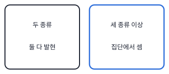
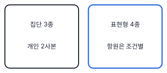
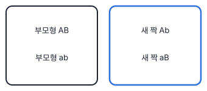
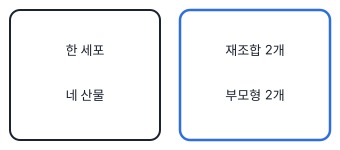
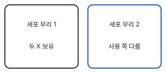

# 0929 맞춤 약점노트 — 관계·개수·발현을 나누기

0929 공부 기록 기반 · 유전에서 다시 확인할 여섯 가지

> `정리노트_0929_Weakness_0929_v1.html`를 마크다운으로 옮겼어요. 그림은 `figures_0929/` 폴더의 SVG, 위젯은 대표 설정의 정적 그림으로 바꿨어요. 수식은 `$…$` / `$$…$$`라서 GitHub, Obsidian, Typora에서 보여요.

**목차**

- [0. 발현 관계와 세는 대상](#s0)
  - [공동우성에 복대립이 꼭 필요할까?](#s0-relations)
  - [ABO에서 3·2·4를 구별하기](#s0-counts)
- [1. 함께 전달됨과 재조합](#s1)
  - [연관은 같이 전달되는 경향](#s1-linkage)
  - [세포·산물·자손을 나누어 재조합 세기](#s1-frequency)
- [2. X의 보유와 사용](#s2)
  - [X가 있다는 것과 사용한다는 것](#s2-x)
- [3. 구조와 조절](#s3)
  - [염색체 수·절편 사본·표현형 구별](#s3-structure)
- [4. 요약 · 예고](#s4)
  - [한눈에 구분하기](#s4-cheatsheet)
  - [다음 재확인](#s4-next)
  - [함께 보면 좋은 자료](#s4-links)

## 0. 발현 관계와 세는 대상

### 공동우성에 복대립이 꼭 필요할까?

*0929 공부 기록 · 4장 p4 · 교재 p79–80*

**쉽게 말하면**

두 종류를 함께 보여 주는 것과, 고를 수 있는 종류가 셋 이상인 것은 다른 질문이에요.

**정확히 말하면**

공부할 때 공동우성의 필요조건을 복대립유전자로 연결했어요. 두 정의의 **세는 대상**을 나누면 풀려요. 공동우성(codominance)은 이형접합자에서 두 대립유전자의 산물이 각각 드러나는 관계예요. 복대립유전자(multiple alleles)는 집단의 한 좌위에 대립유전자 종류가 세 개 이상 있다는 뜻이에요.

MN 혈액형의 기본 모형은 M과 N 두 대립유전자만 두고, MN 이형접합자에서 두 산물이 모두 나타나요. 두 종류만으로 공동우성이 성립하므로 **복대립은 공동우성의 필요조건이 아니에요.** ABO에는 세 종류가 있고 Iᴬ와 Iᴮ가 공동우성이어서 두 현상이 한 예에 함께 등장할 뿐이에요.

[기존 노트의 관련 설명](../../../복습노트/0929/정리노트_0929_Heredity.html#s1-abo)

**꼭 기억해요**

ABO에서 두 현상이 같이 보인다는 사실을 모든 공동우성의 조건으로 넓히지 않아요. 집단의 종류 수와 이형접합자의 발현 양상을 따로 확인해요.

**보충 · 수업에서 다루지 않았어요**

MN 모형을 반례로 사용하는 것은 정의를 적용한 재확인이에요. 공동우성의 성립에 세 번째 대립유전자는 필요하지 않아요.

출처: 4장 p4 · 교재 p79–80

**페이지 요약**

공동우성은 발현 관계, 복대립은 집단의 종류 수예요.

- **(보충) 공동우성과 복대립** — M·N 두 대립유전자만으로 MN 공동우성이 성립해요. 세 번째 대립유전자나 복대립은 공동우성의 필요조건이 아니에요.

---

### ABO에서 3·2·4를 구별하기

*0929 공부 기록 · 4장 p4 · 교재 p79–80*

**쉽게 말하면**

선택지의 종류 수, 한 사람이 받은 개수, 겉으로 나뉘는 종류 수를 따로 세어요.

**정확히 말하면**

한 좌위에 세 종류가 있다는 말을 보고, 공부 중에는 집단의 종류 수와 개인의 개수를 구별해 정정했어요. 정정 경로는 녹음만으로 확정할 수 없으므로 새 조건에서 다시 확인해요.

| 무엇을 세나요? | 일반적인 ABO 모형 |
|---|---|
| 집단의 대립유전자 종류 | Iᴬ, Iᴮ, i의 3종 |
| DNA 복제 전 이배체 개인의 해당 좌위 | 부모에게서 하나씩 받은 두 사본. 동형접합이면 종류는 1종, 이형접합이면 2종이에요. |
| 표현형 | A·B·AB·O의 네 혈액형 |

IᴬIᴮ는 AB형으로 두 항원을 모두 나타내요. IᴬIᴬ와 Iᴬi는 모두 A형이고 ii는 O형이에요. 세 대립유전자 종류를 세 혈액형이라고 바꾸면 안 돼요. 항원 수 역시 모든 개인에서 둘이 아니에요. A형의 A 항원, AB형의 A·B 항원처럼 유전자형에 따라 달라져요.

[기존 노트의 관련 설명](../../../복습노트/0929/정리노트_0929_Heredity.html#s1-abo)

**꼭 기억해요**

대립유전자 사본 수와 서로 다른 종류 수도 달라요. IᴬIᴬ에는 두 사본이 있지만 대립유전자 종류는 한 종류예요.

**페이지 요약**

집단은 3종, 복제 전 개인은 두 사본, 표현형은 네 혈액형이에요.

---

## 1. 함께 전달됨과 재조합

### 연관은 같이 전달되는 경향

*0929 공부 기록 · 4장 p4–5 · 교재 p81–82*

**쉽게 말하면**

같은 꾸러미로 이동해도, 안의 물건 하나가 바뀐다고 나머지 물건까지 바뀌지는 않아요.

**정확히 말하면**

공부 중 연관을 설명하며 하나를 바꾸면 나머지도 다 바뀐다고 말했어요. 연관(linkage)은 **같은 염색체 위의 서로 다른 유전자가 함께 전달되는 경향**이에요. 한 유전자의 대립유전자가 변하면 다른 유전자의 서열도 자동으로 변한다는 뜻은 아니에요.

AB/ab인 이형접합자를 예로 들어요. 교차가 없다면 AB와 ab 배우자가 부모형이에요. 두 좌위 사이의 비자매염색분체 교차는 Ab와 aB 재조합형을 만들 수 있어요. 그러므로 연관되어도 새 조합이 전혀 불가능한 것은 아니에요.

AB/ab × ab/ab 검정교배에서는 상대가 ab만 주므로 자손 AaBb·aabb는 부모형 배우자 AB·ab를, Aabb·aaBb는 재조합형 배우자 Ab·aB를 드러내요. 처음 부모형 배열을 확인하고 새 짝을 찾으면 돼요.

[기존 노트의 관련 설명](../../../복습노트/0929/정리노트_0929_Heredity.html#s2-morgan)

**꼭 기억해요**

함께 전달됨, 한 유전자의 여러 효과인 다면발현, 여러 유전자가 한 형질에 기여하는 다인자유전을 구별해요. 연관은 이 둘의 정의가 아니에요.

**페이지 요약**

연관은 전달 경향이에요. 교차는 같은 염색체의 조합도 바꿀 수 있어요.

---

### 세포·산물·자손을 나누어 재조합 세기

*0929 공부 기록 · 4장 p5 · 교재 p82–83*

**쉽게 말하면**

작업한 묶음 수와 바뀌어 나온 낱개 수는 달라요. 한 묶음의 일부만 바뀔 수 있어요.

**정확히 말하면**

기록에서는 재조합 빈도를 교차한 세포 비율로 보았다가 자손 수로 계산한다고 정정했어요. 뒤에는 160/1000=16%도 계산했어요. 계산 대상을 고친 사실은 확인되지만, 교정의 독립성은 미확인이에요. 차이의 핵심은 자손이 안 나올 수도 있다는 설명보다 **한 세포의 네 산물 중 일부만 재조합형일 수 있다는 점**이에요.

관측 재조합 빈도(recombination frequency)는 검정교배에서 **두 재조합형 자손 수의 합 ÷ 전체 자손 수 × 100**으로 추정해요. 자손의 생존율 등에 치우침이 없다는 가정을 둬요. 부모형 360·360, 재조합형 40·40이면 80/800=10%예요.

한 감수분열의 네 염색분체 중 두 비자매염색분체 사이에서 두 좌위 사이의 교차가 딱 한 번 일어나면, 단순 모형의 네 산물은 AB, Ab, aB, ab예요. 둘은 부모형, 둘은 재조합형이에요. 100개 세포 중 20개에서만 이 교차가 있고 나머지에는 없다면, 재조합형은 20×2=40개, 전체는 100×4=400개라 10%예요. 교차 세포 비율 20%와 달라요.

**50% 상한은 그림의 바깥 가닥이 교차할 수 없어서 생기는 규칙이 아니에요.** 단일 교차에서는 네 가닥 중 둘만 참여하지만, 다른 감수분열이나 다른 교차에서는 참여 가닥이 달라질 수 있어요. 표준 모형에서 두 좌위의 조합이 독립적으로 관측될 때 부모형 둘과 재조합형 둘이 각각 1/4이어서 재조합형 합은 1/2이에요. 멀리 떨어진 같은 염색체의 두 좌위도 다중 교차 때문에 이 수준에 접근할 수 있어요.

유전자 거리는 염색체 위 두 좌위가 얼마나 떨어졌는지를 나타내는 개념이에요. **짧은 구간**에서는 재조합 빈도 1%를 약 1 지도단위(cM)로 잡아요. 8%이면 약 8 cM예요. cM는 염기쌍 수가 아니고, 긴 구간에서는 다중 교차를 놓쳐 관측 빈도가 거리를 과소평가할 수 있어요. 50%는 표준 모형에서의 이론적 기대 빈도 한계예요. 유한한 표본의 집계값은 우연 변동 때문에 정확히 이 범위 안에만 놓인다고 보장하지 않아요. 관측 50%만으로 서로 다른 염색체라고 확정하거나 지도거리의 상한도 50 cM라고 단정하지 않아요.

[기존 노트의 관련 설명](../../../복습노트/0929/정리노트_0929_Heredity.html#s2-frequency)

**꼭 기억해요**

그림에서 안쪽에 그려졌는지는 영구적인 성질이 아니에요. 한 교차에서 2/4가 재조합형이라는 사실과, 모든 실험의 교차세포 비율이 재조합 빈도와 같다는 주장을 구별해요.

**보충 · 수업에서 다루지 않았어요**

단일 교차의 네 산물과 다중 교차에 따른 관측 한계, 짧은 구간의 cM 대응은 빈도의 단위와 50% 오해를 풀기 위한 보충이에요.

출처: 교재 3장 p68·4장 p82; [OpenStax Biology 2e 13.1](https://openstax.org/books/biology-2e/pages/13-1-chromosomal-theory-and-genetic-linkage)(50%·먼 좌위), [NHGRI Centimorgan](https://www.genome.gov/genetics-glossary/Centimorgan-cM)(지도 단위)

**페이지 요약**

자손 빈도와 교차 세포 비율은 달라요. 50%는 독립처럼 보이는 한계이고 고정된 바깥 가닥 때문이 아니에요.

- **(보충) 교차·재조합 빈도·지도거리** — 두 비자매염색분체 사이 단일 교차의 네 산물 중 둘만 재조합형일 수 있어요. 교차한 세포 비율과 재조합형 자손 비율은 달라요. 다중 교차 때문에 먼 좌위는 관측 재조합 빈도가 50%에 접근하고 거리가 과소평가될 수 있어요. 50%만으로 다른 염색체라고 확정하지 않아요. 짧은 구간에서 재조합 빈도 1%는 약 1 cM에 대응해요. cM는 염기쌍 수가 아니며 지도거리 상한이 50 cM라는 뜻도 아니에요.

---

## 2. X의 보유와 사용

### X가 있다는 것과 사용한다는 것

*0929 공부 기록 · 4장 p6 · 교재 p84–85*

**쉽게 말하면**

같은 책 두 권을 가진 두 방에서, 어느 책을 펼치는지만 달라질 수 있어요. 덮어 둔 책도 방 안에 있어요.

**정확히 말하면**

공부 중 어떤 X가 꺼지는지와 얼룩무늬는 설명했지만, 뒤에서 세포마다 X가 하나인지와 모든 체세포에 염색체가 있는지를 다시 물었어요. **보유한 DNA와 발현 중인 DNA를 분리**해요.

일반적인 XX 포유류의 핵이 있는 이배체 체세포에는 X가 두 개 있어요. X 불활성화(X chromosome inactivation)는 그중 하나의 대부분 유전자 발현을 억제하는 조절이에요. X 한 개를 버리거나 다른 세포에 나누어 주는 일이 아니에요. 응축된 불활성 X를 바소체(Barr body)라고 해요. 모든 X 유전자가 예외 없이 완전히 꺼진다는 뜻도 아니에요.

주황 대립유전자 Xᴼ와 검정 대립유전자 Xᵇ를 가진 고양이를 생각해요. 한 세포 집단은 Xᴼ를 주로 사용하고 다른 집단은 Xᵇ를 사용해요. 두 집단 모두 Xᴼ와 Xᵇ를 보유한 채 사용 쪽이 달라요. 초기의 불활성화 상태가 분열한 세포들에 이어져 색 영역이 생길 수 있어요. 이는 수업에서 미룬 큰 무늬 설명을 교재로 보충한 내용이에요.

같은 사람의 피부세포와 간세포는 보통 같은 전체 염색체 세트를 가져요. 서로 다른 일을 하는 까닭은 필요한 유전자 발현이 다르기 때문이에요. **보통 핵이 있는 이배체 체세포**라는 조건을 남겨요. 핵이 없는 성숙한 사람 적혈구에는 핵 염색체가 없고, 배우자는 반수체여서 예외 없이 모든 세포가 같은 수라는 문장은 성립하지 않아요.

[기존 노트의 관련 설명](../../../복습노트/0929/정리노트_0929_Heredity.html#s3-inactivation)

**꼭 기억해요**

XY 체세포의 X 한 개와 XX 체세포에서 활성 X가 보통 한 개라는 말을 혼동하지 않아요. 주황·검정 이형접합 얼룩의 설명도 정상 XX 모형 안에서 판단해요.

**보충 · 수업에서 다루지 않았어요**

초기 불활성화 상태의 계승과 조직별 발현, 핵 없는 성숙 적혈구의 예외는 보유·발현을 구분하기 위한 보충이에요.

출처: 교재 4장 p84(X 불활성화 상태 유지), 3장 p56–57(유사분열 후 동일 유전정보), 5장 p113(세포별 활성자와 유전자 발현), 13장 p300(적혈구와 백혈구의 핵 차이). 뒤 두 장은 이 구분을 위한 보충 근거이며 수업 진도에 포함하지 않아요.

**페이지 요약**

XX 체세포는 두 X를 보유해요. 하나를 불활성화해도 DNA 자체가 없어지지는 않아요.

- **(보충) X 불활성화와 적혈구의 예외** — 초기 X 불활성화 상태가 딸세포에 이어져 색 영역이 생길 수 있어요. 같은 DNA를 가진 조직도 유전자 발현이 다를 수 있어요. 핵이 없는 성숙 사람 적혈구에는 핵 염색체가 없어요. 모든 체세포가 예외 없이 같은 염색체 수를 가진다고 일반화하지 않아요.

---

## 3. 구조와 조절

### 염색체 수·절편 사본·표현형 구별

*0929 공부 기록 · 4장 p6–7 · 교재 p84–85*

**쉽게 말하면**

책의 권수가 그대로여도 한 문장이 두 번 실리거나, 순서가 뒤집히거나, 연결된 스위치가 바뀔 수 있어요.

**정확히 말하면**

역위 뒤에도 표현형이 같지 않겠냐는 의문은 뒤에서 위치가 바뀌면 다른 결과가 생길 수 있다고 정정했어요. 뒤의 조절 설명도 읽고 정정했으므로, 현재까지 미해결이라고 취급하지 않고 조건을 바꿔 재확인해요.

| 변화 | 절편·서열에서 볼 것 | 단순 구조 변화에서 염색체 수 |
|---|---|---|
| 결실 | 일부 소실 | 그대로일 수 있어요. |
| 중복 | 특정 절편 사본 증가 | 그대로일 수 있어요. |
| 역위 | 같은 염색체 안에서 방향 반전 | 그대로예요. |
| 균형 상호 전좌 | 비상동염색체 사이 교환 | 그대로일 수 있어요. |

따라서 염색체 수가 유지된다는 사실만으로 역위를 고를 수 없어요. ABCDEFG가 ABCFEDG이면 DEF가 뒤집혀 역위이고, ABCDDEFG라면 D 사본이 더해진 중복이에요. 전체 권수와 특정 문장의 사본 수가 다른 질문인 셈이에요.

유전자 목록이나 총량이 보존돼도 **절단점이 유전자를 끊거나 주변 조절 관계를 바꾸면** 발현과 표현형이 달라질 수 있어요. 변화가 조절에 영향을 주지 않으면 큰 변화가 없을 수도 있어요. 역위가 언제나 무해하거나 언제나 질환을 일으킨다는 결론은 모두 피하고 실제 절단 위치와 조절을 확인해요. 수업의 8번·14번 전좌와 버킷 림프종은 위치 변화가 발현 조절에 영향을 주는 한 사례예요.

[기존 노트의 관련 설명](../../../복습노트/0929/정리노트_0929_Heredity.html#s4-structural)

**꼭 기억해요**

전좌는 비상동염색체로의 이동이에요. 상동염색체 비자매염색분체 사이의 정상 교차와 구별해요. 유전자 목록이 같다는 말을 DNA 배열까지 완전히 같다는 뜻으로 쓰지 않아요.

**페이지 요약**

염색체 수가 같아도 절편 사본과 조절은 달라질 수 있어요. 방향 반전이 역위의 기준이에요.

---

## 4. 요약 · 예고

### 한눈에 구분하기

| 주제 | 구분 기준 |
|---|---|
| 공동우성에 복대립이 꼭 필요할까? | 공동우성은 발현 관계, 복대립은 집단의 종류 수예요. |
| ABO에서 3·2·4를 구별하기 | 집단은 3종, 복제 전 개인은 두 사본, 표현형은 네 혈액형이에요. |
| 연관은 같이 전달되는 경향 | 연관은 전달 경향이에요. 교차는 같은 염색체의 조합도 바꿀 수 있어요. |
| 세포·산물·자손을 나누어 재조합 세기 | 자손 빈도와 교차 세포 비율은 달라요. 50%는 독립처럼 보이는 한계이고 고정된 바깥 가닥 때문이 아니에요. |
| X가 있다는 것과 사용한다는 것 | XX 체세포는 두 X를 보유해요. 하나를 불활성화해도 DNA 자체가 없어지지는 않아요. |
| 염색체 수·절편 사본·표현형 구별 | 염색체 수가 같아도 절편 사본과 조절은 달라질 수 있어요. 방향 반전이 역위의 기준이에요. |

---

### 다음 재확인

- 해설을 닫고 공동우성과 복대립의 차이를 다시 말해 봐요.
- 100개 세포의 네 산물을 그려 세포 비율과 산물 비율을 나눠 봐요.
- XX 세포 두 개에 두 X를 모두 그린 뒤 사용하는 쪽만 다르게 표시해 봐요.

이 자료는 당시 발언에 맞춘 보완이에요. 공부 중 정정은 장기 기억이나 현재 숙련을 확인한 결과가 아니에요.

---

### 함께 보면 좋은 자료

- [약점 복습문제](복습문제_0929_Weakness_0929_v1.md)
- [0929 기존 정리노트](../../../복습노트/0929/정리노트_0929_Heredity.html)

---

출처: SSTT/0929 공부.md · 0929 복습노트 HTML 3종 · 강의노트 4장 · 교재 4장. 당시 발언과 현재 숙련은 구분해요.
