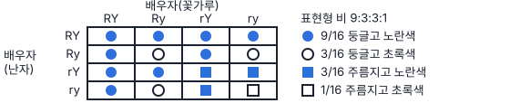
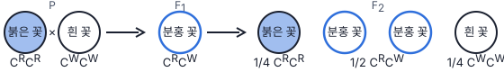

# 독립의 법칙과 멘델 법칙의 확장 — 수업 전에 보는 예습노트

이영만 교수님 생명과학 · 0929 수업 예습 (강의노트 4장 p2–p4)

> `예습노트_0929_Independent_Assortment_and_Beyond_Mendel.html`를 마크다운으로 옮겼어요. 그림은 `figures_0929/` 폴더의 SVG예요. 수식은 `$…$` / `$$…$$`라서 GitHub, Obsidian, Typora에서 보여요.

**목차**

- [0. 미리 알아둘 것](#s0)
  - [분리의 법칙과 상동염색체](#s0-segregation)
- [1. 독립의 법칙과 유전의 염색체설](#s1)
  - [독립의 법칙과 양성잡종 교배](#s1-independent)
  - [유전의 염색체설과 유전자 좌위](#s1-chromosome-theory)
- [2. 멘델 법칙의 확장](#s2)
  - [불완전우성](#s2-incomplete)
  - [공동우성과 MN 혈액형](#s2-codominance)
  - [복대립유전자와 ABO 혈액형](#s2-multiple-alleles)
  - [다인자유전](#s2-polygenic)
  - [다면발현](#s2-pleiotropy)
- [3. 한눈에 보기](#s3)
  - [치트시트](#s3-cheatsheet)
  - [함께 보면 좋은 자료](#s3-links)

## 0. 미리 알아둘 것

### 분리의 법칙과 상동염색체

**쉽게 말하면**

부모는 짝을 이룬 카드 두 장 중 한 장만 아기에게 물려줘요.

그 두 장은 엄마 쪽과 아빠 쪽에서 온 짝꿍 막대 한 쌍에 한 장씩 붙어 있어요.

**정확히 말하면**

- **분리의 법칙(law of segregation)** — 한 형질을 정하는 대립유전자 한 쌍은 배우자(gamete)를 만들 때 갈라져 배우자마다 하나씩 들어가요. Pp는 P와 p를 1/2씩 줘요.
- **상동염색체(homologous chromosome)** — 엄마·아빠에게서 온 모양과 크기가 같은 한 쌍이에요. 같은 위치에 같은 유전자가 있고, 대립유전자는 같을 수도 다를 수도 있어요.

대립유전자 쌍이 갈라지는 것은 감수분열에서 상동염색체 쌍이 갈라지는 것과 같아요. 쌍이 여럿이면 쌍마다 따로 무작위로 갈라져요.

지난 수업: [분리의 법칙과 우열의 법칙](../../복습노트/0922/정리노트_0922_Cell_Division_and_Heredity.html#s4-segregation) · [상동염색체의 무작위 분배](../../복습노트/0922/정리노트_0922_Cell_Division_and_Heredity.html#s3-assortment)

**페이지 요약**

대립유전자 한 쌍은 상동염색체 한 쌍 위에 있고, 배우자를 만들 때 갈라져 하나씩 들어가요.

*용어*

- **분리의 법칙(law of segregation)** — 대립유전자 쌍이 배우자마다 하나씩 갈라져 들어간다는 규칙
- **상동염색체(homologous chromosome)** — 엄마·아빠에게서 온 모양과 크기가 같은 염색체 한 쌍

---

## 1. 독립의 법칙과 유전의 염색체설

### 독립의 법칙과 양성잡종 교배

*4장 p2–p3*

**쉽게 말하면**

윗옷 색과 바지 모양을 따로 고르는 것과 같아요.

*퍼넷 사각형, 교과서 그림 4.4를 단순하게 다시 그렸어요.*

**정확히 말하면**

**독립의 법칙(independent assortment)**: 두 형질의 대립유전자는 독립적으로 분배돼요.

**양성잡종(dihybrid)**: 두 쌍 모두 이형접합(RrYy)이고, F2의 9/16이 둥글고 노란색이에요.

**들을 때 포인트**

- **기출** 독립의 법칙 정의와 양성잡종 교배 예시가 나오면 그대로 받아 적어 두세요.

**페이지 요약**

두 형질의 대립유전자는 따로 배우자로 가서 F2에서 9:3:3:1이 나와요.

*용어*

- **독립의 법칙(principle of independent assortment)** — 서로 다른 형질의 대립유전자는 독립적으로 분배돼요.
- **양성잡종(dihybrid)** — 두 쌍의 대립유전자가 모두 이형접합인 개체(RrYy)예요.

---

### 유전의 염색체설과 유전자 좌위

*4장 p3*

**쉽게 말하면**

짝지은 두 책장의 같은 칸에 꽂힌 비슷한 책 두 권이에요.

*점선이 유전자 좌위, 교과서 그림 4.5를 단순하게 다시 그렸어요.*

**정확히 말하면**

**유전의 염색체설**: 서튼이 제안했고, 유전자는 염색체 위에 있어요.

**유전자 좌위(locus)**: 유전자가 있는 염색체의 특정 부위예요.

**대립유전자(allele)**: 상동염색체의 같은 위치에 있는 유전자예요.

**들을 때 포인트**

- 염색체의 행동을 멘델의 분리의 법칙·[독립의 법칙](#s1-independent)과 하나씩 짝지어 보세요.

**페이지 요약**

서튼은 유전자가 염색체 위에 있어 염색체처럼 행동한다고 봤어요.

*용어*

- **유전자 좌위(locus)** — 유전자가 있는 염색체의 특정 부위예요.
- **대립유전자(allele)** — 상동염색체의 같은 위치에 있는 유전자예요.

---

## 2. 멘델 법칙의 확장

### 불완전우성

*4장 p3*

**쉽게 말하면**

색소 공장이 둘 중 하나만 돌아가서, 붉은색이 절반쯤만 나온 분홍 꽃이 펴요.

*채운 원은 붉은 꽃, 파란 테두리는 분홍 꽃, 빈 원은 흰 꽃. 교과서 그림 4.7을 단순하게 다시 그렸어요.*

**정확히 말하면**

- **불완전우성(incomplete dominance)** — 이형접합자(heterozygote)에서 열성 대립유전자의 효과가 어느 정도 나타나는 경우예요.

CR(붉은색)·CW(흰색): CRCR은 효소 활성 충분, CWCW는 불활성, CRCW는 분홍 꽃으로 보일 만큼만 색소를 합성해요. 사람 예는 [낫모양적혈구 빈혈증](#s2-pleiotropy)이에요.

**들을 때 포인트**

- **기출** 불완전우성이 나오면 F2 1:2:1을 멘델의 3:1과 비교해 보세요.

**페이지 요약**

불완전우성에서는 이형접합자가 중간 표현형(분홍 꽃)이라 F2가 1:2:1이에요.

*용어*

- **불완전우성(incomplete dominance)** — 이형접합자에서 열성 대립유전자의 효과가 어느 정도 나타나는 경우

---

### 공동우성과 MN 혈액형

*4장 p3–p4*

**쉽게 말하면**

빨강·파랑 스티커를 둘 다 붙이면 섞이지 않고 두 색이 그대로 다 보여요.

**정확히 말하면**

- **공동우성(codominance)** — 이형접합자의 두 대립유전자가 비슷한 정도의 효과를 내는 것이에요. 예: 사람 혈액형 M, MN, N(수혈에는 영향이 없어 의학적 중요성은 없어요)

| 유전자형 | 적혈구 표면 당단백질 | 혈액형 |
|---|---|---|
| LMLM | M형만 | M |
| LNLN | N형만 | N |
| LMLN | M형, N형 모두 | MN |

**들을 때 포인트**

- **기출** 공동우성이 나오면 [불완전우성](#s2-incomplete)과 이형접합자 표현형이 어떻게 다른지 비교해 보세요.

**페이지 요약**

공동우성에서는 이형접합자에서 두 대립유전자 효과가 모두 나타나요(MN형).

*용어*

- **공동우성(codominance)** — 이형접합자의 두 대립유전자가 비슷한 정도의 효과를 내는 것

---

### 복대립유전자와 ABO 혈액형

*4장 p4*

**쉽게 말하면**

동네 전체엔 열쇠 모양이 세 가지 있지만, 한 사람은 그중 두 개만 가져요.

*ABO 혈액형 표의 "아버지(어머니) 배우자"는 "아버지로부터 기인한 대립유전자를 가진 배우자"를 줄인 말이에요. 교과서 그림 4.8을 단순하게 다시 그렸어요.*

**정확히 말하면**

- **복대립유전자(multiple alleles)** — 하나의 유전자에 대하여 2개 이상의 다른 대립유전자가 존재하는 것이에요.

IA(A 항원)·IB(B 항원)는 서로 공동우성, i(항원 없음)에는 완전 우성이에요.

**들을 때 포인트**

- **기출** 복대립유전자가 나오면 집단의 대립유전자 수와 한 사람의 수(2개)를 구분해 보세요.

**페이지 요약**

ABO 혈액형은 대립유전자 IA, IB, i 세 개로 네 가지 혈액형을 만들어요.

*용어*

- **복대립유전자(multiple alleles)** — 하나의 유전자에 2개 이상의 다른 대립유전자가 존재하는 것

---

### 다인자유전

*4장 p4*

**쉽게 말하면**

키는 다이얼 여러 개를 조금씩 돌려 정해져서, 사람마다 끊김 없이 달라요.

*세로축은 "각각의 키 범주에 속하는 사람의 수"를 줄였어요. 교과서 그림 4.9c를 단순하게 다시 그렸어요.*

**정확히 말하면**

- **다인자유전(polygenic inheritance)** — 많은 유전자가 한 특성에 기여해, 특성이 연속적으로 증가하거나 감소하는 유전이에요.
- **정량적 형질(quantitative traits)** — 키, 피부색, 몸무게, 옥수수 길이, 밀 종자 색깔 같은 연속적 특성이에요.

**들을 때 포인트**

- **기출** 다인자유전이 나오면 꽃 색·혈액형처럼 딱 나뉘는 형질과 비교해 보세요.

**페이지 요약**

다인자유전은 많은 유전자가 한 특성에 기여해 키처럼 연속적인 분포를 만들어요.

*용어*

- **다인자유전(polygenic inheritance)** — 많은 유전자가 하나의 특성에 기여해 연속적으로 나타나는 유전
- **정량적 형질(quantitative traits)** — 키·몸무게처럼 연속적으로 나타나는 특성

---

### 다면발현

*4장 p4*

**쉽게 말하면**

부품 하나가 고장 나서 기계 여러 곳이 한꺼번에 탈이 나는 것과 같아요.

**정확히 말하면**

- **다면발현(pleiotropy)** — 하나의 유전자가 여러 종류의 유전적 특성에 영향을 주는 현상이에요.

예: 낫세포빈혈증. [불완전우성](#s2-incomplete)의 예이기도 해서, 열성동형접합자는 빈혈증, 이형접합체는 약한 빈혈증을 보여요.

1. 원인: 단일 유전자의 열성 대립유전자가 헤모글로빈의 구조와 기능을 바꿔요.
2. 여러 증상: 모세혈관 막힘, 어지럼증, 복부통증, 심장마비 및 장애, 폐렴 등

**들을 때 포인트**

- **기출** 다면발현(유전자 1개 → 특성 여러 개)을 [다인자유전](#s2-polygenic)과 비교해 보세요.
- 유전자 하나에서 증상이 몇 가지 나오는지 세어 보세요.

**페이지 요약**

다면발현은 유전자 하나가 여러 특성에 영향을 주는 현상이고, 낫세포빈혈증이 예예요.

*용어*

- **다면발현(pleiotropy)** — 하나의 유전자가 여러 종류의 유전적 특성에 영향을 주는 현상

---

## 3. 한눈에 보기

### 치트시트

| 개념 | 한 줄 뜻 | 예 |
|---|---|---|
| [독립의 법칙](#s1-independent) | 서로 다른 형질의 대립유전자는 배우자에 독립적으로 들어가요. | RrYy × RrYy → 둥글고 노란 콩 9/16 (9:3:3:1) |
| [불완전우성](#s2-incomplete) | 이형접합자에서 열성 대립유전자 효과도 어느 정도 나타나요. | 붉은 꽃 × 흰 꽃 → 분홍 꽃, F2 1:2:1 |
| [공동우성](#s2-codominance) | 이형접합자에서 두 대립유전자 효과가 비슷하게 함께 나타나요. | MN 혈액형 (LMLN = MN형) |
| [복대립유전자](#s2-multiple-alleles) | 하나의 유전자에 2개 이상의 다른 대립유전자가 있어요. | ABO 혈액형 (IA, IB, i) |
| [다인자유전](#s2-polygenic) | 많은 유전자가 한 형질에 기여해 연속적으로 변해요. | 키·피부색 |
| [다면발현](#s2-pleiotropy) | 유전자 하나가 여러 형질에 영향을 줘요. | 낫세포빈혈증 |

---

### 함께 보면 좋은 자료

- [교과서 4장 독립의 법칙(양성잡종)](../../교과서/생명과학_기초와_응용_2판/04장_유전.pdf#page=5)
- [교과서 4.1.2 멘델의 가설에 대한 수정과 추가](../../교과서/생명과학_기초와_응용_2판/04장_유전.pdf#page=7)

---

출처: 이영만 교수님 생명과학 강의노트 4장 · 박상규 외, *생명과학 기초와 응용* 2판 (2021) 4장. 수업 전에 만든 노트라 수업 내용과 다를 수 있어요.
