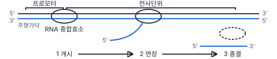
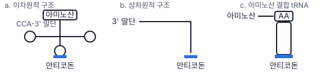
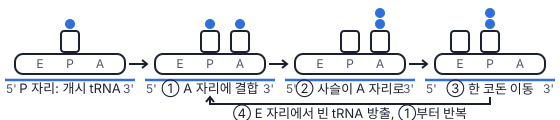
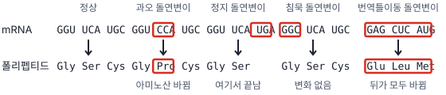

# 유전암호·전사·번역 — 수업 전에 보는 예습노트

이영만 교수님 생명과학 · 1006 수업 예습 (강의노트 5장 p3–p6)

> `예습노트_1006_Genetic_Code_Transcription_and_Translation.html`를 마크다운으로 옮겼어요. 그림은 `figures_1006/` 폴더의 SVG예요. 수식은 `$…$` / `$$…$$`라서 GitHub, Obsidian, Typora에서 보여요.

**목차**

- [0. 미리 알아둘 것](#s0)
  - [DNA에서 단백질까지 큰 흐름](#s0-central-dogma)
- [1. 유전암호와 전사](#s1)
  - [1. 유전암호와 코돈](#s1-genetic-code)
  - [2. 전사: DNA에서 RNA 만들기](#s1-transcription)
- [2. 진핵세포의 mRNA 가공](#s2)
  - [3. 전구체 mRNA 가공](#s2-mrna-processing)
- [3. 번역과 돌연변이](#s3)
  - [4. tRNA와 리보솜](#s3-trna-ribosome)
  - [5. 번역의 세 단계](#s3-translation-steps)
  - [6. 염기쌍 돌연변이](#s3-mutation)
- [4. 한눈에 보기](#s4)
  - [치트시트](#s4-cheatsheet)
  - [함께 보면 좋은 자료](#s4-links)

## 0. 미리 알아둘 것

### DNA에서 단백질까지 큰 흐름

**쉽게 말하면**

원본 설계도를 베껴 쪽지로 옮기고, 쪽지대로 조립해요

원본은 금고에 두고, 베낀 쪽지만 공장으로 가져가 완성품을 만들어요.

**정확히 말하면**

**중심이론(Central Dogma)**: DNA → 전사 → RNA → 번역 → 단백질

**전사(transcription)**: DNA 정보를 상보적인 RNA 사본으로 합성해요.

**번역(translation)**: RNA 정보를 리보솜에서 아미노산 서열로 바꿔 폴리펩티드를 만들어요.

1001 수업에서 복제 다음에 발현을 한 번 훑어봤어요: [1001 정리노트 · 복제와 전사·번역 구별하기](../../복습노트/1001/정리노트_1001_Chromosome_Changes_and_DNA_Replication.html#s7-expression)

**페이지 요약**

유전 정보는 DNA에서 전사로 RNA가 되고, 번역으로 단백질이 돼요.

*용어*

- **중심이론(Central Dogma)** — DNA → 전사 → RNA → 번역 → 단백질

---

## 1. 유전암호와 전사

### 1. 유전암호와 코돈

*5장 p3–p4*

**쉽게 말하면**

글자 4개를 세 개씩 끊어 읽는 요리법 암호예요.

세 글자 단어 하나가 재료 하나를 가리키고, "시작"과 "끝" 표시 단어도 있어요.

**정확히 말하면**

**유전암호(genetic code)**: 염기 3개짜리 **코돈(codon)**이 아미노산 하나를 지정해요.

**퇴화(degeneracy, 중복)**: 아미노산 하나에 코돈이 여럿이에요.

**시작코돈** AUG(개시코돈), **정지코돈** UAA·UAG·UGA(종결 코돈)

**보편성(universal codon)**: 거의 모든 생물에서 암호가 같아요.

**들을 때 포인트**

- **기출** 유전암호·코돈·정지코돈·보편성 정의를 받아 적어요.

**페이지 요약**

유전암호는 염기 3개짜리 코돈으로 아미노산을 지정하고, 모든 생물에서 거의 같아요.

*용어*

- **코돈(codon)** — 아미노산 하나를 지정하는 RNA 염기 3개
- **정지코돈(stop codon)** — 폴리펩티드 합성을 끝내는 UAA·UAG·UGA

---

### 2. 전사: DNA에서 RNA 만들기

*5장 p4*

**쉽게 말하면**

요리책 한 쪽만 메모지에 베껴 적어요.

*3에서 효소와 RNA가 떨어져요. 교과서 그림 5.12를 단순하게 다시 그렸어요.*

**정확히 말하면**

1. 개시: RNA 중합효소가 프로모터에 붙어 프라이머 없이 시작해요.
2. 연장: 주형가닥을 따라 5'→3'로 하나씩 붙여요.
3. 종결: 전사단위 끝에서 RNA와 효소가 떨어져요.

**들을 때 포인트**

- **기출** 전사·프로모터·RNA 중합효소를 복제와 비교해요.

**페이지 요약**

RNA 중합효소가 프로모터에 붙어 주형가닥을 따라 개시, 연장, 종결 순서로 RNA를 만들어요.

*용어*

- **프로모터(promoter)** — RNA 중합효소가 결합해 전사가 시작되는 DNA 염기서열

---

## 2. 진핵세포의 mRNA 가공

### 3. 전구체 mRNA 가공

*5장 p4–p5*

**쉽게 말하면**

갓 베낀 초안은 다듬어야 내보낼 수 있어요.

앞뒤에 보호 덮개를 씌우고, 필요 없는 문단은 오려 낸 뒤 남은 문단을 이어 붙여요.

**정확히 말하면**

**전구체 mRNA**: 핵에서 전사된 가공 전 RNA로, 가공 후 번역돼요.

**5'-Cap**: 5' 말단에 구아닌이 거꾸로 붙어 3'-OH가 있어요.

**폴리(A) 꼬리**: 3' 말단의 아데닌 꼬리로, mRNA 분해를 막아요.

**mRNA 이어맞추기**: 인트론을 잘라 내고 엑손을 이어요.

**들을 때 포인트**

- **기출** 인트론과 엑손이 나오면 어느 쪽이 잘려 나가고 어느 쪽이 남는지 표시해 두세요.
- 5'-Cap은 5' 말단, 폴리(A) 꼬리는 3' 말단에 붙는지 [2. 전사: DNA에서 RNA 만들기](#s1-transcription)의 5'→3' 방향 옆에 표시해 보세요.

**페이지 요약**

전구체 mRNA는 5'-Cap과 폴리(A) 꼬리를 달고 인트론을 잘라 엑손을 이은 뒤 세포질로 나가요.

*용어*

- **인트론(intron)** — 가공 중 잘려 나가는 비암호 서열
- **엑손(exon)** — 완성된 mRNA에 남는 서열

---

## 3. 번역과 돌연변이

### 4. tRNA와 리보솜

*5장 p5–p6*

**쉽게 말하면**

재료를 나르는 배달원과 조립 작업대예요.

*위 끝에 아미노산, 아래 끝에 안티코돈이 있어요. 교과서 그림 5.14를 단순하게 다시 그렸어요.*

**정확히 말하면**

**tRNA**: 아미노아실tRNA 합성효소가 아미노산을 달아요.

**리보솜**: A 자리·P 자리·E 자리가 있는 조립 장소예요.

**들을 때 포인트**

- **기출** tRNA·안티코돈·리보솜: 코돈과 짝짓는 방향을 확인해 보세요.

**페이지 요약**

tRNA는 안티코돈으로 코돈을 읽고 아미노산을 리보솜으로 날라요.

*용어*

- **안티코돈(anticodon)** — mRNA 코돈과 짝짓는 tRNA의 3염기
- **A 자리 / P 자리** — 새 tRNA가 들어오는 자리 / 사슬을 단 tRNA 자리

---

### 5. 번역의 세 단계

*5장 p6*

**쉽게 말하면**

시작하고, 한 칸씩 붙이고, 멈춤 신호에서 끝내요.

*점은 아미노산 사슬, 파란 선은 mRNA예요. 교과서 그림 5.16의 연장 회로를 한 줄로 다시 그렸어요.*

**정확히 말하면**

1. **번역 개시**: P 자리 [개시 코돈](#s1-genetic-code)에 Met-tRNA가 짝지어요.
2. **연장**: A 자리에 새 아미노아실-tRNA가 들어오며 사슬이 길어져요.
3. **종결**: 방출인자가 A 자리에 결합 → P 자리 tRNA에서 폴리펩티드가 잘려요.

**들을 때 포인트**

- 개시·연장·종결마다 A 자리와 P 자리에 무엇이 있는지 그림 옆에 적어 보세요.

**페이지 요약**

번역은 개시, 연장, 종결 순서로 폴리펩티드를 만들어요.

*용어*

- **방출인자(release factor)** — 종결 코돈이 A 자리에 오면 붙어 사슬을 풀어 주는 인자

---

### 6. 염기쌍 돌연변이

*5장 p6*

**쉽게 말하면**

설명서 글자가 바뀌거나 더해지거나 빠진 경우예요.

*붉은 테두리가 바뀐 코돈·아미노산이에요. 교과서 그림 5.18의 mRNA→폴리펩티드 부분을 단순하게 다시 그렸어요.*

**정확히 말하면**

**염기쌍 대체**: 과오 돌연변이는 아미노산이 바뀌고, 정지 돌연변이는 짧아져요.

침묵 돌연변이는 그대로, **번역틀이동 돌연변이**는 틀이 밀려요.

**들을 때 포인트**

- **기출** 과오 돌연변이·정지 돌연변이·침묵 돌연변이의 결과를 구분해 두세요.

**페이지 요약**

염기 하나의 변화가 아미노산을 바꾸거나, 사슬을 끊거나, 아무 영향이 없을 수 있어요.

*용어*

- **침묵 돌연변이(silent mutation)** — 코돈은 바뀌었지만 아미노산은 그대로인 돌연변이
- **번역틀이동 돌연변이(frameshift mutation)** — 염기 삽입·삭제로 읽는 틀이 밀리는 돌연변이

---

## 4. 한눈에 보기

### 치트시트

| 주제 | 핵심 |
|---|---|
| [유전암호·코돈](#s1-genetic-code) | 코돈 = 염기 3개, 64개 중 61개가 아미노산 지정. 시작 AUG, 정지 UAA·UAG·UGA |
| [전사](#s1-transcription) | RNA 중합효소가 프로모터에 결합, 주형가닥 한 가닥으로 5'→3' 합성. 개시 → 연장 → 종결 |
| [mRNA 가공](#s2-mrna-processing) | 5'-Cap + 폴리(A) 꼬리, 인트론 제거·엑손 연결(이어맞추기) |
| [tRNA·리보솜](#s3-trna-ribosome) | 안티코돈이 코돈과 염기쌍. 리보솜 A 자리(새 아미노산) · P 자리(사슬) · E 자리(방출) |
| [번역 단계](#s3-translation-steps) | 개시(P 자리에 AUG) → 연장(A 자리 반복) → 종결(방출인자) |
| [돌연변이 종류](#s3-mutation) | 과오(다른 아미노산) · 정지(짧은 사슬) · 침묵(변화 없음) · 번역틀이동(삭제·첨가) |

5.3.1 오페론(강의노트 p6 뒷부분)은 다음 수업 범위라 이번 노트에서 뺐어요

---

### 함께 보면 좋은 자료

- [교과서 102쪽(파일 p11) 그림 5.11 유전암호](../../교과서/생명과학_기초와_응용_2판/05장_DNA_복제와_유전자의_발현.pdf#page=11)
- [105쪽(파일 p14) 그림 5.14 tRNA](../../교과서/생명과학_기초와_응용_2판/05장_DNA_복제와_유전자의_발현.pdf#page=14)
- [109쪽(파일 p18) 그림 5.18 돌연변이](../../교과서/생명과학_기초와_응용_2판/05장_DNA_복제와_유전자의_발현.pdf#page=18)
- [DNA에서 단백질까지 큰 흐름](#s0-central-dogma)

---

출처: 이영만 교수님 생명과학 강의노트 5장 · 박상규 외, *생명과학 기초와 응용* 2판 (2021) 5장. 수업 전에 만든 노트라 수업 내용과 다를 수 있어요.
