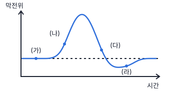
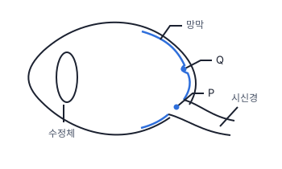
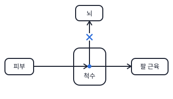

# 생명과학 12장 웹과제 예상 v1 문제해설

왼쪽 목차로 문항을 고르고, 오른쪽 문제를 보며 해설을 따라가요.

문제의 첫 줄부터 검산까지 설명해요.

**목차**

- [문항별 설명](#problems)
  - [P1. [기출 예상] 신경전달물질의 역할](#p1)
  - [P2. [기출 예상] 시각중추의 위치](#p2)
  - [P3. [기출 변형] 말초신경계의 구분](#p3)
  - [P4. [기출 변형] 같은 뉴런에서 자극의 세기를 바꾼 경우](#p4)
  - [P5. [기출 변형] 막전위가 유지되는 조건](#p5)
  - [P6. [예상] 축삭의 막전위 기록](#p6)
  - [P7. [예상] 전달물질 분비 직후의 변화](#p7)
  - [P8. [예상] 세 축삭의 신호 전달](#p8)
  - [P9. [예상] 두 처리군의 관찰 결과](#p9)
  - [P10. [예상] 다섯 가지 감각 상황](#p10)
  - [P11. [예상] 한쪽 눈에 맺힌 두 점](#p11)
  - [P12. [예상] 위험에 대응할 때와 쉴 때](#p12)
  - [P13. [예상] 자극 뒤 갈라지는 두 경로](#p13)
  - [P14. [예상] 뇌 구조별 역할](#p14)
  - [P15. [예상] 크기가 다른 두 소리](#p15)

## 문항별 설명

### P1. [기출 예상] 신경전달물질의 역할

기출 12강 4 예상 · [연습형 문제 보기](../%EB%B3%B5%EC%8A%B5%EB%AC%B8%EC%A0%9C_12%EC%9E%A5_%EC%9B%B9%EA%B3%BC%EC%A0%9C%EC%98%88%EC%83%81_v1.html#p1) · [시험형 문제 보기](../%EB%B3%B5%EC%8A%B5%EB%AC%B8%EC%A0%9C_12%EC%9E%A5_%EC%9B%B9%EA%B3%BC%EC%A0%9C%EC%98%88%EC%83%81_%EC%8B%9C%ED%97%98%ED%98%95_v1.html#p1)

신경전달물질에 대한 설명으로 옳은 것은?

- A. 신경충격의 전달이 빨라지도록 랑비에 결절을 가로질러 방출된다
- B. 전기적 충격이 시냅스후뉴런의 축삭말단에 도달하였을 때 방출된다
- C. 시냅스틈을 가로질러 확산하며 시냅스후뉴런의 세포막에 있는 수용체에 결합한다
- D. 시상에서 방출되는 스테로이드 호르몬이다
- E. 미엘린화된 축삭을 따라서 이동하여 내려가는 전하이다

원문·출처 정보 보기

기출 12강 합본 4번을 보기 순서만 바꿔 실은 예상 문제예요.

#### 문제에서 무엇을 묻나요?

보기마다 신경전달물질이 어디에서 나와 어디에 도착하는지, 또는 그 물질이 무엇이라고 설명하는지 확인해요.

#### 이 문제를 봤을 때 떠올릴 개념과 공식

‘시냅스 틈’은 신호를 보내는 세포와 받는 세포 사이의 좁은 공간이에요. 신호를 보내는 뉴런을 시냅스전뉴런, 받는 뉴런을 시냅스후뉴런이라고 해요.

화학 시냅스에서 활동전위가 시냅스전뉴런의 축삭말단에 도착하면 Ca²⁺가 말단으로 들어와 소포 속 신경전달물질(neurotransmitter)의 방출을 유도해요. 방출된 분자는 틈을 지나 받는 세포막의 수용체에 결합해요. 축삭 자체를 따라가는 전기 신호와 틈을 건너는 분자의 이동을 구분해요.

[화학 시냅스의 전달 순서](../../../%EB%B3%B5%EC%8A%B5%EB%85%B8%ED%8A%B8/1112/%EC%A0%95%EB%A6%AC%EB%85%B8%ED%8A%B8_1112_Nervous_and_Sensory_Systems.html#s3-release)와 [축삭의 도약전도](../../../%EB%B3%B5%EC%8A%B5%EB%85%B8%ED%8A%B8/1112/%EC%A0%95%EB%A6%AC%EB%85%B8%ED%8A%B8_1112_Nervous_and_Sensory_Systems.html#s2-conduction)를 비교해요.

#### 왜 이렇게 푸는지 함께 따라가요

A. 틀려요. 랑비에 결절은 같은 축삭에서 수초가 끊긴 자리예요. 여기서는 이온 통로를 통해 활동전위가 다시 생기고, 전달물질의 방출은 화학 시냅스의 말단에서 일어나요.

B. 틀려요. 받는 쪽인 시냅스후뉴런의 축삭말단을 방출 시작점으로 잡았어요. 이 접점에서 방출을 일으키는 신호는 보내는 쪽 축삭말단에 도착해요.

C. 맞아요. 분자는 시냅스 틈을 확산해서 건너고, 시냅스후뉴런의 세포막에 있는 수용체에 결합해요.

D. 틀려요. 시상의 스테로이드 호르몬이라는 설명으로 신경전달물질을 정의할 수 없어요. 예를 들어 시냅스에서 작용하는 글루탐산은 아미노산이고, 말단에서 나온 뒤 받는 세포의 수용체에 작용해요.

E. 틀려요. 수초가 있는 축삭을 따라 전달되는 현상은 막전위의 변화가 이어지는 활동전위예요. 전달물질은 축삭말단에서 나온 뒤 세포 사이를 이동하는 분자예요.

따라서 답은 C예요.

#### 완성 답과 검산

답 C. 받는 쪽 수용체부터 경로를 거꾸로 추적하면 시냅스 틈을 지나 보내는 쪽 말단의 소포에 닿아요. C의 이동 경로가 이 배치와 일치해요.

**페이지 요약**

#### 핵심 판단

보내는 말단의 소포 → 시냅스 틈 → 받는 쪽 막의 수용체. 답 C.

---

### P2. [기출 예상] 시각중추의 위치

기출 12강 1 예상 · [연습형 문제 보기](../%EB%B3%B5%EC%8A%B5%EB%AC%B8%EC%A0%9C_12%EC%9E%A5_%EC%9B%B9%EA%B3%BC%EC%A0%9C%EC%98%88%EC%83%81_v1.html#p2) · [시험형 문제 보기](../%EB%B3%B5%EC%8A%B5%EB%AC%B8%EC%A0%9C_12%EC%9E%A5_%EC%9B%B9%EA%B3%BC%EC%A0%9C%EC%98%88%EC%83%81_%EC%8B%9C%ED%97%98%ED%98%95_v1.html#p2)

시각중추는 어디에 위치하는가?

- A. 후두엽
- B. 시상하부
- C. 두정엽
- D. 전두엽
- E. 측두엽

원문·출처 정보 보기

기출 12강 합본 1번을 보기 순서만 바꿔 실은 예상 문제예요.

#### 문제에서 무엇을 묻나요?

시각중추가 어느 뇌 영역에 있는지 고르는 문제예요. 보기 이름과 각 영역이 처리하는 정보를 연결해요.

#### 이 문제를 봤을 때 떠올릴 개념과 공식

‘시각중추’에서 확인할 곳은 눈에서 출발한 시각 입력을 받아 처리하는 대뇌겉질의 영역이에요. 대뇌 반구의 겉질은 전두엽·두정엽·측두엽·후두엽으로 나뉘며, 시각 입력을 받는 1차 시각겉질(primary visual cortex)은 뒤통수 쪽에 있어요.

[대뇌의 네 엽과 대표 기능](../../../%EB%B3%B5%EC%8A%B5%EB%85%B8%ED%8A%B8/1117/%EC%A0%95%EB%A6%AC%EB%85%B8%ED%8A%B8_1117_Nervous_and_Sensory_Systems_and_Respiratory_and_Circulatory_Systems.html#s3-lobes)과 [시상과 시상하부의 기능](../../../%EB%B3%B5%EC%8A%B5%EB%85%B8%ED%8A%B8/1117/%EC%A0%95%EB%A6%AC%EB%85%B8%ED%8A%B8_1117_Nervous_and_Sensory_Systems_and_Respiratory_and_Circulatory_Systems.html#s2-thalamus)을 함께 확인해요.

#### 왜 이렇게 푸는지 함께 따라가요

A. 적합해요. 뒤통수 쪽의 후두엽에 1차 시각겉질이 있어 눈에서 온 정보를 처리해요.

B. 부적합해요. 시상하부는 체온 등 몸 안의 상태를 안정적으로 유지하는 기능과 연결돼요. 이 문제에서 찾는 시각겉질의 위치는 후두엽이에요.

C. 부적합해요. 두정엽의 대표 감각 영역은 촉각·압력 등의 정보를 받는 1차 체성감각영역이에요. 시각 입력을 받는 1차 시각겉질은 더 뒤쪽에 있어요.

D. 부적합해요. 이마 쪽의 전두엽에는 수의 운동에 관여하는 1차 운동영역과 계획에 관여하는 영역이 있어요. 시각겉질의 위치와 구분해요.

E. 부적합해요. 측두엽에는 귀에서 온 정보를 받는 청각 영역이 있어요. 이 보기에서는 청각 입력과 시각 입력을 구별해요.

따라서 답은 A, 후두엽이에요.

#### 완성 답과 검산

답 A. 뇌 옆모습에서 1차 시각겉질의 표시를 따라가면 가장 뒤쪽 엽으로 이어지고, 옆쪽의 청각 영역 표시는 측두엽에 놓여요.

**페이지 요약**

#### 핵심 판단

눈의 입력을 받는 1차 시각겉질은 뒤통수 쪽 후두엽에 있어요. 답 A.

---

### P3. [기출 변형] 말초신경계의 구분

기출 12강 40 예상 · [연습형 문제 보기](../%EB%B3%B5%EC%8A%B5%EB%AC%B8%EC%A0%9C_12%EC%9E%A5_%EC%9B%B9%EA%B3%BC%EC%A0%9C%EC%98%88%EC%83%81_v1.html#p3) · [시험형 문제 보기](../%EB%B3%B5%EC%8A%B5%EB%AC%B8%EC%A0%9C_12%EC%9E%A5_%EC%9B%B9%EA%B3%BC%EC%A0%9C%EC%98%88%EC%83%81_%EC%8B%9C%ED%97%98%ED%98%95_v1.html#p3)

말초신경계에 관한 설명으로 잘못된 것은?

- A. 팔을 들어 올릴 때 골격근으로 가는 운동 명령은 체성신경계가 전달한다.
- B. 심장박동을 조절하기 위해 중추에서 심장으로 보내는 신호는 자율신경계에 속한다.
- C. 위험을 피하는 상황에서는 교감신경계가 활성화되면서 소화 활동이 억제될 수 있다.
- D. 휴식 중 부교감신경계가 활성화되면 소화 활동이 촉진될 수 있다.
- E. 피부의 자극을 감지해 척수로 보내는 뉴런은 원심성 뉴런이다.

원문·출처 정보 보기

기출 12강 합본 40번 발문에 정답을 바꾼 생성 변형이에요.

#### 문제에서 무엇을 묻나요?

각 보기에서 신호 방향과 조절 대상을 확인해 **잘못된 설명**을 골라요.

#### 이 문제를 봤을 때 떠올릴 개념과 공식

중추신경계는 뇌와 척수예요. 감각 정보가 말초에서 중추로 들어오면 구심성(afferent), 중추의 명령이 근육이나 기관으로 나가면 원심성(efferent)이에요.

원심성 경로는 조절 대상으로 다시 나눠요. 골격근의 운동 명령은 체성신경계, 심장박동이나 소화의 조절은 자율신경계에 해당해요. 자율신경계에서는 위험에 대응할 때 교감신경계, 편히 쉴 때 부교감신경계가 우세해요.

[중추를 기준으로 나눈 신호 방향](../../../%EB%B3%B5%EC%8A%B5%EB%85%B8%ED%8A%B8/1117/%EC%A0%95%EB%A6%AC%EB%85%B8%ED%8A%B8_1117_Nervous_and_Sensory_Systems_and_Respiratory_and_Circulatory_Systems.html#s0-divisions)과 [교감신경과 부교감신경의 작용](../../../%EB%B3%B5%EC%8A%B5%EB%85%B8%ED%8A%B8/1117/%EC%A0%95%EB%A6%AC%EB%85%B8%ED%8A%B8_1117_Nervous_and_Sensory_Systems_and_Respiratory_and_Circulatory_Systems.html#s0-autonomic)을 연결해요.

#### 왜 이렇게 푸는지 함께 따라가요

A. 맞아요. 팔을 들라는 명령은 중추에서 팔로 나가고, 명령을 받는 곳이 골격근이므로 체성신경계의 원심성 경로예요.

B. 맞아요. 중추에서 심장으로 나가는 신호이고, 조절 대상이 심장박동이므로 자율신경계의 원심성 경로예요.

C. 맞아요. 위험에 대응할 때 교감신경계가 우세하면 당장 필요하지 않은 소화 활동이 줄어들 수 있어요.

D. 맞아요. 쉬고 있을 때 우세한 부교감신경계의 작용으로 소화 활동이 촉진될 수 있어요.

E. 틀려요. 출발점인 피부는 말초이고 목적지인 척수는 중추예요. 중추로 들어오는 감각 경로이므로 이 뉴런은 구심성이에요.

잘못된 설명을 고르므로 답은 E예요.

#### 완성 답과 검산

답 E. 원심성 표기를 '척수에서 몸 쪽으로 나가는 신호'로 풀어 읽으면 E의 피부 → 척수 화살표와 반대예요.

**페이지 요약**

#### 핵심 판단

피부 → 척수는 말초에서 중추로 들어오는 구심성 신호예요. 이를 원심성이라고 한 E가 답이에요.

---

### P4. [기출 변형] 같은 뉴런에서 자극의 세기를 바꾼 경우

기출 12강 37 예상 · [연습형 문제 보기](../%EB%B3%B5%EC%8A%B5%EB%AC%B8%EC%A0%9C_12%EC%9E%A5_%EC%9B%B9%EA%B3%BC%EC%A0%9C%EC%98%88%EC%83%81_v1.html#p4) · [시험형 문제 보기](../%EB%B3%B5%EC%8A%B5%EB%AC%B8%EC%A0%9C_12%EC%9E%A5_%EC%9B%B9%EA%B3%BC%EC%A0%9C%EC%98%88%EC%83%81_%EC%8B%9C%ED%97%98%ED%98%95_v1.html#p4)

다음 중 활동전위에 대한 설명으로 옳은 것은?

- A. 막전위가 역치에 못 미치면 크기가 작은 활동전위가 생긴다.
- B. 같은 뉴런에서 다른 조건이 같을 때 역치에 도달해 발생한 활동전위는 한 번의 크기가 대체로 일정하다.
- C. 같은 뉴런에서 역치를 넘은 자극의 세기를 두 배로 하면 한 번의 활동전위 크기도 두 배가 된다.
- D. 같은 시간에 활동전위가 더 많이 생겼다면 한 번의 활동전위 크기가 커진 것이다.
- E. 같은 뉴런에서는 역치를 넘는 지속 자극의 세기를 바꾸어도 단위 시간당 활동전위 수가 같다.

원문·출처 정보 보기

기출 12강 합본 37번 발문에 정답을 바꾼 생성 변형이에요.

#### 문제에서 무엇을 묻나요?

한 번의 활동전위가 생기는 조건과, 자극의 세기가 파형의 높이와 발생 횟수에 각각 어떤 영향을 주는지 구별해요.

#### 이 문제를 봤을 때 떠올릴 개념과 공식

활동전위(action potential)는 뉴런의 막전위가 빠르게 올라갔다가 내려오는 변화예요. 발화 가능한 뉴런에서 막전위가 기준값인 역치(threshold)에 이르면 Na⁺가 빠르게 들어오며 활동전위가 시작돼요.

실무율(all-or-none principle)에 따라 같은 뉴런의 다른 조건이 같으면 한 번 생긴 활동전위의 크기는 대체로 일정해요. 발화 빈도는 일정 시간 동안의 발생 횟수예요. 같은 뉴런에 더 강한 자극을 지속하면 이 횟수가 늘 수 있어요.

[실무율과 자극의 세기](../../../%EB%B3%B5%EC%8A%B5%EB%85%B8%ED%8A%B8/1112/%EC%A0%95%EB%A6%AC%EB%85%B8%ED%8A%B8_1112_Nervous_and_Sensory_Systems.html#s2-all-or-none)에서 파형 높이와 파형 수를 비교해요.

#### 왜 이렇게 푸는지 함께 따라가요

A. 틀려요. 역치에 못 미쳐도 막전위가 국소적으로 조금 변할 수 있어요. 다만 빠른 Na⁺ 유입이 이어지는 기준에 이르지 않아 활동전위가 시작되지 않아요.

B. 맞아요. 역치에 도달해 발화했고 같은 뉴런에서 다른 조건이 같으므로, 한 번의 전위 변화 크기는 대체로 일정해요.

C. 틀려요. 자극이 두 배여도 역치 이후의 큰 전위 변화는 전압에 반응하는 이온 채널이 열리면서 일어나므로 활동전위의 크기가 자극에 비례해서 두 배가 되지 않아요.

D. 틀려요. 비교 시간이 같을 때 더 많이 발생했다는 것은 단위 시간당 횟수가 늘었다는 뜻이에요. 봉우리 하나의 높이가 커졌는지는 횟수만으로 판단할 수 없어요.

E. 틀려요. 같은 뉴런에 더 강한 자극을 지속하면 조건에 따라 다음 발화가 더 빨리 가능해져 일정 시간의 발생 횟수가 늘 수 있어요.

따라서 답은 B예요.

#### 완성 답과 검산

답 B. 같은 높이의 봉우리 1개와 5개를 같은 시간 구간에 그려 보면, 한 번의 크기가 같으면서 발화 빈도가 다른 경우가 성립해요. D와 E를 함께 걸러낼 수 있어요.

**페이지 요약**

#### 핵심 판단

역치에 이르면 발화하고, 같은 조건에서 한 번의 크기는 대체로 일정해요. 빈도는 바뀔 수 있어요. 답 B.

---

### P5. [기출 변형] 막전위가 유지되는 조건

기출 12강 5 예상 · [연습형 문제 보기](../%EB%B3%B5%EC%8A%B5%EB%AC%B8%EC%A0%9C_12%EC%9E%A5_%EC%9B%B9%EA%B3%BC%EC%A0%9C%EC%98%88%EC%83%81_v1.html#p5) · [시험형 문제 보기](../%EB%B3%B5%EC%8A%B5%EB%AC%B8%EC%A0%9C_12%EC%9E%A5_%EC%9B%B9%EA%B3%BC%EC%A0%9C%EC%98%88%EC%83%81_%EC%8B%9C%ED%97%98%ED%98%95_v1.html#p5)

다음은 막전위에 대한 설명이다. 옳은 것은?

- A. K⁺ 누설 채널은 ATP를 직접 써서 K⁺를 이동시킨다.
- B. 휴지전위가 유지되려면 Na⁺와 K⁺가 각각 세포 안팎에 같은 농도로 분포해야 한다.
- C. 뉴런이 휴지 상태일 때 세포 내부의 전위는 세포 외부보다 높다.
- D. Na⁺/K⁺ 펌프는 ATP를 사용해 한 번 작동할 때 Na⁺ 3개를 세포 밖으로, K⁺ 2개를 세포 안으로 옮긴다.
- E. 활동전위의 상승 구간에는 K⁺가 주로 빠져나가면서 막전위가 올라간다.

원문·출처 정보 보기

기출 12강 합본 5번 발문에 정답을 바꾼 생성 변형이에요.

#### 문제에서 무엇을 묻나요?

휴지 상태에서 막전위를 유지하는 과정과 활동전위가 솟아오를 때의 이온 이동을 나눠 봐요.

#### 이 문제를 봤을 때 떠올릴 개념과 공식

막전위(membrane potential)는 세포 바깥을 기준으로 잰 세포 안의 전위예요. 쉬는 뉴런에서는 세포 안이 바깥보다 낮은 전위를 보이고, 보통 Na⁺는 바깥에, K⁺는 안쪽에 더 많아요.

열린 채널은 이온이 농도 차와 전압 차에 따라 흐를 통로를 제공해요. Na⁺/K⁺ 펌프는 ATP의 에너지로 Na⁺와 K⁺를 각각 이미 더 많은 쪽으로 옮겨 농도 차를 유지해요. 활동전위의 빠른 상승은 채널이 열려 Na⁺가 유입될 때 나타나요.

[채널과 Na⁺/K⁺ 펌프](../../../%EB%B3%B5%EC%8A%B5%EB%85%B8%ED%8A%B8/1112/%EC%A0%95%EB%A6%AC%EB%85%B8%ED%8A%B8_1112_Nervous_and_Sensory_Systems.html#s1-channel-pump)와 [활동전위에서의 이온 이동](../../../%EB%B3%B5%EC%8A%B5%EB%85%B8%ED%8A%B8/1112/%EC%A0%95%EB%A6%AC%EB%85%B8%ED%8A%B8_1112_Nervous_and_Sensory_Systems.html#s2-action)을 비교해요.

#### 왜 이렇게 푸는지 함께 따라가요

A. 틀려요. K⁺ 누설 채널은 열린 틈을 제공해요. 이온은 전기화학 기울기를 따라 이동하므로 이 통과 과정에서 채널이 ATP를 직접 쓰지 않아요.

B. 틀려요. 실제 휴지 상태에서는 Na⁺가 바깥에, K⁺가 안에 더 많아요. 이온 분포가 서로 다르고 막이 각 이온을 다르게 통과시키므로 안팎에 전위 차가 유지될 수 있어요.

C. 틀려요. 세포 바깥을 0으로 잡으면 쉬는 뉴런 안쪽의 막전위는 음수예요. 세포 내부가 바깥보다 낮은 전위라는 뜻이에요.

D. 맞아요. 펌프 한 번당 ATP의 에너지로 Na⁺ 3개를 바깥으로 보내고 K⁺ 2개를 들여와요. 두 이온 모두 농도가 더 높은 쪽으로 운반되므로 능동수송이에요.

E. 틀려요. 양전하를 띤 K⁺가 빠져나가면 안쪽의 전위가 낮아지는 방향으로 작용해요. 상승 구간에는 양전하를 띤 Na⁺의 유입이 우세해요.

따라서 답은 D예요.

#### 완성 답과 검산

답 D. 펌프가 보낸 양전하 3개와 들인 양전하 2개를 비교하면 한 주기당 양전하가 순수하게 1개 밖으로 이동해요. 펌프 작동이 양전하를 순수하게 들여오는 방향이었다면 이 결과가 뒤집혀요.

**페이지 요약**

#### 핵심 판단

Na⁺/K⁺ 펌프는 ATP를 써서 Na⁺ 3개는 밖으로, K⁺ 2개는 안으로 옮겨요. 답 D.

---

### P6. [예상] 축삭의 막전위 기록

예상 12장 6 · [연습형 문제 보기](../%EB%B3%B5%EC%8A%B5%EB%AC%B8%EC%A0%9C_12%EC%9E%A5_%EC%9B%B9%EA%B3%BC%EC%A0%9C%EC%98%88%EC%83%81_v1.html#p6) · [시험형 문제 보기](../%EB%B3%B5%EC%8A%B5%EB%AC%B8%EC%A0%9C_12%EC%9E%A5_%EC%9B%B9%EA%B3%BC%EC%A0%9C%EC%98%88%EC%83%81_%EC%8B%9C%ED%97%98%ED%98%95_v1.html#p6)

한 뉴런의 축삭 한 지점에서 시간에 따른 막전위를 기록했어요. (다) 지점에서 막전위 변화를 주로 일으키는 이온의 이동은 무엇인가요?

- A. 전압개폐성 채널을 통한 Na⁺ 유입
- B. 전압개폐성 채널을 통한 Na⁺ 유출
- C. 전압개폐성 채널을 통한 K⁺ 유입
- D. 전압개폐성 채널을 통한 K⁺ 유출
- E. 전압개폐성 채널을 통한 Ca²⁺ 유입

원문·출처 정보 보기

1112 정리노트의 활동전위 그래프를 바탕으로 만든 예상 문제예요.

#### 문제에서 무엇을 물어요?

그래프는 축삭의 한 지점에서 막전위가 시간에 따라 어떻게 바뀌는지 보여 줘요. (다)를 찾아서 그 순간 어떤 이온이 막의 어느 쪽으로 움직이는지 골라요.

#### 이 문제를 봤을 때 떠올릴 개념과 공식

막전위는 세포 바깥을 기준으로 잰 세포 안의 전위예요. 양전하를 띤 이온이 들어오면 안쪽 전위가 올라가고, 나가면 내려가는 방향으로 작용해요.

이 활동전위에서 급한 상승은 Na⁺ 유입이 주도해요. 정점 부근에는 Na⁺ 채널이 불활성화돼 유입이 줄고, 늦게 열린 K⁺ 채널을 통해 K⁺가 나가요. 막전위가 휴지전위 쪽으로 내려가는 이 단계를 재분극(repolarization)이라고 해요. [활동전위의 단계와 이온 이동](../../../%EB%B3%B5%EC%8A%B5%EB%85%B8%ED%8A%B8/1112/%EC%A0%95%EB%A6%AC%EB%85%B8%ED%8A%B8_1112_Nervous_and_Sensory_Systems.html#s2-action)

#### 왜 이렇게 푸는지 함께 따라가요

A. 틀려요. (나)처럼 막전위가 급히 오를 때 Na⁺가 들어와요. (다)는 정점 뒤에서 전위가 내려가는 곳이에요.

B. 틀려요. Na⁺가 나간다면 전위를 낮추는 방향이겠지만, (다)에서 많은 Na⁺ 채널은 불활성화돼 있어요.

C. 틀려요. K⁺가 들어오면 안쪽에 양전하가 더해져요. 이 구간에서 열린 K⁺ 채널을 통한 주된 이동은 세포 바깥쪽을 향해요.

D. 맞아요. (다)는 정점 뒤 재분극에 해당하고, K⁺가 전압개폐성 채널로 나가면서 막전위가 낮아져요.

E. 틀려요. Ca²⁺ 유입은 축삭말단에서 전달물질의 분비를 유도해요. 양이온이 안으로 들어오는 방향도 (다)의 전위 하강을 설명하지 못해요.

정답은 D예요.

#### 완성 답과 검산

양이온의 이동 방향만으로 먼저 소거하면 유출인 B와 D가 남아요. 정점 뒤에 K⁺ 채널이 작동한다는 조건으로 둘을 구별하면 D가 남아요.

**페이지 요약**

#### 핵심과 정답

(다)는 정점 뒤 하강 구간이에요. 열린 K⁺ 채널에서 양전하가 나가요. 정답 D.

---

### P7. [예상] 전달물질 분비 직후의 변화

예상 12장 7 · [연습형 문제 보기](../%EB%B3%B5%EC%8A%B5%EB%AC%B8%EC%A0%9C_12%EC%9E%A5_%EC%9B%B9%EA%B3%BC%EC%A0%9C%EC%98%88%EC%83%81_v1.html#p7) · [시험형 문제 보기](../%EB%B3%B5%EC%8A%B5%EB%AC%B8%EC%A0%9C_12%EC%9E%A5_%EC%9B%B9%EA%B3%BC%EC%A0%9C%EC%98%88%EC%83%81_%EC%8B%9C%ED%97%98%ED%98%95_v1.html#p7)

같은 화학 시냅스에 같은 자극을 한 번씩 주고, 대조 조건과 재흡수만 느려진 조건을 비교했어요. 자극 한 번에 분비되는 전달물질 양은 같아요. 재흡수가 느려진 조건에서 예상되는 변화는 무엇인가요?

- A. 전달물질이 틈에 더 짧게 머물러 수용체에 작용하는 시간이 짧아져요.
- B. 전달물질이 틈에 더 오래 머물러 수용체에 작용하는 시간이 길어져요.
- C. 전달물질이 틈에 더 오래 머물지만 수용체에 작용하는 시간은 짧아져요.
- D. 전달물질의 체류 시간은 같고, 시냅스 후 막의 수용체 수가 늘어나요.
- E. 전달물질의 체류 시간은 같고, 축삭을 따라 신호가 더 빨리 전도돼요.

원문·출처 정보 보기

1112 정리노트의 전달물질 제거 경로를 바탕으로 만든 예상 문제예요.

#### 문제에서 무엇을 물어요?

한 번에 분비되는 양은 두 조건에서 같아요. 회수만 느려졌을 때 분비된 물질이 틈에 얼마나 오래 남고 수용체에는 얼마나 오래 작용하는지 비교해요.

#### 이 문제를 봤을 때 떠올릴 개념과 공식

재흡수(reuptake)는 시냅스 틈으로 나온 전달물질을 운반단백질이 분비한 뉴런으로 되가져가는 과정이에요. 분비는 틈의 전달물질을 늘리고, 재흡수·분해·확산은 틈에 남은 양을 줄여요.

한 번의 자극으로 분비량이 같고 재흡수만 느려졌다면, 분비 뒤 틈에서 전달물질이 줄어드는 과정에 차이가 생겨요. 수용체에 붙을 수 있는 전달물질이 남아 있는 동안 수용체에 대한 작용이 이어질 수 있어요. [전달물질의 제거와 재흡수](../../../%EB%B3%B5%EC%8A%B5%EB%85%B8%ED%8A%B8/1112/%EC%A0%95%EB%A6%AC%EB%85%B8%ED%8A%B8_1112_Nervous_and_Sensory_Systems.html#s4-removal)

#### 왜 이렇게 푸는지 함께 따라가요

A. 틀려요. 회수 경로가 느려지면 이미 나온 전달물질이 더 빨리 사라질 이유가 없어요. 짧아진다는 방향이 뒤집혔어요.

B. 맞아요. 같은 양이 분비되어도 회수가 느리면 전달물질이 틈에 더 오래 남아요. 시냅스 후 수용체에 결합할 기회도 더 오랫동안 이어져요.

C. 틀려요. 체류 시간이 길어진다는 앞부분은 맞아요. 수용체 조건이 같으므로 틈에 전달물질이 더 오래 남을 때 작용 시간이 짧아진다는 뒷부분이 틀려요.

D. 틀려요. 재흡수는 분비한 뉴런으로 물질을 회수하는 과정이에요. 이 조건에서는 시냅스 후 수용체 수는 그대로이고 틈에 남는 시간이 달라져요.

E. 틀려요. 축삭의 전도 속도는 같은 뉴런에서 활동전위가 퍼지는 속도예요. 이 문항에서 바뀐 것은 시냅스 틈의 전달물질을 회수하는 속도예요.

정답은 B예요.

#### 완성 답과 검산

체류 시간만 보고 먼저 고르면 B와 C가 남아요. 둘 중 수용체가 전달물질을 만날 수 있는 시간이 줄었다고 한 C를 빼면 B가 남아요.

**페이지 요약**

#### 핵심과 정답

같은 분비량에서 재흡수가 느려지면 전달물질의 체류와 수용체 작용이 길어져요. 정답 B.

---

### P8. [예상] 세 축삭의 신호 전달

예상 12장 8 · [연습형 문제 보기](../%EB%B3%B5%EC%8A%B5%EB%AC%B8%EC%A0%9C_12%EC%9E%A5_%EC%9B%B9%EA%B3%BC%EC%A0%9C%EC%98%88%EC%83%81_v1.html#p8) · [시험형 문제 보기](../%EB%B3%B5%EC%8A%B5%EB%AC%B8%EC%A0%9C_12%EC%9E%A5_%EC%9B%B9%EA%B3%BC%EC%A0%9C%EC%98%88%EC%83%81_%EC%8B%9C%ED%97%98%ED%98%95_v1.html#p8)

축삭 (가)와 (나)는 지름이 같고, (가)에만 수초가 있어요. (다)는 (나)보다 지름이 크고 수초가 없어요. 각 비교에서 제시된 차이 외에 전도 속도에 영향을 주는 조건이 같을 때, 옳지 않은 것은 무엇인가요?

- A. (가)는 (나)보다 활동전위의 전도 속도가 빨라요.
- B. (다)는 (나)보다 활동전위의 전도 속도가 빨라요.
- C. (가)에서는 랑비에 결절에서 활동전위가 재생돼요.
- D. (나)에서는 이웃한 막 구간에서 활동전위가 차례로 재생돼요.
- E. (다)는 (나)보다 축삭 내부의 전류 흐름에 대한 저항이 커요.

원문·출처 정보 보기

1112 정리노트의 축삭 지름과 전도 방식 비교를 바탕으로 만든 예상 문제예요.

#### 문제에서 무엇을 물어요?

(가)와 (나)는 지름이 같고 수초 유무가 달라요. (나)와 (다)는 둘 다 수초가 없고 지름이 달라요. 각 진술을 판정해서 **옳지 않은 것**을 골라요.

#### 이 문제를 봤을 때 떠올릴 개념과 공식

수초(myelin sheath)는 축삭을 감싸 전류 누출을 줄여요. 국소 전류가 축삭 내부를 따라 다음 랑비에 결절에 도달하면, 수초가 끊겨 막이 드러난 그 자리가 역치에 도달해 활동전위가 다시 생겨요. 이 방식이 도약전도(saltatory conduction)예요.

수초 유무를 같게 두면 축삭 내부 저항을 비교해요. 길이와 나머지 조건이 같을 때 지름이 클수록 전류가 지나갈 단면이 넓어 내부 저항이 작아요. [축삭 지름과 도약전도](../../../%EB%B3%B5%EC%8A%B5%EB%85%B8%ED%8A%B8/1112/%EC%A0%95%EB%A6%AC%EB%85%B8%ED%8A%B8_1112_Nervous_and_Sensory_Systems.html#s2-conduction)

#### 왜 이렇게 푸는지 함께 따라가요

A. 맞아요. 같은 지름에서 (가)의 수초는 국소 전류가 다음 결절까지 이어지게 해요. 이웃한 구간마다 활동전위가 생기는 (나)보다 빨라요.

B. 맞아요. 두 축삭 모두 무수 축삭이므로 지름으로 비교해요. 더 굵은 (다)는 내부 저항이 작아 전도가 빨라요.

C. 맞아요. (가)에서 수초 사이마다 막이 드러난 랑비에 결절이 있어요. 각 결절이 역치에 닿을 때 활동전위가 재생돼요.

D. 맞아요. 수초가 없는 (나)에서는 국소 전류가 가까운 막을 역치까지 올리고, 그곳에서 생긴 활동전위가 다시 그 옆 막을 자극해요.

E. 틀려요. 굵은 (다)의 축삭 내부 저항은 (나)보다 작아요. 두 축삭의 지름과 저항의 관계를 반대로 썼어요.

틀린 진술을 고르는 문제이므로 정답은 E예요.

#### 완성 답과 검산

지름을 적용하는 B와 E를 묶어서 확인해요. 굵은 (다)에서 전도가 빨라지는 이유가 내부 저항의 감소예요. B는 이 원리에 맞고 E는 저항의 방향을 거꾸로 적었어요.

**페이지 요약**

#### 핵심과 정답

같은 지름에서 수초는 전도를 빠르게 하고, 같은 수초 조건에서 굵은 축삭의 내부 저항은 작아요. 정답 E.

---

### P9. [예상] 두 처리군의 관찰 결과

예상 12장 9 · [연습형 문제 보기](../%EB%B3%B5%EC%8A%B5%EB%AC%B8%EC%A0%9C_12%EC%9E%A5_%EC%9B%B9%EA%B3%BC%EC%A0%9C%EC%98%88%EC%83%81_v1.html#p9) · [시험형 문제 보기](../%EB%B3%B5%EC%8A%B5%EB%AC%B8%EC%A0%9C_12%EC%9E%A5_%EC%9B%B9%EA%B3%BC%EC%A0%9C%EC%98%88%EC%83%81_%EC%8B%9C%ED%97%98%ED%98%95_v1.html#p9)

같은 종류의 화학 시냅스를 두 가지 방법으로 처리했어요. 모든 군에서 활동전위는 시냅스 전 뉴런의 축삭말단에 정상적으로 도착했어요. 각 처리가 전달 과정의 한 단계만 직접 막았다면, 표와 일치하는 조합은 무엇인가요?

| 관찰 항목 | 대조군 | 처리군 X | 처리군 Y |
|---|---|---|---|
| 축삭말단으로 Ca²⁺ 유입 | 있음 | 없음 | 있음 |
| 시냅스 틈에서 전달물질 검출 | 있음 | 없음 | 있음 |
| 시냅스 후 막전위 반응 | 있음 | 없음 | 없음 |

- A. X는 수용체 결합을, Y는 Ca²⁺ 유입을 막았어요.
- B. X는 소포와 막의 융합을, Y는 수용체 결합을 막았어요.
- C. X는 Ca²⁺ 유입을, Y는 수용체 결합을 막았어요.
- D. X는 Ca²⁺ 유입을, Y는 소포와 막의 융합을 막았어요.
- E. X는 수용체 결합을, Y는 소포와 막의 융합을 막았어요.

원문·출처 정보 보기

1112 정리노트의 화학 시냅스 전달 순서를 바탕으로 만든 예상 문제예요.

#### 문제에서 무엇을 물어요?

활동전위는 X와 Y의 축삭말단에 둘 다 도착해요. 그 뒤 일어나는 일을 표에서 순서대로 읽고, 두 처리군에 각각 맞는 차단 지점의 조합을 골라요.

#### 이 문제를 봤을 때 떠올릴 개념과 공식

화학 시냅스에서 활동전위가 말단에 닿으면 Ca²⁺ 채널이 열려 Ca²⁺가 들어와요. 들어온 Ca²⁺가 전달물질을 담은 소포와 말단 막의 융합을 유도해요. 전달물질이 틈에 나온 뒤 후 막의 수용체에 결합하면 이온 통로가 조절돼 막전위가 달라질 수 있어요.

앞 단계에 필요한 일이 끊기면 그 결과에 의존하는 뒷 단계도 멈출 수 있어요. 표에서 어디까지 일어났는지 읽고, 후보가 예측하는 결과와 대조해요. [화학 시냅스의 전달 순서](../../../%EB%B3%B5%EC%8A%B5%EB%85%B8%ED%8A%B8/1112/%EC%A0%95%EB%A6%AC%EB%85%B8%ED%8A%B8_1112_Nervous_and_Sensory_Systems.html#s3-release)

#### 왜 이렇게 푸는지 함께 따라가요

A. 틀려요. X에서 수용체 결합만 막혔다면 그 앞의 Ca²⁺ 유입은 남아 있어야 해요. Y에서는 Ca²⁺가 들어온 것이 관찰되므로 Ca²⁺ 유입을 막았다는 설명도 맞지 않아요.

B. 틀려요. Y의 수용체 결합 차단은 표와 맞지만, X에서 융합만 막혔다면 전달물질 방출은 사라져도 Ca²⁺ 유입은 관찰돼야 해요.

C. 맞아요. X는 Ca²⁺ 유입부터 사라졌고, 이로 인해 이후의 분비와 후 막 반응도 없어요. Y는 방출까지 이어졌으므로 보기의 후보 중 수용체 결합 차단이 후 막 반응의 부재와 맞아요.

D. 틀려요. X의 Ca²⁺ 유입 차단은 표와 맞아요. Y에서 융합이 막혔다면 소포의 전달물질이 틈에 나오지 않아야 하는데, 표에서는 검출됐어요.

E. 틀려요. X의 수용체 결합 차단은 X에서 빠진 Ca²⁺ 유입을 설명하지 못해요. Y의 융합 차단은 틈에서 전달물질이 검출된 사실과 어긋나요.

정답은 C예요.

#### 완성 답과 검산

Y부터 보면, 유입과 검출이 모두 있으므로 두 앞 단계를 막았다는 A·D·E가 빠져요. 남은 B와 C 중 X의 Ca²⁺ 유입 부재까지 설명하는 조합은 C예요. 추가 후보가 있는 실험에서는 이 표로 수용체 결합 자체를 확인할 수 없어요. 결합 뒤 이온 통로 조절에 문제가 생겨도 Y와 같은 관찰 결과가 가능해요.

**페이지 요약**

#### 핵심과 정답

X는 Ca²⁺ 유입부터 없고, Y는 전달물질 방출 뒤 반응이 없어요. 제시된 차단 후보 중 정답은 C예요.

---

### P10. [예상] 다섯 가지 감각 상황

예상 12장 10 · [연습형 문제 보기](../%EB%B3%B5%EC%8A%B5%EB%AC%B8%EC%A0%9C_12%EC%9E%A5_%EC%9B%B9%EA%B3%BC%EC%A0%9C%EC%98%88%EC%83%81_v1.html#p10) · [시험형 문제 보기](../%EB%B3%B5%EC%8A%B5%EB%AC%B8%EC%A0%9C_12%EC%9E%A5_%EC%9B%B9%EA%B3%BC%EC%A0%9C%EC%98%88%EC%83%81_%EC%8B%9C%ED%97%98%ED%98%95_v1.html#p10)

다음 상황을 담당하는 감각수용기가 옳지 않게 연결된 것은 무엇인가요?

- A. 눈을 감은 채 내 팔꿈치가 얼마나 굽혀졌는지 알아요. — 광수용기
- B. 컵을 잡은 손가락에 닿는 압력을 느껴요. — 기계 수용기
- C. 설탕이 녹은 물의 단맛을 느껴요. — 화학 수용기
- D. 차가운 공기가 손등에 닿아 서늘하게 느껴져요. — 온도 수용기
- E. 뾰족한 물체에 찔린 손끝의 통증을 느껴요. — 통각 수용기

원문·출처 정보 보기

1117 정리노트의 감각수용기 분류를 바탕으로 만든 예상 문제예요.

#### 문제에서 무엇을 물어요?

상황마다 몸이 알아낸 정보와 보기의 수용기를 짝지어 봐요. 둘이 **옳지 않게 연결된 것**을 골라요.

#### 이 문제를 봤을 때 떠올릴 개념과 공식

감각수용기는 몸 안팎에서 자극을 받아들이는 구조예요. 같은 손끝에서도 압력, 온도, 조직에 해로운 자극을 각각 감지할 수 있어요. 수용기의 종류를 고를 때는 몸의 위치보다 무엇을 감지했는지를 확인해요.

기계 수용기는 눌림이나 늘어남과 같은 물리적 자극을 감지해요. 그중 고유 수용기(proprioceptor)는 근육 등의 상태를 통해 팔다리의 위치를 알려 줘요. 광수용기가 받아들이는 자극은 빛이에요.

화학 수용기는 녹아 있는 분자 같은 화학 자극에, 온도 수용기는 열이나 냉기에, 통각 수용기는 조직을 손상시킬 수 있는 자극에 반응해요. [감각수용기 유형과 고유 수용기](../../../%EB%B3%B5%EC%8A%B5%EB%85%B8%ED%8A%B8/1117/%EC%A0%95%EB%A6%AC%EB%85%B8%ED%8A%B8_1117_Nervous_and_Sensory_Systems_and_Respiratory_and_Circulatory_Systems.html#s4-receptors)

#### 왜 이렇게 푸는지 함께 따라가요

A. 틀려요. 팔꿈치가 얼마나 굽혀졌는지는 팔다리의 위치 정보예요. 눈을 감고도 고유 수용기로 그 정보를 얻을 수 있어요. 광수용기는 망막에 닿는 빛에 반응해요.

B. 맞아요. 컵을 쥘 때 피부가 눌리므로 그 물리적 변화를 기계 수용기가 감지해요.

C. 맞아요. 물에 녹은 설탕 분자가 미각의 화학 자극이 되어 혀의 화학 수용기에 작용해요.

D. 맞아요. 공기가 차다는 느낌은 피부에서 감지한 온도 변화이고, 온도 수용기가 관여해요.

E. 맞아요. 뾰족한 물체가 피부를 찌르면 조직을 손상시키거나 손상시킬 위험이 있어요. 통각 수용기가 그런 자극에 반응해요.

틀린 연결을 고르는 문제이므로 정답은 A예요.

#### 완성 답과 검산

수용기 이름에서 거꾸로 자극을 떠올리면 B부터 E는 각각 압력·녹은 분자·온도 변화·조직에 해로운 자극으로 돌아가요. A의 광수용기에서 떠오르는 빛은 팔꿈치 위치를 느낀 상황에 필요한 자극이 아니에요.

**페이지 요약**

#### 핵심과 정답

팔다리 위치는 기계 수용기의 한 종류인 고유 수용기가 감지해요. 잘못 연결한 보기는 A예요.

---

### P11. [예상] 한쪽 눈에 맺힌 두 점

예상 12장 11 · [연습형 문제 보기](../%EB%B3%B5%EC%8A%B5%EB%AC%B8%EC%A0%9C_12%EC%9E%A5_%EC%9B%B9%EA%B3%BC%EC%A0%9C%EC%98%88%EC%83%81_v1.html#p11) · [시험형 문제 보기](../%EB%B3%B5%EC%8A%B5%EB%AC%B8%EC%A0%9C_12%EC%9E%A5_%EC%9B%B9%EA%B3%BC%EC%A0%9C%EC%98%88%EC%83%81_%EC%8B%9C%ED%97%98%ED%98%95_v1.html#p11)

밝은 곳에서 한쪽 눈을 가린 사람 앞에 작은 점 두 개가 있어요. 뜬 눈의 망막에 맺힌 두 점의 상은 그림의 P와 Q에 하나씩 놓여 있어요. P와 Q 외의 위치에는 두 점의 상이 맺히지 않을 때, 옳은 설명은?

- A. P의 원추세포가 밝은 점의 빛을 감지해요.
- B. P의 간상세포가 밝은 점의 빛을 감지해요.
- C. P와 Q에 광수용기가 있으므로 두 점의 빛이 모두 감지돼요.
- D. P의 점은 보이고, Q의 점은 그곳에 광수용기가 없어 보이지 않아요.
- E. P의 점은 그곳에 광수용기가 없어 보이지 않고, Q의 점은 보여요.

원문·출처 정보 보기

12장 강의 내용을 바탕으로 만든 예상 문항이에요.

#### 문제에서 무엇을 물어보나요?

뜬 눈의 P와 Q에 각각 점 하나의 상이 맺혀요. 그림에서 P와 Q가 각각 어느 자리인지 찾고, 그 자리에서 빛을 감지할 수 있는지 판단해요.

#### 이 문제를 봤을 때 떠올릴 개념과 공식

망막에 상이 맺히면 그 자리에 있는 광수용기(photoreceptor)가 빛에 반응해 시각 신호를 만들어요. 원추세포(cone)는 밝은 곳에서 세부를 구별하는 데 쓰이고, 간상세포(rod)는 약한 빛에 민감해요.

판단하려면 그림에서 먼저 시신경이 눈 바깥으로 나가는 곳과 망막이 오목한 곳을 찾으세요. 시신경 다발이 나가는 맹점(blind spot)에는 두 종류의 광수용기가 모두 없어요. 망막의 중심오목(fovea, 중심와)에는 원추세포가 모여 있어 밝은 점을 감지할 수 있어요. [중심오목·맹점과 망막의 배선](../../../%EB%B3%B5%EC%8A%B5%EB%85%B8%ED%8A%B8/1117/%EC%A0%95%EB%A6%AC%EB%85%B8%ED%8A%B8_1117_Nervous_and_Sensory_Systems_and_Respiratory_and_Circulatory_Systems.html#s5-retina)

#### 왜 이렇게 푸는지 함께 따라가요

A. 틀려요. P는 시신경 다발이 나가는 맹점이에요. 이 자리에는 보기가 말한 원추세포가 없어서 원추세포로 점의 빛을 감지할 수 없어요.

B. 틀려요. 간상세포도 빛을 감지하는 세포지만 P에는 간상세포가 없어요.

C. 틀려요. Q의 원추세포는 밝은 점에 반응하지만, P에는 광수용기가 없어 그 점의 빛을 감지하지 못해요.

D. 틀려요. 그림에서 Q는 원추세포가 밀집한 중심오목이고, P가 광수용기 없는 시신경 출구예요. 보기는 두 위치의 역할을 바꿨어요.

E. 맞아요. P는 점의 빛을 감지할 세포가 없고 Q는 원추세포로 빛을 감지해요. 다른 눈은 가려져 있으므로 Q에 상이 맺힌 점만 보여요.

따라서 답은 E예요.

#### 완성 답과 검산

답 E. 그림에서 P의 점이 보인다고 하려면 다른 광수용기까지 빛이 닿거나 다른 눈이 그 점을 감지해야 해요. 점의 상이 P에만 맺히고 반대쪽 눈을 가렸으므로, P에서도 빛이 감지되거나 점이 보인다는 A~D를 모두 제외할 수 있어요.

**페이지 요약**

#### 핵심 판단과 답

시신경이 나가는 P에는 광수용기가 없어요. 중심오목 Q의 원추세포가 밝은 점을 감지해요. 답 E.

---

### P12. [예상] 위험에 대응할 때와 쉴 때

예상 12장 12 · [연습형 문제 보기](../%EB%B3%B5%EC%8A%B5%EB%AC%B8%EC%A0%9C_12%EC%9E%A5_%EC%9B%B9%EA%B3%BC%EC%A0%9C%EC%98%88%EC%83%81_v1.html#p12) · [시험형 문제 보기](../%EB%B3%B5%EC%8A%B5%EB%AC%B8%EC%A0%9C_12%EC%9E%A5_%EC%9B%B9%EA%B3%BC%EC%A0%9C%EC%98%88%EC%83%81_%EC%8B%9C%ED%97%98%ED%98%95_v1.html#p12)

어떤 사람이 길을 걷다가 갑자기 달려오는 개를 피해 달아났어요(가). 위험이 지나가자 의자에 앉아 충분히 쉬었어요(나). 두 상황에서 나타나는 자율신경계의 작용에 대한 설명으로 옳지 않은 것은?

- A. (가)에서는 교감신경계가 우세하게 작용해요.
- B. (나)에서는 (가)에 비해 부교감신경계의 작용이 두드러져요.
- C. (가)에서는 교감신경계가 심박수를 높이는 방향으로 작용해요.
- D. (나)에서는 부교감신경계가 심박수를 낮추면서 소화를 억제하는 방향으로 작용해요.
- E. (가)에서는 교감신경계가 소화를 억제하는 방향으로 작용해요.

원문·출처 정보 보기

12장 강의 내용을 바탕으로 만든 예상 문항이에요.

#### 문제에서 무엇을 물어보나요?

위험을 피해 달리는 (가)와 충분히 쉬고 있는 (나)를 비교해요. 각각 어느 계통이 우세한지 짚고, 심박수와 소화에 미치는 효과를 확인해 **옳지 않은 설명**을 골라요.

#### 이 문제를 봤을 때 떠올릴 개념과 공식

자율신경계(autonomic nervous system)는 의식적으로 지시하지 않아도 심장과 소화기관의 활동을 조절해요. 위험에 빠르게 대응할 때는 교감신경계(sympathetic division)가 우세해져 심장이 빨리 뛰고 소화가 억제돼요. 쉴 때는 부교감신경계(parasympathetic division)가 우세해져 심박수가 낮아지고 소화가 촉진돼요.

보기마다 상황에 맞는 계통인지 먼저 확인한 뒤, 심박과 소화의 방향을 따로 확인해요. ‘우세’는 그 상황에서 한쪽 작용이 더 두드러진다는 뜻이에요. [교감신경과 부교감신경](../../../%EB%B3%B5%EC%8A%B5%EB%85%B8%ED%8A%B8/1117/%EC%A0%95%EB%A6%AC%EB%85%B8%ED%8A%B8_1117_Nervous_and_Sensory_Systems_and_Respiratory_and_Circulatory_Systems.html#s0-autonomic)

#### 왜 이렇게 푸는지 함께 따라가요

A. 맞아요. (가)는 위험을 피하기 위해 몸을 빠르게 움직이는 상황이라 교감신경계의 작용이 두드러져요.

B. 맞아요. (나)는 위험이 지나가고 충분히 쉰 상태라 (가)보다 부교감신경계의 작용이 두드러져요.

C. 맞아요. (가)에서 교감신경계는 심장이 더 자주 뛰도록 해 활동에 필요한 산소와 영양분을 근육에 더 빨리 공급할 수 있게 해요.

D. 틀려요. ‘심박수를 낮춘다’는 부분은 (나)의 부교감신경계 작용에 맞아요. 소화는 촉진하는 방향으로 작용하므로 ‘소화를 억제한다’는 부분이 틀렸어요.

E. 맞아요. (가)에서 교감신경계는 당장 필요한 신체 활동에 대응하는 동안 소화 활동을 억제해요.

옳지 않은 설명을 묻고 있으므로 답은 D예요.

#### 완성 답과 검산

답 D. 이 보기에서 ‘소화를 억제’를 ‘소화를 촉진’으로 한 군데만 고치면 휴식 중 심박과 소화의 변화가 모두 맞아요. 나머지 네 보기는 고칠 부분이 없어요.

**페이지 요약**

#### 핵심 판단과 답

위험에 대응할 때는 교감 우세로 심박 증가·소화 억제, 쉴 때는 부교감 우세로 심박 감소·소화 촉진이에요. 답 D.

---

### P13. [예상] 자극 뒤 갈라지는 두 경로

예상 12장 13 · [연습형 문제 보기](../%EB%B3%B5%EC%8A%B5%EB%AC%B8%EC%A0%9C_12%EC%9E%A5_%EC%9B%B9%EA%B3%BC%EC%A0%9C%EC%98%88%EC%83%81_v1.html#p13) · [시험형 문제 보기](../%EB%B3%B5%EC%8A%B5%EB%AC%B8%EC%A0%9C_12%EC%9E%A5_%EC%9B%B9%EA%B3%BC%EC%A0%9C%EC%98%88%EC%83%81_%EC%8B%9C%ED%97%98%ED%98%95_v1.html#p13)

손이 뜨거운 물체에 닿았을 때 신호가 지나는 경로를 간단히 그렸어요. 이 모형에서 ×가 표시된 구간만 신호를 전달하지 못하고, 다른 구간은 정상이에요. 손을 떼는 반사와 이 자극의 통증 인식을 비교한 설명으로 옳은 것은?

- A. 손을 떼는 반사는 일어나지만 그 자극의 통증은 의식적으로 느끼지 못해요.
- B. 손을 떼는 반사는 일어나지 않지만 그 자극의 통증은 느껴요.
- C. 손을 떼는 반사와 그 자극의 통증 인식이 모두 일어나요.
- D. 신호가 척수에 도착하지만 손을 떼는 반사와 그 자극의 통증 인식이 모두 일어나지 않아요.
- E. 신호가 척수에 도착하지 않아 손을 떼는 반사와 그 자극의 통증 인식이 모두 일어나지 않아요.

원문·출처 정보 보기

12장 강의 내용을 바탕으로 만든 예상 문항이에요.

#### 문제에서 무엇을 물어보나요?

같은 자극이 팔을 움직이는 반사와 통증을 의식하는 데 어떻게 이어지는지 비교해요. ×가 어느 가지에 놓였는지를 읽고, 이 모형에서 두 반응이 각각 남는지 판단해요.

#### 이 문제를 봤을 때 떠올릴 개념과 공식

회수 반사(withdrawal reflex)에서 피부의 감각뉴런은 신호를 척수 안으로 들여보내는 구심성 뉴런이에요. 척수의 연합뉴런이 신호를 받아 운동뉴런으로 연결하고, 원심성 운동뉴런은 팔 근육으로 신호를 내보내 손을 떼게 해요.

의식적으로 통증을 느끼려면 그 자극의 신호가 척수에서 뇌까지도 올라가야 해요. 그림에서 피부→척수의 공통 입력을 확인하고, 분기한 뒤 팔 근육과 뇌 각각에 신호가 닿는지 따로 따라가요. [척수와 척수 반사](../../../%EB%B3%B5%EC%8A%B5%EB%85%B8%ED%8A%B8/1117/%EC%A0%95%EB%A6%AC%EB%85%B8%ED%8A%B8_1117_Nervous_and_Sensory_Systems_and_Respiratory_and_Circulatory_Systems.html#s1-spinal-reflex)

#### 왜 이렇게 푸는지 함께 따라가요

A. 맞아요. ×는 척수에서 뇌로 올라가는 가지에만 있어요. 피부에서 들어온 신호는 척수에서 팔 근육 쪽으로 이어져 손을 떼게 하지만, 뇌에는 닿지 않아 이 자극의 통증은 의식하지 못해요.

B. 틀려요. ‘반사는 안 되고 통증은 느낀다’가 되려면 근육 방향이 끊기고 뇌 방향이 이어져야 해요. 그림에서는 두 가지의 연결 상태가 반대예요.

C. 틀려요. 손을 떼는 반사에는 필요한 구간이 모두 이어져 있지만, 통증 인식에 필요한 뇌 방향 가지에는 ×가 있어요.

D. 틀려요. 신호는 척수에 도착해요. 정상인 척수 안의 회로와 팔 근육으로 향하는 출력도 이용할 수 있으므로 손을 떼는 반사는 일어나요.

E. 틀려요. ×는 척수에 도착하기 전의 공통 입력에 없어요. 그래서 피부의 신호는 척수에 도착하고 팔 근육에까지 전달돼요.

따라서 답은 A예요.

#### 완성 답과 검산

답 A. 정상적인 회수 반사에서 손은 뇌가 통증을 느끼기 전에 이미 물체에서 떨어져요. 이 순서로 확인해도 뇌에 신호가 도달해야 한다는 조건은 통증 인식에만 필요해요.

**페이지 요약**

#### 핵심 판단과 답

×는 척수에서 뇌로 가는 가지에 있어요. 팔 근육으로 가는 신호는 전달되어 반사가 일어나고, 통증은 의식하지 못해요. 답 A.

---

### P14. [예상] 뇌 구조별 역할

예상 12장 14 · [연습형 문제 보기](../%EB%B3%B5%EC%8A%B5%EB%AC%B8%EC%A0%9C_12%EC%9E%A5_%EC%9B%B9%EA%B3%BC%EC%A0%9C%EC%98%88%EC%83%81_v1.html#p14) · [시험형 문제 보기](../%EB%B3%B5%EC%8A%B5%EB%AC%B8%EC%A0%9C_12%EC%9E%A5_%EC%9B%B9%EA%B3%BC%EC%A0%9C%EC%98%88%EC%83%81_%EC%8B%9C%ED%97%98%ED%98%95_v1.html#p14)

사람의 뇌에서 각 구조가 하는 역할을 짝지은 설명으로 옳지 않은 것은?

- A. 해마는 단기기억을 장기기억으로 전환하는 데 관여해요.
- B. 편도체는 식욕을 조절하는 항상성 중추예요.
- C. 시상은 감각 정보를 대뇌 피질로 중계해요.
- D. 시상하부는 체온 조절에 관여해요.
- E. 뇌간의 연수는 호흡 리듬을 만드는 데 관여해요.

원문·출처 정보 보기

12장 강의 내용을 바탕으로 만든 예상 문항이에요.

#### 문제에서 무엇을 물어보나요?

각 보기에서 뇌 구조 이름과 그 기능의 짝을 확인해요. 기능 자체가 우리 몸에서 일어나도, 다른 구조에 잘못 붙였으면 **옳지 않은 짝**이에요.

#### 이 문제를 봤을 때 떠올릴 개념과 공식

‘기억’이 단서라면 무엇을 기억하는지 봐요. 새 장기기억을 만드는 과정은 해마(hippocampus), 공포처럼 정서가 담긴 경험을 처리하는 일은 편도체(amygdala)에 연결해요. [변연계의 편도체와 해마](../../../%EB%B3%B5%EC%8A%B5%EB%85%B8%ED%8A%B8/1117/%EC%A0%95%EB%A6%AC%EB%85%B8%ED%8A%B8_1117_Nervous_and_Sensory_Systems_and_Respiratory_and_Circulatory_Systems.html#s2-limbic)

‘정보를 보낸다’는 감각 신호의 중계 기능은 시상(thalamus), ‘몸 상태를 일정하게 유지한다’는 항상성(homeostasis) 조절은 시상하부(hypothalamus)와 연결해요. 자동 호흡을 만들어 내는 기본 리듬은 뇌간의 연수(medulla oblongata)가 담당해요. [시상과 시상하부](../../../%EB%B3%B5%EC%8A%B5%EB%85%B8%ED%8A%B8/1117/%EC%A0%95%EB%A6%AC%EB%85%B8%ED%8A%B8_1117_Nervous_and_Sensory_Systems_and_Respiratory_and_Circulatory_Systems.html#s2-thalamus), [뇌간과 연수](../../../%EB%B3%B5%EC%8A%B5%EB%85%B8%ED%8A%B8/1117/%EC%A0%95%EB%A6%AC%EB%85%B8%ED%8A%B8_1117_Nervous_and_Sensory_Systems_and_Respiratory_and_Circulatory_Systems.html#s2-brainstem)

#### 왜 이렇게 푸는지 함께 따라가요

A. 맞아요. 방금 겪은 일을 나중에도 기억할 수 있도록 새 장기기억을 만드는 과정에 해마가 관여해요.

B. 틀려요. 식욕 조절은 몸의 상태를 맞추는 항상성 기능에 해당해 시상하부와 짝지어요. 편도체는 정서가 담긴 경험의 처리에 관여해요.

C. 맞아요. 시상은 들어온 감각 정보를 받아 대뇌 피질이 처리할 수 있도록 전달하는 중계 역할을 해요.

D. 맞아요. 체온은 일정한 범위에 유지해야 하는 몸의 상태이고, 시상하부는 체온 조절에 관여해요.

E. 맞아요. 연수는 뇌간의 한 부분이며, 숨을 주기적으로 쉬게 하는 기본 호흡 리듬을 만드는 데 관여해요.

옳지 않은 짝은 B예요.

#### 완성 답과 검산

답 B. 이번에는 기능에서 구조를 거꾸로 찾아보세요. 식욕 조절과 체온 조절은 모두 같은 항상성 중추인 시상하부에 해당해요. 그래서 체온을 시상하부에 연결한 D는 맞고, 식욕을 편도체에 연결한 B는 틀려요.

**페이지 요약**

#### 핵심 판단과 답

해마는 새 장기기억, 편도체는 정서가 담긴 경험, 시상은 감각 중계, 시상하부는 항상성, 연수는 기본 호흡 리듬이에요. 답 B.

---

### P15. [예상] 크기가 다른 두 소리

예상 12장 15 · [연습형 문제 보기](../%EB%B3%B5%EC%8A%B5%EB%AC%B8%EC%A0%9C_12%EC%9E%A5_%EC%9B%B9%EA%B3%BC%EC%A0%9C%EC%98%88%EC%83%81_v1.html#p15) · [시험형 문제 보기](../%EB%B3%B5%EC%8A%B5%EB%AC%B8%EC%A0%9C_12%EC%9E%A5_%EC%9B%B9%EA%B3%BC%EC%A0%9C%EC%98%88%EC%83%81_%EC%8B%9C%ED%97%98%ED%98%95_v1.html#p15)

스피커가 순음 A와 B를 차례로 재생해요. 두 소리의 음높이는 같고 B가 A보다 커요. 기저막에서 가장 크게 진동하는 위치를 비교하고, A에 가장 잘 반응한 청각신경 한 가닥에서 두 소리에 대한 활동전위를 같은 시간 동안 기록했어요. 수업에서 다룬 소리 감지 모형에서 B의 측정 결과를 A와 비교한 설명으로 옳은 것은?

- A. 위치는 같고, 활동전위는 같은 빈도로 생기지만 하나하나의 크기가 커져요.
- B. 위치는 타원창 쪽으로 이동하고, 활동전위는 같은 빈도로 생겨요.
- C. 위치는 같고, 크기가 같은 활동전위가 더 자주 생겨요.
- D. 위치는 기저막 끝 쪽으로 이동하고, 크기가 같은 활동전위가 더 자주 생겨요.
- E. 위치는 같고, 크기가 같은 활동전위가 더 드물게 생겨요.

원문·출처 정보 보기

12장 강의 내용을 바탕으로 만든 예상 문항이에요.

#### 문제에서 무엇을 물어보나요?

소리 B는 A와 음높이가 같고 더 커요. B에서 가장 크게 진동하는 기저막의 위치와 같은 청각신경에서 기록한 활동전위가 각각 어떻게 달라지는지 물어요.

#### 이 문제를 봤을 때 떠올릴 개념과 공식

순음의 음높이는 공기가 1초에 몇 번 진동하는지 나타내는 진동수(frequency)와 관련돼요. 기저막(basilar membrane)은 부분마다 잘 반응하는 진동수가 달라요. 높은 음은 타원창에 가까운 쪽, 낮은 음은 달팽이관 끝 쪽을 가장 크게 흔들어요. [소리의 높이와 크기를 구분하는 방법](../../../%EB%B3%B5%EC%8A%B5%EB%85%B8%ED%8A%B8/1117/%EC%A0%95%EB%A6%AC%EB%85%B8%ED%8A%B8_1117_Nervous_and_Sensory_Systems_and_Respiratory_and_Circulatory_Systems.html#s4-hearing)

소리의 크기는 진동이 얼마나 크게 일어나는지를 나타내는 진폭(amplitude)과 관련돼요. 이 문항의 수업 모형에서는 진폭이 커지면 같은 신경에서 같은 시간 동안 활동전위(action potential)가 더 많이 기록돼요. 같은 뉴런에서 막전위가 역치에 도달해 활동전위가 일어나면 한 번의 크기는 거의 일정해요. [실무율과 자극의 세기](../../../%EB%B3%B5%EC%8A%B5%EB%85%B8%ED%8A%B8/1112/%EC%A0%95%EB%A6%AC%EB%85%B8%ED%8A%B8_1112_Nervous_and_Sensory_Systems.html#s2-all-or-none)

#### 왜 이렇게 푸는지 함께 따라가요

A. 틀려요. 진동수가 같으니 위치는 같지만, 진폭 증가에 반응해 바뀌는 것은 기록 시간당 활동전위 횟수예요. 활동전위 하나의 높이는 거의 일정해요.

B. 틀려요. 타원창 쪽으로 최대 반응 위치가 옮겨 가려면 음높이가 높아져야 해요. 여기서는 진폭만 커져 위치는 같고 활동전위가 더 자주 생겨요.

C. 맞아요. 음높이가 같으니 최대 진동 위치는 유지돼요. B의 진폭이 더 커서 같은 신경에서 높이가 같은 활동전위가 더 자주 생겨요.

D. 틀려요. ‘더 자주 생긴다’는 맞지만, 기저막 끝 쪽으로 최대 진동 위치가 이동하는 것은 음높이가 낮아질 때예요.

E. 틀려요. 위치와 활동전위 하나의 크기는 맞지만, B는 소리가 더 커요. 그러므로 같은 시간 안에 발화 횟수가 늘어요.

따라서 답은 C예요.

#### 완성 답과 검산

답 C. 먼저 위치가 변한다고 한 B와 D를 제외해요. A는 활동전위 한 번의 높이가 달라진다고 하고, E는 발화 횟수가 줄어든다고 해요. 같은 높이의 활동전위가 더 많이 기록되는 C가 두 조건을 모두 만족해요.

**페이지 요약**

#### 핵심 판단과 답

같은 음높이 → 최대 진동 위치 유지. 더 큰 소리 → 활동전위 한 번의 크기는 유지되고 발화 빈도 증가. 답 C.

---

원 문제·정리노트·PDF는 보존해요.
