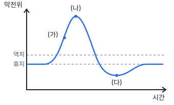
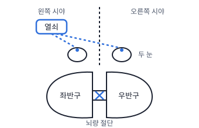
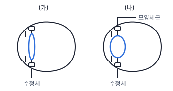

# 생명과학 12장 웹과제 예상 v2 문제해설

왼쪽 목차로 문항을 고르고, 오른쪽 문제를 보며 해설을 따라가요.

문제의 첫 줄부터 검산까지 설명해요.

**목차**

- [문항별 설명](#problems)
  - [P1. [기출 예상] 회수 반사의 신호 순서](#p1)
  - [P2. [기출 예상] 귀의 음파 전달 경로](#p2)
  - [P3. [기출 변형] 광수용기와 망막의 특징](#p3)
  - [P4. [기출 변형] 신경아교세포의 종류와 역할](#p4)
  - [P5. [기출 변형] 뇌 구조와 기능 짝짓기](#p5)
  - [P6. [예상] 시간에 따른 축삭의 막전위 변화](#p6)
  - [P7. [예상] 두 신경독소 처리군의 운동 경로 관찰](#p7)
  - [P8. [예상] Cl⁻ 평형전위와 같은 휴지전위에서의 시냅스 입력](#p8)
  - [P9. [예상] 혈액 속 치료 약물의 뇌 전달 장애](#p9)
  - [P10. [예상] 뇌 손상 환자의 기억 변화](#p10)
  - [P11. [예상] 연수·뇌교·중뇌와 두 상태](#p11)
  - [P12. [예상] 한쪽 시야에 제시된 열쇠](#p12)
  - [P13. [예상] 언어 영역과 뇌 영상 기법](#p13)
  - [P14. [예상] 두 눈 단면의 수정체 모양](#p14)
  - [P15. [예상] 감각수용기 분류와 자극 유형](#p15)

## 문항별 설명

### P1. [기출 예상] 회수 반사의 신호 순서

기출 12강 26 예상 · [연습형 문제 보기](../%EB%B3%B5%EC%8A%B5%EB%AC%B8%EC%A0%9C_12%EC%9E%A5_%EC%9B%B9%EA%B3%BC%EC%A0%9C%EC%98%88%EC%83%81_v2.html#p1) · [시험형 문제 보기](../%EB%B3%B5%EC%8A%B5%EB%AC%B8%EC%A0%9C_12%EC%9E%A5_%EC%9B%B9%EA%B3%BC%EC%A0%9C%EC%98%88%EC%83%81_%EC%8B%9C%ED%97%98%ED%98%95_v2.html#p1)

뜨거운 난로를 만진 후 회수반사가 일어나는 동안, 정보의 흐름의 올바른 순서는 무엇인가?

- A. 원심성 뉴런 -&gt; 연합뉴런 -&gt; 구심성 뉴런
- B. 구심성 뉴런 -&gt; 연합뉴런 -&gt; 원심성 뉴런
- C. 원심성 뉴런 -&gt; 구심성 뉴런 -&gt; 연합뉴런
- D. 연합뉴런 -&gt; 원심성 뉴런 -&gt; 구심성 뉴런
- E. 구심성 뉴런 -&gt; 원심성 뉴런 -&gt; 연합뉴런

원문·출처 정보 보기

기출 12강 합본 26번을 보기 순서만 바꿔 실은 예상 문제예요.

#### 문제에서 무엇을 묻는지 먼저 읽어요

뜨거운 난로에 손을 댔을 때 일어나는 회수 반사(withdrawal reflex)에서, 자극이 들어와 손을 떼기까지 신호가 지나는 뉴런의 **올바른 순서**를 고르는 문제예요.

#### 이 문제를 봤을 때 떠올릴 개념과 공식

‘뜨거운 난로’와 ‘회수 반사’에서 뇌의 명령을 기다리지 않고 척수에서 바로 근육으로 명령을 내리는 척수 반사(spinal reflex) 경로와 기능에 따른 세 뉴런의 방향을 떠올려요.

판단 기준은 **신호가 중추(척수)로 들어가는지, 중추 안에서 잇는지, 중추에서 근육으로 나가는지**예요. 구심성 뉴런(afferent neuron, 감각뉴런)은 구심력처럼 말초에서 중추로 신호를 들여보내고, 연합뉴런(interneuron)은 척수 안에서 그 신호를 받아 연결하며, 원심성 뉴런(efferent neuron, 운동뉴런)은 중추에서 근육으로 명령을 내보내요. 따라서 회수 반사의 신호 흐름은 **구심성 뉴런 → 연합뉴런 → 원심성 뉴런** 순서로 이어져요.

관련 정리노트: [척수와 척수 반사](../../../%EB%B3%B5%EC%8A%B5%EB%85%B8%ED%8A%B8/1117/%EC%A0%95%EB%A6%AC%EB%85%B8%ED%8A%B8_1117_Nervous_and_Sensory_Systems_and_Respiratory_and_Circulatory_Systems.html#s1-spinal-reflex) · [중추·말초, 구심·원심, 체성·자율](../../../%EB%B3%B5%EC%8A%B5%EB%85%B8%ED%8A%B8/1117/%EC%A0%95%EB%A6%AC%EB%85%B8%ED%8A%B8_1117_Nervous_and_Sensory_Systems_and_Respiratory_and_Circulatory_Systems.html#s0-divisions)

#### 왜 이렇게 푸는지 함께 따라가요

A. 틀려요. 중추에서 근육으로 명령을 내보내는 원심성 뉴런을 맨 앞에 두고, 말초 자극을 들여보내는 구심성 뉴런을 맨 뒤에 놓아 신호 방향이 거꾸로예요.

B. 맞아요. 뜨거운 자극을 받은 구심성 뉴런(감각뉴런)이 척수로 신호를 보내면, 척수의 연합뉴런이 이를 받아 원심성 뉴런(운동뉴런)에 전달해 팔 근육을 움직여 손을 떼요.

C. 틀려요. 신호는 먼저 말초에서 중추로 들어가는 구심성 뉴런을 지나야 하는데 원심성 뉴런으로 시작하고 있고, 중추 안의 연결 단계인 연합뉴런이 맨 끝에 놓여 있어요.

D. 틀려요. 연합뉴런은 척수 안에서 구심성 뉴런의 신호를 받아 원심성 뉴런으로 잇는 중간 단계이므로 경로의 시작이 될 수 없어요.

E. 틀려요. 구심성 뉴런으로 시작하는 점은 맞지만, 회수 반사에서는 신호가 척수의 연합뉴런을 먼저 거친 뒤 원심성 뉴런으로 이어져야 해요.

따라서 답은 B예요.

#### 완성 답과 검산

답 B. 다섯 보기 중 말초에서 중추로 신호를 들여보내는 구심성 뉴런으로 시작하는 보기는 B와 E뿐이고, 이 가운데 척수 안의 연합뉴런을 중간에 거쳐 근육 쪽 원심성 뉴런으로 끝나는 순서는 B 하나뿐이에요.

#### 헷갈리기 쉬운 점

구심성(afferent)과 원심성(efferent)의 방향이 헷갈릴 때는 ‘구심력=중심으로 들어가는 힘’을 기준으로 구심성=감각(말초→중추), 원심성=운동(중추→근육)으로 고정하면 시작과 끝이 뒤바뀌지 않아요.

**페이지 요약**

#### 핵심 판단 기준

회수 반사는 말초→중추(구심성 뉴런) → 척수 내 연결(연합뉴런) → 중추→근육(원심성 뉴런) 순서로 흘러요.

#### 결론

답 B (구심성 뉴런 → 연합뉴런 → 원심성 뉴런).

---

### P2. [기출 예상] 귀의 음파 전달 경로

기출 12강 9 예상 · [연습형 문제 보기](../%EB%B3%B5%EC%8A%B5%EB%AC%B8%EC%A0%9C_12%EC%9E%A5_%EC%9B%B9%EA%B3%BC%EC%A0%9C%EC%98%88%EC%83%81_v2.html#p2) · [시험형 문제 보기](../%EB%B3%B5%EC%8A%B5%EB%AC%B8%EC%A0%9C_12%EC%9E%A5_%EC%9B%B9%EA%B3%BC%EC%A0%9C%EC%98%88%EC%83%81_%EC%8B%9C%ED%97%98%ED%98%95_v2.html#p2)

척추동물의 귀에서 음파에 의해 활성화되는 구조의 순서는?

- A. 타원창, 고막, 반규관, 골지힘줄기관, 망치뼈, 모루뼈, 등자뼈
- B. 기저막, 피개막, 이석, 통낭, 구형낭, 망치뼈, 달팽이
- C. 유스타키오관, 타원창, 전정관, 티파니관, 달팽이관, 귓바퀴
- D. 귓바퀴, 고막, 망치뼈, 모루뼈, 등자뼈, 타원창, 달팽이관
- E. 코르티기관, 망치뼈, 모루뼈, 등자뼈, 청각신경, 고막

원문·출처 정보 보기

기출 12강 합본 9번을 보기 순서만 바꿔 실은 예상 문제예요.

#### 문제에서 무엇을 묻는지 먼저 읽어요

척추동물의 귀로 들어온 음파가 바깥쪽에서 안쪽으로 차례대로 진동·활성화시키는 구조의 **올바른 순서**를 고르는 문제예요.

#### 이 문제를 봤을 때 떠올릴 개념과 공식

‘귀에서 음파에 의해 활성화되는 구조의 순서’에서 바깥귀(외이) → 가운데귀(중이) → 속귀(내이)로 이어지는 소리 진동 전달 경로를 떠올려요.

판단 기준은 **공기에 닿는 바깥 구조에서 액체가 찬 속귀 안쪽으로 이어지는 해부학적 순서**예요. 먼저 바깥귀의 귓바퀴(pinna)가 음파를 모아 고막(tympanic membrane)을 진동시키고, 가운데귀의 세 뼈인 망치뼈(malleus) → 모루뼈(incus) → 등자뼈(stapes)가 지렛대 작용으로 진동을 증폭해요. 이어서 등자뼈가 맞닿은 달팽이관 입구의 막인 타원창(oval window)이 진동하면, 속귀의 달팽이관(cochlea) 안 액체가 진동하고 그 내부의 코르티 기관(organ of Corti: 기저막·모세포·덮개막)이 진동을 감지해요. 참고로 보기의 ‘피개막’은 덮개막(tectorial membrane)의 다른 이름이에요.

관련 정리노트: [귀: 진동이 활동전위가 되기까지](../../../%EB%B3%B5%EC%8A%B5%EB%85%B8%ED%8A%B8/1117/%EC%A0%95%EB%A6%AC%EB%85%B8%ED%8A%B8_1117_Nervous_and_Sensory_Systems_and_Respiratory_and_Circulatory_Systems.html#s4-hearing) · [귓바퀴와 세 뼈의 이름](../../../%EB%B3%B5%EC%8A%B5%EB%85%B8%ED%8A%B8/1117/%EC%A0%95%EB%A6%AC%EB%85%B8%ED%8A%B8_1117_Nervous_and_Sensory_Systems_and_Respiratory_and_Circulatory_Systems.html#s4-hearing-supp-1)

#### 왜 이렇게 푸는지 함께 따라가요

A. 틀려요. 달팽이관 입구의 막인 타원창이 고막과 가운데귀 세 뼈(망치뼈·모루뼈·등자뼈)보다 앞에 놓여 바깥→안쪽 순서가 어긋나고, 음파 전달 경로가 아닌 반규관과 골지힘줄기관까지 섞여 있어요.

B. 틀려요. 기저막과 피개막(덮개막)은 달팽이관 안쪽 코르티 기관의 구조인데 가운데귀의 망치뼈보다 먼저 나오며, 평형 감각 관련 구조(이석·통낭·구형낭)가 섞여 있어 음파 전달 순서와 맞지 않아요.

C. 틀려요. 음파를 맨 먼저 모으는 바깥귀의 귓바퀴가 맨 끝에 놓여 전달 방향이 거꾸로이고, 유스타키오관은 음파가 차례로 활성화하는 경로의 시작 구조가 아니에요.

D. 맞아요. 바깥귀(귓바퀴 → 고막)에서 가운데귀의 세 뼈(망치뼈 → 모루뼈 → 등자뼈)를 거쳐 속귀 입구(타원창)와 달팽이관으로 이어지는 바깥→안쪽 음파 전달 순서와 정확히 일치해요.

E. 틀려요. 달팽이관 안에서 진동을 감지하는 코르티 기관이 맨 앞에 놓여 있고, 음파가 먼저 닿는 고막이 청각신경보다도 뒤인 맨 끝에 있어 순서가 뒤바뀌어 있어요.

따라서 답은 D예요.

#### 완성 답과 검산

답 D. 다섯 보기 중 공기에 직접 닿는 바깥귀의 귓바퀴로 시작해 속귀의 달팽이관으로 끝나는 보기는 D 하나뿐이에요. 가운데귀의 세 뼈도 고막 쪽 망치뼈 → 가운데 모루뼈 → 타원창 쪽 등자뼈 순서로 맞물려 있어 바깥→안쪽 경로가 어긋나지 않아요.

#### 헷갈리기 쉬운 점

오답 보기에 반규관, 이석, 유스타키오관, 골지힘줄기관처럼 낯선 용어가 많아 당황하기 쉬워요. 모든 용어를 외우지 않아도 ‘맨 앞이 귓바퀴·고막인지, 타원창과 코르티 기관·기저막이 세 뼈보다 뒤에 오는지’만 확인하면 네 오답을 바로 걸러 낼 수 있어요.

**페이지 요약**

#### 핵심 판단 기준

음파는 바깥귀(귓바퀴·고막) → 가운데귀(망치뼈·모루뼈·등자뼈) → 속귀(타원창·달팽이관) 순서로 바깥에서 안쪽으로 전달돼요.

#### 결론

답 D (귓바퀴, 고막, 망치뼈, 모루뼈, 등자뼈, 타원창, 달팽이관).

---

### P3. [기출 변형] 광수용기와 망막의 특징

기출 12강 38 예상 · [연습형 문제 보기](../%EB%B3%B5%EC%8A%B5%EB%AC%B8%EC%A0%9C_12%EC%9E%A5_%EC%9B%B9%EA%B3%BC%EC%A0%9C%EC%98%88%EC%83%81_v2.html#p3) · [시험형 문제 보기](../%EB%B3%B5%EC%8A%B5%EB%AC%B8%EC%A0%9C_12%EC%9E%A5_%EC%9B%B9%EA%B3%BC%EC%A0%9C%EC%98%88%EC%83%81_%EC%8B%9C%ED%97%98%ED%98%95_v2.html#p3)

다음 광수용기에 대한 설명 중 틀린 것은 ?

- A. 중심오목에는 간상세포가 밀집해 있어 희미한 별빛을 정면으로 볼 때 가장 잘 감지한다.
- B. 간상세포의 광색소인 로돕신은 단백질인 옵신과 빛을 흡수하는 색소인 레티날로 이루어져 있다.
- C. 원추세포는 세 종류의 포톱신 활성으로 색깔을 구분하며 강한 빛에 반응한다.
- D. 레티날이 빛을 흡수해 구조가 바뀌면 광수용기 세포의 채널 상태와 신경전달물질 분비량이 달라진다.
- E. 문어와 오징어의 눈은 신호를 받는 세포가 광수용기 뒤에 놓여 있어 사람과 달리 맹점이 생기지 않는다.

원문·출처 정보 보기

기출 12강 합본 38번 발문에 정답을 바꾼 생성 변형이에요.

#### 문제에서 무엇을 묻는지 먼저 읽어요

광수용기(간상세포·원추세포)의 광색소와 신호 변화, 망막에서의 분포와 배선에 대한 다섯 진술 가운데 **틀린 것**을 고르는 부정형 문제예요.

#### 이 문제를 봤을 때 떠올릴 개념과 공식

‘광수용기’, ‘중심오목’, ‘로돕신’, ‘포톱신’, ‘맹점’에서 간상세포와 원추세포의 기능·광색소·분포 차이와 사람·두족류 망막 배선의 차이를 떠올려요.

확인할 판단 기준은 세 가지예요. 첫째, **광수용기와 광색소**로, 간상세포(rod)는 1종류이며 약한 빛에도 반응하고 광색소 로돕신(rhodopsin = 단백질 옵신 + 빛 흡수 색소 레티날)을 가져요. 원추세포(cone)는 빨강·초록·파랑 세 종류의 포톱신(photopsin) 활성으로 색깔을 구분하며 강한 빛에 반응해요. 둘째, **빛 흡수 뒤의 신호 변화**로, 레티날(retinal)이 빛을 흡수해 구조가 바뀌면 광수용기 세포의 채널이 열리는 정도와 신경전달물질 분비량이 달라져요. 셋째, **망막 분포와 배선**으로, 중심오목(fovea, 중심와)에는 원추세포만 밀집하고 간상세포가 없어 밝은 물체는 또렷하지만 희미한 빛은 오히려 안 보이며, 간상세포는 주변 망막에 많아요. 사람은 신호를 받는 세포가 광수용기 앞(빛 쪽)에 있어 시신경 다발이 망막을 뚫고 나가는 자리에 맹점(blind spot)이 생기지만, 문어·오징어는 신호를 받는 세포가 광수용기 뒤에 있어 맹점이 없어요.

관련 정리노트: [간상세포와 원추세포](../../../%EB%B3%B5%EC%8A%B5%EB%85%B8%ED%8A%B8/1117/%EC%A0%95%EB%A6%AC%EB%85%B8%ED%8A%B8_1117_Nervous_and_Sensory_Systems_and_Respiratory_and_Circulatory_Systems.html#s5-photoreceptors) · [중심오목·맹점과 망막의 배선](../../../%EB%B3%B5%EC%8A%B5%EB%85%B8%ED%8A%B8/1117/%EC%A0%95%EB%A6%AC%EB%85%B8%ED%8A%B8_1117_Nervous_and_Sensory_Systems_and_Respiratory_and_Circulatory_Systems.html#s5-retina)

#### 왜 이렇게 푸는지 함께 따라가요

A. 내용상 틀려요. 중심오목에는 원추세포가 밀집하고 간상세포는 없으므로 희미한 별빛을 정면으로 보면 오히려 잘 보이지 않아요. 희미한 빛은 간상세포가 많은 주변 망막에 상이 맺히도록 곁눈질할 때 더 잘 감지해요.

B. 내용상 맞아요. 간상세포의 광색소인 로돕신은 단백질인 옵신(opsin)과 빛을 흡수하는 색소인 레티날(retinal)이 결합해 이루어져 있어요.

C. 내용상 맞아요. 원추세포는 빨강·초록·파랑 세 종류의 포톱신 활성 조합으로 색깔을 구분하며, 약한 빛이 아니라 강한 빛에 반응해요.

D. 내용상 맞아요. 레티날이 빛을 흡수해 구조가 바뀌면(이성질체화) 광수용기 세포막의 채널 상태와 신경전달물질 분비량이 달라져 다음 세포로 시각 신호가 이어져요.

E. 내용상 맞아요. 문어와 오징어의 눈은 신호를 받는 세포가 광수용기 뒤에 놓여 신경 다발이 망막을 뚫고 나갈 필요가 없으므로 사람과 달리 맹점이 생기지 않아요.

틀린 진술을 고르는 문제이므로 답은 A예요.

#### 완성 답과 검산

답 A. B(로돕신 구성), C(원추세포의 색 구분과 강한 빛 반응), D(레티날 구조 변화→채널·신경전달물질 변화), E(문어·오징어의 무맹점 배선)는 모두 광수용기와 망막 원리에 부합하는 참 진술이고, 틀린 진술은 중심오목과 주변 망막의 세포 분포를 뒤바꾼 A 하나뿐이에요.

#### 헷갈리기 쉬운 점

‘중심오목은 가장 잘 보이는 곳’이라는 기억만 떠올리면 희미한 별빛도 정면으로 볼 때 가장 잘 보인다고 착각하기 쉬워요. 중심오목은 원추세포만 몰려 **밝은 물체**를 또렷하게 보는 자리이고, 약한 빛을 감지하는 간상세포는 주변 망막에 많아 희미한 빛은 곁눈질로 볼 때 더 잘 보여요.

**페이지 요약**

#### 핵심 판단 기준

중심오목(fovea)은 원추세포가 밀집하고 간상세포가 없어 밝은 물체는 또렷하지만 희미한 빛은 주변 망막(간상세포)으로 감지해요.

#### 결론

부정형 답 A (B~E는 모두 참).

---

### P4. [기출 변형] 신경아교세포의 종류와 역할

기출 12강 3 예상 · [연습형 문제 보기](../%EB%B3%B5%EC%8A%B5%EB%AC%B8%EC%A0%9C_12%EC%9E%A5_%EC%9B%B9%EA%B3%BC%EC%A0%9C%EC%98%88%EC%83%81_v2.html#p4) · [시험형 문제 보기](../%EB%B3%B5%EC%8A%B5%EB%AC%B8%EC%A0%9C_12%EC%9E%A5_%EC%9B%B9%EA%B3%BC%EC%A0%9C%EC%98%88%EC%83%81_%EC%8B%9C%ED%97%98%ED%98%95_v2.html#p4)

신경아교세포(glial cell)에 대한 진술 중 옳지 않은 것은 ?

- A. 희소돌기아교세포는 뇌와 척수로 이루어진 중추신경계에서 축삭을 감싸 미엘린 수초를 만든다.
- B. 미엘린 수초는 축삭 자체가 분비한 물질이 아니라 아교세포의 세포막이 축삭을 여러 겹 감싸 형성된다.
- C. 수초를 만드는 아교세포가 감싼 구간 사이에는 축삭이 드러난 랑비에 결절이 놓여 있다.
- D. 말초신경계에서 슈반세포가 축삭을 여러 겹 감싸 만든 지질 막은 전기적 절연체로 작용한다.
- E. 성상세포는 중추신경계에서 뉴런의 축삭을 감싸 미엘린 수초를 만드는 아교세포이다.

원문·출처 정보 보기

기출 12강 합본 3번 발문에 정답을 바꾼 생성 변형이에요.

#### 문제에서 무엇을 묻는지 먼저 읽어요

신경아교세포(glial cell)의 종류와 미엘린 수초·랑비에 결절에 관한 다섯 진술 가운데 **옳지 않은 것**을 고르는 부정형 문제예요.

#### 이 문제를 봤을 때 떠올릴 개념과 공식

‘신경아교세포’, ‘미엘린 수초’, ‘랑비에 결절’에서 세 종류의 신경아교세포(성상세포·희소돌기아교세포·슈반세포)의 역할과 위치, 그리고 수초의 구조를 떠올려요.

확인할 판단 기준은 **어떤 아교세포가 어느 신경계에서 수초를 만드는지**와 **수초·결절의 구조**예요. 성상세포(astrocyte)는 별 모양 아교세포로 뉴런을 물리적으로 지지하고 환경을 유지할 뿐 수초를 만들지 않아요. 미엘린 수초(myelin sheath)는 뇌와 척수인 중추신경계(CNS)에서는 희소돌기아교세포(oligodendrocyte)가, 말초신경계(PNS)에서는 슈반세포(Schwann cell)가 만들어요. 이때 수초는 축삭 자체가 분비한 물질이 아니라 아교세포의 지질성 세포막이 축삭을 여러 겹 감싸 형성한 전기적 절연체이며, 수초 구간 사이에 축삭이 드러난 틈을 랑비에 결절(node of Ranvier)이라고 해요.

관련 정리노트: [신경아교세포와 미엘린 수초](../../../%EB%B3%B5%EC%8A%B5%EB%85%B8%ED%8A%B8/1112/%EC%A0%95%EB%A6%AC%EB%85%B8%ED%8A%B8_1112_Nervous_and_Sensory_Systems.html#s0-glia) · [수초 세포의 장소](../../../%EB%B3%B5%EC%8A%B5%EB%85%B8%ED%8A%B8/1112/%EC%A0%95%EB%A6%AC%EB%85%B8%ED%8A%B8_1112_Nervous_and_Sensory_Systems.html#s0-glia-supp-1)

#### 왜 이렇게 푸는지 함께 따라가요

A. 내용상 맞아요. 희소돌기아교세포는 뇌와 척수로 이루어진 중추신경계에서 뉴런의 축삭을 감싸 미엘린 수초를 만들어요.

B. 내용상 맞아요. 미엘린 수초는 축삭 자체나 세포 밖 분비물이 아니라, 수초를 만드는 아교세포의 세포막이 축삭을 여러 겹 감싸 형성된 구조예요.

C. 내용상 맞아요. 미엘린 수초가 덮인 구간과 구간 사이에는 축삭막이 바깥으로 드러난 틈인 랑비에 결절이 놓여 있어요.

D. 내용상 맞아요. 말초신경계에서는 슈반세포의 지질성 세포막이 축삭을 여러 겹 감싸 미엘린 수초를 이루며, 이 지질 막은 전기적 절연체로 작용해요.

E. 내용상 틀려요. 성상세포는 뉴런을 물리적으로 지지하고 환경을 유지하는 아교세포이며 수초를 만들지 않아요. 중추신경계에서 미엘린 수초를 만드는 아교세포는 희소돌기아교세포예요.

옳지 않은 진술을 고르는 문제이므로 답은 E예요.

#### 완성 답과 검산

답 E. 중추신경계에서 미엘린 수초를 만드는 세포를 A(희소돌기아교세포)와 E(성상세포)가 서로 다르게 짝짓고 있어 두 진술은 동시에 참일 수 없어요. A·B·C·D가 수초 형성 세포의 위치(중추=희소돌기, 말초=슈반), 기원(아교세포 세포막), 결절 위치 기준과 모두 일치하므로, 옳지 않은 진술은 E 하나뿐이에요.

#### 헷갈리기 쉬운 점

성상세포·희소돌기아교세포·슈반세포가 모두 신경아교세포에 속해 ‘아교세포 = 수초 형성’으로 뭉뚱그리기 쉬워요. 수초를 만드는 세포는 희소돌기아교세포(중추)와 슈반세포(말초) 둘뿐이고, 성상세포는 뉴런 지지·환경 유지 역할로 분리해 확인해요.

**페이지 요약**

#### 핵심 판단 기준

수초 형성은 중추=희소돌기아교세포, 말초=슈반세포의 세포막이 맡고, 성상세포는 뉴런 지지·환경 유지 역할을 해요.

#### 결론

부정형 답 E (A~D는 모두 참).

---

### P5. [기출 변형] 뇌 구조와 기능 짝짓기

기출 12강 17 예상 · [연습형 문제 보기](../%EB%B3%B5%EC%8A%B5%EB%AC%B8%EC%A0%9C_12%EC%9E%A5_%EC%9B%B9%EA%B3%BC%EC%A0%9C%EC%98%88%EC%83%81_v2.html#p5) · [시험형 문제 보기](../%EB%B3%B5%EC%8A%B5%EB%AC%B8%EC%A0%9C_12%EC%9E%A5_%EC%9B%B9%EA%B3%BC%EC%A0%9C%EC%98%88%EC%83%81_%EC%8B%9C%ED%97%98%ED%98%95_v2.html#p5)

구조와 기능이 올바르게 연결된 것은?

- A. 해마 : 체온과 나트륨 농도, 식욕을 맞추는 항상성 조절 중추
- B. 편도체 : 단기기억을 장기기억으로 전환해 새 장기기억을 형성
- C. 시상 : 감각 정보를 받아 대뇌 피질로 전달하는 중계 역할
- D. 시상하부 : 뇌간 중심부에서 중요한 감각 신호만 골라내는 필터
- E. 망상체 : 정서적 경험과 공포와 관련된 기억을 처리

원문·출처 정보 보기

기출 12강 합본 17번 발문에 정답을 바꾼 생성 변형이에요.

#### 문제에서 무엇을 묻는지 먼저 읽어요

뇌의 다섯 구조(해마·편도체·시상·시상하부·망상체)와 그 기능이 **올바르게 연결된** 보기 하나를 고르는 문제예요.

#### 이 문제를 봤을 때 떠올릴 개념과 공식

‘시상’, ‘시상하부’, ‘망상체’, ‘편도체’, ‘해마’에서 감각 신호가 대뇌로 올라가는 경로와 항상성·정서·기억을 맡는 각 뇌 부위의 고유 기능을 떠올려요.

판단 기준은 **다섯 구조 각각의 대표 기능**을 일대일로 대조하는 거예요. 망상체(reticular formation)는 뇌간 중심부에 뉴런이 그물처럼 얽힌 구조로, 수많은 감각 정보 중 중요한 신호만 골라내는 필터이며 의식이 깨어날 때 가장 먼저 깨어나요. 시상(thalamus)은 뇌간 위의 동그란 부분으로, 몸에서 올라온 감각 정보를 받아 대뇌 피질로 전달하는 중계소 역할을 해요. 시상하부(hypothalamus)는 시상 아래에서 체온·나트륨(Na⁺) 농도·식욕 등을 맞추는 항상성 조절 중추예요. 변연계에서 편도체(amygdala)는 정서적 경험과 공포에 관련된 기억을 처리하고, 해마(hippocampus)는 단기기억을 장기기억으로 전환해 새 장기기억을 형성해요.

관련 정리노트: [시상·시상하부와 망상체](../../../%EB%B3%B5%EC%8A%B5%EB%85%B8%ED%8A%B8/1117/%EC%A0%95%EB%A6%AC%EB%85%B8%ED%8A%B8_1117_Nervous_and_Sensory_Systems_and_Respiratory_and_Circulatory_Systems.html#s2-thalamus) · [변연계: 편도체와 해마](../../../%EB%B3%B5%EC%8A%B5%EB%85%B8%ED%8A%B8/1117/%EC%A0%95%EB%A6%AC%EB%85%B8%ED%8A%B8_1117_Nervous_and_Sensory_Systems_and_Respiratory_and_Circulatory_Systems.html#s2-limbic)

#### 왜 이렇게 푸는지 함께 따라가요

A. 틀려요. 체온·나트륨 농도·식욕을 맞추는 항상성 조절 중추는 해마가 아니라 시상하부예요. 해마는 단기기억을 장기기억으로 전환하는 역할을 맡아요.

B. 틀려요. 단기기억을 장기기억으로 전환해 새 장기기억을 형성하는 구조는 편도체가 아니라 해마예요. 편도체는 정서적 경험과 공포와 관련된 기억을 처리해요.

C. 맞아요. 시상은 뇌간 위에 놓여 몸에서 올라온 감각 정보를 받아 대뇌 피질로 전달하는 중계 역할을 해요.

D. 틀려요. 뇌간 중심부에서 중요한 감각 신호만 골라내는 필터는 시상하부가 아니라 망상체예요. 시상하부는 시상 아래에서 항상성을 조절해요.

E. 틀려요. 정서적 경험과 공포와 관련된 기억을 처리하는 부위는 망상체가 아니라 편도체예요. 망상체는 감각 신호 필터와 의식 각성에 관여해요.

따라서 답은 C예요.

#### 완성 답과 검산

답 C. 나머지 네 보기의 설명을 제자리에 되돌려 보면 A(항상성)는 시상하부, B(단기→장기 기억 전환)는 해마, D(감각 신호 필터)는 망상체, E(정서·공포 기억)는 편도체에 각각 대응해요. 네 오답이 서로 정확히 엇갈려 있으므로 구조와 기능이 바르게 짝지어진 보기는 C 하나뿐이에요.

#### 헷갈리기 쉬운 점

시상과 망상체는 둘 다 감각 신호가 올라가는 길에 놓여 헷갈리기 쉬워요. 뇌간 중심부에서 중요한 신호만 걸러 내는 **필터**는 망상체, 그 위에서 감각 정보를 대뇌 피질로 넘기는 **중계소**는 시상이에요. 또 시상을 변연계에 포함해 언급하더라도 감정·공포 기억은 편도체의 기능으로 구별해요.

**페이지 요약**

#### 핵심 판단 기준

시상=감각 중계, 시상하부=항상성, 망상체=감각 필터, 편도체=공포·정서 기억, 해마=단기→장기 기억 전환.

#### 결론

답 C (시상 : 감각 정보를 받아 대뇌 피질로 전달하는 중계 역할).

---

### P6. [예상] 시간에 따른 축삭의 막전위 변화

예상 12장 6 · [연습형 문제 보기](../%EB%B3%B5%EC%8A%B5%EB%AC%B8%EC%A0%9C_12%EC%9E%A5_%EC%9B%B9%EA%B3%BC%EC%A0%9C%EC%98%88%EC%83%81_v2.html#p6) · [시험형 문제 보기](../%EB%B3%B5%EC%8A%B5%EB%AC%B8%EC%A0%9C_12%EC%9E%A5_%EC%9B%B9%EA%B3%BC%EC%A0%9C%EC%98%88%EC%83%81_%EC%8B%9C%ED%97%98%ED%98%95_v2.html#p6)

그림은 한 뉴런의 축삭 초기분절에서 역치 이상의 자극으로 활동전위가 발생한 뒤 시간에 따라 기록된 막전위 변화예요. (가), (나), (다) 구간에 대한 설명으로 옳지 않은 것은 무엇인가요?

- A. (가)에서는 전압 개폐성 Na⁺ 채널이 열려 Na⁺ 유입이 우세해져요.
- B. (나) 부근에서는 많은 전압 개폐성 Na⁺ 채널이 불활성화되어 Na⁺ 유입이 줄어들어요.
- C. (다)에서는 지연성 K⁺ 채널이 천천히 닫히면서 막전위가 휴지전위보다 낮아져요.
- D. (나)에서는 평소보다 훨씬 강한 자극을 주면 즉시 새로운 활동전위가 다시 발생해요.
- E. (다)에서는 회복 중인 상태라 평소보다 더 강한 자극이 있어야 다시 발화할 수 있어요.

원문·출처 정보 보기

1112 정리노트의 활동전위 파형과 불응기 내용을 바탕으로 만든 예상 문제예요.

#### 문제에서 무엇을 묻나요

활동전위 막전위 그래프에 표시된 세 지점 (가), (나), (다)의 이온 채널 상태와 재발화 가능성을 읽고, 그중 **옳지 않은 설명**을 고르는 문제예요.

#### 이 문제를 봤을 때 떠올릴 개념과 공식

‘역치 이상의 자극으로 발생한 활동전위(action potential)의 막전위 변화’에서 파형 구간별 이온 채널 상태와 불응기(refractory period)를 떠올려요.

판단 기준은 각 구간에서 전압 개폐성 Na⁺ 채널과 지연성 K⁺ 채널이 어떤 상태인지예요. 역치(threshold)를 넘어 막전위가 급히 오르는 탈분극(depolarization) 구간에서는 전압 개폐성 Na⁺ 채널이 열려 Na⁺ 유입이 우세해요. 정점 부근에서는 많은 전압 개폐성 Na⁺ 채널이 불활성화(inactivation)되어 Na⁺ 유입이 줄어들고, 늦게 반응한 지연성 K⁺ 채널의 작용이 겹쳐요. 이후 K⁺ 유출이 우세해 재분극(repolarization)이 일어나고, 지연성 K⁺ 채널이 천천히 닫히면서 막전위가 휴지전위 아래로 내려가는 과분극(hyperpolarization)이 나타나요.

재발화 가능성은 두 불응기로 나눠 판단해요. Na⁺ 채널이 불활성화된 절대 불응기(absolute refractory period)에는 아무리 강한 자극을 주어도 다시 발화할 수 없어요. 과분극처럼 Na⁺ 채널이 회복 중이고 일부 K⁺ 채널이 열려 있는 상대 불응기(relative refractory period)에는 평소보다 더 강한 자극이 있어야 다시 발화할 수 있어요.

관련 정리노트: [활동전위: 탈분극·재분극·과분극](../../../%EB%B3%B5%EC%8A%B5%EB%85%B8%ED%8A%B8/1112/%EC%A0%95%EB%A6%AC%EB%85%B8%ED%8A%B8_1112_Nervous_and_Sensory_Systems.html#s2-action), [실무율과 자극의 세기](../../../%EB%B3%B5%EC%8A%B5%EB%85%B8%ED%8A%B8/1112/%EC%A0%95%EB%A6%AC%EB%85%B8%ED%8A%B8_1112_Nervous_and_Sensory_Systems.html#s2-all-or-none)

#### 첫 줄부터 잡아요

그래프의 세 표시를 파형 구간에 먼저 대응해요. (가)는 역치 점선을 넘어 급히 오르는 탈분극 구간, (나)는 곡선의 정점 부근(Na⁺ 채널 불활성화·절대 불응기), (다)는 휴지 점선 아래로 내려간 과분극 구간(상대 불응기)이에요.

#### 왜 이렇게 푸는지 함께 따라가요

A. 맞아요. (가)는 역치를 넘어 막전위가 급격히 오르는 탈분극 구간이므로, 전압 개폐성 Na⁺ 채널이 열려 Na⁺ 유입이 우세해진다는 설명이 기준과 일치해요.

B. 맞아요. (나)는 활동전위의 정점 부근으로, 많은 전압 개폐성 Na⁺ 채널이 불활성화되어 Na⁺ 유입이 줄어드는 시점에 해당해요.

C. 맞아요. (다)는 막전위가 휴지 점선 아래로 내려간 과분극 구간으로, 지연성 K⁺ 채널이 천천히 닫히면서 K⁺ 유출이 이어진 결과예요.

D. 틀려요. (나) 부근은 전압 개폐성 Na⁺ 채널이 불활성화된 절대 불응기에 해당해요. 채널이 다시 열릴 수 없는 상태이므로 평소보다 훨씬 강한 자극을 주어도 즉시 새로운 활동전위가 발생할 수 없어요.

E. 맞아요. (다)의 과분극 구간은 불활성화된 Na⁺ 채널이 회복 중이고 일부 K⁺ 채널이 아직 열려 있는 상대 불응기이므로, 평소보다 더 강한 자극이 있어야 역치에 닿아 다시 발화할 수 있어요.

이 문제는 옳지 않은 설명을 고르는 부정형이므로, 답은 D예요.

#### 완성 답과 검산

답 D. A·B·C·E 네 보기는 탈분극·정점·과분극의 채널 상태와 상대 불응기 조건에 모두 부합하고, D만 절대 불응기에 강한 자극으로 즉시 재발화한다고 서술해 틀렸어요. Na⁺ 채널이 불활성화되어 열릴 수 없는 시기(절대 불응기)와 회복 중인 시기(상대 불응기)를 나누어 확인해도 정점 부근의 즉시 재발화는 성립하지 않아요.

#### 여기서 자주 헷갈려요

‘자극이 아주 강하면 언제든 다시 발화한다’고 생각하면 절대 불응기와 상대 불응기를 섞게 돼요. 강한 자극으로 재발화가 가능한 시기는 Na⁺ 채널이 회복 중인 상대 불응기((다))뿐이고, 채널 자체가 불활성화된 절대 불응기((나))에는 자극 세기와 무관하게 발화가 일어나지 않아요.

#### 혼자 다시 점검해요

- 설명을 닫고 (가) 탈분극, (나) 정점, (다) 과분극에서 전압 개폐성 Na⁺ 채널과 지연성 K⁺ 채널의 상태를 차례로 말해 보세요.
- (나)와 (다)에 평소보다 훨씬 강한 자극을 주었을 때 재발화 여부가 왜 달라지는지 ‘불활성화’와 ‘회복 중’으로 구분해 설명해 보세요.

**페이지 요약**

#### 핵심 판단 기준

(가) 탈분극 = Na⁺ 유입, (나) 정점 = Na⁺ 불활성화·절대 불응기(재발화 불가), (다) 과분극 = 지연성 K⁺ 채널 느린 닫힘·상대 불응기(강한 자극 시 재발화). 옳지 않은 D가 답이에요.

#### 함정

강한 자극으로 다시 발화할 수 있는 시기는 상대 불응기((다))이며, 절대 불응기((나))에는 아무리 강한 자극도 즉시 재발화를 일으키지 못해요.

---

### P7. [예상] 두 신경독소 처리군의 운동 경로 관찰

예상 12장 7 · [연습형 문제 보기](../%EB%B3%B5%EC%8A%B5%EB%AC%B8%EC%A0%9C_12%EC%9E%A5_%EC%9B%B9%EA%B3%BC%EC%A0%9C%EC%98%88%EC%83%81_v2.html#p7) · [시험형 문제 보기](../%EB%B3%B5%EC%8A%B5%EB%AC%B8%EC%A0%9C_12%EC%9E%A5_%EC%9B%B9%EA%B3%BC%EC%A0%9C%EC%98%88%EC%83%81_%EC%8B%9C%ED%97%98%ED%98%95_v2.html#p7)

정상 대조군과 두 신경독소(처리군 X, 처리군 Y)를 각각 투여한 동물에서 척수 운동뉴런과 골격근의 반응을 측정해 표로 정리했어요. 표의 결과를 가장 잘 설명하는 두 처리군의 작용 기작 조합은 무엇인가요?

| 관찰 항목 | 정상 대조군 | 처리군 X | 처리군 Y |
|---|---|---|---|
| 운동뉴런의 활동전위 발화 빈도 | 정상 | 정상 | 매우 증가 |
| 신경근접합부의 아세틸콜린 분비량 | 정상 | 정상 | 매우 증가 |
| 골격근 수축 상태 | 정상 조절 | 이완된 채 수축 불가 | 강하게 지속 수축(경직) |

- A. X는 골격근의 니코틴성 아세틸콜린 수용체를 차단하고, Y는 척수 억제 뉴런의 GABA·글리신 방출을 차단해요.
- B. X는 운동뉴런 말단의 아세틸콜린 분비를 차단하고, Y는 골격근의 니코틴성 아세틸콜린 수용체를 차단해요.
- C. X는 척수 억제 뉴런의 GABA·글리신 방출을 차단하고, Y는 골격근의 니코틴성 아세틸콜린 수용체를 차단해요.
- D. X는 골격근의 니코틴성 아세틸콜린 수용체를 차단하고, Y는 신경근접합부의 아세틸콜린 분비를 직접 차단해요.
- E. X는 척수 억제 뉴런의 GABA·글리신 방출을 늘려 운동뉴런을 멈추게 하고, Y는 운동뉴런 축삭의 Na⁺ 채널을 차단해요.

원문·출처 정보 보기

1112 정리노트의 쿠라레와 파상풍 독 작용 비교를 바탕으로 만든 예상 문제예요.

#### 문제에서 무엇을 묻나요

정상 대조군과 두 신경독소 처리군 X, Y의 운동뉴런 발화 빈도·아세틸콜린 분비량·골격근 수축 상태 표를 읽고, 두 처리군의 작용 기작 조합이 가장 알맞은 보기를 고르는 문제예요.

#### 이 문제를 봤을 때 떠올릴 개념과 공식

운동뉴런 발화, 신경근접합부의 아세틸콜린(acetylcholine), 골격근 이완 마비와 지속 수축(경직)에서 척수 억제 뉴런 → 운동뉴런 → 골격근으로 이어지는 운동 경로와 쿠라레(curare)·파상풍 독(tetanus toxin)의 작용점을 떠올려요.

판단 기준은 표의 세 단계 중 **어디까지는 정상이고 어디서부터 이상이 나타나는지**예요. 평소 척수의 억제 뉴런은 GABA와 글리신(glycine)을 방출해 운동뉴런의 과도한 발화를 막고, 운동뉴런 말단이 분비한 아세틸콜린은 골격근의 니코틴성 수용체에 결합해 근육을 탈분극·수축시켜요.

쿠라레형 독소는 골격근의 니코틴성 아세틸콜린 수용체를 차단해, 운동뉴런 발화와 아세틸콜린 분비가 정상이어도 근육이 수축하지 못하는 이완성 마비를 일으켜요. 반대로 파상풍 독형은 척수 억제 뉴런 말단에서 GABA·글리신 방출을 차단(‘억제를 억제’)해, 운동뉴런이 과발화하고 아세틸콜린 분비가 늘어 근육이 강하게 지속 수축(경직·경련)해요.

관련 정리노트: [여러 가지 신경전달물질](../../../%EB%B3%B5%EC%8A%B5%EB%85%B8%ED%8A%B8/1112/%EC%A0%95%EB%A6%AC%EB%85%B8%ED%8A%B8_1112_Nervous_and_Sensory_Systems.html#s4-transmitters)

#### 첫 줄부터 잡아요

표의 두 처리군을 신호 순서대로 끊어 읽어요. 처리군 X는 ‘운동뉴런 발화 정상 → 아세틸콜린 분비 정상 → 골격근만 이완·수축 불가’이므로 근육 수용체 단계가 막혔어요. 처리군 Y는 ‘운동뉴런 발화 매우 증가 → 아세틸콜린 분비 매우 증가 → 골격근 경직’이므로 운동뉴런을 누르던 억제가 풀렸어요.

#### 왜 이렇게 푸는지 함께 따라가요

A. 맞아요. X는 운동뉴런 발화와 아세틸콜린 분비가 모두 정상인데 골격근만 수축하지 못하므로 골격근의 니코틴성 아세틸콜린 수용체 차단(쿠라레형)에 해당하고, Y는 운동뉴런 발화와 아세틸콜린 분비가 모두 매우 증가해 근육이 경직되므로 척수 억제 뉴런의 GABA·글리신 방출 차단(파상풍 독형)에 해당해요.

B. 틀려요. 표에서 X의 신경근접합부 아세틸콜린 분비량은 정상이어서 아세틸콜린 분비 차단과 맞지 않고, Y가 골격근 수용체를 차단한다면 경직이 아니라 이완성 마비가 나타나야 해요.

C. 틀려요. X와 Y의 작용점이 서로 뒤바뀌어 있어 X의 이완 상태와 Y의 운동뉴런 과발화를 모두 설명하지 못해요.

D. 틀려요. X의 설명은 표와 맞지만, Y는 표에서 아세틸콜린 분비량이 줄지 않고 매우 증가했으므로 아세틸콜린 분비를 직접 차단한다는 설명이 모순이에요.

E. 틀려요. X에서 운동뉴런 발화 빈도는 멈추지 않고 정상이므로 억제 뉴런 방출 증가로 설명할 수 없고, Y에서 운동뉴런 축삭의 Na⁺ 채널이 막히면 발화 빈도가 매우 증가할 수 없어요.

따라서 답은 A예요.

#### 완성 답과 검산

답 A. X와 Y를 각각 표의 세 행과 대조하면 B·C·D·E는 최소 한 처리군에서 관찰값과 어긋나고 A만 여섯 칸의 결과를 모두 만족해요. 흥분 신호의 수신을 막으면 이완, 억제 신호의 방출을 막으면 과발화·경직이 된다는 원리와도 일치해요.

#### 여기서 자주 헷갈려요

X의 ‘이완된 채 수축 불가’만 보고 아세틸콜린 분비 차단(B)을 고르기 쉬워요. 분비 차단과 수용체 차단을 가르는 단서는 표의 둘째 행인 ‘신경근접합부의 아세틸콜린 분비량 정상’이에요. 또 Y에서 ‘억제 방출 차단’은 운동뉴런을 더 억제하는 것이 아니라 억제를 풀어 발화를 폭증시킨다는 점을 구별해요.

#### 혼자 다시 점검해요

- 표에서 처리군 X의 아세틸콜린 분비량이 ‘정상’이 아니라 ‘매우 감소’였다면, 어떤 단계가 차단된 것으로 해석이 달라지는지 말해 보세요.
- 척수 억제 뉴런의 GABA·글리신 방출이 막힐 때 운동뉴런 발화 빈도, 아세틸콜린 분비량, 골격근 상태가 차례로 어떻게 변하는지 연결해 보세요.

**페이지 요약**

#### 핵심 판단 기준

X: 발화·ACh 분비 정상 + 수축 불가 → 근육 니코틴성 수용체 차단(쿠라레형). Y: 발화·ACh 분비 급증 + 경직 → 척수 억제 뉴런 GABA·글리신 방출 차단(파상풍 독형). 답은 A예요.

#### 함정

ACh 분비량이 정상이므로 X는 분비 차단이 아니라 수용체 차단이고, 억제 뉴런 차단은 ‘억제를 억제’해 경직을 일으켜요.

---

### P8. [예상] Cl⁻ 평형전위와 같은 휴지전위에서의 시냅스 입력

예상 12장 8 · [연습형 문제 보기](../%EB%B3%B5%EC%8A%B5%EB%AC%B8%EC%A0%9C_12%EC%9E%A5_%EC%9B%B9%EA%B3%BC%EC%A0%9C%EC%98%88%EC%83%81_v2.html#p8) · [시험형 문제 보기](../%EB%B3%B5%EC%8A%B5%EB%AC%B8%EC%A0%9C_12%EC%9E%A5_%EC%9B%B9%EA%B3%BC%EC%A0%9C%EC%98%88%EC%83%81_%EC%8B%9C%ED%97%98%ED%98%95_v2.html#p8)

어떤 뉴런은 휴지전위가 −65 mV, 활동전위 역치가 −55 mV, Cl⁻ 평형전위가 −65 mV예요. 이 뉴런의 GABAA 수용체(Cl⁻ 채널)가 단독으로 열렸을 때와, 흥분성 Na⁺ 유입 신호가 동시에 들어왔을 때의 변화를 옳게 설명한 것은 무엇인가요?

- A. GABAA 채널이 단독으로 열리면 Cl⁻가 대량 유입되어 막전위가 −65 mV보다 크게 낮아지고, 이 과분극 때문에만 억제가 성립해요.
- B. 단독 개방에서 과분극이 일어나지 않으므로, 흥분성 입력이 동시에 들어와도 열린 GABAA 채널은 역치 도달을 막지 못해요.
- C. 동시 흥분성 입력으로 막전위가 −65 mV보다 높아지면 열린 GABAA 채널로 Cl⁻가 밖으로 유출되어 탈분극을 더 키워요.
- D. GABAA 채널이 단독으로 열리면 Cl⁻가 세포 밖으로 유출되어 막전위가 역치인 −55 mV에 가까워지며 발화가 쉬워져요.
- E. 단독 개방에서는 Cl⁻ 순이동이 없어 과분극이 없지만, 동시 흥분성 입력으로 전위가 오르면 Cl⁻가 유입되어 역치 도달을 억제해요.

원문·출처 정보 보기

1112 정리노트의 Cl⁻ 평형전위와 과분극 없는 억제 원리를 바탕으로 만든 예상 문제예요.

#### 문제에서 무엇을 묻나요

휴지전위 −65 mV, 역치 −55 mV, Cl⁻ 평형전위 −65 mV인 뉴런에서 ① GABAA 수용체(Cl⁻ 채널)가 단독으로 열릴 때와 ② 흥분성 Na⁺ 유입 신호가 동시에 들어올 때의 이온 이동과 억제 여부를 옳게 설명한 보기를 고르는 문제예요.

#### 이 문제를 봤을 때 떠올릴 개념과 공식

‘휴지전위 −65 mV = Cl⁻ 평형전위 −65 mV’와 ‘GABAA 수용체(Cl⁻ 채널)’에서 이온의 평형전위(equilibrium potential)와 과분극 없는 억제성 신호(inhibitory signal)의 원리를 떠올려요.

판단 기준은 두 가지예요. 첫째, 열린 Cl⁻ 채널에서 Cl⁻의 순이동 방향은 현재 막전위와 Cl⁻ 평형전위를 비교해 정해요. 막전위가 Cl⁻ 평형전위와 같으면 순이동이 없고, 평형전위보다 높으면 음이온인 Cl⁻가 세포 안으로 유입되며, 평형전위보다 낮으면 세포 밖으로 유출돼요.

둘째, 억제는 막전위가 활동전위 역치에 도달하기 어렵게 만드는 효과예요. Cl⁻ 평형전위가 역치보다 낮다면, 단독 개방에서 과분극이 없더라도 동시 흥분성 입력으로 막전위가 올라가는 순간 Cl⁻가 유입되어 탈분극을 약화시키므로 역치 도달을 억제할 수 있어요.

관련 정리노트: [흥분성 신호와 억제성 신호](../../../%EB%B3%B5%EC%8A%B5%EB%85%B8%ED%8A%B8/1112/%EC%A0%95%EB%A6%AC%EB%85%B8%ED%8A%B8_1112_Nervous_and_Sensory_Systems.html#s3-excite-inhibit)

#### 첫 줄부터 잡아요

두 상황에서 현재 막전위와 Cl⁻ 평형전위(−65 mV)를 먼저 비교해요. 단독 개방에서는 막전위(−65 mV) = Cl⁻ 평형전위(−65 mV)이므로 Cl⁻ 순이동과 과분극이 없어요. 동시 흥분성 입력이 들어오면 막전위가 −65 mV보다 높아지므로 Cl⁻가 유입되어 막전위를 −65 mV 쪽으로 끌어내려 역치(−55 mV) 도달을 막아요.

#### 왜 이렇게 푸는지 함께 따라가요

A. 틀려요. 단독 개방 시 휴지전위(−65 mV)가 Cl⁻ 평형전위(−65 mV)와 같으므로 Cl⁻ 대량 유입이나 과분극이 생기지 않고, 과분극 때문에만 억제가 성립하는 것도 아니에요.

B. 틀려요. 단독 개방에서 과분극이 없더라도 Cl⁻ 평형전위(−65 mV)가 역치(−55 mV)보다 낮으므로, 흥분성 입력으로 막전위가 올라갈 때 열린 GABAA 채널이 탈분극을 약화시켜 역치 도달을 막을 수 있어요.

C. 틀려요. 막전위가 Cl⁻ 평형전위(−65 mV)보다 높아지면 Cl⁻는 세포 밖으로 유출되는 것이 아니라 세포 안으로 유입되어 탈분극을 줄여요.

D. 틀려요. Cl⁻ 유출은 막전위가 Cl⁻ 평형전위보다 낮을 때 일어나요. 휴지전위와 평형전위가 −65 mV로 같은 상태에서는 유출도, 역치(−55 mV) 쪽으로의 탈분극도 생기지 않아요.

E. 맞아요. −65 mV에서 단독 개방하면 Cl⁻ 순이동과 과분극이 없지만, 동시 흥분성 입력으로 막전위가 −65 mV보다 올라가면 Cl⁻가 유입되어 탈분극을 줄이고 역치(−55 mV) 도달을 억제해요.

따라서 답은 E예요.

#### 완성 답과 검산

답 E. A와 D는 단독 개방에서 순이동이 생긴다고 해 평형전위의 정의에 어긋나고, B는 과분극 없는 억제를 부정했으며, C는 Cl⁻ 이동 방향을 반대로 적었어요. 세 전위를 수직선에 놓으면 Cl⁻ 평형전위(−65 mV)가 역치(−55 mV)보다 아래에 있으므로, 열린 Cl⁻ 채널은 막전위가 위로 올라갈 때마다 −65 mV 쪽으로 끌어당겨 발화를 억제한다는 점에서도 E가 확인돼요.

#### 여기서 자주 헷갈려요

‘억제성 시냅스 = 반드시 과분극이 일어나야 한다’고 기억하면 B를 고르기 쉬워요. 억제의 기준은 과분극 유무가 아니라 활동전위 역치에 도달하기 어려워지는지예요. Cl⁻ 평형전위가 휴지전위와 같더라도 역치보다 낮으면 동시 흥분성 입력의 탈분극을 깎아 억제가 성립해요.

#### 혼자 다시 점검해요

- 만약 이 뉴런의 휴지전위가 −70 mV이고 Cl⁻ 평형전위가 −65 mV라면, GABAA 채널이 단독으로 열릴 때 Cl⁻의 순이동 방향과 막전위 변화를 판단해 보세요.
- 단독 개방에서 과분극이 없는데도 억제가 성립하는 이유를 ‘Cl⁻ 평형전위’와 ‘역치’의 크기 관계로 한 문장으로 말해 보세요.

**페이지 요약**

#### 핵심 판단 기준

막전위 = Cl⁻ 평형전위(−65 mV)면 순이동·과분극 없음. 동시 흥분 입력으로 전위 상승 시 막전위 &gt; Cl⁻ 평형전위가 되어 Cl⁻ 유입 → 역치(−55 mV) 도달 억제. 답은 E예요.

#### 함정

과분극이 없어도 Cl⁻ 평형전위가 역치보다 낮으면 동시 흥분성 입력의 탈분극을 줄여 억제할 수 있어요.

---

### P9. [예상] 혈액 속 치료 약물의 뇌 전달 장애

예상 12장 9 · [연습형 문제 보기](../%EB%B3%B5%EC%8A%B5%EB%AC%B8%EC%A0%9C_12%EC%9E%A5_%EC%9B%B9%EA%B3%BC%EC%A0%9C%EC%98%88%EC%83%81_v2.html#p9) · [시험형 문제 보기](../%EB%B3%B5%EC%8A%B5%EB%AC%B8%EC%A0%9C_12%EC%9E%A5_%EC%9B%B9%EA%B3%BC%EC%A0%9C%EC%98%88%EC%83%81_%EC%8B%9C%ED%97%98%ED%98%95_v2.html#p9)

뇌 질환 치료용 약물을 혈관에 주사해 혈중 농도를 충분히 높였는데도 뇌 조직 안으로 거의 들어가지 못했어요. 이 현상의 원인과 이를 우회하는 약물 전달 전략을 옳게 짝지은 것은 무엇인가요?

- A. 뇌에는 모세혈관이 없기 때문이며, 두개골 바깥에서 약물을 피부로 흡수시켜 전달해요.
- B. 뇌 모세혈관 벽의 상피세포가 밀착연접으로 틈 없이 붙어 있기 때문이며, 장벽을 지나는 전구물질을 투여해 중추신경계 안에서 약물로 바뀌게 해요.
- C. 뇌척수액이 혈액에서 넘어온 약물을 즉시 분해하기 때문이며, 뇌척수액의 양을 줄인 뒤 약물을 투여해요.
- D. 뇌 모세혈관 벽이 일반 모세혈관보다 틈이 넓어 약물이 밖으로 새기 때문이며, 약물 분자 크기를 훨씬 크게 만들어 투여해요.
- E. 대뇌겉질의 회색질이 약물의 이동을 물리적으로 막기 때문이며, 약물을 일반 모세혈관의 틈으로만 보내 뇌까지 확산시켜요.

원문·출처 정보 보기

1117 정리노트의 혈액뇌장벽과 전구물질 우회 전달 내용을 바탕으로 만든 예상 문제예요.

#### 문제에서 무엇을 묻나요

혈중 농도를 충분히 높인 치료 약물이 뇌 조직으로 거의 들어가지 못하는 이유와, 이 장벽을 우회해 뇌로 약물을 전달하는 전략을 옳게 짝지은 보기를 고르는 문제예요.

#### 이 문제를 봤을 때 떠올릴 개념과 공식

‘혈액 속 약물이 뇌 조직으로 들어가지 못함’에서 중추신경계를 보호하는 세 구조(뼈·뇌척수액·혈액뇌장벽) 가운데 혈액뇌장벽(blood-brain barrier, BBB)을 떠올려요.

판단 기준은 원인의 정확한 구조와 우회 전략 두 가지예요. 혈액뇌장벽은 대뇌겉질 같은 뇌 조직이 아니라, **뇌 모세혈관 벽의 상피세포가 밀착연접(tight junction)으로 틈 없이 단단히 붙은 구조**예요. 일반 모세혈관은 상피세포 사이가 느슨해 틈이 있지만, 뇌 모세혈관은 틈이 없어 세균·바이러스·독성 물질뿐 아니라 치료 약물도 대부분 통과하지 못해요.

이 문제를 우회하는 전략은 장벽을 지날 수 있는 **전구물질(precursor)**을 투여해 중추신경계 안으로 들인 뒤, 안에서 화학 반응으로 원하는 약물로 바뀌게 하는 방법이에요. 한편 뇌척수액(cerebrospinal fluid)은 물리적 충격을 완충하고 영양분 공급과 노폐물 제거를 맡는 액체로, 약물을 분해해 차단하는 구조가 아니에요.

관련 정리노트: [중추신경계를 지키는 세 가지](../../../%EB%B3%B5%EC%8A%B5%EB%85%B8%ED%8A%B8/1117/%EC%A0%95%EB%A6%AC%EB%85%B8%ED%8A%B8_1117_Nervous_and_Sensory_Systems_and_Respiratory_and_Circulatory_Systems.html#s1-protection)

#### 왜 이렇게 푸는지 함께 따라가요

A. 틀려요. 뇌에도 모세혈관이 있으며, 그 모세혈관 벽의 구조가 장벽 역할을 해요. 두개골 바깥 피부로 흡수시켜 전달한다는 전략도 맞지 않아요.

B. 맞아요. 뇌 모세혈관 벽의 상피세포가 밀착연접으로 틈 없이 붙어 있는 혈액뇌장벽 때문에 약물이 통과하지 못하며, 장벽을 지나는 전구물질을 투여해 중추신경계 안에서 약물로 바뀌게 하는 전략이 정확해요.

C. 틀려요. 뇌척수액은 물리적 충격을 흡수하고 영양분 공급과 노폐물 제거를 도울 뿐, 혈액 속 약물을 분해해 막는 구조가 아니에요.

D. 틀려요. 세포 사이 틈이 있는 쪽은 일반 모세혈관이고, 뇌 모세혈관은 밀착연접으로 틈이 없어요. 원인 설명이 정반대예요.

E. 틀려요. 대뇌겉질의 회색질은 세포체와 수상돌기가 모인 뇌 조직이지, 혈액 속 약물의 이동을 막는 혈액뇌장벽이 아니에요.

따라서 답은 B예요.

#### 완성 답과 검산

답 B. A는 뇌 모세혈관의 존재를 부정했고, C는 뇌척수액의 기능을 잘못 연결했으며, D는 일반 모세혈관과 뇌 모세혈관의 틈을 뒤집었고, E는 뇌 조직을 혈관 벽 장벽과 혼동했어요. 혈액뇌장벽이 해로운 물질을 막는 동시에 치료 약물도 막는다는 양면성과 전구물질 우회 경로에 일치하는 보기는 B뿐이에요.

#### 여기서 자주 헷갈려요

혈액뇌장벽을 대뇌겉질·회색질 같은 뇌의 한 부위로 착각하거나(E), 뇌를 감싼 뇌척수액이 혈액 약물을 막는다고 생각하기 쉬워요(C). 혈액에서 뇌로 넘어가는 관문은 ‘뇌 모세혈관 벽의 밀착연접’이라는 위치와 구조를 함께 묶어 구별해요.

#### 혼자 다시 점검해요

- 일반 모세혈관 벽과 뇌 모세혈관 벽에서 상피세포의 결합 방식과 물질 통과 차이를 한 문장으로 비교해 보세요.
- 중추신경계를 지키는 세 가지(뼈, 뇌척수액, 혈액뇌장벽)가 각각 어떤 위험을 막는지 짝지어 보세요.

**페이지 요약**

#### 핵심 판단 기준

원인 = 뇌 모세혈관 상피세포의 밀착연접(혈액뇌장벽), 우회 전략 = 장벽을 지나는 전구물질 투여 후 중추신경계 내 전환. 답은 B예요.

#### 함정

혈액뇌장벽은 대뇌겉질·회색질이나 뇌척수액이 아니라 뇌 모세혈관 벽의 구조예요.

---

### P10. [예상] 뇌 손상 환자의 기억 변화

예상 12장 10 · [연습형 문제 보기](../%EB%B3%B5%EC%8A%B5%EB%AC%B8%EC%A0%9C_12%EC%9E%A5_%EC%9B%B9%EA%B3%BC%EC%A0%9C%EC%98%88%EC%83%81_v2.html#p10) · [시험형 문제 보기](../%EB%B3%B5%EC%8A%B5%EB%AC%B8%EC%A0%9C_12%EC%9E%A5_%EC%9B%B9%EA%B3%BC%EC%A0%9C%EC%98%88%EC%83%81_%EC%8B%9C%ED%97%98%ED%98%95_v2.html#p10)

사고로 뇌의 한 부위가 손상된 환자가 방금 들은 전화번호는 곧바로 받아 적고 초등학교 동창의 이름도 정확히 기억하지만, 사고 이후 어제 새로 만난 의사의 얼굴은 오늘 전혀 알아보지 못해요. 손상되었을 가능성이 가장 큰 부위와 그 기능 설명으로 옳은 것은 무엇인가요?

- A. 편도체 — 단기기억 자체를 몇 초 동안 임시로 보관하는 역할을 해요.
- B. 시상 — 오래전에 저장된 장기기억을 꺼내어 대뇌로 보내는 역할을 해요.
- C. 해마 — 단기기억을 장기기억으로 전환하는 역할을 해요.
- D. 해마 — 손상 이전에 만들어진 옛 장기기억을 영구히 보관하는 역할을 해요.
- E. 시상하부 — 새로운 시각·청각 경험을 장기기억으로 저장하는 역할을 해요.

원문·출처 정보 보기

1117 정리노트의 해마 손상과 기억 유형 내용을 바탕으로 만든 예상 문제예요.

#### 문제에서 무엇을 묻나요

방금 들은 전화번호와 초등학교 동창 이름은 기억하지만 사고 이후 어제 새로 만난 의사의 얼굴은 기억하지 못하는 환자 사례에서, 손상되었을 가능성이 가장 큰 뇌 부위와 그 기능 설명이 모두 옳은 보기를 고르는 문제예요.

#### 이 문제를 봤을 때 떠올릴 개념과 공식

‘방금 들은 번호·옛 동창은 기억하지만 어제 만난 사람은 기억하지 못함’에서 단기기억(short-term memory)·장기기억(long-term memory)의 구분과 변연계(limbic system)의 해마(hippocampus) 기능을 떠올려요.

판단 기준은 세 가지 기억 중 무엇이 보존되고 무엇이 끊겼는지예요. 단기기억은 몇 초에서 길어야 1시간 정도의 임시 저장이고, 장기기억은 며칠에서 평생에 걸친 저장이에요. 해마는 **단기기억을 장기기억으로 전환**하는 역할을 맡아요. 그래서 해마가 손상되면 단기기억과 손상 전에 이미 만들어진 옛 장기기억은 정상으로 남지만, 전환 고리가 끊겨 손상 뒤에 새로 만들 장기기억이 형성되지 않아요.

인접 부위도 기능으로 구별해요. 편도체(amygdala)는 정서적 경험과 공포에 관련된 기억을 다루고, 시상(thalamus)은 감각 정보를 대뇌 피질로 전달하는 중계소이며, 시상하부(hypothalamus)는 체온·Na⁺ 농도·식욕 등을 조절하는 항상성 중추예요.

관련 정리노트: [변연계: 편도체와 해마](../../../%EB%B3%B5%EC%8A%B5%EB%85%B8%ED%8A%B8/1117/%EC%A0%95%EB%A6%AC%EB%85%B8%ED%8A%B8_1117_Nervous_and_Sensory_Systems_and_Respiratory_and_Circulatory_Systems.html#s2-limbic)

#### 첫 줄부터 잡아요

지문의 세 사례를 기억 유형으로 먼저 나눠요. ‘방금 들은 전화번호’는 단기기억(정상), ‘초등학교 동창 이름’은 손상 전 장기기억(정상), ‘어제 새로 만난 의사 얼굴’은 손상 후 새 장기기억(형성 실패)이에요. 단기기억에서 장기기억으로 넘어가는 전환 단계가 끊겼어요.

#### 왜 이렇게 푸는지 함께 따라가요

A. 틀려요. 편도체는 단기기억을 임시 보관하는 곳이 아니라 정서적 요소가 있는 경험, 특히 공포와 관련된 기억을 다루는 부위예요.

B. 틀려요. 시상은 옛 장기기억을 꺼내는 부위가 아니라 몸에서 올라온 감각 정보를 받아 대뇌 피질로 전달하는 중계 역할을 해요.

C. 맞아요. 단기기억과 손상 전 장기기억은 정상이지만 새로운 장기기억이 형성되지 않는 증상은 단기기억을 장기기억으로 전환하는 해마의 손상과 정확히 일치해요.

D. 틀려요. 부위 이름인 해마는 맞지만 기능 설명이 틀렸어요. 이 환자는 초등학교 동창 이름을 정확히 기억하므로, 해마는 손상 전 옛 장기기억을 영구 보관하는 장소가 아니라 단기기억을 장기기억으로 전환하는 역할을 해요.

E. 틀려요. 시상하부는 새로운 감각 경험을 장기기억으로 저장하는 곳이 아니라 체온·Na⁺ 농도·식욕 등을 조절하는 항상성 중추예요.

따라서 답은 C예요.

#### 완성 답과 검산

답 C. A·B·E는 부위와 기능이 모두 기억 전환 장애와 무관하고, D는 해마가 옛 장기기억의 영구 보관소라고 서술해 지문의 ‘초등학교 동창 이름 기억’ 사실과 직접 충돌해요. 단기기억과 옛 장기기억이 모두 남고 새 장기기억 형성만 막히는 해마 손상 기준에 부합하는 보기는 C뿐이에요.

#### 여기서 자주 헷갈려요

부위 이름만 보고 ‘해마’가 적힌 D를 함께 헷갈리기 쉬워요. 해마는 장기기억을 담아 두는 창고가 아니라 단기기억을 장기기억으로 넘기는 전환 장치이므로, 손상 전에 저장된 옛 장기기억은 그대로 남는다는 점을 지문의 단서와 꼭 대조해요.

#### 혼자 다시 점검해요

- 해마가 손상된 환자에서 정상으로 남는 기억 두 가지와 형성되지 않는 기억 한 가지를 사례와 함께 말해 보세요.
- 편도체·시상·시상하부가 각각 맡는 핵심 기능을 한 줄씩 짝지어 보세요.

**페이지 요약**

#### 핵심 판단 기준

단기기억·손상 전 장기기억 정상 + 새 장기기억 형성 실패 → 단기기억을 장기기억으로 전환하는 해마의 손상. 답은 C예요.

#### 함정

해마는 옛 장기기억을 영구 보관하는 곳(D)이 아니라 전환을 맡는 곳(C)이라서, 손상 전 기억은 그대로 남아요.

---

### P11. [예상] 연수·뇌교·중뇌와 두 상태

예상 12장 11 · [연습형 문제 보기](../%EB%B3%B5%EC%8A%B5%EB%AC%B8%EC%A0%9C_12%EC%9E%A5_%EC%9B%B9%EA%B3%BC%EC%A0%9C%EC%98%88%EC%83%81_v2.html#p11) · [시험형 문제 보기](../%EB%B3%B5%EC%8A%B5%EB%AC%B8%EC%A0%9C_12%EC%9E%A5_%EC%9B%B9%EA%B3%BC%EC%A0%9C%EC%98%88%EC%83%81_%EC%8B%9C%ED%97%98%ED%98%95_v2.html#p11)

척수 바로 위에서 아래부터 연수, 뇌교, 중뇌로 이어지는 뇌간과 관련 상태에 대한 설명으로 옳지 않은 것은 무엇인가요?

- A. 연수는 호흡 리듬을 만들고 심박수 조절과 구토·삼키기 반사를 맡아요.
- B. 뇌교는 뇌간 가운데에 있으며 연수가 만든 호흡 리듬을 부드럽게 다듬어요.
- C. 중뇌는 뇌간 맨 위에 위치하며 눈동자 움직임(안구 운동)을 조절해요.
- D. 식물인간 상태에서는 뇌간이 살아 있어 인공호흡기 없이도 스스로 숨을 쉴 수 있어요.
- E. 뇌사 상태에서는 뇌간이 기능을 유지하므로 인공호흡기가 필요 없지만, 식물인간은 뇌간까지 기능을 잃어 인공호흡기가 필요해요.

원문·출처 정보 보기

1117 정리노트의 뇌간 구성과 뇌사·식물인간 비교를 바탕으로 만든 예상 문제예요.

#### 문제에서 무엇을 묻나요?

뇌간을 이루는 연수·뇌교·중뇌의 위치와 기능, 그리고 뇌사와 식물인간 상태의 차이를 확인해 **옳지 않은 설명**을 고르는 문제예요.

#### 이 문제를 봤을 때 떠올릴 개념과 공식

‘연수, 뇌교, 중뇌’는 척수 바로 위에서 아래부터 순서대로 기둥처럼 이어진 뇌간(brain stem)의 세 부위예요. 각 부위가 맡는 일을 먼저 구분해요.

맨 아래 연수(medulla oblongata)는 호흡 리듬을 만들고 심박수 조절과 구토·삼키기 반사를 맡아요. 가운데 뇌교(pons)는 연수가 만든 호흡 리듬을 부드럽게 다듬고, 맨 위 중뇌(midbrain)는 눈동자 움직임(안구 운동)을 조절해요.

뇌사(brain death)와 식물인간(persistent vegetative state)을 가르는 판단 기준은 뇌간이 살아 있는지예요. 뇌간이 살아 있으면 연수가 호흡을 조절해 인공호흡기 없이 스스로 숨을 쉴 수 있고, 뇌간까지 기능을 잃으면 자발 호흡이 불가능해 인공호흡기가 필요해요.

관련 정리노트: [뇌간: 중뇌·뇌교·연수](../../../%EB%B3%B5%EC%8A%B5%EB%85%B8%ED%8A%B8/1117/%EC%A0%95%EB%A6%AC%EB%85%B8%ED%8A%B8_1117_Nervous_and_Sensory_Systems_and_Respiratory_and_Circulatory_Systems.html#s2-brainstem)

#### 왜 이렇게 푸는지 함께 따라가요

A. 맞아요. 연수는 뇌간 맨 아래에서 호흡 리듬 생성, 심박수 조절, 구토 반사와 삼키기 반사를 맡아요.

B. 맞아요. 뇌교는 뇌간 가운데에 위치하며 연수가 만든 호흡 리듬을 부드럽게 다듬는 역할을 해요.

C. 맞아요. 중뇌는 뇌간 맨 위에서 눈동자 움직임(안구 운동)을 조절해요.

D. 맞아요. 식물인간 상태에서는 뇌간이 살아 있어 연수가 호흡 리듬을 만들므로 인공호흡기 없이도 스스로 숨을 쉴 수 있어요.

E. 틀려요. 뇌사와 식물인간의 설명이 거꾸로 뒤바뀌었어요. 뇌사는 뇌간을 포함한 뇌 전체가 기능을 잃어 인공호흡기가 필요하고, 식물인간은 뇌간이 살아 있어 스스로 숨을 쉴 수 있어요.

옳지 않은 설명을 고르는 문제이므로 답은 E예요.

#### 완성 답과 검산

답 E. A~D 네 진술은 뇌간 세 부위의 기능과 식물인간의 자발 호흡 기준에 모두 일치하고, E만 거짓이에요. 또한 D와 E는 식물인간의 뇌간 생존 여부와 인공호흡기 필요 여부에 대해 서로 정반대를 말하고 있어 둘 중 하나가 반드시 틀려야 하는데, 식물인간은 뇌간이 살아 있다는 기준에 따라 E가 오답 진술로 확정돼요.

#### 헷갈리기 쉬운 점

뇌사와 식물인간을 ‘의식이 있는지’로만 떠올리면 둘을 섞기 쉬워요. 두 상태는 뇌간(특히 호흡을 조절하는 연수)이 살아 있어 스스로 숨을 쉴 수 있는지로 구분해요. 연수(호흡 리듬 생성)와 뇌교(호흡 리듬 다듬기)의 역할도 함께 구별해 두세요.

**페이지 요약**

#### 핵심 판단

뇌간은 아래부터 연수(호흡 리듬·심박·구토/삼키기) – 뇌교(호흡 다듬기) – 중뇌(안구 운동)예요. 뇌사는 뇌간까지 정지해 인공호흡기가 필요하고, 식물인간은 뇌간이 살아 있어 자발 호흡이 가능해요. 옳지 않은 E가 답이에요.

#### 함정

뇌사와 식물인간을 의식 유무가 아니라 뇌간 생존과 자발 호흡 가능 여부로 나눠야 해요.

---

### P12. [예상] 한쪽 시야에 제시된 열쇠

예상 12장 12 · [연습형 문제 보기](../%EB%B3%B5%EC%8A%B5%EB%AC%B8%EC%A0%9C_12%EC%9E%A5_%EC%9B%B9%EA%B3%BC%EC%A0%9C%EC%98%88%EC%83%81_v2.html#p12) · [시험형 문제 보기](../%EB%B3%B5%EC%8A%B5%EB%AC%B8%EC%A0%9C_12%EC%9E%A5_%EC%9B%B9%EA%B3%BC%EC%A0%9C%EC%98%88%EC%83%81_%EC%8B%9C%ED%97%98%ED%98%95_v2.html#p12)

그림은 두 대뇌 반구를 잇는 뇌량이 절단된 분리뇌 환자를 위에서 본 모식도예요. 환자가 정면을 바라보는 동안 두 눈의 왼쪽 시야에만 열쇠를 잠시 보여 준 뒤, 눈을 가리고 여러 물건이 놓인 상자에서 방금 본 물건을 말로 답하거나 손으로 고르게 했어요. 환자의 반응으로 옳은 것은 무엇인가요?

- A. 왼쪽 시야의 정보가 좌반구로 전달되므로 "열쇠"라고 말로 답할 수 있고, 오른손으로도 고를 수 있어요.
- B. 무엇을 보았는지 말로 답하지 못하지만, 왼손으로는 상자에서 열쇠를 골라낼 수 있어요.
- C. 무엇을 보았는지 말로 답하지 못하지만, 오른손으로는 상자에서 열쇠를 골라낼 수 있어요.
- D. 오른쪽 눈도 열쇠를 보았으므로 정보가 좌반구로 전달되어 "열쇠"라고 말로 답할 수 있어요.
- E. 뇌량이 절단되어 두 눈의 시각 정보가 어느 반구에도 도달하지 못하므로 말로도 답하지 못하고 두 손으로도 고르지 못해요.

원문·출처 정보 보기

1117 정리노트의 분리뇌 실험과 시야·운동 교차 지배를 바탕으로 만든 예상 문제예요.

#### 문제에서 무엇을 묻나요?

뇌량이 절단된 분리뇌 환자에게 두 눈의 왼쪽 시야에만 열쇠를 보여 주었을 때, 말로 답할 수 있는지와 어느 손으로 상자에서 열쇠를 고를 수 있는지 옳은 반응을 찾는 문제예요.

#### 이 문제를 봤을 때 떠올릴 개념과 공식

‘왼쪽 시야’, ‘뇌량 절단’, ‘말로 답하거나 손으로 고르기’에서 세 가지 원리를 차례로 확인해요.

첫째, 시각 정보의 교차 기준은 눈이 아니라 시야(visual field)예요. 두 눈의 왼쪽 시야 정보는 모두 우반구(right hemisphere)로, 오른쪽 시야 정보는 모두 좌반구(left hemisphere)로 들어가요.

둘째, 뇌량(corpus callosum)은 좌우 대뇌 반구를 잇는 축삭 다발이에요. 뇌량이 절단되면 두 반구 사이의 정보 교환만 끊길 뿐, 각 반구로 들어오는 시각 입력 자체는 유지돼요. 이때 언어 중추(language center)는 좌반구에 있으므로, 좌반구가 받지 못한 정보는 말로 답할 수 없어요.

셋째, 운동 지배도 교차해요. 우반구는 몸 왼쪽(왼손)을, 좌반구는 몸 오른쪽(오른손)을 움직여요.

관련 정리노트: [좌우 반구와 뇌량](../../../%EB%B3%B5%EC%8A%B5%EB%85%B8%ED%8A%B8/1117/%EC%A0%95%EB%A6%AC%EB%85%B8%ED%8A%B8_1117_Nervous_and_Sensory_Systems_and_Respiratory_and_Circulatory_Systems.html#s3-hemispheres)

#### 풀기 전에 경로를 먼저 적어요

왼쪽 시야(열쇠) → 두 눈 → 우반구 도착 → 뇌량 절단으로 좌반구(언어 중추) 전달 차단 → 말로 답하기 불가, 대신 우반구가 지배하는 왼손으로 선택 가능.

#### 왜 이렇게 푸는지 함께 따라가요

A. 틀려요. 왼쪽 시야의 정보는 좌반구가 아니라 우반구로 전달돼요. 좌반구는 열쇠 정보를 받지 못했으므로 말로 답하거나 오른손으로 고를 수 없어요.

B. 맞아요. 왼쪽 시야의 열쇠 정보는 우반구에 도달하지만 뇌량이 절단되어 언어 중추가 있는 좌반구로 넘어가지 못하므로 말로 답하지 못해요. 대신 몸 왼쪽을 지배하는 우반구가 왼손을 움직여 상자에서 열쇠를 골라낼 수 있어요.

C. 틀려요. 오른손은 좌반구가 지배해요. 좌반구는 뇌량 절단 때문에 왼쪽 시야의 열쇠 정보를 받지 못했으므로 오른손으로는 열쇠를 고를 수 없어요.

D. 틀려요. 시각 경로의 교차 기준은 왼쪽·오른쪽 눈이 아니라 시야예요. 오른쪽 눈이 본 왼쪽 시야의 정보도 좌반구가 아니라 우반구로 들어가므로 말로 답할 수 없어요.

E. 틀려요. 뇌량 절단은 두 반구 사이의 연결만 끊을 뿐 눈에서 각 반구로 들어가는 시각 경로는 차단하지 않아요. 왼쪽 시야 정보는 우반구에 정상적으로 도달해 왼손 선택이 가능해요.

따라서 답은 B예요.

#### 완성 답과 검산

답 B. 입력(왼쪽 시야 → 우반구), 언어(좌반구 차단 → 발화 불가), 출력(우반구 → 왼손)의 세 조건을 모두 만족하는 보기는 B 하나예요. 반대로 오른쪽 시야에 열쇠를 보여 주었다면 좌반구에 직접 도달해 말하기와 오른손 선택이 모두 가능했을 것과 대조하면, 왼쪽 시야 자극은 우반구·왼손 짝으로 일관돼요.

#### 헷갈리기 쉬운 점

그림에서 오른쪽 눈에서도 열쇠로 점선이 이어져 있어 ‘오른쪽 눈이 봤으니 좌반구로 간다’고 착각하기 쉬워요. 교차 기준은 눈이 아니라 시야의 왼쪽·오른쪽이에요. 또 뇌량 절단은 반구 간 통신만 막으므로 한쪽 반구의 입력·손 운동은 정상 작동해요.

#### 스스로 확인해 봐요

- 같은 분리뇌 환자에게 이번에는 오른쪽 시야에만 열쇠를 보여 주었을 때, 말로 답할 수 있는지와 어느 손으로 고를 수 있는지 경로를 따라 적어 보세요.

**페이지 요약**

#### 첫 줄

왼쪽 시야 → 우반구(뇌량 절단으로 좌반구 전달 차단) → 말하기 불가, 왼손 선택 가능.

#### 핵심 판단

시야 교차(왼쪽 시야 → 우반구), 좌반구 언어 중추, 운동 교차(우반구 → 왼손)를 연결하면 B가 답이에요.

#### 함정

오른쪽 눈이 본 왼쪽 시야 정보도 눈 기준이 아니라 시야 기준으로 우반구에 들어가요.

---

### P13. [예상] 언어 영역과 뇌 영상 기법

예상 12장 13 · [연습형 문제 보기](../%EB%B3%B5%EC%8A%B5%EB%AC%B8%EC%A0%9C_12%EC%9E%A5_%EC%9B%B9%EA%B3%BC%EC%A0%9C%EC%98%88%EC%83%81_v2.html#p13) · [시험형 문제 보기](../%EB%B3%B5%EC%8A%B5%EB%AC%B8%EC%A0%9C_12%EC%9E%A5_%EC%9B%B9%EA%B3%BC%EC%A0%9C%EC%98%88%EC%83%81_%EC%8B%9C%ED%97%98%ED%98%95_v2.html#p13)

대뇌의 언어 영역과 뇌 활동을 알아보는 기법에 대한 설명으로 옳지 않은 것은 무엇인가요?

- A. 전두엽의 브로카 영역이 손상되면 말의 의미는 통하지만 매우 느리고 더듬게 돼요.
- B. 두정엽과 측두엽에 걸친 베르니케 영역이 손상되면 말은 빠르고 유창하지만 의미가 통하지 않아요.
- C. PET는 방사성 동위원소로 표지한 포도당이 많이 소모되는 부위를 찾아 뇌 활동을 영상으로 보여 줘요.
- D. fMRI는 두피에 붙인 전극으로 뇌 뉴런의 전기 신호를 직접 측정해 활성 부위를 기록해요.
- E. 아무것도 하지 않고 쉴 때도 여러 뇌 영역이 연결된 디폴트 모드 네트워크(DMN)가 활성화돼요.

원문·출처 정보 보기

1117 정리노트의 언어 영역과 뇌 영상 기법 비교를 바탕으로 만든 예상 문제예요.

#### 문제에서 무엇을 묻나요?

대뇌의 언어 영역(브로카·베르니케 영역)의 손상 증상과 뇌 활동 측정 기법(PET·fMRI), 디폴트 모드 네트워크(DMN)의 특징을 확인해 **옳지 않은 설명**을 고르는 문제예요.

#### 이 문제를 봤을 때 떠올릴 개념과 공식

이 문제는 언어 영역 구분과 뇌 활동 측정 기법 구분이라는 두 기준을 함께 확인해요.

언어 영역은 위치와 손상 시 말의 특징으로 나눠요. 전두엽(frontal lobe)의 브로카 영역(Broca's area)은 언어 표현을 맡아 손상되면 의미는 통하지만 말이 매우 느리고 더듬어요. 두정엽(parietal lobe)과 측두엽(temporal lobe)에 걸친 베르니케 영역(Wernicke's area)은 언어 이해를 맡아 손상되면 말은 빠르고 유창하지만 의미가 통하지 않아요.

뇌 활동 측정 기법은 무엇을 재는지로 구별해요. PET(양전자 방출 단층촬영, positron emission tomography)는 방사성 동위원소(radioisotope)로 표지한 포도당 소모량을, fMRI(기능적 자기공명영상, functional magnetic resonance imaging)는 혈류 변화와 산소 소모를 간접 측정해 활성 부위를 찾아요. 두피 전극으로 뇌 뉴런의 전기 신호를 직접 측정하는 기법은 뇌전도(electroencephalogram, EEG)예요. 한편 디폴트 모드 네트워크(default mode network, DMN)는 아무것도 하지 않고 쉴 때도 여러 뇌 영역이 연결되어 활성화되는 네트워크예요.

관련 정리노트: [대뇌의 네 엽과 언어 영역](../../../%EB%B3%B5%EC%8A%B5%EB%85%B8%ED%8A%B8/1117/%EC%A0%95%EB%A6%AC%EB%85%B8%ED%8A%B8_1117_Nervous_and_Sensory_Systems_and_Respiratory_and_Circulatory_Systems.html#s3-lobes) · [뇌 영상과 디폴트 모드 네트워크](../../../%EB%B3%B5%EC%8A%B5%EB%85%B8%ED%8A%B8/1117/%EC%A0%95%EB%A6%AC%EB%85%B8%ED%8A%B8_1117_Nervous_and_Sensory_Systems_and_Respiratory_and_Circulatory_Systems.html#s3-imaging)

#### 왜 이렇게 푸는지 함께 따라가요

A. 맞아요. 전두엽의 브로카 영역은 언어 표현을 맡으므로, 손상되면 말의 의미는 통하지만 느리고 더듬게 돼요.

B. 맞아요. 두정엽과 측두엽에 걸친 베르니케 영역은 언어 이해를 맡으므로, 손상되면 말은 빠르고 유창하지만 의미가 통하지 않아요.

C. 맞아요. PET는 방사성 동위원소로 표지한 포도당이 많이 소모되는 활성 부위를 영상으로 보여 줘요.

D. 틀려요. 두피에 붙인 전극으로 뇌 뉴런의 전기 신호를 직접 측정하는 기법은 fMRI가 아니라 뇌전도(EEG)예요. fMRI는 혈류 변화와 산소 소모를 간접적으로 감지해 활성 부위를 찾아요.

E. 맞아요. 디폴트 모드 네트워크(DMN)는 아무것도 하지 않고 쉴 때도 여러 뇌 영역이 연결되어 활성화돼요.

옳지 않은 설명을 고르는 문제이므로 답은 D예요.

#### 완성 답과 검산

답 D. A·B·C·E는 각 영역과 기법의 정의·측정 원리에 일치하고, D만 기법과 측정 방식이 어긋나요. D의 ‘두피 전극으로 전기 신호 직접 측정’은 뇌전도(EEG)의 정의와 정확히 맞물리므로 fMRI 설명으로 틀렸음을 다시 확인할 수 있어요.

#### 헷갈리기 쉬운 점

PET·fMRI·EEG를 모두 ‘뇌 활동 측정’으로 묶어 외우면 측정 대상을 섞기 쉬워요. PET는 표지 포도당 소모, fMRI는 혈류·산소 소모의 간접 측정, EEG는 두피 전극의 전기 신호 직접 측정으로 짝지어 구별하세요.

**페이지 요약**

#### 핵심 판단

두피 전극으로 뉴런의 전기 신호를 직접 재는 기법은 뇌전도(EEG)이고, fMRI는 혈류·산소 소모를 간접 측정해요. 옳지 않은 D가 답이에요.

#### 함정

fMRI와 EEG의 측정 방식(간접 대사·산소 측정 vs 직접 전기 신호 측정)을 뒤바꿔 제시하는 보기를 주의하세요.

---

### P14. [예상] 두 눈 단면의 수정체 모양

예상 12장 14 · [연습형 문제 보기](../%EB%B3%B5%EC%8A%B5%EB%AC%B8%EC%A0%9C_12%EC%9E%A5_%EC%9B%B9%EA%B3%BC%EC%A0%9C%EC%98%88%EC%83%81_v2.html#p14) · [시험형 문제 보기](../%EB%B3%B5%EC%8A%B5%EB%AC%B8%EC%A0%9C_12%EC%9E%A5_%EC%9B%B9%EA%B3%BC%EC%A0%9C%EC%98%88%EC%83%81_%EC%8B%9C%ED%97%98%ED%98%95_v2.html#p14)

그림 (가)와 (나)는 정상 시력을 가진 사람이 서로 다른 거리의 물체를 바라볼 때 눈의 단면과 수정체 모양을 나타낸 것이에요. (가)와 (나)에서 모양체근의 상태와 초점이 맺히는 물체의 거리를 옳게 짝지은 것은 무엇인가요?

- A. (가)는 모양체근이 이완해 먼 물체에 초점을 맞춘 상태이고, (나)는 모양체근이 수축해 가까운 물체에 초점을 맞춘 상태예요.
- B. (가)는 모양체근이 수축해 먼 물체에 초점을 맞춘 상태이고, (나)는 모양체근이 이완해 가까운 물체에 초점을 맞춘 상태예요.
- C. (가)는 모양체근이 이완해 가까운 물체에 초점을 맞춘 상태이고, (나)는 모양체근이 수축해 먼 물체에 초점을 맞춘 상태예요.
- D. (가)는 모양체근이 수축해 가까운 물체에 초점을 맞춘 상태이고, (나)는 모양체근이 이완해 먼 물체에 초점을 맞춘 상태예요.
- E. (가)와 (나) 모두 모양체근의 변화가 아니라 홍채가 수정체 두께를 직접 바꿔 초점을 맞춘 상태예요.

원문·출처 정보 보기

1117 정리노트의 눈 구조와 수정체 두께 조절을 바탕으로 만든 예상 문제예요.

#### 문제에서 무엇을 묻나요?

두 눈 단면 그림에서 (가)의 얇은 수정체와 (나)의 두꺼운 수정체를 비교해, 각각 모양체근의 수축·이완 상태와 초점이 맺히는 물체의 거리가 바르게 짝지어진 보기를 고르는 문제예요.

#### 이 문제를 봤을 때 떠올릴 개념과 공식

‘모양체근’은 수업에서 부르는 섬모체근(ciliary muscle)과 같은 근육이에요. 눈의 초점 조절은 수정체(lens) 두께와 모양체근 상태, 물체 거리의 대응으로 판단해요.

가까운 물체를 볼 때는 모양체근이 수축해 수정체를 당기는 인대의 힘이 줄어들고, 수정체가 둥글고 두꺼운 구형이 되어 상이 망막(retina)에 맺혀요. 반대로 먼 물체를 볼 때는 모양체근이 이완해 인대가 수정체를 양쪽으로 당기면서 수정체가 얇고 납작해져요.

한편 홍채(iris)는 수정체 두께가 아니라 빛의 양에 따라 동공(pupil) 크기를 조절하는 구조예요.

관련 정리노트: [눈의 구조와 초점 맞추기](../../../%EB%B3%B5%EC%8A%B5%EB%85%B8%ED%8A%B8/1117/%EC%A0%95%EB%A6%AC%EB%85%B8%ED%8A%B8_1117_Nervous_and_Sensory_Systems_and_Respiratory_and_Circulatory_Systems.html#s5-eye)

#### 그림에서 수정체 두께를 먼저 읽어요

(가) 얇고 납작한 수정체 → 모양체근 이완, 먼 물체 초점. (나) 둥글고 두꺼운 구형 수정체 → 모양체근 수축, 가까운 물체 초점.

#### 왜 이렇게 푸는지 함께 따라가요

A. 맞아요. (가)는 수정체가 얇고 납작하므로 모양체근이 이완해 먼 물체에 초점을 맞춘 상태이고, (나)는 수정체가 둥글고 두꺼운 구형이므로 모양체근이 수축해 가까운 물체에 초점을 맞춘 상태예요.

B. 틀려요. 모양체근의 수축·이완 방향이 반대예요. 모양체근이 수축하면 수정체가 얇아지는 것이 아니라 둥글고 두꺼워져요.

C. 틀려요. 물체 거리와 수정체 두께의 대응이 반대예요. 가까운 물체를 볼 때 수정체가 두꺼워지므로 (가)가 먼 물체, (나)가 가까운 물체예요.

D. 틀려요. (가)와 (나)의 모양체근 상태와 물체 거리가 모두 서로 뒤바뀌어 있어요.

E. 틀려요. 홍채는 동공 크기를 조절해 들어오는 빛의 양을 바꿀 뿐, 수정체 두께를 직접 조절하는 구조는 모양체근(섬모체근)이에요.

따라서 답은 A예요.

#### 완성 답과 검산

답 A. (가) 얇은 수정체 = 이완·먼 물체, (나) 두꺼운 수정체 = 수축·가까운 물체의 두 조건을 모두 만족하는 보기는 A뿐이에요. 가까운 물체에서 퍼져 들어오는 빛은 망막에 모으기 위해 더 크게 꺾어야 하므로 더 볼록하고 두꺼운 수정체((나))가 필요하고, 이때 모양체근이 수축한다는 원리와도 일치해요.

#### 헷갈리기 쉬운 점

‘근육이 수축하면 수정체를 당겨 얇게 만들 것’이라고 직관적으로 오해하기 쉬워요. 실제로는 모양체근(섬모체근)이 수축해야 수정체를 잡아당기는 인대의 힘이 줄어들어 수정체가 둥글고 두꺼워져요. ‘모양체근’과 ‘섬모체근’이 같은 근육이라는 점도 함께 기억하세요.

**페이지 요약**

#### 첫 줄

(가) 얇은 수정체 = 이완·먼 물체 / (나) 두꺼운 수정체 = 수축·가까운 물체.

#### 핵심 판단

모양체근(섬모체근) 수축 → 수정체 구형 → 가까운 물체 초점. 두 그림을 바르게 짝지은 A가 답이에요.

#### 함정

모양체근 수축을 수정체가 얇아지는 방향과 반대로 연결하거나, 홍채를 초점 조절 구조로 혼동하지 마세요.

---

### P15. [예상] 감각수용기 분류와 자극 유형

예상 12장 15 · [연습형 문제 보기](../%EB%B3%B5%EC%8A%B5%EB%AC%B8%EC%A0%9C_12%EC%9E%A5_%EC%9B%B9%EA%B3%BC%EC%A0%9C%EC%98%88%EC%83%81_v2.html#p15) · [시험형 문제 보기](../%EB%B3%B5%EC%8A%B5%EB%AC%B8%EC%A0%9C_12%EC%9E%A5_%EC%9B%B9%EA%B3%BC%EC%A0%9C%EC%98%88%EC%83%81_%EC%8B%9C%ED%97%98%ED%98%95_v2.html#p15)

대부분의 동물에 공통으로 있는 감각수용기 유형과 감지하는 자극에 대한 설명으로 옳지 않은 것은 무엇인가요?

- A. 감각수용기는 몸 안의 위치가 아니라 받아들이는 자극의 종류에 따라 기계·광·화학·온도·통각 수용기로 나눠요.
- B. 귀의 청각수용기와 손발 위치를 감지하는 고유 수용기는 모두 물리적 자극을 받는 기계 수용기에 속해요.
- C. 고추의 캡사이신이 일으키는 매운맛은 혀의 화학 수용기가 감지하는 기본 맛에 속해요.
- D. 짠맛·단맛·쓴맛·신맛·감칠맛과 후각은 화학 물질을 받아들이는 화학 수용기가 감지해요.
- E. 온도 수용기는 피부뿐 아니라 체온을 조절하는 뇌의 시상하부에도 있어요.

원문·출처 정보 보기

1117 정리노트의 감각수용기 다섯 유형과 캡사이신 분류를 바탕으로 만든 예상 문제예요.

#### 문제에서 무엇을 묻나요?

감각수용기를 나누는 기준과 다섯 기본 유형이 받아들이는 자극·위치 설명을 확인해 **옳지 않은 설명**을 고르는 문제예요.

#### 이 문제를 봤을 때 떠올릴 개념과 공식

감각수용기(sensory receptor)는 몸 안의 위치가 아니라 받아들이는 자극의 종류에 따라 다섯 가지 기본 유형으로 나눠요.

기계 수용기(mechanoreceptor)는 떨림·압력·위치 같은 물리적 자극을 받으며 귀의 청각수용기와 손발 위치·근육 수축을 감지하는 고유 수용기(proprioceptor)가 여기 속해요. 광수용기(photoreceptor)는 빛을, 화학 수용기(chemoreceptor)는 다섯 가지 기본 맛(짠맛·단맛·쓴맛·신맛·감칠맛)과 후각의 화학 물질을 받아요. 온도 수용기(thermoreceptor)는 피부뿐 아니라 체온 조절 중추인 뇌의 시상하부에도 있어요. 통각 수용기(nociceptor)는 통증을 감지하며, 고추의 캡사이신이 일으키는 매운맛도 통각 수용기가 받아들이는 통증이에요.

관련 정리노트: [감각수용기의 다섯 종류](../../../%EB%B3%B5%EC%8A%B5%EB%85%B8%ED%8A%B8/1117/%EC%A0%95%EB%A6%AC%EB%85%B8%ED%8A%B8_1117_Nervous_and_Sensory_Systems_and_Respiratory_and_Circulatory_Systems.html#s4-receptors)

#### 왜 이렇게 푸는지 함께 따라가요

A. 맞아요. 감각수용기는 위치가 아니라 받아들이는 자극의 종류를 기준으로 기계·광·화학·온도·통각 수용기의 다섯 유형으로 나눠요.

B. 맞아요. 소리 진동을 받는 청각수용기와 팔다리 위치·균형을 감지하는 고유 수용기는 모두 물리적 자극을 받아들이는 기계 수용기에 속해요.

C. 틀려요. 고추의 캡사이신이 일으키는 매운맛은 혀의 화학 수용기가 감지하는 기본 맛이 아니라, 통각 수용기가 감지하는 통증이에요.

D. 맞아요. 짠맛·단맛·쓴맛·신맛·감칠맛의 다섯 가지 기본 맛과 후각은 모두 화학 물질을 감지하는 화학 수용기가 맡아요.

E. 맞아요. 온도 수용기는 피부뿐 아니라 체온을 조절하는 뇌의 시상하부에도 있어요.

옳지 않은 설명을 고르는 문제이므로 답은 C예요.

#### 완성 답과 검산

답 C. A·B·D·E는 다섯 가지 감각수용기의 분류 기준과 대표 자극·위치에 모두 일치해요. 특히 D에 나열된 화학 수용기의 다섯 가지 기본 맛(짠맛·단맛·쓴맛·신맛·감칠맛)에 매운맛이 포함되지 않는다는 점을 대조하면, 매운맛을 화학 수용기의 기본 맛으로 묶은 C가 틀렸음을 다시 확인할 수 있어요.

#### 헷갈리기 쉬운 점

일상에서 ‘매운맛’이라고 불러 화학 수용기(미각)로 분류하기 쉽지만, 캡사이신 자극은 통각 수용기가 감지하는 통증이에요. 또 감각수용기는 피부나 감각기관에만 있는 것이 아니라 시상하부의 온도 수용기처럼 뇌 속에도 있다는 점을 함께 챙기세요.

**페이지 요약**

#### 핵심 판단

고추의 캡사이신(매운맛)은 화학 수용기의 기본 맛이 아니라 통각 수용기가 감지하는 통증이에요. 옳지 않은 C가 답이에요.

#### 함정

매운맛을 다섯 가지 기본 맛(짠·단·쓴·신·감칠맛)에 끼워 넣는 진술과, 온도 수용기를 피부에만 한정하는 진술을 주의하세요.

---

원 문제·정리노트·PDF는 보존해요.
