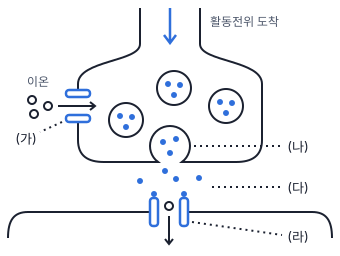
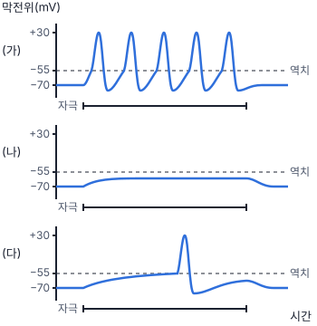
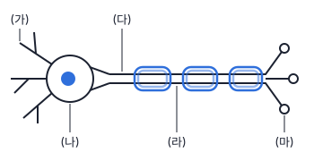
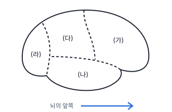
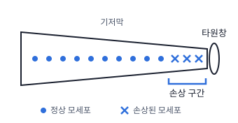

# 생명과학 12장 웹과제 예상 v3 문제해설

왼쪽 목차로 문항을 고르고, 오른쪽 문제를 보며 해설을 따라가요.

문제의 첫 줄부터 검산까지 설명해요.

**목차**

- [문항별 설명](#problems)
  - [P1. [기출 예상] 다발성 경화증과 활동전위의 이동 속도](#p1)
  - [P2. [기출 예상] 색깔 감지의 직접 원인](#p2)
  - [P3. [기출 변형] 신경전달물질의 효과를 바꾸는 방법](#p3)
  - [P4. [기출 변형] 화학시냅스의 작동 순서 그림](#p4)
  - [P5. [기출 변형] 대뇌 좌측반구와 능력](#p5)
  - [P6. [예상] 세 막전위 기록과 자극의 세기](#p6)
  - [P7. [예상] 재분극 동안 K⁺의 이동과 이온 농도](#p7)
  - [P8. [예상] 뉴런의 다섯 부위](#p8)
  - [P9. [예상] 두 약물을 처리한 시냅스의 측정 결과](#p9)
  - [P10. [예상] 팔 동작 동안 두 운동뉴런의 기록](#p10)
  - [P11. [예상] 시끄러운 카페에서 책을 읽던 사람](#p11)
  - [P12. [예상] 감촉에 집중하는 동안의 대뇌 옆모습](#p12)
  - [P13. [예상] 펴 놓은 기저막의 손상 구간](#p13)
  - [P14. [예상] 귀와 망막의 두 감각세포](#p14)
  - [P15. [예상] 어두운 상영관의 희미한 표시등](#p15)

## 문항별 설명

### P1. [기출 예상] 다발성 경화증과 활동전위의 이동 속도

기출 12강 8 예상 · [연습형 문제 보기](../%EB%B3%B5%EC%8A%B5%EB%AC%B8%EC%A0%9C_12%EC%9E%A5_%EC%9B%B9%EA%B3%BC%EC%A0%9C%EC%98%88%EC%83%81_v3.html#p1) · [시험형 문제 보기](../%EB%B3%B5%EC%8A%B5%EB%AC%B8%EC%A0%9C_12%EC%9E%A5_%EC%9B%B9%EA%B3%BC%EC%A0%9C%EC%98%88%EC%83%81_%EC%8B%9C%ED%97%98%ED%98%95_v3.html#p1)

다발성 경화증에서 보이는 것과 같이 축삭을 싸고 있는 미엘린수초의 감소는 활동전위의 이동하는 속도를 __시킨다.

- A. 유지
- B. 증가
- C. 보기 모두 정답이다
- D. 극대화
- E. 감소

원문·출처 정보 보기

기출 12강 합본 8번을 보기 순서만 바꿔 실은 예상 문제예요.

#### 문제에서 무엇을 묻는지 먼저 읽어요

축삭을 싼 미엘린 수초가 **줄어들면** 활동전위의 이동 속도가 어떻게 되는지, 빈칸에 들어갈 변화의 방향을 고르는 문제예요.

#### 이 문제를 봤을 때 떠올릴 개념과 공식

‘미엘린 수초(myelin sheath)’와 ‘이동하는 속도’에서 도약전도(saltatory conduction)를 떠올려요. 수초는 축삭막을 가로질러 새는 전류를 줄여 주고, 활동전위는 수초가 끊긴 랑비에 결절(node of Ranvier)마다 다시 생겨요.

판단 기준은 **다음 결절이 얼마나 빨리 역치에 닿는가**예요. 다발성 경화증(multiple sclerosis)처럼 수초가 손상되면 전류 누출 증가 → 다음 결절의 탈분극 감소 → 역치 도달 지연 또는 실패로 이어져요.

관련 정리노트: [전도 속도: 축삭의 지름과 도약전도](../../../%EB%B3%B5%EC%8A%B5%EB%85%B8%ED%8A%B8/1112/%EC%A0%95%EB%A6%AC%EB%85%B8%ED%8A%B8_1112_Nervous_and_Sensory_Systems.html#s2-conduction) · [신경아교세포와 미엘린 수초](../../../%EB%B3%B5%EC%8A%B5%EB%85%B8%ED%8A%B8/1112/%EC%A0%95%EB%A6%AC%EB%85%B8%ED%8A%B8_1112_Nervous_and_Sensory_Systems.html#s0-glia)

#### 왜 이렇게 푸는지 함께 따라가요

A. 틀려요. ‘유지’가 되려면 수초가 줄어도 다음 결절이 역치에 닿는 시간이 그대로여야 해요. 실제로는 새는 전류가 늘어 그 시간이 길어져요.

B. 틀려요. ‘증가’는 다음 결절이 더 빨리 역치에 닿는다는 뜻이에요. 전류 누출을 줄여 속도를 높이는 쪽은 수초가 있을 때이므로 방향이 반대예요.

C. 틀려요. A·B·D가 모두 맞지 않고, 속도가 유지되면서 동시에 증가하거나 감소할 수도 없으므로 ‘모두 정답’이 될 수 없어요.

D. 틀려요. ‘극대화’는 속도가 가장 커진다는 뜻인데, 누출이 늘어 다음 결절의 탈분극이 작아지므로 B와 마찬가지로 방향이 반대예요.

E. 맞아요. 수초가 줄면 전류가 더 새고 다음 결절이 역치에 늦게 닿으므로 속도가 ‘감소’해요. 역치에 아예 닿지 못하면 전도가 막혀요.

따라서 답은 E예요.

#### 완성 답과 검산

답 E. 거꾸로 비교해도 같아요. 지름이 비슷하면 수초가 있는 축삭이 없는 축삭보다 전도가 빠르므로, 수초가 있는 상태에서 없는 쪽으로 갈수록 속도는 줄어야 해요.

**페이지 요약**

#### 핵심 판단 기준

수초 감소 → 전류 누출 증가 → 다음 결절의 역치 도달 지연·실패 → 전도 지연·차단.

#### 결론

답 E (감소).

---

### P2. [기출 예상] 색깔 감지의 직접 원인

기출 12강 41 예상 · [연습형 문제 보기](../%EB%B3%B5%EC%8A%B5%EB%AC%B8%EC%A0%9C_12%EC%9E%A5_%EC%9B%B9%EA%B3%BC%EC%A0%9C%EC%98%88%EC%83%81_v3.html#p2) · [시험형 문제 보기](../%EB%B3%B5%EC%8A%B5%EB%AC%B8%EC%A0%9C_12%EC%9E%A5_%EC%9B%B9%EA%B3%BC%EC%A0%9C%EC%98%88%EC%83%81_%EC%8B%9C%ED%97%98%ED%98%95_v3.html#p2)

인간에 의해 감지되는 다양한 색깔은 직접적으로 다음 중 어느 것에 의해 일어나는가?

- A. 모든 광수용기가 빛에 의해 똑같이 자극되어
- B. 원추세포에 있는 세 가지 종류의 포톱신 분자의 활성에 의해
- C. 시각교차에 의해 다른 대뇌 반구로 상이 전달되어
- D. 간상세포의 신경 충격이 측면슬형핵을 거쳐 전달되므로
- E. 아마크린세포에 의한 측면 억제에 의해

원문·출처 정보 보기

기출 12강 합본 41번을 보기 순서만 바꿔 실은 예상 문제예요.

#### 문제에서 무엇을 묻는지 먼저 읽어요

사람이 여러 색깔을 구별해 느끼게 하는 **직접적인** 원인을 고르는 문제예요. 시각에 관여하기만 하는 것과 색의 차이를 처음 만드는 것을 구별해야 해요.

#### 이 문제를 봤을 때 떠올릴 개념과 공식

‘다양한 색깔’에서 빛을 흡수하는 광수용기(photoreceptor) 두 가지를 떠올려요. 간상세포(rod)는 한 종류뿐이라 색을 구별하지 못하고, 원추세포(cone)는 세 종류이며 세포마다 세 종류의 포톱신(photopsin) 중 하나를 광색소로 가져요.

판단 기준은 **빛의 색에 따라 달라지는 반응을 만드는가**예요. 색에 따라 세 종류 포톱신이 활성화되는 정도가 달라지고, 그 차이로 색을 구별해요. 신호가 지나는 길이나 도착하는 곳은 이 차이를 만들지 않아요.

관련 정리노트: [간상세포와 원추세포](../../../%EB%B3%B5%EC%8A%B5%EB%85%B8%ED%8A%B8/1117/%EC%A0%95%EB%A6%AC%EB%85%B8%ED%8A%B8_1117_Nervous_and_Sensory_Systems_and_Respiratory_and_Circulatory_Systems.html#s5-photoreceptors) · [중심오목·맹점과 망막의 배선](../../../%EB%B3%B5%EC%8A%B5%EB%85%B8%ED%8A%B8/1117/%EC%A0%95%EB%A6%AC%EB%85%B8%ED%8A%B8_1117_Nervous_and_Sensory_Systems_and_Respiratory_and_Circulatory_Systems.html#s5-retina) · [좌우 반구와 뇌량(시야의 교차)](../../../%EB%B3%B5%EC%8A%B5%EB%85%B8%ED%8A%B8/1117/%EC%A0%95%EB%A6%AC%EB%85%B8%ED%8A%B8_1117_Nervous_and_Sensory_Systems_and_Respiratory_and_Circulatory_Systems.html#s3-hemispheres)

#### 왜 이렇게 푸는지 함께 따라가요

A. 틀려요. ‘똑같이 자극’되면 어떤 색의 빛이 와도 반응이 같아서 색을 가를 차이가 생기지 않아요.

B. 맞아요. ‘세 가지 종류의 포톱신’은 종류마다 잘 흡수하는 빛이 달라, 색에 따라 활성의 조합이 달라져요. 색의 차이를 만드는 첫 단계예요.

C. 틀려요. ‘다른 대뇌 반구로’ 전달된다는 것은 정보가 어느 반구에 도착하는지에 대한 설명이에요. 도착하는 곳이 바뀌어도 색에 따라 다른 반응이 새로 생기지는 않아요.

D. 틀려요. 출발점이 ‘간상세포’예요. 한 종류뿐인 간상세포의 신호에는 색을 구별할 정보가 없으므로, 뒤에 적힌 측면슬형핵이 무엇인지 몰라도 답이 될 수 없어요.

E. 틀려요. 아마크린세포(amacrine cell)는 광수용기의 신호를 받아 처리하는 망막 세포이고 빛을 흡수하는 세포가 아니에요. 측면 억제를 몰라도, 색의 차이를 처음 만드는 직접 원인이 아니라는 점으로 제외할 수 있어요.

따라서 답은 B예요.

#### 완성 답과 검산

답 B. 빛을 흡수하는 단계를 말한 보기는 A와 B뿐이고, 둘 중 색에 따라 반응이 달라지는 것은 B예요. 약한 빛에서 원추세포가 반응하지 못하고 간상세포만 반응하면 사물이 흑백으로 보인다는 사실과도 맞아요.

**페이지 요약**

#### 핵심 판단 기준

색의 차이를 만드는 것은 색에 따라 활성이 달라지는 원추세포의 세 종류 포톱신이에요. 신호의 길·도착지, 간상세포는 직접 원인이 아니에요.

#### 결론

답 B (원추세포에 있는 세 종류 포톱신의 활성).

---

### P3. [기출 변형] 신경전달물질의 효과를 바꾸는 방법

기출 12강 33 예상 · [연습형 문제 보기](../%EB%B3%B5%EC%8A%B5%EB%AC%B8%EC%A0%9C_12%EC%9E%A5_%EC%9B%B9%EA%B3%BC%EC%A0%9C%EC%98%88%EC%83%81_v3.html#p3) · [시험형 문제 보기](../%EB%B3%B5%EC%8A%B5%EB%AC%B8%EC%A0%9C_12%EC%9E%A5_%EC%9B%B9%EA%B3%BC%EC%A0%9C%EC%98%88%EC%83%81_%EC%8B%9C%ED%97%98%ED%98%95_v3.html#p3)

신경전달물질의 효과가 증가될 수 있는 가능성이 있는 방법은?

- A. 신호를 일으키지 않으면서 수용체의 결합 자리를 차지하는 물질을 시냅스 틈에 넣는다
- B. 시냅스 틈에서 신경전달물질을 자르는 효소의 양을 늘린다
- C. 활동전위가 도착할 때 축삭말단으로 들어오는 Ca²⁺의 양을 줄인다
- D. 축삭말단에서 시냅스소포가 시냅스전세포막과 융합하는 횟수를 늘린다
- E. 시냅스 틈의 신경전달물질을 시냅스전뉴런으로 회수하는 운반단백질의 수를 늘린다

원문·출처 정보 보기

기출 12강 합본 33번 발문에 정답을 바꾼 생성 변형이에요.

#### 문제에서 무엇을 묻는지 먼저 읽어요

다섯 조작 중 신경전달물질의 효과를 **키울 수 있는** 것을 고르는 문제예요. 보기마다 무엇을 늘리거나 줄이는지 방향까지 읽어요.

#### 이 문제를 봤을 때 떠올릴 개념과 공식

‘효과가 증가’에서 신경전달물질(neurotransmitter)의 효과는 시냅스 후 막의 수용체(receptor)에 결합해야 나타난다는 점을 떠올려요. 시냅스 틈에 있는 양은 **분비량**과 **제거량**이 정하고, 제거 방법에는 확산·효소에 의한 분해·재흡수(reuptake)가 있어요.

판단 기준은 **신경전달물질이 수용체에 결합할 기회가 늘어나는가**예요. 다른 조건이 같을 때 분비가 늘거나 제거가 줄거나 결합할 수용체가 늘면 효과가 커질 수 있고, 반대 방향이면 작아져요.

관련 정리노트: [신경전달물질의 제거와 약물](../../../%EB%B3%B5%EC%8A%B5%EB%85%B8%ED%8A%B8/1112/%EC%A0%95%EB%A6%AC%EB%85%B8%ED%8A%B8_1112_Nervous_and_Sensory_Systems.html#s4-removal) · [화학 시냅스의 전달 순서](../../../%EB%B3%B5%EC%8A%B5%EB%85%B8%ED%8A%B8/1112/%EC%A0%95%EB%A6%AC%EB%85%B8%ED%8A%B8_1112_Nervous_and_Sensory_Systems.html#s3-release)

#### 왜 이렇게 푸는지 함께 따라가요

A. 틀려요. 결합 단계를 막아요. 다른 물질이 ‘결합 자리를 차지’해 신경전달물질이 결합할 기회가 줄고, 그 물질은 ‘신호를 일으키지 않으므로’ 효과를 대신 내지도 않아요.

B. 틀려요. 제거를 늘려요. 자르는 효소의 양이 늘면 시냅스 틈의 신경전달물질이 더 빨리 분해되어 결합할 양이 줄어요.

C. 틀려요. 분비를 줄여요. 축삭말단으로 들어온 Ca²⁺가 소포의 융합을 일으키므로, ‘Ca²⁺의 양을 줄이면’ 틈으로 나오는 신경전달물질도 줄어요.

D. 맞아요. 분비를 늘려요. ‘시냅스소포가 시냅스전세포막과 융합하는 횟수’가 늘면 틈으로 나오는 신경전달물질이 많아져 결합할 기회가 늘어요.

E. 틀려요. 제거를 늘려요. ‘회수하는 운반단백질’이 많아지면 재흡수가 빨라져 신경전달물질이 틈에 머무는 시간이 짧아져요.

따라서 답은 D예요.

#### 완성 답과 검산

답 D. 조작의 방향만 모아 보면 A는 결합↓, B·E는 제거↑, C는 분비↓로 모두 효과가 줄어드는 쪽이고, D만 분비↑예요. 조작을 거꾸로 해 보아도 B의 효소를 줄이거나 E의 회수를 막으면 효과가 커지므로, 적힌 그대로의 B·E는 효과를 줄이는 쪽임을 확인할 수 있어요.

#### 헷갈리기 쉬운 점

‘분해’나 ‘재흡수’라는 낱말만 보고 고르지 마세요. 효과를 키우는 것은 이것을 **막을** 때인데, B와 E는 오히려 **늘렸어요**.

**페이지 요약**

#### 핵심 판단 기준

수용체에 결합할 기회가 늘어나는 방향인지 봐요. 분비↑·제거↓·수용체↑는 효과가 커질 수 있는 쪽이에요.

#### 결론

답 D (시냅스소포와 시냅스전세포막의 융합 횟수 증가).

---

### P4. [기출 변형] 화학시냅스의 작동 순서 그림

기출 12강 35 예상 · [연습형 문제 보기](../%EB%B3%B5%EC%8A%B5%EB%AC%B8%EC%A0%9C_12%EC%9E%A5_%EC%9B%B9%EA%B3%BC%EC%A0%9C%EC%98%88%EC%83%81_v3.html#p4) · [시험형 문제 보기](../%EB%B3%B5%EC%8A%B5%EB%AC%B8%EC%A0%9C_12%EC%9E%A5_%EC%9B%B9%EA%B3%BC%EC%A0%9C%EC%98%88%EC%83%81_%EC%8B%9C%ED%97%98%ED%98%95_v3.html#p4)

위 그림은 화학시냅스의 작동 순서를 나타낸 것이다. 그림을 참고하여, 전형적인 시냅스를 통한 화학시냅스 전달에 대한 설명으로 틀린 것을 고르시오.

- A. (라)의 이온 채널은 축삭말단에 도착한 활동전위의 막전위 변화로 직접 열린다
- B. (가)의 이온 채널은 활동전위가 도착해 그 자리의 막전위가 변하면 열린다
- C. (나)에서는 소포의 막이 축삭말단의 세포막과 이어지며 속에 든 분자가 밖으로 나온다
- D. (나)에서 나온 분자는 (다)를 확산으로 건너간다
- E. (나)에서 막이 이어지려면 축삭말단 안으로 들어온 Ca²⁺가 필요하다

원문·출처 정보 보기

기출 12강 합본 35번 발문에 정답을 바꾼 생성 변형이에요. 그림은 원문 그림의 구조를 기호로 바꿔 새로 그렸어요.

#### 문제에서 무엇을 묻는지 먼저 읽어요

그림의 (가)~(라)를 읽고 화학시냅스(chemical synapse) 전달에 대한 설명 중 **틀린 것**을 고르는 문제예요.

발문의 ‘위 그림’은 발문 바로 아래에 있는 그림을 말해요.

#### 이 문제를 봤을 때 떠올릴 개념과 공식

‘활동전위 도착’ 화살표가 있는 위쪽이 신호를 보내는 축삭말단이고, 아래쪽이 신호를 받는 시냅스 후 세포예요. 그림의 위치를 전달 순서에 맞추면 (가)는 이온이 축삭말단 안으로 들어오는 전압개폐성 Ca²⁺ 채널(voltage-gated calcium channel), (나)는 시냅스 소포(synaptic vesicle)가 시냅스 전 막과 융합한 자리, (다)는 시냅스 틈(synaptic cleft), (라)는 신경전달물질이 붙은 시냅스 후 막의 리간드 개폐성 이온 채널(ligand-gated ion channel)이에요.

채널의 판단 기준은 **무엇이 채널을 여는가**예요. 전압개폐성은 그 자리의 막전위 변화로, 리간드 개폐성은 신경전달물질 같은 리간드(ligand)의 결합으로 열려요. 나머지 보기는 ‘활동전위 도착 → Ca²⁺ 유입 → 소포 융합과 방출 → 확산과 결합’ 순서에 맞는지 봐요.

관련 정리노트: [화학 시냅스의 전달 순서](../../../%EB%B3%B5%EC%8A%B5%EB%85%B8%ED%8A%B8/1112/%EC%A0%95%EB%A6%AC%EB%85%B8%ED%8A%B8_1112_Nervous_and_Sensory_Systems.html#s3-release)

#### 왜 이렇게 푸는지 함께 따라가요

A. 틀려요. (라)는 시냅스 후 막에 있고 알갱이가 붙어 있는 리간드 개폐성 채널이에요. 신경전달물질의 결합으로 열리며, 시냅스 틈 건너편 ‘축삭말단에 도착한 활동전위의 막전위 변화’가 직접 여는 것이 아니에요.

B. 맞아요. (가)는 축삭말단 막의 전압개폐성 Ca²⁺ 채널이므로, 활동전위가 도착해 ‘그 자리의 막전위가 변하면’ 열려요.

C. 맞아요. (나)에서 주머니의 막이 위쪽 세포의 아래 막과 이어져 열려 있어요. 소포가 시냅스 전 막과 융합해 속의 신경전달물질을 내보내는 모습이에요.

D. 맞아요. (나)에서 나온 알갱이가 (다) 시냅스 틈에 흩어져 있어요. 방출된 신경전달물질은 확산(diffusion)으로 틈을 건너요.

E. 맞아요. (가)로 들어온 Ca²⁺가 소포와 시냅스 전 막의 융합을 일으키므로, (나)에서 막이 이어지려면 Ca²⁺가 필요해요.

틀린 설명을 묻고 있으므로 답은 A예요.

#### 완성 답과 검산

답 A. 네 설명 B → E → C → D를 이어 읽으면 ‘(가) 채널 열림 → Ca²⁺ 유입 → 막 융합·방출 → 확산’으로 순서가 끊기지 않아요. A대로라면 신경전달물질이 나오지 않아도 (라)가 열려야 하므로, (라)에 알갱이가 붙어 있는 그림과 맞지 않아요.

**페이지 요약**

#### 핵심 판단 기준

(가) 축삭말단 Ca²⁺ 채널은 막전위 변화로, (라) 시냅스 후 막 채널은 신경전달물질의 결합으로 열려요.

#### 결론

틀린 설명은 A. (라)의 여는 조건을 (가)의 것으로 바꿨어요.

---

### P5. [기출 변형] 대뇌 좌측반구와 능력

기출 12강 7 예상 · [연습형 문제 보기](../%EB%B3%B5%EC%8A%B5%EB%AC%B8%EC%A0%9C_12%EC%9E%A5_%EC%9B%B9%EA%B3%BC%EC%A0%9C%EC%98%88%EC%83%81_v3.html#p5) · [시험형 문제 보기](../%EB%B3%B5%EC%8A%B5%EB%AC%B8%EC%A0%9C_12%EC%9E%A5_%EC%9B%B9%EA%B3%BC%EC%A0%9C%EC%98%88%EC%83%81_%EC%8B%9C%ED%97%98%ED%98%95_v3.html#p5)

다음 중 대뇌의 좌측반구에서 조절하지 않는 능력은?

- A. 떠오른 생각을 소리 내어 문장으로 전하는 능력
- B. 여러 근거를 차례로 따져 결론을 이끌어 내는 능력
- C. 공간 속 물체의 위치와 배치를 알아내는 능력
- D. 전하려는 내용을 글로 적어 나타내는 능력
- E. 숫자와 식을 다루어 값을 계산하는 능력

원문·출처 정보 보기

기출 12강 합본 7번 발문에 정답을 바꾼 생성 변형이에요.

#### 문제에서 무엇을 묻는지 먼저 읽어요

다섯 능력 중 대뇌 좌측반구가 **조절하지 않는 것**을 고르는 문제예요. 보기는 능력의 이름 대신 하는 일을 풀어 썼어요.

#### 이 문제를 봤을 때 떠올릴 개념과 공식

‘좌측반구에서 조절하지 않는’에서 기능이 한쪽 반구에 치우쳐 있는 측화(lateralization)를 떠올려요. 좌반구(left hemisphere)는 말하기·쓰기 같은 언어, 추론·논리, 수학적 계산에 관여하고, 우반구(right hemisphere)는 공간 인지, 음악적·예술적 능력, 직감적 사고에 관여해요.

판단 기준은 **보기에 적힌 일이 언어·추론·계산에 드는지, 공간 인지·예술·직감에 드는지**예요. 이 문제는 대부분의 사람에서 보이는 기능의 치우침을 기준으로 해요.

관련 정리노트: [좌우 반구와 뇌량](../../../%EB%B3%B5%EC%8A%B5%EB%85%B8%ED%8A%B8/1117/%EC%A0%95%EB%A6%AC%EB%85%B8%ED%8A%B8_1117_Nervous_and_Sensory_Systems_and_Respiratory_and_Circulatory_Systems.html#s3-hemispheres)

#### 왜 이렇게 푸는지 함께 따라가요

A. 좌반구의 능력이에요. ‘소리 내어 문장으로 전하는’ 것은 말하기이고, 언어 기능에 들어요.

B. 좌반구의 능력이에요. ‘근거를 차례로 따져 결론을 이끌어 내는’ 것은 추론이에요.

C. 좌반구의 능력이 아니에요. ‘공간 속 물체의 위치와 배치를 알아내는’ 것은 공간 인지이고, 우반구가 잘하는 일이에요.

D. 좌반구의 능력이에요. ‘글로 적어 나타내는’ 것은 쓰기이고, 말하기와 함께 언어 기능에 들어요.

E. 좌반구의 능력이에요. ‘숫자와 식을 다루어 값을 계산하는’ 것은 수학적 계산이에요.

좌반구가 조절하지 않는 것을 묻고 있으므로 답은 C예요.

#### 완성 답과 검산

답 C. 거꾸로 우반구의 능력을 찾아도 같은 답이 나와요. A·D는 언어, B는 추론, E는 계산이라 공간 인지·예술·직감에 드는 보기는 C 하나예요.

**페이지 요약**

#### 핵심 판단 기준

좌반구는 말하기·쓰기·추론·계산, 우반구는 공간 인지·음악·예술·직감이에요.

#### 결론

답 C (공간 인지는 우반구 쪽).

---

### P6. [예상] 세 막전위 기록과 자극의 세기

예상 12장 6 · [연습형 문제 보기](../%EB%B3%B5%EC%8A%B5%EB%AC%B8%EC%A0%9C_12%EC%9E%A5_%EC%9B%B9%EA%B3%BC%EC%A0%9C%EC%98%88%EC%83%81_v3.html#p6) · [시험형 문제 보기](../%EB%B3%B5%EC%8A%B5%EB%AC%B8%EC%A0%9C_12%EC%9E%A5_%EC%9B%B9%EA%B3%BC%EC%A0%9C%EC%98%88%EC%83%81_%EC%8B%9C%ED%97%98%ED%98%95_v3.html#p6)

휴지 상태로 돌아온 같은 뉴런에 세기만 다른 자극을 같은 시간 동안 한 번씩 주고, 축삭 초기분절의 막전위를 (가), (나), (다)로 기록했어요. 자극의 세기 외의 조건과 세 기록의 눈금은 모두 같아요. 약한 자극을 준 기록부터 늘어놓은 순서와 기록의 해석을 옳게 짝지은 것은 무엇인가요?

- A. (나)-(다)-(가) 순서이고, 자극이 셀수록 한 번의 활동전위가 더 높이 솟아요.
- B. (나)-(다)-(가) 순서이고, 자극이 셀수록 같은 높이의 활동전위가 더 자주 생겨요.
- C. (다)-(나)-(가) 순서이고, 자극이 셀수록 같은 높이의 활동전위가 더 자주 생겨요.
- D. (가)-(다)-(나) 순서이고, 자극이 약할수록 같은 높이의 활동전위가 더 자주 생겨요.
- E. (나)-(다)-(가) 순서이고, 가장 약한 자극에서는 막전위가 전혀 달라지지 않아요.

원문·출처 정보 보기

1112 정리노트의 실무율과 자극의 세기 토픽을 바탕으로 만든 예상 문제예요.

#### 문제에서 무엇을 묻나요

같은 뉴런에 세기만 다른 자극을 같은 시간 동안 주고 얻은 세 기록을 약한 자극부터 늘어놓고, 자극이 세질 때 활동전위의 높이와 횟수 가운데 무엇이 달라지는지 고르는 문제예요.

#### 이 문제를 봤을 때 떠올릴 개념과 공식

‘자극의 세기 외의 조건은 모두 같다’와 역치 점선에서 실무율(all-or-nothing)을 떠올려요. 축삭 초기분절(axon initial segment)이 역치(threshold)에 닿아야 활동전위(action potential)가 생기고, 같은 뉴런의 같은 조건에서는 활동전위 한 번의 크기가 대체로 일정해요.

판단 기준은 두 가지예요. 먼저 기록이 역치에 닿았는지 보고, 닿았다면 같은 시간 동안 생긴 활동전위의 횟수(발화 빈도)를 세요. 지속 자극이 세면 회복한 뒤 역치에 더 빨리 다시 닿아 발화 빈도가 높아질 수 있어요. 역치에 못 미쳐도 크기가 작은 국소 막전위 변화는 생길 수 있어요.

관련 정리노트: [실무율과 자극의 세기](../../../%EB%B3%B5%EC%8A%B5%EB%85%B8%ED%8A%B8/1112/%EC%A0%95%EB%A6%AC%EB%85%B8%ED%8A%B8_1112_Nervous_and_Sensory_Systems.html#s2-all-or-none)

#### 첫 줄부터 잡아요

기록마다 점선에 닿았는지, 봉우리가 몇 개인지, 어디까지 솟는지 적어요. (가)는 +30 mV까지 솟은 봉우리 5개, (나)는 점선 아래의 작은 상승만 있고 봉우리 0개, (다)는 +30 mV까지 솟은 봉우리 1개예요.

#### 왜 이렇게 푸는지 함께 따라가요

A. 틀려요. 0개인 (나), 1개인 (다), 5개인 (가)로 늘어놓은 순서는 옳아요. 하지만 (다)의 봉우리와 (가)의 봉우리 다섯 개가 모두 같은 눈금의 +30 mV까지 솟으므로 ‘더 높이 솟아요’는 기록과 어긋나요.

B. 맞아요. 역치에 못 닿은 (나)가 가장 약하고, 역치에 닿아 한 번 발화한 (다), 같은 시간에 다섯 번 발화한 (가) 순서로 세요. 봉우리 높이는 같고 횟수만 늘었으므로 ‘같은 높이의 활동전위가 더 자주’라는 해석과 일치해요.

C. 틀려요. 자극이 셀수록 더 자주 생긴다는 해석은 옳지만 순서가 달라요. (다)는 역치에 닿았고 (나)는 닿지 못했으므로 (나)의 자극이 (다)의 자극보다 약해요.

D. 틀려요. 다섯 번 발화한 (가)를 가장 약한 자극으로 놓아 순서가 거꾸로예요. 다른 조건이 같은 지속 자극은 약할수록 역치에 늦게 닿거나 닿지 못하므로 ‘약할수록 더 자주’도 맞지 않아요.

E. 틀려요. 순서는 옳지만, 가장 약한 (나)의 곡선도 자극을 받는 동안 −70 mV보다 조금 올라갔다가 돌아와요. 역치에 못 미치면 활동전위가 없을 뿐, 막전위가 전혀 달라지지 않는 것은 아니에요.

따라서 답은 B예요.

#### 완성 답과 검산

답 B. 순서만 따로 보면 (나)-(다)-(가)인 A·B·E가 남고, 해석만 따로 보면 ‘셀수록 같은 높이로 더 자주’인 B·C가 남아요. 두 조건을 함께 만족하는 보기는 B 하나예요.

**페이지 요약**

#### 핵심 판단 기준

역치 도달 여부 → 같은 시간 동안의 활동전위 횟수. (나) 0개 → (다) 1개 → (가) 5개이고 높이는 모두 +30 mV로 같아요. 답은 B예요.

---

### P7. [예상] 재분극 동안 K⁺의 이동과 이온 농도

예상 12장 7 · [연습형 문제 보기](../%EB%B3%B5%EC%8A%B5%EB%AC%B8%EC%A0%9C_12%EC%9E%A5_%EC%9B%B9%EA%B3%BC%EC%A0%9C%EC%98%88%EC%83%81_v3.html#p7) · [시험형 문제 보기](../%EB%B3%B5%EC%8A%B5%EB%AC%B8%EC%A0%9C_12%EC%9E%A5_%EC%9B%B9%EA%B3%BC%EC%A0%9C%EC%98%88%EC%83%81_%EC%8B%9C%ED%97%98%ED%98%95_v3.html#p7)

한 뉴런이 발화해 활동전위가 한 번 지나가는 동안, 축삭막의 재분극 구간에서 K⁺가 세포 밖으로 나갔어요. K⁺가 나가는 까닭과 그때 세포 안팎의 이온 농도를 옳게 설명한 것은 무엇인가요?

- A. K⁺는 Na⁺/K⁺ 펌프가 ATP를 써서 내보내고, 드나든 양이 매우 적어 K⁺는 안쪽, Na⁺는 바깥쪽이 여전히 높아요.
- B. K⁺는 열린 채널에서 전기화학 기울기를 따라 나가고, 앞서 들어온 양이 많아 Na⁺는 이미 안쪽이 바깥쪽보다 높아요.
- C. K⁺는 열린 채널에서 전기화학 기울기를 따라 나가고, 빠져나간 양이 많아 K⁺는 이미 바깥쪽이 안쪽보다 높아요.
- D. K⁺는 Na⁺/K⁺ 펌프가 ATP를 써서 내보내고, 퍼낸 양이 많아 K⁺와 Na⁺ 모두 이미 바깥쪽이 안쪽보다 높아요.
- E. K⁺는 열린 채널에서 전기화학 기울기를 따라 나가고, 드나든 양이 매우 적어 K⁺는 안쪽, Na⁺는 바깥쪽이 여전히 높아요.

원문·출처 정보 보기

1112 정리노트의 활동전위: 탈분극·재분극·과분극 토픽을 바탕으로 만든 예상 문제예요.

#### 문제에서 무엇을 묻나요

활동전위가 한 번 지나가는 동안의 재분극 구간에서 K⁺가 무엇을 통해 왜 나가는지, 그리고 그때 세포 안팎의 K⁺·Na⁺ 농도가 어느 쪽이 높은지를 함께 판단하는 문제예요.

#### 이 문제를 봤을 때 떠올릴 개념과 공식

‘재분극(repolarization) 구간의 K⁺ 유출’에서는 열린 K⁺ 채널(channel)을 떠올려요. 채널을 지나는 이온은 농도 차와 전압 차의 효과를 합친 전기화학 기울기(electrochemical gradient)를 따라 ATP를 직접 쓰지 않고 이동해요. Na⁺/K⁺ 펌프(pump)는 ATP를 써서 Na⁺ 3개를 밖으로, K⁺ 2개를 안으로 옮기므로 K⁺의 방향이 반대예요.

‘그때 세포 안팎의 이온 농도’에서는 드나든 양과 전체 양을 견줘요. 활동전위 동안 막을 드나드는 이온은 세포 안팎의 전체 이온 수에 비해 극히 일부예요. 막전위는 크게 바뀌어도 농도 차는 뒤집히지 않아서, 안쪽은 K⁺, 바깥쪽은 Na⁺가 더 높은 상태가 유지돼요.

판단 기준은 K⁺의 통로(채널인지 펌프인지)와 농도 분포(유지됐는지 뒤집혔는지)이고, 두 기준에 모두 맞아야 답이에요.

관련 정리노트: [활동전위: 탈분극·재분극·과분극](../../../%EB%B3%B5%EC%8A%B5%EB%85%B8%ED%8A%B8/1112/%EC%A0%95%EB%A6%AC%EB%85%B8%ED%8A%B8_1112_Nervous_and_Sensory_Systems.html#s2-action), [채널과 Na⁺/K⁺ 펌프](../../../%EB%B3%B5%EC%8A%B5%EB%85%B8%ED%8A%B8/1112/%EC%A0%95%EB%A6%AC%EB%85%B8%ED%8A%B8_1112_Nervous_and_Sensory_Systems.html#s1-channel-pump)

#### 왜 이렇게 푸는지 함께 따라가요

A. 틀려요. ‘드나든 양이 매우 적어 K⁺는 안쪽, Na⁺는 바깥쪽이 여전히 높다’는 농도 설명은 옳아요. 그러나 펌프는 K⁺를 안으로 들이므로 ‘펌프가 K⁺를 내보낸다’는 방향이 맞지 않고, 재분극 때의 유출은 열린 K⁺ 채널에서 일어나요.

B. 틀려요. 열린 채널로 나간다는 설명은 옳아요. 그러나 탈분극 때 들어온 Na⁺도 전체의 극히 일부라 Na⁺ 농도는 여전히 바깥쪽이 높으므로 ‘이미 안쪽이 바깥쪽보다 높다’가 틀렸어요.

C. 틀려요. 열린 채널로 나간다는 설명은 옳아요. 그러나 빠져나간 K⁺는 극히 일부라 K⁺ 농도는 여전히 안쪽이 높으므로 ‘이미 바깥쪽이 안쪽보다 높다’가 틀렸어요.

D. 틀려요. Na⁺ 농도가 바깥쪽이 높다는 부분만 옳아요. 펌프가 K⁺를 옮기는 방향은 안쪽이고, K⁺ 농도도 여전히 안쪽이 높으므로 통로와 K⁺ 농도 설명이 모두 어긋나요.

E. 맞아요. 열린 채널에서 전기화학 기울기를 따라 나간다는 설명이 통로 기준에, 드나든 양이 매우 적어 K⁺는 안쪽, Na⁺는 바깥쪽이 여전히 높다는 설명이 농도 기준에 모두 맞아요.

따라서 답은 E예요.

#### 완성 답과 검산

답 E. 통로 기준으로 거르면 채널이라고 한 B·C·E가, 농도 기준으로 거르면 두 이온의 농도 차가 유지된다고 한 A·E가 남아서 공통인 것은 E뿐이에요. K⁺의 농도 차가 안쪽에서 바깥쪽으로 향한 채 남아 있다는 점도, 채널이 열렸을 때 K⁺가 밖으로 나가는 문제의 관찰과 맞아요.

#### 여기서 자주 헷갈려요

막전위의 부호가 바뀐다는 것과 이온 농도가 뒤집힌다는 것은 달라요. 막전위는 적은 양의 이온이 드나들어도 크게 바뀌지만, 드나든 양이 전체 양에 비해 극히 적어 안팎의 농도는 거의 그대로예요.

**페이지 요약**

#### 핵심 판단 기준

재분극의 K⁺ 유출은 열린 채널에서 전기화학 기울기를 따른 이동. 드나든 양은 극히 일부라 K⁺는 안쪽, Na⁺는 바깥쪽이 여전히 높아요. 답은 E예요.

#### 함정

막전위가 바뀌어도 농도 차는 뒤집히지 않아요. 펌프는 K⁺를 안으로 들여요.

---

### P8. [예상] 뉴런의 다섯 부위

예상 12장 8 · [연습형 문제 보기](../%EB%B3%B5%EC%8A%B5%EB%AC%B8%EC%A0%9C_12%EC%9E%A5_%EC%9B%B9%EA%B3%BC%EC%A0%9C%EC%98%88%EC%83%81_v3.html#p8) · [시험형 문제 보기](../%EB%B3%B5%EC%8A%B5%EB%AC%B8%EC%A0%9C_12%EC%9E%A5_%EC%9B%B9%EA%B3%BC%EC%A0%9C%EC%98%88%EC%83%81_%EC%8B%9C%ED%97%98%ED%98%95_v3.html#p8)

그림은 축삭의 일부가 덮여 있는 한 뉴런을 간단히 나타낸 거예요. 이 뉴런의 (가)~(마) 부위에 대한 설명으로 옳지 않은 것은 무엇인가요?

- A. (가)에서는 다른 뉴런이 보낸 신경전달물질을 받으면 그 자리의 막전위가 달라질 수 있어요.
- B. (나)에는 핵과 미토콘드리아 같은 세포소기관이 있고, 여러 입력이 합쳐질 수 있어요.
- C. (다)에는 전압 개폐성 Na⁺ 채널이 밀집해 있고, 보통 여기서 활동전위가 시작돼요.
- D. (라)에 활동전위가 도착하면 Ca²⁺가 들어와 신경전달물질이 다음 세포 쪽으로 방출돼요.
- E. (마)에서는 축삭을 따라 전도된 활동전위가 도착한 뒤 다음 세포로 신호를 넘겨요.

원문·출처 정보 보기

1112 정리노트의 뉴런의 세 부분과 신호의 방향 토픽을 바탕으로 만든 예상 문제예요.

#### 문제에서 무엇을 묻나요

그림의 (가)~(마)가 뉴런의 어느 부위인지 알아내고, 그 부위에 대한 설명으로 **옳지 않은 것**을 고르는 문제예요.

#### 이 문제를 봤을 때 떠올릴 개념과 공식

뉴런(neuron)의 신호는 수상돌기(dendrite)에서 입력을 받고, 세포체(cell body)를 거쳐, 축삭(axon)을 따라 전도된 뒤 축삭말단(axon terminal)에서 다음 세포로 넘어가요. 활동전위는 보통 축삭둔덕(axon hillock) 바로 다음의 축삭 초기분절(axon initial segment)에서 시작돼요.

판단 기준은 부위마다의 구조와 하는 일이 보기와 맞는지예요. 세포체는 핵·미토콘드리아 같은 세포소기관이 있고 여러 입력이 합쳐지는 곳, 축삭 초기분절은 전압 개폐성 Na⁺ 채널이 밀집한 곳이에요. 축삭 쪽은 **전도**인지 **전달**인지도 구별해요. 수초로 덮인 부분 사이의 랑비에 결절(node of Ranvier)은 전압 개폐성 Na⁺ 채널이 집중되어 활동전위를 재생하는 전도 구간이에요. 활동전위가 도착했을 때 Ca²⁺가 들어와 신경전달물질(neurotransmitter)을 방출하는 곳은 축삭말단이에요.

관련 정리노트: [뉴런의 세 부분과 신호의 방향](../../../%EB%B3%B5%EC%8A%B5%EB%85%B8%ED%8A%B8/1112/%EC%A0%95%EB%A6%AC%EB%85%B8%ED%8A%B8_1112_Nervous_and_Sensory_Systems.html#s0-neuron), [전도 속도: 축삭의 지름과 도약전도](../../../%EB%B3%B5%EC%8A%B5%EB%85%B8%ED%8A%B8/1112/%EC%A0%95%EB%A6%AC%EB%85%B8%ED%8A%B8_1112_Nervous_and_Sensory_Systems.html#s2-conduction), [화학 시냅스의 전달 순서](../../../%EB%B3%B5%EC%8A%B5%EB%85%B8%ED%8A%B8/1112/%EC%A0%95%EB%A6%AC%EB%85%B8%ED%8A%B8_1112_Nervous_and_Sensory_Systems.html#s3-release)

#### 첫 줄부터 잡아요

그림을 왼쪽부터 이름으로 바꿔 적어요. 여러 갈래의 가지 (가)는 수상돌기, 핵이 든 둥근 부분 (나)는 세포체, 둥근 부분이 좁아진 자리 바로 다음의 덮이지 않은 구간 (다)는 축삭 초기분절, 두 덮개 사이의 드러난 틈 (라)는 랑비에 결절, 긴 돌기가 갈라진 끝 (마)는 축삭말단이에요.

#### 왜 이렇게 푸는지 함께 따라가요

A. 맞아요. (가) 수상돌기는 시냅스 입력을 받는 곳이에요. 전달물질이 결합해 이온 채널이 열리면 그 자리의 막전위가 달라질 수 있어요.

B. 맞아요. (나) 세포체에는 핵·미토콘드리아 같은 세포소기관이 있고, 수상돌기에서 온 여러 입력이 합쳐질 수 있어요.

C. 맞아요. (다) 축삭 초기분절에는 전압 개폐성 Na⁺ 채널이 밀집해 있고, 합쳐진 입력이 이곳에서 역치에 닿으면 보통 여기서 활동전위가 시작돼요.

D. 틀려요. (라)는 랑비에 결절이라 활동전위가 도착하면 집중된 전압 개폐성 Na⁺ 채널로 Na⁺가 들어와 활동전위를 재생해요. ‘Ca²⁺가 들어와 신경전달물질이 방출된다’는 설명은 (마) 축삭말단의 일을 (라)에 붙인 거예요.

E. 맞아요. (마) 축삭말단은 축삭을 따라 전도된 활동전위가 도착한 뒤 다음 세포로 신호를 넘기는 끝이에요.

옳지 않은 것을 물었으므로 내용이 틀린 D를 골라요. 따라서 답은 D예요.

#### 완성 답과 검산

답 D. 보기의 기능을 거꾸로 부위에 대응시키면 ‘입력을 받음 → 수상돌기’, ‘소기관·입력의 합 → 세포체’, ‘활동전위의 시작 → 축삭 초기분절’, ‘신호를 넘김 → 축삭말단’은 A·B·C·E의 기호와 일치해요. ‘Ca²⁺ 유입과 방출’만 보기의 (라)가 아니라 (마)로 이어져요.

#### 여기서 자주 헷갈려요

(라)와 (마)에는 모두 활동전위가 도착해요. ‘도착’이라는 말로 고르지 말고 들어오는 이온과 결과를 구별해요. 결절은 Na⁺ 유입 → 활동전위 재생, 말단은 Ca²⁺ 유입 → 전달물질 방출이에요.

**페이지 요약**

#### 핵심 판단 기준

(가) 수상돌기, (나) 세포체, (다) 축삭 초기분절, (라) 랑비에 결절, (마) 축삭말단. 결절은 활동전위를 재생하고 전달물질은 말단에서 방출되므로, 옳지 않은 것은 D예요.

---

### P9. [예상] 두 약물을 처리한 시냅스의 측정 결과

예상 12장 9 · [연습형 문제 보기](../%EB%B3%B5%EC%8A%B5%EB%AC%B8%EC%A0%9C_12%EC%9E%A5_%EC%9B%B9%EA%B3%BC%EC%A0%9C%EC%98%88%EC%83%81_v3.html#p9) · [시험형 문제 보기](../%EB%B3%B5%EC%8A%B5%EB%AC%B8%EC%A0%9C_12%EC%9E%A5_%EC%9B%B9%EA%B3%BC%EC%A0%9C%EC%98%88%EC%83%81_%EC%8B%9C%ED%97%98%ED%98%95_v3.html#p9)

어떤 화학 시냅스에 약물 P와 Q를 따로 처리하고, (1) 시냅스 전 뉴런이 전달물질을 전혀 분비하지 못하게 한 조건과 (2) 같은 자극으로 전달물질이 분비되게 한 조건에서 측정했어요. 두 약물은 각각 ‘수용체에 직접 결합해 전달물질을 흉내 냄’, ‘분비한 뉴런으로의 회수를 막음’, ‘축삭말단의 Ca²⁺ 유입을 막음’, ‘시냅스 후 막의 수용체를 막음’, ‘소포 융합을 늘림’ 가운데 한 가지 작용만 하고, 그 밖의 조건은 모두 같아요. 표의 결과를 설명하는 두 약물의 작용을 옳게 짝지은 것은 무엇인가요?

| 처리 | (1)의 시냅스 후 반응 | (2)의 시냅스 후 반응 | (2)의 분비량 | (2)의 제거 시간 |
|---|---|---|---|---|
| 대조군 | 없음 | 있음 | 기준값 | 기준값 |
| 약물 P | 있음 | 있음 | 대조와 같음 | 대조와 같음 |
| 약물 Q | 없음 | 대조보다 오래 지속 | 대조와 같음 | 더 길어짐 |

- A. P는 분비한 뉴런으로의 회수를 막고, Q는 수용체에 직접 결합해 전달물질을 흉내 내요.
- B. P는 축삭말단의 소포 융합을 늘리고, Q는 분비한 뉴런으로의 전달물질 회수를 막아요.
- C. P는 수용체에 직접 결합해 전달물질을 흉내 내고, Q는 분비한 뉴런으로의 회수를 막아요.
- D. P는 수용체에 직접 결합해 전달물질을 흉내 내고, Q는 축삭말단의 소포 융합을 늘려요.
- E. P는 축삭말단으로의 Ca²⁺ 유입을 막고, Q는 시냅스 후 막의 전달물질 수용체를 막아요.

원문·출처 정보 보기

1112 정리노트의 신경전달물질의 제거와 약물 토픽을 바탕으로 만든 예상 문제예요.

#### 문제에서 무엇을 묻나요

전달물질이 전혀 분비되지 않는 조건 (1)과 분비되는 조건 (2)의 가상 측정 결과를 대조군과 견줘, P와 Q가 제시된 다섯 작용 가운데 어느 하나를 하는지 짝짓는 문제예요. 두 약물이 각각 한 가지 작용만 하고 나머지 조건은 같다는 가정이 붙어 있어요.

#### 이 문제를 봤을 때 떠올릴 개념과 공식

‘분비하지 못하게 한 조건에서도 반응이 있다’에서는 전달물질 대신 수용체(receptor)에 직접 결합해 작용을 모방하는 약물을 떠올려요. 모르핀이 엔도르핀 수용체에 결합하는 방식이에요. ‘분비량은 같고 제거 시간이 길다’에서는 분비한 뉴런으로의 회수인 재흡수(reuptake)를 막는 약물을 떠올려요. 이미 분비된 전달물질이 시냅스 틈에 더 오래 머물러 반응이 길어져요.

판단 기준은 세 가지예요. 분비가 없어도 반응이 나오는지, 분비량이 달라졌는지, 제거 시간이 달라졌는지 차례로 확인해요. 회수를 막거나 소포 융합을 늘리는 작용은 분비되는 전달물질이 있어야 효과가 나타나요.

관련 정리노트: [신경전달물질의 제거와 약물](../../../%EB%B3%B5%EC%8A%B5%EB%85%B8%ED%8A%B8/1112/%EC%A0%95%EB%A6%AC%EB%85%B8%ED%8A%B8_1112_Nervous_and_Sensory_Systems.html#s4-removal), [화학 시냅스의 전달 순서](../../../%EB%B3%B5%EC%8A%B5%EB%85%B8%ED%8A%B8/1112/%EC%A0%95%EB%A6%AC%EB%85%B8%ED%8A%B8_1112_Nervous_and_Sensory_Systems.html#s3-release)

#### 첫 줄부터 잡아요

대조군과 다른 칸에만 표시해요. P는 ‘(1)의 시냅스 후 반응’ 칸만 없음에서 있음으로 바뀌었어요. Q는 ‘(1)의 시냅스 후 반응’과 ‘(2)의 분비량’ 칸은 대조와 같고, ‘(2)의 시냅스 후 반응’ 칸이 오래 지속, ‘(2)의 제거 시간’ 칸이 더 길어짐으로 바뀌었어요.

#### 왜 이렇게 푸는지 함께 따라가요

A. 틀려요. 두 약물의 작용이 서로 바뀌었어요. 회수를 막는 약물은 분비된 전달물질이 있어야 작용하므로 P의 (1) 반응 칸 ‘있음’을 설명하지 못해요. 수용체에 직접 결합해 흉내 내는 약물이라면 Q의 (1) 반응 칸도 ‘없음’이 아니어야 해요.

B. 틀려요. Q의 작용은 표와 맞아요. 그러나 (1)에서는 전달물질이 분비되지 않으므로 소포 융합을 늘리는 작용으로 P의 반응이 생길 수 없고, P의 (2) 분비량 칸도 ‘대조와 같음’이에요.

C. 맞아요. P는 분비가 없는 (1)에서도 반응이 ‘있음’이므로 수용체에 직접 결합해 전달물질을 흉내 내요. Q는 (1)에서 반응이 ‘없음’이고, (2)에서 분비량은 ‘대조와 같음’인데 제거 시간이 ‘더 길어짐’이며 반응이 오래 지속되므로 회수를 막아요.

D. 틀려요. P의 작용은 표와 맞아요. 그러나 Q가 소포 융합을 늘린다면 (2) 분비량이 늘어야 하는데 그 칸은 ‘대조와 같음’이에요.

E. 틀려요. Ca²⁺ 유입을 막으면 소포 융합이 줄어 (2) 분비량이 줄어야 하지만 P는 대조와 같고, P의 (1) 반응도 설명하지 못해요. 수용체를 막으면 (2) 반응이 줄거나 사라져야 하지만 Q는 오히려 오래 지속돼요.

따라서 답은 C예요.

#### 완성 답과 검산

답 C. 다섯 작용에서 거꾸로 예측해도 같아요. (1)에서 반응을 낼 수 있는 작용은 ‘수용체에 직접 결합해 흉내 냄’ 하나이므로 P가 정해져요. 분비량을 그대로 둔 채 제거 시간만 늘리는 작용은 ‘회수를 막음’ 하나이므로 Q도 정해져요. 이 유일성은 다섯 작용 가운데 한 가지만 한다는 가정 안에서 성립해요.

#### 여기서 자주 헷갈려요

두 약물 모두 (2)에서 반응이 있으므로 (2)의 반응 칸만으로는 작용을 정할 수 없어요. 작용 모방은 (1)의 반응 칸에서, 회수 억제와 분비 증가는 (2)의 분비량·제거 시간 칸에서 갈려요.

#### 혼자 다시 점검해요

- 설명을 닫고, 표에서 Q의 (2) 분비량이 ‘대조보다 많음’이고 제거 시간이 ‘대조와 같음’이었다면 제시된 다섯 작용 가운데 무엇으로 판단할지 말해 보세요.

**페이지 요약**

#### 핵심 판단 기준

P: 분비가 없는 (1)에서도 반응 있음 → 수용체에 직접 결합해 모방. Q: (1) 반응 없음, (2) 분비량 같음·제거 시간 길어짐 → 회수 차단. 답은 C예요.

#### 함정

작용 모방은 (1)의 반응 칸, 회수 억제와 분비 증가는 (2)의 분비량·제거 시간 칸에서 구별해요.

---

### P10. [예상] 팔 동작 동안 두 운동뉴런의 기록

예상 12장 10 · [연습형 문제 보기](../%EB%B3%B5%EC%8A%B5%EB%AC%B8%EC%A0%9C_12%EC%9E%A5_%EC%9B%B9%EA%B3%BC%EC%A0%9C%EC%98%88%EC%83%81_v3.html#p10) · [시험형 문제 보기](../%EB%B3%B5%EC%8A%B5%EB%AC%B8%EC%A0%9C_12%EC%9E%A5_%EC%9B%B9%EA%B3%BC%EC%A0%9C%EC%98%88%EC%83%81_%EC%8B%9C%ED%97%98%ED%98%95_v3.html#p10)

한 사람이 팔 동작을 한 번 하는 동안, 이두근에 연결된 운동뉴런 X와 삼두근에 연결된 운동뉴런 Y의 막전위를 축삭 초기분절에서 기록했어요. 두 뉴런의 휴지전위는 −70 mV, 역치는 −55 mV이고, X와 Y는 각 근육에 연결된 운동뉴런들의 반응을 대표해요. 이 팔이 이두근과 삼두근의 작용으로만 움직일 때, 두 운동뉴런이 받은 신호와 근육의 상태, 팔의 움직임을 옳게 짝지은 것은 무엇인가요?

| 기록 항목 | 운동뉴런 X | 운동뉴런 Y |
|---|---|---|
| 연결된 근육 | 이두근 | 삼두근 |
| 입력을 받은 직후의 막전위 | −70 mV에서 −76 mV로 변함 | −70 mV에서 −55 mV로 변함 |
| 활동전위 | 발생하지 않음 | 여러 번 발생함 |

- A. X는 억제성, Y는 흥분성 신호를 받아 이두근은 이완, 삼두근은 수축하고 팔이 펴져요.
- B. X는 억제성, Y는 흥분성 신호를 받아 이두근은 이완, 삼두근은 수축하고 팔이 굽어요.
- C. X는 억제성, Y는 흥분성 신호를 받아 이두근은 수축, 삼두근은 이완하고 팔이 굽어요.
- D. X는 흥분성, Y는 억제성 신호를 받아 이두근은 수축, 삼두근은 이완하고 팔이 굽어요.
- E. X와 Y가 모두 흥분성 신호를 받아 이두근과 삼두근이 함께 수축하고 팔이 펴져요.

원문·출처 정보 보기

1117 정리노트의 척수와 척수 반사 토픽을 바탕으로 만든 예상 문제예요.

#### 문제에서 무엇을 묻나요

이두근 쪽 운동뉴런 X와 삼두근 쪽 운동뉴런 Y의 가상 기록에서 각각 받은 신호 → 근육의 상태 → 팔의 움직임을 차례로 정하는 문제예요. X와 Y가 각 근육의 운동뉴런들을 대표하고, 팔은 두 근육의 작용으로만 움직인다는 조건이 붙어 있어요.

#### 이 문제를 봤을 때 떠올릴 개념과 공식

막전위가 휴지전위·역치와 함께 주어지면 흥분성(excitatory) 신호와 억제성(inhibitory) 신호를 떠올려요. 흥분성 신호는 막전위를 역치(threshold) 쪽으로 올려 활동전위가 생길 가능성을 높이고, 억제성 신호는 그 가능성을 낮춰요. 이 표처럼 휴지전위보다 더 음수인 값으로 내려가면 역치에서 멀어진 억제예요.

이두근(biceps)과 삼두근(triceps)이 함께 나오면 두 근육이 서로 반대 신호를 받는 관계를 떠올려요. 팔을 굽힐 때는 이두근이 수축하고 삼두근이 이완하며, 펼 때는 이두근이 이완하고 삼두근이 수축해요.

판단 기준은 막전위가 역치에 가까워졌는지 멀어졌는지, 그 운동뉴런이 어느 근육에 이어졌는지, 수축한 근육이 굽힘과 폄 가운데 어느 쪽을 맡는지예요.

관련 정리노트: [척수와 척수 반사](../../../%EB%B3%B5%EC%8A%B5%EB%85%B8%ED%8A%B8/1117/%EC%A0%95%EB%A6%AC%EB%85%B8%ED%8A%B8_1117_Nervous_and_Sensory_Systems_and_Respiratory_and_Circulatory_Systems.html#s1-spinal-reflex), [흥분성 신호와 억제성 신호](../../../%EB%B3%B5%EC%8A%B5%EB%85%B8%ED%8A%B8/1112/%EC%A0%95%EB%A6%AC%EB%85%B8%ED%8A%B8_1112_Nervous_and_Sensory_Systems.html#s3-excite-inhibit)

#### 첫 줄부터 잡아요

‘입력을 받은 직후의 막전위’ 행을 역치 −55 mV와 견줘요. X는 −70 mV에서 −76 mV로 내려가 역치와의 차이가 15 mV에서 21 mV로 커졌고, Y는 −70 mV에서 −55 mV로 올라가 역치에 닿았어요.

#### 왜 이렇게 푸는지 함께 따라가요

A. 맞아요. X의 막전위 칸은 역치에서 멀어지고 활동전위 칸은 ‘발생하지 않음’이므로 억제성 신호이고, 연결된 이두근은 이완해요. Y의 막전위 칸은 역치에 닿고 활동전위 칸은 ‘여러 번 발생함’이므로 흥분성 신호이고, 연결된 삼두근은 수축해요. 이두근 이완과 삼두근 수축의 조합에서는 팔이 펴져요.

B. 틀려요. 두 신호와 근육의 상태는 옳지만, 이두근 이완과 삼두근 수축은 팔을 펴는 조합이라 ‘굽어요’가 틀렸어요.

C. 틀려요. 두 신호는 옳아요. 그러나 발화하지 않은 X에 연결된 이두근이 수축하고, 여러 번 발화한 Y에 연결된 삼두근이 이완한다고 하여 근육의 상태를 뒤바꿨어요. 그 결과 움직임도 반대가 됐어요.

D. 틀려요. 두 신호가 서로 바뀌었어요. X의 −76 mV는 역치에서 멀어진 값이라 흥분성이 아니고, Y의 −55 mV는 역치에 닿은 값이라 억제성이 아니에요.

E. 틀려요. X는 막전위가 내려가고 활동전위가 없으므로 흥분성 신호를 받아 이두근이 수축했다고 볼 수 없어요. 팔을 굽히거나 펼 때 두 근육의 운동뉴런은 서로 반대 신호를 받아요.

따라서 답은 A예요.

#### 완성 답과 검산

답 A. 움직임에서 거꾸로 확인해요. 팔을 굽히는 동작이었다면 이두근 쪽 X가 흥분성, 삼두근 쪽 Y가 억제성이어야 하는데 표의 X·Y는 정반대예요. 두 근육의 작용으로만 움직인다는 조건에서 폄만 기록과 맞고, 신호·근육·움직임이 모두 맞는 보기는 A뿐이에요.

#### 여기서 자주 헷갈려요

뜨거운 것에서 손을 떼는 회수 반사(withdrawal reflex)의 ‘이두근 흥분·삼두근 억제’를 외운 대로 옮기면 D로 가기 쉬워요. 이 문제는 동작의 종류를 주지 않았으므로 표의 막전위부터 읽어 움직임을 정해요.

**페이지 요약**

#### 핵심 판단 기준

X: −76 mV·발화 없음 → 억제성 → 이두근 이완. Y: −55 mV(역치)·발화 → 흥분성 → 삼두근 수축. 두 근육만 작용하는 이 조건에서 팔이 펴져요. 답은 A예요.

#### 함정

회수 반사의 굽힘 조합을 그대로 옮기지 않고 표의 막전위부터 읽어요.

---

### P11. [예상] 시끄러운 카페에서 책을 읽던 사람

예상 12장 11 · [연습형 문제 보기](../%EB%B3%B5%EC%8A%B5%EB%AC%B8%EC%A0%9C_12%EC%9E%A5_%EC%9B%B9%EA%B3%BC%EC%A0%9C%EC%98%88%EC%83%81_v3.html#p11) · [시험형 문제 보기](../%EB%B3%B5%EC%8A%B5%EB%AC%B8%EC%A0%9C_12%EC%9E%A5_%EC%9B%B9%EA%B3%BC%EC%A0%9C%EC%98%88%EC%83%81_%EC%8B%9C%ED%97%98%ED%98%95_v3.html#p11)

어떤 사람이 시끄러운 카페에서 의자에 등을 기대고 책을 읽고 있었어요. 주변의 말소리와 등이 눌리는 느낌은 의식하지 못하다가, 누군가 자기 이름을 부르자 곧바로 고개를 돌렸어요. 이 상황에서 감각 정보가 처리되는 과정에 대한 설명으로 옳지 않은 것은 무엇인가요?

- A. 들어온 많은 정보 중 일부만 의식한 것은 망상체가 중요한 신호를 구분하기 때문이에요.
- B. 망상체는 뇌간 중심부에 있고, 피부의 느낌뿐 아니라 소리와 눈에 보이는 정보도 걸러요.
- C. 등의 피부에서 생긴 감각 신호는 척수로 들어간 뒤 뇌간 쪽으로 올라가요.
- D. 시상은 뇌간 위에 있고, 등의 피부에서 온 감각 정보를 대뇌 피질로 중계해요.
- E. 등의 피부에서 온 감각 신호는 시상을 먼저 거치고, 그다음 망상체에서 걸러져 대뇌로 가요.

원문·출처 정보 보기

1117 정리노트의 시상·시상하부와 망상체 토픽을 바탕으로 만든 예상 문제예요.

#### 문제에서 무엇을 묻나요?

시끄러운 카페에서 책을 읽던 사람의 감각 처리에 대한 다섯 설명 가운데 **옳지 않은 것**을 골라요. 망상체와 시상이 맡은 일, 그리고 등의 피부에서 온 신호가 두 곳을 지나는 차례를 확인해요.

#### 이 문제를 봤을 때 떠올릴 개념과 공식

‘일부만 의식했다’에서 망상체(reticular formation)를, ‘대뇌 피질로 중계’에서 시상(thalamus)을 떠올려요. 망상체는 뇌간(brainstem) 중심부에 뉴런이 그물처럼 얽힌 구조로, 들어오는 많은 정보에서 중요한 신호를 골라내는 필터예요. 시상은 뇌간 위에서 감각 정보를 받아 대뇌 피질(cerebral cortex)로 전달하는 중계소예요.

‘등의 피부’처럼 온몸에서 온 감각은 척수(spinal cord) → 뇌간 중심부의 망상체 → 시상 → 대뇌 순서로 올라가요. 판단 기준은 구조의 위치, 맡은 일, 이 순서 세 가지예요.

이 순서는 피부처럼 척수로 들어오는 감각에 적용해요. 소리와 눈에 보이는 정보도 망상체가 걸러 주지만, 귀나 눈의 신호까지 척수를 거쳐 올라간다는 뜻은 아니에요.

관련 정리노트: [시상·시상하부와 망상체](../../../%EB%B3%B5%EC%8A%B5%EB%85%B8%ED%8A%B8/1117/%EC%A0%95%EB%A6%AC%EB%85%B8%ED%8A%B8_1117_Nervous_and_Sensory_Systems_and_Respiratory_and_Circulatory_Systems.html#s2-thalamus)

#### 왜 이렇게 푸는지 함께 따라가요

A. 맞는 설명이에요. 말소리와 등의 느낌은 의식하지 못하고 자기 이름에만 반응했어요. 중요한 신호를 골라내는 망상체의 필터 기능과 일치해요.

B. 맞는 설명이에요. 망상체의 위치는 뇌간 중심부이고, 거르는 정보에는 몸의 감각, 바깥 소리, 눈에 보이는 것이 모두 들어가요.

C. 맞는 설명이에요. 등의 피부 감각은 온몸의 감각이므로 척수로 들어간 뒤 뇌간 쪽으로 올라가는 순서와 일치해요.

D. 맞는 설명이에요. ‘뇌간 위’라는 위치와 ‘대뇌 피질로 중계’라는 일이 모두 시상에 맞아요.

E. 틀린 설명이에요. ‘시상을 먼저, 그다음 망상체’는 순서가 뒤바뀌었어요. 등의 피부 신호는 척수에서 올라와 뇌간 중심부의 망상체를 먼저 지나고, 그 위의 시상을 거쳐 대뇌로 가요.

옳지 않은 것을 고르므로 답은 E예요.

#### 완성 답과 검산

답 E. 위치로 다시 확인해요. 척수에서 위로 올라가면 뇌간이 먼저 나오고 시상은 그 위에 있어요. 아래에서 올라온 신호가 시상에 먼저 닿은 뒤 뇌간으로 되돌아가야 하는 E만 이 배치와 어긋나고, 틀린 설명은 하나뿐이에요.

#### 헷갈리기 쉬운 점

상황에는 이름을 부르는 소리도 나오지만, 경로를 묻는 C·D·E는 모두 ‘등의 피부’에서 온 신호예요. 소리도 망상체가 거른다는 것(B)과 소리가 척수로 들어온다는 것은 다른 말이에요.

**페이지 요약**

#### 핵심 판단

온몸의 감각은 척수 → 망상체(거름) → 시상(중계) → 대뇌 순서로 올라가요.

#### 결론

옳지 않은 것은 시상과 망상체의 순서를 뒤바꾼 E예요.

#### 함정

척수에서 시작하는 순서는 피부처럼 척수로 들어오는 감각의 길이에요. 소리 신호에 그대로 옮기지 않아요.

---

### P12. [예상] 감촉에 집중하는 동안의 대뇌 옆모습

예상 12장 12 · [연습형 문제 보기](../%EB%B3%B5%EC%8A%B5%EB%AC%B8%EC%A0%9C_12%EC%9E%A5_%EC%9B%B9%EA%B3%BC%EC%A0%9C%EC%98%88%EC%83%81_v3.html#p12) · [시험형 문제 보기](../%EB%B3%B5%EC%8A%B5%EB%AC%B8%EC%A0%9C_12%EC%9E%A5_%EC%9B%B9%EA%B3%BC%EC%A0%9C%EC%98%88%EC%83%81_%EC%8B%9C%ED%97%98%ED%98%95_v3.html#p12)

그림은 대뇌를 옆에서 본 모습을 네 구역 (가)~(라)로 나눈 모식도예요. 어떤 사람이 눈을 감고 움직이지 않은 채 두 손바닥에 놓인 물건의 감촉에 집중하는 동안, 방사성 동위원소로 표지한 포도당이 많이 소모된 곳을 PET로 찾았어요. 손바닥의 감촉을 느끼는 일을 맡은 구역의 기호와 그 구역의 기능을 옳게 짝지은 것은 무엇인가요?

- A. (가) — 운동을 맡는 구역이에요.
- B. (가) — 체성 감각을 맡는 구역이에요.
- C. (다) — 체성 감각을 맡는 구역이에요.
- D. (다) — 운동을 맡는 구역이에요.
- E. (라) — 체성 감각을 맡는 구역이에요.

원문·출처 정보 보기

1117 정리노트의 대뇌의 네 엽과 언어 영역, 뇌 영상과 디폴트 모드 네트워크 토픽을 바탕으로 만든 예상 문제예요.

#### 문제에서 무엇을 묻나요?

대뇌를 옆에서 본 그림에서, 손바닥의 감촉을 느끼는 일을 맡은 구역의 기호와 그 기능이 모두 맞는 짝을 골라요. 그림의 앞뒤는 ‘뇌의 앞쪽’ 화살표로 정해요.

#### 이 문제를 봤을 때 떠올릴 개념과 공식

‘감촉에 집중’에서 체성 감각(somatic sensation)을 떠올려요. 체성 감각 영역(somatosensory area)은 정수리 쪽 두정엽(parietal lobe)에 있어요.

나머지 엽도 위치와 기능을 짝지어요. 앞쪽 전두엽(frontal lobe)에는 운동 영역(motor area)이 있고, 옆쪽 측두엽(temporal lobe)은 청각·언어를, 뒤통수 쪽 후두엽(occipital lobe)은 시각 정보를 맡아요.

PET(양전자 방출 단층촬영, positron emission tomography)에서 표지 포도당이 많이 소모된 곳은 그 활동을 하는 동안 활성화된 부위예요. 그래서 감촉을 느끼는 일을 맡은 구역을 찾을 때 두정엽의 위치를 읽으면 돼요.

판단 기준은 두 가지예요. 기호가 두정엽 위치인지, 적힌 기능이 그 엽의 기능인지 따로 확인해요.

관련 정리노트: [대뇌의 네 엽과 언어 영역](../../../%EB%B3%B5%EC%8A%B5%EB%85%B8%ED%8A%B8/1117/%EC%A0%95%EB%A6%AC%EB%85%B8%ED%8A%B8_1117_Nervous_and_Sensory_Systems_and_Respiratory_and_Circulatory_Systems.html#s3-lobes), [뇌 영상에서 활성 부위 읽기](../../../%EB%B3%B5%EC%8A%B5%EB%85%B8%ED%8A%B8/1117/%EC%A0%95%EB%A6%AC%EB%85%B8%ED%8A%B8_1117_Nervous_and_Sensory_Systems_and_Respiratory_and_Circulatory_Systems.html#s3-imaging)

#### 먼저 앞뒤를 정하고 엽 이름을 적어요

‘뇌의 앞쪽’ 화살표가 오른쪽 → 오른쪽 (가) 전두엽, 아래 (나) 측두엽, 왼쪽 위 (다) 두정엽, 왼쪽 끝 (라) 후두엽

#### 왜 이렇게 푸는지 함께 따라가요

A. 틀려요. 오른쪽의 (가)는 앞쪽 전두엽이고 운동 영역이 있어, 구역과 기능의 짝 자체는 맞아요. 하지만 이 사람은 움직이지 않고 감촉에 집중했으므로 찾는 구역이 아니에요.

B. 틀려요. 감촉이 체성 감각인 것은 맞지만, (가)는 전두엽이라 체성 감각 영역이 있는 두정엽이 아니에요.

C. 맞아요. (다)는 앞쪽 (가)의 뒤, 뒤통수 쪽 (라)의 앞에 있는 위쪽 구역이므로 두정엽이에요. 기능도 체성 감각이라 두 기준을 모두 만족해요.

D. 틀려요. (다)가 두정엽인 것은 맞지만, 운동 영역은 전두엽인 (가)에 있어요. 기능이 맞지 않아요.

E. 틀려요. (라)는 화살표 반대쪽 끝의 후두엽으로, 시각 정보가 들어오는 곳이에요. 체성 감각을 맡는 구역이 아니에요.

따라서 답은 C예요.

#### 완성 답과 검산

답 C. 거꾸로 네 엽을 모두 채워 봐요. 앞쪽 (가)는 전두엽, 아래 (나)는 측두엽, 뒤쪽 끝 (라)는 후두엽이므로 남은 (다)가 두정엽이에요. 눈을 감아 시각 정보가 들어오지 않고 움직이지도 않은 조건은 (라)의 보기 활동이나 (가)의 운동이 아니라 감촉을 찾으라는 단서와도 맞아요.

#### 헷갈리기 쉬운 점

왼쪽이 앞인 그림에 익숙하면 왼쪽 위 (다)를 전두엽, 오른쪽 위 (가)를 두정엽으로 읽고 B를 고르기 쉬워요. 위치 이름을 붙이기 전에 화살표부터 확인해요.

**페이지 요약**

#### 첫 줄

화살표가 오른쪽을 가리키므로 오른쪽이 앞이에요. (가) 전두엽, (나) 측두엽, (다) 두정엽, (라) 후두엽이에요.

#### 핵심 판단

감촉 = 체성 감각 = 두정엽이므로 (다) — 체성 감각, 답은 C예요.

---

### P13. [예상] 펴 놓은 기저막의 손상 구간

예상 12장 13 · [연습형 문제 보기](../%EB%B3%B5%EC%8A%B5%EB%AC%B8%EC%A0%9C_12%EC%9E%A5_%EC%9B%B9%EA%B3%BC%EC%A0%9C%EC%98%88%EC%83%81_v3.html#p13) · [시험형 문제 보기](../%EB%B3%B5%EC%8A%B5%EB%AC%B8%EC%A0%9C_12%EC%9E%A5_%EC%9B%B9%EA%B3%BC%EC%A0%9C%EC%98%88%EC%83%81_%EC%8B%9C%ED%97%98%ED%98%95_v3.html#p13)

그림은 어떤 사람의 달팽이관에 있는 기저막을 곧게 펴서 위에서 본 모식도예요. ×로 표시한 구간의 모세포만 손상되어 소리에 반응하지 못해요. 나머지 모세포와 고막, 세 개의 작은 뼈, 타원창, 기저막, 청각 신경, 뇌는 모두 정상이에요. 이 사람의 청각을 손상 전과 비교한 설명으로 옳은 것은 무엇인가요?

- A. 낮은 음을 듣기 어려워졌고, 높은 음에 반응하는 자리의 모세포는 남아 있어요.
- B. 높은 음을 듣기 어려워졌고, 낮은 음에 반응하는 자리의 모세포는 남아 있어요.
- C. 음높이와 관계없이 큰 소리를 듣기 어려워졌고, 작은 소리는 전과 같이 들어요.
- D. 음높이와 관계없이 작은 소리를 듣기 어려워졌고, 큰 소리는 전과 같이 들어요.
- E. 진폭이 큰 소리에 반응하는 자리를 잃었고, 진동수는 모든 범위에서 전과 같이 구별해요.

원문·출처 정보 보기

1117 정리노트의 귀: 진동이 활동전위가 되기까지 토픽을 바탕으로 만든 예상 문제예요.

#### 문제에서 무엇을 묻나요?

기저막 그림에서 손상 구간이 어느 쪽인지 읽고, 그 자리의 모세포만 반응하지 못할 때 듣기 어려워지는 소리를 옳게 설명한 것을 골라요. 나머지 구조와 모세포는 모두 정상이에요.

#### 이 문제를 봤을 때 떠올릴 개념과 공식

‘기저막의 한 구간’에서 소리의 높이(pitch)를 구분하는 방법을 떠올려요. 기저막(basilar membrane)은 타원창(oval window) 가까운 쪽이 좁고 단단해서 높은 음에, 먼 끝은 넓고 유연해서 낮은 음에 가장 크게 떨려요. 뇌는 어느 위치의 모세포(hair cell)가 반응했는지로 음의 높이를 구분해요.

소리의 크기(loudness)는 구분하는 방법이 달라요. 진폭(amplitude)이 커지면 같은 높이에서 반응하는 위치는 그대로이고 활동전위의 빈도가 늘어요. 높이를 정하는 것은 진동수(frequency)예요.

판단 기준은 위치 ↔ 높이(진동수), 활동전위의 빈도 ↔ 크기(진폭)를 섞지 않는 것이에요.

관련 정리노트: [귀: 진동이 활동전위가 되기까지](../../../%EB%B3%B5%EC%8A%B5%EB%85%B8%ED%8A%B8/1117/%EC%A0%95%EB%A6%AC%EB%85%B8%ED%8A%B8_1117_Nervous_and_Sensory_Systems_and_Respiratory_and_Circulatory_Systems.html#s4-hearing)

#### 그림에서 손상 위치를 먼저 읽어요

× 구간은 타원창 옆의 좁은 쪽 → 높은 음 자리 손상, 왼쪽 넓은 끝 → 낮은 음 자리 정상

#### 왜 이렇게 푸는지 함께 따라가요

A. 틀려요. 낮은 음에 가장 크게 떨리는 곳은 타원창에서 먼 넓은 쪽인데, 그쪽 모세포는 정상이에요. 손상된 자리는 오히려 높은 음 쪽이므로 두 음이 뒤바뀌었어요.

B. 맞아요. 손상 구간은 타원창에 가까운 좁은 쪽이라 높은 음에 가장 크게 떨리는 자리예요. 낮은 음 자리인 왼쪽 넓은 끝의 모세포는 남아 있어요.

C. 틀려요. ‘음높이와 관계없이’가 기준과 어긋나요. 손상된 것은 특정 위치이므로 그 위치가 맡은 높이의 소리가 문제가 돼요. 큰 소리만 따로 맡는 구간은 없어요.

D. 틀려요. 소리의 크기는 활동전위의 빈도로 구분하므로, 한 구간의 손상이 모든 높이에서 작은 소리만 못 듣게 하지 않아요. 낮은 음 자리의 모세포는 낮은 음에 전처럼 반응해요.

E. 틀려요. 진폭은 반응하는 자리를 정하지 않아요. 자리는 진동수에 따라 달라지므로, 손상 구간이 맡은 높은 음을 전과 같이 구별한다고 볼 수 없어요.

따라서 답은 B예요.

#### 완성 답과 검산

답 B. 반대로 왼쪽 넓은 끝의 모세포만 손상되었다고 바꾸면 낮은 음이 어려워지고 높은 음 자리가 남아 A의 설명이 돼요. 손상 위치를 바꾸면 달라지는 것은 듣기 어려운 음의 높이이고 소리의 크기가 아니므로, C·D·E도 함께 제외돼요.

#### 스스로 확인해 봐요

- 해설을 닫고, 모든 모세포가 정상일 때 높은 음 하나를 더 크게 들려주면 ‘기저막에서 반응하는 위치’와 ‘활동전위의 빈도’가 각각 어떻게 되는지 말해 보세요.

**페이지 요약**

#### 첫 줄

손상 구간 = 타원창에 가까운 좁은 쪽 = 높은 음 자리

#### 핵심 판단

위치는 음의 높이, 활동전위의 빈도는 소리의 크기를 구분하게 해요. 높은 음이 어려워지고 낮은 음 자리는 남으므로 답은 B예요.

---

### P14. [예상] 귀와 망막의 두 감각세포

예상 12장 14 · [연습형 문제 보기](../%EB%B3%B5%EC%8A%B5%EB%AC%B8%EC%A0%9C_12%EC%9E%A5_%EC%9B%B9%EA%B3%BC%EC%A0%9C%EC%98%88%EC%83%81_v3.html#p14) · [시험형 문제 보기](../%EB%B3%B5%EC%8A%B5%EB%AC%B8%EC%A0%9C_12%EC%9E%A5_%EC%9B%B9%EA%B3%BC%EC%A0%9C%EC%98%88%EC%83%81_%EC%8B%9C%ED%97%98%ED%98%95_v3.html#p14)

귀의 청각 모세포와 망막의 간상세포가 자극을 받아 신호로 바꾸는 과정을 비교했어요. 두 세포에 대한 설명으로 옳지 않은 것은 무엇인가요?

- A. 빛을 받은 간상세포는 글루탐산 분비를 늘리고, 그 분비량의 차이가 시각 형성에 쓰여요.
- B. 모세포의 털이 덮개막에 닿아 구부러지면 기계적 개폐성 채널이 열려 이온이 들어와요.
- C. 채널이 열린 모세포가 신경전달물질을 분비하면, 이를 받은 청각 신경에서 활동전위가 생겨요.
- D. 간상세포의 레티날이 빛을 흡수해 구조가 바뀌면 채널이 열리는 정도가 달라져요.
- E. 소리의 떨림을 감지하는 모세포는 기계 수용기이고, 빛을 감지하는 간상세포는 광수용기예요.

원문·출처 정보 보기

1117 정리노트의 귀: 진동이 활동전위가 되기까지, 간상세포와 원추세포 토픽을 바탕으로 만든 예상 문제예요.

#### 문제에서 무엇을 묻나요?

청각 모세포와 간상세포가 자극을 신호로 바꾸는 과정에서 **옳지 않은 것**을 골라요. 두 세포에서 채널을 바꾸는 자극과 신경전달물질 분비가 바뀌는 방향을 비교해요.

#### 이 문제를 봤을 때 떠올릴 개념과 공식

‘털이 구부러지면’에서 모세포(hair cell)의 순서를 떠올려요. 떨림으로 털이 덮개막(tectorial membrane)에 닿아 굽음 → 기계적 개폐성 채널(mechanically gated channel)이 열려 이온 유입 → 모세포의 신경전달물질 분비 자극 → 청각 신경(auditory nerve, 구심성 뉴런)에서 활동전위 발생이에요. 모세포가 하는 일은 분비까지이고, 활동전위가 생기는 곳은 청각 신경이에요.

‘빛을 받은 간상세포’에서는 간상세포(rod)의 순서를 떠올려요. 로돕신(rhodopsin)의 레티날(retinal)이 빛을 흡수해 구조가 바뀜 → 채널이 열리는 정도 변화 → 글루탐산(glutamate) 분비 감소 → 그 차이를 인식해 시각 형성이에요.

판단 기준은 분비의 방향이에요. 자극을 받으면 모세포의 분비는 자극되고, 간상세포의 글루탐산 분비는 줄어요. 수용기(receptor)의 종류는 받는 자극이 물리적 떨림인지 빛인지로 나눠요.

관련 정리노트: [모세포의 굽힘과 전달물질 분비](../../../%EB%B3%B5%EC%8A%B5%EB%85%B8%ED%8A%B8/1117/%EC%A0%95%EB%A6%AC%EB%85%B8%ED%8A%B8_1117_Nervous_and_Sensory_Systems_and_Respiratory_and_Circulatory_Systems.html#s4-hearing), [간상세포가 빛을 받은 뒤의 변화](../../../%EB%B3%B5%EC%8A%B5%EB%85%B8%ED%8A%B8/1117/%EC%A0%95%EB%A6%AC%EB%85%B8%ED%8A%B8_1117_Nervous_and_Sensory_Systems_and_Respiratory_and_Circulatory_Systems.html#s5-photoreceptors), [감각수용기의 다섯 종류](../../../%EB%B3%B5%EC%8A%B5%EB%85%B8%ED%8A%B8/1117/%EC%A0%95%EB%A6%AC%EB%85%B8%ED%8A%B8_1117_Nervous_and_Sensory_Systems_and_Respiratory_and_Circulatory_Systems.html#s4-receptors)

#### 왜 이렇게 푸는지 함께 따라가요

A. 틀린 설명이에요. 분비량의 차이가 시각 형성에 쓰인다는 뒷부분은 맞지만, 간상세포는 빛을 받으면 글루탐산 분비를 줄여요. ‘늘리고’가 방향을 반대로 썼어요.

B. 맞는 설명이에요. 털의 굽힘이라는 기계적 변화가 채널을 열어 이온이 들어오므로 모세포의 순서와 일치해요.

C. 맞는 설명이에요. 신경전달물질을 분비하는 쪽은 모세포, 활동전위가 생기는 쪽은 청각 신경으로 두 역할을 바르게 나눴어요.

D. 맞는 설명이에요. 레티날이 빛을 흡수해 구조가 바뀐 뒤 채널이 열리는 정도가 달라지는 순서와 일치해요. 이 문장은 열리는지 닫히는지를 정하지 않았어요.

E. 맞는 설명이에요. 떨림은 기계적 자극이므로 모세포는 기계 수용기(mechanoreceptor), 빛을 받는 간상세포는 광수용기(photoreceptor)예요.

옳지 않은 것을 고르므로 답은 A예요.

#### 완성 답과 검산

답 A. 빛을 끈 상황으로 뒤집어 확인해요. 빛을 받을 때 글루탐산 분비가 줄므로 어두울 때의 분비가 더 많아야 해요. A대로라면 어두울 때 분비가 더 적어야 하므로 어긋나요. 나머지 네 보기는 순서·역할·자극 종류가 모두 맞아 틀린 설명은 하나예요.

#### 헷갈리기 쉬운 점

‘자극을 받으면 분비가 는다’를 모든 감각세포에 적용하면 A를 맞다고 보기 쉬워요. 시각에 쓰이는 것은 분비량의 변화이므로, 줄어드는 것도 신호가 돼요.

**페이지 요약**

#### 핵심 판단

모세포는 털의 굽힘이 전달물질 분비를 자극하고, 간상세포는 빛이 글루탐산 분비를 줄여요.

#### 결론

옳지 않은 것은 빛을 받은 간상세포의 분비가 늘어난다고 한 A예요.

#### 함정

모세포는 전달물질을 분비하고, 활동전위는 그것을 받은 청각 신경에서 생겨요.

---

### P15. [예상] 어두운 상영관의 희미한 표시등

예상 12장 15 · [연습형 문제 보기](../%EB%B3%B5%EC%8A%B5%EB%AC%B8%EC%A0%9C_12%EC%9E%A5_%EC%9B%B9%EA%B3%BC%EC%A0%9C%EC%98%88%EC%83%81_v3.html#p15) · [시험형 문제 보기](../%EB%B3%B5%EC%8A%B5%EB%AC%B8%EC%A0%9C_12%EC%9E%A5_%EC%9B%B9%EA%B3%BC%EC%A0%9C%EC%98%88%EC%83%81_%EC%8B%9C%ED%97%98%ED%98%95_v3.html#p15)

어떤 사람이 밝은 로비에 있다가 의자의 색을 구별할 수 없을 만큼 아주 어두운 상영관에 들어갔어요. 눈이 어둠에 적응한 뒤 작은 표시등을 찾고 있는데, 표시등도 매우 희미해서 무슨 색인지 알 수 없어요. 로비에 있을 때와 비교한 동공의 변화, 표시등의 빛에 반응하는 세포, 상이 맺혔을 때 그 빛이 가장 잘 감지되는 망막의 위치를 순서대로 옳게 짝지은 것은 무엇인가요?

- A. 동공은 작아짐 — 간상세포 — 중심오목 둘레
- B. 동공은 커짐 — 원추세포 — 중심오목
- C. 동공은 커짐 — 간상세포 — 중심오목
- D. 동공은 커짐 — 간상세포 — 중심오목 둘레
- E. 동공은 커짐 — 간상세포 — 맹점

원문·출처 정보 보기

1117 정리노트의 눈의 구조와 초점 맞추기, 간상세포와 원추세포, 중심오목·맹점과 망막의 배선 토픽을 바탕으로 만든 예상 문제예요.

#### 문제에서 무엇을 묻나요?

의자의 색도 구별할 수 없는 어두운 상영관에서 희미한 표시등을 찾을 때, 동공의 변화(로비와 비교) — 빛에 반응하는 세포 — 가장 잘 감지되는 망막의 위치가 모두 맞는 짝을 골라요.

#### 이 문제를 봤을 때 떠올릴 개념과 공식

세 항목을 따로 판단해요. 첫째, ‘밝은 곳에서 어두운 곳으로’에서 동공(pupil)의 크기를 떠올려요. 홍채(iris)는 강한 빛에 동공을 작게, 약한 빛에 크게 해요.

둘째, ‘색을 알 수 없을 만큼 희미한 빛’에서 광수용기 세포를 떠올려요. 원추세포(cone)는 강한 빛에만 반응하며 색을 구분하고, 간상세포(rod)는 약한 빛에도 반응하지만 색을 구분하지 못해요.

셋째, 위치는 반응하는 세포가 있는 곳으로 정해요. 중심오목(fovea)에는 원추세포가 밀집하고 간상세포가 없어요. 중심오목 둘레의 주변 망막(peripheral retina)에는 간상세포가 많고, 맹점(blind spot)에는 두 세포가 모두 없어요.

관련 정리노트: [홍채와 동공의 빛 조절](../../../%EB%B3%B5%EC%8A%B5%EB%85%B8%ED%8A%B8/1117/%EC%A0%95%EB%A6%AC%EB%85%B8%ED%8A%B8_1117_Nervous_and_Sensory_Systems_and_Respiratory_and_Circulatory_Systems.html#s5-eye), [간상세포와 원추세포](../../../%EB%B3%B5%EC%8A%B5%EB%85%B8%ED%8A%B8/1117/%EC%A0%95%EB%A6%AC%EB%85%B8%ED%8A%B8_1117_Nervous_and_Sensory_Systems_and_Respiratory_and_Circulatory_Systems.html#s5-photoreceptors), [중심오목·맹점과 주변 망막](../../../%EB%B3%B5%EC%8A%B5%EB%85%B8%ED%8A%B8/1117/%EC%A0%95%EB%A6%AC%EB%85%B8%ED%8A%B8_1117_Nervous_and_Sensory_Systems_and_Respiratory_and_Circulatory_Systems.html#s5-retina)

#### 왜 이렇게 푸는지 함께 따라가요

A. 틀려요. 동공: 어두운 곳에서는 커져야 하므로 ‘작아짐’이 틀려요. 세포: 간상세포라 맞아요. 위치: 간상세포가 많은 중심오목 둘레라 맞아요.

B. 틀려요. 동공: 커져서 맞아요. 세포: 원추세포는 강한 빛에만 반응하므로 틀려요. 위치: 중심오목에는 약한 빛에 반응할 간상세포가 없어 틀려요.

C. 틀려요. 동공: 커져서 맞아요. 세포: 간상세포라 맞아요. 위치: 중심오목에는 간상세포가 없어 희미한 빛을 감지하지 못하므로 틀려요.

D. 맞아요. 동공: 약한 빛이라 커져요. 세포: 색을 구분하지 못하지만 약한 빛에 반응하는 간상세포예요. 위치: 간상세포가 많은 중심오목 둘레예요. 세 항목이 모두 맞아요.

E. 틀려요. 동공: 커져서 맞아요. 세포: 간상세포라 맞아요. 위치: 맹점에는 간상세포도 원추세포도 없어 그곳에 맺힌 상을 인식하지 못하므로 틀려요.

따라서 답은 D예요.

#### 완성 답과 검산

답 D. 항목별로 소거해요. 동공이 커진 B·C·D·E → 그중 간상세포인 C·D·E → 그중 간상세포가 많은 위치인 D만 남아요. 희미한 별을 곁눈질로 볼 때 더 잘 보이는 것도 상이 중심오목 옆에 맺히기 때문이라 같은 결론이에요.

#### 헷갈리기 쉬운 점

‘중심오목에서 가장 잘 보인다’는 밝은 물체에 대한 설명이에요. 중심오목과 맹점도 구별해요. 중심오목은 간상세포만 없고, 맹점은 광수용기 세포가 모두 없어요.

**페이지 요약**

#### 핵심 판단

약한 빛 → 동공 커짐 → 간상세포가 반응 → 간상세포가 많은 중심오목 둘레에서 가장 잘 감지돼요.

#### 결론

세 항목이 모두 맞는 D가 답이에요.

#### 함정

중심오목은 밝은 물체가 가장 잘 보이는 곳이고, 간상세포가 없어 희미한 빛은 놓쳐요.

---

원 문제·정리노트·PDF는 보존해요.
