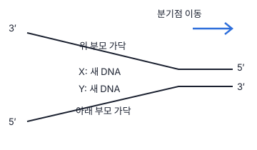
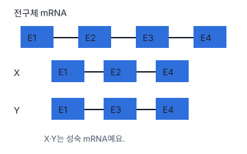
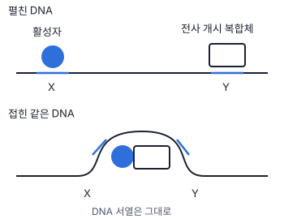

# 생명과학 5장 웹과제 예상 v1 문제해설

왼쪽 목차로 문항을 고르고, 오른쪽 문제를 보며 해설을 따라가요.

문제의 첫 줄부터 검산까지 설명해요.

**목차**

- [문항별 설명](#problems)
  - [P1. [기출 예상] 반보존적 복제의 의미](#p1)
  - [P2. [기출 예상] 세 염기 단위와 짧은 RNA](#p2)
  - [P3. [기출 변형] lac 오페론의 유도](#p3)
  - [P4. [기출 변형] 조절 서열과 조절 단백질](#p4)
  - [P5. [기출 변형] 이중가닥 DNA의 염기 비율](#p5)
  - [P6. [예상] 어느 새 가닥이 연속으로 자랄까?](#p6)
  - [P7. [예상] 주형에서 읽어 만든 짧은 사슬](#p7)
  - [P8. [예상] 같은 원본에서 달라진 RNA](#p8)
  - [P9. [예상] 한 염기 치환의 서로 다른 결과](#p9)
  - [P10. [예상] 전사는 되는데 효소가 작동하지 않을 때](#p10)
  - [P11. [예상] DNA를 읽기 쉽게 하는 변화](#p11)
  - [P12. [예상] 멀리 있는 조절 서열의 접촉](#p12)
  - [P13. [예상] 작은 RNA를 넣은 뒤의 변화](#p13)
  - [P14. [예상] 표지가 붙은 단백질이 쌓인 까닭](#p14)
  - [P15. [예상] 전구체 mRNA를 다듬기](#p15)

## 문항별 설명

### P1. [기출 예상] 반보존적 복제의 의미

기출 5강 1 예상 · [원 문제 보기](../%EB%B3%B5%EC%8A%B5%EB%AC%B8%EC%A0%9C_5%EC%9E%A5_%EC%9B%B9%EA%B3%BC%EC%A0%9C%EC%98%88%EC%83%81_v1.html#p1)

반보존적 복제가 지칭하는 것은?

- A. 각 분자의 양쪽 가닥은 오래된 절편과 새로운 절편이 섞인 상태로 갖는다
- B. DNA는 9개의 가능한 뉴클레오타이드 중 단지 4개만으로 만들어 진다
- C. DNA의 이중나선은 항상 부모 가닥과 새로이 합성된 가닥으로 구성된다
- D. DNA는 단일 나선이 아니라 서로 상보적인 이중나선으로 되어 있다
- E. DNA복제의 방법은 잘 알려져 있지 않다

원문·출처 정보 보기

기출 5강 합본 1번을 보기 순서만 바꿔 실은 예상 문제예요. 원문은 PDF 1쪽에 있어요.

#### 문제를 내 말로 읽어요

반보존적이라는 이름이 DNA를 복제한 뒤 각 딸 분자의 두 가닥이 어디서 왔는지를 묻고 있어요. DNA가 어떤 염기로 구성되는지보다 부모 가닥이 어떻게 나뉘는지에 집중해요.

#### 이 문제를 봤을 때 떠올릴 개념과 공식

“반보존적 복제”라는 단서에서 반보존적 복제(semiconservative replication)의 정의를 떠올려요. 여기서 부모 가닥은 이번 복제가 시작되기 전에 있던 가닥, 새 가닥은 이번 복제에서 합성한 가닥이에요.

부모 DNA의 두 가닥이 분리되어 각각 주형(template)이 되고, 각 주형 옆에 상보적인 새 가닥을 만들어요. 그러므로 복제 직후 두 딸 DNA는 각각 부모 가닥 한 개와 새 가닥 한 개를 가져요. 이 “가닥 단위의 보존”이 보기 판단 규칙이에요.

보존적 복제(conservative replication)는 부모 두 가닥을 함께 보존하고, 분산적 복제(dispersive replication)는 한 가닥 안에 옛 조각과 새 조각을 섞는 가상 모형이에요. 이 문제에서는 세 모형의 가닥 기원을 비교하면 돼요.

수업과의 연결: 1001 수업에서 각 딸 분자에 옛 가닥 하나가 남는다는 점을 보존적·분산적 모형과 비교했어요([정리노트 "원래 가닥 하나와 새 가닥 하나"](../../../%EB%B3%B5%EC%8A%B5%EB%85%B8%ED%8A%B8/1001/%EC%A0%95%EB%A6%AC%EB%85%B8%ED%8A%B8_1001_Chromosome_Changes_and_DNA_Replication.html#s4-semiconservative)).

#### 종이에 쓸 첫 줄

부모 가닥을 O1·O2, 이번 새 가닥을 N1·N2라고 적고, 딸 DNA = (O1+N1), (O2+N2)라고 써요.

#### 왜 이렇게 푸는지 함께 따라가요

A. 틀려요. 한 가닥 안에 옛 절편과 새 절편이 섞인다는 설명은 분산적 복제 모형이에요.

B. 틀려요. DNA의 네 종류 뉴클레오타이드를 언급한 문장으로, 각 딸 DNA에 부모 가닥 하나가 남는 복제 방식을 설명하지 않아요.

C. 맞아요. 매 복제에서 두 부모 가닥이 각각 주형이 되어, 각 딸 DNA에는 그 복제의 부모 가닥 하나와 새로 합성한 가닥 하나가 들어가요.

D. 틀려요. 상보적인 이중나선이라는 구조 설명만으로는 복제 후 부모 가닥이 어떻게 나뉘는지 나타내지 못해요.

E. 틀려요. DNA 복제는 부모 가닥을 주형으로 새 가닥을 만드는 반보존적 방식으로 설명할 수 있어요.

정답은 **C**예요.

#### 완성 답과 검산

부모 가닥 수로 검산해요. 복제 전 부모 가닥은 두 개이고, 복제 후 딸 분자 두 개에 하나씩 배분되면 두 개를 모두 보존해요. 여기에 새 가닥 두 개가 더해져 총 네 가닥이 돼요. 한 가닥 안에 옛·새 절편을 섞을 필요가 없으므로 A의 분산적 모형은 제외돼요. 강의노트 5장 PDF 1쪽의 “각각의 가닥이 주형” 설명과도 맞아 답은 C예요.

#### 여기서 자주 헷갈려요

C의 “항상”은 각 복제 회차 직후 딸 DNA의 구성에 대한 정의 문맥으로 읽어요. 모든 후손 DNA에 맨 처음 조상의 가닥이 계속 하나씩 남는다는 뜻은 아니에요. 첫 복제 때의 새 가닥도 다음 복제 때에는 부모 가닥이 돼요.

#### 설명을 닫고 다시 해 봐요

- 옛 가닥 두 개를 각각 다른 딸 분자에 배치해요.
- 반보존적과 분산적의 차이를 “한 가닥 내부”라는 말로 설명해요.

**페이지 요약**

#### 떠올릴 개념·공식

반보존적: 해당 복제의 부모 가닥 1개 + 새 가닥 1개.

#### 첫 줄

부모 가닥을 O1·O2, 이번 새 가닥을 N1·N2라고 적고, 딸 DNA = (O1+N1), (O2+N2)라고 써요.

#### 핵심 판단

정답 C. 반보존적: 해당 복제의 부모 가닥 1개 + 새 가닥 1개.

#### 검산

부모 가닥 2개를 딸 DNA 두 분자에 하나씩 배분하고 새 가닥 2개를 더해요.

---

### P2. [기출 예상] 세 염기 단위와 짧은 RNA

기출 5강 45 예상 · [원 문제 보기](../%EB%B3%B5%EC%8A%B5%EB%AC%B8%EC%A0%9C_5%EC%9E%A5_%EC%9B%B9%EA%B3%BC%EC%A0%9C%EC%98%88%EC%83%81_v1.html#p2)

다음 중 항상 세 개의 뉴클레오타이드로 구성되어 있지 않은 것은?

- A. miRNA
- B. 코돈
- C. 개시코돈
- D. 정지코돈
- E. 안티코돈

원문·출처 정보 보기

기출 5강 합본 45번을 보기 순서만 바꿔 실은 예상 문제예요. 원문은 PDF 5쪽에 있어요.

#### 문제를 내 말로 읽어요

**세 뉴클레오타이드로 구성되어 있지 않은 것**을 골라요. 각 명칭의 기능만 외우지 말고, 세 염기의 정보 구간인지 RNA 분자 전체인지 구별해요.

#### 이 문제를 봤을 때 떠올릴 개념과 공식

“항상 세 개의 뉴클레오타이드”라는 단서에서 코돈(codon)과 안티코돈(anticodon)의 정의를 떠올려요. 뉴클레오타이드(nucleotide)는 염기·당·인산으로 이루어진 핵산의 단위이고, 이 문제에서는 세 뉴클레오타이드가 세 염기의 구간을 뜻해요.

코돈은 mRNA에서 읽는 세 염기의 정보 단위예요. 개시코돈(start codon)과 정지코돈(stop codon)은 코돈의 종류라 둘 다 세 염기예요. 안티코돈은 tRNA 전체가 아니라 코돈과 상보적으로 결합하는 세 염기 부분이에요.

miRNA(microRNA)는 단백질 복합체와 함께 표적 mRNA에 작용하는 작은 RNA 분자예요. “작다”는 말은 “세 염기”라는 정의가 아니에요. 따라서 세 염기를 단위로 정한 명칭 네 개와 작은 RNA 전체를 가리키는 명칭 하나를 나누어요.

수업과의 연결: 1008 수업의 RNA 간섭에서는 짧은 RNA 분자가 표적 mRNA를 억제한다고 배웠어요. RNA 전체와 그 안의 세 염기 단위를 구별해요([정리노트 "짧은 RNA로 발현을 낮추기"](../../../%EB%B3%B5%EC%8A%B5%EB%85%B8%ED%8A%B8/1008/%EC%A0%95%EB%A6%AC%EB%85%B8%ED%8A%B8_1008_Gene_Regulation_and_DNA_Cloning.html#s2-rnai)).

#### 종이에 쓸 첫 줄

코돈·개시코돈·정지코돈·안티코돈 = 3개, miRNA = 세 염기 단위가 아닌 RNA 분자라고 써요.

#### 왜 이렇게 푸는지 함께 따라가요

A. 틀려요. miRNA가 세 뉴클레오타이드로 이루어졌다는 설명은 틀리고, miRNA는 표적 mRNA의 발현을 억제하는 짧은 RNA 분자예요.

B. 맞아요. 코돈은 mRNA에서 연속한 세 뉴클레오타이드로 이루어진 정보 단위예요.

C. 맞아요. 개시코돈도 세 염기 코돈이며 대표적인 AUG가 번역의 시작을 알려요.

D. 맞아요. 정지코돈도 세 염기로 이루어져 번역의 종료를 알려요.

E. 맞아요. 안티코돈은 tRNA 안에서 mRNA의 코돈과 상보적으로 결합하는 세 염기 부분이에요.

틀린 보기를 찾는 질문이므로 정답은 **A**예요.

#### 완성 답과 검산

구체적인 구간으로 길이를 확인해요. 개시코돈 AUG는 A·U·G 세 개, 정지코돈 UAA도 U·A·A 세 개이고, AUG에 맞춰 놓은 안티코돈 3′-UAC-5′도 세 개예요. 이들은 정의상 세 염기 단위지만 miRNA에는 그 정의가 없어요. 강의노트 5장 PDF 3·5쪽의 코돈·안티코돈 정의와 8쪽의 작은 RNA 설명을 함께 대조하면 예외 하나는 A예요.

#### 여기서 자주 헷갈려요

부정형이므로 “세 염기이다”라는 명제에 틀려요로 판정한 A를 정답으로 골라요. 안티코돈은 세 염기지만 tRNA 전체는 세 염기가 아니에요. miRNA의 기능과 mRNA의 번역 주형 역할도 바꾸지 않아요.

#### 설명을 닫고 다시 해 봐요

- 질문의 “있지 않은”에 표시해요.
- 코돈과 tRNA 전체의 길이를 같은 것으로 생각하지 않는 이유를 말해요.

**페이지 요약**

#### 떠올릴 개념·공식

코돈·안티코돈은 세 염기 구간, miRNA는 조절 RNA 분자.

#### 첫 줄

코돈·개시코돈·정지코돈·안티코돈 = 3개, miRNA = 세 염기 단위가 아닌 RNA 분자라고 써요.

#### 핵심 판단

정답 A. 코돈·안티코돈은 세 염기 구간, miRNA는 조절 RNA 분자.

#### 검산

AUG·UAA·안티코돈 UAC는 각각 세 염기예요. miRNA는 이 암호 단위와 달라요.

---

### P3. [기출 변형] lac 오페론의 유도

기출 5강 18 예상 · [원 문제 보기](../%EB%B3%B5%EC%8A%B5%EB%AC%B8%EC%A0%9C_5%EC%9E%A5_%EC%9B%B9%EA%B3%BC%EC%A0%9C%EC%98%88%EC%83%81_v1.html#p3)

다음은 원핵생물의 오페론에 대한 설명이다. 맞는 설명은?

- A. 알로락토스가 억제자에 결합하면 억제자의 작동자 결합이 강해진다.
- B. 작동자는 젖당을 분해하는 단백질 효소이다.
- C. 젖당이 없는 조건에서는 억제자가 작동자에서 떨어져 lac 유전자들의 전사가 유도된다.
- D. RNA 중합효소가 작동자에 붙어 있으면 lac 유전자들의 전사를 차단한다.
- E. 알로락토스가 억제자에 결합하면 억제자가 작동자에서 떨어져 lac 유전자들의 전사가 가능해진다.

원문·출처 정보 보기

기출 5강 합본 18번 발문에 정답을 바꾼 생성 변형이에요. 원문은 PDF 2~3쪽에 있어요. 다루는 혼동은 유도자와 억제자의 역할이에요.

#### 문제를 내 말로 읽어요

lac 오페론에서 유도자가 억제자의 결합 상태를 어떻게 바꾸는지 묻고 있어요. 원문 발문을 유지했지만 보기는 바뀐 기출 변형이므로 현재 A~E 문장을 직접 판단해요.

#### 이 문제를 봤을 때 떠올릴 개념과 공식

“알로락토스·억제자·작동자”라는 세 이름이 나오면 유도성 lac 오페론(lac operon)을 떠올려요. 오페론은 함께 전사되는 유전자들과 조절 DNA 서열의 단위이고, 작동자(operator)는 억제자가 붙는 DNA 자리예요.

억제자(repressor)는 작동자에 결합해 전사를 억제하는 단백질이고, 알로락토스(allolactose)는 억제자에 결합하는 유도자(inducer)예요. 유도자가 억제자의 구조를 바꾸면 작동자 결합이 어려워져 전사 억제가 풀려요.

RNA 중합효소(RNA polymerase)는 프로모터(promoter)에서 RNA 합성을 시작하는 효소예요. 억제자 이탈은 전사가 가능해진다는 뜻이지 모든 환경에서 최대 전사량을 보장하는 말은 아니에요. 여기서는 젖당에 따른 억제자 스위치의 방향을 판단해요.

수업과의 연결: 1006 수업에서는 젖당이 있을 때 억제자가 DNA에서 떨어져 효소 유전자들을 읽을 수 있다고 설명했어요([정리노트 "lac 오페론의 억제자 스위치"](../../../%EB%B3%B5%EC%8A%B5%EB%85%B8%ED%8A%B8/1006/%EC%A0%95%EB%A6%AC%EB%85%B8%ED%8A%B8_1006_Transcription_Translation_and_Lac_Operon.html#s5-operon)).

#### 종이에 쓸 첫 줄

알로락토스 → 억제자에 결합 → 작동자에서 억제자 이탈 → 전사 가능이라고 화살표를 써요.

#### 왜 이렇게 푸는지 함께 따라가요

A. 틀려요. 알로락토스는 억제자의 모양을 바꿔 작동자에 붙기 어렵게 해요.

B. 틀려요. 작동자는 억제자가 결합하는 DNA 서열이며 젖당 분해 효소가 아니에요.

C. 틀려요. 젖당이 없으면 유도자의 작용이 없어 억제자가 작동자에 결합하고 전사를 억제해요.

D. 틀려요. 작동자에서 전사를 차단하는 단백질은 억제자이고 RNA 중합효소는 RNA를 합성해요.

E. 맞아요. 유도자가 억제자의 작동자 결합을 풀면 전사를 가로막던 장벽이 제거돼요.

정답은 **E**예요.

#### 완성 답과 검산

거꾸로 원인을 확인해요. 전사를 가로막던 억제자가 작동자에서 떨어져야 RNA 합성이 가능해져요. E는 이 조건을 만족하고 A·C는 억제 상태의 방향을 뒤집으며, B·D는 DNA 자리와 단백질의 역할을 바꾸어요. 강의노트 5장 PDF 6~7쪽의 유도자에 의한 억제자 비활성화와도 일치하므로 답은 E예요.

#### 여기서 자주 헷갈려요

알로락토스가 작동자에 직접 붙는다고 쓰지 않아요. 작동자는 DNA, 억제자는 단백질, 유도자는 억제자에 붙는 물질이에요. 젖당이 없을 때의 정상 억제자 상황을 결합 불능 변이 상황과 섞지 않아요.

#### 설명을 닫고 다시 해 봐요

- 세 구성 요소의 종류와 결합 대상을 연결해요.
- 젖당 없음·있음에서 억제자의 위치를 각각 말해요.

**페이지 요약**

#### 떠올릴 개념·공식

유도자 결합 → 억제자 비활성화 → 전사 억제 해제.

#### 첫 줄

알로락토스 → 억제자에 결합 → 작동자에서 억제자 이탈 → 전사 가능이라고 화살표를 써요.

#### 핵심 판단

정답 E. 유도자 결합 → 억제자 비활성화 → 전사 억제 해제.

#### 검산

전사가 가능하려면 억제자가 작동자에서 떨어져야 해요. E가 이 조건을 만족해요.

---

### P4. [기출 변형] 조절 서열과 조절 단백질

기출 5강 33 예상 · [원 문제 보기](../%EB%B3%B5%EC%8A%B5%EB%AC%B8%EC%A0%9C_5%EC%9E%A5_%EC%9B%B9%EA%B3%BC%EC%A0%9C%EC%98%88%EC%83%81_v1.html#p4)

진핵생물에서의 유전자 발현 조절에 대한 설명 중 틀린 것은?

- A. 프로모터는 전사의 시작에 관여하는 DNA 서열이다.
- B. 전사 인자는 전사 개시를 돕는 단백질이다.
- C. 활성자는 증폭자에 결합하여 전사 기구의 작용을 도울 수 있다.
- D. 증폭자는 RNA 중합효소를 활성화하는 단백질이다.
- E. DNA가 접히면 멀리 있는 증폭자에 결합한 활성자가 전사 기구와 가까워질 수 있다.

원문·출처 정보 보기

기출 5강 합본 33번 발문에 정답을 바꾼 생성 변형이에요. 원문은 PDF 4쪽에 있어요. 다루는 혼동은 조절 DNA 서열과 거기에 결합하는 단백질의 구별이에요.

#### 문제를 내 말로 읽어요

**틀린 설명**을 골라요. 전사 조절에 쓰이는 “자리”와 그 자리에 붙어 일하는 “단백질”을 나누는 문제예요. 원문 발문에 새 보기를 붙인 기출 변형이에요.

#### 이 문제를 봤을 때 떠올릴 개념과 공식

“프로모터·전사 인자·활성자·증폭자”라는 명칭에서 전사 개시(transcription initiation)를 떠올려요. 전사는 DNA 정보로 RNA를 만드는 과정이고, 개시는 전사 기구가 DNA에 자리잡고 합성을 시작하는 단계예요.

프로모터(promoter)와 증폭자(enhancer)는 DNA 염기서열이에요. 전사 인자(transcription factor)와 활성자(activator)는 DNA 또는 전사 기구와 상호작용하는 단백질이에요. 증폭자는 단백질이 결합해 전사를 조절하는 자리이지 효소가 아니에요.

DNA가 입체적으로 굽으면 서열상 멀리 떨어진 증폭자에 붙은 활성자가 개시 복합체와 가까워질 수 있어요. 이 문항에서는 물질 종류를 먼저 분류하면 D의 혼동을 찾을 수 있어요.

수업과의 연결: 1008 수업에서는 프로모터·증폭자와 전사 인자·활성자를 각각 DNA 서열과 단백질로 구별했어요([정리노트 "DNA 서열과 조절 단백질"](../../../%EB%B3%B5%EC%8A%B5%EB%85%B8%ED%8A%B8/1008/%EC%A0%95%EB%A6%AC%EB%85%B8%ED%8A%B8_1008_Gene_Regulation_and_DNA_Cloning.html#s1-initiation)).

#### 종이에 쓸 첫 줄

두 칸을 만들고 DNA 서열: 프로모터·증폭자 / 단백질: 전사 인자·활성자라고 적어요.

#### 왜 이렇게 푸는지 함께 따라가요

A. 맞아요. 프로모터는 전사 기구가 전사를 시작하도록 돕는 DNA 서열이에요.

B. 맞아요. 전사 인자는 DNA나 전사 기구와 상호작용하며 전사 개시를 돕는 단백질이에요.

C. 맞아요. 활성자는 조절 서열인 증폭자에 결합해 전사를 촉진할 수 있어요.

D. 틀려요. 증폭자는 DNA 서열이고 그 증폭자에 결합하는 활성자가 단백질이에요.

E. 맞아요. DNA의 접힘으로 서열상 멀리 있는 증폭자의 활성자가 전사 기구 가까이에서 작용할 수 있어요.

틀린 보기를 찾는 질문이므로 정답은 **D**예요.

#### 완성 답과 검산

“결합 자리”와 “결합하는 물질”을 바꾸어 읽어 검산해요. 활성자가 증폭자에 결합한다면 증폭자는 그 단백질이 인식하는 DNA 자리여야 해요. D처럼 둘 다 단백질이라고 분류하면 이 관계를 설명하지 못해요. 강의노트 5장 PDF 7~8쪽 및 1008 정리노트 s1-initiation과 대조하면 틀린 보기 하나는 D예요.

#### 여기서 자주 헷갈려요

이름에 “자”가 붙었다고 전부 단백질은 아니에요. DNA 접힘은 공간적 거리를 줄이는 것이며, 증폭자의 DNA를 잘라 프로모터 옆에 옮긴다는 뜻은 아니에요.

#### 설명을 닫고 다시 해 봐요

- 네 명칭을 DNA 서열과 단백질로 나눠요.
- 멀리 있는 증폭자의 단백질이 전사 기구와 만나는 방법을 설명해요.

**페이지 요약**

#### 떠올릴 개념·공식

DNA: 프로모터·증폭자. 단백질: 전사 인자·활성자.

#### 첫 줄

두 칸을 만들고 DNA 서열: 프로모터·증폭자 / 단백질: 전사 인자·활성자라고 적어요.

#### 핵심 판단

정답 D. DNA: 프로모터·증폭자. 단백질: 전사 인자·활성자.

#### 검산

프로모터·증폭자는 DNA 서열, 전사 인자·활성자는 단백질로 다시 분류해요.

---

### P5. [기출 변형] 이중가닥 DNA의 염기 비율

기출 5강 41 예상 · [원 문제 보기](../%EB%B3%B5%EC%8A%B5%EB%AC%B8%EC%A0%9C_5%EC%9E%A5_%EC%9B%B9%EA%B3%BC%EC%A0%9C%EC%98%88%EC%83%81_v1.html#p5)

DNA 이중가닥 한 분자가 구아닌을 18% 갖고 있으면 다음 중 옳지 않은 것은?

- A. 우라실은 갖지 않는다.
- B. 아데닌을 36% 갖는다.
- C. 타이민을 32% 갖는다.
- D. 사이토신을 18% 갖는다.
- E. 타이민을 32%, 사이토신을 18% 갖는다

원문·출처 정보 보기

기출 5강 합본 41번의 숫자를 바꾸고 보기를 다시 계산한 예상 문제예요. 원문은 PDF 5쪽에 있어요. 구아닌 22%를 18%로 바꿨어요.

#### 문제를 내 말로 읽어요

구아닌이 이중가닥 DNA 전체 염기의 18%라는 조건이에요. **계산 결과와 맞지 않는 설명**을 골라요. 원기출의 22%를 18%로 바꾼 문제이므로 원문 숫자로 계산하지 않아요.

#### 이 문제를 봤을 때 떠올릴 개념과 공식

“DNA 이중가닥 한 분자”라는 단서에서 샤가프의 염기 조성 법칙(Chargaff’s rules)을 떠올려요. A·T·G·C는 각각 아데닌·타이민·구아닌·사이토신의 비율이에요.

상보적 염기쌍(complementary base pair)은 A-T와 G-C이므로 이중가닥 전체에서 $A=T$, $G=C$예요. 네 염기 비율의 합은 $A+T+G+C=100\%$이며 따라서 $A=T=(100\%-G-C)/2$예요.

이 규칙은 양쪽 가닥을 합친 조성에 적용해요. 한쪽 가닥 안에서 A와 T가 같아야 한다는 법칙은 아니에요. 이 문제는 전체 이중가닥 조건을 명시하므로 곧바로 이 등식을 써요.

수업과의 연결: 1001 수업에서는 전체 이중가닥의 A=T, G=C를 이용해 염기 조성을 계산했어요. 이 등식은 한쪽 가닥의 조성에 그대로 적용하는 규칙이 아니에요([정리노트 "뉴클레오타이드와 상보적인 두 가닥"](../../../%EB%B3%B5%EC%8A%B5%EB%85%B8%ED%8A%B8/1001/%EC%A0%95%EB%A6%AC%EB%85%B8%ED%8A%B8_1001_Chromosome_Changes_and_DNA_Replication.html#s3-dna-structure)).

#### 종이에 쓸 첫 줄

$G=18\% \Rightarrow C=18\%$라고 먼저 쓰고, 남은 $A+T=64\%$를 반으로 나눠요.

#### 왜 이렇게 푸는지 함께 따라가요

$A=T=(100-18-18)/2=32\%$예요. 따라서 전체 조성은 A 32%, T 32%, G 18%, C 18%예요.

A. 맞아요. 수업에서 다룬 DNA의 염기는 A·T·G·C이며 RNA의 염기인 U는 포함하지 않아요.

B. 틀려요. 36%는 G와 C의 합이고 아데닌 A의 비율은 32%예요.

C. 맞아요. 남은 64%를 A와 T가 똑같이 차지하므로 T는 32%예요.

D. 맞아요. 전체 이중가닥에서 G와 C의 수가 같으므로 C는 18%예요.

E. 맞아요. 계산 결과 타이민 T는 32%, 사이토신 C는 18%예요.

틀린 보기를 찾는 질문이므로 정답은 **B**예요.

#### 완성 답과 검산

100개의 염기를 가진 이중가닥 전체를 가정해 다시 세어요. G 18개에는 C 18개가 짝으로 필요하고, 남은 64개는 A-T 짝 32쌍을 이루므로 A 32개·T 32개예요. 합도 $32+32+18+18=100$이에요. B의 A 36%를 넣으면 T도 36%가 되어 총 108%라 모순이에요. 답은 B예요.

#### 여기서 자주 헷갈려요

G와 C를 합한 36%를 A의 비율로 옮기지 않아요. 또 남은 64%는 A 하나의 비율이 아니라 A와 T의 합이에요. 보기의 U는 RNA의 우라실이고 수업에서 다룬 DNA 네 염기에 속하지 않아요.

#### 설명을 닫고 다시 해 봐요

- 네 염기의 합을 100%로 확인해요.
- 한 가닥 조성에 A=T를 바로 쓰면 안 되는 이유를 말해요.

**페이지 요약**

#### 떠올릴 개념·공식

$G=C$, $A=T$, $A+T+G+C=100\%$. 결과: 32·32·18·18%.

#### 첫 줄

$G=18\% \Rightarrow C=18\%$라고 먼저 쓰고, 남은 $A+T=64\%$를 반으로 나눠요.

#### 핵심 판단

정답 B. $G=C$, $A=T$, $A+T+G+C=100\%$. 결과: 32·32·18·18%.

#### 검산

A32 + T32 + G18 + C18 = 100%. B의 A36%라면 T도 36%여서 합이 108%가 돼요.

---

### P6. [예상] 어느 새 가닥이 연속으로 자랄까?

예상 5장 6 · [원 문제 보기](../%EB%B3%B5%EC%8A%B5%EB%AC%B8%EC%A0%9C_5%EC%9E%A5_%EC%9B%B9%EA%B3%BC%EC%A0%9C%EC%98%88%EC%83%81_v1.html#p6)

그림의 복제분기점은 오른쪽으로 이동해요. X와 Y는 각각 위쪽과 아래쪽 부모 가닥을 주형으로 만드는 새 DNA예요. 그림의 말단 방향을 근거로 X와 Y를 바르게 설명한 것은 무엇인가요?

- A. X는 조각으로 합성되고 Y는 연속 합성되며, 둘 다 새 DNA는 5′→3′으로 자라요.
- B. X는 연속 합성되고 Y는 조각으로 합성되며, 둘 다 새 DNA는 5′→3′으로 자라요.
- C. X는 연속 합성되고 Y는 조각으로 합성되며, Y의 새 DNA만 3′→5′으로 자라요.
- D. X와 Y 모두 분기점의 이동 방향으로 연속 합성돼요.
- E. X와 Y 모두 분기점의 이동 반대 방향으로 조각을 만들어요.

원문·출처 정보 보기

1001 정리노트의 선도·지연가닥 원리로 만든 새 예상 문제예요.

#### 문제를 내 말로 읽어요

복제분기점은 오른쪽으로 이동하고, X는 위 주형에서, Y는 아래 주형에서 만드는 새 DNA예요. 그림의 부모 가닥 끝에 적힌 3′·5′를 먼저 읽고 새 가닥의 연속 여부를 판단해요.

#### 이 문제를 봤을 때 떠올릴 개념과 공식

“복제분기점의 이동 방향”과 “말단 방향”이 함께 주어지면 역평행(antiparallel)과 DNA 중합효소(DNA polymerase)의 합성 방향을 연결해요. 두 DNA 가닥은 같은 공간 방향에서 서로 반대 방향으로 놓여요.

DNA 중합효소는 새 가닥의 3′-OH 말단에 뉴클레오타이드를 더하므로 새 DNA를 5′→3′으로만 늘려요. 이에 대응하여 주형은 3′→5′ 방향으로 읽어요. 5′·3′는 당의 탄소 번호로 구분한 가닥의 방향 표시예요.

선도가닥(leading strand)은 분기점 진행 방향으로 연속 합성되고, 지연가닥(lagging strand)은 반대 방향으로 오카자키 조각(Okazaki fragments)을 만들어요. 위아래 위치가 아니라 주형을 읽을 수 있는 방향과 분기점 이동을 비교해야 해요.

수업과의 연결: 선도·지연은 위아래 위치가 아니라 분기점 이동과 합성 방향의 관계로 정해요([정리노트 "선도가닥과 지연가닥은 왜 다를까"](../../../%EB%B3%B5%EC%8A%B5%EB%85%B8%ED%8A%B8/1001/%EC%A0%95%EB%A6%AC%EB%85%B8%ED%8A%B8_1001_Chromosome_Changes_and_DNA_Replication.html#s5-strands)).

#### 종이에 쓸 첫 줄

분기점 → 오른쪽 / 위 주형 3′→5′: 오른쪽으로 읽음 / 아래 주형 3′→5′: 왼쪽으로 읽음이라고 적어요.

#### 왜 이렇게 푸는지 함께 따라가요

위 주형을 오른쪽으로 읽으며 X의 3′ 끝을 오른쪽으로 늘리면 분기점을 따라갈 수 있어요. 따라서 X는 연속 합성이에요. 아래 주형은 왼쪽으로 읽어야 하므로 Y의 각 조각은 왼쪽으로 자라고, 오른쪽에 새 주형이 열릴 때마다 다른 조각을 시작해요.

A. 틀려요. 그림의 말단 방향과 오른쪽으로 이동하는 분기점을 대조하면 연속 합성은 X 쪽이에요.

B. 맞아요. 위 주형을 오른쪽으로 읽을 수 있어 X는 선도가닥이고, Y는 반대 방향으로 자라는 조각을 만들며 두 새 가닥의 합성 방향은 모두 5′→3′이에요.

C. 틀려요. 지연가닥도 각 조각의 새 DNA를 5′→3′으로 합성해요.

D. 틀려요. 아래 주형은 오른쪽으로 5′→3′이므로 새 DNA를 그 방향으로 연속 합성할 수 없어요.

E. 틀려요. X는 분기점 이동과 같은 오른쪽 방향으로 연속 합성돼요.

정답은 **B**예요.

#### 완성 답과 검산

새 가닥의 끝을 직접 붙여 방향을 검산해요. 위 부모가 왼쪽 3′·오른쪽 5′이므로 X는 왼쪽 5′·오른쪽 3′이고 성장 끝은 오른쪽이에요. 아래 부모가 왼쪽 5′·오른쪽 3′이므로 Y 조각은 왼쪽 3′·오른쪽 5′이고 성장 끝은 왼쪽이에요. 두 경우 모두 늘어나는 끝은 3′이며 X만 분기점을 따라가요. 강의노트 5장 PDF 2쪽 원리와 일치하여 답은 B예요.

#### 여기서 자주 헷갈려요

지연가닥을 3′→5′으로 합성한다고 쓰지 않아요. 왼쪽으로 자란다는 공간 방향과 5′→3′이라는 분자 방향은 다른 표현이에요. 그림이 뒤집히면 위아래 선도·지연 배치도 달라질 수 있어요.

#### 설명을 닫고 다시 해 봐요

- X와 Y의 새 DNA 양끝을 주형과 반대로 표시해요.
- 각 새 가닥의 3′ 성장 끝과 분기점 화살표를 비교해요.

**페이지 요약**

#### 떠올릴 개념·공식

새 DNA는 항상 5′→3′. 분기점과 같은 방향이면 선도, 반대이면 지연.

#### 첫 줄

분기점 → 오른쪽 / 위 주형 3′→5′: 오른쪽으로 읽음 / 아래 주형 3′→5′: 왼쪽으로 읽음이라고 적어요.

#### 핵심 판단

정답 B. 새 DNA는 항상 5′→3′. 분기점과 같은 방향이면 선도, 반대이면 지연.

#### 검산

X는 오른쪽으로 연속, Y의 조각은 반대쪽으로 합성돼요. 각 새 가닥은 모두 5′→3′이에요.

---

### P7. [예상] 주형에서 읽어 만든 짧은 사슬

예상 5장 7 · [원 문제 보기](../%EB%B3%B5%EC%8A%B5%EB%AC%B8%EC%A0%9C_5%EC%9E%A5_%EC%9B%B9%EA%B3%BC%EC%A0%9C%EC%98%88%EC%83%81_v1.html#p7)

어떤 유전자의 전사되는 DNA 주형 구간이 **3′-CCTACTGCGGGATTCCG-5′**예요. RNA 가공은 없다고 가정해요. 생성된 mRNA의 첫 AUG에서 번역을 시작하여 처음 만나는 종결 코돈에서 끝내요. AUG는 아미노산 하나를 지정하고, UAA·UAG·UGA는 아미노산을 지정하지 않는 종결 코돈이에요. 다른 코돈은 모두 아미노산 하나를 지정해요. 생성 mRNA를 5′→3′으로 쓴 서열과 만들어진 폴리펩티드의 아미노산 잔기 수가 바르게 짝지어진 것은 무엇인가요?

- A. 5′-CCUACUGCGGGAUUCCG-3′ / 3개
- B. 5′-GGAUGACGCCCUAAGGC-3′ / 2개
- C. 5′-GGAUGACGCCCUAAGGC-3′ / 4개
- D. 5′-GGAUGACGCCCUAAGGC-3′ / 5개
- E. 5′-GGAUGACGCCCUAAGGC-3′ / 3개

원문·출처 정보 보기

1006 정리노트의 주형·mRNA 방향과 번역 원리로 만든 새 서열 문제예요. 필요한 코돈의 의미는 발문에 제시했어요.

#### 문제를 내 말로 읽어요

주어진 DNA는 3′→5′의 **주형**이에요. 먼저 상보적인 mRNA를 5′→3′으로 만들고, 그 mRNA의 첫 AUG부터 세 염기씩 읽어 처음 종결 신호 앞까지 잔기를 세어요. 가공과 다른 시작 규칙은 발문에서 제외했어요.

#### 이 문제를 봤을 때 떠올릴 개념과 공식

“DNA 주형 3′→5′”는 전사(transcription)를, “첫 AUG와 종결 코돈”은 번역(translation)을 떠올리게 해요. 전사는 주형에 상보적인 RNA를 만들고 번역은 mRNA 정보를 아미노산 사슬로 바꾸는 과정이에요.

DNA→RNA 상보 관계는 C→G, G→C, T→A, A→U예요. 주형과 RNA는 역평행이라 주형이 이미 왼쪽 3′·오른쪽 5′이면 mRNA는 같은 좌우 배치에서 왼쪽 5′·오른쪽 3′으로 적어요. T만 U로 바꾸는 방법은 5′→3′ 암호화가닥을 줄 때의 방법이에요.

코돈(codon)은 mRNA의 세 염기 정보 단위이고 읽기틀(reading frame)은 어디서부터 세 염기씩 묶는지 정해요. 발문에 따라 첫 AUG는 잔기 하나를 지정하며 UAA·UAG·UGA는 종결 코돈(stop codon)이라 잔기 수에 넣지 않아요. 종결 뒤 코돈도 이 사슬에 포함되지 않아요.

수업과의 연결: 주형과 mRNA는 상보적이고 역평행이며 코돈은 mRNA의 5′→3′ 방향으로 읽어요([정리노트 "가닥 방향과 코돈·안티코돈"](../../../%EB%B3%B5%EC%8A%B5%EB%85%B8%ED%8A%B8/1006/%EC%A0%95%EB%A6%AC%EB%85%B8%ED%8A%B8_1006_Transcription_Translation_and_Lac_Operon.html#s3-trna)).

#### 종이에 쓸 첫 줄

주형 3′-CCTACTGCGGGATTCCG-5′ 아래에 mRNA 5′-GGAUGACGCCCUAAGGC-3′를 맞춰 써요.

#### 왜 이렇게 푸는지 함께 따라가요

상보 염기를 차례로 쓰면 CC→GG, TAC→AUG, TGC→ACG, GGG→CCC, ATT→UAA, CCG→GGC예요. 따라서 mRNA는 5′-GG｜AUG｜ACG｜CCC｜UAA｜GGC-3′로 묶여요.

앞의 GG는 첫 AUG 이전이라 번역하지 않아요. AUG는 첫 잔기, ACG는 둘째 잔기, CCC는 셋째 잔기를 지정하고 UAA에서 끝나요. 최종 사슬의 아미노산 잔기는 3개예요.

A. 틀려요. 주형의 T를 U로만 바꾸면 상보적인 mRNA가 되지 않아요.

B. 틀려요. 개시 AUG가 지정한 첫 아미노산도 사슬의 잔기 수에 포함해요.

C. 틀려요. UAA는 종결 신호여서 네 번째 아미노산을 추가하지 않아요.

D. 틀려요. UAA 뒤의 GGC는 이 사슬의 번역에 포함되지 않으며 UAA 자체도 잔기로 세지 않아요.

E. 맞아요. AUG·ACG·CCC가 각각 아미노산 하나를 지정하므로 사슬에는 잔기 3개가 들어가요.

정답은 **E**예요.

#### 완성 답과 검산

이번에는 계산한 RNA에서 역으로 DNA 주형을 복원해요. GG/AUG/ACG/CCC/UAA/GGC에 상보적인 DNA는 CC/TAC/TGC/GGG/ATT/CCG이고 이를 붙이면 원래 CCTACTGCGGGATTCCG와 정확히 같아요. 위치로도 다시 세면 AUG는 RNA 3~5번째, ACG는 6~8번째, CCC는 9~11번째, UAA는 12~14번째예요. 3번째부터 11번째까지 아미노산 지정 염기 9개이므로 $9/3=3$잔기예요. 서열과 잔기 수를 모두 만족하는 답은 E예요.

#### 여기서 자주 헷갈려요

RNA 맨 왼쪽에서 무조건 세 염기씩 묶지 않아요. 읽기틀은 첫 AUG에서 시작해요. 개시 AUG도 잔기로 세지만 종결 UAA는 세지 않고, 종결 뒤 GGC도 읽지 않아요. 주형을 암호화가닥으로 착각하면 보기 A처럼 잘못된 서열이 나와요.

#### 설명을 닫고 다시 해 봐요

- 주형 한 글자씩 RNA로 바꾸고 양끝 방향을 표시해요.
- 첫 AUG를 찾은 뒤 종결 앞의 코돈만 세어요.
- RNA에서 역으로 원래 DNA 주형을 복원해요.

**페이지 요약**

#### 떠올릴 개념·공식

주형→상보 mRNA. 첫 AUG에서 읽기틀 설정. 종결 제외: AUG·ACG·CCC = 3잔기.

#### 첫 줄

주형 3′-CCTACTGCGGGATTCCG-5′ 아래에 mRNA 5′-GGAUGACGCCCUAAGGC-3′를 맞춰 써요.

#### 핵심 판단

정답 E. 주형→상보 mRNA. 첫 AUG에서 읽기틀 설정. 종결 제외: AUG·ACG·CCC = 3잔기.

#### 검산

RNA에서 원래 주형을 역복원해요. AUG~CCC의 9염기 ÷ 3 = 3잔기예요.

---

### P8. [예상] 같은 원본에서 달라진 RNA

예상 5장 8 · [원 문제 보기](../%EB%B3%B5%EC%8A%B5%EB%AC%B8%EC%A0%9C_5%EC%9E%A5_%EC%9B%B9%EA%B3%BC%EC%A0%9C%EC%98%88%EC%83%81_v1.html#p8)

한 진핵세포의 같은 유전자에서 만든 전구체 mRNA가 그림처럼 두 종류의 성숙 mRNA로 가공되었어요. 과정 중 DNA 염기서열은 변하지 않았어요. E1~E4는 엑손이고, 전구체에서 엑손 사이의 선은 인트론이에요. X와 Y에서는 인트론이 제거된 뒤 엑손이 이어졌어요. 그림의 X와 Y를 비교한 설명으로 옳은 것은 무엇인가요?

- A. X는 E3를, Y는 E2를 건너뛰어 원래 순서를 유지한 서로 다른 엑손 조합이에요.
- B. Y에는 전구체에서 E3보다 앞에 있던 E2가 남아 있어요.
- C. X의 E4는 전구체에 없던 새 엑손이에요.
- D. X와 Y가 다르므로 DNA의 E2와 E3 자리도 서로 바뀌었어요.
- E. X와 Y는 엑손 조합이 같고 인트론의 길이만 달라요.

원문·출처 정보 보기

1008 정리노트의 선택적 이어맞추기로 만든 새 그림 문제예요.

#### 문제를 내 말로 읽어요

DNA 원본은 같고 전구체 mRNA도 같은 엑손 순서를 가져요. 완성된 X·Y에서 어떤 엑손이 남았고 어떤 엑손이 빠졌는지를 그림에서 직접 비교해요.

#### 이 문제를 봤을 때 떠올릴 개념과 공식

“같은 전구체에서 두 성숙 mRNA”와 “DNA는 불변”이라는 단서에서 선택적 이어맞추기(alternative splicing)를 떠올려요. 전구체 mRNA(precursor mRNA)는 가공 전 RNA이고, 성숙 mRNA(mature mRNA)는 가공을 마쳐 번역에 사용할 수 있는 RNA예요.

엑손(exon)은 가공 후 RNA에 남는 구간이고 인트론(intron)은 이 그림의 가공에서 제거되는 사이 구간이에요. 이어맞추기(splicing)는 인트론을 제거하고 엑손을 이어요. 선택적 이어맞추기는 사용할 엑손의 조합을 달리해 여러 성숙 mRNA를 만들 수 있어요.

그림에서는 E1→E2→E3→E4의 원래 순서를 유지하며 일부 엑손을 건너뛰어요. 따라서 DNA에서 엑손의 자리를 바꾸거나 새 엑손을 만든다고 해석할 필요 없이, 각 성숙 RNA의 엑손 목록을 적으면 돼요.

수업과의 연결: 선택적 이어맞추기는 한 유전자에서 엑손 조합이 다른 성숙 mRNA를 만들 수 있어요([정리노트 "엑손 조합과 mRNA의 수명"](../../../%EB%B3%B5%EC%8A%B5%EB%85%B8%ED%8A%B8/1008/%EC%A0%95%EB%A6%AC%EB%85%B8%ED%8A%B8_1008_Gene_Regulation_and_DNA_Cloning.html#s2-splicing)).

#### 종이에 쓸 첫 줄

전구체: E1·E2·E3·E4 / X: E1·E2·E4 / Y: E1·E3·E4라고 세 줄을 써요.

#### 왜 이렇게 푸는지 함께 따라가요

전구체 목록과 대조하면 X는 E3가 빠졌고 Y는 E2가 빠졌어요. X의 1→2→4와 Y의 1→3→4는 모두 원래의 앞뒤 순서대로예요. 공통으로 남은 엑손은 E1·E4이고, 달리 선택한 엑손은 E2·E3예요.

A. 맞아요. X는 E1·E2·E4, Y는 E1·E3·E4이며 엑손 순서를 뒤집지 않고 선택을 달리했어요.

B. 틀려요. Y는 E1·E3·E4로 이루어져 E2를 포함하지 않아요.

C. 틀려요. E4는 전구체에도 있고 X와 Y에 공통으로 남아요.

D. 틀려요. 발문에서 DNA 서열은 그대로이고 차이는 전구체 RNA의 가공에서 생겼어요.

E. 틀려요. 성숙 mRNA에 남은 엑손 자체가 X의 E2와 Y의 E3로 달라요.

정답은 **A**예요.

#### 완성 답과 검산

포함 여부를 별도로 확인해요. E1은 X·Y 모두 있음, E2는 X만 있음, E3는 Y만 있음, E4는 X·Y 모두 있음이에요. 두 성숙 RNA를 함께 보면 전구체에 없던 엑손은 하나도 없고, E2와 E3의 순서를 뒤집은 배열도 없어요. 강의노트 5장 PDF 8쪽의 선택적 이어맞추기 원리에 맞는 설명은 A예요.

#### 여기서 자주 헷갈려요

성숙 RNA 사이의 차이를 DNA 돌연변이라고 결론 내리지 않아요. 발문이 DNA 불변을 명시했고 그림은 RNA 가공 단계예요. 두 RNA는 인트론의 길이가 아니라 남은 엑손의 종류가 달라요.

#### 설명을 닫고 다시 해 봐요

- X·Y의 엑손을 그림에서 읽어 적어요.
- 각 목록을 전구체와 비교해 빠진 엑손을 찾고 순서가 유지되는지 확인해요.

**페이지 요약**

#### 떠올릴 개념·공식

선택적 이어맞추기: DNA 불변, 엑손 조합 변경. X=124, Y=134.

#### 첫 줄

전구체: E1·E2·E3·E4 / X: E1·E2·E4 / Y: E1·E3·E4라고 세 줄을 써요.

#### 핵심 판단

정답 A. 선택적 이어맞추기: DNA 불변, 엑손 조합 변경. X=124, Y=134.

#### 검산

X는 E1·E2·E4, Y는 E1·E3·E4예요. 원래 순서는 같고 선택만 달라요.

---

### P9. [예상] 한 염기 치환의 서로 다른 결과

예상 5장 9 · [원 문제 보기](../%EB%B3%B5%EC%8A%B5%EB%AC%B8%EC%A0%9C_5%EC%9E%A5_%EC%9B%B9%EA%B3%BC%EC%A0%9C%EC%98%88%EC%83%81_v1.html#p9)

각 경우에는 단백질 암호화 부위에서 염기쌍 하나가 치환되었어요. 표는 그 결과 바뀐 mRNA 코돈과 코돈의 의미를 보여 줘요. X·Y·Z를 차례대로 바르게 분류한 것은 무엇인가요?

| 경우 | 치환 전 | 치환 후 |
|---|---|---|
| X | GGU: 글리신 | GGC: 글리신 |
| Y | UCA: 세린 | CCA: 프롤린 |
| Z | UGC: 시스테인 | UGA: 종결 신호 |

- A. 침묵 / 정지(무의미) / 과오
- B. 과오 / 침묵 / 정지(무의미)
- C. 정지(무의미) / 과오 / 침묵
- D. 침묵 / 과오 / 정지(무의미)
- E. 침묵 / 과오 / 번역틀이동

원문·출처 정보 보기

1006 정리노트의 치환 코돈 사례를 비교하도록 만든 새 표 문제예요.

#### 문제를 내 말로 읽어요

모든 경우가 한 염기쌍의 치환이에요. 염기가 바뀌었다는 사실은 공통이므로, 코돈이 지정하는 아미노산이 같아졌는지·달라졌는지·종결 신호가 됐는지를 표에서 비교해요.

#### 이 문제를 봤을 때 떠올릴 개념과 공식

“염기쌍 하나가 치환”과 “코돈의 의미”라는 단서에서 치환(substitution)의 결과 분류를 떠올려요. 치환은 한 염기쌍을 다른 염기쌍으로 바꾸며 삽입·삭제와 구별해요.

침묵 돌연변이(silent mutation)는 코돈은 바뀌어도 지정하는 아미노산이 같은 경우예요. 과오 돌연변이(missense mutation)는 다른 아미노산을 지정하는 경우이고, 정지 또는 무의미 돌연변이(nonsense mutation)는 아미노산 코돈이 종결 코돈으로 바뀐 경우예요.

번역틀이동(frameshift)은 삽입·삭제로 읽기틀이 이동하는 변화예요. 이번 표의 한 글자 치환은 염기 수를 바꾸지 않으므로 그 이름을 사용하지 않아요. 단백질 기능 변화의 크기가 아니라 제시한 코돈의 의미를 판단 기준으로 삼아요.

수업과의 연결: 치환의 분류는 염기 변화의 유무보다 바뀐 코돈이 지정하는 결과를 비교해요([정리노트 "한 글자를 바꿨을 때"](../../../%EB%B3%B5%EC%8A%B5%EB%85%B8%ED%8A%B8/1006/%EC%A0%95%EB%A6%AC%EB%85%B8%ED%8A%B8_1006_Transcription_Translation_and_Lac_Operon.html#s4-substitution)).

#### 종이에 쓸 첫 줄

X: 글리신→글리신 / Y: 세린→프롤린 / Z: 시스테인→종결이라고 결과만 먼저 적어요.

#### 왜 이렇게 푸는지 함께 따라가요

X는 아미노산이 같으므로 침묵, Y는 아미노산 종류가 달라 과오, Z는 종결 신호가 되어 정지 변이예요. 따라서 순서는 침묵 / 과오 / 정지(무의미)예요.

A. 틀려요. Y는 다른 아미노산이 된 과오이고 Z는 종결 신호가 된 정지 변이예요.

B. 틀려요. X는 아미노산이 유지되는 침묵이며 Y는 세린이 프롤린으로 바뀌는 과오예요.

C. 틀려요. X는 글리신이 유지되고 Z는 종결 신호로 바뀌므로 각각 침묵과 정지예요.

D. 맞아요. X는 아미노산 유지, Y는 다른 아미노산 지정, Z는 종결 신호로의 변화에 해당해요.

E. 틀려요. Z는 한 염기 치환으로 종결 코돈이 된 것이며 삽입·삭제로 번역틀이 바뀐 경우가 아니에요.

정답은 **D**예요.

#### 완성 답과 검산

변한 위치와 염기 수를 별도로 확인해요. X는 GGU→GGC의 셋째 글자, Y는 UCA→CCA의 첫째 글자, Z는 UGC→UGA의 셋째 글자가 하나씩 달라요. 셋 모두 길이 3을 유지하여 틀이동이 없고, Z는 UGA라는 종결 신호를 새로 얻었어요. 강의노트 5장 PDF 6쪽의 세 치환 분류와 대조하면 X·Y·Z에 동시에 맞는 조합은 D뿐이에요.

#### 여기서 자주 헷갈려요

침묵은 DNA에 변화가 없다는 뜻이 아니라 아미노산이 유지된다는 뜻이에요. 정지 코돈은 “정지라는 아미노산”을 추가하지 않아요. Z에서 단백질이 짧아질 수 있다는 결과만 보고 틀이동으로 분류하지 않아요.

#### 설명을 닫고 다시 해 봐요

- 코돈 문자보다 먼저 코돈의 의미 전후를 비교해요.
- Z가 정지이고 틀이동이 아닌 이유를 염기 수로 설명해요.

**페이지 요약**

#### 떠올릴 개념·공식

같은 아미노산=침묵, 다른 아미노산=과오, 종결 획득=정지.

#### 첫 줄

X: 글리신→글리신 / Y: 세린→프롤린 / Z: 시스테인→종결이라고 결과만 먼저 적어요.

#### 핵심 판단

정답 D. 같은 아미노산=침묵, 다른 아미노산=과오, 종결 획득=정지.

#### 검산

X는 아미노산 유지, Y는 아미노산 변경, Z는 종결 신호이므로 D예요.

---

### P10. [예상] 전사는 되는데 효소가 작동하지 않을 때

예상 5장 10 · [원 문제 보기](../%EB%B3%B5%EC%8A%B5%EB%AC%B8%EC%A0%9C_5%EC%9E%A5_%EC%9B%B9%EA%B3%BC%EC%A0%9C%EC%98%88%EC%83%81_v1.html#p10)

어떤 세균의 lac 억제자는 변이 때문에 작동자에 결합하지 못해요. 동시에 lacZ 암호화 부위의 치환으로 이른 종결 코돈이 생겼어요. 이 변이 lacZ에서 생긴 짧은 산물은 젖당 분해 효소로 기능하지 못해요. 프로모터와 전사 과정은 정상이고, lacY·lacA의 번역과 기능에는 영향이 없어요. 기존 기능성 LacZ는 없으며, 젖당 외의 전사 조건은 같아요. 이 세균에서 젖당이 없을 때와 있을 때의 **lac 구조유전자 전사 여부 및 기능성 LacZ의 생성 여부**를 바르게 예측한 것은 무엇인가요?

- A. 젖당이 없으면 전사되지 않고, 젖당이 있으면 전사되어 기능성 LacZ가 생겨요.
- B. 젖당의 유무와 관계없이 전사되지 않아 기능성 LacZ도 생기지 않아요.
- C. 젖당의 유무와 관계없이 전사되지만, 기능성 LacZ는 생기지 않아요.
- D. 젖당이 없을 때만 전사되며, 그때도 기능성 LacZ는 생기지 않아요.
- E. 젖당의 유무와 관계없이 전사되어 기능성 LacZ가 생겨요.

원문·출처 정보 보기

1006 정리노트의 억제자 결합 결함과 정지 돌연변이를 연결한 새 예상 문제예요. 짧은 LacZ의 기능 상실과 다른 유전자에 영향이 없다는 조건을 발문에 주었어요.

#### 문제를 내 말로 읽어요

한 세균에 서로 다른 단계의 변이 두 개가 있어요. 억제자는 작동자에 결합하지 못하고, lacZ에는 조기 종결 코돈이 있어요. 물은 것은 “전사가 일어나는가”와 “기능하는 LacZ가 만들어지는가” 두 가지이므로 각각 판단한 뒤 합쳐요.

#### 이 문제를 봤을 때 떠올릴 개념과 공식

“작동자 결합 불가”에서 lac 오페론의 전사 조절(transcriptional regulation)을, “이른 종결 코돈”에서 번역(translation)과 정지 돌연변이(nonsense mutation)를 떠올려요. 전사는 DNA→RNA, 번역은 RNA→폴리펩티드의 단계예요.

억제자(repressor)는 작동자(operator)에 붙어 전사를 막아요. 결합할 수 없는 억제자는 젖당이 없어도 그 억제를 수행하지 못해요. 프로모터와 전사 과정이 정상이며 나머지 전사 조건이 같다는 가정으로 두 젖당 조건에서 전사가 가능하다고 판단해요.

종결 코돈(stop codon)은 번역의 조립을 끝내며 DNA의 전사를 끝내는 신호와는 달라요. 짧아진 폴리펩티드의 기능은 경우마다 다를 수 있지만, 이 문제는 변이 LacZ가 기능하지 못한다고 직접 정했어요. 따라서 전사 허용 여부로 기능성 효소 생성까지 단정하지 않아요.

수업과의 연결: 억제자는 전사를 조절하고 종결 코돈은 번역을 끝내므로 서로 다른 단계를 구분해요([정리노트 "lac 오페론의 억제자 스위치"](../../../%EB%B3%B5%EC%8A%B5%EB%85%B8%ED%8A%B8/1006/%EC%A0%95%EB%A6%AC%EB%85%B8%ED%8A%B8_1006_Transcription_Translation_and_Lac_Operon.html#s5-operon), [정리노트 "한 글자를 바꿨을 때"](../../../%EB%B3%B5%EC%8A%B5%EB%85%B8%ED%8A%B8/1006/%EC%A0%95%EB%A6%AC%EB%85%B8%ED%8A%B8_1006_Transcription_Translation_and_Lac_Operon.html#s4-substitution)).

#### 종이에 쓸 첫 줄

단계별로 전사: 억제자 결합 불가→두 조건 모두 가능 / LacZ 기능: 조기 종결·기능 상실→두 조건 모두 없음이라고 적어요.

#### 왜 이렇게 푸는지 함께 따라가요

젖당이 없어도 억제자는 작동자를 막지 못해 lac 구조유전자가 전사돼요. 젖당이 있어도 결합 불능이라는 사실은 같아 전사돼요. 하지만 두 경우 모두 lacZ의 번역은 이른 종결 코돈에서 끝나요.

발문이 짧은 LacZ는 기능하지 못하고 기존 기능성 LacZ도 없다고 정했으므로 기능성 LacZ는 두 조건에서 모두 생기지 않아요. lacY·lacA에는 영향이 없다는 조건 때문에 lacZ의 조기 종결을 전체 오페론의 번역·전사 정지로 넓히지 않아요.

A. 틀려요. 젖당이 없을 때도 변이 억제자는 전사를 막지 못하며, 젖당을 넣어도 lacZ의 종결 코돈은 고쳐지지 않아요.

B. 틀려요. lacZ의 번역 조기 종결을 정상인 전사 과정의 정지로 바꾸어 해석하면 안 돼요.

C. 맞아요. 작동자 결합 결함은 젖당 없이도 전사를 허용하고, lacZ의 조기 종결은 기능성 효소 생성에 따로 영향을 주어요.

D. 틀려요. 젖당이 있어도 결합 불가능한 억제자가 다시 전사를 차단하지 않아요.

E. 틀려요. 전사는 되지만 lacZ의 짧은 산물은 발문에서 기능하지 못한다고 정했어요.

정답은 **C**예요.

#### 완성 답과 검산

조건 두 개를 제거해 보는 방식으로 검산해요. 조기 종결이 없었다면 결합 불능 억제자만으로는 전사가 막히지 않아요. 반대로 현재의 조기 종결은 전사 과정이 정상이라는 조건을 없애지 않고 LacZ의 기능만 상실시켜요. 두 효과를 다시 합치면 젖당 없음: 전사 있음·기능성 LacZ 없음, 젖당 있음: 전사 있음·기능성 LacZ 없음이에요. 강의노트 5장 PDF 6쪽 정지 변이와 6~7쪽 억제자 역할에 모두 맞는 답은 C예요.

#### 여기서 자주 헷갈려요

정상 lac 오페론의 “젖당 없음→억제”를 결합 불능 억제자에도 적용하지 않아요. 젖당을 넣는 것은 변이 코돈을 정상으로 복구하지 않아요. RNA가 만들어진다는 사실과 그 RNA에서 기능성 효소가 만들어진다는 사실을 따로 확인해요.

#### 설명을 닫고 다시 해 봐요

- 두 변이가 각각 전사·번역 중 어느 단계에 작용하는지 표시해요.
- 젖당 있음·없음의 전사와 기능성 LacZ를 네 칸으로 다시 써요.

**페이지 요약**

#### 떠올릴 개념·공식

작동자 결합 불가→전사 가능. lacZ 조기 종결·기능 상실→기능성 LacZ 없음.

#### 첫 줄

단계별로 전사: 억제자 결합 불가→두 조건 모두 가능 / LacZ 기능: 조기 종결·기능 상실→두 조건 모두 없음이라고 적어요.

#### 핵심 판단

정답 C. 작동자 결합 불가→전사 가능. lacZ 조기 종결·기능 상실→기능성 LacZ 없음.

#### 검산

젖당 두 조건 모두 전사는 허용되지만, 조기 종결·기능 상실 조건 때문에 기능성 LacZ는 없어요.

---

### P11. [예상] DNA를 읽기 쉽게 하는 변화

예상 5장 11 · [원 문제 보기](../%EB%B3%B5%EC%8A%B5%EB%AC%B8%EC%A0%9C_5%EC%9E%A5_%EC%9B%B9%EA%B3%BC%EC%A0%9C%EC%98%88%EC%83%81_v1.html#p11)

수업에서 다룬 염색질과 전사 조절에 대한 설명으로 옳지 않은 것은?

- A. 수업에서 다룬 프로모터 DNA의 메틸화는 유전자 침묵을 유도한다.
- B. 염색질은 DNA와 단백질이 함께 이루는 구조이다.
- C. DNA가 조밀하게 포장되면 전사에 필요한 단백질의 접근이 어려워질 수 있다.
- D. 히스톤 아세틸화는 DNA와 히스톤의 결합을 더 조밀하게 하여 전사 단백질의 접근을 어렵게 한다.
- E. 염색질 포장 상태의 변화로 DNA 염기서열을 바꾸지 않고도 전사량이 달라질 수 있다.

원문·출처 정보 보기

기출 원문이 아닌 새 예상 문제예요. 1008 정리노트의 염색질 조절을 근거로 만들었어요.

#### 문제를 내 말로 읽어요

DNA의 포장과 화학적 표지가 전사에 어떤 영향을 주는지 묻고 있어요. **옳지 않은 설명 한 개를 골라요.** 특히 히스톤 아세틸화가 포장을 조이는지 푸는지 확인해요.

#### 이 문제를 봤을 때 떠올릴 개념과 공식

‘조밀한 포장’과 ‘전사 단백질의 접근’이라는 단서에서 염색질(chromatin)을 떠올려요. 염색질은 DNA와 히스톤(histone) 등 단백질이 함께 이룬 구조예요. 조밀한 포장은 전사 단백질이 프로모터에 접근하기 어렵게 할 수 있어요.

히스톤 아세틸화(histone acetylation)는 히스톤에 아세틸기를 붙이는 변화예요. 히스톤의 양전하가 줄어 DNA와의 결합이 느슨해지면 접근성이 높아져 전사가 촉진될 수 있어요. 이번 수업의 프로모터 DNA 메틸화(DNA methylation)는 전사를 억제하는 유전자 침묵(gene silencing) 사례예요.

따라서 ‘무엇에 표지가 붙는가’와 ‘접근이 쉬워지는가’를 함께 따져요. DNA 메틸화의 효과를 모든 위치에 똑같이 적용하지 않고, 발문에 명시된 프로모터 사례에 적용해요.

#### 종이에 쓰는 첫 줄

“히스톤 아세틸화 → 결합 완화 → 전사 단백질 접근이 쉬워질 수 있음.”이라고 먼저 써요. 그 아래 “이번 프로모터 DNA 메틸화 → 침묵”을 적어 두 방향을 구별해요.

#### 보기마다 판단해요

A. 맞아요. 수업의 프로모터 DNA 메틸화는 전사를 억제하여 유전자 침묵을 유도해요.

B. 맞아요. 염색질은 DNA와 단백질의 복합 구조이며 DNA만의 이름이 아니에요.

C. 맞아요. 조밀한 포장은 프로모터 등 필요한 DNA 부위에 전사 단백질이 접근하는 것을 어렵게 할 수 있어요.

D. 틀려요. ‘결합을 더 조밀하게 한다’는 방향이 반대예요. 히스톤 아세틸화는 결합을 느슨하게 하여 접근을 쉽게 할 수 있어요.

E. 맞아요. 포장 상태가 바뀌면 DNA 염기서열을 그대로 두어도 읽기 쉬운 정도와 전사량이 달라질 수 있어요.

**정답은 D예요.** 옳지 않은 것을 묻기 때문에 ‘틀려요’로 판정한 D를 골라요.

#### 완성 답과 검산

강의노트 5장 PDF 7쪽과 교과서 113쪽의 설명을 대조해요. 두 자료 모두 히스톤 아세틸화 뒤 결합이 느슨해져 전사 기구의 접근이 쉬워진다고 설명해요. 이 원리를 뒤집은 보기는 D 하나이며, A는 강의노트 8쪽의 프로모터 메틸화 사례와 일치해요.

#### 이 함정을 조심해요

‘아세틸화’와 ‘메틸화’를 화학적 변화라는 이유로 같은 효과라고 묶지 않아요. 여기서는 히스톤 아세틸화와 프로모터 DNA 메틸화를 비교해요. DNA 서열이 그대로라는 말도 전사량이 그대로라는 뜻은 아니에요.

#### 설명을 닫고 다시 해요

- 아세틸화와 메틸화의 대상과 이번 문제에서의 전사 방향을 각각 말해요.
- 다섯 보기 중 방향을 거꾸로 쓴 문장을 찾아요.

**페이지 요약**

#### 떠올릴 개념·공식

염색질 = DNA와 단백질. 히스톤 아세틸화는 결합 완화, 이번 프로모터 DNA 메틸화는 침묵이에요.

#### 첫 줄

히스톤 아세틸화 → 결합 완화 → 접근 쉬워짐.

#### 핵심 판단

D는 아세틸화의 방향을 뒤집었어요. 부정형 정답 D.

#### 검산

강의노트 7–8쪽·교과서 113쪽의 접근성 원리와 대조해요.

---

### P12. [예상] 멀리 있는 조절 서열의 접촉

예상 5장 12 · [원 문제 보기](../%EB%B3%B5%EC%8A%B5%EB%AC%B8%EC%A0%9C_5%EC%9E%A5_%EC%9B%B9%EA%B3%BC%EC%A0%9C%EC%98%88%EC%83%81_v1.html#p12)

그림은 한 진핵 유전자의 DNA를 펼친 모습과 접힌 모습을 나타내요. X와 Y는 DNA 서열이고, 원과 사각형은 단백질이에요. 그림의 활성자는 전사를 촉진해요. 그림을 해석한 설명으로 옳은 것은?

- A. X는 활성자 단백질 자체이며 Y는 그 단백질의 아미노산 서열이다.
- B. X는 프로모터이고 Y는 증폭자이므로 활성자가 Y에 결합한 모습이다.
- C. X는 증폭자에 해당하며, DNA 접힘으로 X에 결합한 활성자가 Y 부근의 전사 개시 복합체와 접촉할 수 있다.
- D. DNA 접힘은 X와 Y 사이의 DNA를 제거하여 염기서열상의 거리를 줄이는 과정이다.
- E. X에 결합한 활성자는 Y 부근의 mRNA를 읽어 단백질을 합성하는 리보솜이다.

원문·출처 정보 보기

기출 원문이 아닌 새 예상 문제예요. 1008 정리노트의 DNA 굽힘과 전사 조절을 근거로 만들었어요.

#### 문제를 내 말로 읽어요

펼친 DNA에서는 두 단백질이 멀리 있고, 접힌 같은 DNA에서는 가까이 있어요. X와 Y는 DNA 서열이고 원과 사각형이 단백질이라는 조건을 이용해 옳은 설명을 골라요.

#### 이 문제를 봤을 때 떠올릴 개념과 공식

‘멀리 떨어진 DNA 서열에 활성자가 붙는다’는 단서에서 증폭자(enhancer)를 떠올려요. 증폭자는 전사를 촉진하는 조절 DNA 서열이고, 활성자(activator)는 그 서열에 결합하는 단백질이에요.

프로모터(promoter)는 전사 개시에 관여하는 DNA 서열이에요. 그 부근에서 RNA 중합효소와 전사 인자 등이 전사 개시 복합체(transcription initiation complex)를 만들어요. DNA가 굽으면 먼 증폭자에 붙은 활성자가 이 복합체와 상호작용할 수 있어요.

이 그림은 ‘같은 DNA가 접힌다’는 조건이 있으므로 염기를 삭제한 것으로 해석하지 않아요. DNA 서열상의 거리는 유지되고 공간에서의 거리가 줄어드는 원리를 적용해요.

#### 종이에 쓰는 첫 줄

“X: 활성자가 붙는 조절 DNA / Y 부근: 전사 개시 복합체 / 접힘: 두 단백질 접근.”이라고 그림의 표지를 옮겨 적어요.

#### 보기마다 판단해요

A. 틀려요. 발문에서 X와 Y는 모두 DNA 서열이라고 주었어요. X 자체가 활성자 단백질인 것은 아니에요.

B. 틀려요. 그림의 결합 위치가 반대예요. 활성자는 X에 붙고 전사 개시 복합체는 Y 부근에 있어요.

C. 맞아요. X는 활성자가 결합한 증폭자에 해당해요. DNA의 접힘은 이 활성자를 Y 부근의 전사 개시 복합체와 가깝게 하여 전사 촉진을 도울 수 있어요.

D. 틀려요. DNA를 접는 것은 염기서열을 제거하는 과정이 아니에요. X와 Y 사이 DNA는 고리로 남아 있어요.

E. 틀려요. 활성자는 전사를 조절하는 단백질이에요. mRNA를 읽어 단백질을 합성하는 리보솜(ribosome)과 역할이 달라요.

**정답은 C예요.** DNA 서열과 결합 단백질을 구별하고 접힘의 효과를 바르게 설명해요.

#### 완성 답과 검산

세 조건으로 소거해요. ‘X와 Y는 DNA’로 A를, ‘활성자는 X에 결합’으로 B를, ‘같은 DNA가 접힘’으로 D를 지워요. 남은 C와 E 중 전사 개시 복합체와의 접촉을 설명한 것은 C예요. E의 리보솜은 번역 단계여서 그림의 전사 조건에 맞지 않아요.

#### 이 함정을 조심해요

증폭자라는 이름이 단백질처럼 들려도 DNA 서열이에요. 접힌 그림에서 두 부위가 가까워졌다고 중간 DNA가 없어졌다고 생각하지 않아요.

#### 설명을 닫고 다시 해요

- X·Y와 원·사각형을 DNA와 단백질로 각각 분류해요.
- 접힘이 바꾸는 거리와 바꾸지 않는 서열을 말하고 정답을 골라요.

**페이지 요약**

#### 떠올릴 개념·공식

증폭자는 DNA, 활성자는 단백질. DNA 굽힘은 원거리 조절 단백질의 접촉을 도와요.

#### 첫 줄

X에 활성자, Y 부근에 개시 복합체, 접힘으로 접근.

#### 핵심 판단

서열 삭제 없이 두 단백질이 접촉할 수 있어요. 정답 C.

#### 검산

물질 종류·결합 위치·같은 DNA 조건으로 소거해요.

---

### P13. [예상] 작은 RNA를 넣은 뒤의 변화

예상 5장 13 · [원 문제 보기](../%EB%B3%B5%EC%8A%B5%EB%AC%B8%EC%A0%9C_5%EC%9E%A5_%EC%9B%B9%EA%B3%BC%EC%A0%9C%EC%98%88%EC%83%81_v1.html#p13)

세포에 유전자 R의 mRNA와 상보적인 작은 RNA를 넣었어요. 이 RNA는 단백질 복합체와 함께 R의 mRNA를 절단·분해하는 RNA 간섭을 일으켜요. R의 DNA 서열과 전사 속도는 그대로이며, 다른 조건은 같아요. 충분한 시간이 지난 뒤 예상되는 변화로 옳은 것은?

- A. R의 DNA가 제거되어 R의 전사 자체가 중단된다.
- B. R의 mRNA 양이 줄고, 그 mRNA에서 만들어지는 단백질의 생산량도 감소한다.
- C. R의 전사 속도가 그대로이므로 R의 mRNA 양은 감소할 수 없다.
- D. 작은 RNA가 R의 mRNA를 대신하여 동일한 단백질을 더 많이 만든다.
- E. 이미 합성된 R 단백질을 작은 RNA가 직접 절단하는 것이 관찰 변화의 원인이다.

원문·출처 정보 보기

기출 원문이 아닌 새 예상 문제예요. 1008 정리노트의 표적 mRNA 분해 원리를 새 상황에 적용했어요.

#### 문제를 내 말로 읽어요

R의 DNA와 RNA를 만드는 속도는 그대로예요. 추가한 작은 RNA는 R의 mRNA를 찾아 분해하게 해요. 시간이 지난 뒤 남은 mRNA 양과 그 mRNA에서 만드는 단백질의 생산량을 판단해요.

#### 이 문제를 봤을 때 떠올릴 개념과 공식

‘상보적인 작은 RNA’와 ‘mRNA 절단·분해’라는 단서에서 RNA 간섭(RNA interference, RNAi)을 떠올려요. 작은 RNA는 단백질 복합체와 함께 상보적인 표적 mRNA에 작용하여 그 mRNA의 사용을 줄여요.

mRNA 양은 전사(transcription)로 들어오는 양과 분해로 없어지는 양의 균형으로 정해져요. 같은 속도로 새 mRNA를 만들어도 더 빨리 분해하면 남은 양이 줄어들어요. mRNA는 번역(translation)의 주형이므로 다른 조건이 같을 때 사용할 mRNA가 줄면 단백질 생산량도 감소해요.

RNAi에는 번역만 억제하는 경우도 있지만, 이 문제는 mRNA를 절단·분해한다고 명시했어요. 따라서 mRNA 양 감소까지 판단할 수 있어요.

#### 종이에 쓰는 첫 줄

“R의 전사는 그대로, mRNA 분해는 증가 → 남은 mRNA 감소.”라고 써요. 그다음 번역할 주형 감소를 단백질 생산 감소와 연결해요.

#### 보기마다 판단해요

A. 틀려요. DNA 서열은 그대로라는 조건이 있어요. 제시된 RNAi의 표적은 R의 mRNA예요.

B. 맞아요. R의 mRNA 분해가 증가하면 남은 mRNA 양이 줄어요. 같은 다른 조건에서 그 mRNA로부터의 단백질 생산량도 감소해요.

C. 틀려요. 전사 속도는 mRNA의 생성 속도예요. 생성이 같아도 분해가 증가하면 mRNA 양은 감소할 수 있어요.

D. 틀려요. 작은 RNA는 표적 mRNA를 억제하는 조절자로 주어졌어요. R 단백질의 번역 주형을 대신하여 생산을 늘리는 것이 아니에요.

E. 틀려요. 발문의 복합체는 mRNA를 절단·분해해요. 이미 만들어진 R 단백질을 작은 RNA가 직접 자르는 과정은 제시되지 않았어요.

**정답은 B예요.** 표적 mRNA가 줄어 그로부터 새로 만들어지는 단백질의 생산도 줄어요.

#### 완성 답과 검산

물을 일정하게 넣는 통에서 배수만 빨라지면 남는 물이 줄어드는 것처럼, 동일한 전사는 동일한 mRNA 양을 보장하지 않아요. 교과서 114쪽 그림 5.23과 115쪽은 작은 RNA 복합체가 표적 mRNA를 분해하거나 번역을 억제하는 경로를 보여 줘요. 이 문제의 ‘분해’ 경로에 따라 B를 확인해요.

#### 이 함정을 조심해요

‘전사 속도’와 ‘남아 있는 mRNA 양’을 같은 값으로 생각하지 않아요. 답에서 말하는 감소는 단백질의 새 생산량이에요. 이미 존재하는 모든 단백질이 즉시 사라진다는 뜻은 아니에요.

#### 설명을 닫고 다시 해요

- DNA·mRNA·완성 단백질 중 직접 작용 대상을 골라요.
- 생성 속도와 분해 속도를 따로 적어 mRNA 양의 변화를 설명해요.

**페이지 요약**

#### 떠올릴 개념·공식

RNAi는 표적 mRNA 사용을 낮춰요. mRNA 양은 생성과 분해의 균형으로 정해져요.

#### 첫 줄

전사 일정 + mRNA 분해 증가 → mRNA 감소.

#### 핵심 판단

번역 주형이 줄어 단백질 생산 감소. 정답 B.

#### 검산

교과서 114–115쪽의 mRNA 분해 경로와 대조해요.

---

### P14. [예상] 표지가 붙은 단백질이 쌓인 까닭

예상 5장 14 · [원 문제 보기](../%EB%B3%B5%EC%8A%B5%EB%AC%B8%EC%A0%9C_5%EC%9E%A5_%EC%9B%B9%EA%B3%BC%EC%A0%9C%EC%98%88%EC%83%81_v1.html#p14)

같은 수의 세포를 대조군과 물질 Q 처리군으로 나누었어요. 처리 전 두 군의 측정값은 같았어요. Q는 아래 보기의 과정 중 한 과정만 억제하며, 처리 동안 단백질 S의 새 합성률은 두 군에서 같아요. S의 분해는 유비퀴틴 표지를 붙인 뒤 프로테아좀에서 처리하는 경로로만 일어나요. 세포 수와 표지 제거 속도 등 다른 조건은 같아요. 처리 후 표를 가장 잘 설명하는 Q의 작용은?

| 측정 항목 | 대조군 | Q 처리군 |
|---|---|---|
| S의 mRNA 양 | 100 | 100 |
| S의 전체 단백질 양 | 100 | 180 |
| 유비퀴틴 분해 표지가 붙은 S의 양 | 10 | 70 |

- A. S 유전자의 전사 개시를 억제한다.
- B. S의 mRNA 분해를 억제한다.
- C. S의 번역 개시를 억제한다.
- D. S에 유비퀴틴 분해 표지를 붙이는 과정을 억제한다.
- E. 프로테아좀에서 표지된 S를 분해하는 과정을 억제한다.

원문·출처 정보 보기

기출 원문이 아닌 새 예상 문제예요. 1008 정리노트의 RNA 수명과 단백질 분해를 연결한 자료 해석 문제예요. 표의 수치는 가상 실험값이에요.

#### 문제를 내 말로 읽어요

두 군은 같은 양에서 시작하고 같은 속도로 S를 새로 만들어요. 처리 후 mRNA는 100으로 같은데 전체 S는 100에서 180으로, 표지된 S는 10에서 70으로 더 많아요. Q가 어느 한 단계를 막았기에 이런 차이가 생겼는지 골라요.

분해는 ‘유비퀴틴 표지 부착 → 프로테아좀 분해’ 경로로만 일어나고, 세포 수와 표지 제거 속도 등은 같다는 조건도 사용해야 해요.

#### 이 문제를 봤을 때 떠올릴 개념과 공식

‘새 합성률은 같다’와 ‘전체 단백질이 더 많다’는 단서에서 단백질 양의 수지를 떠올려요. 같은 기간의 끝 양은 **초기량 + 새로 합성된 양 − 분해된 양**이에요. 초기량과 합성량이 같다면 끝 양 차이는 분해량 차이로 설명해야 해요.

‘유비퀴틴 표지가 붙은 S’라는 단서는 번역 후 조절(post-translational regulation)이에요. 유비퀴틴(ubiquitin)은 분해할 단백질에 붙는 표지이고, 프로테아좀(proteasome)은 표지된 단백질을 실제로 분해하는 복합체예요.

표지 붙이기를 막으면 표지된 S가 새로 생기는 속도가 줄어요. 반대로 표지 뒤의 분해를 막으면 표지된 S가 처리되지 못하고 쌓일 수 있어요. 이번에는 한 과정만 억제하고 표지 제거 등 다른 조건이 같으므로, 이 두 단계의 차이로 D와 E를 구별해요.

#### 종이에 쓰는 첫 줄

“초기 S 같음 + 새 합성량 같음 + 끝 S는 Q군이 많음 → Q군의 분해량이 적음.”이라고 써요. 다음 줄에 “표지된 S도 많음 → 표지 뒤 처리 단계 확인”을 적어요.

#### 보기마다 판단해요

A. 틀려요. 전사 개시(transcription initiation)를 억제하는 것은 RNA 생성 단계의 억제예요. 다른 조건이 같다면 mRNA가 줄어드는 방향이며, mRNA가 같고 표지된 S가 쌓인 결과를 설명하지 못해요.

B. 틀려요. mRNA 분해를 억제하면 같은 생성 조건에서 남은 mRNA가 늘어나는 방향이에요. 그런데 표의 mRNA는 두 군 모두 100이고 새 단백질 합성률도 같아요. RNA 수명 증가로 S가 더 만들어졌다고 해석할 수 없어요.

C. 틀려요. 번역 개시(translation initiation)를 억제하면 새 S의 합성을 낮추는 방향이에요. 발문의 동일한 새 합성률 조건과 맞지 않고, 같은 합성량에서 S가 더 쌓이는 것도 설명하지 못해요.

D. 틀려요. 표지 부착을 막아도 전체 S가 덜 분해되어 남을 수는 있어요. 하지만 이 경우 새로 표지되는 S가 줄고 기존 표지된 S의 분해는 계속돼요. 다른 조건이 같은데 표지된 S까지 10에서 70으로 크게 늘어난 결과와 맞지 않아요.

E. 맞아요. 프로테아좀 분해를 막으면 새 S는 평소와 같이 만들어지면서 제거되는 양은 줄어요. 유비퀴틴 표지 부착은 계속되므로 표지된 S가 분해되지 못해 쌓이고 전체 S도 늘어요.

**정답은 E예요.** 전체 단백질 증가로 분해 억제를 찾고, 표지된 단백질 증가로 억제 위치를 표지 뒤의 프로테아좀 단계로 좁혀요.

#### 완성 답과 검산

E를 가정하고 관찰 세 가지를 다시 예측해요. 작용 대상이 단백질 분해이므로 mRNA는 그대로일 수 있어요. 같은 초기량과 합성량에서 제거량이 줄어 전체 S가 더 남아요. 표지 부착은 계속되는데 표지된 S의 처리가 막혀 표지된 S도 늘어요. 세 행 모두 같은 가정으로 설명돼요. 강의노트 9쪽·교과서 115쪽도 표지 부착과 실제 분해를 별도 단계로 구별해요.

#### 이 함정을 조심해요

전체 S가 많다는 한 행만 읽으면 D도 그럴듯해요. 반드시 표지된 S의 증가까지 설명해야 해요. 유비퀴틴은 표지이고 프로테아좀은 분해 기구예요. 표의 전체 S와 표지된 S는 부분과 전체 관계이므로 180과 70을 더하여 전체량을 계산하지 않아요.

#### 설명을 닫고 다시 해요

- 초기량과 합성량이 같을 때 전체 S 증가가 무엇의 감소를 뜻하는지 말해요.
- D를 고르면 표지된 S가 왜 늘기 어려운지 설명해요.
- E로 표의 세 행을 모두 설명해요.

**페이지 요약**

#### 떠올릴 개념·공식

끝 양 = 초기량 + 합성량 − 분해량. 유비퀴틴은 표지, 프로테아좀은 분해 기구예요.

#### 첫 줄

초기·합성 같음 + 전체 S 증가 → 분해 감소.

#### 핵심 판단

표지된 S도 축적 → 표지 뒤 분해 억제. 정답 E.

#### 검산

E가 mRNA 일정·전체 S 증가·표지된 S 증가를 모두 설명해요.

---

### P15. [예상] 전구체 mRNA를 다듬기

예상 5장 15 · [원 문제 보기](../%EB%B3%B5%EC%8A%B5%EB%AC%B8%EC%A0%9C_5%EC%9E%A5_%EC%9B%B9%EA%B3%BC%EC%A0%9C%EC%98%88%EC%83%81_v1.html#p15)

진핵세포의 전형적인 핵 유전자에서 만들어지는 전구체 mRNA의 가공에 대한 설명으로 옳지 않은 것은?

- A. 이어맞추기는 전구체 mRNA의 엑손을 제거하고 인트론끼리 연결하는 과정이다.
- B. 5′ 말단에 모자 구조가 붙는다.
- C. 3′ 말단에 여러 A 뉴클레오타이드로 이루어진 꼬리가 붙는다.
- D. 가공된 성숙 mRNA는 핵 밖으로 나와 번역에 사용될 수 있다.
- E. 전구체 mRNA는 핵 안에서 가공된다.

원문·출처 정보 보기

기출 원문이 아닌 새 예상 문제예요. 1006 정리노트의 진핵 RNA 가공을 근거로 만들었어요.

#### 문제를 내 말로 읽어요

전형적인 진핵 핵 유전자의 전구체 mRNA를 어떻게 다듬는지 묻고 있어요. **옳지 않은 설명 한 개를 골라요.** 말단에 붙는 구조와 이어맞추기 때 남기는 부분·제거하는 부분을 구별해요.

#### 이 문제를 봤을 때 떠올릴 개념과 공식

‘진핵세포의 전구체 mRNA’라는 단서에서 RNA 가공(RNA processing)을 떠올려요. 핵에서 만든 전구체 mRNA(pre-mRNA)는 가공을 거쳐 성숙 mRNA(mature mRNA)가 되고 핵 밖에서 번역에 사용될 수 있어요.

전형적인 가공에는 5′ 모자(5′ cap) 부착, 3′ poly(A) 꼬리(poly(A) tail) 부착, 이어맞추기(splicing)가 있어요. poly(A)는 A 뉴클레오타이드가 여러 개 이어진 꼬리예요. 이어맞추기는 인트론(intron)을 제거하고 엑손(exon)을 연결하는 과정이며 엑손은 가공 후 남는 부분이에요.

발문은 전형적인 핵 유전자라고 범위를 정했으므로 이 핵 내 가공과 세포질 번역의 모형을 적용해요. DNA 원본을 잘라 내는 과정으로 바꾸지 않아요.

#### 종이에 쓰는 첫 줄

“핵 안: 5′ 모자 + 3′ poly(A) 꼬리 + 인트론 제거·엑손 연결.”이라고 써요. 이어서 “성숙 mRNA → 핵 밖 → 번역”을 적어요.

#### 보기마다 판단해요

A. 틀려요. 제거하는 것과 연결하는 것을 서로 바꿨어요. 이어맞추기에서는 전구체 mRNA의 인트론을 제거하고 엑손을 연결해요.

B. 맞아요. 모자 구조는 5′ 말단에 붙어요. 3′ 말단의 꼬리와 위치를 구별해요.

C. 맞아요. 3′ 말단의 poly(A) 꼬리는 여러 A 뉴클레오타이드가 이어진 구조예요.

D. 맞아요. 가공된 성숙 mRNA는 핵 밖으로 수송되어 세포질 리보솜에서 번역에 사용될 수 있어요.

E. 맞아요. 제시된 진핵 핵 유전자의 전구체 mRNA는 핵 안에서 가공돼요.

**정답은 A예요.** 옳지 않은 것을 묻기 때문에 ‘틀려요’인 A를 선택해요.

#### 완성 답과 검산

시간 순서로 다시 확인해요. 핵에서 전사한 전구체 RNA를 가공하므로 E, 두 말단에 모자와 꼬리를 붙이므로 B·C, 성숙 RNA를 핵 밖 번역 장소로 보내므로 D가 맞아요. 이어맞춘 뒤 남는 부분은 엑손이므로 엑손을 없앤다는 A만 틀려요. 이 순서는 강의노트 5장 PDF 4–5쪽과 일치해요.

#### 이 함정을 조심해요

인트론과 엑손을 이름만 외우지 말고 ‘제거/남음’으로 연결해요. 모든 엑손 염기가 반드시 단백질을 암호화하는 것은 아니에요. 이 문제의 가공 대상은 전구체 RNA이며 DNA 서열 자체를 제거하는 과정이 아니에요.

#### 설명을 닫고 다시 해요

- 모자와 꼬리의 말단 위치를 각각 써요.
- 이어맞추기에서 제거하는 부분과 잇는 부분을 말하고 틀린 보기를 골라요.

**페이지 요약**

#### 떠올릴 개념·공식

RNA 가공: 5′ 모자·3′ poly(A) 꼬리·인트론 제거와 엑손 연결.

#### 첫 줄

핵 안 가공 → 성숙 mRNA → 핵 밖 번역.

#### 핵심 판단

A는 제거/연결 대상을 바꿨어요. 부정형 정답 A.

#### 검산

가공부터 번역까지 시간 순서와 강의노트 4–5쪽으로 확인해요.

---

원 문제·정리노트·PDF는 보존해요.
