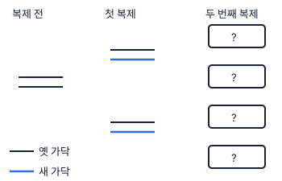
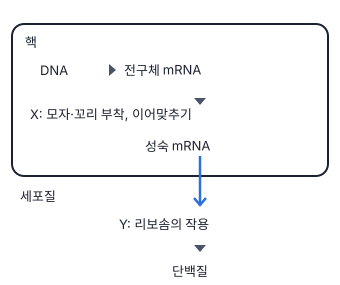

# 생명과학 5장 웹과제 예상 v2 문제해설

왼쪽 목차로 문항을 고르고, 오른쪽 문제를 보며 해설을 따라가요.

문제의 첫 줄부터 검산까지 설명해요.

**목차**

- [문항별 설명](#problems)
  - [P1. [기출 예상] 복제를 시작하는 조각](#p1)
  - [P2. [기출 예상] 전사 시작의 결합 부위](#p2)
  - [P3. [기출 변형] 안티코돈의 역할](#p3)
  - [P4. [기출 변형] DNA의 골격과 염기쌍](#p4)
  - [P5. [기출 변형] 상보 가닥을 같은 방향으로 쓰기](#p5)
  - [P6. [예상] 처음 표지한 가닥은 어디에 남을까?](#p6)
  - [P7. [예상] 한 염기 삽입 뒤 사슬 길이](#p7)
  - [P8. [예상] RNA를 만드는 재료](#p8)
  - [P9. [예상] 똑같이 만들지만 다르게 남을 때](#p9)
  - [P10. [예상] 억제자를 공급하면 돌아오는 스위치](#p10)
  - [P11. [예상] 조절 서열과 조절 단백질](#p11)
  - [P12. [예상] 핵 경계 양쪽에서 일어나는 일](#p12)
  - [P13. [예상] 전사를 멈춘 뒤에도 늘어나는 단백질](#p13)
  - [P14. [예상] 아미노산을 지정하는 암호 수](#p14)
  - [P15. [예상] 교정이 있어도 남는 변화](#p15)

## 문항별 설명

### P1. [기출 예상] 복제를 시작하는 조각

기출 5강 8 예상 · [원 문제 보기](../%EB%B3%B5%EC%8A%B5%EB%AC%B8%EC%A0%9C_5%EC%9E%A5_%EC%9B%B9%EA%B3%BC%EC%A0%9C%EC%98%88%EC%83%81_v2.html#p1)

다음은 DNA 복제에 관한 내용이다. 보기 중 틀린 것은?

- A. 한 가닥의 새로운 DNA는 연속적으로 합성되고, 다른 가닥은 불연속적으로 합성된다
- B. DNA의 복제 시, 주형과 상보적인 복사본 사슬은 서로 감긴 채로 있어서 반은 오래된 그리고 반은 새로운 분자체를 형성한다
- C. DNA 주형가닥의 분리는 DNA 헬리케이스에 의해 촉매된다
- D. DNA로 구성되는 프라이머에 의해 DNA 중합효소는 합성의 시작점을 제공받는다
- E. DNA 중합효소는 5’ -&gt; 3’ 방향으로만 뉴클레오타이드 사슬을 만든다

원문·출처 정보 보기

기출 5강 합본 8번을 보기 순서만 바꿔 실은 예상 문제예요.

#### 문제를 내 말로 읽어요

복제 효소와 새 가닥에 관한 설명을 읽고 **틀린 설명**을 골라요. 시작 조각이 무엇으로 만들어지는지를 효소 이름과 분리해서 살펴봐요.

#### 이 문제를 봤을 때 떠올릴 개념과 공식

‘DNA 중합효소가 합성의 시작점을 제공받는다’에서 프라이머(primer)를 떠올려요. 프라이머는 중합효소가 늘릴 수 있는 3′-OH 말단을 제공하는 짧은 시작 가닥이에요. 수업에서 다룬 복제에서는 프라이메이스(primase)가 짧은 RNA 프라이머를 만들어요.

DNA 중합효소(DNA polymerase)는 기존 끝에 DNA 뉴클레오타이드를 더해요. 새 사슬은 항상 5′→3′로 늘어나지만, 역평행인 두 주형 때문에 한 복제분기점에서 연속 합성과 불연속 합성이 나뉘어요. 반보존적 복제(semiconservative replication)는 완성 분자마다 부모 가닥 하나와 새 가닥 하나가 있다는 뜻이에요.

#### 종이에 쓸 첫 줄

“복제 시작 조각 = RNA 프라이머, DNA 중합효소가 늘리는 끝 = 3′-OH”라고 먼저 적어요.

#### 왜 이렇게 푸는지 함께 따라가요

A. 맞아요. 한 복제분기점에서 선도가닥은 연속적으로, 지연가닥은 조각으로 합성돼요.

B. 맞아요. 반보존적 복제의 산물은 부모 가닥 하나와 새 가닥 하나가 결합한 이중가닥 DNA예요.

C. 맞아요. 헬리케이스가 부모 DNA의 두 가닥을 분리해요.

D. 틀려요. 수업의 DNA 복제 모형에서 프라이머는 짧은 RNA이며, DNA 중합효소가 늘릴 3′-OH를 제공해요.

E. 맞아요. 새 뉴클레오타이드는 3′ 말단에 붙으므로 DNA 사슬은 5′→3′로 늘어나요.

따라서 답은 **D**예요. 옳지 않은 설명을 찾으므로 ‘틀려요’로 판정한 보기를 골라요.

#### 완성 답과 검산

교과서 p.99 그림 5.8에서 효소의 순서를 독립적으로 따라가요. 프라이메이스가 RNA 프라이머를 만들고, DNA 중합효소가 이를 늘리며, 나중에 프라이머가 DNA로 교체돼요. 처음부터 DNA 프라이머라고 하면 ‘RNA 제거 후 DNA 대체’ 단계와 충돌하므로 답 D를 확인할 수 있어요.

#### 이 지점에서 조심해요

완성된 사슬이 DNA라는 사실을 시작 조각의 재료에도 적용하지 않아요. 선도·지연가닥 모두 새 DNA를 5′→3′로 합성해요.

#### 설명을 닫고 다시 해요

- DNA 중합효소가 요구하는 말단을 써요.
- 프라이머의 최초 재료와 나중에 대체되는 재료를 구별해요.

**페이지 요약**

#### 떠올릴 개념·공식

RNA 프라이머 · 3′-OH 연장

#### 첫 줄

“복제 시작 조각 = RNA 프라이머, DNA 중합효소가 늘리는 끝 = 3′-OH”라고 먼저 적어요.

#### 핵심 판단

정답 D. RNA 프라이머 · 3′-OH 연장을 적용해요.

#### 검산

교과서 p.99 그림 5.8에서 효소의 순서를 독립적으로 따라가요. 프라이메이스가 RNA 프라이머를 만들고, DNA 중합효소가 이를 늘리며, 나중에 프라이머가 DNA로 교체돼요. 처음부터 DNA 프라이머라고 하면 ‘RNA 제거 후 DNA 대체’ 단계와 충돌하므로 답 D를 확인할 수 있어요.

---

### P2. [기출 예상] 전사 시작의 결합 부위

기출 5강 35 예상 · [원 문제 보기](../%EB%B3%B5%EC%8A%B5%EB%AC%B8%EC%A0%9C_5%EC%9E%A5_%EC%9B%B9%EA%B3%BC%EC%A0%9C%EC%98%88%EC%83%81_v2.html#p2)

RNA 중합효소는 전사를 시작할 때 ( ) 에 결합한다.

- A. 리보솜
- B. 프로모터
- C. 엑손
- D. tRNA
- E. 인트론

원문·출처 정보 보기

기출 5강 합본 35번을 보기 순서만 바꿔 실은 예상 문제예요.

#### 문제를 내 말로 읽어요

전사 시작 때 RNA 중합효소가 결합하는 대상을 찾는 빈칸 문제예요. 만들어질 RNA의 부분이 아니라 시작 위치를 알려 주는 DNA 부위를 골라요.

#### 이 문제를 봤을 때 떠올릴 개념과 공식

‘RNA 중합효소’와 ‘전사를 시작’이라는 두 단서에서 프로모터(promoter)를 떠올려요. 프로모터는 전사 개시에 필요한 결합 부위를 제공하는 DNA 서열이에요. 수업의 기본 모형에서는 중합효소가 이 부위를 인식하고 전사 개시점에서 RNA 합성을 시작해요.

전사(transcription)는 DNA 정보를 RNA로 옮기는 과정이고, 번역(translation)은 mRNA 정보를 아미노산 사슬로 바꾸는 과정이에요. 리보솜·tRNA는 번역 도구이고 엑손·인트론은 RNA 가공에서 구별하는 구간이므로, 여기서는 전사 시작 부위의 이름을 선택해야 해요.

#### 종이에 쓸 첫 줄

“전사 시작: RNA 중합효소 → DNA의 프로모터”라는 관계를 적어요.

#### 왜 이렇게 푸는지 함께 따라가요

A. 틀려요. 리보솜은 번역을 수행하는 도구이며 전사 시작의 DNA 결합 부위가 아니에요.

B. 맞아요. 프로모터는 RNA 중합효소가 전사를 시작하도록 결합 부위를 제공하는 DNA 서열이에요.

C. 틀려요. 엑손은 가공 후 RNA에 남는 구간이며, 전사 개시 결합 부위를 부르는 이름이 아니에요.

D. 틀려요. tRNA는 번역에서 아미노산을 운반하는 RNA이며 DNA의 전사 개시 부위가 아니에요.

E. 틀려요. 인트론은 전구체 RNA에 포함됐다가 가공 중 제거되는 구간이며 프로모터와 구별해요.

따라서 답은 **B**예요.

#### 완성 답과 검산

교과서 p.104의 ‘유전자의 구성과 전사 단계’를 보면 프로모터 인식·결합 다음에 전사 개시가 이어져요. 나머지를 물질·역할로 다시 분류하면 리보솜과 tRNA는 번역 도구, 엑손과 인트론은 전사체 구간으로 묶여 시작 결합 부위 B만 남아요.

#### 이 지점에서 조심해요

RNA 중합효소라는 이름 때문에 결합 부위까지 RNA라고 생각하지 않아요. 효소가 만드는 것은 RNA지만 시작 표지는 DNA예요.

#### 설명을 닫고 다시 해요

- 효소·결합 부위·산물을 한 줄에 연결해요.
- 전사 시작 부위와 RNA 가공 구간을 구별해요.

**페이지 요약**

#### 떠올릴 개념·공식

프로모터 = 전사 개시 DNA 서열

#### 첫 줄

“전사 시작: RNA 중합효소 → DNA의 프로모터”라는 관계를 적어요.

#### 핵심 판단

정답 B. 프로모터 = 전사 개시 DNA 서열을 적용해요.

#### 검산

교과서 p.104의 ‘유전자의 구성과 전사 단계’를 보면 프로모터 인식·결합 다음에 전사 개시가 이어져요. 나머지를 물질·역할로 다시 분류하면 리보솜과 tRNA는 번역 도구, 엑손과 인트론은 전사체 구간으로 묶여 시작 결합 부위 B만 남아요.

---

### P3. [기출 변형] 안티코돈의 역할

기출 5강 34 예상 · [원 문제 보기](../%EB%B3%B5%EC%8A%B5%EB%AC%B8%EC%A0%9C_5%EC%9E%A5_%EC%9B%B9%EA%B3%BC%EC%A0%9C%EC%98%88%EC%83%81_v2.html#p3)

번역 과정 중 tRNA의 기능은?

- A. 안티코돈이 mRNA 코돈과 상보적으로 결합하여 유전암호 해독에 참여한다.
- B. 분자 전체가 세 개의 뉴클레오타이드로만 이루어져 코돈 하나를 대신한다.
- C. 아미노산을 자신의 안티코돈에 공유결합시켜 운반한다.
- D. DNA를 주형으로 RNA 사슬을 직접 합성하는 효소로 작용한다.
- E. 아미노산을 전달한 뒤 tRNA 자체가 폴리펩티드 사슬의 일부로 연결된다.

원문·출처 정보 보기

기출 5강 합본 34번을 바탕으로 발문은 유지하고 보기를 바꾼 예상 문제예요.

#### 문제를 내 말로 읽어요

기출 발문을 유지하고 보기를 바꾼 예상문제예요. 아미노산 운반이라는 역할을 암기한 뒤, 그 운반체가 어느 코돈에 대응하는지 알아보는 구조를 생각해요.

#### 이 문제를 봤을 때 떠올릴 개념과 공식

‘번역’과 ‘tRNA’에서 운반 RNA(transfer RNA)의 두 기능 부위를 떠올려요. 아미노산은 3′ 말단에 붙고, 안티코돈(anticodon)은 mRNA 코돈(codon)과 상보적으로 짝짓는 세 염기 구간이에요. 이 짝짓기가 운반체를 코돈에 대응시키는 데 쓰여요.

코돈과 안티코돈은 역평행이에요. 예를 들어 코돈 5′-AUG-3′와 맞춰 놓는 안티코돈은 3′-UAC-5′예요. 세 염기라는 설명은 안티코돈 구간에만 적용하고 tRNA 전체 길이나 아미노산 부착 자리에 적용하지 않아요.

#### 종이에 쓸 첫 줄

“tRNA: 3′ 말단은 아미노산 부착, 안티코돈은 코돈 인식”이라고 두 칸으로 나눠 적어요.

#### 왜 이렇게 푸는지 함께 따라가요

A. 맞아요. tRNA의 세 염기 구간인 안티코돈이 코돈과 역평행으로 짝지어 번역에 참여해요.

B. 틀려요. 세 염기로 된 부분은 안티코돈이며 tRNA 분자 전체가 세 염기로만 이루어진 것은 아니에요.

C. 틀려요. 아미노산은 안티코돈이 아니라 tRNA의 3′ 말단에 붙어요.

D. 틀려요. DNA를 읽어 RNA를 합성하는 효소는 RNA 중합효소예요.

E. 틀려요. 단백질 사슬에 들어가는 것은 전달한 아미노산이고 tRNA는 다시 쓰일 수 있어요.

따라서 답은 **A**예요.

#### 완성 답과 검산

교과서 p.105 그림 5.14의 위쪽 아미노산 부착 끝과 아래쪽 안티코돈을 따로 짚어 봐요. 같은 분자에 두 기능 부위가 따로 존재하므로, 세 염기가 분자 전체라는 B와 그 세 염기에 아미노산이 붙는다는 C는 동시에 배제돼요. 남은 효소·사슬 재료 설명도 tRNA 역할이 아니므로 A가 남아요.

#### 이 지점에서 조심해요

원문 기출의 정답 문장인 ‘아미노산 운반’을 이 변형 문제의 보기에서 억지로 찾지 않아요. 안티코돈도 운반 기능을 정확한 코돈과 연결하는 tRNA의 일부예요.

#### 설명을 닫고 다시 해요

- tRNA를 그려 아미노산 부착 끝과 안티코돈을 따로 표시해요.
- 코돈과 안티코돈의 방향을 반대로 써요.

**페이지 요약**

#### 떠올릴 개념·공식

안티코돈의 상보적·역평행 인식

#### 첫 줄

“tRNA: 3′ 말단은 아미노산 부착, 안티코돈은 코돈 인식”이라고 두 칸으로 나눠 적어요.

#### 핵심 판단

정답 A. 안티코돈의 상보적·역평행 인식을 적용해요.

#### 검산

교과서 p.105 그림 5.14의 위쪽 아미노산 부착 끝과 아래쪽 안티코돈을 따로 짚어 봐요. 같은 분자에 두 기능 부위가 따로 존재하므로, 세 염기가 분자 전체라는 B와 그 세 염기에 아미노산이 붙는다는 C는 동시에 배제돼요. 남은 효소·사슬 재료 설명도 tRNA 역할이 아니므로 A가 남아요.

---

### P4. [기출 변형] DNA의 골격과 염기쌍

기출 5강 43 예상 · [원 문제 보기](../%EB%B3%B5%EC%8A%B5%EB%AC%B8%EC%A0%9C_5%EC%9E%A5_%EC%9B%B9%EA%B3%BC%EC%A0%9C%EC%98%88%EC%83%81_v2.html#p4)

다음 DNA 구조에 대한 설명 중 옳지 않은 것은?

- A. DNA의 뉴클레오타이드는 염기, 디옥시리보스, 인산으로 이루어진다.
- B. 보통의 B형 DNA에서 두 가닥은 서로 역평행으로 놓인다.
- C. 이중가닥 DNA의 상보적 염기쌍은 A-T와 G-C이다.
- D. DNA 한 가닥의 당-인산 골격은 공유결합으로 이어진다.
- E. DNA 두 가닥에서 서로 마주한 상보적 염기는 공유결합으로 연결된다.

원문·출처 정보 보기

기출 5강 합본 43번을 바탕으로 발문은 유지하고 보기를 바꾼 예상 문제예요.

#### 문제를 내 말로 읽어요

DNA를 이루는 재료·가닥 방향·결합 위치를 구별하고 **옳지 않은 설명**을 골라요. 기출 발문을 이용했지만 정답을 결정하는 보기 내용은 바뀌었어요.

#### 이 문제를 봤을 때 떠올릴 개념과 공식

‘골격’과 ‘서로 마주한 염기’라는 위치 단서에서 결합 종류를 나눠요. 한 가닥을 따라 당과 인산이 연결되는 골격에는 공유결합(covalent bond)이 있고, 두 가닥 사이의 A-T 및 G-C 염기쌍에는 수소결합(hydrogen bond)이 있어요. 같은 DNA 안에서도 결합 위치가 다르므로 이름을 바꿔 쓸 수 없어요.

DNA 뉴클레오타이드는 염기·디옥시리보스·인산으로 구성돼요. 이 문항의 보통 B형 DNA에서는 두 가닥의 5′→3′ 방향이 반대인 역평행(antiparallel) 배치를 적용해요. 염기쌍 규칙과 골격 결합 규칙은 서로 다른 판단 기준이에요.

#### 종이에 쓸 첫 줄

“가닥을 따라: 당–인산 공유결합 / 가닥 사이: 염기쌍 수소결합”을 먼저 써요.

#### 왜 이렇게 푸는지 함께 따라가요

A. 맞아요. 염기·당·인산이 뉴클레오타이드의 세 구성 부분이며 DNA의 당은 디옥시리보스예요.

B. 맞아요. B형 DNA에서는 같은 공간 방향으로 볼 때 한 가닥이 5′→3′이면 다른 가닥은 3′→5′예요.

C. 맞아요. A는 T와, G는 C와 상보적으로 짝을 이뤄요.

D. 맞아요. 한 가닥 안의 당과 인산은 공유결합으로 연결되어 골격을 만들어요.

E. 틀려요. 서로 마주한 상보적 염기는 수소결합으로 짝지으며, 골격의 공유결합과 구별해요.

따라서 답은 **E**예요. 옳지 않은 설명을 찾으므로 ‘틀려요’로 판정한 보기를 골라요.

#### 완성 답과 검산

교과서 p.94 그림 5.2의 한 가닥을 따라가는 인산다이에스터 연결과 p.96 그림 5.4의 가닥 사이 수소결합 표시를 비교해요. E의 ‘공유결합’을 ‘수소결합’으로 바꿨을 때 두 그림의 위치가 정확히 대응해요. A~D는 이 위치 구분과 충돌하지 않아 틀린 설명은 E예요.

#### 이 지점에서 조심해요

DNA가 복제될 때 두 가닥이 벌어지는 것을 당–인산 골격이 잘리는 것으로 읽지 않아요. 원문 기출의 A=G 혼동이 이번 보기에도 있다고 가정하지 않아요.

#### 설명을 닫고 다시 해요

- 사다리의 기둥과 가로대에 해당하는 결합 이름을 써요.
- 틀린 보기의 한 단어만 고쳐 참인 설명을 만들어요.

**페이지 요약**

#### 떠올릴 개념·공식

골격 공유결합 / 염기쌍 수소결합

#### 첫 줄

“가닥을 따라: 당–인산 공유결합 / 가닥 사이: 염기쌍 수소결합”을 먼저 써요.

#### 핵심 판단

정답 E. 골격 공유결합 / 염기쌍 수소결합을 적용해요.

#### 검산

교과서 p.94 그림 5.2의 한 가닥을 따라가는 인산다이에스터 연결과 p.96 그림 5.4의 가닥 사이 수소결합 표시를 비교해요. E의 ‘공유결합’을 ‘수소결합’으로 바꿨을 때 두 그림의 위치가 정확히 대응해요. A~D는 이 위치 구분과 충돌하지 않아 틀린 설명은 E예요.

---

### P5. [기출 변형] 상보 가닥을 같은 방향으로 쓰기

기출 5강 17 예상 · [원 문제 보기](../%EB%B3%B5%EC%8A%B5%EB%AC%B8%EC%A0%9C_5%EC%9E%A5_%EC%9B%B9%EA%B3%BC%EC%A0%9C%EC%98%88%EC%83%81_v2.html#p5)

만약 어떤 유전자의 일부가 5′-AGTCCATGCA-3′ 이라면 상보 DNA 가닥의 서열은? 상보 가닥도 5′→3′ 방향으로 표기한 것을 고르시오.

- A. 5′-TCAGGTACGT-3′
- B. 5′-AGTCCATGCA-3′
- C. 5′-TGCATGGACT-3′
- D. 5′-UGCAUGGACU-3′
- E. 5′-ACGTACCTGA-3′

원문·출처 정보 보기

기출 5강 합본 17번을 바탕으로 조건 서열과 보기를 바꾼 예상 문제예요. 상보 가닥을 5′→3′로 다시 쓰도록 출력 방향을 명시했어요.

#### 문제를 내 말로 읽어요

주어진 DNA에 짝을 이루는 가닥을 만들고, 그 가닥의 서열도 왼쪽부터 5′→3′로 적어야 해요. 염기만 바꾼 뒤 끝 번호를 그대로 붙이면 완성되지 않아요.

#### 이 문제를 봤을 때 떠올릴 개념과 공식

‘상보 DNA’라는 단서에서는 A↔T, G↔C의 상보적 염기쌍(complementary base pairing)을 적용해요. ‘상보 가닥도 5′→3′’라는 추가 조건에서는 두 가닥의 역평행 배치를 함께 적용해야 해요.

상보화는 마주한 위치의 염기를 바꾸는 작업이고, 역순 표기는 가닥을 읽는 방향을 바꾸는 작업이에요. 위 가닥이 왼쪽 5′이면 바로 아래 맞은편은 왼쪽 3′여야 하므로, 먼저 맞춰 쓰고 나서 오른쪽부터 읽는 순서가 안전해요.

#### 종이에 쓸 첫 줄

“5′-AGTCCATGCA-3′” 아래에 “3′-TCAGGTACGT-5′”를 맞춰 적어요.

#### 왜 이렇게 푸는지 함께 따라가요

위쪽을 A G T C C A T G C A 순으로 두고, 아래를 T C A G G T A C G T로 채워요. 아래 왼쪽은 3′, 오른쪽은 5′예요.

요구한 5′부터 아래 가닥을 읽으면 T G C A T G G A C T가 되어 5′-TGCATGGACT-3′예요.

A. 틀려요. 글자별 상보화 결과 TCAGGTACGT는 주어진 가닥 아래에 3′→5′로 놓여야 해요. 이 문자열에 5′→3′를 붙이면 역평행 조건을 어겨요.

B. 틀려요. 주어진 가닥을 그대로 적었고 A-T, G-C로 상보화하지 않았어요.

C. 맞아요. 먼저 3′-TCAGGTACGT-5′로 맞춰 쓰고, 이를 오른쪽부터 읽으면 5′-TGCATGGACT-3′예요.

D. 틀려요. U가 들어 있어 DNA 상보 가닥이 아니에요. DNA에서는 T를 사용해요.

E. 틀려요. 주어진 서열을 역순으로 적기만 했으며 각 염기를 상보 염기로 바꾸지 않았어요.

따라서 답은 **C**예요.

#### 완성 답과 검산

답 C의 5′-TGCATGGACT-3′를 다시 역상보화해요. 마주한 가닥은 3′-ACGTACCTGA-5′이고 이를 5′부터 읽으면 5′-AGTCCATGCA-3′로 원래 입력이 돌아와요. 길이도 두 가닥 모두 10염기이고 U가 없어 DNA 조건도 만족해요.

#### 이 지점에서 조심해요

상보화만 한 TCAGGTACGT에 왼쪽 5′를 붙이는 실수와, 원래 서열을 뒤집기만 하는 실수를 구별해요. 두 연산을 모두 해야 해요.

#### 설명을 닫고 다시 해요

- 원래 서열 아래에 끝 번호부터 반대로 써요.
- 상보 가닥을 만든 뒤 5′ 쪽부터 다시 읽어요.

**페이지 요약**

#### 떠올릴 개념·공식

상보화 후 방향 재표기

#### 첫 줄

“5′-AGTCCATGCA-3′” 아래에 “3′-TCAGGTACGT-5′”를 맞춰 적어요.

#### 핵심 판단

정답 C. 상보화 후 방향 재표기를 적용해요.

#### 검산

답 C의 5′-TGCATGGACT-3′를 다시 역상보화해요. 마주한 가닥은 3′-ACGTACCTGA-5′이고 이를 5′부터 읽으면 5′-AGTCCATGCA-3′로 원래 입력이 돌아와요. 길이도 두 가닥 모두 10염기이고 U가 없어 DNA 조건도 만족해요.

---

### P6. [예상] 처음 표지한 가닥은 어디에 남을까?

예상 5장 6 · [원 문제 보기](../%EB%B3%B5%EC%8A%B5%EB%AC%B8%EC%A0%9C_5%EC%9E%A5_%EC%9B%B9%EA%B3%BC%EC%A0%9C%EC%98%88%EC%83%81_v2.html#p6)

DNA 한 분자의 두 가닥을 모두 표지한 뒤, 표지 없는 재료만 공급하여 그림의 화살표를 따라 반보존적으로 복제해요. 그림의 옛 가닥은 실험 시작 때 있던 가닥만 뜻해요. 가닥의 절단·분해·표지 교환은 없어요. 그림의 모든 복제가 끝난 뒤 생긴 DNA 분자들 중 옛 가닥을 포함한 분자에 대한 설명으로 옳은 것은 무엇인가요?

- A. 네 분자 모두 옛 가닥을 하나씩 포함해요.
- B. 네 분자 중 한 분자에 옛 가닥 두 개가 함께 남아요.
- C. 네 분자 모두 옛 가닥을 잃어요.
- D. 네 분자 중 세 분자가 옛 가닥을 하나씩 포함해요.
- E. 네 분자 중 두 분자가 옛 가닥을 하나씩 포함해요.

원문·출처 정보 보기

1001 정리노트의 반보존적 복제와 가닥 표지 추적으로 만든 새 예상 문제예요.

#### 문제를 내 말로 읽어요

처음에 표지한 두 가닥의 행방을 두 번의 복제 동안 추적해요. ‘옛 가닥’은 각 복제 직전의 가닥이 아니라 실험 시작 때 있던 두 가닥만 뜻해요.

#### 이 문제를 봤을 때 떠올릴 개념과 공식

‘두 번 반보존적으로 복제’에서 부모 가닥 하나가 새 분자 하나에 이어진다는 원리를 떠올려요. 반보존적 복제(semiconservative replication)는 기존 두 가닥이 분리되고 각 가닥에 새 상보 가닥 하나씩 붙는 방식이에요.

‘절단·분해·표지 교환 없음’은 처음의 표지 가닥 두 개가 늘거나 없어지지 않는다는 조건이에요. 새 재료에는 표지가 없으므로 새로 생긴 가닥을 다음 복제 때 다시 ‘옛 가닥’이라고 부르지 않아요. 분자 수와 표지된 가닥 수를 따로 세야 해요.

#### 종이에 쓸 첫 줄

“처음 표지 가닥 = O1, O2; 첫 복제 산물 = O1+N1, O2+N2”라고 적어요.

#### 왜 이렇게 푸는지 함께 따라가요

첫 복제의 O1+N1이 다시 복제되면 O1+N3과 N1+N4가 돼요. O1은 앞쪽 산물에만 남아요.

O2+N2도 O2+N5와 N2+N6가 돼요. 최종 네 분자 중 O1 또는 O2가 있는 것은 각각 하나씩, 합계 두 분자예요.

A. 틀려요. 처음의 옛 가닥은 두 개뿐이므로 네 분자에 하나씩 들어갈 수 없어요.

B. 틀려요. 처음 두 가닥은 첫 복제에서 분리되고, 반보존적 복제에서 다시 서로 합쳐지지 않아요.

C. 틀려요. 새 가닥을 만들어도 기존의 표지된 두 가닥은 사라지지 않아요.

D. 틀려요. 옛 가닥 두 개를 보유하는 분자는 두 개이며 세 개가 아니에요.

E. 맞아요. 첫 복제의 각 분자가 다시 복제될 때 옛 가닥을 물려받은 분자 하나와 새 가닥끼리의 분자 하나가 생겨, 최종 네 분자 중 두 분자만 옛 가닥을 포함해요.

따라서 답은 **E**예요.

#### 완성 답과 검산

가닥 총수 보존으로 다시 확인해요. 최종 네 분자는 8가닥이며, 그중 시작 표지 가닥은 여전히 2가닥이에요. 첫 복제에서 이미 분리된 표지 가닥이 다시 합쳐지지 않으므로 각각 다른 분자에 들어 있어 표지 보유 분자는 2/4, 즉 E예요. 표지 비율 2/8을 분자 비율로 쓰지 않아요.

#### 이 지점에서 조심해요

첫 복제에서 새로 만든 N1도 두 번째 복제의 주형이지만 이 실험에서 말한 ‘옛 가닥’은 아니에요.

#### 설명을 닫고 다시 해요

- 처음 표지 가닥 두 개에 서로 다른 이름을 붙여요.
- 최종 분자 수와 표지 보유 분자 수를 따로 세어요.

**페이지 요약**

#### 떠올릴 개념·공식

표지 가닥 2개 보존 · 최종 4분자

#### 첫 줄

“처음 표지 가닥 = O1, O2; 첫 복제 산물 = O1+N1, O2+N2”라고 적어요.

#### 핵심 판단

정답 E. 표지 가닥 2개 보존 · 최종 4분자을 적용해요.

#### 검산

가닥 총수 보존으로 다시 확인해요. 최종 네 분자는 8가닥이며, 그중 시작 표지 가닥은 여전히 2가닥이에요. 첫 복제에서 이미 분리된 표지 가닥이 다시 합쳐지지 않으므로 각각 다른 분자에 들어 있어 표지 보유 분자는 2/4, 즉 E예요. 표지 비율 2/8을 분자 비율로 쓰지 않아요.

---

### P7. [예상] 한 염기 삽입 뒤 사슬 길이

예상 5장 7 · [원 문제 보기](../%EB%B3%B5%EC%8A%B5%EB%AC%B8%EC%A0%9C_5%EC%9E%A5_%EC%9B%B9%EA%B3%BC%EC%A0%9C%EC%98%88%EC%83%81_v2.html#p7)

아래 정상 mRNA의 첫 AUG 바로 뒤에 C 하나가 삽입되어 삽입 mRNA가 되었어요. 두 mRNA 모두 첫 AUG부터 세 염기씩 읽고 처음 만나는 종결 코돈에서 번역을 끝내요. 개시 아미노산도 세고, 종결 코돈은 잔기로 세지 않으며 번역 후 절단은 없어요. 정상 사슬과 삽입 사슬의 아미노산 잔기 수를 차례로 바르게 짝지은 것은 무엇인가요?

정상 mRNA: **5′-AUGGGCGCUAACUACUAA-3′** 삽입 mRNA: **5′-AUGCGGCGCUAACUACUAA-3′**

필요한 코돈의 뜻: AUG=메티오닌, GGC=글리신, GCU=알라닌, AAC=아스파라긴, UAC=타이로신, CGG·CGC=아르기닌, UAA=종결이에요.

- A. 정상 6개 / 삽입 4개
- B. 정상 5개 / 삽입 5개
- C. 정상 5개 / 삽입 3개
- D. 정상 4개 / 삽입 2개
- E. 정상 3개 / 삽입 5개

원문·출처 정보 보기

1006 정리노트의 번역틀이동 원리로 만든 새 서열 문제예요. 서열과 필요한 코돈 뜻은 문제에 제공했어요.

#### 문제를 내 말로 읽어요

각 mRNA를 첫 AUG부터 새로 세 염기씩 묶고, 첫 종결 코돈 직전까지의 아미노산 수를 비교해요. 답의 앞 숫자는 정상, 뒤 숫자는 삽입 사슬이에요.

#### 이 문제를 봤을 때 떠올릴 개념과 공식

‘AUG 바로 뒤에 C 하나 삽입’이라는 단서에서는 번역틀이동(frameshift)을 떠올려요. 코돈(codon)은 mRNA의 연속된 세 염기이고, 번역틀은 어디부터 세 칸씩 묶는지에 따른 구획이에요. 3의 배수가 아닌 염기 삽입은 삽입 뒤의 묶음을 바꿀 수 있어요.

이번에는 시작점이 첫 AUG로 고정돼 있고, 첫 UAA를 만나면 끝낸다는 규칙이 주어졌어요. AUG도 아미노산을 지정하므로 하나로 세지만 종결 코돈(stop codon)은 아미노산을 지정하지 않아 세지 않아요. 전체 서열 길이를 3으로 나누기 전에 조기 종결 여부를 확인해야 해요.

#### 종이에 쓸 첫 줄

“정상: AUG / GGC / GCU / AAC / UAC / UAA”라고 시작점부터 구획해요.

#### 왜 이렇게 푸는지 함께 따라가요

정상은 AUG(Met) / GGC(Gly) / GCU(Ala) / AAC(Asn) / UAC(Tyr) / UAA(종결)이에요. 종결 전 지정 코돈은 다섯 개예요.

삽입 서열은 AUG / CGG / CGC / UAA / CUA / CUA / A로 구획돼요. AUG(Met) / CGG(Arg) / CGC(Arg) 다음 네 번째 구획 UAA에서 끝나므로 뒤의 CUA들은 번역하지 않아요.

A. 틀려요. 정상과 삽입 사슬 모두 UAA는 아미노산을 지정하지 않으므로 종결 코돈을 잔기로 더하지 않아요.

B. 틀려요. 삽입으로 읽는 틀이 바뀌어 네 번째 코돈에 UAA가 나타나요.

C. 맞아요. 정상에서는 아미노산 지정 코돈 다섯 개를 읽지만 삽입 후에는 세 개를 읽은 뒤 종결해요.

D. 틀려요. 사슬의 첫 AUG가 지정하는 메티오닌도 잔기 수에 포함해야 해요.

E. 틀려요. 두 서열을 재구획하면 정상은 5개, 삽입은 3개로 보기와 순서가 반대예요.

따라서 답은 **C**예요.

#### 완성 답과 검산

각 서열에서 첫 종결 코돈의 위치를 염기 번호로 다시 찾아요. 정상 UAA는 16~18번째여서 앞의 15염기÷3=5잔기예요. 삽입 UAA는 10~12번째여서 앞의 9염기÷3=3잔기예요. AUG를 포함하고 UAA를 제외한 결과가 C와 일치해요.

#### 이 지점에서 조심해요

삽입했다고 사슬이 반드시 길어지는 것은 아니에요. 염기는 하나 늘었어도 첫 종결 코돈이 앞당겨지면 사슬은 짧아져요.

#### 설명을 닫고 다시 해요

- 두 서열을 각각 처음부터 다시 세 칸씩 나눠요.
- 첫 종결 코돈 앞의 구획만 세어요.

**페이지 요약**

#### 떠올릴 개념·공식

번역틀 재구획 → 첫 종결 → 잔기수

#### 첫 줄

“정상: AUG / GGC / GCU / AAC / UAC / UAA”라고 시작점부터 구획해요.

#### 핵심 판단

정답 C. 번역틀 재구획 → 첫 종결 → 잔기 수를 적용해요.

#### 검산

각 서열에서 첫 종결 코돈의 위치를 염기 번호로 다시 찾아요. 정상 UAA는 16~18번째여서 앞의 15염기÷3=5잔기예요. 삽입 UAA는 10~12번째여서 앞의 9염기÷3=3잔기예요. AUG를 포함하고 UAA를 제외한 결과가 C와 일치해요.

---

### P8. [예상] RNA를 만드는 재료

예상 5장 8 · [원 문제 보기](../%EB%B3%B5%EC%8A%B5%EB%AC%B8%EC%A0%9C_5%EC%9E%A5_%EC%9B%B9%EA%B3%BC%EC%A0%9C%EC%98%88%EC%83%81_v2.html#p8)

수업에서 비교한 RNA의 기본 구성과 전사에 대한 설명으로 옳지 않은 것은 무엇인가요?

- A. RNA 중합효소는 디옥시리보스를 가진 A·T·G·C 뉴클레오타이드를 연결해 RNA를 만들어요.
- B. RNA를 이루는 뉴클레오타이드에는 리보스 당이 들어 있어요.
- C. RNA를 이루는 기본 염기 종류에는 우라실이 포함돼요.
- D. RNA도 DNA처럼 뉴클레오타이드가 이어진 핵산이에요.
- E. 주형 DNA의 A에 대응하여 RNA에는 U가 들어가요.

원문·출처 정보 보기

1001·1006 정리노트의 DNA와 RNA 재료 구별로 만든 새 예상 문제예요.

#### 문제를 내 말로 읽어요

RNA의 재료와 전사 규칙을 비교해서 **옳지 않은 설명**을 찾는 문제예요. 효소 이름보다 실제로 연결하는 당과 염기를 확인해요.

#### 이 문제를 봤을 때 떠올릴 개념과 공식

‘RNA의 기본 구성’이라는 단서에서는 RNA와 DNA 뉴클레오타이드의 차이를 떠올려요. RNA의 당은 리보스(ribose), 기본 염기는 A·U·G·C이고, DNA의 당은 디옥시리보스(deoxyribose), 기본 염기는 A·T·G·C예요. 둘 다 뉴클레오타이드(nucleotide)가 이어진 핵산이라는 점은 같아요.

전사(transcription)에서는 DNA 주형에 상보적인 RNA를 만들어요. 따라서 DNA 주형의 A에는 RNA의 U가 대응해요. 효소가 RNA 중합효소라는 사실은 DNA용 재료로 RNA를 만든다는 뜻이 아니며, 생성물의 당과 염기를 함께 확인해야 해요.

#### 종이에 쓸 첫 줄

“RNA = 리보스 + A·U·G·C / DNA = 디옥시리보스 + A·T·G·C”를 적어요.

#### 왜 이렇게 푸는지 함께 따라가요

A. 틀려요. 이 보기는 DNA의 재료를 설명하며 RNA는 리보스를 가진 A·U·G·C 뉴클레오타이드를 사용해요.

B. 맞아요. RNA의 당은 리보스이고 DNA의 당은 디옥시리보스예요.

C. 맞아요. RNA의 기본 염기는 A·U·G·C여서 U인 우라실을 포함해요.

D. 맞아요. DNA와 RNA 모두 뉴클레오타이드를 기본 단위로 하는 핵산이에요.

E. 맞아요. 전사에서 DNA 주형의 A는 RNA의 U와 상보적으로 대응해요.

따라서 답은 **A**예요. 옳지 않은 설명을 찾으므로 ‘틀려요’로 판정한 보기를 골라요.

#### 완성 답과 검산

A에서 잘못된 재료 두 가지를 각각 고쳐 봐요. ‘디옥시리보스’를 ‘리보스’로, ‘T’를 ‘U’로 바꾸면 B와 C의 구성 설명 및 E의 전사 대응과 일치해요. D는 두 핵산의 공통 분류이므로 충돌하지 않아요. 두 구성 차이를 동시에 거꾸로 쓴 A가 답이에요.

#### 이 지점에서 조심해요

리보스만 맞는지 확인하고 염기 T를 놓치거나, T만 U로 바꾸고 당의 종류를 놓치지 않아요.

#### 설명을 닫고 다시 해요

- DNA와 RNA의 당·염기 차이를 각각 한 개씩 써요.
- 주형 A에 들어갈 RNA 염기를 써요.

**페이지 요약**

#### 떠올릴 개념·공식

RNA: 리보스·U / DNA: 디옥시리보스·T

#### 첫 줄

“RNA = 리보스 + A·U·G·C / DNA = 디옥시리보스 + A·T·G·C”를 적어요.

#### 핵심 판단

정답 A. RNA: 리보스·U / DNA: 디옥시리보스·T의 구분을 적용해요.

#### 검산

A에서 잘못된 재료 두 가지를 각각 고쳐 봐요. ‘디옥시리보스’를 ‘리보스’로, ‘T’를 ‘U’로 바꾸면 B와 C의 구성 설명 및 E의 전사 대응과 일치해요. D는 두 핵산의 공통 분류이므로 충돌하지 않아요. 두 구성 차이를 동시에 거꾸로 쓴 A가 답이에요.

---

### P9. [예상] 똑같이 만들지만 다르게 남을 때

예상 5장 9 · [원 문제 보기](../%EB%B3%B5%EC%8A%B5%EB%AC%B8%EC%A0%9C_5%EC%9E%A5_%EC%9B%B9%EA%B3%BC%EC%A0%9C%EC%98%88%EC%83%81_v2.html#p9)

표의 P와 Q는 같은 세포에서 일정하게 합성되는 단백질이에요. 다른 조건은 같고, 반감기는 이미 합성된 단백질의 절반이 분해되는 데 걸리는 시간이에요. P와 Q의 세포 내 양을 조절하는 원리를 바르게 설명한 것은 무엇인가요?

| 단백질 | 단위 시간당 합성량 | 반감기 |
|---|---|---|
| P | 같음 | 2분 |
| Q | 같음 | 20분 |

- A. P의 반감기가 짧으므로 같은 합성량을 계속 유지하면 P가 Q보다 더 잘 축적돼요.
- B. Q는 P보다 천천히 제거되므로 합성속도가 같아도 더 잘 축적될 수 있어요.
- C. 합성속도가 같으면 분해속도와 관계없이 P와 Q의 양도 같아요.
- D. Q의 긴 반감기는 Q를 암호화하는 DNA 복제가 더 빠르다는 뜻이에요.
- E. P의 짧은 반감기는 P를 만드는 리보솜의 번역속도가 반드시 느리다는 뜻이에요.

원문·출처 정보 보기

1008 정리노트의 단백질 수명과 번역 후 조절 원리로 만든 새 표 문제예요. 반감기의 정의는 문제에 제공했어요.

#### 문제를 내 말로 읽어요

표에서 합성속도는 같고 단백질 반감기만 달라요. 이미 만들어진 단백질이 얼마나 오래 남는지를 이용해 축적 차이를 설명해요.

#### 이 문제를 봤을 때 떠올릴 개념과 공식

‘같은 합성량’과 ‘반감기’가 함께 나오면 단백질 양은 생성과 제거를 함께 반영한다는 원리를 떠올려요. 반감기(half-life)는 이미 존재하던 분자의 절반이 제거되는 데 걸리는 시간이에요. 값이 길면 같은 집단이 더 천천히 사라져요.

번역 후 조절(post-translational regulation)에는 합성된 단백질의 분해(degradation) 조절이 포함돼요. 이 문항에서는 다른 조건을 같게 두었으므로, 같은 양을 새로 만들어도 오래 남는 Q가 더 축적될 수 있다고 판단해요. 반감기로 DNA 복제속도나 리보솜의 개별 번역속도를 역으로 결정할 수는 없어요.

#### 종이에 쓸 첫 줄

“합성: P=Q, 제거: 반감기 P 2분 &lt; Q 20분 → Q가 더 오래 남음”이라고 적어요.

#### 왜 이렇게 푸는지 함께 따라가요

A. 틀려요. 짧은 반감기는 이미 만든 P가 더 빨리 제거됨을 나타내므로 같은 합성량에서 P가 더 잘 축적된다는 근거가 아니에요.

B. 맞아요. Q의 반감기가 더 길어 이미 만든 Q가 더 오래 남으며 같은 합성속도에서도 단백질 양이 달라질 수 있어요.

C. 틀려요. 세포 내 단백질 양은 합성뿐 아니라 분해의 영향도 받아요.

D. 틀려요. 반감기는 단백질 분해에 관한 값이며 DNA 사본을 만드는 속도를 뜻하지 않아요.

E. 틀려요. 표에서 단위 시간당 합성량은 같고 짧은 반감기는 합성 후 제거를 설명하므로 번역속도가 느리다고 결론낼 수 없어요.

따라서 답은 **B**예요.

#### 완성 답과 검산

교과서 p.115의 번역 후 조절 항목에서 단백질 분해속도도 기능 단백질 양을 조절함을 확인해요. 표의 반감기 정의만으로도 이미 만들어진 같은 수의 P와 Q 중 P는 2분에 절반이 없어지고 Q는 절반이 없어지는 데 20분이 걸려요. 동일한 유입과 다른 제거가 있으므로 분해 영향을 인정한 B와 일치해요.

#### 이 지점에서 조심해요

합성량이 같다는 조건을 ‘현재 세포 내 양도 반드시 같음’으로 바꾸지 않아요. 초기 양이나 관찰 시각이 따로 없으므로 정확한 양의 비율까지 계산하지 않아요.

#### 설명을 닫고 다시 해요

- 표에서 같은 조건과 다른 조건을 각각 표시해요.
- 반감기가 어느 과정의 속도를 설명하는지 말해요.

**페이지 요약**

#### 떠올릴 개념·공식

축적량은 합성·분해 둘 다 반영

#### 첫 줄

“합성: P=Q, 제거: 반감기 P 2분 &lt; Q 20분 → Q가 더 오래 남음”이라고 적어요.

#### 핵심 판단

정답 B. 축적량은 합성·분해 둘 다 반영을 적용해요.

#### 검산

교과서 p.115의 번역 후 조절 항목에서 단백질 분해속도도 기능 단백질 양을 조절함을 확인해요. 표의 반감기 정의만으로도 이미 만들어진 같은 수의 P와 Q 중 P는 2분에 절반이 없어지고 Q는 절반이 없어지는 데 20분이 걸려요. 동일한 유입과 다른 제거가 있으므로 분해 영향을 인정한 B와 일치해요.

---

### P10. [예상] 억제자를 공급하면 돌아오는 스위치

예상 5장 10 · [원 문제 보기](../%EB%B3%B5%EC%8A%B5%EB%AC%B8%EC%A0%9C_5%EC%9E%A5_%EC%9B%B9%EA%B3%BC%EC%A0%9C%EC%98%88%EC%83%81_v2.html#p10)

lac 억제자를 전혀 만들지 못하는 세균이 있어요. 이 세균의 작동자·프로모터·구조유전자는 정상이에요. 실험자가 기능성 억제자 단백질을 세포 안에 충분히 공급하고, 공급된 억제자가 유지되도록 했어요. 포도당에 의한 조절은 고려하지 않고 전사에 필요한 다른 조건은 갖춰져 있어요. 젖당이 있으면 억제자에 결합하는 유도물질이 충분히 생겨 억제자의 작동자 결합을 막는 수업 모형을 적용해요. **공급 전의 젖당 없는 조건 → 공급 후의 젖당 없는 조건 → 공급 후의 젖당 있는 조건**에서 lac 구조유전자 전사를 차례로 바르게 예측한 것은 무엇인가요? 여기서 ‘억제’는 억제자에 의한 전사 차단을 뜻해요.

- A. 억제 → 억제 → 허용
- B. 허용 → 허용 → 허용
- C. 허용 → 허용 → 억제
- D. 허용 → 억제 → 허용
- E. 억제 → 허용 → 억제

원문·출처 정보 보기

1006 정리노트의 억제자 단백질과 작동자 DNA 구별로 만든 새 예상 문제예요. 단백질 공급·유지와 유도물질 생성 조건은 문제에 제공했어요.

#### 문제를 내 말로 읽어요

세 조건을 순서대로 풀어야 해요. 처음에는 억제자를 만들지 못하고, 다음 두 조건에서는 외부에서 공급한 기능성 억제자가 유지돼요. DNA 조절 부위는 정상이라는 조건도 함께 써요.

#### 이 문제를 봤을 때 떠올릴 개념과 공식

‘억제자 없음’과 ‘기능성 단백질 공급’이라는 단서에서는 조절 DNA와 조절 단백질을 구별해요. 작동자(operator)는 억제자가 붙는 DNA 서열이고, 억제자(repressor)는 그곳에 결합해 전사를 막는 단백질이에요. DNA 부위가 정상이어도 결합할 단백질이 없으면 그 억제 작용은 생기지 않아요.

lac 오페론(lac operon)의 수업 모형에서 젖당이 있으면 충분한 유도물질(inducer)이 억제자에 결합하여 작동자 결합을 막아요. 이번 문제는 포도당 조절을 제외하고 다른 전사 조건을 충족했으므로, 각 조건에서 ‘작동자에 붙을 수 있는 억제자가 있는가’만 연결하면 돼요. 젖당이 없는 상태 자체가 억제 단백질을 대신하지는 않아요.

#### 종이에 쓸 첫 줄

“공급 전: 억제자 없음 → 작동자 결합 없음 → 전사 허용”을 첫 행으로 적어요.

#### 왜 이렇게 푸는지 함께 따라가요

공급 후·젖당 없음: 정상 작동자와 기능성 억제자가 모두 있고 유도물질의 방해가 없어요. 억제자가 결합하므로 전사는 억제돼요.

공급 후·젖당 있음: 문제에서 충분하다고 정한 유도물질이 억제자에 결합해 작동자 결합을 막아요. 차단이 풀려 전사가 허용돼요. 순서는 허용 → 억제 → 허용이에요.

A. 틀려요. 공급 전에는 억제자가 없으므로 정상 작동자가 남아 있어도 억제자에 의한 전사 차단은 일어나지 않아요.

B. 틀려요. 공급 후 젖당이 없으면 기능성 억제자가 정상 작동자에 결합해 전사를 억제해요.

C. 틀려요. 젖당은 억제자가 작동자에 결합하도록 만드는 조건이 아니라 유도물질을 통해 그 결합을 막는 조건이에요.

D. 맞아요. 억제자 결손의 전사 허용이 기능성 단백질 공급으로 젖당에 반응하는 억제·허용 조절로 돌아와요.

E. 틀려요. 공급 전 억제자가 없을 때의 결과와 공급 후 젖당별 결합 예측이 모두 반대예요.

따라서 답은 **D**예요.

#### 완성 답과 검산

교과서 p.111 그림 5.20의 정상 젖당 없음/있음 두 상태를 마지막 두 조건에 대응시키면 ‘억제/허용’이에요. 앞 조건만 따로 되돌려 보면 억제자 단백질이 없으므로 그 그림의 차단을 수행할 물질도 없어요. 정상 그림과 결손 조건을 나누어 확인한 결과가 D예요.

#### 이 지점에서 조심해요

작동자가 남아 있다는 사실과 억제자가 붙어 있다는 사실은 달라요. 억제자 유전자가 고장 나도 외부에서 넣은 기능성 단백질이 결합할 수 있다는 조건을 놓치지 않아요.

#### 설명을 닫고 다시 해요

- 세 조건 각각에서 결합 가능한 억제자 유무를 써요.
- 젖당 유도물질이 결합을 돕는지 막는지 확인해요.

**페이지 요약**

#### 떠올릴 개념·공식

억제자 존재 → 작동자 결합 여부 → 전사

#### 첫 줄

“공급 전: 억제자 없음 → 작동자 결합 없음 → 전사 허용”을 첫 행으로 적어요.

#### 핵심 판단

정답 D. 억제자 존재 → 작동자 결합 여부 → 전사를 적용해요.

#### 검산

교과서 p.111 그림 5.20의 정상 젖당 없음/있음 두 상태를 마지막 두 조건에 대응시키면 ‘억제/허용’이에요. 앞 조건만 따로 되돌려 보면 억제자 단백질이 없으므로 그 그림의 차단을 수행할 물질도 없어요. 정상 그림과 결손 조건을 나누어 확인한 결과가 D예요.

---

### P11. [예상] 조절 서열과 조절 단백질

예상 5장 11 · [원 문제 보기](../%EB%B3%B5%EC%8A%B5%EB%AC%B8%EC%A0%9C_5%EC%9E%A5_%EC%9B%B9%EA%B3%BC%EC%A0%9C%EC%98%88%EC%83%81_v2.html#p11)

이번 수업에서 구별한 프로모터근접요소와 증폭자에 대한 설명으로 옳지 않은 것은?

- A. 프로모터근접요소는 프로모터 가까이에 있는 조절 DNA 서열이다.
- B. 증폭자는 DNA 서열이 아니라 전사를 촉진하는 조절 단백질이다.
- C. 증폭자에 결합한 활성자는 전사 개시 복합체의 작용에 영향을 줄 수 있다.
- D. DNA가 굽으면 멀리 떨어진 부위에 결합한 조절 단백질들이 공간적으로 가까워질 수 있다.
- E. 프로모터근접요소와 증폭자는 전사 속도를 조절하는 데 관여할 수 있다.

원문·출처 정보 보기

기출 원문이 아닌 새 예상 문제예요. 1008 정리노트의 조절 부위 구분을 근거로 만들었어요.

#### 문제를 내 말로 읽어요

조절에 참여한다는 공통점보다 먼저, 각 이름이 DNA의 자리인지 그 자리에 붙는 단백질인지 구별해요. **옳지 않은 설명을 고르는 부정형**이므로 틀린 보기가 정답이에요.

#### 이 문제를 봤을 때 떠올릴 개념과 공식

문제의 ‘프로모터근접요소’와 ‘증폭자’라는 단서에서 전사 조절 DNA 서열과 조절 단백질의 구분을 떠올려요. 전사(transcription)는 DNA를 주형으로 RNA를 만드는 과정이고, 전사 개시 복합체는 이 과정을 시작하는 단백질들의 모임이에요.

프로모터근접요소(promoter proximal element)는 수업에서 프로모터 가까운 조절 DNA 서열로, 증폭자(enhancer)는 멀리서도 전사를 촉진하는 조절 DNA 서열로 구별했어요. 활성자(activator)는 이 DNA 자리에 결합하여 전사를 촉진하는 단백질이에요. ‘작용하는 자리’와 ‘결합하여 작용하는 분자’는 서로 다른 물질이에요.

이 문제는 수업의 위치·기능 구분을 묻기 때문에 두 요소의 정의를 적용해요. 먼 증폭자와 개시 복합체는 DNA 굽힘으로 공간적으로 가까워질 수 있어요. DNA의 글자 순서를 잘라서 줄여야만 가까워지는 것은 아니에요.

#### 종이에 쓰는 실제 첫 줄

첫 줄: “프로모터근접요소·증폭자 = DNA 서열 / 활성자 = 단백질”이라고 써요. 그런 다음 물질 종류를 바꿔 쓴 보기를 찾아요.

#### 왜 이렇게 푸는지 함께 따라가요

A. 맞아요. 수업의 정의에서 근접요소는 프로모터 가까이에 있는 조절 염기서열이에요. ‘가까이에 있는 DNA’라는 두 조건이 모두 맞아요.

B. 틀려요. 증폭자를 단백질이라고 바꿨어요. 증폭자는 결합 장소인 DNA이고, 그곳에 결합하는 활성자가 단백질이에요.

C. 맞아요. 활성자는 증폭자에 결합한 뒤 개시 복합체와 상호작용하여 전사 시작에 영향을 줄 수 있어요.

D. 맞아요. 긴 끈의 양쪽을 접어 만나게 하듯 DNA를 굽히면 떨어진 자리의 결합 단백질들이 가까워질 수 있어요.

E. 맞아요. 위치가 달라도 두 요소는 모두 전사 속도 조절에 참여하는 DNA 서열이에요.

따라서 틀린 설명인 B가 정답이에요.

#### 완성 답과 검산

정답은 B예요. 강의노트 5장의 전사 개시 조절 정의를 대조하면 근접요소와 증폭자를 모두 ‘염기서열’로 구분해요. B의 단백질이라는 분류만 이 기준에 맞지 않아요. 교재 p112 그림 5.21에서도 전사 조절은 RNA 가공이나 단백질 분해와 구별돼요.

#### 이 부분을 조심해요

이름이 비슷하다고 증폭자와 활성자를 같은 물질로 외우지 않아요. 증폭자에 활성자가 결합한다는 문장을 주어와 결합 대상까지 나누어 읽어요.

#### 설명을 닫고 다시 해 봐요

- 증폭자와 활성자를 각각 DNA·단백질 중 하나로 분류해요.
- 거리와 물질 종류를 분리해서 B가 틀린 이유를 말해요.

**페이지 요약**

#### 떠올릴 개념·공식

증폭자·근접요소는 DNA, 활성자는 단백질이에요.

#### 첫 줄

조절 자리와 결합 단백질을 두 묶음으로 나눠요.

#### 핵심 판단·검산

B가 증폭자를 단백질로 바꿨어요. 강의노트의 염기서열 정의와 대조해요.

---

### P12. [예상] 핵 경계 양쪽에서 일어나는 일

예상 5장 12 · [원 문제 보기](../%EB%B3%B5%EC%8A%B5%EB%AC%B8%EC%A0%9C_5%EC%9E%A5_%EC%9B%B9%EA%B3%BC%EC%A0%9C%EC%98%88%EC%83%81_v2.html#p12)

그림은 진핵세포의 전형적인 핵 유전자에서 단백질이 만들어지는 경로예요. X와 Y에 대한 설명으로 옳은 것은?

- A. X는 세포질에서 일어나는 번역이다.
- B. X에서 DNA의 인트론을 제거하여 성숙 DNA를 만든다.
- C. Y는 핵 안에서 mRNA를 합성하는 전사이다.
- D. X는 핵 안의 RNA 가공이고, Y는 세포질에서 mRNA를 읽는 번역이다.
- E. 핵 밖으로 나온 성숙 mRNA는 Y에서 DNA로 바뀐다.

원문·출처 정보 보기

기출 원문이 아닌 새 예상 문제예요. 1006 정리노트의 핵 내 가공과 세포질 번역을 구획 그림으로 바꾸었어요.

#### 문제를 내 말로 읽어요

그림의 X는 핵 안에서 전구체 mRNA가 성숙 mRNA로 바뀌는 부분이고, Y는 핵 밖에서 단백질이 생기는 부분이에요. 두 과정의 위치와 작용 대상을 함께 맞추면 돼요.

#### 이 문제를 봤을 때 떠올릴 개념과 공식

‘진핵세포의 핵 유전자’라는 조건과 핵 경계가 보이면, 핵 안의 RNA 가공(RNA processing)과 세포질의 번역(translation)이 구분된다는 원리를 떠올려요. 전사는 DNA에서 RNA를 만드는 일이고, 번역은 리보솜이 mRNA의 암호를 읽어 아미노산 사슬을 만드는 일이에요.

RNA 가공은 이미 전사된 전구체 mRNA를 다듬는 과정이에요. 5′ 모자와 3′ 꼬리를 붙이고, 이어맞추기(splicing)로 인트론을 제거하여 엑손을 연결해요. 가공되는 분자는 DNA 원본이 아니라 RNA예요.

문제에 전형적인 핵 유전자라고 명시했으므로, 이 핵 내 가공 → 핵 밖 수송 → 세포질 번역 경로를 적용해요. 그림에서도 X 앞뒤는 모두 RNA이고 Y 뒤는 단백질이므로 과정 이름을 붙일 근거가 있어요.

#### 종이에 쓰는 실제 첫 줄

첫 줄: “X: 핵 안, 전구체 RNA → 성숙 RNA / Y: 세포질, mRNA → 단백질”이라고 써요.

#### 왜 이렇게 푸는지 함께 따라가요

A. 틀려요. X는 핵 안에 그려져 있고 RNA를 가공해요. 세포질에서 단백질을 만드는 번역은 Y에 해당해요.

B. 틀려요. 인트론은 X에서 전구체 RNA로부터 제거돼요. DNA를 잘라 성숙 DNA를 만드는 단계가 아니에요.

C. 틀려요. Y는 핵 경계 밖에 있으며 리보솜이 단백질을 만드는 곳이에요. DNA에서 mRNA를 합성하는 핵 내 전사와 달라요.

D. 맞아요. X의 위치·기질은 핵 안의 전구체 RNA이고 Y의 위치·산물은 세포질의 단백질이므로 두 과정의 정의와 모두 맞아요.

E. 틀려요. 번역에서 RNA의 암호를 따라 단백질을 만들어요. 그림의 Y는 RNA가 DNA로 전환되는 과정이 아니에요.

따라서 정답은 D예요.

#### 완성 답과 검산

정답은 D예요. 그림을 아래에서 거꾸로 읽어 확인해요. 산물이 단백질이므로 직전 Y는 번역이고, 그 주형인 성숙 mRNA는 핵에서 가공되어 나왔으므로 X는 RNA 가공이에요. 교재 p104 그림 5.13의 핵 안 전사·가공과 핵 밖 번역 배치도 이 경로와 일치해요.

#### 이 부분을 조심해요

‘인트론 제거’만 보고 DNA를 자르는 것으로 생각하지 않아요. X에 들어오는 분자 이름을 확인하면 전구체 mRNA라는 RNA 분자임을 알 수 있어요.

#### 설명을 닫고 다시 해 봐요

- X와 Y에 위치·들어오는 분자·나오는 분자를 하나씩 적어요.
- B에서 작용 대상 하나를 고쳐 옳은 문장으로 만들어요.

**페이지 요약**

#### 떠올릴 개념·공식

RNA 가공은 핵에서, 이 경로의 번역은 세포질에서 일어나요.

#### 첫 줄

X: RNA 가공 / Y: 번역.

#### 핵심 판단·검산

D. 단백질 산물에서 거슬러 읽고 교재 p104 그림과 대조해요.

---

### P13. [예상] 전사를 멈춘 뒤에도 늘어나는 단백질

예상 5장 13 · [원 문제 보기](../%EB%B3%B5%EC%8A%B5%EB%AC%B8%EC%A0%9C_5%EC%9E%A5_%EC%9B%B9%EA%B3%BC%EC%A0%9C%EC%98%88%EC%83%81_v2.html#p13)

동일한 단백질 S를 만드는 세포군 가와 나에서 시각 0분에 S 유전자의 전사만 완전히 중지했어요. 새 mRNA는 생기지 않으며 남은 성숙 mRNA는 계속 번역돼요. 두 군에서 mRNA 한 분자당 단백질 생성 속도는 같고 일정해요. 실험 중 S는 분해되지 않으며 세포 수도 변하지 않아요. 두 군의 초기 S 총량은 같아요. 0~10분 동안 mRNA는 끊김 없이 감소하며 표는 각 시각의 잔존량을 나타내요. 10분의 단백질 생성 속도와 5~10분의 S 총량 변화에 대한 설명으로 옳은 것은?

| 시각 | 가 | 나 |
|---|---|---|
| 0분 | 100 | 100 |
| 5분 | 40 | 80 |
| 10분 | 20 | 60 |

- A. 10분에는 두 군 모두 새 단백질 생성이 없으며, S 총량도 5분과 같다.
- B. 10분의 단백질 생성 속도는 가가 더 크며, 두 군의 S 총량은 5~10분에 증가한다.
- C. 10분의 단백질 생성 속도는 나가 더 크며, 두 군의 S 총량은 5~10분에 감소한다.
- D. 10분의 단백질 생성 속도는 두 군에서 같으며, 두 군의 S 총량은 5~10분에 증가한다.
- E. 10분의 단백질 생성 속도는 나가 더 크며, 두 군의 S 총량은 5~10분에 증가한다.

원문·출처 정보 보기

기출 원문이 아닌 새 예상 문제예요. 1008 정리노트의 mRNA 수명과 단백질 생산 관계에 가상 실험 조건을 적용했어요. 표의 값은 생성한 자료예요.

#### 문제를 내 말로 읽어요

전사를 멈춘 뒤에도 이미 있던 mRNA는 남아서 번역돼요. 묻는 것은 두 가지예요. 10분 순간의 새 단백질 생성 속도는 어느 군이 큰지, 그리고 각 군의 S 총량이 5분보다 10분에 늘어나는지 판단해요.

#### 이 문제를 봤을 때 떠올릴 개념과 공식

‘전사만 중지’라는 단서에서 전사와 번역의 분리를 떠올려요. 전사(transcription)는 새 RNA를 만들고, 번역(translation)은 이미 있는 mRNA에서 단백질을 만들어요. 새 RNA 생산이 멈춰도 기존 mRNA가 즉시 사라지는 것은 아니에요.

‘mRNA 한 분자당 생성 속도가 같고 일정’하므로 한 시각의 전체 생성 속도는 번역 가능한 mRNA 잔존량에 비례해요. 한 분자당 생성 속도를 k, 그 시각의 mRNA 양을 M이라고 하면 전체 생성 속도는 k × M이에요. 이 문제에서는 두 군의 k가 같으므로 M만 비교하면 돼요.

‘S는 분해되지 않는다’는 조건은 단백질 총량을 판단하는 데 필요해요. 총량 변화는 새로 만들어진 양에서 사라진 양을 뺀 값이에요. mRNA가 남아 번역이 이어지고 분해량이 0이면 단백질 생성 속도가 낮아져도 누적 총량은 증가해요. 이는 mRNA 수명에 따른 생산 기회와 단백질 수명이라는 서로 다른 조절을 연결한 판단이에요.

#### 종이에 쓰는 실제 첫 줄

첫 줄: “10분 mRNA: 가 20, 나 60 → 생성 속도는 나가 큼 / 5~10분: 합성 있음, 분해 없음 → S 총량 증가”라고 써요.

#### 왜 이렇게 푸는지 함께 따라가요

먼저 10분의 양을 비교해요. 한 mRNA가 같은 속도로 번역되므로 60이 남은 나에서 20이 남은 가보다 새 S 생성 속도가 커요. 이어서 5~10분에는 양쪽 모두 mRNA가 계속 남고 S는 분해되지 않으므로 양쪽의 S 총량이 증가해요.

A. 틀려요. 멈춘 것은 새 mRNA 생산이에요. 기존 mRNA가 10분에도 남아 있으므로 새 S 생성과 총량 증가가 계속돼요.

B. 틀려요. 총량 증가 부분은 맞지만 10분에 mRNA가 더 많은 군은 나예요. 동일한 한 분자당 속도에서 가의 생성 속도가 더 클 수 없어요.

C. 틀려요. 나의 생성 속도가 더 크다는 부분은 맞아요. 그러나 S가 분해되지 않으므로 mRNA가 줄어도 이미 생긴 S가 없어져 총량이 감소하지 않아요.

D. 틀려요. 두 군에서 같은 것은 mRNA 한 분자당 속도이지 세포군 전체의 생성 속도가 아니에요. 남은 mRNA 양이 다르면 전체 속도도 달라요.

E. 맞아요. 10분의 속도는 잔존 mRNA가 많은 나에서 크고, 5~10분에는 양쪽 모두 분해 없이 새 S를 더하므로 총량이 증가해요.

따라서 정답은 E예요.

#### 완성 답과 검산

정답은 E예요. 총량이 감소한다고 가정하여 반대로 점검해요. 5~10분에 새로 합성되는 S가 있고 제거되는 S가 없는데 총량이 감소하려면 주어진 분해 없음 조건을 어겨야 해요. 따라서 C의 총량 감소는 성립하지 않아요. 속도도 한 mRNA당 속도를 임의로 1이라 두어 보면 가 20, 나 60으로 나가 커요. 교재 p115는 mRNA 분해 속도와 단백질 분해 조절을 서로 다른 항목으로 설명해요.

#### 이 부분을 조심해요

생성 속도 감소와 총량 감소는 달라요. 천천히라도 계속 물을 붓고 새는 물이 없다면 물통의 물은 늘어요. 또한 세 시각의 점만으로 누적 생산량의 정확한 수치를 계산하지 않아요. 여기서는 증가 방향만 판단하면 돼요.

#### 설명을 닫고 다시 해 봐요

- 전사 중지 뒤에도 번역이 지속되는 조건을 말해요.
- 한 분자당 속도와 전체 속도를 구별해 10분을 비교해요.
- 합성량−분해량으로 5~10분 총량의 증가 방향을 확인해요.

**페이지 요약**

#### 떠올릴 개념·공식

전체 생성 속도 = 한 mRNA당 속도 × mRNA 양. 총량 변화 = 생성량−분해량.

#### 첫 줄

10분은 나가 큼. 5~10분은 두 군 모두 S가 증가해요.

#### 핵심 판단·검산

E. 기존 mRNA로 합성하고 분해하지 않으므로 총량 감소는 불가능해요.

---

### P14. [예상] 아미노산을 지정하는 암호 수

예상 5장 14 · [원 문제 보기](../%EB%B3%B5%EC%8A%B5%EB%AC%B8%EC%A0%9C_5%EC%9E%A5_%EC%9B%B9%EA%B3%BC%EC%A0%9C%EC%98%88%EC%83%81_v2.html#p14)

RNA 염기 A·U·C·G를 세 자리씩 배열하여 코돈을 만들어요. 같은 염기를 여러 자리에 쓸 수 있고 순서가 다르면 다른 코돈으로 세어요. 표준 유전암호에서 이 조합 중 UAA·UAG·UGA 세 가지는 종결 신호예요. 아미노산을 지정하는 코돈은 몇 가지인가요?

- A. 12가지
- B. 16가지
- C. 61가지
- D. 64가지
- E. 20가지

원문·출처 정보 보기

기출 원문이 아닌 새 예상 문제예요. 1006 정리노트의 코돈 조합 원리를 바탕으로 만들었어요.

#### 문제를 내 말로 읽어요

세 자리 RNA 암호를 몇 개 만들 수 있는지 센 다음, 그중 아미노산을 지정하지 않는 종결 신호를 제외해요. 아미노산의 종류 수를 묻는 문제가 아니에요.

#### 이 문제를 봤을 때 떠올릴 개념과 공식

‘각 자리에 네 염기’, ‘같은 염기를 여러 자리’, ‘순서가 다르면 다른 코돈’이라는 조건에서 곱셈 규칙을 떠올려요. 코돈(codon)은 mRNA의 연속된 세 염기로 이루어진 암호예요. 첫 자리를 정해도 다음 자리에 네 종류를 모두 넣을 수 있으므로 자리마다 선택 수를 곱해요.

세 자리 전체 배열 수는 4 × 4 × 4 = 64예요. 표준 유전암호에서는 UAA·UAG·UGA가 종결 코돈(stop codon)으로, 아미노산을 지정하지 않고 번역 종료를 알려요. 그래서 물은 대상이 아미노산 지정 코돈일 때는 이 세 가지를 제외해요.

여러 코돈이 같은 아미노산을 지정할 수 있는 중복성(redundancy)이 있어요. 따라서 코돈 종류 수와 아미노산 종류 수를 같다고 놓으면 안 돼요.

#### 종이에 쓰는 실제 첫 줄

첫 줄: “전체 코돈 4 × 4 × 4 = 64, 아미노산 지정 코돈 64 − 3 = 61”이라고 써요.

#### 왜 이렇게 푸는지 함께 따라가요

A. 틀려요. 12는 4와 자리 수 3을 곱한 값이에요. 배열은 앞자리 선택 하나마다 뒷자리 선택이 갈라지므로 4를 세 번 곱해야 해요.

B. 틀려요. 16은 두 자리 암호의 전체 수 4 × 4예요. 세 번째 자리 선택을 빠뜨렸어요.

C. 맞아요. 세 자리 64개 중 아미노산을 지정하지 않는 종결 신호 3개를 빼면 61개예요.

D. 틀려요. 64는 전체 코돈 수라서 묻는 대상에서 제외해야 할 종결 코돈도 포함해요.

E. 틀려요. 20은 일반적인 단백질 구성 아미노산 종류 수예요. 같은 아미노산을 지정하는 서로 다른 코돈들을 별도로 세므로 답은 20보다 많아요.

따라서 정답은 C, 61가지예요.

#### 완성 답과 검산

61가지, C예요. 다른 방식으로 교재 p102의 코돈표를 첫 염기별 네 묶음으로 나누어 확인해요. U로 시작하는 16개 중 종결 3개를 빼면 13개, C·A·G로 시작하는 묶음은 각각 16개이므로 13 + 16 + 16 + 16 = 61이에요. 같은 페이지 본문도 64개 중 61개가 아미노산을 지정한다고 설명해요.

#### 이 부분을 조심해요

같은 글자를 다시 쓰지 못하는 순열 문제가 아니에요. AAA처럼 같은 염기를 반복한 배열도 코돈이에요. 개시코돈 AUG는 메티오닌도 지정하므로 종결 코돈처럼 추가로 빼지 않아요.

#### 설명을 닫고 다시 해 봐요

- 자리별 선택 수를 적고 곱셈으로 전체 코돈 수를 구해요.
- 종결 신호 수만 빼고 개시코돈을 빼지 않는 이유를 말해요.

**페이지 요약**

#### 떠올릴 개념·공식

중복 허용 세 자리 배열: 4³. 아미노산 지정 수: 64−3.

#### 첫 줄

4 × 4 × 4 − 3 = 61.

#### 핵심 판단·검산

C. 코돈표를 첫 염기별로 세면 13+16+16+16=61이에요.

---

### P15. [예상] 교정이 있어도 남는 변화

예상 5장 15 · [원 문제 보기](../%EB%B3%B5%EC%8A%B5%EB%AC%B8%EC%A0%9C_5%EC%9E%A5_%EC%9B%B9%EA%B3%BC%EC%A0%9C%EC%98%88%EC%83%81_v2.html#p15)

DNA 복제 오류를 줄이는 교정과 수선에 대한 설명으로 옳지 않은 것은?

- A. DNA 중합효소의 교정과 복제 후 수선이 모두 작동하면 복제 오류율은 반드시 0이 된다.
- B. 복제 중 잘못 들어간 염기를 DNA 중합효소가 제거하고 올바른 염기로 바꿀 수 있다.
- C. 복제 후 남은 잘못된 염기쌍은 불일치 수선의 대상이 될 수 있다.
- D. 교정과 수선은 DNA 복제의 정확도를 높이는 데 기여한다.
- E. 교정과 수선을 거친 뒤에도 남은 DNA 변화는 돌연변이로 이어질 수 있다.

원문·출처 정보 보기

기출 원문이 아닌 새 예상 문제예요. 1001 정리노트의 교정과 수선의 한계를 근거로 만들었어요.

#### 문제를 내 말로 읽어요

교정과 수선이 무엇을 고치는지, 어느 시점에 작동하는지 살펴요. **옳지 않은 설명을 고르는 부정형**이라서 기능을 지나치게 보장하는 문장을 찾아요.

#### 이 문제를 봤을 때 떠올릴 개념과 공식

‘복제 오류’, ‘교정’, ‘수선’이라는 단서에서 복제 중 검사와 복제 후 검사를 구별해요. DNA 중합효소는 주형과 상보적으로 새 염기를 붙여요. 잘못 들어간 염기를 복제 중 제거하여 고치는 작용이 교정(proofreading)이에요.

복제가 끝난 뒤에도 남은 잘못된 염기쌍은 불일치 수선(mismatch repair)으로 고칠 수 있어요. 두 단계가 오류를 줄이는 것은 맞지만, 낮아진 오류율이 곧 0이라는 뜻은 아니에요. 수정되지 않은 DNA 변화가 남으면 돌연변이(mutation)로 이어질 수 있어요.

이 문제는 교정 기능의 존재와 모든 오류 제거를 구분하므로, ‘반드시 0’이라는 보장이 실제 원리에서 나오는지 확인해요. 두 과정의 기능을 인정하면서도 한계가 있다는 설명을 적용해야 해요.

#### 종이에 쓰는 실제 첫 줄

첫 줄: “복제 중 교정 → 복제 후 수선 → 매우 적은 오류가 남을 수 있음”이라고 써요.

#### 왜 이렇게 푸는지 함께 따라가요

A. 틀려요. 두 과정이 작동해도 일부 오류가 남을 수 있어요. 실제 기능인 오류 감소를 모든 오류의 제거로 바꾸었어요.

B. 맞아요. DNA 중합효소가 복제 중 잘못 넣은 염기를 제거하고 바르게 채우는 것이 교정이에요.

C. 맞아요. 불일치 수선은 교정 후에도 복제 DNA에 남은 잘못된 염기쌍을 고치는 과정이에요.

D. 맞아요. 두 검사는 오류가 남을 가능성을 낮추므로 DNA 복제의 정확도를 높여요. 완벽해야만 정확도가 높아지는 것은 아니에요.

E. 맞아요. 검사를 모두 통과하고도 남은 변화는 돌연변이로 남을 수 있어요. 그래서 교정과 수선이 있어도 돌연변이가 불가능해지지 않아요.

따라서 틀린 설명인 A가 정답이에요.

#### 완성 답과 검산

정답은 A예요. 교재 p100의 복제 오류 수정 절을 대조하면 교정·DNA 수선 후에도 드문 복제 오류가 남아 돌연변이의 원인이 될 수 있다고 설명해요. 이 사실이 성립하려면 오류율이 0이라는 A는 성립할 수 없어요. B와 C는 작동 시점을 나누면 서로 충돌하지 않고, D와 E도 오류 감소와 잔존 가능성으로 함께 성립해요.

#### 이 부분을 조심해요

‘반드시’라는 단어만 보고 기계적으로 오답을 고르지 않아요. 여기서는 교정·수선 후 잔존 오류라는 실제 근거가 있으므로 완전 무오류 주장이 틀려요. 교정과 불일치 수선의 작동 시점도 바꿔 외우지 않아요.

#### 설명을 닫고 다시 해 봐요

- 교정과 불일치 수선을 작동 시점으로 구별해요.
- 오류율이 작아진다는 말과 0이라는 말의 차이를 설명해요.

**페이지 요약**

#### 떠올릴 개념·공식

교정은 복제 중, 불일치 수선은 복제 후에 남은 오류를 줄여요.

#### 첫 줄

오류 감소 ≠ 오류율 0.

#### 핵심 판단·검산

A. 교재 p100의 드문 잔존 오류와 돌연변이 설명에 대조해요.

---

원 문제·정리노트·PDF는 보존해요.
