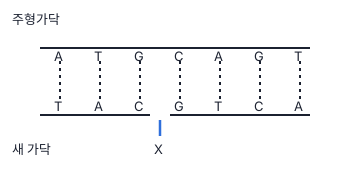
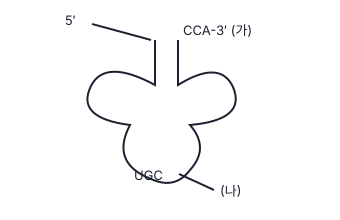

# 생명과학 5장 웹과제 예상 v3 문제해설

왼쪽 목차로 문항을 고르고, 오른쪽 문제를 보며 해설을 따라가요.

문제의 첫 줄부터 검산까지 설명해요.

**목차**

- [문항별 설명](#problems)
  - [P1. [기출 예상] 번역의 첫 아미노산](#p1)
  - [P2. [기출 예상] 돌연변이와 단백질의 변화](#p2)
  - [P3. [기출 변형] DNA 합성 방향의 뜻](#p3)
  - [P4. [기출 변형] mRNA 수송의 조절 단계](#p4)
  - [P5. [기출 변형] 네 자리 암호의 조합 수](#p5)
  - [P6. [예상] 염기는 있는데 줄은 끊어져 있어요](#p6)
  - [P7. [예상] 같은 DNA에서 서로 다른 작업을 시작해요](#p7)
  - [P8. [예상] tRNA의 두 끝 역할을 구별해요](#p8)
  - [P9. [예상] 잘라 내고 이어서 해독해요](#p9)
  - [P10. [예상] 유도가 끝나도 남아 있는 효소](#p10)
  - [P11. [예상] 히스톤에서 아세틸기가 떨어지면](#p11)
  - [P12. [예상] TATA 상자의 물질 종류](#p12)
  - [P13. [예상] 표적 서열이 바뀐 mRNA](#p13)
  - [P14. [예상] RNA 처리와 완성 단백질의 작동](#p14)
  - [P15. [예상] 표지와 분해 장치를 구별하기](#p15)

## 문항별 설명

### P1. [기출 예상] 번역의 첫 아미노산

기출 5강 38 예상 · [원 문제 보기](%EB%B3%B5%EC%8A%B5%EB%AC%B8%EC%A0%9C_5%EC%9E%A5_%EC%9B%B9%EA%B3%BC%EC%A0%9C%EC%98%88%EC%83%81_v3.html#p1)

어떤 아미노산이 번역 과정에서 맨 처음 시작하는가?

- A. 아르지닌
- B. 메싸이오닌
- C. 발린
- D. 글리신
- E. 페닐알라닌

원문·출처 정보 보기

기출 5강 합본 38번을 보기 순서만 바꿔 실은 예상 문제예요.

#### 무엇을 구하는 문제인가요

번역을 시작할 때 첫 번째로 연결하는 아미노산의 이름을 골라요. DNA 복제 시작점이나 첫 RNA 염기를 묻는 것이 아니에요.

#### 이 문제를 봤을 때 떠올릴 개념과 공식

‘번역 과정에서 맨 처음’이라는 말에서 번역 개시(translation initiation)와 개시 코돈(start codon)을 떠올려요. 번역은 mRNA 염기서열을 아미노산 서열로 바꾸는 과정이에요.

수업의 표준 모형에서 AUG가 개시 신호이며 메티오닌(methionine)을 지정해요. 코돈(codon)은 mRNA의 연속한 세 염기이고, 메싸이오닌과 메티오닌은 같은 아미노산의 표기예요. 개시 단계라는 조건 때문에 나머지 아미노산의 코돈을 모두 외울 필요는 없어요.

#### 종이에 쓰는 첫 줄

개시 코돈 AUG → 메티오닌(메싸이오닌).

필요한 개념: AUG는 개시 신호이며 메티오닌을 지정해요.

#### 왜 이렇게 푸는지 함께 따라가요

A. 틀려요. 아르지닌은 개시 코돈 AUG가 지정하는 아미노산이 아니에요.

B. 맞아요. 번역은 AUG에서 시작하며 AUG는 메싸이오닌(메티오닌)을 지정해요.

C. 틀려요. 발린은 AUG의 지정 결과가 아니에요.

D. 틀려요. 글리신은 AUG의 지정 결과가 아니에요.

E. 틀려요. 페닐알라닌은 UUU·UUC가 지정하며 AUG의 지정 결과가 아니에요.

따라서 B가 정답이에요.

#### 완성 답과 검산

B, 메싸이오닌이에요. 원문 합본 PDF 5쪽의 기출 38번은 인쇄 보기 3을 표시하며, 그 문장은 메싸이오닌이에요. 이 카드에서는 같은 문장을 B로 이동했으므로 번호 대신 문장으로 대조해도 일치해요.

#### 여기서 헷갈리기 쉬워요

‘첫 번째’라는 말을 보기 맨 위 A와 연결하지 않아요. 아미노산 이름의 다른 한글 표기를 별개의 물질로 보지 않아요.

#### 설명을 닫고 다시 해 봐요

- 개시 코돈을 쓰고 그것이 지정하는 아미노산을 말해요.
- 메싸이오닌과 메티오닌이 같은 이름인지 확인해요.

**페이지 요약**

#### 떠올릴 개념·공식

AUG는 개시 신호이며 메티오닌을 지정해요.

#### 첫 줄

개시 코돈 AUG → 메티오닌(메싸이오닌).

#### 핵심 판단

정답 B. AUG는 개시 신호이며 메티오닌을 지정해요.

#### 검산

원문 인쇄 3의 메싸이오닌 문장과 현재 B가 일치해요.

---

### P2. [기출 예상] 돌연변이와 단백질의 변화

기출 5강 36 예상 · [원 문제 보기](%EB%B3%B5%EC%8A%B5%EB%AC%B8%EC%A0%9C_5%EC%9E%A5_%EC%9B%B9%EA%B3%BC%EC%A0%9C%EC%98%88%EC%83%81_v3.html#p2)

유전자에 일어난 돌연변이는 _____________.

- A. 새로운 기능을 갖는 단백질을 만들 수 없다.
- B. 항상 개체의 표현형에 변화를 가져온다
- C. 기능이 없는 단백질을 반드시 만들어야 한다.
- D. 단백질을 만들 수 없다
- E. 유전자에 의해 만들어지는 단백질에 영향을 미치지 않을 수도 있다.

원문·출처 정보 보기

기출 5강 합본 36번을 보기 순서만 바꿔 실은 예상 문제예요.

#### 무엇을 구하는 문제인가요

돌연변이가 생겼다는 조건만으로 반드시 따라오는 결과와, 그중 일어날 수 있는 결과를 구별해요. DNA 변화가 단백질에 언제나 똑같은 효과를 내는지 확인해요.

#### 이 문제를 봤을 때 떠올릴 개념과 공식

‘돌연변이’와 ‘단백질에 영향’이 함께 나오므로 DNA 변화와 아미노산 변화의 관계를 떠올려요. 돌연변이(mutation)는 유전물질의 변화이고, 단백질 서열이 바뀌었다는 뜻 자체는 아니에요.

유전암호의 중복성(degeneracy)은 서로 다른 코돈이 같은 아미노산을 지정할 수 있다는 성질이에요. 따라서 염기가 치환되어도 아미노산이 유지되는 침묵 돌연변이(silent mutation)가 가능해요. 예를 들어 mRNA 코돈 GGU와 GGC는 모두 글리신이에요. 다른 변이는 아미노산이나 종결 위치를 바꿀 수 있으므로 결과를 하나로 단정하지 않아요.

#### 종이에 쓰는 첫 줄

DNA 변화 ≠ 아미노산 변화가 반드시 발생한다는 뜻.

필요한 개념: 염기가 바뀌어도 같은 아미노산이면 단백질 서열이 유지될 수 있어요.

#### 왜 이렇게 푸는지 함께 따라가요

A. 틀려요. 돌연변이로 아미노산 서열과 기능이 바뀌어 새로운 기능이 나타날 수도 있어요.

B. 틀려요. 같은 아미노산을 지정하는 코돈으로 바뀌는 침묵 변이는 표현형을 바꾸지 않을 수 있어요.

C. 틀려요. 침묵 변이에서는 기존 아미노산 서열이 유지되어 기능 있는 단백질이 만들어질 수 있어요.

D. 틀려요. 침묵 변이나 아미노산 한 개가 바뀌는 변이가 생겨도 단백질은 만들어질 수 있어요.

E. 맞아요. 코돈이 바뀌어도 같은 아미노산을 지정하면 단백질의 아미노산 서열은 유지될 수 있어요.

따라서 E가 정답이에요.

#### 완성 답과 검산

E예요. 강의노트 5장 p6의 침묵 돌연변이 정의와 별도로, GGU→GGC라는 구체적 반례를 대입해요. 염기는 달라졌지만 글리신은 유지되므로 ‘항상 표현형 변화’, ‘반드시 기능 없음’, ‘단백질 생성 불가’라는 필수 결과들이 무너져요. 기능 변화의 가능성을 막는 A도 성립하지 않아 E만 남아요.

#### 여기서 헷갈리기 쉬워요

침묵 변이를 DNA 변화가 없는 상태로 오해하지 않아요. ‘기능이 유지된다’는 결과만으로 침묵을 단정하지도 않아요. 여기서는 아미노산 서열이 같은 사례를 사용해요.

#### 설명을 닫고 다시 해 봐요

- 침묵 변이의 전후 코돈과 지정 아미노산을 하나 써요.
- 가능성을 묻는 문장과 필연성을 주장하는 문장을 구별해요.

**페이지 요약**

#### 떠올릴 개념·공식

염기가 바뀌어도 같은 아미노산이면 단백질 서열이 유지될 수 있어요.

#### 첫 줄

DNA 변화 ≠ 아미노산 변화가 반드시 발생한다는 뜻.

#### 핵심 판단

정답 E. 염기가 바뀌어도 같은 아미노산이면 단백질 서열이 유지될 수 있어요.

#### 검산

GGU→GGC는 염기 변화가 아미노산을 반드시 바꾸지 않는 반례예요.

---

### P3. [기출 변형] DNA 합성 방향의 뜻

기출 5강 46 예상 · [원 문제 보기](%EB%B3%B5%EC%8A%B5%EB%AC%B8%EC%A0%9C_5%EC%9E%A5_%EC%9B%B9%EA%B3%BC%EC%A0%9C%EC%98%88%EC%83%81_v3.html#p3)

복제 동안에 DNA는 5’ → 3’ 방향으로 합성이 된다. 이것은 무엇을 의미하는가?

- A. 새 가닥을 만들 때 주형가닥과 같은 방향으로 나란히 읽는다.
- B. 지연가닥의 오카자키 조각은 3′ → 5′ 방향으로 합성한다.
- C. 새 가닥을 5′ → 3′으로 연장할 때 주형가닥은 3′ → 5′ 방향으로 읽는다.
- D. 선도가닥에서는 새 뉴클레오타이드가 기존 가닥의 5′ 말단에 붙는다.
- E. 연결효소가 이중나선을 풀어 새 가닥의 합성 방향을 정한다.

원문·출처 정보 보기

기출 5강 합본 46번 발문에 정답을 바꾼 생성 변형이에요.

#### 무엇을 구하는 문제인가요

새 DNA가 5′→3′으로 자란다는 말이 주형을 읽는 방향과 어떻게 연결되는지 골라요. 새 가닥과 주형가닥을 따로 표시해야 해요.**인쇄 정답 오류:** 기출 46번 합본 PDF 5쪽은 원문 보기 1인 ‘주형 5′→3′ 읽기’를 인쇄 답으로 표시하지만 강의노트 p1–2의 역평행·3′-OH 연장 원리에 맞지 않아요. 원문 판단 답은 보기 3인 신생 사슬의 3′-OH 첨가이고, 보기를 바꾼 이 카드의 답은 C예요.

#### 이 문제를 봤을 때 떠올릴 개념과 공식

‘5′→3′ 방향으로 합성’에서 DNA 중합효소(DNA polymerase)의 연장 말단을 떠올려요. 5′와 3′은 당의 탄소 위치에 따른 가닥 방향 표시이며, 새 뉴클레오타이드는 기존 사슬의 3′-OH에 연결돼요.

새 가닥은 5′→3′으로 늘어나고, 서로 마주 보는 주형가닥은 역평행(antiparallel)이에요. 그래서 중합효소가 진행하며 읽는 주형 방향은 3′→5′이에요. 선도·지연가닥 모두 이 연장 원리를 따르며 지연가닥도 각 조각 자체는 5′→3′으로 만들어져요.

#### 종이에 쓰는 첫 줄

새 가닥: 5′→3′ / 주형을 읽는 방향: 3′→5′.

필요한 개념: 새 가닥 5′→3′ 합성, 주형 3′→5′ 읽기예요.

#### 왜 이렇게 푸는지 함께 따라가요

A. 틀려요. 주형가닥과 새 가닥은 역평행이므로 읽는 방향과 합성 방향은 반대예요.

B. 틀려요. 지연가닥의 각 오카자키 조각도 5′ → 3′ 방향으로 합성돼요.

C. 맞아요. 신생 DNA의 3′ 말단을 연장하므로 역평행인 주형은 3′ → 5′으로 읽어요.

D. 틀려요. 선도가닥에서도 뉴클레오타이드는 3′ 말단에 첨가돼요.

E. 틀려요. 이중나선을 푸는 것은 헬리케이스이고 연결효소는 절편 사이의 골격을 이어요.

기출 원문의 인쇄 보기 1은 주형을 5′→3′으로 읽는다고 하여 강의노트 p1–2의 역평행 원리와 어긋나요. 이 카드에서는 원문 보기들을 새로 작성했으므로 원문의 인쇄 번호를 현재 보기 번호로 옮기지 않아요.

따라서 C가 정답이에요.

#### 완성 답과 검산

C예요. 강의노트 5장 p1의 ‘기존 사슬 3′-OH에 첨가’와 p2의 ‘두 가닥 역평행’을 별도로 대조해요. 두 사실을 함께 만족하려면 주형 읽기는 3′→5′이어야 해요. 교재 p117 문제 2도 신생 사슬 3′-OH 첨가를 직접 제시해 원문 인쇄 보기 1의 방향과 어긋남을 확인할 수 있어요.

#### 여기서 헷갈리기 쉬워요

합본의 빨간 번호를 그대로 외우지 않아요. 원문에서는 ‘3′-OH 첨가’가 판단 답이고, 이 변형에서는 다른 보기 문장인 ‘주형 3′→5′ 읽기’가 답이에요. 시험에서 인쇄 답을 만나도 새 가닥·주형·말단을 써서 근거를 남겨요.

#### 설명을 닫고 다시 해 봐요

- 새 가닥과 주형의 양끝을 역평행으로 표시해요.
- 새 뉴클레오타이드가 붙는 OH 말단을 말해요.

**페이지 요약**

#### 떠올릴 개념·공식

새 가닥 5′→3′ 합성, 주형 3′→5′ 읽기예요.

#### 첫 줄

새 가닥: 5′→3′ / 주형을 읽는 방향: 3′→5′.

#### 핵심 판단

정답 C. 새 가닥 5′→3′ 합성, 주형 3′→5′ 읽기예요.

#### 검산

강의노트 p1–2의 3′-OH 연장과 역평행, 교재 p117 문제 2로 대조해요.

---

### P4. [기출 변형] mRNA 수송의 조절 단계

기출 5강 13 예상 · [원 문제 보기](%EB%B3%B5%EC%8A%B5%EB%AC%B8%EC%A0%9C_5%EC%9E%A5_%EC%9B%B9%EA%B3%BC%EC%A0%9C%EC%98%88%EC%83%81_v3.html#p4)

mRNA가 세포질로 이동하는 것을 통제하는 것은 다음 중 어느 것에 해당하는가?

- A. 이미 전사된 RNA를 번역 장소로 보내는 단계의 조절
- B. DNA를 복제하여 유전자 사본 수를 늘리는 단계의 조절
- C. RNA 중합효소가 프로모터에서 전사를 시작하는 단계의 조절
- D. 리보솜에서 아미노산 사이의 결합을 만드는 단계의 조절
- E. 합성된 단백질을 분해하여 수명을 바꾸는 단계의 조절

원문·출처 정보 보기

기출 5강 합본 13번 발문에 정답을 바꾼 생성 변형이에요.

#### 무엇을 구하는 문제인가요

이미 존재하는 mRNA를 핵에서 세포질로 내보내는 조절이 유전자 발현의 어느 단계인지 찾아요. 생성, 이동, 번역, 단백질 처리의 순서를 나눠요.

#### 이 문제를 봤을 때 떠올릴 개념과 공식

‘mRNA가 세포질로 이동’은 RNA가 이미 만들어졌다는 단서예요. 전사(transcription)는 DNA를 주형으로 RNA를 만드는 과정이고, 전사 후 조절(post-transcriptional regulation)은 만들어진 RNA의 가공·수송·수명 등을 조절해요.

진핵세포에서 핵 안에서 만들어지고 가공된 mRNA는 세포질의 리보솜에서 번역돼요. 그러므로 핵 밖 수송은 전사 뒤, 번역 전에 놓여요. ‘전사 후’는 번역을 마친 뒤라는 뜻이 아니에요.

#### 종이에 쓰는 첫 줄

전사 → mRNA 가공·핵 밖 수송 → 번역 → 단백질 처리.

필요한 개념: 핵 밖 mRNA 수송은 전사 후 조절이에요.

#### 왜 이렇게 푸는지 함께 따라가요

A. 맞아요. mRNA의 핵 밖 수송은 RNA가 만들어진 뒤 번역에 쓰이기 전에 일어나는 전사 후 조절이에요.

B. 틀려요. 수송 대상은 만들어진 RNA이며 DNA 사본 수를 늘리는 과정이 아니에요.

C. 틀려요. 프로모터에서 전사를 시작하는 것은 전사 조절이고, 수송 시점에는 mRNA가 이미 있어요.

D. 틀려요. 아미노산 연결은 번역 단계이고 mRNA 수송은 그 전에 일어나요.

E. 틀려요. 단백질 수명 조절은 번역 후 조절이며 RNA 수송과 대상이 달라요.

따라서 A가 정답이에요.

#### 완성 답과 검산

A예요. 교재 p117 문제 6은 같은 핵심인 mRNA의 세포질 이동을 조절 단계 중 고르게 해요. 시간 순서와 별도로 조절 대상을 살펴봐도 RNA의 이동이므로 DNA 사본 수나 단백질 처리인 B·E와 구별돼요. C는 RNA 생성 시작, D는 아미노산 연결이므로 현재 조절 대상과 맞지 않아요.

#### 여기서 헷갈리기 쉬워요

‘세포질’이라는 장소만 보고 번역 조절로 고르지 않아요. 물질이 그곳으로 이동하는 것과 리보솜이 그 물질을 읽는 일은 달라요.

#### 설명을 닫고 다시 해 봐요

- mRNA 수송을 전사와 번역 사이에 놓아요.
- 전사 후와 번역 후의 조절 대상을 각각 말해요.

**페이지 요약**

#### 떠올릴 개념·공식

핵 밖 mRNA 수송은 전사 후 조절이에요.

#### 첫 줄

전사 → mRNA 가공·핵 밖 수송 → 번역 → 단백질 처리.

#### 핵심 판단

정답 A. 핵 밖 mRNA 수송은 전사 후 조절이에요.

#### 검산

교재 p117 문제 6과 수송 대상이 RNA라는 점을 대조해요.

---

### P5. [기출 변형] 네 자리 암호의 조합 수

기출 5강 12 예상 · [원 문제 보기](%EB%B3%B5%EC%8A%B5%EB%AC%B8%EC%A0%9C_5%EC%9E%A5_%EC%9B%B9%EA%B3%BC%EC%A0%9C%EC%98%88%EC%83%81_v3.html#p5)

만약 네 개의 뉴클레오타이드가 하나의 아미노산을 결정하는 데 사용된다면, 단백질 합성 시 몇 개의 아미노산을 지정할 수 있는가? 단, A·U·C·G 네 종류를 사용하며, 서로 다른 네 자리 암호는 각각 서로 다른 아미노산을 지정하고 종결 암호는 없다고 가정한다.

- A. 16
- B. 64
- C. 128
- D. 256
- E. 1024

원문·출처 정보 보기

기출 5강 합본 12번의 두 개 뉴클레오타이드 조건을 네 개로 바꾸고 중복·종결 배정이 없다는 가상 조건을 명시한 생성 변형이에요.

#### 무엇을 구하는 문제인가요

실제 세 염기 코돈 대신 네 자리 암호를 쓰는 가상 상황이에요. 염기는 네 종류이고, 각 암호가 서로 다른 아미노산을 지정하며 종결 암호가 없다는 조건으로 지정 가능한 종류 수를 세어요.

#### 이 문제를 봤을 때 떠올릴 개념과 공식

‘네 종류’, ‘네 자리’라는 두 수에서 곱셈 원리(product rule)를 떠올려요. 첫 자리부터 마지막 자리까지 각각 A·U·C·G 네 선택지가 있고, 같은 염기를 여러 자리에 써도 돼요.

염기 종류 수를 k, 자리 수를 n이라 하면 배열 수는 kⁿ이에요. 서로 다른 암호가 서로 다른 아미노산을 지정하고 종결 암호가 없다는 이 문제의 추가 조건 때문에 배열 수를 그대로 아미노산 종류 수로 사용할 수 있어요. 실제 표준 유전암호의 중복성과 종결 세 개를 이 가상 조건에 가져오지 않아요.

#### 종이에 쓰는 첫 줄

첫째 자리 4 × 둘째 자리 4 × 셋째 자리 4 × 넷째 자리 4.

필요한 개념: k종 염기 n자리의 배열 수는 kⁿ이며 여기서는 4⁴=256이에요.

#### 왜 이렇게 푸는지 함께 따라가요

A. 틀려요. 16은 네 종류 염기를 두 자리로 배열하는 4²의 값이에요.

B. 틀려요. 64는 세 자리 암호의 조합 수인 4³의 값이에요.

C. 틀려요. 각 자리마다 네 종류를 선택하므로 4×4×4×4를 계산해야 해요.

D. 맞아요. 네 자리 각각에 네 종류 염기가 올 수 있으므로 4⁴=256가지예요.

E. 틀려요. 1024는 다섯 자리 암호의 조합 수인 4⁵의 값이에요.

따라서 D가 정답이에요.

#### 완성 답과 검산

D, 256이에요. 네 자리를 앞 두 자리와 뒤 두 자리로 나누어 다시 세면 각각 4²=16가지예요. 앞 묶음 16가지마다 뒤 묶음 16가지가 오므로 16×16=256이에요. 한 자리씩 곱한 결과와 묶음으로 센 결과가 같아요.

#### 여기서 헷갈리기 쉬워요

4×4=16은 종류 수와 자리 수를 단순히 곱한 값이에요. 또한 이 문제는 종결 암호가 없다고 명시했으므로 256에서 3을 빼지 않아요.

#### 설명을 닫고 다시 해 봐요

- 각 자리 아래에 네 선택지를 표시해요.
- 종결과 중복 배정 조건을 확인한 뒤 경우의 수를 해석해요.

**페이지 요약**

#### 떠올릴 개념·공식

k종 염기 n자리의 배열 수는 kⁿ이며 여기서는 4⁴=256이에요.

#### 첫 줄

첫째 자리 4 × 둘째 자리 4 × 셋째 자리 4 × 넷째 자리 4.

#### 핵심 판단

정답 D. k종 염기 n자리의 배열 수는 kⁿ이며 여기서는 4⁴=256이에요.

#### 검산

앞 두 자리 16 × 뒤 두 자리 16 = 256으로 다시 세어요.

---

### P6. [예상] 염기는 있는데 줄은 끊어져 있어요

예상 5장 6 · [원 문제 보기](%EB%B3%B5%EC%8A%B5%EB%AC%B8%EC%A0%9C_5%EC%9E%A5_%EC%9B%B9%EA%B3%BC%EC%A0%9C%EC%98%88%EC%83%81_v3.html#p6)

복제 중 RNA 프라이머를 제거하고 DNA로 채운 뒤, DNA 연결효소의 작용만 차단했어요. 그림은 그때 관찰한 지연가닥 일부예요. 실선은 당-인산 골격, 세로 점선은 상보적 염기 사이의 결합을 나타내요. 그림과 처리 조건에 대한 설명으로 **옳지 않은 것**은 무엇인가요?

- A. X의 끊김은 그 위치의 DNA 염기 하나가 빠져 있다는 뜻이에요.
- B. 주형과 새 가닥의 염기가 짝지어져도 새 가닥 골격에는 끊김이 남을 수 있어요.
- C. 연결효소가 다시 작용하면 X의 골격 결합을 이을 수 있어요.
- D. 프라이머를 DNA로 교체하는 일과 조각 사이 골격을 잇는 일은 구별돼요.
- E. 그림의 새 가닥은 아직 하나의 연속된 골격으로 완성되지 않았어요.

원문·출처 정보 보기

1001 정리노트의 닉과 연결효소 역할에 근거한 새 예상 문제예요.

#### 무엇을 구하는 문제인가요

프라이머 자리는 이미 DNA로 채웠고 연결효소만 막았어요. X 주변에 염기가 있는지와 새 가닥의 실선 골격이 이어졌는지를 따로 봐요. **질문은 옳지 않은 설명을 고르는 부정형이에요.**

#### 이 문제를 봤을 때 떠올릴 개념과 공식

‘DNA로 채운 뒤 연결효소만 차단’이라는 순서가 단서예요. DNA 중합효소가 뉴클레오타이드를 채우는 일과 DNA 연결효소(DNA ligase)가 이웃 절편의 골격을 잇는 일은 달라요.

당-인산 골격(sugar-phosphate backbone)은 한 가닥 안의 공유결합 연결이고, 염기쌍의 수소결합은 두 가닥 사이의 연결이에요. 염기는 모두 있고 골격 연결만 끊긴 자리를 닉(nick)이라고 해요. 그림의 세로 점선과 가로 실선을 서로 다른 결합으로 읽는 이유가 이것이에요.

#### 종이에 쓰는 첫 줄

X: 염기는 있음 / 새 가닥 당-인산 골격의 연결만 끊김.

필요한 개념: 염기가 채워져도 연결효소 작용 전에는 골격 닉이 남을 수 있어요.

#### 왜 이렇게 푸는지 함께 따라가요

A. 틀려요. 그림에는 X 부근에도 염기가 모두 있으며, 끊긴 것은 당-인산 골격의 결합이에요.

B. 맞아요. 두 가닥 사이 상보적 염기쌍과 한 가닥 안의 골격 결합은 서로 다른 연결이에요.

C. 맞아요. DNA 연결효소는 이처럼 염기가 채워진 뒤 남은 닉에서 골격의 공유결합을 형성해요.

D. 맞아요. 프라이머 자리를 DNA로 채워도 이웃 조각 사이 닉은 별도로 연결해야 해요.

E. 맞아요. X의 골격 결합이 끊어져 있으므로 염기가 채워졌다는 사실만으로 마무리된 것은 아니에요.

따라서 틀린 설명인 A가 정답이에요.

#### 완성 답과 검산

A가 틀린 설명이므로 정답이에요. 그림의 염기를 왼쪽부터 다시 짝지으면 A–T, T–A, G–C, C–G, A–T, G–C, T–A로 빠진 염기가 없어요. 그런데 X의 가로 실선은 끊겨 있어 염기 결손보다 골격 결합의 미완성을 뜻해요. 이 관찰은 프라이머 자리가 이미 DNA로 채워졌다는 조건과도 맞아요.

#### 여기서 헷갈리기 쉬워요

그림의 하얀 틈을 모두 ‘염기 하나 없음’으로 읽지 않아요. 가로 골격과 세로 염기쌍 중 어느 선이 끊겼는지 확인해요.

#### 설명을 닫고 다시 해 봐요

- X 주변의 염기 두 쌍을 직접 찾아요.
- DNA를 채우는 일과 조각을 잇는 효소를 구별해요.

**페이지 요약**

#### 떠올릴 개념·공식

염기가 채워져도 연결효소 작용 전에는 골격 닉이 남을 수 있어요.

#### 첫 줄

X: 염기는 있음 / 새 가닥 당-인산 골격의 연결만 끊김.

#### 핵심 판단

정답 A. 염기가 채워져도 연결효소 작용 전에는 골격 닉이 남을 수 있어요.

#### 검산

일곱 염기쌍은 모두 있고 X의 골격만 끊겼어요.

---

### P7. [예상] 같은 DNA에서 서로 다른 작업을 시작해요

예상 5장 7 · [원 문제 보기](%EB%B3%B5%EC%8A%B5%EB%AC%B8%EC%A0%9C_5%EC%9E%A5_%EC%9B%B9%EA%B3%BC%EC%A0%9C%EC%98%88%EC%83%81_v3.html#p7)

세포가 염색체 DNA를 복사하는 작업과, 특정 유전자의 RNA 사본을 만드는 작업을 구분하려고 해요. 두 작업의 **시작과 관련된 DNA 부위**를 바르게 짝지은 것은 무엇인가요?

- A. DNA 복사 — 프로모터 / RNA 사본 생성 — 복제원점
- B. DNA 복사 — 안티코돈 / RNA 사본 생성 — 프로모터
- C. DNA 복사 — 복제원점 / RNA 사본 생성 — 프로모터
- D. DNA 복사 — 복제원점 / RNA 사본 생성 — 종결 코돈
- E. DNA 복사 — 프로모터 / RNA 사본 생성 — 안티코돈

원문·출처 정보 보기

1001 정리노트의 복제 효소 토픽에 명시된 복제원점과 1006 정리노트의 프로모터를 비교한 새 예상 문제예요.

#### 무엇을 구하는 문제인가요

DNA에서 DNA를 만드는 작업과 DNA에서 RNA 사본을 만드는 작업의 시작 관련 DNA 부위를 각각 연결해요.

#### 이 문제를 봤을 때 떠올릴 개념과 공식

‘염색체 DNA를 복사’는 복제(replication), ‘특정 유전자의 RNA 사본’은 전사(transcription)를 뜻해요. 둘 다 DNA 정보를 이용하지만 최종 생산물이 달라 시작을 담당하는 부위의 이름도 구별해야 해요.

복제원점(origin of replication)은 DNA 복제가 시작되는 위치이고, 프로모터(promoter)는 RNA 중합효소의 결합과 전사 시작에 관여하는 DNA 서열이에요. 반면 안티코돈(anticodon)은 tRNA의 세 염기 부분이며, 종결 코돈(stop codon)은 번역 종료 신호예요. 이 문제는 ‘시작 관련 DNA 부위’를 물으므로 이 둘은 대체할 수 없어요.

#### 종이에 쓰는 첫 줄

DNA→DNA: 복제원점 / DNA→RNA: 프로모터.

필요한 개념: 복제원점은 DNA 복제, 프로모터는 전사 시작과 관련돼요.

#### 왜 이렇게 푸는지 함께 따라가요

A. 틀려요. 복제원점과 프로모터의 대응이 서로 뒤바뀌었어요.

B. 틀려요. 안티코돈은 tRNA의 일부이며 DNA 복제 시작 부위가 아니에요.

C. 맞아요. DNA 복제는 복제원점에서 시작하고, 전사 시작에는 RNA 중합효소가 결합하는 프로모터가 관여해요.

D. 틀려요. 종결 코돈은 번역을 끝내는 신호이며 RNA 사본 생성을 시작하는 부위가 아니에요.

E. 틀려요. 프로모터는 전사 시작에 관여하고 안티코돈은 tRNA에 있으므로 두 대응 모두 맞지 않아요.

따라서 C가 정답이에요.

#### 완성 답과 검산

C예요. 시간 순서 대신 물질 종류로 소거해요. 안티코돈은 tRNA의 부분이므로 B·E는 DNA 시작 부위를 짝짓지 못해요. 종결 코돈은 RNA를 만드는 전사의 시작이 아니므로 D도 제외해요. 남은 A·C 중 DNA 복제에 복제원점을 연결한 C를 고르면 두 기능이 함께 맞아요. 강의노트 p4는 프로모터를 전사 시작 관련 DNA 서열로 정의해요.

#### 여기서 헷갈리기 쉬워요

코돈이나 안티코돈처럼 익숙한 말이 나와도 ‘시작’과 ‘DNA 부위’라는 두 조건을 모두 확인해요.

#### 설명을 닫고 다시 해 봐요

- 복제와 전사의 생산물을 각각 써요.
- 복제원점과 프로모터를 생산물에 연결해요.

**페이지 요약**

#### 떠올릴 개념·공식

복제원점은 DNA 복제, 프로모터는 전사 시작과 관련돼요.

#### 첫 줄

DNA→DNA: 복제원점 / DNA→RNA: 프로모터.

#### 핵심 판단

정답 C. 복제원점은 DNA 복제, 프로모터는 전사 시작과 관련돼요.

#### 검산

안티코돈은 tRNA, 종결 코돈은 번역 종료라 제외해요.

---

### P8. [예상] tRNA의 두 끝 역할을 구별해요

예상 5장 8 · [원 문제 보기](%EB%B3%B5%EC%8A%B5%EB%AC%B8%EC%A0%9C_5%EC%9E%A5_%EC%9B%B9%EA%B3%BC%EC%A0%9C%EC%98%88%EC%83%81_v3.html#p8)

그림은 한 tRNA의 두 기능 부위 (가), (나)를 단순화한 것이에요. 그림에 대한 설명으로 **옳지 않은 것**은 무엇인가요?

- A. (가)의 마지막 A는 아미노산이 붙는 자리예요.
- B. (나)는 mRNA 코돈과 상보적으로 짝지을 수 있어요.
- C. (가)의 CCA와 (나)의 세 염기는 같은 tRNA 안의 서로 다른 부위예요.
- D. (가)의 CCA가 mRNA 코돈과 짝지어 다음 아미노산의 순서를 읽어요.
- E. (나)의 세 염기는 안티코돈이라고 불러요.

원문·출처 정보 보기

1006 정리노트의 3′ CCA 말단과 안티코돈 구별에 근거한 새 예상 문제예요.

#### 무엇을 구하는 문제인가요

tRNA의 위쪽 (가)는 CCA-3′ 말단, 아래쪽 (나)는 UGC가 적힌 고리예요. 두 부분의 역할을 구별해요. **옳지 않은 설명을 골라야 해요.**

#### 이 문제를 봤을 때 떠올릴 개념과 공식

한 tRNA에 ‘CCA’와 ‘세 염기 고리’가 함께 표시되어 있으므로 아미노산 부착 부위와 안티코돈(anticodon)을 떠올려요. tRNA(transfer RNA)는 알맞은 아미노산을 리보솜으로 운반하는 RNA예요.

아미노산은 3′ 말단 CCA의 마지막 A에 붙고, 안티코돈은 mRNA 코돈과 상보적·역평행으로 짝지어요. 앞쪽 기능은 재료 운반, 뒤쪽 기능은 암호 인식에 해당해요. 세 염기라는 길이가 같아도 두 부위의 위치와 기능이 같아지지는 않아요.

#### 종이에 쓰는 첫 줄

(가) CCA-3′: 아미노산 부착 / (나) 안티코돈: mRNA 코돈 인식.

필요한 개념: CCA 말단은 부착, 안티코돈은 코돈 인식이에요.

#### 왜 이렇게 푸는지 함께 따라가요

A. 맞아요. 아미노산은 3′ 말단 CCA의 마지막 A에 붙어요.

B. 맞아요. (나)는 안티코돈이므로 mRNA 코돈과 역평행·상보적으로 짝지어요.

C. 맞아요. CCA 말단과 안티코돈은 한 tRNA 안에서 위치와 기능이 달라요.

D. 틀려요. 코돈을 읽는 부위는 (나)의 안티코돈이고 (가)는 아미노산 부착 부위예요.

E. 맞아요. 그림에서 아래 고리의 UGC가 안티코돈으로 표시되어 있어요.

따라서 틀린 설명인 D가 정답이에요.

#### 완성 답과 검산

D가 틀린 설명이므로 정답이에요. 강의노트 5장 p5의 tRNA 구조 설명은 안티코돈이 mRNA와 염기쌍을 이루고 그 반대쪽 CCA-3′-OH에 아미노산이 붙는다고 구별해요. 이 두 독립 기능을 그림에 다시 대입하면 (가)는 부착, (나)는 인식으로 대응되어 D의 역할 바꾸기를 확인할 수 있어요.

#### 여기서 헷갈리기 쉬워요

CCA도 세 염기라서 안티코돈이라고 이름 붙이지 않아요. 이 그림의 UGC는 방향 표기가 없어 상보 코돈 서열 계산에는 쓰지 않고 위치·역할만 판별해요.

#### 설명을 닫고 다시 해 봐요

- 아미노산을 붙일 곳을 그림에서 가리켜요.
- 코돈을 읽는 부위의 이름과 위치를 말해요.

**페이지 요약**

#### 떠올릴 개념·공식

CCA 말단은 부착, 안티코돈은 코돈 인식이에요.

#### 첫 줄

(가) CCA-3′: 아미노산 부착 / (나) 안티코돈: mRNA 코돈 인식.

#### 핵심 판단

정답 D. CCA 말단은 부착, 안티코돈은 코돈 인식이에요.

#### 검산

강의노트 p5에서 부착 말단과 안티코돈의 기능을 대조해요.

---

### P9. [예상] 잘라 내고 이어서 해독해요

예상 5장 9 · [원 문제 보기](%EB%B3%B5%EC%8A%B5%EB%AC%B8%EC%A0%9C_5%EC%9E%A5_%EC%9B%B9%EA%B3%BC%EC%A0%9C%EC%98%88%EC%83%81_v3.html#p9)

어떤 진핵 유전자의 **DNA 주형가닥** 일부를 표에 나타냈어요. 표의 구간은 위에서 아래 순서로 이어져 있고, 각 구간의 서열은 왼쪽에서 오른쪽으로 **3′→5′** 방향이에요. 이 영역 전체가 전사된 다음 인트론만 제거돼요. 성숙 mRNA의 첫 AUG에서 번역을 시작하여 처음 만나는 종결 코돈에서 끝낼 때, 만들어지는 짧은 폴리펩티드는 무엇인가요? 개시 메티오닌은 유지되며, 아래 코돈표를 사용해요.

| 구간 순서 | 구분 | DNA 주형 서열 (3′→5′) |
|---|---|---|
| 1 | 엑손 1 | TACCG |
| 2 | 인트론 | GGTG |
| 3 | 엑손 2 | ATTTATT |

| mRNA 코돈 (5′→3′) | 지정 결과 |
|---|---|
| AUG | 메티오닌 |
| GCU | 알라닌 |
| AAA | 라이신 |
| UAA | 종결 |
| GGU | 글리신 |
| CCC | 프롤린 |
| ACU | 트레오닌 |

- A. 메티오닌–글리신–라이신 (3개)
- B. 메티오닌–알라닌–라이신 (3개)
- C. 메티오닌–알라닌–라이신–종결 아미노산 (4개)
- D. 메티오닌–프롤린–트레오닌–라이신 (4개)
- E. 메티오닌–라이신 (2개)

원문·출처 정보 보기

1006 정리노트의 전사·스플라이싱·코돈 해독을 연결한 생성 문제예요. 서열과 코돈표는 이 문항을 위해 제시했어요.

#### 무엇을 구하는 문제인가요

표의 DNA는 주형이고 각 행이 3′→5′이에요. 전체를 RNA로 바꾼 후 인트론을 빼고, 남은 RNA의 첫 AUG부터 세 염기씩 읽어 아미노산 사슬을 구해요.

#### 이 문제를 봤을 때 떠올릴 개념과 공식

‘DNA 주형 3′→5′’는 전사(transcription)의 상보적 RNA를 5′→3′으로 쓰라는 단서예요. 대응 규칙은 DNA T→RNA A, A→U, C→G, G→C예요. RNA에는 T 대신 U가 있어요.

‘전체가 전사된 뒤 인트론 제거’는 스플라이싱(splicing)을 뜻해요. 엑손(exon)은 가공 뒤 남고 인트론(intron)은 전구체 RNA에서 제거돼요. 엑손 경계가 코돈 경계일 필요는 없으므로 두 엑손을 먼저 이어야 해요.

번역(translation)은 이어진 성숙 mRNA의 AUG에서 시작해 세 염기씩 읽고 첫 종결 코돈에서 끝나요. 문제에서 개시 메티오닌을 유지한다고 했고, 종결 코돈은 아미노산 하나를 추가하지 않아요.

#### 종이에 쓰는 첫 줄

전구체 RNA 5′-AUGGC | CCAC | UAAAUAA-3′ (가운데 CCAC가 인트론).

필요한 개념: 전사 → 인트론 제거·엑손 연결 → AUG부터 코돈 해독해요.

#### 왜 이렇게 푸는지 함께 따라가요

먼저 전사하면 엑손 1은 AUGGC, 인트론은 CCAC, 엑손 2는 UAAAUAA예요. 가운데 CCAC만 제거하여 5′-AUGGCUAAAUAA-3′를 얻어요.

이어진 서열을 AUG | GCU | AAA | UAA로 나누어요. 주어진 표에서 각각 메티오닌 | 알라닌 | 라이신 | 종결이므로 사슬에는 세 아미노산만 들어가요.

A. 틀려요. 가공 뒤 두 번째 코돈은 GCU이므로 글리신이 아니라 알라닌이에요.

B. 맞아요. 전구체 RNA는 5′-AUGGC|CCAC|UAAAUAA-3′이고 가운데 인트론을 제거하면 5′-AUGGCUAAAUAA-3′가 되어 AUG·GCU·AAA·UAA로 읽어요. 종결을 제외한 세 아미노산이 연결돼요.

C. 틀려요. UAA는 사슬을 끝내는 신호이며 종결 아미노산을 하나 더 붙이지 않아요.

D. 틀려요. 인트론은 성숙 mRNA에서 제거되므로 그 구간의 염기를 남겨 폴리펩티드를 해독하지 않아요.

E. 틀려요. 엑손 1 끝의 GC와 엑손 2 시작의 U가 합쳐 GCU가 되므로 알라닌도 포함돼요.

따라서 B가 정답이에요.

#### 완성 답과 검산

B, 메티오닌–알라닌–라이신이에요. 다른 순서로 검산해요. DNA 주형에서 엑손만 원래 순서로 붙이면 3′-TACCGATTTATT-5′이고, 이에 상보적인 RNA는 5′-AUGGCUAAAUAA-3′예요. RNA는 12염기이므로 네 코돈이고 마지막 UAA는 종결이라 실제 아미노산은 세 개예요. 전사 후 제거한 결과와 엑손 주형을 먼저 모아 상보서열을 만든 검산 결과가 같아요.

#### 여기서 헷갈리기 쉬워요

엑손마다 번역을 새로 시작하지 않아요. 엑손 1의 끝 GC와 엑손 2의 첫 U가 연결되어 하나의 GCU를 만들어요. 마지막 UAA를 ‘종결 아미노산’으로 세지 않아요.

#### 설명을 닫고 다시 해 봐요

- 세 구간을 RNA로 전사하고 인트론을 표시해요.
- 엑손을 연결한 뒤 AUG부터 세 칸씩 끊어요.
- 종결을 제외하고 아미노산 수를 세어요.

**페이지 요약**

#### 떠올릴 개념·공식

전사 → 인트론 제거·엑손 연결 → AUG부터 코돈 해독해요.

#### 첫 줄

전구체 RNA 5′-AUGGC | CCAC | UAAAUAA-3′ (가운데 CCAC가 인트론).

#### 핵심 판단

정답 B. 전사 → 인트론 제거·엑손 연결 → AUG부터 코돈 해독해요.

#### 검산

엑손 DNA를 먼저 모아 전사해도 12염기·4코돈·3아미노산이에요.

---

### P10. [예상] 유도가 끝나도 남아 있는 효소

예상 5장 10 · [원 문제 보기](%EB%B3%B5%EC%8A%B5%EB%AC%B8%EC%A0%9C_5%EC%9E%A5_%EC%9B%B9%EA%B3%BC%EC%A0%9C%EC%98%88%EC%83%81_v3.html#p10)

포도당이 없는 조건에서 정상 대장균의 lac 오페론을 충분히 유도했어요. 이후 젖당을 제거하고, 세포 안의 알로락토스도 줄어 억제자에 더 이상 결합하지 않는 상태가 되었어요. 이 시점부터 잠시 관찰하는 동안, 앞서 만들어진 젖당 분해 효소는 아직 분해되지 않고 활성을 유지한다고 가정해요. 억제자와 작동자는 정상이에요. **새 lac mRNA 생성과 기존 효소의 상태**를 가장 잘 설명한 것은 무엇인가요?

- A. 유도자가 없어지면 억제자도 작동자에서 떨어지므로 새 mRNA 생성이 더 활발해져요.
- B. 억제자가 작동자에 다시 결합하면 앞서 만들어진 효소도 즉시 활성을 잃어요.
- C. 기존 효소가 남아 있다는 사실은 새 mRNA 생성이 젖당 제거 전과 같은 높은 속도로 계속된다는 뜻이에요.
- D. 유도자는 RNA 중합효소 자체이므로 제거되면 모든 유전자의 전사가 함께 멈춰요.
- E. 억제자가 작동자에 다시 결합하여 새 lac mRNA 생성은 줄어들지만, 기존 효소의 활성은 당분간 남을 수 있어요.

원문·출처 정보 보기

1006 정리노트의 lac 전사 억제를 시간 변화에 적용한 새 예상 문제예요. 기존 효소의 잔류와 활성 유지 여부는 문제의 관찰 조건으로 제공했어요.

#### 무엇을 구하는 문제인가요

유도자 알로락토스가 억제자에서 떨어진 뒤의 새 mRNA 생산과, 이미 만들어져 아직 활성이 유지된 효소를 각각 판단해요. 기존 효소의 활성 유지가 문제의 조건이에요.

#### 이 문제를 봤을 때 떠올릴 개념과 공식

‘알로락토스가 더 이상 결합하지 않는다’와 ‘정상 억제자’에서 lac 오페론의 억제 회복을 떠올려요. 오페론(operon)은 조절 DNA 서열과 함께 발현되는 유전자들의 단위예요. 작동자(operator)는 DNA 부위이고 억제자(repressor)는 거기에 결합해 전사를 억제하는 단백질이에요.

알로락토스(allolactose)는 억제자에 붙어 작동자 결합을 약하게 하는 유도자(inducer)예요. 유도자가 사라지면 정상 억제자가 작동자에 다시 결합하여 새 전사를 줄여요. 이는 이미 합성된 효소를 직접 제거하거나 불활성화하는 작용과 달라요. 포도당이 없다는 고정 조건과 효소 활성 유지라는 명시 조건 안에서 두 결과를 구별하면 돼요.

#### 종이에 쓰는 첫 줄

알로락토스 결합 소실 → 억제자–작동자 결합 회복 → 새 lac mRNA 감소.

필요한 개념: 새 전사는 줄어도 기존 효소 활성은 조건에 따라 남을 수 있어요.

#### 왜 이렇게 푸는지 함께 따라가요

A. 틀려요. 유도자가 결합하지 않으면 정상 억제자는 작동자에 다시 결합하여 전사를 억제해요.

B. 틀려요. 작동자 결합은 새 전사를 억제하며, 앞서 만든 효소가 아직 활성을 유지한다는 조건과 즉시 불활성화는 맞지 않아요.

C. 틀려요. 기존 단백질은 새 mRNA 생성이 감소한 뒤에도 남을 수 있으므로 효소의 존재만으로 현재 전사 속도를 판단하지 않아요.

D. 틀려요. 알로락토스는 억제자에 결합하는 유도자이며 RNA 중합효소가 아니에요.

E. 맞아요. 알로락토스 결합 소실로 억제자의 작동자 결합이 회복되어 새 lac 전사는 억제되지만, 이미 만들어진 효소는 제시 조건에 따라 활성이 남아요.

따라서 E가 정답이에요.

#### 완성 답과 검산

E예요. 조건을 두 칸으로 나누어 독립 확인해요. ‘현재 DNA에서 새로 만드는 것’ 칸에는 억제자 결합에 따른 mRNA 생성 감소가 들어가요. ‘이미 만들어져 존재하는 것’ 칸에는 발문에 주어진 효소 활성 유지가 들어가요. A·D는 조절 원리와 맞지 않고 B는 명시 조건을 어기며 C는 과거 생산물이 현재 전사량을 보장한다고 추론해 두 칸을 섞어요.

#### 여기서 헷갈리기 쉬워요

전사 억제라는 말에서 모든 기존 단백질이 즉시 사라진다고 생각하지 않아요. 억제된 전사가 반드시 완전히 0이라는 뜻도 아니므로 ‘줄어든다’는 결과로 해석해요.

#### 설명을 닫고 다시 해 봐요

- 유도자가 없어졌을 때 억제자의 결합 위치를 말해요.
- 새 mRNA와 기존 효소를 따로 두 줄로 적어요.

**페이지 요약**

#### 떠올릴 개념·공식

새 전사는 줄어도 기존 효소 활성은 조건에 따라 남을 수 있어요.

#### 첫 줄

알로락토스 결합 소실 → 억제자–작동자 결합 회복 → 새 lac mRNA 감소.

#### 핵심 판단

정답 E. 새 전사는 줄어도 기존 효소 활성은 조건에 따라 남을 수 있어요.

#### 검산

새 mRNA 생산과 기존 효소 활성을 서로 다른 두 칸에서 확인해요.

---

### P11. [예상] 히스톤에서 아세틸기가 떨어지면

예상 5장 11 · [원 문제 보기](%EB%B3%B5%EC%8A%B5%EB%AC%B8%EC%A0%9C_5%EC%9E%A5_%EC%9B%B9%EA%B3%BC%EC%A0%9C%EC%98%88%EC%83%81_v3.html#p11)

히스톤에 붙었던 아세틸기가 제거되는 탈아세틸화를 생각해 보세요. 다른 조절 조건이 같고, 히스톤의 전하와 DNA 결합에 대한 수업의 모형을 적용할 때 옳지 않은 설명은?

- A. 탈아세틸화는 히스톤에 붙어 있던 아세틸기를 제거하는 변화이다.
- B. 탈아세틸화는 히스톤과 DNA의 결합을 느슨하게 하여 전사 단백질의 접근을 쉽게 하는 방향으로 작용한다.
- C. 아세틸화로 낮아졌던 히스톤의 양전하는 탈아세틸화로 다시 커질 수 있다.
- D. DNA가 조밀하게 포장되면 프로모터에 대한 전사 단백질의 접근이 어려워질 수 있다.
- E. 히스톤의 아세틸기 제거와 프로모터 DNA에 메틸기 부착은 변화가 일어나는 대상이 다르다.

원문·출처 정보 보기

기출 원문이 아닌 생성 예상 문제예요. 1008 정리노트의 염색질을 풀면 전사가 쉬워져요을 근거로 만들었어요.

#### 문제에서 묻는 것

히스톤의 아세틸기를 떼었을 때 전하와 DNA 포장 상태가 어느 방향으로 돌아가는지 판단해요. 다른 조건은 같다는 수업 모형을 적용해요. **옳지 않은 설명, 즉 틀린 보기 하나를 골라요.**

#### 이 문제를 봤을 때 떠올릴 개념과 공식

‘아세틸기가 제거된다’는 단서에서 히스톤 아세틸화(histone acetylation)와 그 역변화인 탈아세틸화(deacetylation)를 떠올려요. 히스톤은 DNA를 감아 포장하는 단백질이고, 염색질(chromatin)은 DNA와 이런 단백질이 함께 이룬 구조예요.

수업 모형에서 DNA는 음전하, 히스톤은 양전하를 띠어요. 히스톤에 아세틸기가 붙으면 양전하가 줄고 DNA와의 결합이 느슨해져 전사 기구가 접근하기 쉬워져요. 탈아세틸화는 이 변화를 되돌리므로 양전하가 커지고 결합이 조밀해지는 방향이에요.

여기서는 다른 조절 조건이 같다는 조건 때문에 이 한 가지 변화의 방향을 적용할 수 있어요. 실제 전사량이 모든 세포에서 반드시 같은 비율로 줄어든다는 계산 법칙은 아니에요. DNA 메틸화(DNA methylation)는 수업에서 프로모터 DNA에 메틸기가 붙는 별개의 조절로 배웠어요.

#### 종이에 쓰는 실제 첫 줄

첫 줄: “탈아세틸화 → 히스톤 양전하 회복 → DNA 결합 강화 → 전사 기구 접근 어려움.”이라고 적어요. 이 화살표와 반대 방향인 보기를 찾아요.

#### 왜 이렇게 푸는지 함께 따라가요

A. 맞아요. 탈아세틸화의 정의가 히스톤에 붙은 아세틸기의 제거이므로 변화의 대상과 방향을 정확히 말해요.

B. 틀려요. 결합을 느슨하게 하고 접근을 쉽게 하는 것은 수업 모형에서 아세틸화의 방향이에요. B는 아세틸기를 떼는 변화에 그 효과를 잘못 붙였어요.

C. 맞아요. 아세틸화로 줄어든 양전하가 아세틸기 제거로 회복되는 것이므로 DNA를 끌어당기는 방향도 강해질 수 있어요.

D. 맞아요. DNA가 더 조밀하게 감기면 단백질이 프로모터에 자리잡기 어려워지므로 접근성 설명과 일치해요.

E. 맞아요. 아세틸기 제거의 대상은 히스톤 단백질이고 메틸기 부착의 대상은 프로모터 DNA이므로 서로 같은 분자의 같은 변화가 아니에요.

따라서 정답은 B예요. 틀린 보기를 고르는 질문이므로 이 보기를 선택해요.

#### 완성 답과 검산

답은 B예요. 반대 상태로 되돌려 검산해요. B가 참이라면 아세틸기를 붙일 때에도, 붙인 것을 뗄 때에도 똑같이 느슨해진다고 해야 해요. 이는 다른 조건이 같은 수업 모형의 역변화와 맞지 않아요. 강의노트 5장 p7의 “아세틸화는 결합을 느슨하게 하여 접근을 쉽게 한다”는 방향과 1008 정리노트의 전하 설명을 기준으로 역전시켜도 B만 어긋나요.

#### 여기서 조심해요

아세틸화와 탈아세틸화에서 “탈”을 놓치기 쉬워요. “히스톤 변화”와 “DNA 메틸화”의 대상도 따로 적어요. 이 문제의 탈아세틸화 설명은 수업 모형을 반대로 적용한 추론이며, 모든 유전자의 실제 전사량을 단정하는 말은 아니에요.

#### 다시 풀어 보기

- 아세틸기를 붙일 때와 뗄 때의 접근성 화살표를 반대로 그려 보세요.
- B가 어떤 변화의 효과를 잘못 가져왔는지 말해 보세요.

**페이지 요약**

#### 떠올릴 개념·공식

히스톤 전하와 DNA 접근성

#### 첫 줄

탈아세틸화 → 더 조밀한 결합

#### 핵심 판단

역변화에 아세틸화의 효과를 붙인 B가 틀려요.

#### 검산

아세틸화의 역방향과 대조해요.

---

### P12. [예상] TATA 상자의 물질 종류

예상 5장 12 · [원 문제 보기](%EB%B3%B5%EC%8A%B5%EB%AC%B8%EC%A0%9C_5%EC%9E%A5_%EC%9B%B9%EA%B3%BC%EC%A0%9C%EC%98%88%EC%83%81_v3.html#p12)

TATA 상자가 있는 진핵 유전자의 프로모터를 조사했어요. 이 부위의 전사 개시를 설명한 것으로 옳지 않은 것은?

- A. TATA 상자는 DNA에 결합해 전사 개시를 돕는 단백질이다.
- B. TATA 상자는 일부 프로모터에 존재하는 특정 DNA 서열이다.
- C. 일반전사인자는 RNA 중합효소 II가 전사를 시작할 복합체를 만드는 데 관여한다.
- D. 전사인자는 단백질이며 TATA 상자와 물질 종류가 다르다.
- E. TATA 상자를 가진 프로모터의 사례를 모든 진핵 프로모터에 그대로 적용할 수는 없다.

원문·출처 정보 보기

기출 원문이 아닌 생성 예상 문제예요. 1008 정리노트의 DNA 서열과 조절 단백질을 근거로 만들었어요.

#### 문제에서 묻는 것

TATA 상자가 있는 프로모터에서 어떤 것이 DNA이고 어떤 것이 단백질인지 구별해요. **옳지 않은 설명을 고르므로 틀린 문장이 정답이에요.**

#### 이 문제를 봤을 때 떠올릴 개념과 공식

‘TATA 상자가 있는 프로모터’라는 표현은 전사 개시(transcription initiation)와 결합 서열의 구분을 떠올리게 해요. 프로모터(promoter)는 RNA 합성을 시작할 기구가 자리잡는 DNA 부위이고, TATA 상자(TATA box)는 일부 프로모터 안의 짧은 DNA 서열이에요.

일반전사인자(general transcription factor)는 전사 개시를 돕는 단백질이에요. TATA 상자가 있는 이 모형에서는 전사인자들이 RNA 중합효소 II(RNA polymerase II)와 함께 개시 복합체 형성에 관여해요. DNA 서열은 결합할 자리이고 단백질은 그 자리에서 작용하는 분자예요.

문제는 TATA 상자를 가진 유전자를 명시했으므로 그 사례에 이 원리를 적용해요. 모든 진핵 유전자 프로모터에 TATA 상자가 있다고 확대하면 안 돼요. 계산식 대신 “DNA 서열 / 단백질”이라는 분류 기준을 사용해요.

#### 종이에 쓰는 실제 첫 줄

첫 줄에 “TATA 상자: DNA 서열 / 전사인자: 단백질”이라고 두 칸으로 적어요. A의 주어와 서술어가 어느 칸에 속하는지 대조해요.

#### 왜 이렇게 푸는지 함께 따라가요

A. 틀려요. DNA에 결합해 개시를 돕는 단백질이라는 설명은 전사인자 쪽에 해당해요. TATA 상자 자체는 DNA 서열이므로 물질 종류를 바꿨어요.

B. 맞아요. 일부 프로모터 안의 특정 DNA 서열이라는 설명은 TATA 상자의 정의와 일치해요.

C. 맞아요. 일반전사인자는 중합효소가 알맞게 자리잡고 RNA 합성을 시작하도록 개시 복합체 형성에 관여해요.

D. 맞아요. 결합 자리인 TATA DNA와 그 자리에서 작용하는 전사인자 단백질은 다른 종류예요.

E. 맞아요. TATA 상자를 갖는 프로모터를 예로 들었다고 해서 모든 진핵 프로모터의 필수 서열이라는 결론은 나오지 않아요.

따라서 정답은 A예요. 틀린 보기를 고르는 질문이므로 이 보기를 선택해요.

#### 완성 답과 검산

답은 A예요. 소거로 따로 확인하면 B는 DNA 서열, D는 단백질과의 구별을 정확히 말하므로 두 보기의 정의가 서로 맞물려요. C는 그 단백질의 기능이고 E는 적용 범위의 제한이라 이 정의들과 충돌하지 않아요. A만 같은 TATA 상자를 단백질로 분류해 B와 정반대가 돼요. 강의노트 5장 p7의 TATA 상자 정의와 p8의 일반전사인자 기능도 이 구분을 뒷받침해요.

#### 여기서 조심해요

“전사에 관여한다”는 공통 기능만 보고 전부 단백질로 묶지 않아요. TATA라는 이름은 염기서열의 특징이며, 상자라는 말이 별도 세포 구조물을 뜻하지도 않아요.

#### 다시 풀어 보기

- TATA 상자와 일반전사인자의 물질 종류를 각각 말해 보세요.
- TATA 상자가 없는 프로모터도 있을 수 있는지 답해 보세요.

**페이지 요약**

#### 떠올릴 개념·공식

결합 DNA 서열과 전사인자 단백질

#### 첫 줄

TATA = DNA / 전사인자 = 단백질

#### 핵심 판단

단백질이라고 한 A가 틀려요.

#### 검산

B·D의 정의와 모순되는 A를 확인해요.

---

### P13. [예상] 표적 서열이 바뀐 mRNA

예상 5장 13 · [원 문제 보기](%EB%B3%B5%EC%8A%B5%EB%AC%B8%EC%A0%9C_5%EC%9E%A5_%EC%9B%B9%EA%B3%BC%EC%A0%9C%EC%98%88%EC%83%81_v3.html#p13)

특정 miRNA는 mRNA R에 결합하여 번역을 억제해요. R의 단백질 암호화 구간 밖에 있는 miRNA 결합 부위만 바뀌었고, 이 변화로 miRNA와의 상보성이 낮아져 결합이 약해졌어요. miRNA 양, R의 전사 속도, mRNA 수명과 리보솜의 작용 등 다른 조건은 같아요. 이때 R의 단백질 생산에 대한 예측으로 옳은 것은?

- A. miRNA의 양이 같으므로 R의 번역 억제 정도도 반드시 같다.
- B. 상보성이 낮아지면 miRNA의 결합이 강해져 R의 번역 억제가 커진다.
- C. miRNA가 약하게 결합하면 R의 DNA가 제거되어 전사가 중단된다.
- D. miRNA에 의한 번역 억제가 줄어 R의 단백질 생산이 증가할 수 있다.
- E. 결합 부위의 변화는 miRNA를 리보솜으로 바꾸어 R을 번역하게 한다.

원문·출처 정보 보기

기출 원문이 아닌 생성 예상 문제예요. 1008 정리노트의 짧은 RNA로 발현을 낮추기을 근거로 만들었어요.

#### 문제에서 묻는 것

miRNA의 양이 바뀐 실험이 아니라 표적 mRNA에 붙는 힘만 약해진 실험이에요. 암호화 구간 밖의 결합 부위가 변했고 전사 속도와 RNA 수명 등은 같아요. 번역 억제가 약해진 뒤 단백질 생산이 어느 방향으로 갈지 찾아요.

#### 이 문제를 봤을 때 떠올릴 개념과 공식

‘miRNA와 상보성이 낮아져 결합이 약해졌다’는 단서에서 RNA 간섭(RNA interference, RNAi)의 표적 인식을 떠올려요. miRNA(microRNA)는 단백질 복합체와 함께 표적 mRNA의 상보적인 부분에 결합하여 단백질 생산을 낮추는 작은 RNA예요.

상보성(complementarity)은 서로 짝을 이룰 수 있는 염기서열의 대응 관계예요. 이 문제에서는 상보성 감소가 실제 결합 약화로 이어졌다고 주어졌어요. 억제자가 표적에 덜 붙으면 그 표적의 번역을 누르는 효과도 줄어드는 한 가지 원리를 적용해요.

RNA 간섭에는 mRNA 분해와 번역 억제 경로가 있지만, 이번 실험은 번역 억제를 지정하고 mRNA 수명은 같다고 했어요. 따라서 RNA가 더 오래 남는다고 추론할 필요가 없어요. 암호화 구간 밖의 변화라 아미노산 서열 변화도 근거로 삼지 않아요.

#### 종이에 쓰는 실제 첫 줄

첫 줄: “miRNA 결합 약화 → 번역 억제 감소 → R 단백질 생산 증가 가능.”이라고 적어요. RNA 양이 아니라 RNA를 쓰는 정도에 표시해요.

#### 왜 이렇게 푸는지 함께 따라가요

A. 틀려요. 억제 정도는 miRNA 양만으로 정해지지 않아요. 같은 양을 넣어도 표적에 덜 결합하면 번역 억제 효과가 줄 수 있어요.

B. 틀려요. 상보성이 낮아져 결합이 약해졌다는 조건을 결합이 강해졌다고 반대로 읽었어요. 그러므로 억제 증가라는 결론도 맞지 않아요.

C. 틀려요. 여기서 작용 대상은 mRNA의 사용이며 DNA가 제거되는 조건은 없어요. 전사 속도가 같다는 조건과도 충돌해요.

D. 맞아요. mRNA의 양과 다른 번역 조건은 같고 miRNA의 억제만 약해졌으므로 R의 단백질 생산이 증가할 수 있어요.

E. 틀려요. 결합 부위가 바뀌어도 miRNA는 조절 RNA로 남아요. mRNA를 읽고 단백질을 만드는 리보솜으로 변하지 않아요.

따라서 정답은 D예요.

#### 완성 답과 검산

답은 D예요. miRNA가 아예 붙지 못하는 극단의 경우를 생각해 확인해요. 표적에 붙어야 작동하는 번역 억제는 사라지고, 수명과 다른 조건이 같은 mRNA를 리보솜이 더 자유롭게 이용할 수 있어요. 결합이 약해진 실험도 이 방향에 가까워지므로 생산 증가 가능성과 맞아요. 교재 p114 그림 5.23과 p115의 작은 RNA 설명은 “상보적 표적에 결합한 뒤 번역을 억제한다”는 순서를 보여 줘요.

#### 여기서 조심해요

miRNA 양이 일정하다는 조건을 “효과도 일정하다”로 바꾸지 않아요. 효과가 나타나려면 표적 결합이 필요해요. 결합이 약해졌다는 말만으로 단백질 생산이 몇 배인지 계산할 수는 없어요.

#### 다시 풀어 보기

- 이번에 달라진 변수 하나와 그대로인 변수 두 개를 말해 보세요.
- 결합이 약해진 뒤 억제와 생산의 화살표를 각각 그려 보세요.

**페이지 요약**

#### 떠올릴 개념·공식

표적 상보 결합을 통한 번역 억제

#### 첫 줄

결합↓ → 억제↓ → 생산↑ 가능

#### 핵심 판단

양이 같아도 결합이 약해지면 효과는 줄어요.

#### 검산

표적 결합이 없어지는 극단에서 확인해요.

---

### P14. [예상] RNA 처리와 완성 단백질의 작동

예상 5장 14 · [원 문제 보기](%EB%B3%B5%EC%8A%B5%EB%AC%B8%EC%A0%9C_5%EC%9E%A5_%EC%9B%B9%EA%B3%BC%EC%A0%9C%EC%98%88%EC%83%81_v3.html#p14)

유전자 S를 대상으로 독립된 실험 X와 Y를 했어요. X에서는 같은 시간 동안 만들어진 전구체 mRNA와 그 전구체에서 가공된 성숙 mRNA를 측정했어요. 두 군의 RNA 분해 속도와 핵 밖 수송 등 다른 조건은 같아요. Y에서는 이미 합성된 같은 S 단백질을 같은 양씩 나누어 처리했으며, 관찰 중 새 단백질의 합성이나 분해는 없어요. X 처리와 Y 처리가 각각 영향을 준 조절 단계의 조합으로 가장 적절한 것은?

| 실험 | 측정 항목 | 대조군 | 처리군 |
|---|---|---|---|
| X | 새로 만든 전구체 mRNA | 100 | 100 |
| 이 전구체에서 가공된 성숙 mRNA | 80 | 20 |  |
| Y | 이미 합성된 S 단백질의 총량 | 100 | 100 |
| S 전체의 효소 활성 | 100 | 20 |  |

- A. X: 전사 조절 / Y: 번역 조절
- B. X: 번역 조절 / Y: 전사 후 조절
- C. X: 전사 후 조절 / Y: 번역 후 조절
- D. X: 전사 후 조절 / Y: 번역 조절
- E. X: 번역 후 조절 / Y: 번역 후 조절

원문·출처 정보 보기

기출 원문이 아닌 생성 예상 문제예요. 1008 정리노트의 리보솜 결합과 단백질 활성을 근거로 만들었어요.

#### 문제에서 묻는 것

X와 Y는 서로 독립된 실험이에요. X는 같은 전구체 양에서 성숙 mRNA가 다르게 나온 경우이고, Y는 같은 양의 완성 단백질이 다르게 작동하는 경우예요. 각각의 변화가 일어난 단계를 판단한 뒤 한 쌍으로 골라요.

#### 이 문제를 봤을 때 떠올릴 개념과 공식

‘전구체에서 가공된 성숙 mRNA’는 전사 후 조절(post-transcriptional regulation)의 단서예요. 전사는 RNA를 새로 만드는 과정이고, 전사 후 조절은 이미 만든 RNA를 가공하거나 수명·수송을 조절하는 과정이에요. 이어맞추기(splicing)는 그 RNA 가공의 한 예예요.

‘이미 합성된 같은 단백질’과 ‘합성·분해 없음’은 번역 후 조절(post-translational regulation)의 단서예요. 번역 조절(translational regulation)은 단백질을 만드는 속도의 조절이고, 번역 후 조절은 만들어진 단백질의 활성·가공·수명을 바꾸는 조절이에요.

X에서는 전구체 생산량이 같고 RNA 분해·수송도 같으므로 가공 결과 차이를 비교할 수 있어요. Y에서는 총량이 일정한데 효소 활성이 달라져 양이 아니라 기능의 변화라고 판단해요. 표만으로 특정 인산화 반응이나 특정 가공 효소까지 확정할 수는 없어요.

#### 종이에 쓰는 실제 첫 줄

첫 줄에 “X: 전구체 100=100, 성숙 RNA 80→20 / Y: 단백질 100=100, 활성 100→20”이라고 적어요. 다음 줄에 X는 RNA 처리, Y는 완성 단백질 기능이라고 대응시켜요.

#### 왜 이렇게 푸는지 함께 따라가요

A. 틀려요. X에서는 새 전구체 생산량이 같은데 성숙 RNA가 달라져 RNA 가공 이후를 봐야 해요. Y에는 새 단백질 합성이 없어 번역 조절로 설명할 수 없어요.

B. 틀려요. X는 단백질 합성을 측정한 것이 아니라 RNA 처리를 측정했어요. Y는 RNA가 아니라 이미 만들어진 단백질의 기능 변화예요.

C. 맞아요. X는 만들어진 전구체가 성숙 RNA가 되는 결과의 변화라 전사 후 조절, Y는 같은 완성 단백질 양에서 활성만 달라져 번역 후 조절이에요.

D. 틀려요. X의 전사 후 조절은 맞아요. 하지만 Y는 단백질을 새로 만드는 과정 없이 활성이 달라졌으므로 번역 조절이 아니라 번역 후 조절이에요.

E. 틀려요. Y의 번역 후 조절은 맞지만 X의 대상은 전구체 RNA예요. 단백질이 만들어진 뒤의 변화가 아니므로 X를 번역 후 조절로 분류할 수 없어요.

따라서 정답은 C예요.

#### 완성 답과 검산

답은 C예요. 이번에는 Y부터 소거해요. 이미 만들어진 단백질만 있으므로 새 합성의 단계인 번역을 말한 A·D, RNA 처리를 말한 B를 제외하면 C·E가 남아요. X의 가공 대상이 RNA이므로 단백질 처리로 분류한 E도 제외돼 C만 남아요. 교재 p114의 전구체 mRNA 가공과 p115의 기능 단백질 유효성 설명을 대조해도 두 단계가 각각 일치해요.

#### 여기서 조심해요

단백질 양과 활성을 같은 값으로 취급하지 않아요. 물건 100개가 그대로 있어도 각각 덜 작동하면 전체 기능이 줄어요. X와 Y를 한 세포의 연속 결과처럼 연결하지 말고 각 실험에서 통제한 조건을 따로 사용해요.

#### 다시 풀어 보기

- X와 Y에서 변하지 않은 양과 변한 결과를 각각 한 쌍씩 적어 보세요.
- Y만 먼저 사용해 남는 보기 두 개를 고른 뒤 X로 최종 답을 정해 보세요.

**페이지 요약**

#### 떠올릴 개념·공식

전사 후 RNA 처리 / 번역 후 단백질 기능

#### 첫 줄

X: RNA 가공 / Y: 단백질 활성

#### 핵심 판단

각 실험을 따로 분류한 뒤 C로 묶어요.

#### 검산

Y로 C·E를 남긴 뒤 X로 C를 골라요.

---

### P15. [예상] 표지와 분해 장치를 구별하기

예상 5장 15 · [원 문제 보기](%EB%B3%B5%EC%8A%B5%EB%AC%B8%EC%A0%9C_5%EC%9E%A5_%EC%9B%B9%EA%B3%BC%EC%A0%9C%EC%98%88%EC%83%81_v3.html#p15)

세포가 불필요해진 단백질에 유비퀴틴 분해 표지를 붙이고 프로테아좀으로 보내는 경로를 생각해 보세요. 이 경로에 대한 설명으로 옳지 않은 것은?

- A. 유비퀴틴은 단백질에 분해 표지로 붙을 수 있는 작은 단백질이다.
- B. 프로테아좀은 표지된 단백질을 인식하여 작은 조각으로 분해하는 복합체이다.
- C. 이미 합성된 단백질을 이 경로로 없애는 것은 번역 후 조절에 해당한다.
- D. 리보솜의 단백질 합성과 프로테아좀의 단백질 분해는 서로 다른 과정이다.
- E. 유비퀴틴은 표적 단백질을 직접 잘게 자르는 분해 장치이고, 프로테아좀은 표지로 붙는 작은 단백질이다.

원문·출처 정보 보기

기출 원문이 아닌 생성 예상 문제예요. 1008 정리노트의 표지를 붙여 분해하기을 근거로 만들었어요.

#### 문제에서 묻는 것

불필요한 단백질을 골라 없애는 경로에서 표지를 붙이는 역할과 실제로 자르는 역할을 구별해요. **옳지 않은 설명을 묻기 때문에 역할을 잘못 설명한 보기를 골라요.**

#### 이 문제를 봤을 때 떠올릴 개념과 공식

‘유비퀴틴 분해 표지’와 ‘프로테아좀’이라는 단서에서 단백질 분해(degradation)를 통한 번역 후 조절을 떠올려요. 유비퀴틴(ubiquitin)은 분해할 단백질에 붙는 작은 표지 단백질이고, 프로테아좀(proteasome)은 이를 인식해 분해하는 단백질 복합체예요.

표지 붙이기 → 표지 인식 → 단백질을 작은 조각으로 분해하기의 순서를 적용해요. 표지는 처리 대상을 지정하는 역할이고 분해 장치는 실제 절단을 수행해요. 리보솜(ribosome)은 단백질 합성 장치로, 프로테아좀과 역할이 달라요.

이 문제는 이미 만들어진 단백질을 제거하는 경로를 지정했으므로 번역 후 조절(post-translational regulation)에 해당해요. 여기서 배운 분해 표지의 역할을 유비퀴틴이 붙은 모든 단백질이 즉시 분해된다는 절대 규칙으로 확대하지는 않아요.

#### 종이에 쓰는 실제 첫 줄

첫 줄: “유비퀴틴 = 분해 표지 / 프로테아좀 = 분해 장치 / 리보솜 = 합성 장치”라고 적어요. 보기에서 이 역할이 서로 바뀌어 있는지 찾아요.

#### 왜 이렇게 푸는지 함께 따라가요

A. 맞아요. 유비퀴틴은 작은 단백질이며 이 경로에서 분해할 단백질에 표지로 붙어요.

B. 맞아요. 프로테아좀은 표지된 단백질을 인식하고 작은 조각으로 분해하는 복합체예요.

C. 맞아요. 번역을 마친 단백질의 수명을 줄이는 과정이므로 번역 후 조절의 분해 경로예요.

D. 맞아요. 리보솜에서 새 단백질을 만드는 합성과 프로테아좀에서 완성 단백질을 없애는 분해는 반대 방향의 서로 다른 과정이에요.

E. 틀려요. 유비퀴틴과 프로테아좀의 역할을 뒤집었어요. 유비퀴틴은 표지이고 실제로 절단하는 복합체는 프로테아좀이에요.

따라서 정답은 E예요. 틀린 보기를 고르는 질문이므로 이 보기를 선택해요.

#### 완성 답과 검산

답은 E예요. 경로를 역할 순서로 다시 조립해 확인해요. “작은 유비퀴틴이 붙음 → 프로테아좀이 표지된 단백질을 인식함 → 단백질이 조각남”으로 놓으면 기능 단백질이 줄어드는 과정이 연결돼요. E처럼 뒤집으면 강의노트 5장 p9의 두 단계와 순서부터 맞지 않아요. 교재 p115도 유비퀴틴을 파멸 표지로, 프로테아좀을 분해 복합체로 구별해요.

#### 여기서 조심해요

둘 다 단백질로 이루어졌다는 사실과 둘의 역할이 같다는 주장을 혼동하지 않아요. 유비퀴틴은 작은 단백질이라는 물질 종류, 프로테아좀은 단백질 복합체라는 구성과 함께 표지·분해의 기능 차이를 기억해요.

#### 다시 풀어 보기

- 표지 붙이기부터 분해까지 순서대로 세 단계를 써 보세요.
- 이 경로가 번역 후 조절인 이유를 대상과 시점으로 말해 보세요.

**페이지 요약**

#### 떠올릴 개념·공식

유비퀴틴 표지와 프로테아좀 분해

#### 첫 줄

유비퀴틴 = 표지 / 프로테아좀 = 장치

#### 핵심 판단

역할을 뒤바꾼 E가 틀려요.

#### 검산

표지→인식→분해 순서로 확인해요.

---

원 문제·정리노트·PDF는 보존해요.
