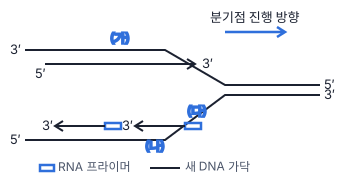
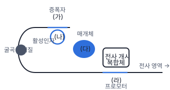

# 생명과학 5장 웹과제 예상 v4 문제해설

왼쪽 목차로 문항을 고르고, 오른쪽 문제를 보며 해설을 따라가요.

문제의 첫 줄부터 검산까지 설명해요.

**목차**

- [문항별 설명](#problems)
  - [P1. [기출 예상] DNA 복제 중 오류 수정](#p1)
  - [P2. [기출 예상] 동일 아미노산을 지정하는 코돈](#p2)
  - [P3. [기출 변형] 전사 과정의 특징](#p3)
  - [P4. [기출 변형] 번역에 직접 참여하지 않는 분자](#p4)
  - [P5. [기출 변형] 주형 DNA로부터 전사된 mRNA 서열](#p5)
  - [P6. [예상] 복제 분기점에서의 두 가닥 합성](#p6)
  - [P7. [예상] 세 핵산 시료의 염기 조성 판별](#p7)
  - [P8. [예상] 진핵 전사 개시 복합체와 증폭자](#p8)
  - [P9. [예상] 점돌연변이에 따른 아미노산 개수 계산](#p9)
  - [P10. [예상] lac 오페론 변이주의 유전자형 분석](#p10)
  - [P11. [예상] 진핵 mRNA의 5′ 캡과 3′ 폴리A 꼬리](#p11)
  - [P12. [예상] DNA 복제와 RNA 전사의 기작 비교](#p12)
  - [P13. [예상] 염색질 구조와 후성유전학적 전사 조절](#p13)
  - [P14. [예상] 유비퀴틴과 프로테아좀에 의한 단백질 분해](#p14)
  - [P15. [예상] microRNA(miRNA)와 전사 후 조절](#p15)

## 문항별 설명

### P1. [기출 예상] DNA 복제 중 오류 수정

기출 5강 15 예상 · [원 문제 보기](%EB%B3%B5%EC%8A%B5%EB%AC%B8%EC%A0%9C_5%EC%9E%A5_%EC%9B%B9%EA%B3%BC%EC%A0%9C%EC%98%88%EC%83%81_v4.html#p1)

다음 중 DNA 복제의 오류를 수정하는 메커니즘에 대한 설명으로 잘못된 것은?

- A. 교정 후에도 남아 있는 염기쌍 불일치들은 DNA 수선 메커니즘에 의해 수정된다
- B. 모두 맞다
- C. 교정과 DNA 수선 이후에도 돌연변이는 발생 할 수 있다
- D. DNA 중합효소는 불일치 뉴클레오타이드를 제거하고 되돌릴 수 있다
- E. DNA 중합효소는 새로운 뉴클레오타이드 사슬을 조립할 때 많은 오류를 범한다

원문·출처 정보 보기

기출 5강 합본 15번을 보기 순서만 바꿔 실은 예상 문제예요.

#### 무엇을 구하는 문제인가요

DNA 복제 과정에서 오류를 바로잡는 메커니즘에 대한 설명 중 **옳지 않은 것**을 골라요. 질문은 잘못된 설명을 찾는 부정형이에요.

#### 이 문제를 봤을 때 떠올릴 개념과 공식

‘오류를 수정하는 메커니즘’이라는 단서에서 DNA 중합효소의 교정(proofreading)과 불일치 수선(mismatch repair)을 떠올려요. DNA 중합효소는 5′→3′ 중합 활성 외에 3′→5′ 엑소뉴클레아제 활성을 가져 잘못 들어간 염기를 즉시 제거하고 교정해요. 교정 후에도 남은 오류는 수선 단백질들이 수정하므로 복제 오류율은 10억 염기쌍당 1개 수준으로 극히 낮아요.

#### 종이에 쓰는 첫 줄

DNA 중합효소의 복제 오류율: 극히 낮음 (높은 정확도와 자체 교정 기능 보유).

필요한 개념: 중합효소의 자체 교정과 2차 불일치 수선 메커니즘을 적용해요.

#### 왜 이렇게 푸는지 함께 따라가요

A. 맞아요. 복제 도중 교정을 통과한 일부 불일치 염기쌍은 복제 직후 DNA 불일치 수선 시스템에 의해 탐지되어 정상적으로 수정돼요.

B. 맞아요. 지문에 제시된 교정과 수선 메커니즘에 관한 일반적인 사실들이 부합해요.

C. 맞아요. 복제 교정과 2차 수선 시스템이 아무리 정교해도 드물게 수정되지 못한 오류가 영구적인 돌연변이로 고착될 수 있어요.

D. 맞아요. DNA 중합효소는 불일치 뉴클레오타이드를 인지하면 뒤로 물러서며 3′ 말단의 잘못된 염기를 떼어내고 올바른 뉴클레오타이드로 교체할 수 있어요.

E. 틀려요. DNA 중합효소는 상보적인 염기쌍 형성을 매우 엄밀하게 선별하며, 자체 교정 활성까지 갖추고 있어 새로운 사슬을 조립할 때 많은 오류를 범하지 않고 극히 정밀하게 복제해요.

따라서 틀린 설명인 E가 정답이에요.

#### 완성 답과 검산

답 E. 원문 기출 5강 15번의 인쇄 정답 문장과 일치하며, 1001 정리노트 “DNA 복제 오류의 교정과 수선” 및 교재 p.117 설명에서도 중합효소의 자체 교정 덕분에 복제 정확도가 극도로 높음을 확인해요.

#### 여기서 헷갈리기 쉬워요

‘돌연변이가 생길 수 있다’는 사실을 중합효소가 허술하게 일한다는 뜻으로 과장 해석하지 않아요. 중합효소의 본래 오류율은 매우 낮아요.

#### 설명을 닫고 다시 해 봐요

- 교정(proofreading)과 불일치 수선(mismatch repair)의 작동 시점을 구별해요.
- 중합효소의 낮은 오류율과 3′→5′ 엑소뉴클레아제 활성을 확인해요.

**페이지 요약**

#### 떠올릴 개념·공식

DNA 중합효소는 자체 교정(proofreading) 활성으로 복제 오류율이 극히 낮아요.

#### 첫 줄

DNA 중합효소 복제 오류율: 극히 낮음 (자체 교정 기능).

#### 핵심 판단

정답 E. 많은 오류를 범한다는 진술은 중합효소의 특성과 정반대예요.

#### 검산

기출 5강 15번 원문 및 1001 정리노트 교정 기작과 일치해요.

---

### P2. [기출 예상] 동일 아미노산을 지정하는 코돈

기출 5강 26 예상 · [원 문제 보기](%EB%B3%B5%EC%8A%B5%EB%AC%B8%EC%A0%9C_5%EC%9E%A5_%EC%9B%B9%EA%B3%BC%EC%A0%9C%EC%98%88%EC%83%81_v4.html#p2)

DNA 분자의 코돈 CCU를 코돈 CCC로 변화시킨 돌연변이를 가정하자. 이 두 코돈은 모두 프롤린을 지시한다. 이러한 예를 무엇이라 하는가?

- A. 유전암호의 보편성
- B. 유전암호의 중복성
- C. 유전암호의 모호성
- D. 유전암호의 진화성
- E. 유전암호의 연속성

원문·출처 정보 보기

기출 5강 합본 26번을 보기 순서만 바꿔 실은 예상 문제예요.

#### 무엇을 구하는 문제인가요

한 아미노산(프롤린)을 서로 다른 두 코돈(CCU, CCC)이 함께 지정할 수 있는 유전암호의 고유 특성 이름을 골라요.

#### 이 문제를 봤을 때 떠올릴 개념과 공식

‘두 코돈이 모두 프롤린을 지시한다’는 사실에서 유전암호의 중복성(redundancy, 퇴화성 degeneracy)을 떠올려요. 4종류 염기로 3자리 코돈을 만들면 $4^3 = 64$개 조합이 생겨 20종류 아미노산보다 훨씬 많기 때문에 한 아미노산에 여러 코돈이 배정돼요. 반면 한 코돈이 두 가지 이상의 아미노산으로 번역되지는 않아요(비모호성).

#### 종이에 쓰는 첫 줄

여러 코돈 → 하나의 아미노산 지정 = 유전암호의 중복성(redundancy).

필요한 개념: 64개 코돈과 20개 아미노산의 대응 규칙을 적용해요.

#### 왜 이렇게 푸는지 함께 따라가요

A. 틀려요. 보편성은 거의 모든 생물체가 동일한 코돈-아미노산 대응 체계를 공유한다는 특성이에요.

B. 맞아요. 64개 코돈이 20개 아미노산에 대응하여 하나의 아미노산에 둘 이상의 코돈이 배정되는 성질을 유전암호의 중복성이라고 해요.

C. 틀려요. 단일 코돈이 여러 아미노산으로 번역되지 않는 성질을 뜻하며, 여러 코돈이 한 아미노산에 대응하는 중복성과는 달라요.

D. 틀려요. 생물의 진화 과정에서 암호 체계가 변화한 역사를 나타내는 용어가 아니에요.

E. 틀려요. 코돈 사이에 쉼표나 겹침 없이 3염기씩 연속으로 읽히는 특성을 뜻해요.

따라서 B가 정답이에요.

#### 완성 답과 검산

답 B. 원문 기출 5강 26번의 인쇄 정답인 ‘유전암호의 중복성’과 일치하며, 1006 정리노트 코돈 표 및 교재 p.119에서도 동의 코돈의 존재를 중복성으로 설명해요.

#### 여기서 헷갈리기 쉬워요

‘중복성’과 ‘보편성’을 혼동하지 않아요. 중복성은 코돈과 아미노산의 다대일 대응이고 보편성은 생물 간 암호 공유예요.

#### 설명을 닫고 다시 해 봐요

- 64개 코돈과 20개 아미노산의 수적 관계를 확인해요.
- 중복성과 보편성의 뜻을 구분해 말해요.

**페이지 요약**

#### 떠올릴 개념·공식

여러 코돈이 하나의 아미노산을 지정하는 성질 = 유전암호의 중복성.

#### 첫 줄

CCU와 CCC 모두 프롤린 지정 → 중복성(redundancy).

#### 핵심 판단

정답 B. 64개 코돈이 20개 아미노산에 배정되는 다대일 관계예요.

#### 검산

기출 5강 26번 및 1006 정리노트의 유전암호 특성과 일치해요.

---

### P3. [기출 변형] 전사 과정의 특징

기출 5강 2 예상 · [원 문제 보기](%EB%B3%B5%EC%8A%B5%EB%AC%B8%EC%A0%9C_5%EC%9E%A5_%EC%9B%B9%EA%B3%BC%EC%A0%9C%EC%98%88%EC%83%81_v4.html#p3)

다음 중 전사에 관한 설명으로 옳은 것은?

- A. 전사는 세포질의 리보솜에서 개시된다.
- B. RNA 중합효소는 프라이머가 있어야만 합성을 시작할 수 있다.
- C. RNA 합성 시 아데닌(A)에 타이민(T)이 상보적으로 결합한다.
- D. 새로운 RNA 가닥은 RNA 중합효소에 의해 5′에서 3′ 방향으로 합성된다.
- E. 주형 DNA의 양쪽 가닥 모두가 동시에 하나의 RNA 사본으로 전사된다.

원문·출처 정보 보기

기출 5강 합본 2번의 발문을 유지하고 새로운 보기로 전사 합성 방향을 묻는 변형 문제예요.

#### 무엇을 구하는 문제인가요

세포 내 전사(transcription) 과정의 시작, 방향, 효소의 특징 중 옳은 설명을 골라요.

#### 이 문제를 봤을 때 떠올릴 개념과 공식

‘전사에 관한 설명’에서 RNA 중합효소(RNA polymerase)의 작용 기작을 떠올려요. 전사는 DNA 주형 가닥을 읽어 상보적인 RNA 분자를 합성하는 과정이에요. 복제 효소와 달리 RNA 중합효소는 프라이머 없이도 프로모터를 인식해 단독 개시할 수 있고, 합성되는 신생 RNA는 항상 5′에서 3′ 방향으로 자라나요.

#### 종이에 쓰는 첫 줄

전사 합성 방향: 5′→3′ (주형 DNA는 3′→5′로 읽음). 프라이머 불필요.

필요한 개념: RNA 중합효소의 합성 방향성과 프라이머 비의존성을 적용해요.

#### 왜 이렇게 푸는지 함께 따라가요

A. 틀려요. 유전자 부위에서 DNA 이중가닥 중 오직 한 가닥(주형 가닥)만 선택되어 RNA로 전사돼요.

B. 틀려요. RNA 중합효소는 DNA 중합효소와 달리 별도의 프라이머 없이 프로모터 서열에 결합하여 합성을 개시해요.

C. 틀려요. 진핵세포에서 전사는 DNA가 위치한 세포핵 안에서 일어나며 리보솜은 세포질에 있어요.

D. 맞아요. RNA 중합효소는 신생 RNA의 3′-OH에 다음 리보뉴클레오타이드를 연결하므로 5′→3′ 방향으로 합성돼요.

E. 틀려요. 전사에서는 오카자키 절편이 생성되지 않으므로 DNA 연결효소가 관여하지 않아요.

따라서 D가 정답이에요.

#### 완성 답과 검산

답 D. 원문 기출 5강 2번의 발문에서 보기를 개편한 변형 문항으로, 신생 가닥의 합성 방향성(5′→3′)은 1006 정리노트 “전사의 시작과 진행” 및 교재 p.118과 정확히 부합해요.

#### 여기서 헷갈리기 쉬워요

‘RNA 중합효소는 프라이머를 만들지 않나?’ 하고 복제 효소인 프라이메이스와 혼동하지 않아요. 전사 자체는 프라이머 없이 시작해요.

#### 설명을 닫고 다시 해 봐요

- RNA 중합효소의 합성 방향(5′→3′)을 써 봐요.
- DNA 중합효소와의 프라이머 의존성 차이를 정리해요.

**페이지 요약**

#### 떠올릴 개념·공식

RNA 중합효소는 프라이머 없이 5′→3′ 방향으로 RNA를 합성해요.

#### 첫 줄

신생 RNA 합성 방향 = 5′→3′.

#### 핵심 판단

정답 D. 3′-OH에 뉴클레오타이드가 연결되어 5′→3′로 신장돼요.

#### 검산

1006 정리노트 전사 진행 설명과 교재 원리와 일치해요.

---

### P4. [기출 변형] 번역에 직접 참여하지 않는 분자

기출 5강 37 예상 · [원 문제 보기](%EB%B3%B5%EC%8A%B5%EB%AC%B8%EC%A0%9C_5%EC%9E%A5_%EC%9B%B9%EA%B3%BC%EC%A0%9C%EC%98%88%EC%83%81_v4.html#p4)

다음 중 번역 과정에 직접적으로 참여하지 않는 분자는?

- A. RNA 중합효소
- B. 아미노산
- C. 운반 RNA(tRNA)
- D. 리보솜 소단위체
- E. 전령 RNA(mRNA)

원문·출처 정보 보기

기출 5강 합본 37번의 발문을 유지하고 배제 대상을 RNA 중합효소로 바꾼 변형 문제예요.

#### 무엇을 구하는 문제인가요

리보솜에서 폴리펩타이드를 조립하는 번역(translation) 과정에 직접 관여하지 않는 분자를 골라요. **질문은 참여하지 않는 대상을 찾는 부정형이에요.**

#### 이 문제를 봤을 때 떠올릴 개념과 공식

‘번역 과정에 직접 참여’라는 단서에서 센트럴 도그마의 단계를 구분해요. 전령 RNA(mRNA), 운반 RNA(tRNA), 리보솜(rRNA+단백질), 아미노산은 리보솜에서 펩타이드 결합을 형성하는 번역 장치의 핵심 구성 요소예요. 반면 RNA 중합효소(RNA polymerase)는 핵 안에서 DNA를 주형으로 RNA를 만드는 전사 효소예요.

#### 종이에 쓰는 첫 줄

번역 인자: mRNA, tRNA, 리보솜, 아미노산. / 전사 인자: RNA 중합효소.

필요한 개념: 전사와 번역에 관여하는 분자들의 역할 구분을 적용해요.

#### 왜 이렇게 푸는지 함께 따라가요

A. 틀려요. RNA 중합효소는 전사(transcription) 전용 효소이므로 리보솜의 번역 과정에 직접 참여하지 않아요.

B. 맞아요. 아미노산은 번역을 통해 폴리펩타이드를 이루는 기본 단위체로 직접 참여해요.

C. 맞아요. tRNA는 아미노산을 리보솜으로 운반하고 안티코돈으로 코돈을 인식하여 번역에 직접 참여해요.

D. 맞아요. 리보솜 대단위체와 소단위체는 번역이 일어나는 물리적 장소이자 펩타이드 결합을 촉매하는 효소 복합체예요.

E. 맞아요. mRNA는 유전정보(코돈)를 리보솜에 제공하는 직접적인 번역 주형이에요.

따라서 참여하지 않는 분자인 A가 정답이에요.

#### 완성 답과 검산

답 A. 원문 기출 5강 37번의 발문을 바탕으로 전사 효소를 배제 대상으로 교체한 변형 문항이며, 1006 정리노트 번역 개관과 정확히 일치해요.

#### 여기서 헷갈리기 쉬워요

‘RNA 중합효소도 RNA를 다루니까 번역에 쓰이나?’ 하고 전사와 번역의 일터를 섞지 않아요.

#### 설명을 닫고 다시 해 봐요

- 전사에 쓰이는 분자들과 번역에 쓰이는 분자들을 분류해 봐요.
- RNA 중합효소가 일하는 세포 내 장소를 말해요.

**페이지 요약**

#### 떠올릴 개념·공식

RNA 중합효소는 전사 효소이며 번역에 직접 참여하지 않아요.

#### 첫 줄

RNA 중합효소 = 전사 담당 / mRNA·tRNA·리보솜·아미노산 = 번역 담당.

#### 핵심 판단

정답 A. RNA 중합효소는 리보솜 번역 반응과 무관해요.

#### 검산

1006 정리노트 번역 인자 목록과 완벽히 부합해요.

---

### P5. [기출 변형] 주형 DNA로부터 전사된 mRNA 서열

기출 5강 5 예상 · [원 문제 보기](%EB%B3%B5%EC%8A%B5%EB%AC%B8%EC%A0%9C_5%EC%9E%A5_%EC%9B%B9%EA%B3%BC%EC%A0%9C%EC%98%88%EC%83%81_v4.html#p5)

만약 전사 주형 가닥 DNA 서열이 3′-TACCGGATTC-5′ 라면, 이로부터 합성되는 mRNA 분자의 5′→3′ 서열은 어느 것인가?

- A. 5′-UACCGGAUUC-3′
- B. 5′-AUGGCCTTAG-3′
- C. 5′-AUGGCCUAAG-3′
- D. 5′-GAATCCGGTA-3′
- E. 5′-CUUAGGCCAU-3′

원문·출처 정보 보기

기출 5강 합본 5번을 바탕으로 주형 가닥의 서열 조건과 방향성을 명시하여 계산하도록 바꾼 변형 문제예요.

#### 무엇을 구하는 문제인가요

주어진 주형 DNA 가닥의 3′→5′ 서열로부터 만들어지는 상보적 mRNA의 5′→3′ 서열을 계산하여 구해요.

#### 이 문제를 봤을 때 떠올릴 개념과 공식

‘전사 주형 가닥 서열로부터 mRNA 서열’이라는 조건에서 역평행과 상보적 염기쌍(Watson-Crick base pairing)을 떠올려요. 주형 DNA가 3′→5′ 방향으로 주어지면 합성되는 mRNA는 역평행인 5′→3′ 방향으로 합성돼요. DNA의 T는 RNA의 A와, A는 U와, C는 G와, G는 C와 짝을 이뤄요.

#### 종이에 쓰는 첫 줄

주형 DNA: 3′- T A C C G G A T T C -5′ → 상보 mRNA: 5′- A U G G C C U A A G -3′.

필요한 개념: 역평행 상보성(A-U, T-A, G-C, C-G)을 적용해요.

#### 왜 이렇게 푸는지 함께 따라가요

A. 틀려요. DNA 서열의 T만 U로 단순 치환한 서열로, 상보적 전사 산물이 아니에요.

B. 틀려요. RNA 분자에는 티민(T) 대신 우라실(U)이 들어가야 하므로 T가 포함된 서열은 틀려요.

C. 맞아요. 3′-TACCGGATTC-5′의 각 염기에 대해 5′→3′로 A-U, T-A, C-G, G-C를 짝지으면 5′-AUGGCCUAAG-3′가 정확히 도출돼요.

D. 틀려요. DNA 상보 사슬을 T를 유지한 채 역순으로 적은 서열이에요.

E. 틀려요. 올바른 mRNA 서열 5′-AUGGCCUAAG-3′를 거꾸로 뒤집어 표기한 서열이에요.

따라서 C가 정답이에요.

#### 완성 답과 검산

답 C. 첫 염기 T에 상보적인 염기는 A, 두 번째 A에 상보적인 염기는 U, 마지막 C에 상보적인 염기는 G예요. 양 말단 극성이 5′와 3′로 올바르게 표시되었음을 재확인해요.

#### 여기서 헷갈리기 쉬워요

DNA의 A를 보고 RNA에 T를 넣는 실수를 하지 않아요. RNA에는 T가 없고 U가 들어가요.

#### 설명을 닫고 다시 해 봐요

- 3′-TACCGGATTC-5′를 종이에 쓰고 각 염기 아래에 상보적 RNA 염기를 차례로 적어요.
- 양 끝의 5′와 3′ 방향을 다시 확인해요.

**페이지 요약**

#### 떠올릴 개념·공식

전사는 3′→5′ 주형 DNA에 역평행인 5′→3′ 상보적 RNA를 합성해요.

#### 첫 줄

3′-TACCGGATTC-5′ → 5′-AUGGCCUAAG-3′.

#### 핵심 판단

정답 C. A-U, T-A, C-G, G-C 상보성과 5′→3′ 방향이 일치해요.

#### 검산

10개 염기를 하나씩 일대일 대조해도 완벽히 일치해요.

---

### P6. [예상] 복제 분기점에서의 두 가닥 합성

예상 5장 6 · [원 문제 보기](%EB%B3%B5%EC%8A%B5%EB%AC%B8%EC%A0%9C_5%EC%9E%A5_%EC%9B%B9%EA%B3%BC%EC%A0%9C%EC%98%88%EC%83%81_v4.html#p6)

다음 그림은 복제 분기점에서 DNA가 복제되는 과정을 나타낸 모식도예요. (가)와 (나)는 각각 새로 합성되는 가닥 중 하나이고, (다)는 짧은 조각의 앞부분에 존재하는 구조예요. 이에 대한 설명으로 **옳지 않은 것**은?

- A. (가)는 복제 분기점이 열리는 방향을 향해 연속적으로 합성되는 선도 가닥이에요.
- B. (나)는 복제 분기점 진행 반대 방향으로 불연속적으로 합성되는 지연 가닥이에요.
- C. (다)는 프라이메이스에 의해 합성된 짧은 RNA 프라이머예요.
- D. (나)의 오카자키 절편들은 3′에서 5′ 방향으로 뉴클레오타이드가 연결되어 신장돼요.
- E. (나) 가닥의 절편 사이에 남은 당-인산 골격의 틈은 DNA 연결효소에 의해 공유결합으로 연결돼요.

원문·출처 정보 보기

복제 분기점에서 두 가닥의 합성 방향성과 효소의 역할을 묻는 신규 예상 문제예요.

#### 무엇을 구하는 문제인가요

복제 분기점 모식도에서 선도 가닥(가), 지연 가닥의 오카자키 절편(나), RNA 프라이머(다)의 특징 중 **옳지 않은 것**을 골라요. 질문은 부정형이에요.

#### 이 문제를 봤을 때 떠올릴 개념과 공식

‘복제 분기점 모식도’에서 선도 가닥(leading strand)과 지연 가닥(lagging strand)의 비대칭성을 떠올려요. 분기점이 열리는 방향으로 3′→5′ 주형을 읽는 쪽은 5′→3′로 연속 합성(선도 가닥)되지만, 반대쪽 주형은 5′→3′로 불연속 절편들이 만들어져요(지연 가닥). 중요한 점은 어떤 가닥이든 합성 자체는 무조건 5′→3′ 방향으로만 일어난다는 법칙이에요.

#### 종이에 쓰는 첫 줄

(가)=선도 가닥, (나)=지연 가닥의 오카자키 절편, (다)=RNA 프라이머. 합성 방향은 모두 5′→3′.

필요한 개념: 모든 DNA 중합효소는 5′→3′ 방향으로만 합성한다는 원리를 적용해요.

#### 왜 이렇게 푸는지 함께 따라가요

A. 맞아요. (가)는 분기점이 열리는 오른쪽 방향을 향해 중단 없이 연속 합성되는 선도 가닥이에요.

B. 맞아요. (나)는 분기점 진행과 반대 방향(왼쪽)으로 짧은 조각들이 반복 생성되는 지연 가닥이에요.

C. 맞아요. (다)는 DNA 중합효소가 3′-OH를 이어받을 수 있도록 프라이메이스가 먼저 놓은 RNA 프라이머예요.

D. 틀려요. 지연 가닥의 오카자키 절편도 3′→5′가 아니라 반드시 5′에서 3′ 방향으로 뉴클레오타이드가 연결되어 신장돼요.

E. 맞아요. RNA 프라이머가 제거되고 DNA로 채워진 뒤 남은 골격 틈(nick)은 DNA 연결효소(DNA ligase)가 이어줘요.

따라서 틀린 설명인 D가 정답이에요.

#### 완성 답과 검산

답 D. 그림에서 (나)의 화살표 머리가 3′ 말단을 가리키고 있으며, 1001 정리노트 “선도 가닥과 지연 가닥의 복제”에서 모든 핵산 중합효소의 합성 방향은 5′→3′로 불변임을 확인해요.

#### 여기서 헷갈리기 쉬워요

‘지연 가닥은 분기점 반대로 가니까 3′→5′로 합성되나?’ 하고 가닥의 전체 진행 방향과 분자 자체의 합성 방향을 혼동하지 않아요.

#### 설명을 닫고 다시 해 봐요

- 선도 가닥과 지연 가닥 각각의 5′와 3′ 위치를 그림에 직접 표시해 봐요.
- DNA 연결효소가 결합시키는 부위를 확인해요.

**페이지 요약**

#### 떠올릴 개념·공식

선도 가닥과 지연 가닥 모두 신생 가닥의 합성 방향은 예외 없이 5′→3′예요.

#### 첫 줄

(가)=선도 가닥, (나)=지연 가닥, (다)=프라이머. 합성 방향 = 5′→3′.

#### 핵심 판단

정답 D. 오카자키 절편이 3′→5′로 합성된다는 진술은 거짓이에요.

#### 검산

1001 정리노트 및 분기점 가닥 극성과 정확히 일치해요.

---

### P7. [예상] 세 핵산 시료의 염기 조성 판별

예상 5장 7 · [원 문제 보기](%EB%B3%B5%EC%8A%B5%EB%AC%B8%EC%A0%9C_5%EC%9E%A5_%EC%9B%B9%EA%B3%BC%EC%A0%9C%EC%98%88%EC%83%81_v4.html#p7)

표는 세 종류의 생물체 또는 바이러스에서 추출한 핵산 시료 I~III의 염기 조성 비율(%)을 분석한 결과예요. 이에 대한 옳은 분석만을 고른 것은?

| 시료 | A (%) | T (%) | G (%) | C (%) | U (%) |
|---|---|---|---|---|---|
| 시료 I | 28 | 28 | 22 | 22 | 0 |
| 시료 II | 34 | 20 | 26 | 20 | 0 |
| 시료 III | 24 | 0 | 26 | 26 | 24 |

- A. 시료 I은 티민을 포함하므로 단일가닥 RNA예요.
- B. 시료 II는 티민을 포함하지만 샤가프의 상보적 염기쌍 법칙(A=T, G=C)을 만족하지 않으므로 단일가닥 DNA예요.
- C. 시료 III은 우라실을 포함하므로 단일가닥 DNA예요.
- D. 시료 I과 시료 II를 혼합하면 열을 가하지 않아도 저절로 완전한 이중나선을 형성해요.
- E. 시료 III을 완전히 가수분해하면 디옥시리보스 당과 인산이 1:1 비율로 검출돼요.

원문·출처 정보 보기

샤가프의 법칙과 염기 조성을 바탕으로 단일가닥/이중가닥 핵산의 종류를 판별하는 신규 예상 문제예요.

#### 무엇을 구하는 문제인가요

표에 제시된 세 핵산 시료 I~III의 A, T, G, C, U 백분율(%)을 비교하여 각 시료의 가닥 구조와 핵산 종류(DNA/RNA, 단일가닥/이중가닥)를 올바르게 판별해요.

#### 이 문제를 봤을 때 떠올릴 개념과 공식

‘염기 조성 비율 표’에서 샤가프의 법칙(Chargaff's rules)과 RNA 고유 염기를 떠올려요. 1) T가 있으면 DNA, U가 있으면 RNA예요. 2) 상보적 이중가닥 DNA는 $A=T$, $G=C$가 엄격히 성립해요. 반면 단일가닥 DNA는 상보가닥이 없으므로 $A eq T$이거나 $G eq C$예요. 시료 I은 $A=T=28\%$, $G=C=22\%$로 이중가닥 DNA, 시료 II는 T가 있지만 $A(34\%) \neq T(20\%)$이므로 단일가닥 DNA, 시료 III은 U가 있고 $A=U=24\%$, $G=C=26\%$로 이중가닥 RNA예요.

#### 종이에 쓰는 첫 줄

시료 II: T 있음(DNA) / A(34%)≠T(20%) → 샤가프 불성립 → 단일가닥 DNA.

필요한 개념: 샤가프 법칙 성립 여부로 이중가닥과 단일가닥을 구분해요.

#### 왜 이렇게 푸는지 함께 따라가요

A. 틀려요. 시료 I은 티민(T)을 포함하고 A=T, G=C 비율이 같으므로 이중가닥 DNA예요.

B. 맞아요. 시료 II는 T를 포함하여 DNA이지만 A(34%)와 T(20%)의 비율이 달라 샤가프 법칙을 만족하지 않으므로 단일가닥 DNA예요.

C. 틀려요. 시료 III은 우라실(U)을 포함하므로 DNA가 아니라 RNA 시료예요.

D. 틀려요. 서열 정보가 상보적이라는 조건이 없으므로 두 시료를 섞는다고 완전한 이중나선이 저절로 생기지 않아요.

E. 틀려요. 시료 III은 RNA이므로 디옥시리보스가 아닌 리보스 당을 가져요.

따라서 B가 정답이에요.

#### 완성 답과 검산

답 B. 각 시료의 A:T 및 G:C 비율을 직접 대조하면 시료 II만 상보적 짝의 비율이 어긋나 있어 단일가닥 DNA임이 확실해요.

#### 여기서 헷갈리기 쉬워요

‘T가 있으니까 무조건 이중나선 DNA겠지’ 하고 염기 비율의 균등 여부를 확인하지 않고 넘기지 않아요.

#### 설명을 닫고 다시 해 봐요

- $A=T$, $G=C$가 성립하지 않는 DNA는 어떤 입체 구조를 가지는지 설명해요.
- 시료 I, II, III의 핵산 종류와 가닥 수를 표로 정리해요.

**페이지 요약**

#### 떠올릴 개념·공식

T가 있고 A≠T이면 단일가닥 DNA, T가 있고 A=T이면 이중가닥 DNA예요.

#### 첫 줄

시료 II: T 있음 + A(34%)≠T(20%) → 단일가닥 DNA.

#### 핵심 판단

정답 B. 시료 II는 샤가프 법칙을 만족하지 않는 단일가닥 DNA예요.

#### 검산

시료 I(dsDNA), II(ssDNA), III(dsRNA)의 판정이 논리적으로 일치해요.

---

### P8. [예상] 진핵 전사 개시 복합체와 증폭자

예상 5장 8 · [원 문제 보기](%EB%B3%B5%EC%8A%B5%EB%AC%B8%EC%A0%9C_5%EC%9E%A5_%EC%9B%B9%EA%B3%BC%EC%A0%9C%EC%98%88%EC%83%81_v4.html#p8)

다음 그림은 진핵세포에서 유전자 발현을 조절하는 전사 개시 복합체의 형성을 나타낸 모식도예요. (가)~(라)에 대한 설명으로 옳은 것은?

- A. (가)는 프로모터와 멀리 떨어져 존재할 수 있는 DNA 조절 서열인 증폭자(Enhancer)예요.
- B. (나)는 전사를 억제하기 위해 프로모터에 직접 결합하는 RNA 분자예요.
- C. (다)는 DNA 서열이며 단백질이 관여하지 않는 부위예요.
- D. (라)는 인트론 서열로 전사 시작 후 즉시 잘려 나가는 부위예요.
- E. DNA 굴곡 단백질이 작용해도 (나)는 (다)나 전사 복합체와 물리적으로 접촉할 수 없어요.

원문·출처 정보 보기

진핵 전사 조절에서 증폭자와 활성인자, 매개 복합체의 상호작용을 묻는 신규 예상 문제예요.

#### 무엇을 구하는 문제인가요

진핵세포 유전자 발현 조절 모식도에서 원거리 조절 서열 (가), 조절 단백질 (나), 매개 복합체 (다), 프로모터 (라)의 정체와 기능을 옳게 설명한 것을 골라요.

#### 이 문제를 봤을 때 떠올릴 개념과 공식

‘원거리 서열과 단백질 복합체 그림’에서 진핵 전사 조절 기작을 떠올려요. 프로모터에서 멀리 떨어진 DNA 조절 부위를 증폭자(Enhancer)라고 하며, 여기에 특이 전사인자인 활성인자(Activator) 단백질이 결합해요. DNA 굴곡 단백질이 DNA를 구부리면 활성인자가 매개 복합체(Mediator) 및 기본 전사인자, RNA 중합효소와 접촉하여 전사 개시 복합체를 완성해요.

#### 종이에 쓰는 첫 줄

(가)=증폭자(DNA 서열), (나)=활성인자(단백질), (다)=매개 복합체(단백질), (라)=프로모터(DNA 서열).

필요한 개념: 서열(DNA)과 결합 단백질의 구분을 적용해요.

#### 왜 이렇게 푸는지 함께 따라가요

A. 맞아요. (가)는 프로모터로부터 멀리 떨어진 위치에서 전사 효율을 극대화하는 DNA 조절 서열인 증폭자(Enhancer)예요.

B. 틀려요. (나)는 증폭자에 결합하여 전사를 활성화하는 특이 전사인자 단백질(Activator)이에요.

C. 틀려요. (다)는 활성인자와 기본 전사 장치를 물리적으로 연결하는 매개 단백질 복합체(Mediator)예요.

D. 틀려요. (라)는 RNA 중합효소가 직접 결합하는 핵심 전사 개시 부위인 프로모터 DNA 서열이에요.

E. 틀려요. DNA 굴곡 단백질이 DNA를 구부려 줌으로써 멀리 떨어진 (나)가 (다)와 직접 접촉하여 전사를 촉진해요.

따라서 A가 정답이에요.

#### 완성 답과 검산

답 A. 1008 정리노트 “전사 조절: 증폭자와 전사인자” 및 교재 p.122의 모델 그림과 부합하며, (가)가 DNA 서열이고 (나)가 단백질임을 교차 확인해요.

#### 여기서 헷갈리기 쉬워요

증폭자(서열)와 활성인자(단백질)의 개념을 서로 뒤바꾸지 않아요.

#### 설명을 닫고 다시 해 봐요

- 증폭자와 프로모터, 활성인자와 매개체의 결합 관계를 순서도로 그려 봐요.
- DNA 굴곡 단백질이 왜 필요한지 말해요.

**페이지 요약**

#### 떠올릴 개념·공식

증폭자(Enhancer)는 원거리 DNA 서열이며 활성인자 단백질이 결합해요.

#### 첫 줄

(가)=증폭자(DNA), (나)=활성인자(단백질), (다)=매개체, (라)=프로모터.

#### 핵심 판단

정답 A. (가)는 멀리 떨어진 조절 서열인 증폭자예요.

#### 검산

1008 정리노트 전사 개시 복합체 구조와 일치해요.

---

### P9. [예상] 점돌연변이에 따른 아미노산 개수 계산

예상 5장 9 · [원 문제 보기](%EB%B3%B5%EC%8A%B5%EB%AC%B8%EC%A0%9C_5%EC%9E%A5_%EC%9B%B9%EA%B3%BC%EC%A0%9C%EC%98%88%EC%83%81_v4.html#p9)

어떤 진핵생물 유전자로부터 만들어진 정상 mRNA의 암호화 부위 서열이 다음과 같아요. 5′-AUG GCA UAC GGU UCA UAA-3′ 이 mRNA의 9번째 염기인 C가 A로 치환되는 점돌연변이가 발생했어요. (단, UAA, UAG, UGA는 종결코돈이며, 정상 코돈 UAC는 티로신을 암호화해요.) 번역 결과 합성되는 정상 단백질과 변이 단백질의 아미노산 개수로 옳은 것은?

- A. 정상: 6개, 변이: 2개
- B. 정상: 6개, 변이: 3개
- C. 정상: 5개, 변이: 5개
- D. 정상: 5개, 변이: 3개
- E. 정상: 5개, 변이: 2개

원문·출처 정보 보기

염기 치환에 의한 조기 종결(무의미 돌연변이)과 합성되는 펩타이드 아미노산 개수를 계산하는 신규 예상 문제예요.

#### 무엇을 구하는 문제인가요

정상 mRNA 서열에서 9번째 염기 C가 A로 치환되었을 때, 정상 단백질과 변이 단백질의 아미노산 개수를 각각 계산하여 비교해요.

#### 이 문제를 봤을 때 떠올릴 개념과 공식

‘염기 치환과 아미노산 개수’에서 코돈 해독과 돌연변이 유형을 떠올려요. 번역은 개시 코돈 AUG에서 시작하여 종결코돈(UAA, UAG, UGA)을 만나면 종료돼요. 종결코돈은 아미노산을 지정하지 않아요. 정상 mRNA는 5′-AUG(1) GCA(2) UAC(3) GGU(4) UCA(5) UAA(종결)-3′로 5개 아미노산을 합성해요. 9번째 C가 A가 되면 세 번째 코돈이 UAC에서 UAA(종결코돈)로 변하는 무의미 돌연변이(nonsense mutation)가 발생하여 앞선 2개 아미노산만 만들어져요.

#### 종이에 쓰는 첫 줄

정상: 5개 아미노산 / 변이: 9번째 C→A 치환 시 3번째 코돈 UAA(종결) → 2개 아미노산.

필요한 개념: 조기 종결코돈 생성과 종결코돈의 비암호화 특성을 적용해요.

#### 왜 이렇게 푸는지 함께 따라가요

A. 틀려요. 종결코돈 UAA는 아미노산으로 세지 않으므로 정상 단백질은 6개가 아니라 5개예요.

B. 틀려요. 정상 아미노산 수는 5개이며, 변이 단백질은 세 번째가 종결이므로 3개가 아닌 2개예요.

C. 틀려요. 조기 종결이 발생하므로 변이 단백질의 아미노산 수는 정상과 같을 수 없어요.

D. 틀려요. 세 번째 코돈 UAA는 아미노산을 넣지 않고 번역을 중단시키므로 변이 단백질은 2개예요.

E. 맞아요. 정상 mRNA는 5개의 아미노산을 합성하고, 9번째 C→A 치환으로 세 번째 코돈이 종결코돈(UAA)이 되어 앞선 2개(Met-Ala)만 합성돼요.

따라서 E가 정답이에요.

#### 완성 답과 검산

답 E. 염기 번호를 직접 세면 1~3은 AUG, 4~6은 GCA, 7~9는 UAC예요. 9번째가 A가 되면 UAA(종결코돈)가 되므로 1번째와 2번째 아미노산만 만들어지고 즉시 끝나요. 5개와 2개 계산이 일치해요.

#### 여기서 헷갈리기 쉬워요

종결코돈을 아미노산 하나로 세어 ‘정상 6개, 변이 3개’로 오답을 내지 않아요. 종결코돈에는 아미노산이 배정되지 않아요.

#### 설명을 닫고 다시 해 봐요

- UAA, UAG, UGA 세 종결코돈을 암기해요.
- 무의미 돌연변이가 일어났을 때 아미노산 개수를 세어 봐요.

**페이지 요약**

#### 떠올릴 개념·공식

UAA는 종결코돈이며 아미노산으로 세지 않아요.

#### 첫 줄

정상: 5개(Met-Ala-Tyr-Gly-Ser) / 변이: 2개(Met-Ala).

#### 핵심 판단

정답 E. 세 번째 코돈이 조기 종결되어 2개만 합성돼요.

#### 검산

AUG(1)-GCA(2)-UAA(종결) 대조로 정확히 일치해요.

---

### P10. [예상] lac 오페론 변이주의 유전자형 분석

예상 5장 10 · [원 문제 보기](%EB%B3%B5%EC%8A%B5%EB%AC%B8%EC%A0%9C_5%EC%9E%A5_%EC%9B%B9%EA%B3%BC%EC%A0%9C%EC%98%88%EC%83%81_v4.html#p10)

표는 대장균의 야생형과 서로 다른 단일 돌연변이주 I, II의 배지 조건에 따른 β-갈락토시다이스(lacZ 산물) 합성 여부를 조사한 결과예요. (+: 합성됨, -: 합성되지 않음) 이에 대한 옳은 설명만을 고른 것은?

| 대장균 균주 | 젖당 없음 | 젖당 있음 |
|---|---|---|
| 야생형 | - | + |
| 변이주 I | + | + |
| 변이주 II | - | - |

- A. 야생형은 젖당이 없을 때 억제자가 프로모터에 직접 결합하여 전사를 막아요.
- B. 변이주 I은 젖당이 없어도 효소를 생산하므로 작동자(operator) 서열이 결실될 수는 없어요.
- C. 변이주 I은 억제자 유전자(lacI) 결실 변이이거나 작동자 결합 부위 변이일 수 있어요.
- D. 변이주 II는 젖당이 들어왔을 때 유도자가 억제자에 결합하여 억제자가 완전히 분해되는 균주예요.
- E. 변이주 II는 억제자가 작동자에 전혀 결합하지 못하는 돌연변이예요.

원문·출처 정보 보기

lac 오페론 돌연변이주의 표현형 표를 분석하여 억제자와 작동자의 조절 기작을 판별하는 신규 예상 문제예요.

#### 무엇을 구하는 문제인가요

배지의 젖당 유무에 따른 β-갈락토시다이스 발현 여부 표를 보고, 야생형과 돌연변이주 I, II의 유전적 결함 원인을 옳게 분석한 것을 골라요.

#### 이 문제를 봤을 때 떠올릴 개념과 공식

‘lac 오페론 변이주 표현형 표’에서 억제자(lacI)와 작동자(operator)의 상호작용을 떠올려요. 야생형은 젖당 없을 때 억제자가 작동자에 결합해 발현 차단(-), 젖당 있을 때 유도자가 억제자에 결합해 작동자에서 분리되므로 발현 유도(+)돼요. 변이주 I은 젖당 유무와 상관없이 항상 효소를 합성하므로(구성적 발현), 억제자 자체가 망가졌거나(lacI 결실) 작동자 서열이 망가져 억제자가 못 붙는 경우예요. 변이주 II는 항상 발현되지 않으므로(-, -) 프로모터가 파손되었거나 억제자가 떨어지지 않는 변이예요.

#### 종이에 쓰는 첫 줄

변이주 I: 구성적 발현 (+, +) → lacI 변이(억제자 불능) 또는 작동자(O) 변이.

필요한 개념: lac 오페론 음성 조절 스위치 기작을 적용해요.

#### 왜 이렇게 푸는지 함께 따라가요

A. 틀려요. 야생형에서 억제자가 결합하는 부위는 프로모터가 아니라 작동자(operator)예요.

B. 틀려요. 작동자 서열이 망가지면 억제자가 결합하지 못해 젖당이 없어도 항상 발현되므로 작동자 결실 변이도 변이주 I의 원인이 될 수 있어요.

C. 맞아요. 젖당 없이도 효소가 항상 합성되는 구성적 발현은 억제자를 만들지 못하는 lacI 결실이거나 억제자가 결합할 수 없는 작동자 서열 변이일 때 나타나요.

D. 틀려요. 젖당이 들어와도 억제자는 분해되는 것이 아니라 입체 구조가 변해 작동자에서 떨어질 뿐이에요.

E. 틀려요. 변이주 II는 효소가 전혀 안 나오므로 억제자가 작동자에 결합하지 못하는 것이 아니라, 반대로 떨어지지 않거나 프로모터가 고장 난 변이예요.

따라서 C가 정답이에요.

#### 완성 답과 검산

답 C. 1006 정리노트 “lac 오페론: 젖당이 있을 때와 없을 때”의 음성 조절 기작 및 모형 설명과 대조하여 구성적 발현의 두 가지 원인을 확인해요.

#### 여기서 헷갈리기 쉬워요

억제자가 유도자와 만나면 ‘분해’된다고 오해하지 않아요. 단백질 구조의 가역적 변화예요.

#### 설명을 닫고 다시 해 봐요

- 젖당이 없을 때와 있을 때 억제자의 상태를 그림으로 설명해요.
- 작동자 결실 시 발현 표현형을 예측해 봐요.

**페이지 요약**

#### 떠올릴 개념·공식

젖당 비의존적 구성 발현 = lacI(억제자) 또는 작동자(O) 결실 변이.

#### 첫 줄

변이주 I (+, +) → 억제자 결합 불가(lacI 또는 O 결함).

#### 핵심 판단

정답 C. 변이주 I은 lacI 결실이거나 작동자 변이일 수 있어요.

#### 검산

1006 정리노트 오페론 돌연변이 분석과 정확히 일치해요.

---

### P11. [예상] 진핵 mRNA의 5′ 캡과 3′ 폴리A 꼬리

예상 5장 11 · [원 문제 보기](%EB%B3%B5%EC%8A%B5%EB%AC%B8%EC%A0%9C_5%EC%9E%A5_%EC%9B%B9%EA%B3%BC%EC%A0%9C%EC%98%88%EC%83%81_v4.html#p11)

진핵세포의 전사 후 RNA 가공 과정에서 첨가되는 5′ 캡(5′ cap)과 3′ 폴리A 꼬리(poly-A tail)에 대한 설명으로 옳지 않은 것은?

- A. 5′ 캡과 폴리A 꼬리는 번역 과정에서 특정한 소수성 아미노산 서열로 번역돼요.
- B. 5′ 캡은 변형된 구아닌 뉴클레오타이드(7-메틸구아노신)로 구성되어 있어요.
- C. 5′ 캡은 세포질의 리보솜이 mRNA 분자를 인식하고 결합하는 데 도움을 줘요.
- D. 3′ 폴리A 꼬리는 세포질 내의 가수분해 효소에 의한 mRNA의 급격한 분해를 지연시켜 줘요.
- E. 5′ 캡과 폴리A 꼬리는 모두 전사체가 핵에서 세포질로 원활하게 방출되도록 촉진해요.

원문·출처 정보 보기

진핵생물 mRNA의 말단 변형 구조와 그 생물학적 기능을 묻는 신규 예상 문제예요.

#### 무엇을 구하는 문제인가요

진핵세포 pre-mRNA가 성숙하는 과정에서 양 끝에 첨가되는 5′ 캡과 3′ 폴리A 꼬리의 특성과 기능 중 **옳지 않은 것**을 골라요. 질문은 부정형이에요.

#### 이 문제를 봤을 때 떠올릴 개념과 공식

‘5′ 캡과 폴리A 꼬리’에서 RNA 가공(RNA processing)을 떠올려요. 전사 직후 5′ 말단에는 변형된 구아닌(7-메틸구아노신 캡)이 붙고, 3′ 말단에는 수백 개의 아데닌 뉴클레오타이드(폴리A 꼬리)가 붙어요. 이 두 구조는 1) 세포질 리보뉴클레이스의 분해로부터 mRNA 보호, 2) 핵공을 통한 세포질 방출 촉진, 3) 리보솜의 결합 및 번역 개시 지원의 역할을 해요. 이들은 비번역 부위(UTR)의 양 끝에 위치하며 단백질로 번역되지 않아요.

#### 종이에 쓰는 첫 줄

5′ 캡과 폴리A 꼬리는 mRNA 보호·수송·리보솜 결합용 변형이며 아미노산으로 번역되지 않음.

필요한 개념: 비암호화 말단 수식 구조의 생물학적 기능을 적용해요.

#### 왜 이렇게 푸는지 함께 따라가요

A. 틀려요. 5′ 캡과 3′ 폴리A 꼬리는 번역되지 않는 비번역 부위의 구조물이며 아미노산 서열로 번역되지 않아요.

B. 맞아요. 5′ 캡은 변형된 구아닌 뉴클레오타이드가 거꾸로(5′-5′) 결합된 특수 구조예요.

C. 맞아요. 5′ 캡은 리보솜 소단위체가 mRNA를 올바르게 인식하고 부착되는 신호로 작용해요.

D. 맞아요. 폴리A 꼬리는 세포질 분해 효소가 암호화 부위에 도달하는 시간을 지연시켜 mRNA의 수명을 늘려줘요.

E. 맞아요. 두 말단 수식 구조는 성숙한 mRNA가 핵막의 핵공 복합체를 안전하게 통과하도록 도와줘요.

따라서 틀린 설명인 A가 정답이에요.

#### 완성 답과 검산

답 A. 1006 정리노트 “진핵생물의 RNA 가공”에서 캡과 꼬리가 비암호화 구역임을 확인하며, 소수성 아미노산으로 번역된다는 주장은 명백한 거짓이에요.

#### 여기서 헷갈리기 쉬워요

‘mRNA에 붙어 있으니까 코돈처럼 번역되겠지’ 하고 암호화 부위(CDS)와 말단 수식 구조를 섞지 않아요.

#### 설명을 닫고 다시 해 봐요

- 5′ 캡과 폴리A 꼬리의 3대 공통 기능을 정리해요.
- mRNA에서 번역되는 영역의 범위를 말해요.

**페이지 요약**

#### 떠올릴 개념·공식

5′ 캡과 폴리A 꼬리는 mRNA 보호·수송·결합을 돕는 비암호화 구조예요.

#### 첫 줄

말단 수식 구조는 아미노산으로 번역되지 않음.

#### 핵심 판단

정답 A. 소수성 아미노산으로 번역된다는 진술은 거짓이에요.

#### 검산

1006 정리노트 가공 설명과 정확히 일치해요.

---

### P12. [예상] DNA 복제와 RNA 전사의 기작 비교

예상 5장 12 · [원 문제 보기](%EB%B3%B5%EC%8A%B5%EB%AC%B8%EC%A0%9C_5%EC%9E%A5_%EC%9B%B9%EA%B3%BC%EC%A0%9C%EC%98%88%EC%83%81_v4.html#p12)

세포 내에서 일어나는 DNA 복제와 RNA 전사 과정을 비교한 설명으로 옳지 않은 것은?

- A. 복제는 DNA의 두 가닥 모두 주형으로 쓰이지만, 전사는 특정 유전자의 한쪽 가닥만 주형으로 쓰여요.
- B. DNA 중합효소와 RNA 중합효소는 모두 합성을 시작하기 위해 반드시 RNA 프라이머를 필요로 해요.
- C. 복제 과정에서는 dNTP(디옥시뉴클레오시드 3인산)가 쓰이고, 전사 과정에서는 NTP(리보뉴클레오시드 3인산)가 재료로 쓰여요.
- D. 두 과정 모두 새로운 뉴클레오타이드 사슬이 합성될 때 5′에서 3′ 방향으로 신장돼요.
- E. 복제 산물은 모가닥과 결합한 이중나선으로 남지만, 전사 산물인 단일가닥 RNA는 주형 DNA로부터 떨어져 나와요.

원문·출처 정보 보기

DNA 복제와 RNA 전사의 공통점과 핵심 차이점을 비교하는 신규 예상 문제예요.

#### 무엇을 구하는 문제인가요

세포 내 DNA 복제와 RNA 전사 과정의 기작, 효소, 기질, 생성물의 차이점 중 **옳지 않은 것**을 골라요. 질문은 부정형이에요.

#### 이 문제를 봤을 때 떠올릴 개념과 공식

‘복제와 전사의 비교’에서 두 핵산 합성 과정의 공통점과 차이점을 떠올려요. 공통점은 신생 가닥의 합성 방향이 항상 5′→3′라는 점이에요. 차이점으로 복제는 유전체 전체의 두 가닥 모두 주형으로 쓰이고 dNTP를 기질로 쓰며 반드시 RNA 프라이머가 필요해요. 반면 전사는 특정 유전자의 한쪽 주형 가닥만 읽고 NTP를 기질로 쓰며 프라이머 없이 단독 개시할 수 있어요.

#### 종이에 쓰는 첫 줄

DNA 중합효소: 프라이머 필수. / RNA 중합효소: 프라이머 불필요.

필요한 개념: 두 중합효소의 프라이머 의존성 차이를 적용해요.

#### 왜 이렇게 푸는지 함께 따라가요

A. 맞아요. 복제는 유전체 전체의 두 가닥 모두가 주형이 되지만, 전사는 발현될 유전자의 주형 가닥 한쪽만 읽어요.

B. 틀려요. DNA 중합효소는 프라이머가 반드시 필요하지만, RNA 중합효소는 프라이머 없이도 프로모터에서 스스로 합성을 시작할 수 있어요.

C. 맞아요. DNA 합성에는 dATP, dCTP, dGTP, dTTP가 쓰이고, RNA 합성에는 ATP, CTP, GTP, UTP가 기질로 쓰여요.

D. 맞아요. 두 과정 모두 신생 사슬의 3′-OH 말단에 뉴클레오타이드를 추가하므로 합성 방향은 5′→3′로 동일해요.

E. 맞아요. 전사된 RNA 가닥은 DNA 주형과 분리되어 핵 내 가공 또는 세포질로 방출돼요.

따라서 틀린 설명인 B가 정답이에요.

#### 완성 답과 검산

답 B. 1001 정리노트 “유전자 발현의 개관”과 교재 p.118에서 RNA 중합효소의 프라이머 비의존적 개시 특성을 확인해요.

#### 여기서 헷갈리기 쉬워요

‘둘 다 중합효소니까 둘 다 프라이머가 필요하겠지’ 하고 생각하는 것이 대표적인 함정이에요.

#### 설명을 닫고 다시 해 봐요

- 복제와 전사의 주형, 효소, 프라이머 유무, 기질, 산물을 표로 만들어 비교해요.
- 합성 방향이 둘 다 5′→3′인 이유를 3′-OH와 연결해 말해요.

**페이지 요약**

#### 떠올릴 개념·공식

DNA 중합효소는 프라이머 필수, RNA 중합효소는 프라이머 없이 개시해요.

#### 첫 줄

복제=프라이머 필수 / 전사=프라이머 불필요.

#### 핵심 판단

정답 B. 둘 다 프라이머가 필요하다는 설명은 거짓이에요.

#### 검산

1001 및 1006 정리노트 효소 기작과 부합해요.

---

### P13. [예상] 염색질 구조와 후성유전학적 전사 조절

예상 5장 13 · [원 문제 보기](%EB%B3%B5%EC%8A%B5%EB%AC%B8%EC%A0%9C_5%EC%9E%A5_%EC%9B%B9%EA%B3%BC%EC%A0%9C%EC%98%88%EC%83%81_v4.html#p13)

진핵세포의 염색질 구조 변형과 유전자 발현 조절에 대한 설명으로 옳은 것은?

- A. 히스톤 단백질의 꼬리에 아세틸기가 첨가되면 염색질이 더 단단히 응축되어 전사가 억제돼요.
- B. DNA 메틸화는 주로 아데닌 염기에 일어나며 항상 유전자 전사를 촉진하는 신호로 작용해요.
- C. 히스톤 아세틸화는 양전하를 중화시켜 DNA와의 결합을 느슨하게 만들어 전사인자의 접근을 촉진해요.
- D. 히스톤 탈아세틸화 효소(HDAC)가 작용하면 진정염색질(euchromatin)이 형성되어 전사율이 증가해요.
- E. DNA 염기 서열 자체의 영구적 돌연변이만이 후대에 형질 차이를 전달할 수 있는 유일한 기작이에요.

원문·출처 정보 보기

히스톤 아세틸화와 DNA 메틸화에 따른 염색질 응축도 및 전사 활성 변화를 묻는 신규 예상 문제예요.

#### 무엇을 구하는 문제인가요

진핵세포의 염색질(chromatin) 응축도 변화와 히스톤 아세틸화, DNA 메틸화의 유전자 발현 조절 설명 중 옳은 것을 골라요.

#### 이 문제를 봤을 때 떠올릴 개념과 공식

‘히스톤 아세틸화와 DNA 메틸화’에서 후성유전학적 전사 조절을 떠올려요. 히스톤 아세틸화(histone acetylation)는 히스톤 꼬리의 라이신 잔기에 아세틸기를 붙여 양전하를 중화시켜요. 그러면 음전하를 띤 DNA 인산 골격과의 정전기적 인력이 약해져 염색질이 느슨하게 풀리고(진정염색질), 전사인자와 RNA 중합효소의 접근성이 높아져 전사가 촉진돼요. 반대로 탈아세틸화와 DNA 메틸화는 전사를 억제해요.

#### 종이에 쓰는 첫 줄

히스톤 아세틸화: 양전하 중화 → 염색질 풀림(진정염색질) → 전사 촉진.

필요한 개념: 정전기적 인력 변화와 전사인자 접근성을 적용해요.

#### 왜 이렇게 푸는지 함께 따라가요

A. 틀려요. 히스톤 아세틸화는 염색질을 풀어 전사를 촉진하는 기작이에요.

B. 틀려요. DNA 메틸화는 주로 사이토신(C)에 일어나며 전사를 억제하는 신호로 작용해요.

C. 맞아요. 히스톤 아세틸화는 양전하를 중화하여 음전하 DNA와의 인력을 약화시킴으로써 열린 염색질을 유도해 전사인자의 접근을 도와줘요.

D. 틀려요. 아세틸기를 제거하는 탈아세틸화는 염색질을 다시 단단히 응축시켜 이질염색질을 만들고 전사를 억제해요.

E. 틀려요. 염기 서열 변화 없이도 염색질 상태가 유전되는 후성유전학적(epigenetic) 조절이 존재해요.

따라서 C가 정답이에요.

#### 완성 답과 검산

답 C. 1008 정리노트 “염색질 구조 조절: 히스톤과 DNA 수식” 및 교재 p.121에서 히스톤 아세틸화의 전하 중화와 전사 촉진 기작을 대조해요.

#### 여기서 헷갈리기 쉬워요

아세틸화와 메틸화의 전사 촉진/억제 방향을 반대로 외우지 않아요. 아세틸화는 촉진, 메틸화는 억제예요.

#### 설명을 닫고 다시 해 봐요

- 히스톤 꼬리의 전하 변화와 DNA 결합력의 관계를 설명해 봐요.
- 진정염색질과 이질염색질의 전사 활성 차이를 말해요.

**페이지 요약**

#### 떠올릴 개념·공식

히스톤 아세틸화 = 양전하 중화 → 결합 느슨 → 전사 촉진.

#### 첫 줄

아세틸화: 전하 중화 → 열린 염색질 → 전사인자 접근 촉진.

#### 핵심 판단

정답 C. 양전하를 중화시켜 DNA와의 결합을 느슨하게 만들어요.

#### 검산

1008 정리노트 후성유전 기작과 정확히 일치해요.

---

### P14. [예상] 유비퀴틴과 프로테아좀에 의한 단백질 분해

예상 5장 14 · [원 문제 보기](%EB%B3%B5%EC%8A%B5%EB%AC%B8%EC%A0%9C_5%EC%9E%A5_%EC%9B%B9%EA%B3%BC%EC%A0%9C%EC%98%88%EC%83%81_v4.html#p14)

세포 내에서 수명이 다하거나 손상된 단백질을 선택적으로 분해하는 과정에 대한 설명으로 옳지 않은 것은?

- A. 유비퀴틴(ubiquitin)은 분해 대상 단백질에 결합하여 분해 표지(death tag) 역할을 하는 작은 폴리펩타이드예요.
- B. 프로테아좀(proteasome)은 통 모양의 거대한 단백질 복합체로 내부에서 펩타이드 결합을 가수분해해요.
- C. 프로테아좀에 들어간 표적 단백질은 짧은 펩타이드 조각으로 잘린 후 세포질에서 아미노산으로 재활용돼요.
- D. 표적 단백질에 결합했던 유비퀴틴 분자들은 분해되지 않고 떨어져 나와 다시 재사용돼요.
- E. 프로테아좀은 수명이 다한 mRNA 분자도 인식하여 뉴클레오타이드 단위로 직접 분해해요.

원문·출처 정보 보기

단백질 수명 조절을 담당하는 유비퀴틴-프로테아좀 분해 경로의 역할을 묻는 신규 예상 문제예요.

#### 무엇을 구하는 문제인가요

세포 내 단백질 수명 조절과 분해를 담당하는 유비퀴틴-프로테아좀 경로의 특징 중 **옳지 않은 것**을 골라요. 질문은 부정형이에요.

#### 이 문제를 봤을 때 떠올릴 개념과 공식

‘유비퀴틴과 프로테아좀’에서 번역 후 단백질 수명 조절을 떠올려요. 분해 대상 단백질에는 작은 폴리펩타이드인 유비퀴틴(ubiquitin)이 표지(death tag)로 부착돼요. 거대한 원통형 단백질 복합체인 프로테아좀(proteasome)이 이 표지를 인식하여 단백질을 내부로 끌어들여 짧은 펩타이드로 절단해요. 유비퀴틴은 분해되지 않고 재활용돼요. 프로테아좀은 단백질 전용 분해 장치이며 mRNA를 분해하지 않아요.

#### 종이에 쓰는 첫 줄

유비퀴틴=단백질 분해 표지, 프로테아좀=단백질 분해 장치(mRNA 분해 안 함).

필요한 개념: 유비퀴틴-프로테아좀의 특이적 표적(단백질)과 재활용 기작을 적용해요.

#### 왜 이렇게 푸는지 함께 따라가요

A. 맞아요. 유비퀴틴은 76개 아미노산으로 된 작은 단백질로 분해할 표적 단백질에 꼬리표로 결합해요.

B. 맞아요. 프로테아좀은 내부 챔버에 단백질 가수분해 효소를 품고 있는 거대한 통 모양의 세포 내 분해 복합체예요.

C. 맞아요. 프로테아좀은 단백질을 몇 개 아미노산 길이의 펩타이드로 자르고, 이는 세포질에서 아미노산으로 완전히 분해되어 재활용돼요.

D. 맞아요. 결합했던 유비퀴틴 분자들은 프로테아좀 입구에서 분리되어 방출되므로 재활용돼요.

E. 틀려요. 프로테아좀은 단백질만을 분해하는 장치이며, mRNA는 리보뉴클레이스(RNase) 등에 의해 세포질에서 별도로 분해돼요.

따라서 틀린 설명인 E가 정답이에요.

#### 완성 답과 검산

답 E. 1008 정리노트 “단백질 분해: 유비퀴틴과 프로테아좀”에서 프로테아좀이 단백질 분해 장치임을 확인해요.

#### 여기서 헷갈리기 쉬워요

프로테아좀을 모든 세포 내 물질을 다 녹이는 만능 분쇄기로 생각하지 않아요. 핵산은 건드리지 않아요.

#### 설명을 닫고 다시 해 봐요

- 유비퀴틴의 결합, 프로테아좀 분해, 유비퀴틴 재활용의 3단계를 순서대로 적어요.
- mRNA 분해와 단백질 분해의 담당자를 구분해요.

**페이지 요약**

#### 떠올릴 개념·공식

프로테아좀은 유비퀴틴 표지 단백질을 분해하며, mRNA는 분해하지 않아요.

#### 첫 줄

유비퀴틴=표지, 프로테아좀=단백질 분해기 (mRNA는 대상 아님).

#### 핵심 판단

정답 E. 프로테아좀이 mRNA를 직접 분해한다는 진술은 거짓이에요.

#### 검산

1008 정리노트 단백질 수명 조절과 정확히 일치해요.

---

### P15. [예상] microRNA(miRNA)와 전사 후 조절

예상 5장 15 · [원 문제 보기](%EB%B3%B5%EC%8A%B5%EB%AC%B8%EC%A0%9C_5%EC%9E%A5_%EC%9B%B9%EA%B3%BC%EC%A0%9C%EC%98%88%EC%83%81_v4.html#p15)

진핵세포에서 microRNA(miRNA)에 의해 일어나는 유전자 발현 조절 기작에 대한 설명으로 옳은 것은?

- A. miRNA는 3개의 뉴클레오타이드로 이루어져 있으며 코돈과 1:1로 직접 결합해요.
- B. miRNA는 핵 속의 DNA 이중나선에 직접 끼어들어가 유전자 서열을 영구적으로 제거해요.
- C. miRNA는 항상 표적 mRNA의 5′ 캡 부위에만 결합하여 핵 밖 방출을 촉진해요.
- D. miRNA가 표적 mRNA와 부분적으로 상보 결합하면 번역이 억제되고, 거의 완전하게 결합하면 mRNA가 분해돼요.
- E. miRNA는 번역이 끝난 폴리펩타이드 사슬에 직접 부착하여 단백질의 3차원 구조를 변성시켜요.

원문·출처 정보 보기

비암호화 RNA인 miRNA의 길이와 상보 결합 정도에 따른 번역 억제 및 분해 기작을 묻는 신규 예상 문제예요.

#### 무엇을 구하는 문제인가요

진핵세포에서 비암호화 RNA인 microRNA(miRNA)가 수행하는 전사 후 유전자 발현 조절 기작 중 옳은 설명을 골라요.

#### 이 문제를 봤을 때 떠올릴 개념과 공식

‘miRNA에 의한 유전자 발현 조절’에서 RNA 간섭(RNA interference, RNAi)을 떠올려요. miRNA는 약 21~22 뉴클레오타이드 길이의 짧은 단일가닥 RNA로, 단백질 복합체(RISC)와 결합하여 표적 mRNA의 3′ UTR 부위와 상보적으로 결합해요. 상보성이 매우 높으면 표적 mRNA를 직접 절단하여 분해하고, 상보성이 부분적이면 mRNA를 분해하지 않고 리보솜의 번역 진행을 차단해요. 어느 쪽이든 최종적으로 특정 단백질의 합성을 억제해요. DNA 서열을 파괴하지 않아요.

#### 종이에 쓰는 첫 줄

miRNA: 약 21~22nt 단일가닥 RNA. 상보 결합 정도에 따라 번역 억제 또는 mRNA 분해.

필요한 개념: 상보성 정도에 따른 miRNA의 2대 조절 기작을 적용해요.

#### 왜 이렇게 푸는지 함께 따라가요

A. 틀려요. miRNA는 약 21~22개 뉴클레오타이드로 구성되며, 3개 염기로 된 코돈과는 전혀 다른 분자예요.

B. 틀려요. miRNA는 세포질에서 mRNA를 표적으로 작동하며 핵 내의 DNA 서열을 파괴하지 않아요.

C. 틀려요. miRNA 복합체는 주로 표적 mRNA의 3′ UTR(비번역 부위)의 상보적 서열에 결합해요.

D. 맞아요. miRNA는 표적 mRNA와의 상보 결합 정도에 따라 부분 결합 시 번역을 차단하고, 완전 결합 시 mRNA를 절단·분해해요.

E. 틀려요. miRNA는 이미 번역된 단백질을 변성시키는 것이 아니라 mRNA 수준에서 단백질 합성을 억제해요.

따라서 D가 정답이에요.

#### 완성 답과 검산

답 D. 1008 정리노트 “비암호화 RNA: miRNA와 RNA 간섭” 및 교재 p.123에서 상보성 수준에 따른 두 가지 조절 경로(번역 차단 vs mRNA 분해)를 대조해요.

#### 여기서 헷갈리기 쉬워요

기출 5강 45번에서도 강조되었듯 miRNA는 코돈처럼 3개 염기가 아니에요. 약 21~22개 길이예요.

#### 설명을 닫고 다시 해 봐요

- miRNA의 길이와 상보 결합 정도에 따른 두 가지 억제 기작을 설명해요.
- miRNA가 결합하는 표적 부위(3′ UTR)를 확인해요.

**페이지 요약**

#### 떠올릴 개념·공식

miRNA는 상보성에 따라 표적 mRNA 번역을 차단하거나 분해해요.

#### 첫 줄

miRNA: 부분 상보성=번역 차단 / 완전 상보성=mRNA 분해.

#### 핵심 판단

정답 D. 상보 결합 정도에 따른 번역 억제와 분해를 옳게 서술했어요.

#### 검산

1008 정리노트 및 기출 5강 45번 개념과 부합해요.

---

원 문제·정리노트·PDF는 보존해요.
