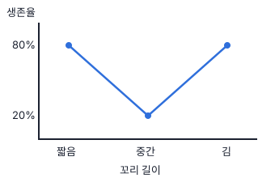
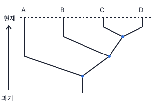

# 생명과학 7장 웹과제 예상 v1 문제해설

왼쪽 목차로 문항을 고르고, 오른쪽 문제를 보며 해설을 따라가요.

문제의 첫 줄부터 검산까지 설명해요.

**목차**

- [문항별 설명](#problems)
  - [P1. [기출 예상] 구조의 관계](#p1)
  - [P2. [기출 예상] 평형의 전제](#p2)
  - [P3. [기출 변형] 우연한 변화](#p3)
  - [P4. [기출 변형] 연구 기간과 세대](#p4)
  - [P5. [기출 변형] 자손세대의 빈도](#p5)
  - [P6. [예상] 집단에서 한 대립유전자 세기](#p6)
  - [P7. [예상] 증상이 없는 사람 중 보인자 비율](#p7)
  - [P8. [예상] 형질별 생존율 읽기](#p8)
  - [P9. [예상] 가지를 거슬러 공통조상 찾기](#p9)
  - [P10. [예상] 재난 뒤 집단이 회복되었을 때](#p10)
  - [P11. [예상] 지질 변화 설명의 연결](#p11)
  - [P12. [예상] 환경 변화 뒤의 형질 비율](#p12)
  - [P13. [예상] 선택 직후 집단에서 다시 세기](#p13)
  - [P14. [예상] 눈에 잘 띄는 장식의 유지](#p14)
  - [P15. [예상] 두 종류 빈도의 변화](#p15)

## 문항별 설명

### P1. [기출 예상] 구조의 관계

기출 7강 11 예상 · [연습형 문제 보기](../%EB%B3%B5%EC%8A%B5%EB%AC%B8%EC%A0%9C_7%EC%9E%A5_%EC%9B%B9%EA%B3%BC%EC%A0%9C%EC%98%88%EC%83%81_v1.html#p1) · [시험형 문제 보기](../%EB%B3%B5%EC%8A%B5%EB%AC%B8%EC%A0%9C_7%EC%9E%A5_%EC%9B%B9%EA%B3%BC%EC%A0%9C%EC%98%88%EC%83%81_%EC%8B%9C%ED%97%98%ED%98%95_v1.html#p1)

박쥐의 날개는 고양이의 앞발과 상동적이다. 상동적이라는 말의 의미는 무엇인가?

- A. 박쥐와 고양이의 공통조상은 고양이 다리와 박쥐 날개에서 발견되는 유사한 골격 구조를 갖는 사지를 갖는다.
- B. 박쥐와 고양이는 공통조상을 갖지 않는다
- C. 박쥐와 고양이의 공통조상은 날개의 기능을 갖는 사지(limbs)를 갖는다
- D. 두 구조는 같은 목적으로 사용된다
- E. 박쥐 날개는 퇴화한 다리이다

원문·출처 정보 보기

기출 7강 합본 11번을 보기 순서만 바꿔 실은 예상 문제예요.

#### 무엇을 구하는 문제인가요?

박쥐의 날개와 고양이의 앞발을 **상동**이라고 할 때 무엇을 공유한다는 뜻인지 찾아요. 지금 하는 일과 조상에서 물려받은 구조를 구별해요.

#### 이 문제를 봤을 때 떠올릴 개념과 공식

상동(homology)은 공통조상에서 물려받은 구조적 유래를 공유하는 관계예요. 사지(limb)는 팔·다리처럼 몸에서 뻗어 나온 부속기관이에요. 뼈의 대응 관계가 보존되어도 날기·걷기처럼 쓰임은 달라질 수 있어요.

판단 기준은 “같은 일을 하는가”가 아니라 “공통조상의 대응하는 구조가 두 후손에서 변형된 것인가”예요.

[상동과 상사](../../../%EB%B3%B5%EC%8A%B5%EB%85%B8%ED%8A%B8/1027/%EC%A0%95%EB%A6%AC%EB%85%B8%ED%8A%B8_1027_Evolutionary_Thought_and_Microevolution.html#s2-homology)

#### 왜 이렇게 푸는지 함께 따라가요

A. 맞아요. 공통조상이 가졌던 사지의 골격 구조가 두 계열로 이어져 각각 날개와 앞발이 되었다는 설명이므로 공통 유래 기준을 충족해요.

B. 틀려요. 공통조상이 없다는 설명은 그 조상에서 구조를 함께 물려받았다는 상동의 전제와 반대예요.

C. 틀려요. 박쥐의 비행 기능이 나중에 발달할 수 있으므로, 공통조상의 사지까지 날개였다고 결론낼 수 없어요.

D. 틀려요. 비행과 보행은 서로 다른 쓰임이에요. 기능의 동일성은 상동을 정의하는 기준이 아니에요.

E. 틀려요. 박쥐 날개는 비행에 특수화된 앞다리예요. 상동이라는 말이 그 구조의 기능이 사라진 퇴화 기관이라는 뜻은 아니에요.

따라서 답은 A예요.

#### 완성 답과 검산

답 A. 쓰임이 다른 날개와 앞발에서도 상완골·아래팔뼈 같은 대응 골격이 이어진다는 점을 확인하면, 기능 동일성을 요구하는 D와 공통조상의 비행 기능을 요구하는 C를 함께 제외할 수 있어요.

**페이지 요약**

상동은 기능의 동일성이 아니라 공통조상에서 이어진 구조의 유래예요. 답 A.

---

### P2. [기출 예상] 평형의 전제

기출 7강 3 예상 · [연습형 문제 보기](../%EB%B3%B5%EC%8A%B5%EB%AC%B8%EC%A0%9C_7%EC%9E%A5_%EC%9B%B9%EA%B3%BC%EC%A0%9C%EC%98%88%EC%83%81_v1.html#p2) · [시험형 문제 보기](../%EB%B3%B5%EC%8A%B5%EB%AC%B8%EC%A0%9C_7%EC%9E%A5_%EC%9B%B9%EA%B3%BC%EC%A0%9C%EC%98%88%EC%83%81_%EC%8B%9C%ED%97%98%ED%98%95_v1.html#p2)

다음 중 하디-바인베르그 원리의 조건으로 틀린 것은 ?

- A. 개체군 내의 개체들은 무작위로 교배한다
- B. 돌연변이가 일어나지 않는다
- C. 개체군의 크기는 무한하다
- D. 자연선택이 존재한다
- E. 다른 개체군으로부터의 유입은 차단된다

원문·출처 정보 보기

기출 7강 합본 3번을 보기 순서만 바꿔 실은 예상 문제예요.

#### 무엇을 구하는 문제인가요?

**하디–바인베르크 평형의 조건으로 틀린 것**을 골라요. 맞는 조건 네 개를 고르는 문제가 아니에요.

#### 이 문제를 봤을 때 떠올릴 개념과 공식

하디–바인베르크 원리(Hardy–Weinberg principle)는 대립유전자 빈도가 유지되고 대립유전자가 무작위로 짝지어질 때 자손 유전자형 빈도를 예측하는 모델이에요.

조건은 돌연변이 없음·이동 없음·무한히 큰 집단·자연선택 없음·무작위 교배예요. 선택지의 표현이 이 조건과 같은지 대조해요.

[유전적 평형의 다섯 조건](../../../%EB%B3%B5%EC%8A%B5%EB%85%B8%ED%8A%B8/1027/%EC%A0%95%EB%A6%AC%EB%85%B8%ED%8A%B8_1027_Evolutionary_Thought_and_Microevolution.html#s3-hardy-weinberg)

#### 왜 이렇게 푸는지 함께 따라가요

A. 맞는 조건이에요. 무작위 교배는 A와 a가 빈도에 따라 결합해 p²·2pq·q²의 자손 분포를 만드는 조건이에요.

B. 맞는 조건이에요. 돌연변이가 없다면 대립유전자가 다른 형태로 바뀌거나 새로 생기는 변화를 배제해요.

C. 맞는 조건이에요. 무한히 큰 집단에서는 우연한 표본 추출이 대립유전자 빈도를 흔드는 유전적 부동을 배제해요.

D. 틀린 조건이에요. 자연선택이 존재하면 유전자형별 생존·번식 성공이 달라져 대립유전자 빈도가 바뀔 수 있어요. 필요한 조건은 자연선택이 없는 것이에요.

E. 맞는 조건이에요. 다른 집단의 개체·생식세포가 들어와 대립유전자를 추가하는 유전자 흐름을 배제하는 표현이에요.

따라서 평형 조건에 어긋나는 D가 답이에요.

#### 완성 답과 검산

답 D. B·C·E는 대립유전자 빈도를 바꾸는 요인을 배제하고, A는 짝짓는 방식을 정해요. D만 그 빈도를 바꿀 수 있는 요인을 허용하므로 질문 방향에 맞아요.

**페이지 요약**

평형에는 자연선택이 없어야 해요. “자연선택이 존재한다”인 D를 골라요.

---

### P3. [기출 변형] 우연한 변화

기출 7강 6 예상 · [연습형 문제 보기](../%EB%B3%B5%EC%8A%B5%EB%AC%B8%EC%A0%9C_7%EC%9E%A5_%EC%9B%B9%EA%B3%BC%EC%A0%9C%EC%98%88%EC%83%81_v1.html#p3) · [시험형 문제 보기](../%EB%B3%B5%EC%8A%B5%EB%AC%B8%EC%A0%9C_7%EC%9E%A5_%EC%9B%B9%EA%B3%BC%EC%A0%9C%EC%98%88%EC%83%81_%EC%8B%9C%ED%97%98%ED%98%95_v1.html#p3)

유전적 부동에 의해 변한 집단은 __________

- A. 잃어버린 대립유전자를 부동만으로 새로 만들어 낸다
- B. 대립유전자 빈도가 우연히 달라진다
- C. 개체군이 작을수록 대립유전자 빈도 변동이 약해진다
- D. 변화한 뒤에는 대립유전자 빈도가 반드시 이전 값으로 돌아간다
- E. 환경에 유리한 대립유전자만 남긴다

원문·출처 정보 보기

기출 7강 합본 6번의 발문은 유지하고 보기를 새로 쓴 예상 문제예요.

#### 무엇을 구하는 문제인가요?

유전적 부동으로 변한 집단에서 무엇이 어떻게 달라졌는지 찾아요. 변화를 일으킨 원인과 변화한 대상을 함께 읽어요.

#### 이 문제를 봤을 때 떠올릴 개념과 공식

유전적 부동(genetic drift)은 우연한 생존·번식 또는 표본 추출로 대립유전자 빈도가 달라지는 현상이에요. 환경에 더 유리해서 남는 자연선택과 구별해요.

적은 수를 뽑으면 우연히 한쪽으로 치우치기 쉬워 작은 집단일수록 영향이 커요. 부동은 있는 대립유전자의 비율을 바꾸며, 새로운 종류를 만들어 내거나 원래 비율로 되돌리는 장치는 아니에요.

[유전적 부동과 집단 크기](../../../%EB%B3%B5%EC%8A%B5%EB%85%B8%ED%8A%B8/1029/%EC%A0%95%EB%A6%AC%EB%85%B8%ED%8A%B8_1029_Microevolution_and_Speciation.html#s0-drift)

#### 왜 이렇게 푸는지 함께 따라가요

A. 틀려요. 부동은 이미 있는 대립유전자가 남거나 사라지는 과정이에요. 없어진 종류를 새로 만드는 것은 돌연변이 같은 별도의 과정이 필요해요.

B. 맞아요. 대립유전자 빈도가 우연한 사건으로 달라진다는 설명이 부동의 원인과 변화 대상을 모두 포함해요.

C. 틀려요. 작은 집단일수록 적은 수의 생존자·자손이 전체 구성을 좌우하므로 우연한 빈도 변동이 더 커질 수 있어요.

D. 틀려요. 부동에는 원래 빈도로 돌아가는 방향성이 없어요. 오히려 어느 대립유전자가 완전히 사라지거나 고정될 수도 있어요.

E. 틀려요. 부동에서는 유리함과 관계없이 어떤 대립유전자가 남을 수 있어요. 환경에 유리한 것만 남는다는 설명은 우연한 추출의 성질을 지워 버려요.

따라서 답은 B예요.

#### 완성 답과 검산

답 B. 병목 현상과 창시자 효과 모두 소수의 우연한 구성이 이후 집단 비율을 좌우한다는 공통점이 있어요. 환경에 대한 유리함이나 원상회복을 요구하지 않아 B와 일치해요.

**페이지 요약**

부동은 우연한 대립유전자 빈도 변화이며 작은 집단에서 영향이 커요. 답 B.

---

### P4. [기출 변형] 연구 기간과 세대

기출 7강 10 예상 · [연습형 문제 보기](../%EB%B3%B5%EC%8A%B5%EB%AC%B8%EC%A0%9C_7%EC%9E%A5_%EC%9B%B9%EA%B3%BC%EC%A0%9C%EC%98%88%EC%83%81_v1.html#p4) · [시험형 문제 보기](../%EB%B3%B5%EC%8A%B5%EB%AC%B8%EC%A0%9C_7%EC%9E%A5_%EC%9B%B9%EA%B3%BC%EC%A0%9C%EC%98%88%EC%83%81_%EC%8B%9C%ED%97%98%ED%98%95_v1.html#p4)

실험실에서 진화의 과정을 연구할 수 있는 적당한 생명체를 찾고 있을 때, 다음 보기들 중 가장 중요하게 고려해야 할 점은?

- A. 실험 중 환경과 관계없이 필요한 변이를 스스로 만들어야 한다
- B. 한 세대가 연구 기간보다 오래 지속되어야 한다
- C. 모든 개체의 유전되는 형질이 처음부터 같아야 한다
- D. 자손에게 유전되는 차이가 전혀 없어야 한다
- E. 정해진 관찰 기간에 많은 세대가 이어져야 한다

원문·출처 정보 보기

기출 7강 합본 10번의 발문은 유지하고 보기를 새로 쓴 예상 문제예요. 원문 인쇄 답은 “조상의 완전한 화석”이지만 기존 정답 대조에서 “짧은 세대”로 판단한 근거를 사용했어요.

#### 무엇을 구하는 문제인가요?

제한된 연구 기간에 실험실에서 진화 과정을 관찰하기 좋은 조건을 찾아요. 여기서는 원문과 보기가 달라진 변형 문제를 풀어요.

#### 이 문제를 봤을 때 떠올릴 개념과 공식

소진화(microevolution)는 세대를 거치며 집단의 대립유전자 빈도가 변하는 과정이에요. 자연선택을 추적하려면 유전되는 변이와 세대 간 생존·번식 차이를 관찰해야 해요.

관찰 기간이 같다면 세대가 짧을수록 더 많은 세대의 변화를 반복 관찰할 수 있어요. 실험 재료의 과거 화석이 완전한지는 살아 있는 집단의 세대 변화를 관찰할 조건과 달라요.

[자연선택의 세대 간 변화](../../../%EB%B3%B5%EC%8A%B5%EB%85%B8%ED%8A%B8/1027/%EC%A0%95%EB%A6%AC%EB%85%B8%ED%8A%B8_1027_Evolutionary_Thought_and_Microevolution.html#s1-natural-selection)

#### 왜 이렇게 푸는지 함께 따라가요

A. 부적합해요. 생물이 필요를 알아서 목표에 맞는 변이를 만든다는 것은 자연선택의 원리가 아니에요. 선택은 유전되는 변이의 번식 성공 차이를 통해 작용해요.

B. 부적합해요. 한 세대가 연구 기간보다 길면 자손 세대 변화조차 끝까지 관찰하기 어려워, 세대가 누적되는 효과를 연구하기 불리해요.

C. 부적합해요. 모든 유전되는 형질이 처음부터 같아야 한다는 조건은 자연선택이 작용할 유전적 차이를 없애요.

D. 부적합해요. 자손에게 전달되는 차이가 전혀 없으면 그 차이에 따른 다음 세대 비율 변화를 추적하기 어려워요.

E. 적합해요. 같은 기간에 많은 세대가 이어지면 생존·번식에 따른 유전적 조성 변화를 여러 번 측정할 수 있어요.

따라서 현재 변형 문제의 답은 E예요. 원문 7강 10번의 인쇄 답은 (3) “조상의 완전한 화석”이지만, 기존 정답 대조는 (2) “세대 길이가 짧아야 한다”로 판단했어요. 현재 E는 그 판단 원리를 관찰 가능한 세대 수로 바꾼 보기예요.

#### 완성 답과 검산

답 E. 같은 1년 동안 1세대가 지나는 재료와 여러 세대가 지나는 재료를 비교하면, 후자에서 세대별 빈도 변화를 반복 측정하기 쉬워요. 짧은 세대를 기준으로 한 기존 정답 대조와 같은 결론이에요.

#### 헷갈리지 않으려면

기출 원문으로 돌아가면 인쇄 (3)과 기존 판단 (2)을 구별해요. 현재 문제는 보기 전체를 새로 썼으므로 원문의 답 번호를 옮기지 말고 각 보기를 다시 판단해요.

**페이지 요약**

정해진 기간에 많은 세대를 관찰할 수 있는 E가 답이에요. 원문 인쇄 답과 기존 판단 답의 차이는 현재 변형의 답 글자와 구별해요.

---

### P5. [기출 변형] 자손세대의 빈도

기출 7강 68 예상 · [연습형 문제 보기](../%EB%B3%B5%EC%8A%B5%EB%AC%B8%EC%A0%9C_7%EC%9E%A5_%EC%9B%B9%EA%B3%BC%EC%A0%9C%EC%98%88%EC%83%81_v1.html#p5) · [시험형 문제 보기](../%EB%B3%B5%EC%8A%B5%EB%AC%B8%EC%A0%9C_7%EC%9E%A5_%EC%9B%B9%EA%B3%BC%EC%A0%9C%EC%98%88%EC%83%81_%EC%8B%9C%ED%97%98%ED%98%95_v1.html#p5)

개체군의 유전자형 빈도가 0.30 AA, 0.40 Aa, 0.30 aa이고 하디-바인베르그의 원리의 요구사항들이 적용된다면, 자손세대의 유전자형 빈도는 어떻게 될 것인가?

- A. 0.09 AA, 0.82 Aa, 0.09 aa
- B. 0.25 AA, 0.25 Aa, 0.50 aa
- C. 0.25 AA, 0.50 Aa, 0.25 aa
- D. 0.30 AA, 0.40 Aa, 0.30 aa
- E. 0.50 AA, 0.00 Aa, 0.50 aa

원문·출처 정보 보기

기출 7강 합본 68번의 숫자를 바꾸고 보기를 다시 계산한 예상 문제예요.

#### 무엇을 구하는 문제인가요?

현재 유전자형 빈도가 AA 0.30·Aa 0.40·aa 0.30일 때, 조건이 성립하는 **자손 세대**의 유전자형 빈도를 구해요.

#### 이 문제를 봤을 때 떠올릴 개념과 공식

A의 대립유전자 빈도를 p, a의 빈도를 q라 하면 p=f(AA)+f(Aa)/2, q=1−p예요. AA는 A를 두 개, Aa는 한 개 가지므로 Aa 빈도의 절반을 더해요.

하디–바인베르크 조건 아래 무작위 교배로 생긴 자손의 AA·Aa·aa 빈도는 p²·2pq·q²예요. 부모가 그 분포를 이미 이루고 있을 필요는 없어요.

[유전자형에서 대립유전자 빈도 구하기](../../../%EB%B3%B5%EC%8A%B5%EB%85%B8%ED%8A%B8/1027/%EC%A0%95%EB%A6%AC%EB%85%B8%ED%8A%B8_1027_Evolutionary_Thought_and_Microevolution.html#s3-frequency) · [무작위 교배 뒤 자손의 빈도](../../../%EB%B3%B5%EC%8A%B5%EB%85%B8%ED%8A%B8/1027/%EC%A0%95%EB%A6%AC%EB%85%B8%ED%8A%B8_1027_Evolutionary_Thought_and_Microevolution.html#s3-hardy-weinberg)

#### 왜 이렇게 푸는지 함께 따라가요

먼저 p=0.30+0.40/2=0.50, q=0.50을 구해요. 따라서 자손은 AA 0.25·Aa 0.50·aa 0.25예요.

A. 틀려요. 자손의 AA와 aa는 각각 0.50²=0.25여야 하므로 0.09와 맞지 않아요. 세 값의 합이 1이라는 사실만으로 평형 분포가 되지는 않아요.

B. 틀려요. Aa는 A–a와 a–A 두 조합을 합쳐 0.50이고 aa는 a–a 한 조합으로 0.25예요. 이 두 값을 잘못 배정했어요.

C. 맞아요. p²=0.25, 2pq=0.50, q²=0.25를 순서대로 배정한 값이에요.

D. 틀려요. 0.30·0.40·0.30은 현재 집단의 값이에요. 부모가 비평형이므로 자손의 평형 분포와 같지 않아요.

E. 틀려요. p와 q가 0.50이라고 AA와 aa를 각각 0.50으로 놓을 수 없어요. 서로 다른 두 대립유전자가 결합하는 Aa도 생겨요.

따라서 답은 C예요.

#### 완성 답과 검산

답 C. 생식세포 A와 a가 각각 1/2인 교배표로 다시 확인해요.

| 생식세포 | A (1/2) | a (1/2) |
|---|---|---|
| A (1/2) | AA 1/4 | Aa 1/4 |
| a (1/2) | Aa 1/4 | aa 1/4 |

네 칸을 합치면 AA 1/4·Aa 1/2·aa 1/4이고, 자손의 p도 1/4+(1/2)/2=1/2로 부모와 같아요.

**페이지 요약**

부모 빈도→p=q=0.50→자손 0.25·0.50·0.25예요. 답 C.

---

### P6. [예상] 집단에서 한 대립유전자 세기

예상 7장 6 · [연습형 문제 보기](../%EB%B3%B5%EC%8A%B5%EB%AC%B8%EC%A0%9C_7%EC%9E%A5_%EC%9B%B9%EA%B3%BC%EC%A0%9C%EC%98%88%EC%83%81_v1.html#p6) · [시험형 문제 보기](../%EB%B3%B5%EC%8A%B5%EB%AC%B8%EC%A0%9C_7%EC%9E%A5_%EC%9B%B9%EA%B3%BC%EC%A0%9C%EC%98%88%EC%83%81_%EC%8B%9C%ED%97%98%ED%98%95_v1.html#p6)

상염색체의 한 유전자에 A와 a 두 대립유전자가 있는 이배체 개체군을 조사했어요. 아래 표를 이용할 때 이 개체군의 A 대립유전자 빈도는 얼마인가요? 하디-바인베르크 평형 여부는 알려지지 않았어요.

| 유전자형 | 개체 수 |
|---|---|
| AA | 40 |
| Aa | 40 |
| aa | 20 |

- A. 0.20
- B. 1.20
- C. 0.60
- D. 0.40
- E. 0.80

원문·출처 정보 보기

원문 기출이 아닌 새 예상 문제예요. 유전자형별 개체 수와 대립유전자 총수의 단위를 구별해요.

#### 무엇을 구하는 문제인가요?

표에 있는 100개체가 가진 A의 비율을 구해요. **개체의 비율**과 **대립유전자 개수의 비율**을 나누어 세어요.

#### 이 문제를 봤을 때 떠올릴 개념과 공식

이배체(diploid)는 이 유전자좌의 대립유전자를 개체당 두 개 가져요. 따라서 N개체에는 대립유전자 2N개가 있어요. AA는 A 두 개, Aa는 A 한 개, aa는 A가 없어요.

관측한 유전자형 수에서 직접 세는 p=(2×AA 수+Aa 수)/(2N)에는 하디–바인베르크 평형 가정이 필요하지 않아요. 평형의 p² 공식을 거꾸로 쓰는 것과 다른 계산이에요.

[분모가 2N인 대립유전자 빈도](../../../%EB%B3%B5%EC%8A%B5%EB%85%B8%ED%8A%B8/1027/%EC%A0%95%EB%A6%AC%EB%85%B8%ED%8A%B8_1027_Evolutionary_Thought_and_Microevolution.html#s3-frequency)

#### 왜 이렇게 푸는지 함께 따라가요

A의 수는 2×40+40=120개, 전체는 2×(40+40+20)=200개예요. 따라서 p=120/200=0.60이에요.

A. 틀려요. 0.20은 aa 개체 비율이에요. A의 대립유전자 빈도와는 대상이 달라요.

B. 틀려요. 120을 개체 수 100으로 나누면 1.20이 되지만, 분모는 대립유전자 전체 200이어야 해요. 비율은 1을 넘을 수 없어요.

C. 맞아요. A 개수를 전체 대립유전자 개수로 나눈 0.60이에요.

D. 틀려요. 0.40은 이 표의 AA 또는 Aa 개체 비율과 같지만, 두 유전자형이 모두 가진 A를 합쳐 센 빈도는 아니에요.

E. 틀려요. 0.80은 AA 개체 수 40을 두 배 하여 개체 수 100으로 나눈 값과 같아요. Aa의 A와 분모 2N을 함께 반영해야 해요.

따라서 답은 C예요.

#### 완성 답과 검산

답 C. 반대로 a를 세면 Aa에서 40개, aa에서 40개로 총 80개예요. a 빈도 80/200=0.40과 A 빈도 0.60의 합이 1이 되어 전체 200개를 빠짐없이 센 것을 확인해요.

**페이지 요약**

평형을 가정하지 않고 직접 세어요. A 120개/전체 200개=0.60, 답 C.

---

### P7. [예상] 증상이 없는 사람 중 보인자 비율

예상 7장 7 · [연습형 문제 보기](../%EB%B3%B5%EC%8A%B5%EB%AC%B8%EC%A0%9C_7%EC%9E%A5_%EC%9B%B9%EA%B3%BC%EC%A0%9C%EC%98%88%EC%83%81_v1.html#p7) · [시험형 문제 보기](../%EB%B3%B5%EC%8A%B5%EB%AC%B8%EC%A0%9C_7%EC%9E%A5_%EC%9B%B9%EA%B3%BC%EC%A0%9C%EC%98%88%EC%83%81_%EC%8B%9C%ED%97%98%ED%98%95_v1.html#p7)

하디-바인베르크 평형인 큰 개체군에서 상염색체 열성 질환을 조사했어요. aa만 환자이고 AA와 Aa는 증상이 없어요. 환자가 전체의 4%일 때, **증상이 없는 사람 중** 보인자 Aa의 비율은 얼마인가요?

- A. 1/3
- B. 8/25
- C. 2/3
- D. 1/25
- E. 1/5

원문·출처 정보 보기

원문 기출이 아닌 새 예상 문제예요. 열성 환자 비율에서 대립유전자 빈도를 역산하고, 보인자의 비교 대상을 구별해요.

#### 무엇을 구하는 문제인가요?

전체 중 환자의 비율이 아니라 **증상이 없는 사람 중 보인자**의 비율을 물어요. 환자는 aa이고 보인자는 증상이 없는 Aa예요.

#### 이 문제를 봤을 때 떠올릴 개념과 공식

상염색체 열성 질환에서 aa만 환자라면, 평형일 때 환자 빈도는 q²예요. 여기서 q는 a의 빈도이며 q²와 달라요. 보인자(carrier) Aa는 2pq, AA는 p²예요.

“증상이 없는 사람 중”이라는 조건이 붙으므로 분모를 전체 1이 아니라 AA+Aa=1−q²로 바꿔요. 구할 비율은 2pq/(1−q²)예요.

[열성 질환 빈도와 보인자 계산](../../../%EB%B3%B5%EC%8A%B5%EB%85%B8%ED%8A%B8/1029/%EC%A0%95%EB%A6%AC%EB%85%B8%ED%8A%B8_1029_Microevolution_and_Speciation.html#s0-hw-practice) · [평형의 유전자형 빈도](../../../%EB%B3%B5%EC%8A%B5%EB%85%B8%ED%8A%B8/1027/%EC%A0%95%EB%A6%AC%EB%85%B8%ED%8A%B8_1027_Evolutionary_Thought_and_Microevolution.html#s3-hardy-weinberg)

#### 왜 이렇게 푸는지 함께 따라가요

q²=0.04이므로 q=0.20, p=0.80이에요. 전체의 Aa 빈도는 2×0.80×0.20=0.32이고 증상이 없는 사람은 0.96이므로 0.32/0.96=1/3이에요.

A. 맞아요. 증상이 없는 0.96 중 보인자 0.32의 비율은 1/3이에요.

B. 틀려요. 8/25=0.32는 전체 사람을 분모로 한 보인자 비율이에요. 이 문제에서는 증상이 없는 사람으로 분모를 제한해야 해요.

C. 틀려요. 2/3은 증상이 없는 사람 중 AA의 비율 0.64/0.96이에요. 보인자가 아닌 쪽을 계산했어요.

D. 틀려요. 1/25=0.04는 aa 환자 빈도예요. 환자는 애초에 증상이 없는 사람 집단에 포함되지 않아요.

E. 틀려요. 1/5=0.20은 a 대립유전자 빈도 q예요. 사람이 보인자인 비율과는 세는 대상이 달라요.

따라서 답은 A예요.

#### 완성 답과 검산

답 A. 10,000명으로 다시 세면 AA 6,400명·Aa 3,200명·aa 400명이에요. 증상이 없는 9,600명 중 Aa 3,200명이므로 3,200/9,600=1/3이에요. 세 유전자형의 합도 10,000명이에요.

**페이지 요약**

q²=0.04→q=0.20→Aa 0.32. 무증상 집단 0.96 안에서는 1/3, 답 A.

---

### P8. [예상] 형질별 생존율 읽기

예상 7장 8 · [연습형 문제 보기](../%EB%B3%B5%EC%8A%B5%EB%AC%B8%EC%A0%9C_7%EC%9E%A5_%EC%9B%B9%EA%B3%BC%EC%A0%9C%EC%98%88%EC%83%81_v1.html#p8) · [시험형 문제 보기](../%EB%B3%B5%EC%8A%B5%EB%AC%B8%EC%A0%9C_7%EC%9E%A5_%EC%9B%B9%EA%B3%BC%EC%A0%9C%EC%98%88%EC%83%81_%EC%8B%9C%ED%97%98%ED%98%95_v1.html#p8)

한 개체군의 유전되는 꼬리 길이에 따라 다음 번식기까지 살아남는 비율을 조사했어요. 아래 그림에서 살아남은 개체들의 번식 성공은 같다고 할 때, 이 조건이 나타내는 자연선택 양상은 무엇인가요?

- A. 꼬리 길이와 생존율이 무관한 유전적 부동
- B. 짧은 꼬리만 유리한 방향성 선택
- C. 중간 길이가 유리한 안정화 선택
- D. 긴 꼬리만 유리한 방향성 선택
- E. 양 극단이 중간보다 유리한 분단성 선택

원문·출처 정보 보기

원문 기출이 아닌 새 예상 문제예요. 형질에 따른 생존율 도식에서 선택 양상을 판별해요.

#### 무엇을 구하는 문제인가요?

꼬리 길이별 생존율 그림을 읽고 자연선택의 양상을 골라요. 세로축은 개체 수가 아니라 **살아남는 비율**이며, 생존 뒤 번식 성공은 같아요.

#### 이 문제를 봤을 때 떠올릴 개념과 공식

자연선택 양상은 어느 표현형이 상대적으로 더 많은 자손을 남기는지로 구별해요. 번식 성공이 같다고 주었으므로 이 문제에서는 생존율이 높은 쪽의 기여가 더 커요.

한쪽 극단이 유리하면 방향성 선택(directional selection), 가운데가 유리하면 안정화 선택(stabilizing selection), 양 극단이 가운데보다 유리하면 분단성 선택(disruptive selection)이에요. 그림의 짧음·중간·김을 각각 비교해요.

[자연선택의 세 양상과 그래프 읽기](../../../%EB%B3%B5%EC%8A%B5%EB%85%B8%ED%8A%B8/1029/%EC%A0%95%EB%A6%AC%EB%85%B8%ED%8A%B8_1029_Microevolution_and_Speciation.html#s1-fitness)

#### 왜 이렇게 푸는지 함께 따라가요

A. 부적합해요. 부동은 형질의 유리함과 무관한 우연한 변화예요. 이 그림에서는 꼬리 길이에 따라 생존율이 체계적으로 달라져요.

B. 부적합해요. 짧은 꼬리만 유리한 것이 아니라 긴 꼬리도 같은 높은 생존율을 보여요.

C. 부적합해요. 안정화 선택은 중간 길이가 가장 유리해야 하지만 중간의 생존율은 20%로 가장 낮아요.

D. 부적합해요. 긴 꼬리의 생존율은 80%지만 짧은 꼬리도 80%예요. 긴 쪽만 유리한 조건이 아니에요.

E. 적합해요. 짧고 긴 양 극단이 80%로, 중간 20%보다 유리하므로 분단성 선택이에요.

따라서 답은 E예요.

#### 완성 답과 검산

답 E. 양 극단과 중간의 생존율을 각각 나누면 80/20=4로, 두 극단 모두 중간보다 네 배 잘 살아남아요. 한쪽만 유리한 방향성이나 중간이 유리한 안정화와 반대임을 다시 확인해요.

**페이지 요약**

생존 뒤 번식이 같으므로 양끝 80%·가운데 20%는 양 극단 선호의 분단성 선택이에요. 답 E.

---

### P9. [예상] 가지를 거슬러 공통조상 찾기

예상 7장 9 · [연습형 문제 보기](../%EB%B3%B5%EC%8A%B5%EB%AC%B8%EC%A0%9C_7%EC%9E%A5_%EC%9B%B9%EA%B3%BC%EC%A0%9C%EC%98%88%EC%83%81_v1.html#p9) · [시험형 문제 보기](../%EB%B3%B5%EC%8A%B5%EB%AC%B8%EC%A0%9C_7%EC%9E%A5_%EC%9B%B9%EA%B3%BC%EC%A0%9C%EC%98%88%EC%83%81_%EC%8B%9C%ED%97%98%ED%98%95_v1.html#p9)

그림은 현존하는 네 생물 A~D의 계통수예요. 세로 방향은 시간을 나타내고 위쪽일수록 현재에 가까워요. 다음 중 **가장 최근의 공통조상**을 공유하는 쌍은 어느 것인가요?

- A. B와 D
- B. C와 D
- C. 모든 쌍의 공통조상이 같은 시점에 있어요.
- D. A와 B
- E. A와 C

원문·출처 정보 보기

원문 기출이 아닌 새 예상 문제예요. 독자 계통도에서 가지의 연결과 갈림점의 시점을 읽어요.

#### 무엇을 구하는 문제인가요?

현존 생물 A~D 가운데 **가장 최근의 공통조상**을 공유하는 두 생물을 찾아요. 그림에서 위쪽일수록 현재에 가까운 시간이에요.

#### 이 문제를 봤을 때 떠올릴 개념과 공식

계통수(phylogenetic tree)의 갈림점은 후손 계열들이 갈라진 공통조상을 나타내요. 두 생물의 가지를 과거 쪽으로 거슬러 처음 만나는 갈림점을 찾으면 그 둘의 가장 최근 공통조상이에요.

이 그림은 시간 방향이 주어졌으므로 여러 쌍의 만나는 갈림점 중 가장 위쪽인 것을 비교해요. 현재 선에서 좌우로 가깝게 그려졌는지는 기준이 아니에요.

[계통수의 갈림점과 공통조상](../../../%EB%B3%B5%EC%8A%B5%EB%85%B8%ED%8A%B8/1027/%EC%A0%95%EB%A6%AC%EB%85%B8%ED%8A%B8_1027_Evolutionary_Thought_and_Microevolution.html#s1-tree)

#### 왜 이렇게 푸는지 함께 따라가요

A. 부적합해요. B와 D는 B가 C·D 계열에서 갈라진 가운데 갈림점에서 만나요. 그보다 위에 C·D의 갈림점이 있어요.

B. 적합해요. C와 D는 다른 제시 쌍보다 현재에 가까운 가장 위쪽 갈림점에서 만나므로 최근 공통조상을 공유해요.

C. 틀려요. 공통조상을 나타내는 세 갈림점의 높이가 달라 각 쌍의 공통조상 시점이 같지 않아요.

D. 부적합해요. A와 B를 거슬러 가면 A가 나머지에서 갈라진 가장 아래 갈림점에서 만나므로 더 오래된 공통조상이에요.

E. 부적합해요. A와 C도 A가 먼저 갈라진 아래 갈림점에서 만나므로 C와 D의 조상보다 오래돼요.

따라서 답은 B예요.

#### 완성 답과 검산

답 B. C와 D를 한 묶음으로 먼저 합친 뒤 그 묶음과 B, 마지막으로 A를 합치면 그림의 분기 순서가 그대로 복원돼요. 처음 합쳐지는 C·D가 가장 최근에 갈라진 쌍이에요.

**페이지 요약**

가지 끝의 좌우 위치 대신 두 가지가 만나는 갈림점의 시간을 비교해요. 가장 최근인 C·D, 답 B.

---

### P10. [예상] 재난 뒤 집단이 회복되었을 때

예상 7장 10 · [연습형 문제 보기](../%EB%B3%B5%EC%8A%B5%EB%AC%B8%EC%A0%9C_7%EC%9E%A5_%EC%9B%B9%EA%B3%BC%EC%A0%9C%EC%98%88%EC%83%81_v1.html#p10) · [시험형 문제 보기](../%EB%B3%B5%EC%8A%B5%EB%AC%B8%EC%A0%9C_7%EC%9E%A5_%EC%9B%B9%EA%B3%BC%EC%A0%9C%EC%98%88%EC%83%81_%EC%8B%9C%ED%97%98%ED%98%95_v1.html#p10)

큰 섬의 딱정벌레 개체군이 폭풍으로 급감했어요. 조사한 대립유전자와 관련된 형질은 생존에 영향을 주지 않았고, 살아남은 개체는 우연히 정해졌어요. 남은 개체들이 **그 섬에서** 번식해 개체 수가 회복되었어요. 이 상황에 대한 설명으로 옳지 않은 것은 무엇인가요?

- A. 생존자 집단이 작을수록 우연한 대립유전자 빈도 변화의 영향이 클 수 있어요.
- B. 폭풍 전 존재하던 일부 대립유전자가 생존자 집단에서 사라졌을 수 있어요.
- C. 개체 수가 회복되어도 대립유전자 조성이 폭풍 전과 같아졌다고 보장할 수 없어요.
- D. 생존자에게서 빈도가 높아진 대립유전자는 폭풍 생존에 유리했기 때문에 증가한 것이에요.
- E. 병목 현상의 사례로 볼 수 있어요.

원문·출처 정보 보기

원문 기출이 아닌 새 예상 문제예요. 기존 집단의 급감과 회복을 통해 유전적 부동과 적응을 구별해요.

#### 무엇을 구하는 문제인가요?

형질과 관계없는 폭풍 생존 뒤 같은 섬에서 회복된 집단을 설명한 것 중 **옳지 않은 것**을 찾아요. 생존자가 우연히 정해졌다는 조건을 유지해요.

#### 이 문제를 봤을 때 떠올릴 개념과 공식

병목 현상(population bottleneck)은 기존 집단의 개체 수가 급감하면서 우연히 남은 소수의 대립유전자 조성이 이후 집단에 이어지는 유전적 부동의 한 경우예요. 소수가 새 지역을 개척하는 창시자 효과와 출발 상황이 달라요.

부동인지 자연선택인지 가르는 기준은 개체 수 감소 자체가 아니라 해당 형질이 생존·번식에 차이를 만들었는지예요. 집단이 다시 커져도 소실된 대립유전자가 자동으로 복구되지는 않아요.

[병목 현상과 자연선택의 구별](../../../%EB%B3%B5%EC%8A%B5%EB%85%B8%ED%8A%B8/1029/%EC%A0%95%EB%A6%AC%EB%85%B8%ED%8A%B8_1029_Microevolution_and_Speciation.html#s0-drift)

#### 왜 이렇게 푸는지 함께 따라가요

A. 맞아요. 생존자 수가 적으면 우연히 뽑힌 몇 개체의 유전적 구성이 집단 전체 빈도에 큰 영향을 줄 수 있어요.

B. 맞아요. 원래 희귀했던 대립유전자를 가진 개체가 우연히 모두 죽으면 그 대립유전자는 생존자 집단에서 사라질 수 있어요.

C. 맞아요. 개체 수 증가는 남은 유전자의 복사 수를 늘리는 것이므로, 폭풍 전의 모든 종류와 비율이 복구되었다는 뜻은 아니에요.

D. 틀려요. 지문은 해당 형질이 생존에 영향을 주지 않았다고 했어요. 빈도가 높아졌다는 결과만으로 폭풍 생존에 유리해서 선택되었다고 해석하면 주어진 조건에 어긋나요.

E. 맞아요. 기존 섬 집단이 급감한 뒤 그곳의 생존자들이 재번식했으므로 병목 현상에 해당해요.

따라서 옳지 않은 설명은 D예요.

#### 완성 답과 검산

답 D. A·B·C·E는 작은 우연 표본의 효과와 그 후유증을 설명해 지문과 양립해요. D만 “형질이 생존에 영향 없음”을 “생존에 유리함”으로 바꾸므로 제외할 설명이 정확히 하나예요.

**페이지 요약**

같은 집단의 무작위 급감은 병목이에요. 우연한 빈도 증가를 적응의 증거로 바꾼 D가 틀려요.

---

### P11. [예상] 지질 변화 설명의 연결

예상 7장 11 · [연습형 문제 보기](../%EB%B3%B5%EC%8A%B5%EB%AC%B8%EC%A0%9C_7%EC%9E%A5_%EC%9B%B9%EA%B3%BC%EC%A0%9C%EC%98%88%EC%83%81_v1.html#p11) · [시험형 문제 보기](../%EB%B3%B5%EC%8A%B5%EB%AC%B8%EC%A0%9C_7%EC%9E%A5_%EC%9B%B9%EA%B3%BC%EC%A0%9C%EC%98%88%EC%83%81_%EC%8B%9C%ED%97%98%ED%98%95_v1.html#p11)

“과거의 지형도 오늘날 관찰하는 침식과 퇴적 같은 과정이 오랫동안 작용하여 형성되었다”라는 설명과 가장 잘 연결되는 이론·인물의 짝은 무엇인가요?

- A. 격변설 — 라이엘
- B. 동일과정설 — 퀴비에
- C. 획득형질의 유전 — 휴튼
- D. 격변설 — 라마르크
- E. 동일과정설 — 라이엘

원문·출처 정보 보기

원문 기출이 아닌 새 예상 문제예요. 근거는 1027 정리노트의 지질학 사상이에요.

#### 무엇을 연결하나요?

지금 보는 침식·퇴적이 과거에도 오랫동안 작용했다는 설명이에요. 그 설명에 맞는 이론과 주창자가 모두 맞아야 해요.

#### 이 문제를 봤을 때 떠올릴 개념과 공식

‘과거도 오늘날 관찰하는 과정’이라는 단서에서 **동일과정설(uniformitarianism)**을 떠올려요. 이론을 가르는 기준은 변화의 속도만이 아니라 과거와 현재에 같은 지질 과정이 작동한다는 주장이에요.

휴튼은 느린 지질 변화를 강조한 점진주의, 라이엘은 과거·현재의 같은 과정을 강조한 동일과정설, 퀴비에는 큰 사건에 의한 급격한 변화를 설명한 격변설과 연결해요. 라마르크의 획득형질 유전은 생물의 형질 전달을 설명한 주장이에요.

[격변설·점진주의·동일과정설의 구별](../../../%EB%B3%B5%EC%8A%B5%EB%85%B8%ED%8A%B8/1027/%EC%A0%95%EB%A6%AC%EB%85%B8%ED%8A%B8_1027_Evolutionary_Thought_and_Microevolution.html#s0-geology)

#### 보기의 두 부분을 함께 확인해요

A. 부적합해요. 격변설은 갑작스러운 큰 사건을 중심으로 설명하므로 지문의 느린 과정과 다르고, 연결 인물도 라이엘이 아니라 퀴비에예요.

B. 부적합해요. 이론 이름은 지문에 맞지만 퀴비에는 격변설과 연결되므로 인물 부분이 틀려요.

C. 부적합해요. 획득형질의 유전은 생애 중 얻은 형질이 자손에게 전달된다는 라마르크의 설명이에요. 지질 과정의 동일성이나 휴튼의 점진주의와 같지 않아요.

D. 부적합해요. 지문이 격변설을 설명하지 않으며, 라마르크와 격변설의 연결도 맞지 않아요.

E. 이 사례에 적합해요. 과거와 현재의 침식·퇴적을 같은 원리로 연결하므로 동일과정설이고, 이 이론의 인물인 라이엘도 맞게 연결했어요.

따라서 답은 E, 동일과정설 — 라이엘이에요.

#### 완성 답과 확인

답 E. 이론만 먼저 고르면 E·B가 남고, 주창자를 라이엘로 대조하면 E만 남아요. 속도가 느리다는 단서에만 의존하지 않고 ‘과거와 현재의 같은 과정’까지 확인한 결과예요.

**페이지 요약**

과거·현재에 같은 지질 과정 → 동일과정설, 라이엘이에요. 답 E.

---

### P12. [예상] 환경 변화 뒤의 형질 비율

예상 7장 12 · [연습형 문제 보기](../%EB%B3%B5%EC%8A%B5%EB%AC%B8%EC%A0%9C_7%EC%9E%A5_%EC%9B%B9%EA%B3%BC%EC%A0%9C%EC%98%88%EC%83%81_v1.html#p12) · [시험형 문제 보기](../%EB%B3%B5%EC%8A%B5%EB%AC%B8%EC%A0%9C_7%EC%9E%A5_%EC%9B%B9%EA%B3%BC%EC%A0%9C%EC%98%88%EC%83%81_%EC%8B%9C%ED%97%98%ED%98%95_v1.html#p12)

어떤 곤충 집단에는 살충제를 처리하기 전부터 유전되는 저항성 차이가 있었어요. 살충제 처리 뒤 저항성이 높은 개체가 살아남아 더 많은 자손을 남겼어요. 이 과정을 자연선택으로 설명한 것으로 옳지 않은 것은 무엇인가요?

- A. 저항성의 유전적 차이는 선택이 작용할 재료가 돼요.
- B. 살충제 때문에 저항성이 필요해져서 각 개체가 필요한 저항성 대립유전자를 만들어 냈어요.
- C. 생존과 번식 성공의 차이가 다음 세대의 유전적 조성에 영향을 줄 수 있어요.
- D. 여러 세대 뒤 저항성 관련 대립유전자의 빈도가 높아질 수 있어요.
- E. 한 개체가 필요한 방향으로 바뀌는 설명과 개체군의 형질 비율이 바뀌는 설명을 구별해야 해요.

원문·출처 정보 보기

원문 기출이 아닌 새 예상 문제예요. 근거는 1027 정리노트의 자연선택 논리예요.

#### 변이가 생긴 때를 확인해요

살충제 처리 전부터 유전되는 저항성 차이가 있었어요. 그 뒤 살아남아 남긴 자손 수가 달라졌어요. 이 순서와 맞지 않는 **옳지 않은 설명**을 찾아요.

#### 이 문제를 봤을 때 떠올릴 개념과 공식

자연선택(natural selection)은 이미 있는 유전변이에 작용해요. 어떤 형질의 개체가 그 환경에서 더 잘 생존하고 번식하면 그 유전적 차이가 다음 세대에 더 많이 전달될 수 있어요.

각 보기는 ‘유전되는 차이가 먼저 존재 → 생존·번식 성공의 차이 → 개체군의 유전적 조성 변화’와 연결되는지 판단해요. 환경에서 필요해졌다는 사실이 필요한 대립유전자를 목표대로 만들어 준다는 뜻은 아니에요.

[자연선택의 논리와 변이가 먼저라는 조건](../../../%EB%B3%B5%EC%8A%B5%EB%85%B8%ED%8A%B8/1027/%EC%A0%95%EB%A6%AC%EB%85%B8%ED%8A%B8_1027_Evolutionary_Thought_and_Microevolution.html#s1-natural-selection)

#### 인과 순서에 보기를 대입해요

A. 맞는 설명이므로 제외해요. 지문에 처리 전부터 유전되는 저항성 차이가 있으므로 선택이 작용할 재료가 있어요.

B. 틀린 설명이므로 선택해요. 각 개체가 필요에 맞춰 대립유전자를 만들었다는 주장은 기존 변이가 먼저 있었다는 조건과 다르며, 자연선택을 변이의 목적 지향적 생성으로 바꾸어 버려요.

C. 맞는 설명이므로 제외해요. 유전되는 저항성에 따라 생존·번식 성공이 다르면 자손에게 전달되는 대립유전자의 비율도 달라질 수 있어요.

D. 맞는 설명이므로 제외해요. 저항성 개체가 더 많은 자손을 남기므로 저항성과 관련된 대립유전자가 세대를 거치며 늘어날 수 있어요.

E. 맞는 설명이므로 제외해요. 한 개체가 자신을 바꾸었다는 이야기와 다음 세대 개체군에서 특정 형질을 가진 개체의 비율이 변했다는 이야기는 변화의 단위가 달라요.

옳지 않은 설명을 고르므로 답은 B예요.

#### 완성 답과 확인

답 B. A는 출발 재료, C는 전달 과정, D는 가능한 결과, E는 변화 단위의 구별로 각각 지문의 조건과 맞아요. B만 처리 전에 있던 변이를 처리 후 필요 때문에 새로 만들었다고 설명하므로 인과 순서가 맞지 않아요.

**페이지 요약**

기존 유전변이 → 생존·번식 차이 → 다음 세대 비율 변화예요. 필요에 맞춘 생성이라는 B가 틀린 설명이에요.

---

### P13. [예상] 선택 직후 집단에서 다시 세기

예상 7장 13 · [연습형 문제 보기](../%EB%B3%B5%EC%8A%B5%EB%AC%B8%EC%A0%9C_7%EC%9E%A5_%EC%9B%B9%EA%B3%BC%EC%A0%9C%EC%98%88%EC%83%81_v1.html#p13) · [시험형 문제 보기](../%EB%B3%B5%EC%8A%B5%EB%AC%B8%EC%A0%9C_7%EC%9E%A5_%EC%9B%B9%EA%B3%BC%EC%A0%9C%EC%98%88%EC%83%81_%EC%8B%9C%ED%97%98%ED%98%95_v1.html#p13)

상염색체의 한 유전자좌에 A와 a가 있는 이배체 집단을 조사했어요. 아래 표의 생존 비율대로 각 유전자형 개체가 살아남았으며, 그동안 출생·이주·돌연변이는 없었어요. 살아남은 집단에서 A의 대립유전자 빈도는 얼마인가요?

| 유전자형 | 선택 전 개체 수 | 생존 비율 |
|---|---|---|
| AA | 20 | 0.5 |
| Aa | 60 | 1.0 |
| aa | 20 | 0 |

- A. 6/7
- B. 1/2
- C. 1/7
- D. 4/7
- E. 3/7

원문·출처 정보 보기

원문 기출이 아닌 새 예상 문제예요. 이형접합자가 가장 잘 살아남는 조건과 대립유전자 개수 세기를 결합했어요.

#### 살아남은 집단이 분모예요

표는 선택 전 개체 수와 실제 생존 비율을 줘요. 구할 것은 선택 전 빈도나 살아남은 AA 개체의 비율이 아니라, **선택 뒤 전체 대립유전자 중 A의 비율**이에요.

#### 이 문제를 봤을 때 떠올릴 개념과 공식

이배체(diploid) 개체는 이 유전자좌에 대립유전자를 두 개 가져요. AA는 A 두 개, Aa는 A 한 개, aa는 A를 갖지 않아요. 살아남은 수를 먼저 구한 뒤 $p=(2n_{AA}+n_{Aa})/(2N)$으로 세어요. 여기서 N은 생존 개체 수예요.

이형접합자 이점(heterozygote advantage)은 Aa의 적응도가 두 동형접합자보다 높은 경우예요. 이 표에서도 Aa가 가장 잘 살아남지만, 선택 직후 집단이 평형이라고 주어지지 않았으므로 p²·2pq·q²를 먼저 적용하지 않아요.

[대립유전자 빈도의 분모와 계산](../../../%EB%B3%B5%EC%8A%B5%EB%85%B8%ED%8A%B8/1027/%EC%A0%95%EB%A6%AC%EB%85%B8%ED%8A%B8_1027_Evolutionary_Thought_and_Microevolution.html#s3-frequency) · [이형접합자 이점](../../../%EB%B3%B5%EC%8A%B5%EB%85%B8%ED%8A%B8/1029/%EC%A0%95%EB%A6%AC%EB%85%B8%ED%8A%B8_1029_Microevolution_and_Speciation.html#s1-balanced)

#### 첫 줄은 실제 생존 개체 수예요

AA: 20×0.5=10, Aa: 60×1=60, aa: 20×0=0이므로 N=70이에요.

#### 선택 뒤 개수로 보기를 판정해요

A. 부적합해요. 6/7=60/70은 Aa 개체의 비율이에요. Aa가 가진 두 대립유전자 중 A는 하나라 개체 비율과 A 빈도를 같게 둘 수 없어요.

B. 부적합해요. 1/2은 선택 전 (2×20+60)/(2×100)이고, 선택 뒤에는 유전자형별 생존 차이를 반영해야 해요.

C. 부적합해요. 1/7=10/70은 AA 개체의 비율이에요. AA의 A 두 개와 Aa의 A 한 개를 모두 세는 대립유전자 빈도가 아니에요.

D. 적합해요. 살아남은 집단의 A는 2×10+60=80개, 전체 대립유전자는 2×70=140개예요. 따라서 A 빈도는 80/140=4/7이에요.

E. 부적합해요. 3/7=60/140은 Aa가 가진 a의 빈도예요. 묻는 대립유전자는 A이므로 다른 값이에요.

따라서 답은 D, 4/7이에요.

#### 반대 대립유전자로 확인해요

답 D. 생존 집단에서 a는 Aa의 60개뿐이므로 q=60/140=3/7이에요. p=1−q=4/7로 다시 얻고, A 80개+a 60개=140개도 전체 대립유전자 수와 같아요.

**페이지 요약**

생존 AA10·Aa60·aa0 → A80개/전체140개=4/7이에요. 답 D. 선택 직후는 평형을 가정하지 않고 직접 세어요.

---

### P14. [예상] 눈에 잘 띄는 장식의 유지

예상 7장 14 · [연습형 문제 보기](../%EB%B3%B5%EC%8A%B5%EB%AC%B8%EC%A0%9C_7%EC%9E%A5_%EC%9B%B9%EA%B3%BC%EC%A0%9C%EC%98%88%EC%83%81_v1.html#p14) · [시험형 문제 보기](../%EB%B3%B5%EC%8A%B5%EB%AC%B8%EC%A0%9C_7%EC%9E%A5_%EC%9B%B9%EA%B3%BC%EC%A0%9C%EC%98%88%EC%83%81_%EC%8B%9C%ED%97%98%ED%98%95_v1.html#p14)

어떤 새의 수컷이 가진 긴 장식깃은 포식자에게 더 잘 보이게 해요. 그러나 암컷은 긴 장식깃을 가진 수컷을 선호하며, 그 수컷들은 생존상의 손해를 고려해도 평균적으로 더 많은 번식 가능한 자손을 남겨요. 장식깃 길이의 차이는 유전돼요. 긴 장식깃이 집단에 유지되는 이유로 가장 적절한 것은 무엇인가요?

- A. 성선택은 유전되는 차이와 무관하게 모든 개체의 자손 수를 같게 만들기 때문이에요.
- B. 수컷의 장식깃이 암컷의 몸에 직접 전달되기 때문이에요.
- C. 짝짓기 성공으로 얻는 번식상의 이익이 생존상의 손해를 넘어서기 때문이에요.
- D. 오래 살아남는 개체만이 언제나 가장 많은 유전자를 다음 세대에 남기기 때문이에요.
- E. 포식자에게 잘 보이는 형질은 생존율을 높이기 때문이에요.

원문·출처 정보 보기

원문 기출이 아닌 새 예상 문제예요. 근거는 1029 정리노트의 성선택과 생존·번식 성공의 구별이에요.

#### 생존 손해와 번식 이익을 함께 봐요

긴 깃은 포식자에게 잘 보여 손해지만, 짝을 얻는 데 유리해요. 지문은 그 손해를 고려하고도 긴 깃의 수컷이 더 많은 번식 가능한 자손을 남긴다고 주었어요.

#### 이 문제를 봤을 때 떠올릴 개념과 공식

한쪽 성의 선호가 짝짓기 성공의 차이를 만든다는 단서에서 성선택(sexual selection)을 떠올려요. 판단 기준은 오래 사는지 하나가 아니라 최종적으로 다음 세대에 얼마나 기여하는지예요.

상대적 적응도(relative fitness)는 다른 개체에 비해 생존 가능한 자손을 얼마나 남기는지와 연결돼요. 유전되는 형질이 생존에는 손해여도 번식 이익이 더 크면 관련 대립유전자가 유지되거나 늘어날 수 있어요.

[성선택과 생존에 불리한 장식의 유지](../../../%EB%B3%B5%EC%8A%B5%EB%85%B8%ED%8A%B8/1029/%EC%A0%95%EB%A6%AC%EB%85%B8%ED%8A%B8_1029_Microevolution_and_Speciation.html#s1-sexual)

#### 다음 세대에 남기는 기여를 비교해요

A. 틀린 설명이에요. 암컷의 선호 때문에 긴 깃 수컷의 자손 수가 더 많으므로, 성선택이 모든 개체의 자손 수를 같게 만든다는 주장과 반대예요.

B. 틀린 설명이에요. 수컷의 깃 자체가 암컷 몸으로 옮겨지는 것이 아니에요. 자손에게 전달되는 것은 깃 길이에 영향을 주는 유전적 차이예요.

C. 맞는 설명이에요. 손해를 고려한 뒤에도 더 많은 자손을 남긴다는 조건이 있으므로 짝짓기에서 얻는 이익이 생존 손해보다 커서 형질이 유지될 수 있어요.

D. 틀린 설명이에요. 오래 살아도 자손을 적게 남길 수 있어요. 이 지문에서도 생존에 불리한 긴 깃 수컷이 더 많은 자손을 남기므로 수명만으로 기여를 정할 수 없어요.

E. 틀린 설명이에요. 지문은 포식자에게 잘 보이는 것을 생존상의 손해로 주었어요. 그 손해를 생존율 증가로 뒤집을 수 없어요.

따라서 답은 C예요.

#### 완성 답과 반례로 확인해요

답 C. 오래 살지만 번식하지 못하는 개체를 생각하면 D의 수명 기준은 성립하지 않아요. 지문의 ‘생존 손해를 고려해도 자손이 더 많다’는 조건은 C의 생존·번식 종합 기준을 직접 충족해요.

**페이지 요약**

성선택은 짝짓기 성공의 차이예요. 번식 이익이 생존 손해를 넘으면 유전되는 장식이 유지될 수 있어요. 답 C.

---

### P15. [예상] 두 종류 빈도의 변화

예상 7장 15 · [연습형 문제 보기](../%EB%B3%B5%EC%8A%B5%EB%AC%B8%EC%A0%9C_7%EC%9E%A5_%EC%9B%B9%EA%B3%BC%EC%A0%9C%EC%98%88%EC%83%81_v1.html#p15) · [시험형 문제 보기](../%EB%B3%B5%EC%8A%B5%EB%AC%B8%EC%A0%9C_7%EC%9E%A5_%EC%9B%B9%EA%B3%BC%EC%A0%9C%EC%98%88%EC%83%81_%EC%8B%9C%ED%97%98%ED%98%95_v1.html#p15)

이배체 집단의 부모 세대 유전자형 빈도가 AA 0.50, Aa 0, aa 0.50이에요. 이 집단은 무한히 크고, 돌연변이·이동·자연선택이 없으며, 부모가 무작위로 교배해 자손 세대를 이루어요. 다음 설명 중 옳지 않은 것은 무엇인가요?

- A. Aa 빈도가 늘었으므로 이 변화만으로 A 대립유전자 빈도가 증가했다고 결론낼 수 있어요.
- B. 부모 세대의 A 대립유전자 빈도는 0.50이에요.
- C. 자손 세대의 Aa 유전자형 빈도는 0.50이에요.
- D. 자손 세대의 aa 유전자형 빈도는 0.25예요.
- E. 자손 세대의 A 대립유전자 빈도는 부모 세대와 같아요.

원문·출처 정보 보기

원문 기출이 아닌 새 예상 문제예요. 유전자형 빈도와 대립유전자 빈도의 변화 대상을 구별해요.

#### 무엇의 빈도가 바뀌었나요?

부모는 AA와 aa가 절반씩이고 Aa는 없어요. 다섯 조건 아래 무작위 교배한 자손을 계산해, **옳지 않은 설명**을 찾아요. 개체의 유전자형 조합과 대립유전자 총비율을 구별해야 해요.

#### 이 문제를 봤을 때 떠올릴 개념과 공식

대립유전자 빈도(allele frequency)는 A와 a 각각의 비율이고, 유전자형 빈도(genotype frequency)는 AA·Aa·aa 개체 각각의 비율이에요. p=f(AA)+f(Aa)/2, q=1−p로 부모의 대립유전자 빈도를 구해요.

무작위 교배에서는 A와 a가 무작위로 짝지어져 자손이 p²·2pq·q²가 돼요. 처음 부모가 그 평형 분포가 아니어도, 한 세대 뒤에는 조합의 빈도가 달라질 수 있어요. 이때 조건이 유지되면 A와 a의 총비율은 그대로예요.

[첫 세대가 비평형일 때의 다음 세대](../../../%EB%B3%B5%EC%8A%B5%EB%85%B8%ED%8A%B8/1027/%EC%A0%95%EB%A6%AC%EB%85%B8%ED%8A%B8_1027_Evolutionary_Thought_and_Microevolution.html#s3-hardy-weinberg) · [유전자형 빈도와 대립유전자 빈도의 구별](../../../%EB%B3%B5%EC%8A%B5%EB%85%B8%ED%8A%B8/1029/%EC%A0%95%EB%A6%AC%EB%85%B8%ED%8A%B8_1029_Microevolution_and_Speciation.html#s0-factors)

#### 부모의 대립유전자 비율부터 구해요

p=0.50+0/2=0.50, q=0.50이에요. 유전자형의 AA 비율과 p가 이번에는 같지만, 일반적으로 같은 양은 아니에요.

#### 조합 변화와 총비율을 나누어 판단해요

A. 틀린 설명이므로 선택해요. Aa가 0에서 0.50으로 늘 때 AA는 0.50에서 0.25로 줄어요. Aa의 증가만 보아 A의 총비율 증가로 결론낼 수 없으며, 실제로 계산한 p는 그대로예요.

B. 맞는 설명이므로 제외해요. 부모 AA가 절반이고 Aa는 없어 A 빈도는 0.50이에요.

C. 맞는 설명이므로 제외해요. Aa는 A를 먼저 받고 a를 나중에 받는 조합과 그 반대 조합이 있어 2pq=2×0.5×0.5=0.50이에요.

D. 맞는 설명이므로 제외해요. aa는 a 둘이 만나는 조합이므로 q²=0.5×0.5=0.25예요.

E. 맞는 설명이므로 제외해요. 자손 AA는 p²=0.25이고 Aa는 0.50이므로 자손의 A 빈도는 0.25+0.50/2=0.50으로 부모와 같아요.

옳지 않은 설명을 고르므로 답은 A예요.

#### 네 가지 수정 조합으로 확인해요

답 A. 부계와 모계의 생식세포 풀에서 각각 A와 a의 빈도가 1/2이므로 AA·Aa·aA·aa 네 조합이 각각 1/4이에요. 가운데 둘을 합치면 AA 1/4·Aa 1/2·aa 1/4이고, 네 조합에 들어 있는 A는 8개 대립유전자 중 4개라 다시 p=1/2이에요.

**페이지 요약**

부모 p=q=0.5 → 자손 AA0.25·Aa0.50·aa0.25예요. Aa는 늘어도 A 빈도는 0.5로 같아요. 틀린 설명 A.

---

원 문제·정리노트·PDF는 보존해요.
