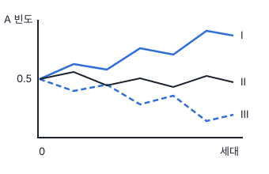
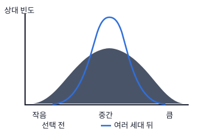

# 생명과학 7장 웹과제 예상 v2 문제해설

왼쪽 목차로 문항을 고르고, 오른쪽 문제를 보며 해설을 따라가요.

문제의 첫 줄부터 검산까지 설명해요.

**목차**

- [문항별 설명](#problems)
  - [P1. [기출 예상] 섬 생물의 가까운 친척](#p1)
  - [P2. [기출 예상] 새 집단의 형성](#p2)
  - [P3. [기출 변형] 인물과 주장](#p3)
  - [P4. [기출 변형] 유사한 적응 형태](#p4)
  - [P5. [기출 변형] 선택 뒤 집단의 변화](#p5)
  - [P6. [예상] 이형접합자의 가능한 최고 빈도](#p6)
  - [P7. [예상] 관측 집단에서 빈도 구하기](#p7)
  - [P8. [예상] 이주 뒤 태어나는 자손](#p8)
  - [P9. [예상] 같은 출발점의 세 집단](#p9)
  - [P10. [예상] 선택 전후 분포의 변화](#p10)
  - [P11. [예상] 변이가 생기는 두 과정](#p11)
  - [P12. [예상] 번식 기여 뒤의 자손 비율](#p12)
  - [P13. [예상] 자손 수와 먹이의 차이](#p13)
  - [P14. [예상] 운동으로 달라진 몸과 다음 세대](#p14)
  - [P15. [예상] 관측 집단과 무작위 교배 자손](#p15)

## 문항별 설명

### P1. [기출 예상] 섬 생물의 가까운 친척

기출 7강 22 예상 · [연습형 문제 보기](../%EB%B3%B5%EC%8A%B5%EB%AC%B8%EC%A0%9C_7%EC%9E%A5_%EC%9B%B9%EA%B3%BC%EC%A0%9C%EC%98%88%EC%83%81_v2.html#p1) · [시험형 문제 보기](../%EB%B3%B5%EC%8A%B5%EB%AC%B8%EC%A0%9C_7%EC%9E%A5_%EC%9B%B9%EA%B3%BC%EC%A0%9C%EC%98%88%EC%83%81_%EC%8B%9C%ED%97%98%ED%98%95_v2.html#p1)

바하마는 대서양에 있는 군도인데, 대부분이 산호초로 이루어져 있다. 가장 가까운 대륙은 북아메리카이다. 그러나 정치적으로는 영국에 속한다. 다윈의 추리를 따르자면, 이들 섬에 살고 있는 조류와 다른 종들은 가장 가까운 친척이 다음 어디에 존재해야 한다고 했는가?

- A. 북아메리카
- B. 태평양 내에 비슷한 구성을 보이는 다른 섬
- C. 영국
- D. 대서양 내에 비슷한 위도에 존재하는 카나리아 제도 같은 섬

원문·출처 정보 보기

기출 7강 합본 22번을 원문 보기 순서로 실은 예상 문제예요.

#### 문제를 먼저 읽어요

바하마 섬 생물의 가장 가까운 친척이 어디에 있을지를 묻고 있어요. 산호초·위도·정치적 소속보다, 대륙과 섬의 지리적 관계를 보세요. **문항 결함:** 바하마는 1973년 7월 10일 독립했으므로 원문의 영국 소속 표현은 현재 사실과 맞지 않아요. 원문은 보존하고 정치적 소속은 친척 판별 조건으로 쓰지 않아요(영국 바하마 독립법(1973) 제1조). 가까운 대륙이라는 단서로 판단해요.

#### 이 문제를 봤을 때 떠올릴 개념과 공식

“가장 가까운 대륙은 북아메리카”라는 단서에서 다윈의 생물지리학(biogeography) 추론을 떠올려요. 섬의 생물은 가까운 대륙에서 온 조상으로부터 갈라졌을 수 있으므로, 가까운 친척을 찾을 때 환경의 겉모습보다 대륙과의 공통 혈통을 먼저 비교해요. 이 문제는 실제 계통 분석을 요구하는 것이 아니라 그 추론을 적용하는 문제예요.

관련 정리노트: [섬 생물과 가까운 대륙의 관계](../../../%EB%B3%B5%EC%8A%B5%EB%85%B8%ED%8A%B8/1027/%EC%A0%95%EB%A6%AC%EB%85%B8%ED%8A%B8_1027_Evolutionary_Thought_and_Microevolution.html#s1-beagle)

#### 왜 이렇게 푸는지 함께 따라가요

A. 북아메리카는 바하마에서 가장 가까운 대륙이에요. 다윈의 섬 생물 분포 추론에 맞으므로 이 사례의 답으로 적합해요.

B. 태평양의 비슷한 구성의 섬은 환경이 닮았다는 정보만 줘요. 바하마 섬 생물과 가까운 공통 혈통의 근거가 없어서 부적합해요.

C. 영국은 원문의 잘못된 정치 배경에만 등장해요. 정치적 소속은 조상이나 이동 경로의 근거가 아니므로 부적합해요.

D. 카나리아 제도 같은 섬은 대서양의 비슷한 위도에 있어도, 바하마와 가까운 대륙이라는 기준에 맞지 않아요. 기후가 비슷하다는 사실만으로 가장 가까운 친척을 정할 수 없어 부적합해요.

따라서 답은 A, 북아메리카예요.

#### 완성 답과 검산

답 A. 지문이 직접 준 “가장 가까운 대륙”을 대입하면 북아메리카 하나만 남아요. 원문의 정치적 소속 표현은 판별에 쓰지 않으며, 비슷한 환경·비슷한 위도도 공통조상의 위치를 가리키는 단서가 아니에요.

#### 헷갈리기 쉬운 점

원문의 영국 소속 표현은 생물의 공통 혈통을 알려 주지 않아요. 바하마는 독립국이라는 사실과 원문 오류를 구분하고, 이 문제에서는 명시된 가장 가까운 대륙인 북아메리카를 기준으로 답을 고르세요.

**페이지 요약**

#### 판단 기준

원문의 정치적 소속 표현은 판별에 쓰지 않아요. 섬 생물의 가까운 친척은 가까운 대륙을 기준으로 찾아 바하마의 답은 북아메리카(A)예요.

---

### P2. [기출 예상] 새 집단의 형성

기출 7강 15 예상 · [연습형 문제 보기](../%EB%B3%B5%EC%8A%B5%EB%AC%B8%EC%A0%9C_7%EC%9E%A5_%EC%9B%B9%EA%B3%BC%EC%A0%9C%EC%98%88%EC%83%81_v2.html#p2) · [시험형 문제 보기](../%EB%B3%B5%EC%8A%B5%EB%AC%B8%EC%A0%9C_7%EC%9E%A5_%EC%9B%B9%EA%B3%BC%EC%A0%9C%EC%98%88%EC%83%81_%EC%8B%9C%ED%97%98%ED%98%95_v2.html#p2)

뉴욕의 롱 아일랜드에 있는 한 도마뱀 개체군은 이탈리아에 있는 한 집단으로부터 유래되었다. 수십 년 전에 애완동물로 팔려서 유입되었고, 이 중 몇몇은 교외에서 탈출하여 새로운 집단을 형성했다. 이는 무엇에 대한 예시인가?

- A. 유전자 확산
- B. 자연선택
- C. 집단 병목현상
- D. 창시자 효과
- E. 돌연변이

원문·출처 정보 보기

기출 7강 합본 15번을 보기 순서만 바꿔 실은 예상 문제예요.

#### 문제를 먼저 읽어요

이탈리아 집단에서 온 소수의 도마뱀이 롱 아일랜드에서 새 집단을 세웠어요. 기존 집단 사이의 이동인지, 새 집단의 소수 출발인지를 구별해요.

#### 이 문제를 봤을 때 떠올릴 개념과 공식

“몇몇이 탈출하여 새로운 집단을 형성”했다는 표현에서 창시자 효과(founder effect)를 떠올려요. 큰 집단에서 소수가 다른 곳으로 나와 새 집단을 시작하면, 그 소수가 가진 대립유전자가 새 집단의 초기 구성을 정해요. 이는 우연한 표본 차이에 의한 유전적 부동(genetic drift)의 한 경우예요. 병목 현상은 원래 장소의 집단이 급감하는 경우이고, 유전자 확산(gene flow)은 이미 있는 집단 사이에 대립유전자가 드나드는 경우예요. 실제 유전자 빈도 변화량은 주어지지 않았으므로 여기서는 사건의 유형을 판단해요.

관련 정리노트: [창시자 효과와 병목 현상](../../../%EB%B3%B5%EC%8A%B5%EB%85%B8%ED%8A%B8/1029/%EC%A0%95%EB%A6%AC%EB%85%B8%ED%8A%B8_1029_Microevolution_and_Speciation.html#s0-drift), [유전자 확산과 자연선택의 구분](../../../%EB%B3%B5%EC%8A%B5%EB%85%B8%ED%8A%B8/1029/%EC%A0%95%EB%A6%AC%EB%85%B8%ED%8A%B8_1029_Microevolution_and_Speciation.html#s0-factors)

#### 왜 이렇게 푸는지 함께 따라가요

A. 유전자 확산은 이미 있는 두 집단 사이에서 대립유전자가 이동하는 일이에요. 여기서는 탈출한 몇 마리가 새 집단을 시작했으므로 이 사례의 대표 이름으로는 부적합해요.

B. 자연선택이라면 유전되는 형질에 따른 생존·번식의 차이가 필요해요. 그런 차이는 제시되지 않아 부적합해요.

C. 집단 병목현상은 원래 집단이 그 자리에서 급격히 줄고 살아남은 소수로 이어지는 일이에요. 이탈리아 집단의 급감은 없으므로 부적합해요.

D. 창시자 효과는 소수가 새 장소에서 집단을 세우는 사건이에요. 몇몇 도마뱀이 롱 아일랜드에서 새 집단을 만들었으므로 적합해요.

E. 돌연변이는 DNA의 변화로 새 대립유전자가 생기는 일이에요. 지문에는 그런 변화가 없어 부적합해요.

따라서 답은 D, 창시자 효과예요.

#### 완성 답과 검산

답 D. 사건의 장소를 다시 표시하면 원래 이탈리아 집단의 급감이 아니라 롱 아일랜드의 새 집단 형성이에요. 이 구분으로 병목현상을 소거할 수 있어요.

**페이지 요약**

#### 판단 기준

소수가 떨어져 나와 새 장소에서 집단을 시작하면 창시자 효과예요. 답은 D예요.

---

### P3. [기출 변형] 인물과 주장

기출 7강 14 예상 · [연습형 문제 보기](../%EB%B3%B5%EC%8A%B5%EB%AC%B8%EC%A0%9C_7%EC%9E%A5_%EC%9B%B9%EA%B3%BC%EC%A0%9C%EC%98%88%EC%83%81_v2.html#p3) · [시험형 문제 보기](../%EB%B3%B5%EC%8A%B5%EB%AC%B8%EC%A0%9C_7%EC%9E%A5_%EC%9B%B9%EA%B3%BC%EC%A0%9C%EC%98%88%EC%83%81_%EC%8B%9C%ED%97%98%ED%98%95_v2.html#p3)

다음은 진화사상을 발전시킨 인물들에 대한 설명이다. 설명이 잘못 연결된 것은?

- A. 퀴비에 – 지진이나 홍수 같은 사건으로 생물이 죽어 화석이 남았다고 설명
- B. 라이엘 – 지층 변화의 주요 원인을 갑작스러운 대재난으로 설명
- C. 라마르크 – 생애 동안 얻은 형질이 자손에게 유전된다고 주장
- D. 월리스 – 자연선택의 원리를 다윈과 별개로 생각해 냄
- E. 허튼 – 지질이 오랜 시간에 걸쳐 서서히 변한다고 설명

원문·출처 정보 보기

기출 7강 합본 14번의 발문을 사용하고 보기를 새로 쓴 예상 변형이에요.

#### 문제를 먼저 읽어요

인물과 주장의 연결에서 **잘못 연결된 것**을 하나 찾는 부정형 문제예요. 각 문장의 내용상 참·거짓을 먼저 판정해요.

#### 이 문제를 봤을 때 떠올릴 개념과 공식

“갑작스러운 대재난”과 “오랜 시간”이라는 말에서 지질 변화에 관한 학설을 나눠요. 퀴비에(Cuvier)의 격변설(catastrophism)은 큰 사건과 멸종을, 허튼(Hutton)의 점진주의(gradualism)는 긴 시간의 느린 변화를, 라이엘(Lyell)의 동일과정설(uniformitarianism)은 과거와 현재에 같은 지질 과정이 이어진다는 생각을 가리켜요. 라마르크(Lamarck)의 획득형질 유전과 월리스(Wallace)의 독자적인 자연선택 제안도 주장자를 확인해요.

관련 정리노트: [퀴비에·허튼·라이엘의 지질학 주장](../../../%EB%B3%B5%EC%8A%B5%EB%85%B8%ED%8A%B8/1027/%EC%A0%95%EB%A6%AC%EB%85%B8%ED%8A%B8_1027_Evolutionary_Thought_and_Microevolution.html#s0-geology), [월리스와 다윈의 자연선택 발표](../../../%EB%B3%B5%EC%8A%B5%EB%85%B8%ED%8A%B8/1027/%EC%A0%95%EB%A6%AC%EB%85%B8%ED%8A%B8_1027_Evolutionary_Thought_and_Microevolution.html#s1-beagle)

#### 왜 이렇게 푸는지 함께 따라가요

A. 퀴비에가 지진·홍수 같은 사건으로 죽은 생물의 화석을 설명했다는 연결은 격변설과 일치하므로 내용상 맞아요.

B. 라이엘이 갑작스러운 대재난을 지층 변화의 주요 원인으로 보았다는 연결은 틀려요. 라이엘은 과거와 현재에 같은 느린 지질 과정이 계속된다는 동일과정설을 주장했어요.

C. 라마르크가 생애 중 얻은 형질의 자손 유전을 주장했다는 연결은 역사적 주장으로 맞아요. 그 주장이 현재의 유전 원리로 옳다는 뜻은 아니에요.

D. 월리스가 자연선택을 다윈과 별개로 생각해 냈다는 연결은 맞아요. 두 사람은 자연선택 이론을 함께 발표했어요.

E. 허튼이 지질의 느리고 오래 지속된 변화를 설명했다는 연결은 점진주의와 맞아요.

따라서 내용상 틀린 진술을 고르는 답은 B예요.

#### 완성 답과 검산

답 B. 인물별 핵심어를 대조하면 큰 사건은 퀴비에, 느린 변화는 허튼, 과거와 현재의 같은 느린 과정은 라이엘이에요. 이 대응에서 B만 어긋나요.

**페이지 요약**

#### 판단 기준

부정형이므로 틀린 연결을 골라요. 라이엘을 대재난과 연결한 B가 답이에요.

---

### P4. [기출 변형] 유사한 적응 형태

기출 7강 21 예상 · [연습형 문제 보기](../%EB%B3%B5%EC%8A%B5%EB%AC%B8%EC%A0%9C_7%EC%9E%A5_%EC%9B%B9%EA%B3%BC%EC%A0%9C%EC%98%88%EC%83%81_v2.html#p4) · [시험형 문제 보기](../%EB%B3%B5%EC%8A%B5%EB%AC%B8%EC%A0%9C_7%EC%9E%A5_%EC%9B%B9%EA%B3%BC%EC%A0%9C%EC%98%88%EC%83%81_%EC%8B%9C%ED%97%98%ED%98%95_v2.html#p4)

서로 연관이 먼 생물들 간에 외형적으로 유사한 적응 형태를 보이는 것을 무엇이라 하는가?

- A. 생애 중 얻은 형질이 그대로 자손에게 유전되는 현상
- B. 소수 개체가 새 집단을 세우며 빈도가 달라지는 현상
- C. 같은 조상에서 물려받은 구조만을 비교하는 상동성
- D. 다른 집단으로 대립유전자가 이동하는 유전자 확산
- E. 비슷한 환경에서 독립적으로 유사한 적응이 생기는 상사형질의 형성

원문·출처 정보 보기

기출 7강 합본 21번 발문에 새 보기를 넣은 예상 변형이에요.

#### 문제를 먼저 읽어요

계통상 먼 생물들이 외형적으로 비슷한 적응 형태를 얻는 현상의 이름을 찾아요. 닮은 *결과*뿐 아니라 닮게 된 기원을 보세요.

#### 이 문제를 봤을 때 떠올릴 개념과 공식

“연관이 먼 생물”과 “유사한 적응 형태”가 함께 나오면 상사형질(analogous traits)의 형성을 떠올려요. 계통이 다른 생물에서 비슷한 환경과 기능에 대한 적응이 독립적으로 생겨 외형이 닮을 수 있어요. 상동성(homology)은 공통조상에게서 물려받은 기원이 같은 구조를 비교하는 개념이고, 상사(analogy)는 기원이 달라도 비슷한 기능·형태를 보이는 관계예요. 단순히 겉모습이 같다는 사실만으로 기원을 단정하지 않고, 이 문항의 “연관이 먼” 조건을 함께 써요.

관련 정리노트: [상동·상사와 독립적 유사 적응](../../../%EB%B3%B5%EC%8A%B5%EB%85%B8%ED%8A%B8/1027/%EC%A0%95%EB%A6%AC%EB%85%B8%ED%8A%B8_1027_Evolutionary_Thought_and_Microevolution.html#s2-homology)

#### 왜 이렇게 푸는지 함께 따라가요

A. 생애 중 얻은 형질의 유전은 라마르크의 주장으로, 먼 계통에서 비슷한 적응이 독립적으로 생긴 과정과 다르므로 이 사례에 부적합해요.

B. 소수가 새 집단을 세우며 빈도가 달라지는 것은 창시자 효과예요. 서로 먼 생물의 외형적 유사성을 묻는 이 사례에 부적합해요.

C. 같은 조상에서 물려받은 구조를 비교하는 상동성 자체는 올바른 개념이에요. 그러나 문항은 먼 계통에서 생긴 유사한 적응 형태를 묻기 때문에 이 사례의 답으로는 부적합해요.

D. 다른 집단으로 대립유전자가 이동하는 유전자 확산은 집단 사이 이동을 뜻해요. 독립적인 유사 적응을 가리키지 않아 부적합해요.

E. 비슷한 환경에서 독립적으로 유사한 적응이 생겨 상사형질이 형성된다는 E의 설명은 먼 계통과 외형적 적응의 유사성이라는 두 조건에 맞으므로 적합해요.

따라서 답은 E, 상사형질의 형성이에요.

#### 완성 답과 검산

답 E. “공통 기원을 물려받음”을 요구하는 C와 “먼 계통에서 독립적으로 닮음”을 말하는 E를 대조하면, 지문의 두 단서에 맞는 것은 E예요.

**페이지 요약**

#### 판단 기준

먼 계통이 비슷한 환경에서 독립적으로 유사한 적응을 얻어 상사형질이 형성돼요. 답은 E예요.

---

### P5. [기출 변형] 선택 뒤 집단의 변화

기출 7강 25 예상 · [연습형 문제 보기](../%EB%B3%B5%EC%8A%B5%EB%AC%B8%EC%A0%9C_7%EC%9E%A5_%EC%9B%B9%EA%B3%BC%EC%A0%9C%EC%98%88%EC%83%81_v2.html#p5) · [시험형 문제 보기](../%EB%B3%B5%EC%8A%B5%EB%AC%B8%EC%A0%9C_7%EC%9E%A5_%EC%9B%B9%EA%B3%BC%EC%A0%9C%EC%98%88%EC%83%81_%EC%8B%9C%ED%97%98%ED%98%95_v2.html#p5)

다음 중 한 개체군에서 자연선택의 가장 직접적인 결과는 무엇인가?

- A. 환경이 개체마다 필요한 새 대립유전자를 만든다.
- B. 모든 개체가 살아 있는 동안 유리한 형질로 바뀐다.
- C. 유전되는 유리한 형질과 관련된 대립유전자의 집단 내 비율이 달라진다.
- D. 개체군의 모든 구성원이 같은 수의 자손을 남긴다.
- E. 자손을 많이 낳은 개체는 반드시 새로운 대립유전자를 가진다.

원문·출처 정보 보기

기출 7강 합본 25번의 발문을 사용하고 보기를 새로 쓴 예상 변형이에요.

#### 문제를 먼저 읽어요

한 개체군에서 자연선택이 일어난 뒤 가장 직접적으로 달라지는 것을 찾아요. 개체의 생애 변화와 세대에 걸친 집단 변화를 구분해요.

#### 이 문제를 봤을 때 떠올릴 개념과 공식

“한 개체군”과 “자연선택의 결과”에서 자연선택(natural selection)의 인과 순서를 떠올려요. 개체군에 이미 유전되는 변이가 있고, 특정 환경에서 그 변이를 가진 개체의 생존·번식이 달라지면, 다음 세대 집단의 관련 대립유전자 빈도가 달라질 수 있어요. 선택은 개체의 표현형에 작용하지만, 집단 수준에서 관찰하는 유전적 결과는 대립유전자 빈도 변화예요. 환경이 목적에 맞는 돌연변이를 만들어 준다는 뜻은 아니에요.

관련 정리노트: [자연선택의 인과 순서](../../../%EB%B3%B5%EC%8A%B5%EB%85%B8%ED%8A%B8/1027/%EC%A0%95%EB%A6%AC%EB%85%B8%ED%8A%B8_1027_Evolutionary_Thought_and_Microevolution.html#s1-natural-selection), [대립유전자 빈도의 뜻](../../../%EB%B3%B5%EC%8A%B5%EB%85%B8%ED%8A%B8/1027/%EC%A0%95%EB%A6%AC%EB%85%B8%ED%8A%B8_1027_Evolutionary_Thought_and_Microevolution.html#s3-frequency)

#### 왜 이렇게 푸는지 함께 따라가요

A. 환경이 개체마다 필요한 새 대립유전자를 만든다는 말은 틀려요. 새 대립유전자의 원천은 돌연변이이고, 선택은 이미 존재하는 유전 변이의 번식 결과를 가려요.

B. 모든 개체가 생애 중 유리한 형질로 바뀐다는 말은 틀려요. 선택은 개체를 일괄 변형하지 않고 유전되는 형질을 가진 개체들의 상대적 번식 결과를 바꿔요.

C. 유전되는 유리한 형질과 관련된 대립유전자의 집단 내 비율이 달라진다는 말은 맞아요. 그 형질의 생존·번식 이점이 다음 세대에 반영될 때 나타나는 직접적인 집단 변화예요.

D. 모든 구성원이 같은 수의 자손을 남긴다는 말은 틀려요. 자연선택을 설명하려면 형질에 따른 번식 성공의 차이가 있어야 해요.

E. 자손을 많이 낳은 개체가 반드시 새로운 대립유전자를 가졌다는 말은 틀려요. 기존 대립유전자를 가진 개체도 환경에 따라 더 많이 번식할 수 있어요.

따라서 답은 C예요.

#### 완성 답과 검산

답 C. 선택의 순서를 역으로 확인하면 “다음 세대의 빈도 변화 ← 유전되는 형질을 가진 개체의 번식 차이”예요. A·E의 새 대립유전자 발생이나 B의 생애 변화는 이 순서에 필요하지 않아요.

**페이지 요약**

#### 판단 기준

자연선택은 유전되는 변이에 따른 번식 차이를 거쳐 집단의 대립유전자 빈도를 바꿔요. 답은 C예요.

---

### P6. [예상] 이형접합자의 가능한 최고 빈도

예상 7장 6 · [연습형 문제 보기](../%EB%B3%B5%EC%8A%B5%EB%AC%B8%EC%A0%9C_7%EC%9E%A5_%EC%9B%B9%EA%B3%BC%EC%A0%9C%EC%98%88%EC%83%81_v2.html#p6) · [시험형 문제 보기](../%EB%B3%B5%EC%8A%B5%EB%AC%B8%EC%A0%9C_7%EC%9E%A5_%EC%9B%B9%EA%B3%BC%EC%A0%9C%EC%98%88%EC%83%81_%EC%8B%9C%ED%97%98%ED%98%95_v2.html#p6)

A와 a 두 대립유전자만 있는 이배체 개체군이 하디-바인베르크 평형을 이루어요. A의 빈도 p는 0부터 1 사이의 어떤 값도 될 수 있어요. 이때 Aa의 빈도가 가질 수 있는 최댓값은 얼마인가요?

- A. 0.25
- B. 1.00
- C. 0.50
- D. 0.75
- E. 0.00

원문·출처 정보 보기

원문 기출이 아닌 새 예상 문제예요. 평형에서 대립유전자 빈도에 따라 이형접합자 빈도가 어떻게 달라지는지 다뤄요.

#### 문제를 먼저 읽어요

하디-바인베르크 평형에서 두 대립유전자 A와 a의 빈도를 바꾸어 볼 때 Aa 이형접합자 빈도의 **최댓값**을 찾아요.

#### 이 문제를 봤을 때 떠올릴 개념과 공식

“평형”과 “Aa”에서 하디-바인베르크(Hardy–Weinberg) 유전자형 빈도식을 써요. p는 A의 빈도, q는 a의 빈도이고, 두 대립유전자뿐이므로 p+q=1이에요. 무작위 교배의 자손에서 AA=p², Aa=2pq, aa=q²예요. Aa의 2는 A·a와 a·A 두 결합 순서를 더한 값이에요. p와 q가 합 1을 유지할 때 두 값이 같으면 곱 pq가 가장 커요. 평형 가정이 없으면 관측 Aa 빈도를 2pq로 둘 수 없어요.

관련 정리노트: [하디-바인베르크 평형과 2pq](../../../%EB%B3%B5%EC%8A%B5%EB%85%B8%ED%8A%B8/1027/%EC%A0%95%EB%A6%AC%EB%85%B8%ED%8A%B8_1027_Evolutionary_Thought_and_Microevolution.html#s3-hardy-weinberg)

#### 첫 줄을 써 봐요

p+q=1이므로 q=1−p로 놓고, 구할 값을 Aa=2p(1−p)로 써요.

#### 왜 이렇게 푸는지 함께 따라가요

A. 0.25는 p=q=0.5일 때 p² 또는 q²의 값이에요. Aa의 두 결합 순서를 합치지 않아 최댓값으로는 틀려요.

B. 1.00은 전체 유전자형의 빈도 합이에요. p=q=0.5일 때 Aa는 0.50이므로 단일 유전자형 Aa의 최댓값이 아니에요.

C. 0.50은 p=q=0.5를 대입한 2pq=2×0.5×0.5예요. p와 q의 곱이 최대인 지점이므로 맞아요.

D. 0.75는 p=q=0.5일 때 Aa=0.50에 동형접합자 한 종류 0.25를 더한 값이에요. Aa만의 빈도가 아니라 틀려요.

E. 0.00은 p=0 또는 q=0일 때의 Aa 빈도예요. 가능한 최솟값이지 최댓값이 아니에요.

따라서 답은 C, 0.50이에요.

#### 완성 답과 검산

답 C. 다른 경로로 2pq=2p(1−p)=0.50−2(p−0.5)²로 쓰면, 제곱항은 0 이상이므로 2pq≤0.50이에요. p=0.5에서만 0.50이 돼요.

**페이지 요약**

#### 판단 기준

평형의 Aa 빈도는 2pq이고 p+q=1일 때 p=q=0.5에서 최대 0.50이에요. 답은 C예요.

---

### P7. [예상] 관측 집단에서 빈도 구하기

예상 7장 7 · [연습형 문제 보기](../%EB%B3%B5%EC%8A%B5%EB%AC%B8%EC%A0%9C_7%EC%9E%A5_%EC%9B%B9%EA%B3%BC%EC%A0%9C%EC%98%88%EC%83%81_v2.html#p7) · [시험형 문제 보기](../%EB%B3%B5%EC%8A%B5%EB%AC%B8%EC%A0%9C_7%EC%9E%A5_%EC%9B%B9%EA%B3%BC%EC%A0%9C%EC%98%88%EC%83%81_%EC%8B%9C%ED%97%98%ED%98%95_v2.html#p7)

이배체 생물 100마리의 한 유전자좌에 A와 a만 있어요. 표는 실제로 센 유전자형 수예요. 이 집단은 하디-바인베르크 평형이 아니에요. 다음 설명 중 옳지 않은 것은 무엇인가요?

| 유전자형 | AA | Aa | aa |
|---|---|---|---|
| 개체 수 | 30 | 20 | 50 |

- A. 조사한 A 대립유전자는 모두 80개예요.
- B. 조사한 대립유전자는 모두 200개예요.
- C. A의 빈도는 0.40이에요.
- D. a의 빈도는 0.60이에요.
- E. 관측된 aa가 50%이므로 a의 빈도는 √0.50이에요.

원문·출처 정보 보기

원문 기출이 아닌 새 예상 문제예요. 관측 개체 수와 대립유전자 수를 구별하고 평형식의 적용 조건을 확인해요.

#### 문제를 먼저 읽어요

100마리에서 실제 센 AA·Aa·aa의 수를 바탕으로 **옳지 않은 설명**을 골라요. 이 집단은 평형이 아니므로 관측 개수에서 대립유전자를 직접 세어야 해요.

#### 이 문제를 봤을 때 떠올릴 개념과 공식

“이배체 100마리”는 한 유전자좌의 대립유전자가 개체마다 2개, 총 200개라는 뜻이에요. AA 한 마리는 A 2개, Aa는 A 1개와 a 1개, aa는 a 2개를 가져요. 따라서 p=(2N_AA+N_Aa)/(2N), q=(N_Aa+2N_aa)/(2N)으로 직접 세어요. 관측 aa 비율을 q²로 놓는 방법은 하디-바인베르크 평형의 유전자형 빈도 관계가 성립할 때만 쓸 수 있어요.

관련 정리노트: [관측 유전자형에서 대립유전자 빈도 세기](../../../%EB%B3%B5%EC%8A%B5%EB%85%B8%ED%8A%B8/1027/%EC%A0%95%EB%A6%AC%EB%85%B8%ED%8A%B8_1027_Evolutionary_Thought_and_Microevolution.html#s3-frequency), [평형일 때만 성립하는 q²](../../../%EB%B3%B5%EC%8A%B5%EB%85%B8%ED%8A%B8/1027/%EC%A0%95%EB%A6%AC%EB%85%B8%ED%8A%B8_1027_Evolutionary_Thought_and_Microevolution.html#s3-hardy-weinberg)

#### 첫 줄을 써 봐요

전체 대립유전자 수 = 2×100마리 = 200개; A 수 = 2×30마리+20마리 = 80개로 먼저 적어요.

#### 왜 이렇게 푸는지 함께 따라가요

A. AA 30마리의 A는 60개, Aa 20마리의 A는 20개예요. A가 모두 80개라는 진술은 맞아요.

B. 이배체 100마리는 한 유전자좌에 대립유전자 2개씩 있으므로 총 2×100=200개예요. 맞아요.

C. A 80개를 전체 200개로 나누면 p=80/200=0.40이에요. 맞아요.

D. Aa의 a 20개와 aa 50마리의 a 100개를 합치면 a는 120개예요. q=120/200=0.60이므로 맞아요.

E. 관측 aa 50마리의 개체 비율은 50/100=0.50이 맞지만, 평형이 아닌 집단에서 이를 q²로 놓을 수는 없어요. 직접 센 q=0.60이고 √0.50≈0.707이므로 틀려요.

따라서 내용상 틀린 진술을 고르는 답은 E예요.

#### 완성 답과 검산

답 E. 직접 센 p+q=0.40+0.60=1.00으로 전체 대립유전자를 빠짐없이 셌어요. 만약 평형식 q²을 잘못 적용하면 0.60²=0.36이어야 하는데 관측 aa 비율은 0.50이라 서로 맞지 않아요.

**페이지 요약**

#### 판단 기준

관측 A=80개, a=120개, 전체=200개라 p=0.40, q=0.60이에요. 평형이 아니므로 aa 0.50의 제곱근을 쓴 E가 틀려요.

---

### P8. [예상] 이주 뒤 태어나는 자손

예상 7장 8 · [연습형 문제 보기](../%EB%B3%B5%EC%8A%B5%EB%AC%B8%EC%A0%9C_7%EC%9E%A5_%EC%9B%B9%EA%B3%BC%EC%A0%9C%EC%98%88%EC%83%81_v2.html#p8) · [시험형 문제 보기](../%EB%B3%B5%EC%8A%B5%EB%AC%B8%EC%A0%9C_7%EC%9E%A5_%EC%9B%B9%EA%B3%BC%EC%A0%9C%EC%98%88%EC%83%81_%EC%8B%9C%ED%97%98%ED%98%95_v2.html#p8)

기존 집단에는 AA 20마리, Aa 20마리, aa 20마리가 있어요. 다른 집단에서 AA 30마리와 Aa 10마리가 이주해 왔어요. 합쳐진 100마리가 같은 확률로 번식하고 이후 돌연변이·추가 이주·선택은 없다고 가정해요. 무작위 교배로 태어나는 자손이 400마리라면, 기대되는 AA 자손은 몇 마리인가요?

- A. 169마리
- B. 130마리
- C. 200마리
- D. 260마리
- E. 225마리

원문·출처 정보 보기

원문 기출이 아닌 새 예상 문제예요. 두 집단의 대립유전자를 합친 뒤 자손의 유전자형 수를 예측해요.

#### 문제를 먼저 읽어요

기존 집단과 이주 개체를 합친 100마리가 번식해 낳는 400마리 중 기대되는 AA 자손 수를 구해요. 부모의 관측 AA 수와 자손의 기대 AA 수를 구별해요.

#### 이 문제를 봤을 때 떠올릴 개념과 공식

“이주해 왔다”에서 유전자 확산(gene flow) 뒤의 대립유전자 빈도를 새로 세어야 해요. 부모 각 집단의 A 개수를 합쳐 전체 2N개로 나누면 p가 나와요. 합쳐진 부모들이 같은 확률로 번식하고 무작위 교배하므로, 자손에서 A를 양쪽 부모에게서 받을 확률은 p×p=p²예요. 400마리의 기대 AA 수는 400p²이에요. 이 계산은 기대값이며 실제 출생 수가 반드시 그 값이라는 뜻은 아니에요.

관련 정리노트: [이주 직후 대립유전자 빈도 다시 세기](../../../%EB%B3%B5%EC%8A%B5%EB%85%B8%ED%8A%B8/1029/%EC%A0%95%EB%A6%AC%EB%85%B8%ED%8A%B8_1029_Microevolution_and_Speciation.html#s0-factors), [무작위 교배 자손의 p²](../../../%EB%B3%B5%EC%8A%B5%EB%85%B8%ED%8A%B8/1027/%EC%A0%95%EB%A6%AC%EB%85%B8%ED%8A%B8_1027_Evolutionary_Thought_and_Microevolution.html#s3-hardy-weinberg)

#### 첫 줄을 써 봐요

부모 A 수를 집단별로 세어요: 기존 집단은 2×20+20=60개, 이주 집단은 2×30+10=70개예요.

#### 왜 이렇게 푸는지 함께 따라가요

A. 기존 집단의 A는 2×20+20=60개, 이주 집단의 A는 2×30+10=70개예요. 합친 A 130개를 전체 200개로 나누면 p=0.65이고, 400×p²=400×0.4225=169마리예요. 맞아요.

B. 130은 부모 100마리에 들어 있는 A 대립유전자 수예요. 자손의 AA 개체 수와 단위·대상이 달라서 틀려요.

C. 200은 부모 100마리의 전체 대립유전자 수예요. AA 자손 수가 아니므로 틀려요.

D. 260=400×0.65는 A 하나를 받는 확률 p만 곱한 값이에요. AA에는 A를 두 번 받아야 하므로 p²을 써야 해서 틀려요.

E. 225=400×0.75²는 p를 0.75로 잡았을 때의 값이에요. 기존 집단의 A 60개도 더한 정확한 p는 0.65이므로 틀려요.

따라서 답은 A, 기대 AA 자손 169마리예요.

#### 완성 답과 검산

답 A. 다른 경로로 부모의 a는 기존 20+2×20=60개, 이주 10개로 총 70개예요. q=70/200=0.35, 따라서 p=1−q=0.65예요. 이 값으로 계산한 400×0.65²=169마리는 400마리 이하이고 자손 수 단위도 맞아요.

**페이지 요약**

#### 판단 기준

이주 뒤 부모 A=130개/전체 200개라 p=0.65예요. 자손 AA 기대수는 400p²=169마리, 답 A예요.

---

### P9. [예상] 같은 출발점의 세 집단

예상 7장 9 · [연습형 문제 보기](../%EB%B3%B5%EC%8A%B5%EB%AC%B8%EC%A0%9C_7%EC%9E%A5_%EC%9B%B9%EA%B3%BC%EC%A0%9C%EC%98%88%EC%83%81_v2.html#p9) · [시험형 문제 보기](../%EB%B3%B5%EC%8A%B5%EB%AC%B8%EC%A0%9C_7%EC%9E%A5_%EC%9B%B9%EA%B3%BC%EC%A0%9C%EC%98%88%EC%83%81_%EC%8B%9C%ED%97%98%ED%98%95_v2.html#p9)

크기가 같은 작은 집단 세 개를 서로 분리해 여러 세대 관찰했어요. 모두 A 대립유전자 빈도 0.5에서 시작했고, A와 a는 생존·번식에 차이가 없으며 돌연변이와 집단 간 이동도 없었어요. 그림의 선은 각 집단을 한 번씩 관찰한 결과예요. 이 결과를 가장 잘 설명하는 것은 무엇인가요?

- A. 세 집단 모두 A가 생존에 유리해 같은 방향으로 빈도가 변했어요.
- B. 세 집단에서 다음 세대로 전달된 대립유전자의 우연한 표본 차이가 서로 다른 궤적을 만들었어요.
- C. 집단 사이의 지속적인 이주가 세 집단의 빈도를 같게 만들었어요.
- D. A를 가진 개체가 모두 더 많은 자손을 남겨 세 집단의 A 빈도가 높아졌어요.
- E. 세 집단의 빈도 차이는 처음부터 서로 다른 A 빈도를 가졌기 때문이에요.

원문·출처 정보 보기

원문 기출이 아닌 새 예상 문제예요. 동일 조건에서 반복한 작은 집단의 빈도 변화 방향을 비교해요.

#### 문제를 먼저 읽어요

세 작은 집단이 같은 A 빈도 0.5에서 출발했는데, 그래프의 선은 서로 다른 방향으로 움직였어요. 생존·번식 이점이나 이동 없이 이런 차이가 생기는 원인을 골라요.

#### 이 문제를 봤을 때 떠올릴 개념과 공식

“작은 집단”, “같은 출발 빈도”, “유리한 대립유전자 없음”에서 유전적 부동(genetic drift)을 떠올려요. 다음 세대로 전달되는 대립유전자는 부모 집단에서 뽑힌 표본이므로, 작은 집단에서는 우연한 표본 차이가 빈도를 크게 흔들 수 있어요. 선택이라면 특정 형질의 상대적 번식 이점이 필요하고, 유전자 확산이라면 집단 사이의 이동이 있어야 해요. 그림의 단일 관찰만으로 실제 원인을 확정하는 것은 아니지만, 주어진 배제 조건에서 가장 잘 맞는 설명을 고를 수 있어요.

관련 정리노트: [작은 집단의 유전적 부동과 다른 궤적](../../../%EB%B3%B5%EC%8A%B5%EB%85%B8%ED%8A%B8/1029/%EC%A0%95%EB%A6%AC%EB%85%B8%ED%8A%B8_1029_Microevolution_and_Speciation.html#s0-drift)

#### 왜 이렇게 푸는지 함께 따라가요

A. 세 집단 모두 A가 유리해 같은 방향으로 변했다는 말은 조건의 “생존·번식 차이 없음”과 맞지 않아요. 그림에서도 위·아래·가운데로 갈라져 있어 틀려요.

B. 다음 세대로 전달된 대립유전자의 우연한 표본 차이는 같은 0.5 출발점에서 다른 궤적을 만들 수 있어요. 작은 집단이라는 조건에도 맞아 적합해요.

C. 지속적인 이주가 빈도를 같게 만들었다는 말은 “집단 간 이동 없음”과 충돌해요. 마지막 빈도도 서로 달라 틀려요.

D. A를 가진 개체 모두가 더 많은 자손을 남겼다면 선택의 이점이 있어야 해요. 그런 이점이 없고 일부 선은 내려가므로 틀려요.

E. 처음부터 서로 다른 A 빈도였다는 말은 세 선이 모두 0.5에서 시작한 그림과 조건에 어긋나므로 틀려요.

따라서 답은 B, 유전적 부동에 따른 표본 차이예요.

#### 완성 답과 검산

답 B. 출발선에서 세 선을 추적하면 모두 0.5에서 시작해 끝에서는 서로 다른 높이에 있어요. 이동·선택·처음 빈도 차이를 조건으로 소거하면 우연한 표본 차이가 남아요.

**페이지 요약**

#### 판단 기준

같은 0.5에서 시작한 작은 집단들이 우연한 대립유전자 표본 차이로 다른 궤적을 보였어요. 답 B예요.

---

### P10. [예상] 선택 전후 분포의 변화

예상 7장 10 · [연습형 문제 보기](../%EB%B3%B5%EC%8A%B5%EB%AC%B8%EC%A0%9C_7%EC%9E%A5_%EC%9B%B9%EA%B3%BC%EC%A0%9C%EC%98%88%EC%83%81_v2.html#p10) · [시험형 문제 보기](../%EB%B3%B5%EC%8A%B5%EB%AC%B8%EC%A0%9C_7%EC%9E%A5_%EC%9B%B9%EA%B3%BC%EC%A0%9C%EC%98%88%EC%83%81_%EC%8B%9C%ED%97%98%ED%98%95_v2.html#p10)

유전되는 한 정량적 형질을 가진 개체군의 분포를 선택 전과 여러 세대 뒤에 조사했어요. 그림에서 두 곡선의 면적은 비교하기 쉽도록 같게 맞췄어요. 평균의 위치와 분포 폭의 변화를 함께 고려할 때 가장 알맞은 해석은 무엇인가요?

- A. 한쪽 끝의 표현형이 유리해 평균이 그쪽으로 이동한 방향성 선택이에요.
- B. 양쪽 끝의 표현형이 유리해 봉우리가 두 개로 나뉜 분단성 선택이에요.
- C. 형질과 관계없는 우연한 생존으로 분포가 반드시 이렇게 좁아지는 유전적 부동이에요.
- D. 양쪽 끝보다 중간 표현형이 유리해 평균은 거의 같고 분포 폭이 좁아진 안정화 선택이에요.
- E. 모든 표현형의 번식 성공이 같아서 선택 전후 분포가 동일해요.

원문·출처 정보 보기

원문 기출이 아닌 새 예상 문제예요. 선택 전후의 정량적 형질 분포에서 평균과 폭을 읽어요.

#### 문제를 먼저 읽어요

선택 전 점선과 여러 세대 뒤 실선의 평균 위치·폭·봉우리 수를 비교해 선택 양상을 고르세요. 두 곡선의 면적은 같게 맞춘 상대 빈도 그림이에요.

#### 이 문제를 봤을 때 떠올릴 개념과 공식

“유전되는 정량적 형질”과 “분포의 변화”에서 자연선택의 세 양상을 떠올려요. 방향성 선택(directional selection)은 한쪽 극단이 유리해 평균이 이동하고, 안정화 선택(stabilizing selection)은 중간이 유리해 양쪽 끝이 줄며 평균은 거의 유지되고 폭이 좁아져요. 분단성 선택(disruptive selection)은 양쪽 끝이 유리해 중간이 줄고 봉우리가 둘로 갈라져요. 곡선의 면적이 같은 것은 빈도를 비교하려는 정규화이므로 실제 개체 수가 같다는 근거로 쓰지 않아요.

관련 정리노트: [방향성·안정화·분단성 선택의 분포 변화](../../../%EB%B3%B5%EC%8A%B5%EB%85%B8%ED%8A%B8/1029/%EC%A0%95%EB%A6%AC%EB%85%B8%ED%8A%B8_1029_Microevolution_and_Speciation.html#s1-fitness)

#### 왜 이렇게 푸는지 함께 따라가요

A. 방향성 선택이라면 평균이 한쪽 끝으로 이동해야 해요. 두 곡선의 중심은 같은 중간 위치이므로 부적합해요.

B. 분단성 선택이라면 양쪽 끝이 늘어 봉우리가 두 개로 나뉘어야 해요. 실선은 가운데 봉우리 하나라 부적합해요.

C. 유전적 부동은 우연한 빈도 변동이지만 양끝이 반드시 줄어 분포가 좁아진다고 예측하지 않아요. 이 그림의 일정한 가운데 집중을 설명하는 답으로 부적합해요.

D. 실선은 점선과 중심이 거의 같고 양끝 비중이 낮아지며 가운데가 높고 좁아요. 중간 표현형의 상대적 이점에 따른 안정화 선택에 적합해요.

E. 모든 표현형의 번식 성공이 같아 분포가 동일하다는 말은 그림과 달라요. 실선은 점선보다 폭이 좁으므로 부적합해요.

따라서 답은 D, 안정화 선택이에요.

#### 완성 답과 검산

답 D. 그래프를 평균·폭·봉우리 수 순으로 다시 읽으면 “평균 거의 동일, 폭 감소, 봉우리 하나”예요. 이 세 특징은 방향성의 평균 이동이나 분단성의 두 봉우리와 구별돼요.

**페이지 요약**

#### 판단 기준

평균은 거의 같고 양끝이 줄어 폭이 좁아진 분포는 안정화 선택이에요. 답 D예요.

---

### P11. [예상] 변이가 생기는 두 과정

예상 7장 11 · [연습형 문제 보기](../%EB%B3%B5%EC%8A%B5%EB%AC%B8%EC%A0%9C_7%EC%9E%A5_%EC%9B%B9%EA%B3%BC%EC%A0%9C%EC%98%88%EC%83%81_v2.html#p11) · [시험형 문제 보기](../%EB%B3%B5%EC%8A%B5%EB%AC%B8%EC%A0%9C_7%EC%9E%A5_%EC%9B%B9%EA%B3%BC%EC%A0%9C%EC%98%88%EC%83%81_%EC%8B%9C%ED%97%98%ED%98%95_v2.html#p11)

한 개체군에서 대립유전자의 종류와 조합이 달라지는 과정을 설명한 것 중 옳지 않은 것은 무엇인가요?

- A. DNA의 변화로 이전에 없던 대립유전자가 생길 수 있어요.
- B. 감수분열 중 교차는 기존 대립유전자 자체를 새로운 종류로 바꾸어요.
- C. 교차는 부모에게 있던 대립유전자를 새로운 조합으로 전달할 수 있어요.
- D. 무작위 수정은 기존 대립유전자들의 조합을 다양하게 할 수 있어요.
- E. 새 대립유전자가 생기는 것과 기존 대립유전자가 섞이는 것은 서로 달라요.

원문·출처 정보 보기

원문 기출이 아닌 새 예상 문제예요. 근거는 1027 정리노트의 변이와 그 원천이에요.

#### 문제를 먼저 읽어요

대립유전자의 *새 종류*가 생기는 일과, 있던 종류가 *새 조합*으로 섞이는 일을 비교해요. **옳지 않은 설명** 하나를 골라요.

#### 이 문제를 봤을 때 떠올릴 개념과 공식

‘대립유전자의 종류와 조합’이 단서예요. 대립유전자(allele)는 같은 유전자 자리에서 나타나는 서로 다른 DNA 형태예요. 돌연변이(mutation)는 DNA 변화를 통해 이전에 없던 대립유전자를 만들 수 있어요. 교차(crossing over)는 감수분열 중 상동염색체가 조각을 맞바꾸는 일이고, 무작위 수정(random fertilization)은 배우자가 우연히 만나는 일이에요. 뒤의 두 과정은 이미 있는 대립유전자의 조합을 다양하게 해요.

판단할 때는 각 보기가 대립유전자 **자체의 새 종류**를 말하는지, **기존 종류의 배열과 결합**을 말하는지 확인해요. 관련 정리노트: [변이와 그 원천: 돌연변이와 교차](../../../%EB%B3%B5%EC%8A%B5%EB%85%B8%ED%8A%B8/1027/%EC%A0%95%EB%A6%AC%EB%85%B8%ED%8A%B8_1027_Evolutionary_Thought_and_Microevolution.html#s3-variation).

#### 왜 이렇게 푸는지 함께 따라가요

A. ‘DNA의 변화로 이전에 없던 대립유전자가 생길 수 있다’는 돌연변이의 역할이에요. 새 종류를 만드는 과정으로 연결했으므로 내용상 맞아요. 부정형 질문의 답으로는 고르지 않아요.

B. ‘교차가 기존 대립유전자 자체를 새로운 종류로 바꾼다’는 주장은 틀려요. 교차가 맞바꾸는 것은 상동염색체의 조각이며, 이 문항의 구분에서는 이미 있던 대립유전자들의 조합이 바뀌어요. 새 종류의 생성은 DNA가 변하는 돌연변이와 연결해야 해요.

C. ‘교차가 기존 대립유전자를 새로운 조합으로 전달한다’는 맞아요. 두 상동염색체의 조각 교환 뒤 한 배우자가 받는 대립유전자 조합이 부모의 기존 염색체 조합과 달라질 수 있어요. 새 종류를 만든다는 뜻은 아니에요.

D. ‘무작위 수정이 기존 대립유전자들의 조합을 다양하게 한다’는 맞아요. 서로 다른 정자와 난자가 만나면 자손이 받는 두 대립유전자의 짝이 달라질 수 있어요.

E. ‘새 대립유전자가 생기는 것과 기존 대립유전자가 섞이는 것은 다르다’는 맞아요. 앞은 종류의 생성, 뒤는 조합의 변경이므로 같은 변화로 세지 않아요.

따라서 내용상 틀린 진술을 묻는 답은 B예요.

#### 완성 답과 검산

답 B. 정리노트의 변이 절은 돌연변이를 새 대립유전자의 원천으로, 교차와 무작위 수정을 기존 대립유전자의 재조합으로 나눠요. 이 구분에 A·C·D·E는 들어맞고 B만 반대로 연결해요.

**페이지 요약**

새 대립유전자는 돌연변이로 생길 수 있고, 교차·무작위 수정은 기존 대립유전자를 섞어요. 옳지 않은 것은 B예요.

---

### P12. [예상] 번식 기여 뒤의 자손 비율

예상 7장 12 · [연습형 문제 보기](../%EB%B3%B5%EC%8A%B5%EB%AC%B8%EC%A0%9C_7%EC%9E%A5_%EC%9B%B9%EA%B3%BC%EC%A0%9C%EC%98%88%EC%83%81_v2.html#p12) · [시험형 문제 보기](../%EB%B3%B5%EC%8A%B5%EB%AC%B8%EC%A0%9C_7%EC%9E%A5_%EC%9B%B9%EA%B3%BC%EC%A0%9C%EC%98%88%EC%83%81_%EC%8B%9C%ED%97%98%ED%98%95_v2.html#p12)

이배체 집단에서 한 유전자좌의 대립유전자는 A와 a예요. 각 유전자형 개체가 다음 세대의 배우자 풀에 기여한 수는 표와 같고, Aa 개체가 낸 배우자는 A와 a를 절반씩 가져요. 표의 기여 수는 배우자 풀의 상대적 조성을 나타내며, 각 수정에서 두 배우자는 이 조성에 따라 독립적으로 추출된다고 가정해요. 이 배우자들이 무작위로 결합한다면 자손 중 Aa의 기대 비율은 얼마인가요?

| 유전자형 | 개체 수 | 개체당 배우자 기여 수 |
|---|---|---|
| AA | 10 | 4 |
| Aa | 20 | 2 |
| aa | 10 | 2 |

- A. 0.25
- B. 0.40
- C. 0.50
- D. 0.48
- E. 0.60

원문·출처 정보 보기

원문 기출이 아닌 새 예상 문제예요. 근거는 1029 정리노트의 번식 기여와 적응도예요.

#### 문제를 먼저 읽어요

부모 40개체를 똑같이 세는 문제가 아니에요. 각 유전자형의 **배우자 기여 수가 나타내는 풀의 조성**으로 A와 a의 비율을 구한 뒤, 그 조성에 따라 두 배우자를 독립적으로 뽑아 생기는 자손 중 Aa의 기대 비율을 구해요.

#### 이 문제를 봤을 때 떠올릴 개념과 공식

‘개체당 배우자 기여 수’가 단서예요. 번식 기여가 다르면 개체 수만으로 다음 세대의 대립유전자 빈도를 정할 수 없어요. 이배체의 AA가 낸 배우자는 A만, aa가 낸 배우자는 a만 가져요. 문제의 조건대로 Aa가 낸 배우자는 A와 a를 절반씩 가져요.

배우자 풀의 A 빈도를 $p=(A\text{ 배우자 수})/(\text{전체 배우자 수})$, a 빈도를 $q=1-p$로 놓아요. 문제의 독립 추출 가정에 따라 각 수정에서 두 배우자가 같은 조성으로 뽑혀요. Aa는 A·a 또는 a·A의 두 순서로 생기므로 기대 비율이 $pq+qp=2pq$예요. 표의 수는 풀의 상대적 조성을 나타내며, 배우자 100개를 한 번씩만 써서 짝짓는 비복원 추출로 계산하지 않아요. 관련 정리노트: [다음 세대에 남기는 번식 기여와 적응도](../../../%EB%B3%B5%EC%8A%B5%EB%85%B8%ED%8A%B8/1029/%EC%A0%95%EB%A6%AC%EB%85%B8%ED%8A%B8_1029_Microevolution_and_Speciation.html#s1-fitness), [무작위 결합 자손의 유전자형 비율](../../../%EB%B3%B5%EC%8A%B5%EB%85%B8%ED%8A%B8/1029/%EC%A0%95%EB%A6%AC%EB%85%B8%ED%8A%B8_1029_Microevolution_and_Speciation.html#s0-hw-practice).

#### 첫 줄을 써 봐요

먼저 유전자형별 기여를 곱해요: AA는 $10\text{개체}\times4\text{배우자/개체}=40\text{배우자}$, Aa는 $20\times2=40\text{배우자}$, aa는 $10\times2=20\text{배우자}$예요.

#### 왜 이렇게 푸는지 함께 따라가요

전체는 $40+40+20=100$배우자예요. A는 AA에서 40개, Aa에서 $40/2=20$개여서 $60$개예요. a는 Aa에서 20개, aa에서 20개여서 $40$개예요. 따라서 $p=60/100=0.60$, $q=40/100=0.40$이고, 자손 Aa의 기대 비율은 $2pq=2\times0.60\times0.40=0.48$이에요.

A. 0.25는 이 배우자 풀의 Aa 기대 비율 0.48과 달라요. 두 대립유전자 빈도가 모두 0.5일 때 한 동형접합자 비율 $0.5^2$에 해당하고, 여기서는 $p=0.60$, $q=0.40$이에요.

B. 0.40은 전체 100배우자 중 a 40개의 빈도 $q$예요. Aa는 a만 가진 배우자 비율이 아니라 A와 a가 결합한 두 순서의 합이라 0.48이에요.

C. 0.50은 부모 중 Aa가 $20/40$개체인 비율이에요. Aa 부모의 기여는 개체당 2배우자이고 AA 부모는 4배우자이므로, 부모의 개체 비율을 자손의 유전자형 비율로 옮길 수 없어요.

D. 0.48은 가중해 구한 $p=0.60$, $q=0.40$을 $2pq$에 대입한 값이에요. 질문이 묻는 Aa 자손의 기대 비율에 맞아요.

E. 0.60은 A 배우자 60개의 빈도 $p$예요. 자손 Aa는 A가 하나라는 사실만으로 정해지지 않고 a 배우자와 결합해야 하므로 0.48이에요.

따라서 답은 D, 0.48이에요.

#### 완성 답과 검산

답 D. 별도로 자손의 세 유전자형을 모두 세면 $AA=p^2=0.36$, $Aa=2pq=0.48$, $aa=q^2=0.16$이에요. 합이 $0.36+0.48+0.16=1.00$이고, 자손의 A 빈도도 $0.36+0.48/2=0.60$으로 배우자 풀의 값과 같아요.

**페이지 요약**

개체 수에 배우자 기여 수를 곱해 배우자 풀을 만들어요. A 60/100, a 40/100이므로 자손 Aa는 $2pq=0.48$, 답 D예요.

---

### P13. [예상] 자손 수와 먹이의 차이

예상 7장 13 · [연습형 문제 보기](../%EB%B3%B5%EC%8A%B5%EB%AC%B8%EC%A0%9C_7%EC%9E%A5_%EC%9B%B9%EA%B3%BC%EC%A0%9C%EC%98%88%EC%83%81_v2.html#p13) · [시험형 문제 보기](../%EB%B3%B5%EC%8A%B5%EB%AC%B8%EC%A0%9C_7%EC%9E%A5_%EC%9B%B9%EA%B3%BC%EC%A0%9C%EC%98%88%EC%83%81_%EC%8B%9C%ED%97%98%ED%98%95_v2.html#p13)

어떤 새 집단은 매년 살아갈 수 있는 자리와 먹이보다 훨씬 많은 새끼를 낳아요. 맬서스의 생각을 다윈이 이 집단에 적용했을 때 가장 먼저 예상할 일은 무엇인가요?

- A. 먹이가 자손 수에 맞춰 해마다 제한 없이 늘어요.
- B. 모든 새끼가 같은 양의 먹이를 확보해 살아남아요.
- C. 제한된 자원을 차지하려는 개체 사이의 경쟁이 생겨요.
- D. 먹이가 부족해지면 각 새가 필요한 대립유전자를 의도적으로 만들어요.
- E. 부모가 먹이를 찾으며 익힌 행동이 그대로 새끼의 DNA에 기록돼요.

원문·출처 정보 보기

원문 기출이 아닌 새 예상 문제예요. 근거는 1027 정리노트의 맬서스 인구론이에요.

#### 문제를 먼저 읽어요

새끼는 먹이와 자리보다 훨씬 많이 태어나요. 맬서스의 생각을 다윈이 적용할 때, 이 차이에서 **가장 먼저** 무엇이 생길지 물어요.

#### 이 문제를 봤을 때 떠올릴 개념과 공식

‘자손은 많지만 자원은 제한됨’에서 맬서스(Malthus)를 떠올려요. 맬서스는 개체 수가 늘 잠재력이 자원의 증가보다 크면 모두가 필요한 몫을 얻을 수 없다고 보았어요. 다윈은 이를 생물 집단에 적용해 제한된 자원을 두고 생존 경쟁(struggle for existence)이 생긴다고 추론했어요.

이 문제는 그 **첫 결과**를 고르는 것이므로, 자원 부족 → 경쟁의 연결을 확인해요. 누가 유리한 형질을 물려주어 세대가 바뀌는지는 그 뒤에 따질 일이에요. 관련 정리노트: [맬서스의 인구론과 다윈의 추론](../../../%EB%B3%B5%EC%8A%B5%EB%85%B8%ED%8A%B8/1027/%EC%A0%95%EB%A6%AC%EB%85%B8%ED%8A%B8_1027_Evolutionary_Thought_and_Microevolution.html#s1-influences).

#### 왜 이렇게 푸는지 함께 따라가요

A. 먹이가 자손 수에 맞춰 ‘제한 없이 늘어난다’면 자원 제한이라는 문제의 출발 조건과 어긋나요. 맬서스가 주목한 것은 그 수가 따라가지 못하는 상황이므로 이 사례의 답으로 부적합해요.

B. 모든 새끼가 ‘같은 양의 먹이를 확보해 살아남는다’는 것은 먹이와 자리가 모자란다는 조건에서 도출할 수 없어요. 모두가 살아남는다는 결론은 자손 과잉이 만드는 경쟁을 지워 버리므로 부적합해요.

C. 새끼 수가 먹이와 자리를 넘으면 개체들이 제한된 몫을 차지하려고 경쟁해요. 자손 과잉과 자원 제한을 바로 연결한 첫 예상이므로 적합해요.

D. 먹이 부족 때문에 각 새가 ‘필요한 대립유전자를 의도적으로 만든다’는 것은 경쟁과 다른 주장이고, 환경이 필요에 맞게 돌연변이를 지시하지 않아요. 부적합해요.

E. 부모가 익힌 먹이 찾기 행동이 ‘그대로 새끼의 DNA에 기록된다’는 것은 획득한 행동이 유전자 서열로 자동 전달된다는 주장이라 맬서스의 자원 경쟁에서 나오지 않아요. 부적합해요.

따라서 답은 C, 제한된 자원을 둘러싼 경쟁이에요.

#### 완성 답과 검산

답 C. 정리노트의 맬서스 절도 자손 또는 인구가 늘려는 속도를 자원 제한과 대조한 뒤 경쟁을 끌어내요. A·B는 제한을 없애고, D·E는 유전 변화의 다른 주장을 더하므로 ‘가장 먼저’의 결과는 C 하나예요.

**페이지 요약**

자손 과잉 + 제한된 먹이·자리 → 자원 경쟁. 맬서스의 생각을 다윈이 적용한 첫 결과는 C예요.

---

### P14. [예상] 운동으로 달라진 몸과 다음 세대

예상 7장 14 · [연습형 문제 보기](../%EB%B3%B5%EC%8A%B5%EB%AC%B8%EC%A0%9C_7%EC%9E%A5_%EC%9B%B9%EA%B3%BC%EC%A0%9C%EC%98%88%EC%83%81_v2.html#p14) · [시험형 문제 보기](../%EB%B3%B5%EC%8A%B5%EB%AC%B8%EC%A0%9C_7%EC%9E%A5_%EC%9B%B9%EA%B3%BC%EC%A0%9C%EC%98%88%EC%83%81_%EC%8B%9C%ED%97%98%ED%98%95_v2.html#p14)

어떤 설치류 집단에는 태어날 때부터 다리 근육의 크기에 유전되는 차이가 있어요. 일부 개체는 운동으로 근육을 더 키웠고, 다른 일부는 원래 가진 유전적 차이 때문에 더 많은 자손을 남겼어요. 다음 설명 중 옳지 않은 것은 무엇인가요?

- A. 운동으로 한 개체의 근육이 커지는 것과 집단의 대립유전자 빈도가 바뀌는 것은 다른 변화예요.
- B. 원래 존재하던 유전적 차이가 번식 성공에 영향을 준다면 자연선택의 재료가 될 수 있어요.
- C. 번식 성공이 다른 유전형 사이에서 다르면 다음 세대의 대립유전자 빈도가 달라질 수 있어요.
- D. 근육 크기의 차이가 자손에게 전달되는지 살피면 두 설명을 구별하는 데 도움이 돼요.
- E. 부모가 운동으로 키운 근육은 그 부모의 대립유전자를 바꾸므로 자손에게 같은 크기로 반드시 전해져요.

원문·출처 정보 보기

원문 기출이 아닌 새 예상 문제예요. 근거는 1027 정리노트의 획득형질과 자연선택 비교예요.

#### 문제를 먼저 읽어요

한 설치류가 운동해서 근육이 커지는 변화와, 원래 유전적 차이가 있던 개체들이 자손을 서로 다르게 남기는 변화를 나눠 봐요. 두 설명 중 **옳지 않은 진술**을 골라요.

#### 이 문제를 봤을 때 떠올릴 개념과 공식

‘운동으로 근육을 키웠다’는 살면서 얻은 형질, 즉 획득형질(acquired characteristic)을 가리켜요. 라마르크(Lamarck)는 이런 형질이 자손에게 전해진다고 생각했지만, 운동 자체가 부모의 생식세포 대립유전자를 바꾸어 같은 근육 크기를 자손에게 보장하지는 않아요. 반면 ‘태어날 때부터 유전되는 차이’가 번식 성공에 영향을 주면, 자연선택(natural selection)에 따라 관련 대립유전자의 집단 내 빈도가 세대를 거쳐 달라질 수 있어요.

각 보기에서 **변화 대상**이 개체의 생애 중 몸인지 집단의 대립유전자 빈도인지, 그리고 자손에게 전달되는 유전적 차이인지 확인해요. 관련 정리노트: [획득형질의 유전과 라마르크](../../../%EB%B3%B5%EC%8A%B5%EB%85%B8%ED%8A%B8/1027/%EC%A0%95%EB%A6%AC%EB%85%B8%ED%8A%B8_1027_Evolutionary_Thought_and_Microevolution.html#s0-lamarck), [유전되는 변이에 작용하는 자연선택](../../../%EB%B3%B5%EC%8A%B5%EB%85%B8%ED%8A%B8/1027/%EC%A0%95%EB%A6%AC%EB%85%B8%ED%8A%B8_1027_Evolutionary_Thought_and_Microevolution.html#s1-natural-selection).

#### 왜 이렇게 푸는지 함께 따라가요

A. 운동으로 ‘한 개체의 근육이 커지는 것’은 생애 중 표현형 변화예요. ‘집단의 대립유전자 빈도가 바뀌는 것’은 세대 사이 유전적 구성의 변화이므로 두 변화가 다르다는 진술은 내용상 맞아요. 부정형 질문의 답은 아니에요.

B. ‘원래 존재하던 유전적 차이’가 ‘번식 성공’에 영향을 주면 관련 대립유전자가 다음 세대에 전달되는 정도가 달라질 수 있어요. 자연선택의 재료와 조건에 맞으므로 내용상 맞아요.

C. ‘번식 성공이 다른 유전형 사이에서 다르면’ 한쪽이 자손을 더 많이 남길 수 있어요. 그러면 그 유전형과 관련된 대립유전자의 다음 세대 빈도가 달라질 *수 있다*는 진술은 맞아요. 반드시 어느 방향으로 바뀐다는 뜻은 아니에요.

D. 근육 차이가 ‘자손에게 전달되는지’ 살피면 운동으로 생긴 개인의 변화와 원래 있던 유전적 차이를 가르는 데 도움이 돼요. 유전 여부가 선택의 재료를 판단하는 기준이므로 맞아요.

E. ‘운동으로 키운 근육이 부모의 대립유전자를 바꾸고 같은 크기로 반드시 전해진다’는 두 단계를 모두 보장할 수 없어요. 운동으로 근육이 커져도 그 자체가 생식세포 DNA의 대립유전자 변화를 뜻하지 않고, 따라서 자손에게 같은 크기가 반드시 전달되지 않아요. 내용상 틀려요.

따라서 옳지 않은 진술을 묻는 답은 E예요.

#### 완성 답과 검산

답 E. 1027 노트의 라마르크 절은 생애에 얻은 형질의 일반적 비유전성과, 원래 있던 유전 변이에 작용하는 다윈식 설명을 대조해요. 이 구분으로 A·B·C·D는 성립하고 E의 ‘운동 → 대립유전자 변경 → 반드시 같은 근육 유전’만 성립하지 않아요.

**페이지 요약**

운동으로 변한 개체의 근육은 생식세포 대립유전자 변화와 같지 않아요. 유전되는 기존 차이에 따른 번식 차이가 선택의 재료예요. 옳지 않은 것은 E예요.

---

### P15. [예상] 관측 집단과 무작위 교배 자손

예상 7장 15 · [연습형 문제 보기](../%EB%B3%B5%EC%8A%B5%EB%AC%B8%EC%A0%9C_7%EC%9E%A5_%EC%9B%B9%EA%B3%BC%EC%A0%9C%EC%98%88%EC%83%81_v2.html#p15) · [시험형 문제 보기](../%EB%B3%B5%EC%8A%B5%EB%AC%B8%EC%A0%9C_7%EC%9E%A5_%EC%9B%B9%EA%B3%BC%EC%A0%9C%EC%98%88%EC%83%81_%EC%8B%9C%ED%97%98%ED%98%95_v2.html#p15)

이배체 집단 100개체의 한 유전자좌에서 관측한 수는 표와 같아요. 이 집단에서 만든 배우자들이 무작위로 결합하고, 대립유전자 빈도를 바꾸는 다른 요인은 없다고 할 때 옳은 설명은 무엇인가요?

| 유전자형 | 관측 개체 수 |
|---|---|
| AA | 50 |
| Aa | 20 |
| aa | 30 |

- A. 관측 집단의 A 빈도는 0.60이고, 평형이라면 기대되는 Aa는 48개체예요. 관측값과 다르지만 무작위 교배 자손의 A 빈도는 0.60으로 유지돼요.
- B. 관측 집단의 A 빈도는 0.50이고, 평형이라면 기대되는 Aa는 50개체예요. 자손의 A 빈도도 0.50이에요.
- C. 관측 집단의 A 빈도는 0.60이고, 평형이라면 기대되는 Aa는 20개체예요. 관측값이 같으므로 이미 평형이에요.
- D. 관측 집단의 A 빈도는 0.60이고, 평형이라면 기대되는 Aa는 48개체예요. Aa가 늘면 자손의 A 빈도도 반드시 늘어요.
- E. 관측 집단의 A 빈도는 0.70이고, 평형이라면 기대되는 Aa는 42개체예요. 자손의 A 빈도도 0.70이에요.

원문·출처 정보 보기

원문 기출이 아닌 새 예상 문제예요. 근거는 1029 정리노트의 관측 빈도와 평형 기대값 비교예요.

#### 문제를 먼저 읽어요

현재 100개체에서 **관측한** AA·Aa·aa 수를 이용해 A의 빈도를 먼저 세어요. 이어 무작위로 결합하는 **자손의 기대** Aa 수를 구하고, 관측값과 대립유전자 빈도 유지 여부를 비교해요.

#### 이 문제를 봤을 때 떠올릴 개념과 공식

‘관측 수’와 ‘무작위로 결합하는 배우자’가 함께 나오면 두 시점을 나눠요. 현재 집단이 평형이라는 보장은 없으므로 관측 Aa 수를 바로 $2pq$로 두지 않아요. 이배체 100개체의 대립유전자는 총 $2\times100=200$개이고, AA는 A를 둘, Aa는 A를 하나, aa는 A를 영 개 갖는다고 세어 현재 $p$를 구해요.

다른 요인이 대립유전자 빈도를 바꾸지 않고 배우자가 무작위로 결합하면 자손의 기대 유전자형 비율은 $AA=p^2$, $Aa=2pq$, $aa=q^2$이고 $q=1-p$예요. 무작위 결합은 **짝의 비율**을 바꾸어도 A와 a의 **전체 빈도** 자체는 바꾸지 않아요. 관련 정리노트: [관측 집단과 무작위 교배 자손의 구분](../../../%EB%B3%B5%EC%8A%B5%EB%85%B8%ED%8A%B8/1029/%EC%A0%95%EB%A6%AC%EB%85%B8%ED%8A%B8_1029_Microevolution_and_Speciation.html#s0-hw-practice), [유전자형 수에서 대립유전자 빈도 세기](../../../%EB%B3%B5%EC%8A%B5%EB%85%B8%ED%8A%B8/1027/%EC%A0%95%EB%A6%AC%EB%85%B8%ED%8A%B8_1027_Evolutionary_Thought_and_Microevolution.html#s3-frequency).

#### 첫 줄을 써 봐요

현재 A의 수는 AA 50개체에서 $2\times50=100$개, Aa 20개체에서 20개로, 모두 $120$개예요. 따라서 $p=120/200=0.60$부터 시작해요.

#### 왜 이렇게 푸는지 함께 따라가요

현재 $p=0.60$, $q=1-0.60=0.40$이에요. 평형 비율과 비교할 때 Aa의 기대 비율은 $2pq=2\times0.60\times0.40=0.48$, 100개체 기준 기대 수는 $0.48\times100=48$개체예요. 이는 현재 관측한 Aa 20개체와 달라요. 무작위 결합 자손에서도 $p=0.60$은 유지돼요.

A. A 빈도 0.60, 평형이라면 기대 Aa 48개체, 관측 Aa 20개체와의 차이, 자손의 A 빈도 0.60 유지를 모두 바르게 연결했어요. 내용상 맞고 이 질문의 답으로 적합해요.

B. ‘A 빈도 0.50’은 AA 개체가 $50/100$이라는 유전자형 비율을 대립유전자 빈도로 쓴 값이에요. Aa의 A 20개도 포함하면 $120/200=0.60$이므로 기대 Aa 50개체와 자손 A 빈도 0.50도 이어서 맞지 않아요.

C. ‘기대 Aa 20개체’는 현재 관측 Aa 수를 평형 기대 수로 옮긴 것이에요. $p=0.60$에서 기대 수는 48개체이고 관측 20개체와 다르므로 이미 평형이라는 결론도 틀려요.

D. A 빈도 0.60과 기대 Aa 48개체까지는 맞아요. 그러나 ‘Aa가 늘면 자손 A 빈도도 반드시 늘어난다’는 틀려요. 무작위 결합으로 AA·Aa·aa의 짝 비율이 바뀌어도 문제의 조건에서는 A 빈도가 0.60으로 유지돼요.

E. ‘A 빈도 0.70’은 Aa 20개체의 A와 a를 모두 A로 센 듯한 값이에요. Aa 하나에는 A가 하나뿐이라 $p=0.60$이고, $p=0.70$을 넣어 얻는 기대 Aa 42개체와 자손 A 빈도 0.70도 이 집단에 맞지 않아요.

따라서 답은 A예요.

#### 완성 답과 검산

답 A. 다른 경로로 자손의 전체 기대 비율을 세면 $AA=0.60^2=0.36$, $Aa=0.48$, $aa=0.40^2=0.16$으로 합이 $1.00$이에요. 이 분포의 A 빈도는 $0.36+0.48/2=0.60$이어서, Aa가 관측 0.20에서 기대 0.48로 달라져도 A 빈도는 유지돼요. 100개체 기준 기대 수는 AA 36, Aa 48, aa 16개체예요.

**페이지 요약**

관측값에서 A를 직접 세면 $120/200=0.60$이에요. 무작위 교배 자손의 Aa 기대 수는 100개체 기준 48개체이며, A 빈도는 0.60으로 유지돼요. 답 A예요.

---

원 문제·정리노트·PDF는 보존해요.
