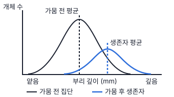
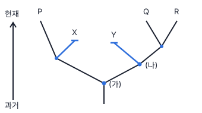

# 생명과학 7장 웹과제 예상 v3 문제해설

왼쪽 목차로 문항을 고르고, 오른쪽 문제를 보며 해설을 따라가요.

문제의 첫 줄부터 검산까지 설명해요.

**목차**

- [문항별 설명](#problems)
  - [P1. [기출 예상] 시간에 따른 내성 비율 변화](#p1)
  - [P2. [기출 예상] 세 종의 DNA 유사성 비교](#p2)
  - [P3. [기출 변형] 소진화의 사례 판별](#p3)
  - [P4. [기출 변형] 여러 가지 변이의 비교](#p4)
  - [P5. [기출 변형] 다윈의 관찰과 추론 연결](#p5)
  - [P6. [예상] 비교해부학과 비교발생학의 증거](#p6)
  - [P7. [예상] 열성 표현형 수로 이형접합자 수 구하기](#p7)
  - [P8. [예상] 유전자 확산 후 빈도 변화와 다음 세대](#p8)
  - [P9. [예상] 이형접합자 안에 숨은 열성 대립유전자 비율](#p9)
  - [P10. [예상] 가뭄 전후 부리 깊이 분포와 선택 해석](#p10)
  - [P11. [예상] 계통수의 가지와 갈림점 읽기](#p11)
  - [P12. [예상] 헤모글로빈 유전자형과 말라리아](#p12)
  - [P13. [예상] 두 개체군의 유전자형과 다음 세대](#p13)
  - [P14. [예상] 성선택의 두 유형과 선택적 교배](#p14)
  - [P15. [예상] 다음 세대의 유전자형 빈도](#p15)

## 문항별 설명

### P1. [기출 예상] 시간에 따른 내성 비율 변화

기출 7강 28 예상 · [연습형 문제 보기](../%EB%B3%B5%EC%8A%B5%EB%AC%B8%EC%A0%9C_7%EC%9E%A5_%EC%9B%B9%EA%B3%BC%EC%A0%9C%EC%98%88%EC%83%81_v3.html#p1) · [시험형 문제 보기](../%EB%B3%B5%EC%8A%B5%EB%AC%B8%EC%A0%9C_7%EC%9E%A5_%EC%9B%B9%EA%B3%BC%EC%A0%9C%EC%98%88%EC%83%81_%EC%8B%9C%ED%97%98%ED%98%95_v3.html#p1)

1980년대, 모든 Staphylococcus aureus 의 1 % ~ 5 % 만이 항생제에 강한 내성을 보였다. 현재는 60 % ~ 70 % 가 내성을 보인다. 이것은 무엇에 대한 예시인가?

- A. 세균의 방향성 선택
- B. 인간의 안정화 선택
- C. 인간의 방향성 선택
- D. 세균의 분단성 선택
- E. 세균의 안정화 선택

원문·출처 정보 보기

기출 7강 합본 28번을 보기 순서만 바꿔 실은 예상 문제예요.

#### 문제를 먼저 읽어요

1980년대에는 황색포도상구균(Staphylococcus aureus) 중 1% ~ 5%만 항생제 내성을 보였는데, 현재는 60% ~ 70%가 내성을 보인다고 했어요. 시간이 흐르면서 **누구의 집단**에서 **어느 방향으로** 비율이 바뀌었는지 확인해 자연선택의 양상을 골라요.

#### 이 문제를 봤을 때 떠올릴 개념과 공식

“항생제에 강한 내성을 보이는 비율이 1% ~ 5%에서 60% ~ 70%로 증가했다”는 단서에서 자연선택의 세 양상(방향성 선택, 안정화 선택, 분단성 선택)을 떠올려요. 판단 기준은 두 가지예요. 첫째, 실제로 세대를 거치며 유전적 구성 비율이 변한 집단이 누구인지(선택의 주체)를 먼저 확인해요. 둘째, 표현형 분포가 한쪽 극단으로 이동했으면 방향성 선택(directional selection), 중간 평균형이 유지되고 양 극단이 줄어들면 안정화 선택(stabilizing selection), 중간형이 불리해 양 극단 두 무리가 함께 늘어나면 분단성 선택(disruptive selection)으로 판별해요.

관련 정리노트: [상대적 적응도와 자연선택의 세 양상](../../../%EB%B3%B5%EC%8A%B5%EB%85%B8%ED%8A%B8/1029/%EC%A0%95%EB%A6%AC%EB%85%B8%ED%8A%B8_1029_Microevolution_and_Speciation.html#s1-fitness)

#### 왜 이렇게 푸는지 함께 따라가요

A. 이 사례에 적합해요. 항생제가 존재하는 환경에서 내성 유전자를 가진 세균이 비내성 세균보다 더 잘 살아남아 번식한 결과, 세균 집단의 구성이 ‘항생제 내성’이라는 한쪽 극단 방향으로 크게 이동한 세균의 방향성 선택이에요.

B. 이 사례에 부적합해요. 시간에 따라 내성 비율이 1% ~ 5%에서 60% ~ 70%로 변한 집단은 인간이 아니라 세균(Staphylococcus aureus)이에요. 또한 한쪽 끝으로 비율이 이동했으므로 중간형이 유지되는 안정화 선택도 아니에요.

C. 이 사례에 부적합해요. 인간은 항생제를 사용해 선택 압력이 되는 환경을 만들었을 뿐, 실제로 세대를 거치며 내성 형질의 빈도가 높아진 진화의 주체는 인간이 아니라 세균 집단이에요.

D. 이 사례에 부적합해요. 분단성 선택은 중간 표현형이 불리해 양쪽 극단 표현형이 동시에 늘어나는 경우예요. 이 사례에서는 ‘강한 내성’이라는 한쪽 끝으로만 비율이 치우쳤으므로 분단성 선택이 아니에요.

E. 이 사례에 부적합해요. 안정화 선택은 기존 평균 표현형이 가장 유리해 양 극단이 제거되고 분포가 좁아지는 양상이에요. 기존에 소수(1% ~ 5%)였던 내성 세균이 다수(60% ~ 70%)로 바뀐 변화와는 맞지 않아요.

따라서 답은 A, 세균의 방향성 선택이에요.

#### 완성 답과 검산

답 A. 선택을 받은 집단(세균 vs 인간)으로 먼저 나누면 B와 C가 제외되고, 세균 집단 안에서 내성이라는 한쪽 방향으로만 비율이 이동했으므로 양 극단이 함께 남는 분단성 선택(D)과 평균이 유지되는 안정화 선택(E)을 제외하면 A만 남아요.

#### 헷갈리기 쉬운 점

사람이 병원에서 항생제를 복용하기 때문에 ‘인간의 선택’이라고 고르기 쉬워요. 하지만 자연선택을 받는 대상은 환경 변화에 따라 생존과 번식 비율이 달라지는 생물 집단 자체이므로, 세대 교체가 빠르게 일어나며 내성 비율이 바뀐 ‘세균’을 주체로 골라야 해요.

**페이지 요약**

#### 판단 기준

빈도가 변한 집단은 인간이 아니라 세균이고, 항생제 내성이라는 한쪽 극단으로 비율이 이동했으므로 세균의 방향성 선택(A)이에요.

---

### P2. [기출 예상] 세 종의 DNA 유사성 비교

기출 7강 13 예상 · [연습형 문제 보기](../%EB%B3%B5%EC%8A%B5%EB%AC%B8%EC%A0%9C_7%EC%9E%A5_%EC%9B%B9%EA%B3%BC%EC%A0%9C%EC%98%88%EC%83%81_v3.html#p2) · [시험형 문제 보기](../%EB%B3%B5%EC%8A%B5%EB%AC%B8%EC%A0%9C_7%EC%9E%A5_%EC%9B%B9%EA%B3%BC%EC%A0%9C%EC%98%88%EC%83%81_%EC%8B%9C%ED%97%98%ED%98%95_v3.html#p2)

개와 고양이의 DNA는 고양이와 햄스터의 DNA 보다 더 유사하다. 이유는?

- A. 고양이와 개는 햄스터보다 자식의 수가 적어서 DNA가 천천히 변한다
- B. 고양이와 개는 육식동물로 유사한 영양을 섭취한다
- C. 고양이의 후손과 개의 후손은 유사한 환경에서 진화하였다
- D. 고양이와 개의 공통 조상은 고양이와 햄스터의 공통 조상보다 더 최근에 생겼다
- E. 고양이와 개는 사람과 오랫동안 같이 살아와서 서로 유사하다

원문·출처 정보 보기

기출 7강 합본 13번을 보기 순서만 바꿔 실은 예상 문제예요.

#### 문제를 먼저 읽어요

고양이를 기준으로 개와 비교한 DNA 유사성이 햄스터와 비교한 DNA 유사성보다 더 높은 이유를 묻고 있어요. 생활 환경이나 먹이가 아니라 **공통조상에서 갈라진 시점**을 기준으로 판단해요.

#### 이 문제를 봤을 때 떠올릴 개념과 공식

“DNA가 더 유사하다”는 단서에서 비교분자생물학(comparative molecular biology)의 진화적 해석을 떠올려요. 한 공통조상에서 두 계통이 갈라진 뒤에는 시간이 흐르면서 각 계통에 독립적으로 돌연변이가 쌓여 DNA 염기서열 차이가 점점 커져요. 따라서 두 종의 DNA 서열이 더 많이 닮았다는 것은 먹이나 서식지가 같아서가 아니라, 두 종이 공유하는 공통조상으로부터 갈라진 시점이 더 최근이어서 서로 다른 돌연변이가 쌓일 시간이 짧았다는 뜻이에요.

관련 정리노트: [비교발생학과 비교분자생물학](../../../%EB%B3%B5%EC%8A%B5%EB%85%B8%ED%8A%B8/1027/%EC%A0%95%EB%A6%AC%EB%85%B8%ED%8A%B8_1027_Evolutionary_Thought_and_Microevolution.html#s2-molecular)

#### 왜 이렇게 푸는지 함께 따라가요

A. 틀려요. 한 번에 낳는 자식의 수가 적다고 해서 유전체 전체의 DNA 염기서열 유사성이 높게 유지되는 것은 아니에요. 종 사이의 DNA 유사성은 공통조상으로부터 분기한 뒤 흐른 시간과 유연관계를 반영해요.

B. 틀려요. 고양이와 개가 육식동물로서 비슷한 영양분을 섭취하더라도, 먹이 성분이 생물의 유전 암호인 DNA 염기서열을 서로 비슷하게 바꾸지는 못해요.

C. 틀려요. 서로 다른 계통이 유사한 환경에서 진화하면 겉모습이나 기능(상사형질)이 닮을 수는 있지만, 유전체 전반의 DNA 염기서열 유사성은 환경의 유사성이 아니라 혈통이 갈라진 시점에 의해 결정돼요.

D. 맞아요. 고양이와 개의 공통조상이 고양이와 햄스터의 공통조상보다 더 최근에 존재했기 때문에, 개와 고양이 계통이 갈라진 뒤 각자 따로 축적된 돌연변이가 더 적어 DNA가 더 유사해요.

E. 틀려요. 사람과 오랫동안 함께 살았다는 반려동물로서의 생활사는 개와 고양이의 유전적 유연관계나 DNA 서열 유사성의 원인이 아니에요.

따라서 답은 D예요.

#### 완성 답과 검산

답 D. 비교분자생물학에서 ‘염기서열 차이 적음(유사성 높음) ↔ 분기 이후 축적된 돌연변이 적음 ↔ 더 최근의 공통조상 공유’ 관계를 거꾸로 대조해도, 혈통의 분기 시점을 설명한 보기는 D 하나뿐이고 나머지 A, B, C, E는 모두 출산 수나 먹이·환경 같은 외적 요인을 들고 있어요.

**페이지 요약**

#### 판단 기준

두 종의 DNA 서열이 더 유사한 까닭은 분기 이후 각자 쌓인 돌연변이가 적기 때문이므로, 더 최근에 공통조상을 공유했다는 D가 답이에요.

---

### P3. [기출 변형] 소진화의 사례 판별

기출 7강 12 예상 · [연습형 문제 보기](../%EB%B3%B5%EC%8A%B5%EB%AC%B8%EC%A0%9C_7%EC%9E%A5_%EC%9B%B9%EA%B3%BC%EC%A0%9C%EC%98%88%EC%83%81_v3.html#p3) · [시험형 문제 보기](../%EB%B3%B5%EC%8A%B5%EB%AC%B8%EC%A0%9C_7%EC%9E%A5_%EC%9B%B9%EA%B3%BC%EC%A0%9C%EC%98%88%EC%83%81_%EC%8B%9C%ED%97%98%ED%98%95_v3.html#p3)

소진화의 예가 될 수 있는 것은?

- A. 영양 상태가 좋아져 한 도시에서 키 큰 사람의 비율이 늘어난 현상
- B. 같은 종의 세균 개체군에서 세대를 거치며 항생제 내성 대립유전자의 빈도가 높아진 현상
- C. 중생대 말기에 공룡 계통 전체가 지구상에서 멸종한 사건
- D. 한 조상 물고기 무리에서 서로 교배하지 않는 새로운 두 종이 출현한 사건
- E. 산불이 발생해 숲에 살던 다람쥐 개체군 구성원 전체가 한꺼번에 사라진 사건

원문·출처 정보 보기

기출 7강 합본 12번의 발문을 사용하고 보기를 새로 쓴 예상 변형이에요.

#### 문제를 먼저 읽어요

다섯 가지 사례 가운데 **소진화(microevolution)의 예**가 될 수 있는 것을 고르는 문제예요. 유전되지 않는 변화나 종 수준 이상의 큰 변화(대진화)를 걸러내고, 한 개체군 안에서 세대를 거치며 대립유전자 빈도가 바뀐 사례를 찾아요.

#### 이 문제를 봤을 때 떠올릴 개념과 공식

“소진화의 예”에서 현대적 종합론이 구분하는 소진화(microevolution)와 대진화(macroevolution)의 경계를 떠올려요. 소진화로 판정하려면 세 가지 조건을 모두 만족해야 해요. 첫째, 영양 상태처럼 당대에 그치는 비유전적 변화가 아니라 **유전되는 대립유전자의 빈도 변화**여야 해요. 둘째, 개체군 전체가 사라지는 단순 소멸이 아니라 살아남은 집단이 **세대를 이어 가며** 겪는 변화여야 해요. 셋째, 새로운 종의 출현이나 대규모 멸종처럼 종 수준 이상에서 일어나는 대진화가 아니라 **같은 종의 단일 개체군 내부**에서 일어나는 변화여야 해요.

관련 정리노트: [현대적 종합론, 소진화와 대진화](../../../%EB%B3%B5%EC%8A%B5%EB%85%B8%ED%8A%B8/1027/%EC%A0%95%EB%A6%AC%EB%85%B8%ED%8A%B8_1027_Evolutionary_Thought_and_Microevolution.html#s2-synthesis)

#### 왜 이렇게 푸는지 함께 따라가요

A. 이 사례에는 부적합해요. 영양 상태가 좋아져 키가 커진 것은 환경이 바꾼 당대의 표현형 변화일 뿐, 유전자의 빈도가 바뀐 진화적 변화가 아니에요.

B. 이 사례에 적합해요. 새로운 종이 갈라져 나오지 않고 ‘같은 종의 세균 개체군’ 안에서 세대를 거치며 항생제 내성 대립유전자의 빈도가 높아졌으므로 소진화의 정의에 정확히 부합해요.

C. 이 사례에는 부적합해요. 중생대 말기에 공룡 계통 전체가 지구상에서 멸종한 사건은 단일 개체군 안의 빈도 변화가 아니라 종 수준 이상에서 일어나는 대규모 진화 양상인 대진화에 해당해요.

D. 이 사례에는 부적합해요. 한 조상 물고기 무리에서 서로 교배하지 않는 새로운 두 종이 출현한 사건은 종의 경계를 넘어 새로운 종이 탄생하는 종 수준 이상의 변화(대진화)이므로 소진화가 아니에요.

E. 이 사례에는 부적합해요. 산불로 다람쥐 개체군 구성원 전체가 한꺼번에 사라진 사건은 집단 자체가 소멸한 것일 뿐, 살아남은 개체들이 다음 세대를 남기며 대립유전자 빈도가 바뀐 현상이 아니에요.

따라서 답은 B예요.

#### 완성 답과 검산

답 B. 두 단계로 검산해 보면, 먼저 진화 자체가 아닌 사례(비유전적 변화인 A, 집단 완전 소멸인 E)가 제외되고, 남은 진화 사례 중 종 수준 이상의 대진화(대멸종인 C, 새로운 종의 출현인 D)를 제외하면 단일 개체군 내 대립유전자 빈도 변화인 B만 남아요.

**페이지 요약**

#### 판단 기준

소진화는 같은 종의 개체군 안에서 세대를 거치며 대립유전자 빈도가 변하는 현상이므로 세균 개체군의 내성 대립유전자 빈도가 높아진 B가 답이에요.

---

### P4. [기출 변형] 여러 가지 변이의 비교

기출 7강 32 예상 · [연습형 문제 보기](../%EB%B3%B5%EC%8A%B5%EB%AC%B8%EC%A0%9C_7%EC%9E%A5_%EC%9B%B9%EA%B3%BC%EC%A0%9C%EC%98%88%EC%83%81_v3.html#p4) · [시험형 문제 보기](../%EB%B3%B5%EC%8A%B5%EB%AC%B8%EC%A0%9C_7%EC%9E%A5_%EC%9B%B9%EA%B3%BC%EC%A0%9C%EC%98%88%EC%83%81_%EC%8B%9C%ED%97%98%ED%98%95_v3.html#p4)

다음의 변이 중 자연선택을 받는 것은?

- A. 사람이 겨울 동안 우리 안을 따뜻하게 데워 주어 추위를 견뎌 낸 토끼
- B. 먹이가 부족한 해에 자라면서 몸집이 작아져 좁은 바위 틈에 잘 숨는 도마뱀
- C. 주인이 잎에 살충제를 뿌려 주어 해충 피해를 입지 않은 정원의 장미
- D. 바위에 부딪혀 한쪽 집게발이 부러진 뒤 포식자의 눈에 덜 띄게 된 게
- E. 딱딱한 씨앗이 많은 섬에서 유전적으로 두꺼운 부리를 타고나 먹이를 더 잘 깨 먹는 핀치

원문·출처 정보 보기

기출 7강 합본 32번의 발문을 사용하고 보기를 새로 쓴 예상 변형이에요.

#### 문제를 먼저 읽어요

다섯 가지 생물 사례 중 **자연선택을 받는 변이**를 고르는 문제예요. 살아남는 데 도움이 되었더라도 자손에게 유전되지 않는 환경 효과나 후천적 변화는 제외하고, **타고난 유전적 차이**가 생존과 번식에 유리하게 작용한 사례를 찾아요.

#### 이 문제를 봤을 때 떠올릴 개념과 공식

“자연선택을 받는 변이”에서 다윈의 자연선택이 작동하기 위한 필수 전제 조건을 떠올려요. 자연선택은 세대를 거치며 유리한 형질의 빈도를 높이는 과정이므로, 어떤 차이가 당대의 생존에 도움을 주더라도 그 차이가 **유전적 기반을 가져 자손에게 전달(유전 가능한 변이, heritable variation)**되어야만 자연선택의 재료가 될 수 있어요. 외부에서 사람이 돌보아 준 환경 조건이나 자라면서 먹이·부상 때문에 후천적으로 생긴 획득형질은 다음 세대로 유전되지 않으므로 자연선택을 받지 않아요.

관련 정리노트: [자연선택의 논리](../../../%EB%B3%B5%EC%8A%B5%EB%85%B8%ED%8A%B8/1027/%EC%A0%95%EB%A6%AC%EB%85%B8%ED%8A%B8_1027_Evolutionary_Thought_and_Microevolution.html#s1-natural-selection)

#### 왜 이렇게 푸는지 함께 따라가요

A. 자연선택을 받지 않아요. 사람이 우리 안을 따뜻하게 데워 준 것은 외부 환경 조건일 뿐 토끼가 타고난 유전적 형질 차이가 아니므로 자손에게 전달되지 않아요.

B. 자연선택을 받지 않아요. 먹이가 부족해 자라면서 몸집이 작아진 것은 영양 상태에 따른 후천적·비유전적 변화이므로, 당대에 바위 틈에 숨기 좋았더라도 다음 세대의 유전자 구성을 바꾸지 못해요.

C. 자연선택을 받지 않아요. 주인이 살충제를 뿌려 해충을 막아 준 것은 외부의 인위적 보호일 뿐 장미 자체가 물려줄 수 있는 유전적 저항성 변이가 아니에요.

D. 자연선택을 받지 않아요. 바위에 부딪혀 집게발이 부러진 변화는 살아가는 동안 사고로 겪은 후천적 신체 손상(획득형질)이어서 자손에게 유전되지 않아요.

E. 자연선택을 받아요. ‘유전적으로 두꺼운 부리를 타고난’ 변이는 자손에게 유전되며, 딱딱한 씨앗이 많은 섬 환경에서 먹이를 더 잘 깨 먹어 생존과 번식 성공률을 높이므로 자연선택의 작용을 받아요.

따라서 답은 E예요.

#### 완성 답과 검산

답 E. 각 보기에서 ‘이 개체가 자손을 낳았을 때 그 유리한 특징이 유전자를 통해 물려지는가?’를 확인하면, 외부 관리(A, C)와 후천적 영양·손상(B, D)은 모두 물려지지 않고 유전적으로 타고난 부리 두께(E)만 자손에게 전달돼요.

**페이지 요약**

#### 판단 기준

자연선택은 유전되는 변이에만 작용하므로, 외부 보호나 후천적 변화를 제외하고 유전적으로 두꺼운 부리를 타고난 핀치(E)를 골라요.

---

### P5. [기출 변형] 다윈의 관찰과 추론 연결

기출 7강 46 예상 · [연습형 문제 보기](../%EB%B3%B5%EC%8A%B5%EB%AC%B8%EC%A0%9C_7%EC%9E%A5_%EC%9B%B9%EA%B3%BC%EC%A0%9C%EC%98%88%EC%83%81_v3.html#p5) · [시험형 문제 보기](../%EB%B3%B5%EC%8A%B5%EB%AC%B8%EC%A0%9C_7%EC%9E%A5_%EC%9B%B9%EA%B3%BC%EC%A0%9C%EC%98%88%EC%83%81_%EC%8B%9C%ED%97%98%ED%98%95_v3.html#p5)

다음 보기 중, 자연선택과 진화에 대한 다윈의 관찰과 추론이 올바르게 연결된 것은?

- A. 먹이와 서식 공간 같은 자원은 제한되어 있다 → 개체군 안의 모든 변이는 다음 세대로 유전된다.
- B. 개체군 안의 개체들은 여러 형질에서 변이를 보인다 → 개체군의 크기는 세대마다 한없이 늘어난다.
- C. 개체군 안의 개체들은 서로 다른 변이를 가지며 많은 변이가 자손에게 유전된다 → 유전되는 유리한 형질을 가진 개체가 더 잘 살아남고 더 많이 번식한다.
- D. 자연 상태의 개체군 크기는 무한히 커지지 않는다 → 필요한 형질이 개체의 생애 동안 새로 만들어져 유전된다.
- E. 많은 변이는 다음 세대에 전달되는 유전적 기반을 가진다 → 자원이 풍부해도 개체들은 항상 같은 수의 자손을 남긴다.

원문·출처 정보 보기

기출 7강 합본 46번의 발문을 사용하고 보기를 새로 쓴 예상 변형이에요.

#### 문제를 먼저 읽어요

화살표(→) 앞의 **다윈의 관찰**과 화살표 뒤의 **추론**이 논리적으로 바르게 짝지어진 보기를 고르는 문제예요. 관찰과 추론 두 문장이 각각 다윈의 진화론에 맞는지, 그리고 앞 문장이 뒤 문장의 직접적인 근거가 되는지 함께 확인해요.

#### 이 문제를 봤을 때 떠올릴 개념과 공식

“다윈의 관찰과 추론”에서 자연선택의 논리 구조를 이루는 두 갈래를 떠올려요. 첫째 갈래(생존 경쟁)는 ‘개체군은 환경이 부양할 수 있는 것보다 더 많은 자손을 낳을 잠재력이 있지만 실제로는 자원이 제한되어 개체군 크기가 일정하게 유지된다’는 관찰에서 **제한된 자원을 두고 개체들 사이에 경쟁이 일어나 일부만 살아남는다**는 추론을 이끌어 내요. 둘째 갈래(차등적 생존과 번식)는 ‘개체군 안의 개체들은 서로 다른 변이를 가지며 그중 많은 변이가 자손에게 유전된다’는 관찰에서 **환경에 유리한 유전 형질을 가진 개체가 더 잘 살아남고 더 많은 자손을 남긴다**는 추론을 이끌어 내요.

관련 정리노트: [자연선택의 논리](../../../%EB%B3%B5%EC%8A%B5%EB%85%B8%ED%8A%B8/1027/%EC%A0%95%EB%A6%AC%EB%85%B8%ED%8A%B8_1027_Evolutionary_Thought_and_Microevolution.html#s1-natural-selection)

#### 왜 이렇게 푸는지 함께 따라가요

A. 틀려요. 먹이와 서식 공간 같은 자원이 제한되어 있다는 관찰에서 나오는 추론은 ‘개체들 사이의 생존 경쟁’이에요. 또한 환경에 의해 생긴 비유전적 변이도 있으므로 개체군 안의 모든 변이가 유전된다는 뒤 문장 자체도 사실과 달라요.

B. 틀려요. 개체들이 여러 형질에서 변이를 보인다는 관찰은 생존과 번식 성공률의 차이로 이어져요. 실제 자연 상태의 개체군 크기는 자원 제한 때문에 세대마다 한없이 늘어나지 않으므로 뒤 문장도 틀려요.

C. 맞아요. 개체군 안에 유전되는 변이가 존재한다는 관찰과, 그 결과 환경에 유리한 유전 형질을 가진 개체가 더 잘 살아남고 더 많이 번식한다는 추론이 인과적으로 바르게 연결되었어요.

D. 틀려요. 자연 상태의 개체군 크기가 무한히 커지지 않는다는 관찰은 자원 제한과 생존 경쟁의 근거예요. 필요한 형질이 개체의 일생 동안 새로 만들어져 유전된다는 뒤 문장은 다윈이 아니라 라마르크의 용불용설과 획득형질 유전 주장이에요.

E. 틀려요. 유전되는 변이가 존재하면 환경에 얼마나 잘 들어맞는지에 따라 개체마다 남기는 자손 수에 차이가 생기므로, 항상 같은 수의 자손을 남긴다는 추론은 자연선택의 핵심과 정반대예요.

따라서 답은 C예요.

#### 완성 답과 검산

답 C. 먼저 화살표 뒤 문장 자체의 참·거짓만 확인해도 A(모든 변이 유전), B(개체군 크기 무한 증가), D(생애 동안 새로 만든 형질 유전), E(항상 같은 수의 자손)는 모두 다윈의 자연선택 이론과 어긋나 소거되고, 앞뒤 내용과 연결이 모두 옳은 C만 남아요.

**페이지 요약**

#### 판단 기준

자원 제한 관찰은 생존 경쟁 추론으로, 유전되는 변이 관찰은 유리한 형질 개체의 생존·번식 우위 추론으로 이어지므로 바르게 연결된 C가 답이에요.

---

### P6. [예상] 비교해부학과 비교발생학의 증거

예상 7장 6 · [연습형 문제 보기](../%EB%B3%B5%EC%8A%B5%EB%AC%B8%EC%A0%9C_7%EC%9E%A5_%EC%9B%B9%EA%B3%BC%EC%A0%9C%EC%98%88%EC%83%81_v3.html#p6) · [시험형 문제 보기](../%EB%B3%B5%EC%8A%B5%EB%AC%B8%EC%A0%9C_7%EC%9E%A5_%EC%9B%B9%EA%B3%BC%EC%A0%9C%EC%98%88%EC%83%81_%EC%8B%9C%ED%97%98%ED%98%95_v3.html#p6)

비교해부학과 비교발생학은 생물의 구조를 비교해 진화의 증거를 찾아요. 다음 설명 중 **옳지 않은 것**은 무엇인가요?

- A. 조상에게서 물려받았으나 지금은 구조의 틀만 남고 본래 기능이 사라진 흔적기관은 조상이 다른 생물이 비슷한 환경에 적응해 닮은 상사기관에 해당해요.
- B. 지금은 기능이 거의 없거나 크게 줄어든 흔적기관은 과거 조상 시대에는 기능을 했던 구조가 물려 내려온 것이므로 공통조상의 증거가 돼요.
- C. 어류와 포유류를 비롯한 척삭동물은 어린 배아 단계에서 유연한 기둥 구조인 척삭을 가져요.
- D. 사람도 배아 단계에서는 척삭을 가지며, 자라면서 이 구조가 척추 디스크(원반)로 줄어들어 남아요.
- E. 어류·양서류·파충류·조류·포유류의 초기 배아가 서로 비슷한 구조를 공유한다는 점은 비교발생학적 진화 증거예요.

원문·출처 정보 보기

원문 기출이 아닌 새 예상 문제예요. 비교해부학의 흔적기관(상동 증거)과 비교발생학의 척삭을 대조해요.

#### 문제를 먼저 읽어요

비교해부학의 흔적기관과 비교발생학의 척삭을 설명한 다섯 보기 가운데 **옳지 않은 것**을 고르는 부정형 문제예요. 각 보기의 진술이 참인지 거짓인지 먼저 판정한 뒤 거짓인 보기를 답으로 골라요.

#### 이 문제를 봤을 때 떠올릴 개념과 공식

“비교해부학과 비교발생학”에서 구조의 유사성을 통해 공통조상을 추적하는 두 가지 기준을 떠올려요. 첫째, 비교해부학에서 **상동(homology)**은 공통조상에게서 물려받아 기본 틀이 닮은 구조이고, **상사(analogy)**는 조상이 다른 생물이 비슷한 환경에 적응하며 겉모습이나 기능만 닮은 구조예요. 이때 본래 기능은 사라지거나 줄어들고 구조의 틀만 남은 **흔적기관(vestigial structure)**은 과거 조상에게서 쓰이던 구조를 물려받은 것이므로 상사기관이 아니라 **상동 및 공통조상의 증거**예요. 둘째, 비교발생학에서 어류부터 사람까지 모든 척삭동물은 어린 배아 시기에 등 쪽의 유연한 기둥 구조인 **척삭(notochord)**을 공통으로 가지며, 사람에서는 자라면서 척추뼈 사이의 디스크(원반)로 줄어들어 남아요.

관련 정리노트: [상동과 상사](../../../%EB%B3%B5%EC%8A%B5%EB%85%B8%ED%8A%B8/1027/%EC%A0%95%EB%A6%AC%EB%85%B8%ED%8A%B8_1027_Evolutionary_Thought_and_Microevolution.html#s2-homology), [비교발생학과 비교분자생물학](../../../%EB%B3%B5%EC%8A%B5%EB%85%B8%ED%8A%B8/1027/%EC%A0%95%EB%A6%AC%EB%85%B8%ED%8A%B8_1027_Evolutionary_Thought_and_Microevolution.html#s2-molecular)

#### 왜 이렇게 푸는지 함께 따라가요

A. 내용상 틀려요. 흔적기관은 조상에게서 물려받은 구조가 환경이 바뀌면서 본래 기능을 잃고 틀만 남은 것이므로, 조상이 다른 생물이 비슷한 환경에 적응해 닮은 상사기관이 아니라 공통조상을 보여 주는 상동 구조에 해당해요.

B. 내용상 맞아요. 현재는 기능이 거의 없거나 크게 줄어든 흔적기관이 남아 있는 까닭은 과거 조상 시대에는 실제로 기능을 하던 구조를 물려받았기 때문이므로 공통조상의 증거가 돼요.

C. 내용상 맞아요. 어류와 포유류를 포함한 모든 척삭동물은 어린 배아 단계에서 몸을 지지하는 유연한 기둥 구조인 척삭을 공통으로 가져요.

D. 내용상 맞아요. 사람 역시 척삭동물이므로 배아 단계에서 척삭이 나타나며, 발생이 진행되면서 척추뼈가 형성될 때 척추 디스크(원반)로 줄어들어 흔적이 남아요.

E. 내용상 맞아요. 성체의 모습이 크게 다른 어류·양서류·파충류·조류·포유류가 초기 배아 단계에서 척삭 등 비슷한 구조를 공유한다는 사실은 이들이 하나의 공통조상에서 갈라져 나왔음을 뒷받침하는 비교발생학적 증거예요.

질문에서 **옳지 않은 것**을 고르라고 했으므로 거짓 진술인 A가 답이에요.

#### 완성 답과 검산

답 A. 보기 A와 B를 나란히 비교하면 두 보기 모두 흔적기관을 다루는데, B는 ‘조상에게서 물려받은 공통조상의 증거(상동)’라고 바르게 설명한 반면 A는 ‘조상이 다른 생물이 닮은 상사기관’이라고 정반대로 설명해 서로 충돌하므로 A가 유일한 오답 진술임을 확인할 수 있어요.

#### 헷갈리기 쉬운 점

흔적기관은 현재 뚜렷한 기능을 하지 않는다는 점 때문에 ‘기능이 같다/다르다’에만 주목하다가 상사기관과 혼동하기 쉬워요. 상동과 상사를 가르는 기준은 현재 기능 유무가 아니라 ‘공통조상에게서 물려받은 구조인가’이므로, 조상의 구조가 퇴화해 남은 흔적기관은 언제나 상동 증거로 분류해요.

**페이지 요약**

#### 판단 기준

흔적기관은 조상에게서 물려받은 상동의 증거이고 척삭동물 배아는 모두 척삭을 가지므로, 흔적기관을 상사기관이라고 한 A가 옳지 않아요.

---

### P7. [예상] 열성 표현형 수로 이형접합자 수 구하기

예상 7장 7 · [연습형 문제 보기](../%EB%B3%B5%EC%8A%B5%EB%AC%B8%EC%A0%9C_7%EC%9E%A5_%EC%9B%B9%EA%B3%BC%EC%A0%9C%EC%98%88%EC%83%81_v3.html#p7) · [시험형 문제 보기](../%EB%B3%B5%EC%8A%B5%EB%AC%B8%EC%A0%9C_7%EC%9E%A5_%EC%9B%B9%EA%B3%BC%EC%A0%9C%EC%98%88%EC%83%81_%EC%8B%9C%ED%97%98%ED%98%95_v3.html#p7)

하디-바인베르크 평형을 이루는 이배체 나비 개체군 10,000마리가 있어요. 날개 무늬를 결정하는 상염색체의 한 유전자좌에는 검은 무늬 대립유전자 A와 흰 무늬 대립유전자 a만 있고, A는 a에 대해 완전우성이에요. 이 개체군에서 흰 무늬 나비(aa)가 100마리일 때, 이형접합자(Aa)로 기대되는 개체 수는 몇 마리인가요?

- A. 900마리
- B. 1,800마리
- C. 198마리
- D. 8,100마리
- E. 1,000마리

원문·출처 정보 보기

원문 기출이 아닌 새 예상 문제예요. 열성 동형접합자 비율(q²)에서 대립유전자 빈도를 역산해 이형접합자 개체 수를 구해요.

#### 문제를 먼저 읽어요

하디-바인베르크 평형을 이루는 나비 10,000마리 가운데 열성 표현형인 흰 무늬 나비(aa)가 100마리일 때, **이형접합자(Aa)로 기대되는 개체 수**를 구하는 계산 문제예요.

#### 이 문제를 봤을 때 떠올릴 개념과 공식

“하디-바인베르크 평형을 이루는 개체군”과 “A는 a에 대해 완전우성”이라는 단서에서 평형 집단의 유전자형 빈도 공식을 떠올려요. 우성 대립유전자 A의 빈도를 p, 열성 대립유전자 a의 빈도를 q라고 하면 p + q = 1이고, 세 유전자형의 기대 빈도는 AA = p², Aa = 2pq, aa = q²이에요. 완전우성일 때는 검은 무늬 개체 속에 AA와 Aa가 섞여 있어 바로 나눌 수 없으므로, **표현형만으로 유전자형이 확정되는 열성 동형접합자(aa)의 비율 q²에서 출발해 제곱근으로 q를 먼저 구한 뒤** p = 1 − q와 이형접합자 빈도 2pq를 차례로 계산해요.

관련 정리노트: [평형 계산의 함정과 열성 질환 역산](../../../%EB%B3%B5%EC%8A%B5%EB%85%B8%ED%8A%B8/1029/%EC%A0%95%EB%A6%AC%EB%85%B8%ED%8A%B8_1029_Microevolution_and_Speciation.html#s0-hw-practice)

#### 첫 줄을 써 봐요

aa의 빈도 q² = 100 ÷ 10,000 = 0.01이므로 q = √0.01 = 0.1, p = 1 − 0.1 = 0.9로 먼저 적어요.

#### 왜 이렇게 푸는지 함께 따라가요

A. 틀려요. 900마리는 p × q × 10,000 = 0.9 × 0.1 × 10,000 = 900을 계산한 값으로, 이형접합자(Aa)가 만들어지는 두 가지 조합(A 난자·a 정자, a 난자·A 정자)을 뜻하는 계수 2를 빠뜨렸어요.

B. 맞아요. q² = 100 ÷ 10,000 = 0.01에서 q = 0.1이고 p = 1 − 0.1 = 0.9이므로, 이형접합자(Aa)의 기대 빈도는 2pq = 2 × 0.9 × 0.1 = 0.18이에요. 전체 개체 수 10,000마리를 곱하면 0.18 × 10,000 = 1,800마리가 돼요.

C. 틀려요. 198마리는 열성 동형접합자 비율인 0.01(q²)을 제곱근을 씌우지 않고 곧바로 대립유전자 빈도 q로 잘못 놓아 2 × 0.99 × 0.01 × 10,000 = 198로 계산한 값이에요.

D. 틀려요. 8,100마리는 p² × 10,000 = 0.9² × 10,000 = 0.81 × 10,000으로, 이형접합자(Aa)가 아니라 우성 동형접합자(AA)의 기대 개체 수예요.

E. 틀려요. 1,000마리는 열성 대립유전자 빈도 q = 0.1에 개체 수 10,000을 단순 곱한 값일 뿐 이형접합자(Aa)의 개체 수가 아니에요.

따라서 답은 B, 1,800마리예요.

#### 완성 답과 검산

답 B. 세 유전자형의 기대 개체 수를 모두 더해보면 AA(p² × 10,000 = 8,100마리) + Aa(2pq × 10,000 = 1,800마리) + aa(q² × 10,000 = 100마리) = 10,000마리로 전체 개체 수와 정확히 일치해요.

#### 헷갈리기 쉬운 점

문제에 주어진 ‘흰 무늬 나비(aa) 100마리(비율 0.01)’는 대립유전자 빈도 q가 아니라 유전자형 빈도 q²이에요. 제곱근을 씌워 q = 0.1로 바꾸는 단계를 건너뛰거나, 이형접합자 공식 2pq에서 2를 곱하는 것을 잊지 않도록 주의해요.

**페이지 요약**

#### 판단 기준

q² = 100 ÷ 10,000 = 0.01에서 q = 0.1, p = 0.9를 구한 뒤 2pq × 10,000 = 2 × 0.9 × 0.1 × 10,000을 계산하면 이형접합자 수는 1,800마리(B)예요.

---

### P8. [예상] 유전자 확산 후 빈도 변화와 다음 세대

예상 7장 8 · [연습형 문제 보기](../%EB%B3%B5%EC%8A%B5%EB%AC%B8%EC%A0%9C_7%EC%9E%A5_%EC%9B%B9%EA%B3%BC%EC%A0%9C%EC%98%88%EC%83%81_v3.html#p8) · [시험형 문제 보기](../%EB%B3%B5%EC%8A%B5%EB%AC%B8%EC%A0%9C_7%EC%9E%A5_%EC%9B%B9%EA%B3%BC%EC%A0%9C%EC%98%88%EC%83%81_%EC%8B%9C%ED%97%98%ED%98%95_v3.html#p8)

불완전우성 꽃 색 유전자좌에 대립유전자 CR과 CW만 있어 CRCR은 붉은색, CRCW는 분홍색, CWCW는 흰색 꽃이 피는 이배체 식물이 있어요. 표와 같이 기존 섬 집단 100개체에 다른 집단에서 이주해 온 100개체가 합쳐져 총 200개체가 되었어요. 이후 합쳐진 집단에 하디-바인베르크 다섯 조건이 적용되어 무작위 교배가 일어날 때, (1) 유입 전 기존 집단과 비교한 합쳐진 집단의 CR 대립유전자 빈도 변화와 (2) 무작위 교배로 태어나는 다음 세대에서 분홍색 꽃(CRCW)의 기대 빈도를 바르게 짝지은 것은 무엇인가요?

| 집단 구분 | CRCR (붉은색) | CRCW (분홍색) | CWCW (흰색) | 개체 수 합계 |
|---|---|---|---|---|
| 유입 전 기존 집단 | 70 | 20 | 10 | 100 |
| 이주해 온 집단 | 10 | 60 | 30 | 100 |

- A. (1) 0.20 감소, (2) 0.40
- B. (1) 0.20 감소, (2) 0.24
- C. (1) 0.40 증가, (2) 0.48
- D. (1) 0.30 감소, (2) 0.50
- E. (1) 0.20 감소, (2) 0.48

원문·출처 정보 보기

원문 기출이 아닌 새 예상 문제예요. 이주 전후의 대립유전자 빈도 변화를 전체 대립유전자 수(2N) 기준으로 세고, 무작위 교배 다음 세대의 유전자형 빈도를 구해요.

#### 문제를 먼저 읽어요

기존 섬 집단 100개체에 이주해 온 100개체가 합쳐져 총 200개체가 되었을 때, **(1) 유입 전과 비교한 합쳐진 집단의 CR 대립유전자 빈도 변화**와 **(2) 무작위 교배 다음 세대에서 분홍색 꽃(CRCW)의 기대 빈도**를 차례로 구하는 문제예요.

#### 이 문제를 봤을 때 떠올릴 개념과 공식

“이주해 온 100개체가 합쳐져”와 “무작위 교배로 태어나는 다음 세대”에서 유전자 확산(gene flow) 직후의 대립유전자 빈도 계산과 다음 세대 하디-바인베르크 평형 공식을 떠올려요. 첫째, 이배체 개체군에서 한 개체는 대립유전자를 2개씩 가지므로 전체 대립유전자 수는 2N개예요. CRCR 개체는 CR을 2개, CRCW 개체는 CR을 1개 가지므로 **CR 빈도 p = (2 × NRR + NRW) ÷ (2N)**으로 직접 세어요. 둘째, 이주 직후 합쳐진 집단은 아직 평형이 아닐 수 있지만, 이 집단이 하디-바인베르크 다섯 조건 아래에서 한 세대 무작위 교배를 하면 다음 세대의 이형접합자(CRCW) 기대 빈도는 합쳐진 집단의 p와 q를 대입한 **2pq**가 돼요.

관련 정리노트: [조건이 깨지면 소진화: 돌연변이와 유전자 확산](../../../%EB%B3%B5%EC%8A%B5%EB%85%B8%ED%8A%B8/1029/%EC%A0%95%EB%A6%AC%EB%85%B8%ED%8A%B8_1029_Microevolution_and_Speciation.html#s0-factors), [평형 계산의 함정과 열성 질환 역산](../../../%EB%B3%B5%EC%8A%B5%EB%85%B8%ED%8A%B8/1029/%EC%A0%95%EB%A6%AC%EB%85%B8%ED%8A%B8_1029_Microevolution_and_Speciation.html#s0-hw-practice)

#### 첫 줄을 써 봐요

유입 전(100개체, 대립유전자 200개): p전 = (2 × 70 + 20) ÷ 200 = 160 ÷ 200 = 0.80; 합쳐진 집단(200개체, 대립유전자 400개): CRCR = 80, CRCW = 80, CWCW = 40이므로 p후 = (2 × 80 + 80) ÷ 400 = 240 ÷ 400 = 0.60으로 먼저 적어요.

#### 왜 이렇게 푸는지 함께 따라가요

A. 틀려요. (1)에서 CR 빈도가 0.80에서 0.60으로 0.20 감소한 것은 맞지만, (2)의 0.40은 이주 직후 합쳐진 당대 집단에서 분홍색 개체가 차지하는 비율(80 ÷ 200 = 0.40)이에요. 문제에서 물은 것은 무작위 교배로 태어나는 ‘다음 세대’의 기대 빈도이므로 2pq = 0.48을 구해야 해요.

B. 틀려요. (2)의 0.24는 p × q = 0.60 × 0.40을 계산한 값으로, 이형접합자(CRCW) 기대 빈도 공식 2pq에서 2를 빠뜨렸어요.

C. 틀려요. 합쳐진 집단의 CR 대립유전자 개수 240개를 전체 대립유전자 수(400개)가 아니라 개체 수(200)로 잘못 나누면 안 돼요. 실제 CR 빈도는 0.80에서 0.60으로 0.20 감소했어요.

D. 틀려요. (1)의 0.30 감소는 붉은색 동형접합자(CRCR) 개체 비율(70/100 = 0.70 → 80/200 = 0.40)만 비교한 값이에요. 대립유전자 빈도는 분홍색 개체(CRCW) 안에 들어 있는 CR까지 합쳐서 계산해야 해요.

E. 맞아요. (1) 유입 전 기존 집단의 CR 빈도는 (2 × 70 + 20) ÷ 200 = 0.80이고, 이주 후 합쳐진 200개체(총 대립유전자 400개)의 CR 빈도는 (2 × 80 + 80) ÷ 400 = 0.60이므로 0.20 감소했어요. (2) 합쳐진 집단에서 p = 0.60, q = 1 − 0.60 = 0.40이므로 무작위 교배 다음 세대에서 분홍색 꽃(CRCW)의 기대 빈도는 2pq = 2 × 0.60 × 0.40 = 0.48이에요.

따라서 답은 E예요.

#### 완성 답과 검산

답 E. 이주해 온 집단(100개체)만의 CR 빈도를 따로 구해 보면 (2 × 10 + 60) ÷ 200 = 80 ÷ 200 = 0.40이에요. 기존 집단(100개체, p = 0.80)과 이주 집단(100개체, p = 0.40)이 1 : 1로 같은 개체 수만큼 합쳐졌으므로, 합쳐진 집단의 p는 두 빈도의 평균인 (0.80 + 0.40) ÷ 2 = 0.60(0.20 감소)이 되고, 다음 세대 전체 유전자형 빈도 합도 p²(0.36) + 2pq(0.48) + q²(0.16) = 1.00으로 정확히 맞아떨어져요.

#### 헷갈리기 쉬운 점

이주 직후 합쳐진 집단의 현재 분홍색 개체 비율(80 ÷ 200 = 0.40)과 무작위 교배를 한 번 거친 ‘다음 세대’의 분홍색 기대 빈도(2pq = 0.48)를 혼동하기 쉬워요. 이주 직후에는 아직 두 집단이 섞이기만 한 상태라 평형이 아니며, 한 세대 무작위 교배를 거쳐야 비로소 p², 2pq, q² 비율이 나타나요.

**페이지 요약**

#### 판단 기준

CR 빈도는 유입 전 160/200 = 0.80에서 유입 후 240/400 = 0.60으로 0.20 감소하고, 무작위 교배 다음 세대의 CRCW 기대 빈도는 2pq = 2 × 0.60 × 0.40 = 0.48이므로 E가 답이에요.

---

### P9. [예상] 이형접합자 안에 숨은 열성 대립유전자 비율

예상 7장 9 · [연습형 문제 보기](../%EB%B3%B5%EC%8A%B5%EB%AC%B8%EC%A0%9C_7%EC%9E%A5_%EC%9B%B9%EA%B3%BC%EC%A0%9C%EC%98%88%EC%83%81_v3.html#p9) · [시험형 문제 보기](../%EB%B3%B5%EC%8A%B5%EB%AC%B8%EC%A0%9C_7%EC%9E%A5_%EC%9B%B9%EA%B3%BC%EC%A0%9C%EC%98%88%EC%83%81_%EC%8B%9C%ED%97%98%ED%98%95_v3.html#p9)

하디-바인베르크 평형을 이루는 이배체 집단 1,000개체에서 상염색체의 한 유전자좌에 우성 대립유전자 A와 열성 대립유전자 a만 있어요. A는 a에 대해 완전우성이어서 AA와 Aa는 정상 표현형을 나타내고, 열성 동형접합자(aa)는 10개체예요. 이 집단 전체에 존재하는 열성 대립유전자 a의 총개수 중에서, 정상 표현형을 나타내는 이형접합자(Aa) 안에 들어 있는 a 대립유전자가 차지하는 비율은 얼마인가요?

- A. 10%
- B. 18%
- C. 90%
- D. 95%
- E. 99%

원문·출처 정보 보기

원문 기출이 아닌 새 예상 문제예요. 이배체 집단에서 열성 대립유전자가 왜 선택을 피해 남는지 대립유전자 개수 단위로 계산해요.

#### 문제를 먼저 읽어요

하디-바인베르크 평형을 이루는 1,000개체(aa 10개체)에서, 집단 전체의 열성 대립유전자 a 총개수 중 이형접합자(Aa) 안에 들어 있는 a 대립유전자의 비율을 구해요. 개체 비율(2pq)이 아니라 ‘전체 a 대립유전자 개수 중 Aa가 가진 a 개수의 비율’을 묻고 있어요.

#### 이 문제를 봤을 때 떠올릴 개념과 공식

“하디-바인베르크 평형(Hardy-Weinberg equilibrium)”과 “열성 동형접합자(aa) 10개체”라는 단서에서 유전자형 빈도 관계 p² + 2pq + q² = 1을 떠올려요. aa 개체 비율이 q²이므로 제곱근(√)을 씌워 a 빈도 q를 구하고, p = 1 − q로 A 빈도를 구해요. 이배체 개체에서 Aa 1개체는 a를 1개, aa 1개체는 a를 2개 가지므로, 각 유전자형에 속한 개체 수로부터 a 대립유전자의 실제 개수를 세어 비율을 비교해요. 자연선택은 겉으로 드러난 표현형에 작용하므로, 열성 대립유전자의 상당수가 정상 표현형인 이형접합자(Aa) 안에 숨어 선택을 피하게 돼요.

관련 정리노트: [열성 대립유전자가 이형접합자 안에 숨어 남는 원리](../../../%EB%B3%B5%EC%8A%B5%EB%85%B8%ED%8A%B8/1029/%EC%A0%95%EB%A6%AC%EB%85%B8%ED%8A%B8_1029_Microevolution_and_Speciation.html#s1-balanced), [열성 동형접합자 비율(q²)에서 대립유전자 빈도 역산하기](../../../%EB%B3%B5%EC%8A%B5%EB%85%B8%ED%8A%B8/1029/%EC%A0%95%EB%A6%AC%EB%85%B8%ED%8A%B8_1029_Microevolution_and_Speciation.html#s0-hw-practice)

#### 첫 줄을 써 봐요

aa 비율 q² = 10 ÷ 1,000 = 0.01이므로 q = √0.01 = 0.10, p = 1 − 0.10 = 0.90으로 먼저 적어요.

#### 왜 이렇게 푸는지 함께 따라가요

A. 10%는 전체 대립유전자 2,000개 중 a가 차지하는 빈도(q = 0.10)이거나, 전체 a 200개 중 열성 동형접합자(aa) 안에 들어 있는 a 20개의 비율(20 ÷ 200 = 0.10)이에요. 문제에서 묻는 Aa 안의 a 비율이 아니므로 틀려요.

B. 18%는 전체 1,000개체 중 이형접합자(Aa) 개체가 차지하는 비율(2pq = 2 × 0.90 × 0.10 = 0.18)이에요. 분모를 전체 개체 수가 아니라 전체 a 대립유전자 수로 두어야 하므로 틀려요.

C. Aa 개체 수는 2pq × 1,000 = 0.18 × 1,000 = 180개체이고, Aa는 a를 1개씩 가지므로 Aa 안의 a는 180개예요. aa 10개체는 a를 2개씩 가지므로 aa 안의 a는 2 × 10 = 20개예요. 따라서 전체 a 대립유전자 180 + 20 = 200개 중 Aa 안에 들어 있는 비율은 180 ÷ 200 = 0.90, 즉 90%여서 맞아요.

D. 95%는 aa 10개체가 a를 2개씩 가진다는 점을 놓쳐 전체 a 개수를 180 + 10 = 190개로 잘못 잡았을 때(180 ÷ 190 ≈ 94.7%) 나오는 값이에요. 이배체의 동형접합자는 같은 대립유전자를 2개 가지므로 틀려요.

E. 99%는 전체 개체 중 정상 표현형(AA와 Aa)이 차지하는 비율(1 − 0.01 = 0.99)이에요. 전체 a 대립유전자 중 Aa에 들어 있는 비율과 대상이 다르므로 틀려요.

따라서 답은 C, 90%예요.

#### 완성 답과 검산

답 C. 대립유전자 빈도 식으로 바로 검산해 볼까요? 전체 대립유전자 수를 2N이라 하면 전체 a 개수는 2Nq이고, Aa 안의 a 개수는 2N × 2pq × (1/2) = 2Npq예요. 두 값을 나누면 (2Npq) ÷ (2Nq) = p = 0.90(90%)이 되어 개체 수를 대입해 센 결과(180 ÷ 200 = 90%)와 정확히 일치해요.

#### 헷갈리기 쉬운 점

‘전체 개체 중 이형접합자(Aa)의 비율(2pq = 18%)’과 ‘전체 a 대립유전자 중 이형접합자(Aa)에 들어 있는 a의 비율(p = 90%)’은 분모가 달라요. 무엇을 기준으로 비율을 묻는지 분모(‘전체 a 대립유전자 총개수 중에서’)를 먼저 확인하세요.

**페이지 요약**

#### 판단 기준

q² = 0.01에서 q = 0.10, p = 0.90이에요. 전체 a 200개(Aa에 180개, aa에 20개) 중 Aa 안의 a 비율은 180 ÷ 200 = 90%(p와 동일)이므로 답은 C예요.

---

### P10. [예상] 가뭄 전후 부리 깊이 분포와 선택 해석

예상 7장 10 · [연습형 문제 보기](../%EB%B3%B5%EC%8A%B5%EB%AC%B8%EC%A0%9C_7%EC%9E%A5_%EC%9B%B9%EA%B3%BC%EC%A0%9C%EC%98%88%EC%83%81_v3.html#p10) · [시험형 문제 보기](../%EB%B3%B5%EC%8A%B5%EB%AC%B8%EC%A0%9C_7%EC%9E%A5_%EC%9B%B9%EA%B3%BC%EC%A0%9C%EC%98%88%EC%83%81_%EC%8B%9C%ED%97%98%ED%98%95_v3.html#p10)

어떤 섬에 사는 새 집단에서 부리 깊이는 유전되는 정량적 형질이에요. 극심한 가뭄 동안 작고 부드러운 씨앗이 사라지고 크고 딱딱한 씨앗만 남았어요. 그림은 가뭄 전 전체 집단과 가뭄 후 생존자 집단의 부리 깊이(mm)에 따른 개체 수 분포를 나타낸 것이에요. 이에 대한 해석으로 **옳지 않은 것**은 무엇인가요?

- A. 가뭄 후 생존자 집단의 평균 부리 깊이는 가뭄 전 집단의 평균보다 깊은 쪽으로 이동했어요.
- B. 가뭄 후 생존자 곡선의 높이와 면적이 줄어든 것으로 보아 가뭄을 거치며 전체 개체 수는 감소했어요.
- C. 크고 딱딱한 씨앗만 남은 환경에서 부리가 깊은 한쪽 극단의 표현형이 유리하게 작용한 방향성 선택의 사례예요.
- D. 가뭄이 닥치자 개별 새들이 딱딱한 씨앗을 깨기 위해 부리를 계속 사용한 결과 한 개체의 부리가 깊어져 그 획득형질이 자손에게 유전되었어요.
- E. 가뭄이 일어나기 전부터 이 새 집단 안에는 부리 깊이에 대한 유전적 변이가 존재했어요.

원문·출처 정보 보기

원문 기출이 아닌 새 예상 문제예요. 두 시점 분포 그래프에서 평균선 이동(방향성 선택)과 곡선 크기(개체 수 감소)를 판독하고 획득형질 서술을 가려내요.

#### 문제를 먼저 읽어요

가뭄 전 전체 집단과 가뭄 후 생존자 집단의 부리 깊이 분포 그래프를 비교해 **옳지 않은 설명**을 골라요. 평균 점선의 이동 방향, 곡선의 높이와 면적(개체 수), 그리고 자연선택과 획득형질의 차이를 확인해요.

#### 이 문제를 봤을 때 떠올릴 개념과 공식

“크고 딱딱한 씨앗만 남았다”와 “생존자 평균 점선의 이동”에서 방향성 선택(directional selection)을 떠올려요. 집단 안에 원래 유전적 변이가 있을 때 한쪽 극단의 표현형(깊은 부리)이 생존에 유리하면 그 개체들이 더 많이 살아남아 집단 평균이 한쪽 방향으로 이동해요. 반면 개체가 살아가는 동안 기관을 많이 써서 변한 형질(획득형질)이 유전된다는 설명은 라마르크(Lamarck)의 용불용설이며 자연선택의 원리가 아니에요.

관련 정리노트: [상대적 적응도와 자연선택의 세 양상(방향성 선택)](../../../%EB%B3%B5%EC%8A%B5%EB%85%B8%ED%8A%B8/1029/%EC%A0%95%EB%A6%AC%EB%85%B8%ED%8A%B8_1029_Microevolution_and_Speciation.html#s1-fitness), [라마르크의 획득형질 유전과 다윈 자연선택의 구별](../../../%EB%B3%B5%EC%8A%B5%EB%85%B8%ED%8A%B8/1027/%EC%A0%95%EB%A6%AC%EB%85%B8%ED%8A%B8_1027_Evolutionary_Thought_and_Microevolution.html#s0-lamarck)

#### 왜 이렇게 푸는지 함께 따라가요

A. 그래프에서 가뭄 후 생존자 평균 점선이 가뭄 전 평균 점선보다 오른쪽(부리가 깊은 쪽)에 놓여 있어요. 따라서 생존자 집단의 평균 부리 깊이가 깊은 쪽으로 이동했다는 진술은 내용상 맞아요.

B. 세로축은 개체 수를 나타내는데, 가뭄 후 생존자 곡선은 가뭄 전 곡선보다 높이와 면적이 모두 크게 줄어들었어요. 가뭄 동안 많은 개체가 죽어 전체 개체 수가 감소했다는 진술은 내용상 맞아요.

C. 크고 딱딱한 씨앗만 남은 환경에서 부리가 깊은 한쪽 극단의 개체들이 더 잘 살아남아 평균이 한쪽 끝으로 옮겨 갔으므로 방향성 선택의 사례라는 진술은 내용상 맞아요.

D. 개별 새가 딱딱한 씨앗을 깨려고 부리를 계속 사용한 결과 한 개체의 부리가 깊어지고 그 획득형질이 유전되었다는 설명은 라마르크식 주장이라 내용상 틀려요. 실제로는 가뭄 전부터 이미 부리가 깊었던 개체들이 더 높은 확률로 살아남은 것이에요.

E. 가뭄 전 집단의 실선 곡선이 얕은 부리부터 깊은 부리까지 넓게 퍼져 있고 지문에서도 부리 깊이가 유전되는 형질이라고 했으므로, 가뭄 전부터 유전적 변이가 존재했다는 진술은 내용상 맞아요.

따라서 옳지 않은 설명을 고르는 답은 D예요.

#### 완성 답과 검산

답 D. 다윈의 자연선택이 일어나려면 (1) 집단 내 유전적 변이 존재(E), (2) 환경에 따른 차등적 생존(B), (3) 유리한 한쪽 극단으로 평균 이동(A, C)이 성립해야 해요. A, B, C, E는 모두 그래프와 자연선택 원리에 부합하고, 개체가 후천적으로 형질을 바꿔 물려준다는 D만 어긋나요.

#### 헷갈리기 쉬운 점

그래프의 평균이 오른쪽으로 이동했다고 해서 개별 새 한 마리의 부리가 가뭄 동안 자라났다고 읽으면 안 돼요. 개체의 부리가 변한 것이 아니라, 부리가 얕은 개체들이 많이 죽고 원래 부리가 깊은 개체들이 살아남아 집단 전체의 평균값이 이동한 것이에요.

**페이지 요약**

#### 판단 기준

평균이 깊은 부리 쪽으로 이동하고 곡선 크기가 줄어든 방향성 선택 그래프예요. 부리를 써서 깊어진 획득형질이 유전되었다는 D가 틀려 답은 D예요.

---

### P11. [예상] 계통수의 가지와 갈림점 읽기

예상 7장 11 · [연습형 문제 보기](../%EB%B3%B5%EC%8A%B5%EB%AC%B8%EC%A0%9C_7%EC%9E%A5_%EC%9B%B9%EA%B3%BC%EC%A0%9C%EC%98%88%EC%83%81_v3.html#p11) · [시험형 문제 보기](../%EB%B3%B5%EC%8A%B5%EB%AC%B8%EC%A0%9C_7%EC%9E%A5_%EC%9B%B9%EA%B3%BC%EC%A0%9C%EC%98%88%EC%83%81_%EC%8B%9C%ED%97%98%ED%98%95_v3.html#p11)

그림은 한 뿌리에서 갈라져 나온 여러 계통의 진화 관계를 나타낸 계통수예요. 세로 방향은 아래(과거)에서 위(현재 점선)로 흐르는 시간을 뜻하고, 가지 P, Q, R은 맨 위 현재 점선에 닿아 있으며 가지 X, Y는 현재 점선에 닿지 못하고 중간에서 끝나요. 이 계통수에 대한 설명으로 **옳은** 것은 무엇인가요?

- A. 현재 점선에 닿아 있는 가지 P, Q, R은 이미 과거에 사라진 계통이고, 도중에 멈춘 X와 Y만 현재 살아 있는 종이에요.
- B. 현재 점선에 닿지 못하고 도중에 끊긴 가지 X와 Y는 과거에 멸종한 계통을 나타내고, 갈림점 (가)와 (나)는 그 위로 갈라진 계통들의 공통조상을 나타내요.
- C. 갈림점 (가)는 갈림점 (나)보다 현재에 더 가까운 시점에 일어난 분기를 나타내요.
- D. 계통수의 각 가지는 한 개체가 태어나 자라면서 평생 동안 몸의 형태가 변해 가는 과정을 나타내요.
- E. 맨 아래 뿌리에서 갈라져 나온 계통들은 서로 아무런 조상도 공유하지 않고 각자 별개로 생겨났어요.

원문·출처 정보 보기

원문 기출이 아닌 새 예상 문제예요. 다루는 혼동: 도중에 끝난 가지(멸종 계통)와 현재 선에 닿은 가지(현존 종)·갈림점(공통조상) 혼동. 근거 토픽: 1027 정리노트 "변형 혈통과 계통수".

#### 문제를 먼저 읽어요

아래(과거)에서 위(현재 점선)로 시간이 흐르는 계통수에서 현재 선에 닿은 가지(P, Q, R), 도중에 끊긴 가지(X, Y), 갈림점((가), (나))의 의미를 바르게 설명한 **옳은 것**을 골라요.

#### 이 문제를 봤을 때 떠올릴 개념과 공식

“계통수(evolutionary tree)”에서 세로축 시간 방향과 세 가지 요소를 짝지어요. 맨 아래 뿌리에서 시작해 위로 올라가며, 갈림점(branch point)은 그 위로 갈라져 나온 모든 계통의 공통조상(common ancestor)을 뜻해요. 맨 위 현재 선까지 닿은 가지 끝은 지금 살아 있는 현존 종이고, 현재 선에 닿지 못하고 중간에서 멈춘 가지는 과거에 멸종(extinction)한 계통이에요.

관련 정리노트: [변형 혈통과 계통수의 갈림점·멸종 가지 읽기](../../../%EB%B3%B5%EC%8A%B5%EB%85%B8%ED%8A%B8/1027/%EC%A0%95%EB%A6%AC%EB%85%B8%ED%8A%B8_1027_Evolutionary_Thought_and_Microevolution.html#s1-tree)

#### 왜 이렇게 푸는지 함께 따라가요

A. 맨 위 현재 점선에 닿아 있는 P, Q, R이 현재 살아 있는 종이고, 도중에 멈춘 X와 Y가 과거에 멸종한 계통이에요. 현존 종과 멸종 계통을 반대로 설명했으므로 틀려요.

B. 현재 점선에 닿지 못하고 중간에서 끊긴 가지 X와 Y는 과거에 멸종한 계통을 나타내고, 가지가 나뉘는 갈림점 (가)와 (나)는 그 위로 갈라진 후손 계통들의 공통조상을 나타내므로 맞아요.

C. 시간 축이 아래(과거)에서 위(현재)로 흐르므로, 더 아래쪽에 위치한 갈림점 (가)는 위쪽에 위치한 갈림점 (나)보다 더 오래전 과거에 일어난 분기예요. (가)가 현재에 더 가깝다고 했으므로 틀려요.

D. 계통수의 가지는 한 개체가 태어나 자라는 일생의 변화를 뜻하지 않고, 세대를 거듭하며 이어지는 개체군(종) 수준의 계통과 진화 역사를 나타내므로 틀려요.

E. 이 계통수의 모든 가지는 맨 아래 하나의 뿌리와 첫 갈림점 (가)에서 갈라져 나왔으므로 공통조상을 공유해요. 아무런 조상도 공유하지 않는다는 설명은 틀려요.

따라서 옳은 설명인 답은 B예요.

#### 완성 답과 검산

답 B. 계통수의 세 위치(현재 선 끝 = 현존 종 P·Q·R, 중간 멈춤 = 멸종 계통 X·Y, 갈림점 = 공통조상 (가)·(나))를 그림과 대조하면 B만 세 요소를 모두 정확히 읽었어요.

**페이지 요약**

#### 판단 기준

현재 점선에 닿은 P·Q·R은 현존 종, 도중에 끊긴 X·Y는 멸종 계통, 갈림점 (가)·(나)는 공통조상이에요. 답은 B예요.

---

### P12. [예상] 헤모글로빈 유전자형과 말라리아

예상 7장 12 · [연습형 문제 보기](../%EB%B3%B5%EC%8A%B5%EB%AC%B8%EC%A0%9C_7%EC%9E%A5_%EC%9B%B9%EA%B3%BC%EC%A0%9C%EC%98%88%EC%83%81_v3.html#p12) · [시험형 문제 보기](../%EB%B3%B5%EC%8A%B5%EB%AC%B8%EC%A0%9C_7%EC%9E%A5_%EC%9B%B9%EA%B3%BC%EC%A0%9C%EC%98%88%EC%83%81_%EC%8B%9C%ED%97%98%ED%98%95_v3.html#p12)

사람의 헤모글로빈 유전자 자리에는 정상 대립유전자 A와 낫모양 적혈구 대립유전자 S가 있어요. 말라리아가 유행하는 지역에서 세 유전자형 AA, AS, SS와 평형 다형성(이형접합자 이점)에 대한 설명 중 **옳지 않은** 것은 무엇인가요?

- A. 이형접합자 AS가 가장 높은 상대적 적응도를 가지는 이점은 말라리아 유행 여부와 관계없이 모든 환경에서 똑같이 유지돼요.
- B. 동형접합자 SS인 사람은 말라리아에는 저항성이 있지만 심한 빈혈 때문에 일찍 죽을 수 있어 상대적 적응도가 낮아요.
- C. 동형접합자 AA인 사람은 빈혈은 없지만 말라리아에 대한 저항성이 없어 말라리아가 흔한 지역에서는 말라리아로 일찍 죽을 수 있어요.
- D. 말라리아가 유행하는 지역에서는 이형접합자 AS가 약한 빈혈만 겪으면서 말라리아 저항성을 가져 생존과 번식에 가장 유리해요.
- E. 빈혈을 일으키는 S 대립유전자가 집단에서 완전히 사라지지 않고 유지되는 것은 가장 유리한 이형접합자 AS 안에 실려 다음 세대로 전해지기 때문이에요.

원문·출처 정보 보기

원문 기출이 아닌 새 예상 문제예요. 다루는 혼동: 말라리아 유행 지역에서의 AS 이점이 말라리아 없는 환경에서도 무조건 유지된다는 착각. 근거 토픽: 1029 정리노트 "불리한 대립유전자가 남는 이유: 이형접합자 이점".

#### 문제를 먼저 읽어요

말라리아가 유행하는 지역에서 헤모글로빈 유전자형 AA, AS, SS의 특징과 이형접합자 이점(평형 다형성)에 대한 설명 중 **옳지 않은 것**을 골라요.

#### 이 문제를 봤을 때 떠올릴 개념과 공식

“헤모글로빈 대립유전자 A와 S”와 “말라리아 유행 지역”에서 이형접합자 이점(heterozygote advantage)에 의한 평형 다형성(balanced polymorphism)을 떠올려요. 동형접합자 SS는 심한 낫모양 적혈구 빈혈증으로 일찍 사망하기 쉽고, 동형접합자 AA는 빈혈은 없지만 말라리아에 걸려 사망하기 쉬워요. 반면 이형접합자 AS는 약한 빈혈만 겪으면서 말라리아 저항성을 가져 말라리아 유행 지역에서 상대적 적응도(relative fitness)가 가장 높아요. 단, 어떤 유전자형이 유리한지는 환경에 따라 달라지므로 말라리아가 없는 환경에서는 AS의 이점이 나타나지 않아요.

관련 정리노트: [불리한 대립유전자가 남는 이유: 이형접합자 이점과 말라리아](../../../%EB%B3%B5%EC%8A%B5%EB%85%B8%ED%8A%B8/1029/%EC%A0%95%EB%A6%AC%EB%85%B8%ED%8A%B8_1029_Microevolution_and_Speciation.html#s1-balanced)

#### 왜 이렇게 푸는지 함께 따라가요

A. 이형접합자 AS가 AA보다 높은 상대적 적응도를 가지는 까닭은 말라리아에 대한 저항성 때문이에요. 말라리아가 없는 환경에서는 AA가 불리할 이유가 사라지고 S 대립유전자는 빈혈 위험만 주므로, 모든 환경에서 AS의 이점이 똑같이 유지된다는 설명은 내용상 틀려요.

B. 동형접합자 SS는 말라리아 저항성이 있더라도 심한 낫모양 적혈구 빈혈증 때문에 일찍 죽을 수 있어 상대적 적응도가 낮다는 설명은 내용상 맞아요.

C. 동형접합자 AA는 정상 적혈구를 만들어 빈혈은 없지만 말라리아 저항성이 없으므로, 말라리아가 흔한 지역에서는 말라리아로 일찍 죽을 수 있다는 설명은 내용상 맞아요.

D. 말라리아 유행 지역에서 이형접합자 AS는 심한 빈혈을 겪지 않으면서도 말라리아 저항성을 함께 가져 세 유전자형 중 생존과 번식에 가장 유리하다는 설명은 내용상 맞아요.

E. SS에서 치명적인 빈혈을 일으키는 S 대립유전자가 집단에서 사라지지 않고 높은 빈도로 유지되는 것은, 가장 적응도가 높은 이형접합자 AS 안에 실려 다음 세대로 계속 전달되기 때문이라는 설명은 내용상 맞아요.

따라서 옳지 않은 설명을 고르는 답은 A예요.

#### 완성 답과 검산

답 A. 자연선택에서 적응도는 언제나 특정 환경 조건 아래에서 평가해요. 말라리아가 풍토병인 아프리카 지역과 달리 말라리아가 거의 없는 지역에서는 S 대립유전자 빈도가 낮게 나타난다는 사실로도 A가 틀렸음을 확인할 수 있어요.

**페이지 요약**

#### 판단 기준

이형접합자 AS의 높은 상대적 적응도는 말라리아가 유행하는 환경에서만 성립해요. 모든 환경에서 이점이 유지된다는 A가 틀려 답은 A예요.

---

### P13. [예상] 두 개체군의 유전자형과 다음 세대

예상 7장 13 · [연습형 문제 보기](../%EB%B3%B5%EC%8A%B5%EB%AC%B8%EC%A0%9C_7%EC%9E%A5_%EC%9B%B9%EA%B3%BC%EC%A0%9C%EC%98%88%EC%83%81_v3.html#p13) · [시험형 문제 보기](../%EB%B3%B5%EC%8A%B5%EB%AC%B8%EC%A0%9C_7%EC%9E%A5_%EC%9B%B9%EA%B3%BC%EC%A0%9C%EC%98%88%EC%83%81_%EC%8B%9C%ED%97%98%ED%98%95_v3.html#p13)

같은 종의 이배체 곤충으로 이루어진 두 개체군 (가)와 (나)(각각 총 100마리)에서 한 유전자좌의 유전자형별 개체 수를 조사한 결과가 아래 표와 같아요. 두 집단 모두 지금부터 하디-바인베르크 원리의 다섯 조건이 모두 적용되어 무작위 교배로 다음 세대를 이어 간다고 할 때, 이에 대한 설명으로 **옳은** 것은 무엇인가요?

| 집단 | AA 개체 수 | Aa 개체 수 | aa 개체 수 | 총 개체 수 |
|---|---|---|---|---|
| (가) | 36 | 48 | 16 | 100 |
| (나) | 50 | 20 | 30 | 100 |

- A. 현재 AA 개체 수가 더 많은 집단 (나)의 A 대립유전자 빈도는 0.70으로, 집단 (가)의 0.60보다 높아요.
- B. 한 세대 무작위 교배 뒤에도 집단 (나)의 유전자형 빈도는 현재와 똑같이 AA 0.50, Aa 0.20, aa 0.30으로 유지돼요.
- C. 집단 (가)는 한 세대 무작위 교배 뒤에 A 대립유전자 빈도가 0.36으로 줄어들어요.
- D. 현재 유전자형 빈도는 서로 다르지만 두 집단의 A 대립유전자 빈도는 0.60으로 같고, 한 세대 무작위 교배 뒤에는 두 집단 모두 Aa의 기대 빈도가 0.48이 돼요.
- E. 현재 시점에서 집단 (나)는 하디-바인베르크 평형 상태이지만 집단 (가)는 평형이 깨진 상태예요.

원문·출처 정보 보기

원문 기출이 아닌 새 예상 문제예요. 다루는 혼동: 현재 유전자형 빈도가 다른 두 집단의 대립유전자 빈도 비교와 무작위 교배 후 평형 도달. 근거 토픽: 1029 정리노트 "평형 계산의 함정과 열성 질환 역산".

#### 문제를 먼저 읽어요

각각 100마리인 두 개체군 (가)와 (나)의 현재 유전자형 개체 수 표를 보고, 현재의 대립유전자 빈도(p, q)와 한 세대 무작위 교배 뒤의 유전자형 빈도에 대한 **옳은 설명**을 골라요.

#### 이 문제를 봤을 때 떠올릴 개념과 공식

“이배체 100마리”에서 전체 대립유전자 수는 2N = 200개예요. 현재 집단이 평형이든 아니든 대립유전자 빈도는 p = (2N_AA + N_Aa) ÷ (2N), q = 1 − p로 직접 세어 구해요. 또한 다음 세대로 전달되는 것은 부모의 유전자형 자체가 아니라 생식세포에 담긴 대립유전자 빈도(p, q)예요. 따라서 하디-바인베르크 다섯 조건이 적용되어 한 세대 무작위 교배가 일어나면, 다음 세대의 유전자형 빈도는 곧바로 p², 2pq, q²의 평형 분포를 이루어요.

관련 정리노트: [평형 계산의 함정과 무작위 교배 다음 세대의 유전자형 빈도](../../../%EB%B3%B5%EC%8A%B5%EB%85%B8%ED%8A%B8/1029/%EC%A0%95%EB%A6%AC%EB%85%B8%ED%8A%B8_1029_Microevolution_and_Speciation.html#s0-hw-practice)

#### 첫 줄을 써 봐요

집단 (가)의 p = (2×36 + 48) ÷ 200 = 120 ÷ 200 = 0.60, 집단 (나)의 p = (2×50 + 20) ÷ 200 = 120 ÷ 200 = 0.60으로 먼저 계산해요.

#### 왜 이렇게 푸는지 함께 따라가요

A. 집단 (나)는 AA가 50마리로 (가)의 36마리보다 많지만, Aa가 20마리로 적어요. 직접 A 개수를 세면 2×50 + 20 = 120개여서 A 대립유전자 빈도는 120 ÷ 200 = 0.60으로 집단 (가)와 같으므로 틀려요.

B. 집단 (나)의 현재 유전자형 빈도(0.50, 0.20, 0.30)는 p = 0.60, q = 0.40에 대한 평형 비율(p² = 0.36, 2pq = 0.48, q² = 0.16)이 아니에요. 한 세대 무작위 교배를 거치면 0.36, 0.48, 0.16으로 바뀌므로 현재 비율이 그대로 유지된다는 설명은 틀려요.

C. 하디-바인베르크 다섯 조건이 적용되면 세대가 지나도 대립유전자 빈도 p는 0.60으로 일정하게 유지돼요. 0.36은 AA 유전자형 빈도(p²)이지 A 대립유전자 빈도가 아니므로 틀려요.

D. 현재 유전자형 비율은 (가)와 (나)가 서로 다르지만, 두 집단 모두 A 대립유전자 빈도 p = 0.60(q = 0.40)으로 같아요. 따라서 한 세대 무작위 교배 뒤에는 두 집단 모두 Aa의 기대 빈도가 2pq = 2 × 0.60 × 0.40 = 0.48이 되므로 맞아요.

E. p = 0.60, q = 0.40일 때 평형 유전자형 빈도는 AA 0.36, Aa 0.48, aa 0.16이에요. 현재 시점에서 이 비율을 만족해 평형 상태인 쪽은 집단 (가)이고, 평형이 깨져 있는 쪽은 집단 (나)이므로 반대로 설명한 E는 틀려요.

따라서 옳은 설명인 답은 D예요.

#### 완성 답과 검산

답 D. 열성 대립유전자 a의 개수로도 검산해 보면, (가)는 48 + 2×16 = 80개(q = 80 ÷ 200 = 0.40), (나)는 20 + 2×30 = 80개(q = 80 ÷ 200 = 0.40)로 두 집단의 p = 0.60, q = 0.40이 완전히 같고, p² + 2pq + q² = 0.36 + 0.48 + 0.16 = 1.00이 성립해요.

**페이지 요약**

#### 판단 기준

(가)와 (나) 모두 A가 120개/200개라 p = 0.60, q = 0.40으로 같아요. 무작위 교배 한 세대 뒤 두 집단 모두 Aa 빈도가 2pq = 0.48이 되므로 답은 D예요.

---

### P14. [예상] 성선택의 두 유형과 선택적 교배

예상 7장 14 · [연습형 문제 보기](../%EB%B3%B5%EC%8A%B5%EB%AC%B8%EC%A0%9C_7%EC%9E%A5_%EC%9B%B9%EA%B3%BC%EC%A0%9C%EC%98%88%EC%83%81_v3.html#p14) · [시험형 문제 보기](../%EB%B3%B5%EC%8A%B5%EB%AC%B8%EC%A0%9C_7%EC%9E%A5_%EC%9B%B9%EA%B3%BC%EC%A0%9C%EC%98%88%EC%83%81_%EC%8B%9C%ED%97%98%ED%98%95_v3.html#p14)

소진화와 관련된 성선택(이성 사이의 선택과 같은 성 사이의 선택), 성적이형성, 그리고 선택적 교배의 한 형태인 근친교배에 대한 설명으로 **옳지 않은** 것은 무엇인가요?

- A. 공작 수컷의 화려한 꼬리 깃처럼 이성 중 한쪽이 특정 형질을 가진 짝을 선호해 교배하는 것은 암컷과 수컷 사이의 성선택에 해당해요.
- B. 사슴의 뿔처럼 같은 성 개체들 사이에서 일어나는 선택도 성선택의 한 유형으로 분류돼요.
- C. 수컷 공작의 큰 꼬리 깃처럼 포식자 눈에 잘 띄어 생존에 불리한 형질이라도 짝짓기 성공을 높여 자손을 더 많이 남기면 집단에 유지될 수 있어요.
- D. 유전적으로 비슷한 친척끼리 교배하는 근친교배가 일어나면 집단 내 동형접합자의 빈도가 증가하고 이형접합자의 빈도가 감소해 유전자 평형에서 벗어나요.
- E. 성선택으로 한쪽 성의 특정 형질이 세대를 거듭해 선택되면 암수의 외형 차이가 점점 줄어들어 암수 형태가 같아져요.

원문·출처 정보 보기

원문 기출이 아닌 새 예상 문제예요. 다루는 혼동: 이성·동성 성선택의 결과(성적이형성)와 근친교배의 유전자형 빈도 변화(동형접합 증가) 혼동. 근거 토픽: 1029 정리노트 "성선택과 성적이형성", "조건이 깨지면 소진화: 돌연변이와 유전자 확산".

#### 문제를 먼저 읽어요

성선택(이성 사이의 선택과 같은 성 사이의 선택), 성적이형성, 그리고 근친교배의 결과에 대한 설명 중 **옳지 않은 것**을 골라요.

#### 이 문제를 봤을 때 떠올릴 개념과 공식

“성선택(sexual selection)”은 짝짓기 성공률의 차이로 일어나는 선택으로, 암컷과 수컷 사이에서 짝을 고르는 선택(예: 공작의 화려한 꼬리)과 같은 성 개체들 사이에서 경쟁하는 선택(예: 사슴의 뿔) 두 유형으로 나뉘어요. 성선택이 거듭되면 암수의 겉모습 차이가 뚜렷해지는 성적이형성(sexual dimorphism)이 나타나요. 한편 “근친교배(inbreeding)”는 유전적으로 비슷한 친척끼리 교배하는 선택적 교배(비무작위 교배)로, 같은 대립유전자끼리 만날 확률이 높아져 동형접합자 빈도가 늘고 이형접합자 빈도가 줄어들어 유전자 평형이 깨져요.

관련 정리노트: [성선택의 두 유형과 성적이형성](../../../%EB%B3%B5%EC%8A%B5%EB%85%B8%ED%8A%B8/1029/%EC%A0%95%EB%A6%AC%EB%85%B8%ED%8A%B8_1029_Microevolution_and_Speciation.html#s1-sexual), [비무작위 교배(근친교배)가 유전자형 빈도에 미치는 영향](../../../%EB%B3%B5%EC%8A%B5%EB%85%B8%ED%8A%B8/1029/%EC%A0%95%EB%A6%AC%EB%85%B8%ED%8A%B8_1029_Microevolution_and_Speciation.html#s0-factors)

#### 왜 이렇게 푸는지 함께 따라가요

A. 암컷 공작이 화려한 꼬리 깃을 가진 수컷을 선호해 교배하는 사례는 수컷과 암컷(이성) 사이에서 일어나는 성선택에 해당하므로 내용상 맞아요.

B. 수컷 사슴들이 뿔로 힘겨루기를 하는 것처럼 같은 성 개체들 사이에서 일어나는 경쟁과 선택도 성선택의 한 유형으로 분류되므로 내용상 맞아요.

C. 상대적 적응도는 살아남아 남기는 자손 수로 결정돼요. 큰 꼬리 깃이 포식자의 눈에 띄어 생존에 불리하더라도, 짝짓기 성공을 높여 더 많은 자손을 남기면 그 형질이 집단에 유지될 수 있으므로 내용상 맞아요.

D. 친척끼리 교배하는 근친교배가 일어나면 동일한 대립유전자가 만날 가능성이 커져 집단 내 동형접합자 빈도는 증가하고 이형접합자 빈도는 감소하므로 유전자 평형에서 벗어난다는 설명은 내용상 맞아요.

E. 성선택으로 한쪽 성의 특정 형질(예: 수컷의 화려한 장식이나 큰 뿔)이 세대를 거듭해 선택되면 암수의 외형 차이가 점점 커지는 성적이형성이 나타나요. 암수 형태가 같아진다고 반대로 설명했으므로 내용상 틀려요.

따라서 옳지 않은 설명을 고르는 답은 E예요.

#### 완성 답과 검산

답 E. 성선택의 두 갈래(A 이성 간 선택, B 동성 간 선택)와 적응도 원리(C), 근친교배의 동형접합 증가(D)는 모두 수업 내용과 일치하고, 성적이형성의 정의(암수 외형 차이 증가)를 뒤집은 E만 틀려요.

**페이지 요약**

#### 판단 기준

성선택이 이어지면 암수의 외형 차이가 커지는 성적이형성이 나타나요. 암수 형태가 같아진다는 E가 틀려 답은 E예요.

---

### P15. [예상] 다음 세대의 유전자형 빈도

예상 7장 15 · [연습형 문제 보기](../%EB%B3%B5%EC%8A%B5%EB%AC%B8%EC%A0%9C_7%EC%9E%A5_%EC%9B%B9%EA%B3%BC%EC%A0%9C%EC%98%88%EC%83%81_v3.html#p15) · [시험형 문제 보기](../%EB%B3%B5%EC%8A%B5%EB%AC%B8%EC%A0%9C_7%EC%9E%A5_%EC%9B%B9%EA%B3%BC%EC%A0%9C%EC%98%88%EC%83%81_%EC%8B%9C%ED%97%98%ED%98%95_v3.html#p15)

어떤 이배체 식물 개체군의 1세대 유전자형 빈도를 조사했더니 AA가 0.70, Aa가 0.20, aa가 0.10이었어요. 이 개체군에 하디-바인베르크 원리의 다섯 조건이 모두 적용되어 한 세대 동안 무작위 교배가 일어났을 때, 2세대에서 기대되는 유전자형 빈도는 어떻게 되나요?

- A. AA 0.70, Aa 0.20, aa 0.10
- B. AA 0.49, Aa 0.42, aa 0.09
- C. AA 0.64, Aa 0.32, aa 0.04
- D. AA 0.64, Aa 0.16, aa 0.04
- E. AA 0.80, Aa 0.00, aa 0.20

원문·출처 정보 보기

원문 기출이 아닌 새 예상 문제예요. 다루는 혼동: 1세대 비평형 유전자형 빈도를 2세대에 그대로 쓰는 함정과 2pq에서 2 누락. 근거 토픽: 1029 정리노트 "평형 계산의 함정과 열성 질환 역산".

#### 문제를 먼저 읽어요

1세대 유전자형 빈도가 AA 0.70, Aa 0.20, aa 0.10인 집단에서, 하디-바인베르크 다섯 조건이 적용되어 한 세대 무작위 교배가 일어났을 때 2세대의 기대 유전자형 빈도를 구해요.

#### 이 문제를 봤을 때 떠올릴 개념과 공식

“1세대 유전자형 빈도”와 “한 세대 동안 무작위 교배”에서 대립유전자 빈도 p, q를 먼저 구한 뒤 2세대의 p², 2pq, q²를 계산하는 순서를 떠올려요. 1세대 유전자형 빈도가 평형 상태가 아니더라도, 유전자형 빈도에서 p = f(AA) + f(Aa) ÷ 2, q = f(aa) + f(Aa) ÷ 2로 대립유전자 빈도를 구할 수 있어요. 그 뒤 하디-바인베르크 조건에서 무작위 교배가 한 번 일어나면 2세대 유전자형 빈도는 AA = p², Aa = 2pq, aa = q²가 돼요.

관련 정리노트: [비평형 1세대에서 p·q를 구해 2세대 유전자형 빈도(p², 2pq, q²) 계산하기](../../../%EB%B3%B5%EC%8A%B5%EB%85%B8%ED%8A%B8/1029/%EC%A0%95%EB%A6%AC%EB%85%B8%ED%8A%B8_1029_Microevolution_and_Speciation.html#s0-hw-practice)

#### 첫 줄을 써 봐요

1세대에서 p = 0.70 + (0.20 ÷ 2) = 0.80, q = 0.10 + (0.20 ÷ 2) = 0.20으로 먼저 구해요.

#### 왜 이렇게 푸는지 함께 따라가요

A. 0.70, 0.20, 0.10은 1세대의 관측 유전자형 빈도예요. 이 비율은 p²(0.64), 2pq(0.32), q²(0.04)과 달라서 평형 상태가 아니므로 무작위 교배 뒤인 2세대에 그대로 유지되지 않아 틀려요.

B. 0.49, 0.42, 0.09는 1세대 AA 유전자형 빈도인 0.70을 A 대립유전자 빈도 p로 잘못 놓았을 때(0.70², 2×0.70×0.30, 0.30²) 나오는 값이에요. 이형접합자 Aa(0.20)에 들어 있는 A 대립유전자 절반(0.10)을 빠뜨렸으므로 틀려요.

C. 1세대 대립유전자 빈도는 p = 0.70 + 0.10 = 0.80, q = 0.10 + 0.10 = 0.20이에요. 무작위 교배로 태어나는 2세대 기대 유전자형 빈도는 AA = p² = 0.80² = 0.64, Aa = 2pq = 2 × 0.80 × 0.20 = 0.32, aa = q² = 0.20² = 0.04이므로 맞아요.

D. Aa의 빈도를 0.16으로 적은 것은 2pq에서 2를 곱하지 않고 pq = 0.80 × 0.20 = 0.16만 계산한 값이에요. 세 유전자형 빈도의 합도 0.64 + 0.16 + 0.04 = 0.84로 1이 되지 않으므로 틀려요.

E. 0.80과 0.20은 대립유전자 A와 a의 빈도(p, q)이지 2세대 유전자형 AA와 aa의 빈도가 아니므로 틀려요.

따라서 답은 C, AA 0.64, Aa 0.32, aa 0.04예요.

#### 완성 답과 검산

답 C. 2세대 유전자형 빈도의 합을 더하면 0.64 + 0.32 + 0.04 = 1.00이 되고, 2세대에서 다시 A 대립유전자 빈도를 구해도 0.64 + (0.32 ÷ 2) = 0.80으로 1세대의 p = 0.80과 똑같이 보존돼요.

#### 헷갈리기 쉬운 점

1세대가 평형이 아닌 상태로 주어졌을 때 “하디-바인베르크 조건이 적용된다”는 말을 보고 1세대 유전자형 빈도(0.70, 0.20, 0.10)를 그대로 답으로 고르면 안 돼요. 1세대에서 p와 q를 먼저 구한 뒤 무작위 교배 결과인 p², 2pq, q²를 계산해야 2세대 유전자형 빈도가 나와요.

**페이지 요약**

#### 판단 기준

1세대에서 p = 0.70 + 0.10 = 0.80, q = 0.20을 먼저 구해요. 2세대 기대 빈도는 p² = 0.64, 2pq = 0.32, q² = 0.04이므로 답은 C예요.

---

원 문제·정리노트·PDF는 보존해요.
