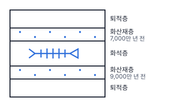
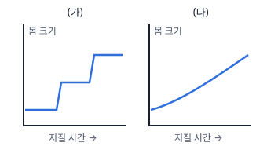
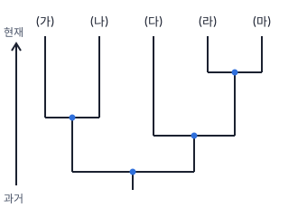

# 생명과학 8장 웹과제 예상 v1 문제해설

왼쪽 목차로 문항을 고르고, 오른쪽 문제를 보며 해설을 따라가요.

문제의 첫 줄부터 검산까지 설명해요.

**목차**

- [문항별 설명](#problems)
  - [P1. [기출 예상] 초파리 종간 교배의 결과](#p1)
  - [P2. [기출 예상] 분류계급의 순서](#p2)
  - [P3. [기출 변형] 짝짓기를 막는 장벽](#p3)
  - [P4. [기출 변형] 지리적 분리가 하는 일](#p4)
  - [P5. [기출 변형] 근연 식물 두 종의 개화 조건](#p5)
  - [P6. [예상] 두 화석 시료의 연대 차이](#p6)
  - [P7. [예상] 화산재층 사이에 낀 화석층의 연대](#p7)
  - [P8. [예상] 지질시대와 큰 사건 짝짓기](#p8)
  - [P9. [예상] 닮음의 원인이 다른 다섯 사례](#p9)
  - [P10. [예상] 몸 크기 변화 그래프 두 개 읽기](#p10)
  - [P11. [예상] 말 화석과 적응방산 진술 점검](#p11)
  - [P12. [예상] 두 대멸종의 흔적 읽기](#p12)
  - [P13. [예상] 학명과 3역, 그리고 rRNA](#p13)
  - [P14. [예상] 계통수로 공통조상 화석의 깊이 예상하기](#p14)
  - [P15. [예상] 2n=16 식물이 4n이 된 뒤의 교배](#p15)

## 문항별 설명

### P1. [기출 예상] 초파리 종간 교배의 결과

기출 8강 17 예상 · [연습형 문제 보기](../%EB%B3%B5%EC%8A%B5%EB%AC%B8%EC%A0%9C_8%EC%9E%A5_%EC%9B%B9%EA%B3%BC%EC%A0%9C%EC%98%88%EC%83%81_v1.html#p1) · [시험형 문제 보기](../%EB%B3%B5%EC%8A%B5%EB%AC%B8%EC%A0%9C_8%EC%9E%A5_%EC%9B%B9%EA%B3%BC%EC%A0%9C%EC%98%88%EC%83%81_%EC%8B%9C%ED%97%98%ED%98%95_v1.html#p1)

어떤 초파리 종 사이의 교배실험에서 정상적인 잡종 자손이 태어났다. 이 자손이 만든 다음 자손들은 높은 빈도의 염색체 변이와 해로운 유전자 조합을 가지고 태어난다. 이것은 무엇에 대한 설명인가?

- A. 잡종붕괴
- B. 잡종불임
- C. 배수성
- D. 배우자 격리
- E. 잡종 생존불능

원문·출처 정보 보기

기출 8강 합본 17번을 보기 순서만 바꿔 실은 예상 문제예요.

#### 문제를 내 말로 읽어요

기출 8강 17번을 보기 순서만 바꿔 실은 문제예요. 두 초파리 종 사이에서 **1대 잡종은 정상으로 태어났고 자손도 낳았는데**, 그다음 세대에서 염색체 변이와 해로운 유전자 조합이 많이 나타나요. 이 현상의 이름을 골라요.

#### 이 문제를 봤을 때 떠올릴 개념과 공식

‘교배실험에서 잡종 자손이 태어났다’는 말은 수정란(접합자, zygote)이 이미 생겼다는 뜻이에요. 그래서 먼저 접합 전 장벽(prezygotic barrier)인지 접합 후 장벽(postzygotic barrier)인지를 수정란이 생겼는지로 갈라요.

접합 후 장벽 세 가지는 어느 단계에서 멈추는지로 구별해요. 잡종이 배아 단계나 태어나자마자 죽으면 잡종 생존불능(reduced hybrid viability), 1대 잡종이 자라도 정자·난자를 못 만들어 자손을 못 남기면 잡종 불임(hybrid sterility), 1대 잡종은 정상이고 자손도 낳지만 다음 세대부터 생존력·생식력이 떨어지면 잡종 붕괴(hybrid breakdown)예요.

판단 기준은 두 가지예요. ① 1대 잡종이 정상으로 태어났는가, ② 1대 잡종이 자손을 남겼는가. 둘 다 ‘예’이고 문제가 그다음 세대에서 생기면 잡종 붕괴예요.

관련 정리노트: [접합 후 장벽: 잡종 생존불능·불임·붕괴](../../../%EB%B3%B5%EC%8A%B5%EB%85%B8%ED%8A%B8/1029/%EC%A0%95%EB%A6%AC%EB%85%B8%ED%8A%B8_1029_Microevolution_and_Speciation.html#s2-postzygotic), 접합 전 장벽과의 구분은 [접합 전 장벽 다섯 가지](../../../%EB%B3%B5%EC%8A%B5%EB%85%B8%ED%8A%B8/1029/%EC%A0%95%EB%A6%AC%EB%85%B8%ED%8A%B8_1029_Microevolution_and_Speciation.html#s2-prezygotic)

#### 왜 이렇게 푸는지 함께 따라가요

A. 잡종붕괴는 이 사례에 맞아요. 지문의 1대 잡종은 ‘정상적’으로 태어났고(기준 ①) 다음 자손을 만들었으며(기준 ②), 문제는 그다음 세대의 염색체 변이와 해로운 유전자 조합으로 나타나요. 세 조건이 잡종 붕괴의 정의와 모두 일치해요.

B. 잡종불임은 이 사례의 답으로 부적합해요. 잡종 불임은 노새처럼 1대 잡종이 정자·난자를 만들지 못해 자손이 없는 경우인데, 지문의 1대 잡종은 ‘다음 자손들’을 만들었으므로 기준 ②에서 어긋나요.

C. 배수성은 부적합해요. 배수성(polyploidy)은 염색체 세트 수가 늘어 한 세대 만에 새 종이 생기는 종분화 방식이에요. 생식적 격리 장벽의 이름이 아니고, 지문에는 염색체 세트가 배로 늘었다는 내용도 없어요.

D. 배우자 격리는 부적합해요. 배우자 격리(gametic isolation)는 정자와 난자의 표면 단백질이 맞지 않아 수정란이 생기지 않는 접합 전 장벽이에요. 지문에서는 잡종이 태어났으니 수정은 이미 일어났어요.

E. 잡종 생존불능은 부적합해요. 이 장벽은 잡종이 배아 단계나 태어나자마자 죽는 경우인데, 지문의 1대 잡종은 정상으로 태어나 자손까지 남겼으므로 기준 ①에서 어긋나요.

따라서 답은 A, 잡종붕괴예요.

#### 완성 답과 검산

답 A. 교과서 8장 p.161–162의 잡종붕괴(hybrid breakdown) 설명이 이 기출 지문과 같은 초파리 교배 예(정상 잡종 → 그 자손에서 염색체 이상·해로운 유전자 조합)를 들어요. 소거로도 접합 전 장벽(D)과 장벽이 아닌 종분화 방식(C)을 빼면 접합 후 셋이 남고, ‘1대 정상 출생’이 E를, ‘1대가 자손을 남김’이 B를 지워 A 하나만 남아요. 원문 보기 순서에서는 ③이었어요.

**페이지 요약**

#### 판단 기준

잡종이 태어남 → 접합 후 장벽. 1대 정상·자손 남김 → 다음 세대에서 쇠퇴하면 잡종 붕괴.

#### 결론

정답 A. 1대가 자손을 못 남기면 불임(B), 일찍 죽으면 생존불능(E)이에요.

---

### P2. [기출 예상] 분류계급의 순서

기출 8강 9 예상 · [연습형 문제 보기](../%EB%B3%B5%EC%8A%B5%EB%AC%B8%EC%A0%9C_8%EC%9E%A5_%EC%9B%B9%EA%B3%BC%EC%A0%9C%EC%98%88%EC%83%81_v1.html#p2) · [시험형 문제 보기](../%EB%B3%B5%EC%8A%B5%EB%AC%B8%EC%A0%9C_8%EC%9E%A5_%EC%9B%B9%EA%B3%BC%EC%A0%9C%EC%98%88%EC%83%81_%EC%8B%9C%ED%97%98%ED%98%95_v1.html#p2)

다음 분류 체계 중, 개체를 가장 많이 포함하는 넓은 범위에서 좁아지는 순서로 나열한 것은?

- A. 계, 영역, 문
- B. 강, 과, 종
- C. 과, 목, 강
- D. 문, 계, 속
- E. 계, 종, 속

원문·출처 정보 보기

기출 8강 합본 9번을 보기 순서만 바꿔 실은 예상 문제예요.

#### 문제를 내 말로 읽어요

기출 8강 9번을 보기 순서만 바꿔 실은 문제예요. 세 계급을 **넓은 범위 → 좁은 범위** 방향으로 올바르게 늘어놓은 보기를 골라요. 세 이름이 모두 이 방향으로 이어져야 해요.

#### 이 문제를 봤을 때 떠올릴 개념과 공식

‘분류 체계’, ‘넓은 범위에서 좁아지는 순서’라는 말에서 분류계급(taxonomic hierarchy)을 떠올려요. 강의노트 8장 p6은 폭이 증가하는 순서로 종(species)·속(genus)·과(family)·목(order)·강(class)·문(phylum)·계(kingdom)·영역(domain, 역)을 적었어요.

문제는 넓은 쪽부터 묻으므로 이 순서를 뒤집어 **역·계·문·강·목·과·속·종**으로 읽어요. 판단 기준은 보기의 세 이름이 이 줄에서 왼쪽 → 오른쪽으로만 이동하는지예요. 사이에 계급이 건너뛰어도 괜찮지만, 한 번이라도 왼쪽으로 돌아가면 탈락이에요.

관련 정리노트: [종 이름은 두 단어이고 분류는 여러 층이에요](../../../%EB%B3%B5%EC%8A%B5%EB%85%B8%ED%8A%B8/1103/%EC%A0%95%EB%A6%AC%EB%85%B8%ED%8A%B8_1103_Macroevolution_and_Taxonomy.html#s3-naming)

#### 왜 이렇게 푸는지 함께 따라가요

A. 틀려요. 계 다음에 영역이 오는데, 영역(역)은 계보다 넓은 맨 위 계급이라 줄에서 왼쪽으로 돌아가요.

B. 맞아요. 강 → 과 → 종은 줄에서 강(4번째) → 과(6번째) → 종(8번째)으로 오른쪽으로만 가요. 목과 속을 건너뛰었을 뿐 방향은 계속 좁아져요.

C. 틀려요. 과 → 목 → 강은 6번째 → 5번째 → 4번째로 계속 왼쪽으로 가요. 좁은 쪽에서 넓은 쪽으로 가는 반대 방향이에요.

D. 틀려요. 문(3번째) 다음 계(2번째)는 넓어지는 방향이에요. 이어지는 속은 좁아지지만 이미 한 번 거꾸로 갔어요.

E. 틀려요. 계 → 종은 좁아지지만 종(8번째) 다음 속(7번째)은 다시 넓어져요.

따라서 답은 B, 강, 과, 종이에요.

#### 완성 답과 검산

답 B. 반대로 강의노트의 ‘폭이 증가하는 순서’(종·속·과·목·강·문·계·영역)에서 B를 거꾸로 읽으면 종 → 과 → 강으로 왼쪽 → 오른쪽 순서를 그대로 지켜요. 다섯 보기 중 한 방향을 끝까지 지키는 것은 B 하나이고, C는 반대 방향으로 일관돼 있어 방향을 거꾸로 읽은 학생이 고르기 쉬운 보기예요. 원문 보기 순서에서는 ③이었어요.

**페이지 요약**

#### 판단 기준

넓은 → 좁은: 역·계·문·강·목·과·속·종. 세 이름이 이 줄에서 오른쪽으로만 가야 해요.

#### 결론

정답 B(강, 과, 종). C는 좁은 → 넓은 반대 방향이에요.

---

### P3. [기출 변형] 짝짓기를 막는 장벽

기출 8강 2 예상 · [연습형 문제 보기](../%EB%B3%B5%EC%8A%B5%EB%AC%B8%EC%A0%9C_8%EC%9E%A5_%EC%9B%B9%EA%B3%BC%EC%A0%9C%EC%98%88%EC%83%81_v1.html#p3) · [시험형 문제 보기](../%EB%B3%B5%EC%8A%B5%EB%AC%B8%EC%A0%9C_8%EC%9E%A5_%EC%9B%B9%EA%B3%BC%EC%A0%9C%EC%98%88%EC%83%81_%EC%8B%9C%ED%97%98%ED%98%95_v1.html#p3)

다음 중 행동적 격리의 예는?

- A. 같은 들판에 사는 두 식물 종 중 한 종은 봄에, 다른 종은 가을에 꽃을 피워 꽃가루와 암술이 만나지 못한다
- B. 두 종 사이에서 수정란은 생기지만 잡종 배아가 발생 도중에 죽는다
- C. 두 반딧불이 종이 함께 사는 곳에서 암컷은 자기 종 수컷의 깜박임 리듬에만 응답해 다른 종 수컷과는 짝짓기를 하지 않는다
- D. 두 미물루스 종은 꽃 모양이 달라 한 종은 벌이, 다른 종은 벌새가 꽃가루를 옮긴다
- E. 여러 개구리 종의 정자가 섞인 연못에서 난자는 표면 단백질이 맞는 같은 종의 정자와만 수정된다

원문·출처 정보 보기

기출 8강 합본 2번의 발문은 유지하고 보기를 새로 쓴 예상 문제예요.

#### 문제를 내 말로 읽어요

발문은 기출 8강 2번과 같고 보기는 새로 쓴 문제예요. 다섯 사례 각각이 어떤 장벽인지 이름을 붙인 뒤, 그중 **행동적 격리**에 해당하는 사례 하나를 골라요.

#### 이 문제를 봤을 때 떠올릴 개념과 공식

‘격리의 예’를 묻는 문제는 생식적 격리(reproductive isolation)의 종류를 사례에 붙이는 문제예요. 먼저 수정란이 생기는지로 접합 전 장벽과 접합 후 장벽을 나누고, 접합 전이면 **무엇이 수정을 막는가**를 봐요.

접합 전 장벽 다섯 가지의 기준은 이래요. 사는 곳이 다름 → 생태적 격리(ecological), 교배·개화 시기가 다름 → 시간적 격리(temporal), 구애 신호·동작을 다른 종이 알아보지 못함 → 행동적 격리(behavioral), 생식 기관·꽃 구조가 맞지 않거나 꽃 구조 때문에 매개 동물이 달라짐 → 기계적 격리(mechanical), 정자·난자가 만나도 표면 단백질이 맞지 않음 → 배우자 격리(gametic)예요. 행동적 격리의 핵심어는 ‘신호를 알아보지 못해 짝짓기를 하지 않음’이에요.

관련 정리노트: [접합 전 장벽 다섯 가지](../../../%EB%B3%B5%EC%8A%B5%EB%85%B8%ED%8A%B8/1029/%EC%A0%95%EB%A6%AC%EB%85%B8%ED%8A%B8_1029_Microevolution_and_Speciation.html#s2-prezygotic), 수정란이 생긴 뒤의 장벽은 [접합 후 장벽](../../../%EB%B3%B5%EC%8A%B5%EB%85%B8%ED%8A%B8/1029/%EC%A0%95%EB%A6%AC%EB%85%B8%ED%8A%B8_1029_Microevolution_and_Speciation.html#s2-postzygotic)

#### 왜 이렇게 푸는지 함께 따라가요

A. 행동적 격리의 예로 부적합해요. 같은 들판에 살지만 봄과 가을로 꽃 피는 때가 달라 꽃가루와 암술이 만나지 못하므로, 막는 원인은 시기 차이인 시간적 격리예요.

B. 부적합해요. 수정란이 생긴 뒤 잡종 배아가 발생 중에 죽으므로 접합 전 장벽이 아니라 접합 후 장벽인 잡종 생존불능이에요.

C. 행동적 격리의 예로 적합해요. 두 반딧불이 종이 같은 곳에 살아 만날 수는 있지만, 암컷이 자기 종 수컷의 깜박임 리듬, 즉 구애 신호에만 응답해 다른 종과는 짝짓기 자체가 일어나지 않아요. 막는 원인이 ‘신호를 알아보지 못함’이라 행동적 격리 기준과 일치해요.

D. 부적합해요. 미물루스 두 종은 꽃 모양(구조)이 달라 꽃가루를 옮기는 매개 동물이 벌과 벌새로 갈리므로 꽃가루가 다른 종 꽃에 가지 않아요. 원인이 구조 차이라 기계적 격리예요. 벌·벌새의 ‘행동’이 끼어 있어도 기준은 꽃 구조예요.

E. 부적합해요. 여러 종의 정자와 난자가 실제로 만났는데 표면 단백질이 맞는 같은 종끼리만 수정되므로 배우자 격리예요.

따라서 답은 C예요.

#### 완성 답과 검산

답 C. 교과서 8장 p.160의 행동적 격리 설명이 바로 반딧불이(Photinus) 수컷의 섬광 패턴과 암컷의 반응을 예로 들고(그림 8.3), 기계적 격리의 예로는 p.161 그림 8.4의 미물루스 두 종을 들어요. 다섯 보기에 이름을 하나씩 붙이면 시간적(A)·잡종 생존불능(B)·행동적(C)·기계적(D)·배우자(E)로 서로 겹치지 않아, 행동적 격리는 C 하나뿐이에요.

**페이지 요약**

#### 판단 기준

무엇이 수정을 막나: 장소·시기·신호·구조·배우자 표면 단백질. 신호를 못 알아보면 행동적 격리.

#### 결론

정답 C(반딧불이 깜박임). A 시간적, B 잡종 생존불능, D 기계적, E 배우자 격리.

---

### P4. [기출 변형] 지리적 분리가 하는 일

기출 8강 13 예상 · [연습형 문제 보기](../%EB%B3%B5%EC%8A%B5%EB%AC%B8%EC%A0%9C_8%EC%9E%A5_%EC%9B%B9%EA%B3%BC%EC%A0%9C%EC%98%88%EC%83%81_v1.html#p4) · [시험형 문제 보기](../%EB%B3%B5%EC%8A%B5%EB%AC%B8%EC%A0%9C_8%EC%9E%A5_%EC%9B%B9%EA%B3%BC%EC%A0%9C%EC%98%88%EC%83%81_%EC%8B%9C%ED%97%98%ED%98%95_v1.html#p4)

이소적 종분화 모델에서, 두 개체군의 지리적 분리는 __________________ .

- A. 두 개체군 사이의 유전자 확산을 늘려 유전자 풀을 하나로 합친다
- B. 생식적 격리가 생겨 종분화가 끝난 뒤에야 나타난다
- C. 그 자체가 생식적 격리이므로 분리된 순간 두 개체군은 서로 다른 종이 된다
- D. 그것만으로는 종분화가 일어났다고 판정할 수 없고, 이후 생식적 격리가 생겨야 종분화로 본다
- E. 두 개체군의 대립유전자 빈도가 분리 이후 계속 같은 값으로 유지되게 한다

원문·출처 정보 보기

기출 8강 합본 13번의 발문은 유지하고 보기를 새로 쓴 예상 문제예요.

#### 문제를 내 말로 읽어요

발문은 기출 8강 13번과 같고 보기는 새로 쓴 문제예요. 이소적 종분화에서 **지리적 분리가 무엇을 하고, 그것만으로 종분화라고 할 수 있는지**를 올바르게 설명한 보기를 골라요.

#### 이 문제를 봤을 때 떠올릴 개념과 공식

‘이소적 종분화 모델’, ‘지리적 분리’라는 말에서 이소적 종분화(allopatric speciation)의 순서를 떠올려요. 강의노트 8장 p2의 순서는 지리적 장벽으로 개체군이 나뉨 → 유전자 풀(gene pool) 분리 → 각 집단에서 서로 다른 돌연변이·자연선택·유전적 부동으로 대립유전자 빈도 변화 → 생식적 격리로 종분화예요.

판단 기준은 두 가지예요. ① 지리적 분리의 역할: 두 집단 사이의 유전자 확산(gene flow)을 끊어요. ② 종분화의 판정: 생물학적 종 개념(biological species concept)에 따라, 다시 만나도 교배하지 않거나 생식력 있는 자손을 낳지 못하는 생식적 격리가 생겨야 다른 종이에요. 즉 지리적 격리는 출발점(원인)이고, 판정 기준은 생식적 격리예요.

관련 정리노트: [이소적 종분화: 지리적 격리 뒤의 생식적 격리](../../../%EB%B3%B5%EC%8A%B5%EB%85%B8%ED%8A%B8/1029/%EC%A0%95%EB%A6%AC%EB%85%B8%ED%8A%B8_1029_Microevolution_and_Speciation.html#s3-allopatric), 판정 기준은 [종 개념과 아종](../../../%EB%B3%B5%EC%8A%B5%EB%85%B8%ED%8A%B8/1029/%EC%A0%95%EB%A6%AC%EB%85%B8%ED%8A%B8_1029_Microevolution_and_Speciation.html#s2-species)

#### 왜 이렇게 푸는지 함께 따라가요

A. 틀려요. 지리적 분리는 두 집단의 왕래를 끊어 유전자 확산을 막고(기준 ①) 유전자 풀을 둘로 나눠요. ‘늘려 하나로 합친다’는 정반대예요.

B. 틀려요. 순서상 지리적 분리가 맨 처음이고 생식적 격리가 마지막이에요. 종분화가 끝난 뒤에 지리적 분리가 나타나는 것이 아니에요.

C. 틀려요. 막 갈라진 두 무리를 다시 한곳에 모으면 아직 교배해 생식력 있는 자손을 낳을 수 있어요. 만나지 못하는 것과 만나도 섞이지 못하는 것은 달라서, 분리 자체는 생식적 격리가 아니에요(기준 ②).

D. 맞아요. 지리적 분리는 유전자 확산을 끊는 출발점일 뿐이고, 이후 차이가 쌓여 생식적 격리가 생겨야 종분화로 판정한다는 기준 ②와 일치해요.

E. 틀려요. 분리된 각 집단에서 돌연변이·자연선택·유전적 부동이 따로 일어나 대립유전자 빈도가 서로 다르게 변해요. 유전자 확산이 끊기면 빈도를 같게 맞춰 주던 흐름이 사라지므로 오히려 달라지기 쉬워요.

따라서 답은 D예요.

#### 완성 답과 검산

답 D. 교과서 8장 p.162는 이소적 종분화를 두 단계로 설명해요. 첫 단계에서 지리적으로 분리된 두 집단 사이의 유전자 확산이 차단되고, 그 뒤 돌연변이·자연선택·유전적 부동을 겪으며 차이가 쌓여 생식적으로 격리된다고 해요. 이 두 단계 구분에 맞는 보기는 D 하나이고, A·E는 첫 단계(확산 차단)를, B·C는 두 단계의 순서와 구분을 거슬러요. 원문 13번의 답이던 ‘유전자 확산을 방해한다’는 기준 ①이고, 이 문제는 기준 ②를 정답으로 삼았어요.

**페이지 요약**

#### 판단 기준

지리적 분리 = 유전자 확산 차단(원인). 종분화 판정 = 생식적 격리.

#### 결론

정답 D. 분리만으로는 아직 같은 종이에요(C 오답), 분리가 맨 처음이에요(B 오답).

---

### P5. [기출 변형] 근연 식물 두 종의 개화 조건

기출 8강 43 예상 · [연습형 문제 보기](../%EB%B3%B5%EC%8A%B5%EB%AC%B8%EC%A0%9C_8%EC%9E%A5_%EC%9B%B9%EA%B3%BC%EC%A0%9C%EC%98%88%EC%83%81_v1.html#p5) · [시험형 문제 보기](../%EB%B3%B5%EC%8A%B5%EB%AC%B8%EC%A0%9C_8%EC%9E%A5_%EC%9B%B9%EA%B3%BC%EC%A0%9C%EC%98%88%EC%83%81_%EC%8B%9C%ED%97%98%ED%98%95_v1.html#p5)

같은 들판에 사는 어떤 식물 종은 밤의 길이가 13시간 이상일 때 꽃이 핀다. 이 종의 근연종은 밤의 길이가 11시간 이하일 때 꽃을 피운다. 종분화의 개념에서 볼 때 이것은 무엇에 대한 예시인가?

- A. 기계적 격리
- B. 생태적 격리
- C. 행동적 격리
- D. 배우자 격리
- E. 시간적 격리

원문·출처 정보 보기

기출 8강 합본 43번의 숫자·조건을 바꾸고 보기를 다시 확인한 예상 문제예요.

#### 문제를 내 말로 읽어요

기출 8강 43번의 숫자·조건을 바꾼 문제예요. 원문은 밤 10시간·8시간이었고, 여기서는 **같은 들판**에 사는 두 근연종이 각각 밤 13시간 이상, 11시간 이하일 때 꽃을 피워요. 두 종이 섞이지 못하는 장벽의 이름을 골라요.

#### 이 문제를 봤을 때 떠올릴 개념과 공식

‘근연종’, ‘종분화의 개념에서’라는 말에서 두 종의 교배를 막는 접합 전 장벽(prezygotic barrier)을 떠올려요. 다섯 장벽은 무엇이 수정을 막는지로 고르는데, 이름을 가르는 것은 원인보다 **결과로 무엇이 어긋나는지**예요.

밤의 길이는 계절에 따라 바뀌어요. 그래서 꽃이 피는 밤 길이 조건이 다르면 꽃이 피는 시기가 서로 다른 때가 돼요. 원인이 생활사 길이든 낮·밤 길이든, 결과가 번식·개화 시기 차이이면 시간적 격리(temporal isolation)예요. 서식지가 달라 만나지 않는 생태적 격리(ecological isolation)와는 ‘같은 곳에 사는가’로 구별해요.

관련 정리노트: [접합 전 장벽 다섯 가지](../../../%EB%B3%B5%EC%8A%B5%EB%85%B8%ED%8A%B8/1029/%EC%A0%95%EB%A6%AC%EB%85%B8%ED%8A%B8_1029_Microevolution_and_Speciation.html#s2-prezygotic)

#### 왜 이렇게 푸는지 함께 따라가요

A. 기계적 격리는 부적합해요. 기계적 격리는 생식 기관·꽃 구조가 맞지 않거나 꽃 구조 때문에 매개 동물이 달라지는 경우인데, 지문은 꽃 구조를 비교하지 않고 개화 조건만 말해요.

B. 생태적 격리는 부적합해요. 두 종이 ‘같은 들판’에 살아 서식지가 같으므로 사는 곳이 달라 만나지 못하는 경우가 아니에요.

C. 행동적 격리는 부적합해요. 행동적 격리는 구애 신호를 다른 종이 알아보지 못하는 경우예요. 밤 길이에 따른 개화는 구애 신호가 아니에요.

D. 배우자 격리는 부적합해요. 배우자 격리는 꽃가루가 암술에 도착했는데 난자가 다른 종의 꽃가루·정자를 인식하지 못하는 경우예요. 여기서는 꽃 피는 때가 달라 꽃가루가 상대 꽃에 닿을 기회부터 없어요.

E. 시간적 격리는 이 사례에 적합해요. 밤이 13시간 이상인 계절과 11시간 이하인 계절은 겹치지 않으므로(두 조건 사이에 11~13시간의 빈 구간도 있어요) 두 종은 같은 들판에서 서로 다른 시기에 꽃을 피워요. 원인이 밤 길이여도 결과가 개화 시기 차이라 시간적 격리예요.

따라서 답은 E, 시간적 격리예요.

#### 완성 답과 검산

답 E. 교과서 8장 p.160은 시간적 격리를 ‘같은 서식지에 사는 종들이 하루 또는 1년 중 다른 시기에 교배’하는 경우로 정의하고, 꽃가루가 날리는 달이 2월·4월로 다른 소나무 두 종을 예로 들어요. 이 문제도 같은 서식지 + 다른 개화 시기라는 두 조건을 모두 갖춰요. ‘같은 들판’이 B를 지우고, 구조·신호·표면 단백질 언급이 없어 A·C·D도 지워져 E만 남아요. 원문(10·8시간)의 답 ①시간적 격리와도 같은 결론이에요.

**페이지 요약**

#### 판단 기준

원인이 밤 길이여도 결과가 개화 시기 차이면 시간적 격리. 같은 들판 → 생태적 격리 아님.

#### 결론

정답 E(시간적 격리).

---

### P6. [예상] 두 화석 시료의 연대 차이

예상 8장 6 · [연습형 문제 보기](../%EB%B3%B5%EC%8A%B5%EB%AC%B8%EC%A0%9C_8%EC%9E%A5_%EC%9B%B9%EA%B3%BC%EC%A0%9C%EC%98%88%EC%83%81_v1.html#p6) · [시험형 문제 보기](../%EB%B3%B5%EC%8A%B5%EB%AC%B8%EC%A0%9C_8%EC%9E%A5_%EC%9B%B9%EA%B3%BC%EC%A0%9C%EC%98%88%EC%83%81_%EC%8B%9C%ED%97%98%ED%98%95_v1.html#p6)

두 생물 화석 시료 (가)와 (나)의 C-14/C-12 비율을 살아 있을 때의 기준과 비교해, 남은 C-14의 비율을 아래 표로 정리했어요. 두 생물의 생전 기준 비율은 같고, 죽은 뒤 탄소 교환은 없었다고 해요. C-14의 반감기가 5,730년일 때, (나)는 (가)보다 몇 년 더 오래전에 죽었나요?

| 시료 | 생전 기준 대비 남은 C-14의 비율 |
|---|---|
| (가) | 25% |
| (나) | 3.125% |

- A. 11,460년
- B. 28,650년
- C. 17,190년
- D. 45,840년
- E. 약 2,507년

원문·출처 정보 보기

원문 기출이 아닌 새 예상 문제예요. 반감기마다 처음 양의 절반을 빼는 착각과 현재 남은 양이 절반이 되는 계산을 구별해요.

#### 문제를 내 말로 읽어요

실제 기출이 아닌 새 예상 문제예요. 두 화석 시료에 남은 C-14의 비율(25%, 3.125%)로 각각 반감기가 몇 번 지났는지 세고, **두 시료가 죽은 시점의 차이**를 구해요. 각 시료의 나이 자체가 아니라 차이를 묻는다는 점을 먼저 확인해요.

#### 이 문제를 봤을 때 떠올릴 개념과 공식

‘C-14/C-12 비율’, ‘반감기 5,730년’에서 방사성 연대측정법(radiometric dating)을 떠올려요. 생물은 살아 있는 동안 탄소를 계속 교환해 C-14 비율이 일정하고, 죽으면 새 탄소가 들어오지 않아 C-14가 질소-14로 붕괴하며 줄어요. 문제의 ‘생전 기준 비율이 같고 탄소 교환이 없었다’는 조건이 이 계산을 쓸 수 있게 해 줘요.

반감기(half-life)는 남은 양이 절반이 되는 시간이에요. 핵심은 반감기마다 **처음 양의 절반을 빼는 것이 아니라 현재 남은 양의 절반**이 남는다는 점이에요. 그래서 반감기를 $n$번 지나면 남은 비율은 $(1/2)^n$이고, 경과 시간은 $n \times 5{,}730$년이에요.

관련 정리노트: [화석의 나이는 무엇을 재서 알아낼까요?](../../../%EB%B3%B5%EC%8A%B5%EB%85%B8%ED%8A%B8/1103/%EC%A0%95%EB%A6%AC%EB%85%B8%ED%8A%B8_1103_Macroevolution_and_Taxonomy.html#s0-dating)

#### 종이에 쓸 첫 줄

100% → 50 → 25 → 12.5 → 6.25 → 3.125로 반으로 나누는 줄을 먼저 적고, 각 화살표가 반감기 한 번이라고 표시해요.

#### 왜 이렇게 푸는지 함께 따라가요

줄에서 (가)의 25%는 화살표 두 번, (나)의 3.125%는 화살표 다섯 번 뒤에 있어요. 즉 (가)는 $2 \times 5{,}730 = 11{,}460$년, (나)는 $5 \times 5{,}730 = 28{,}650$년 전에 죽었고, 차이는 $(5-2) \times 5{,}730 = 17{,}190$년이에요.

A. 틀려요. 11,460년은 반감기 두 번으로, (가)가 죽은 뒤 지난 시간이에요. 차이를 묻는 질문의 답이 아니에요.

B. 틀려요. 28,650년은 반감기 다섯 번으로, (나)가 죽은 뒤 지난 시간이에요. (가)의 경과 시간을 빼지 않았어요.

C. 맞아요. 두 시료의 반감기 수 차이 3번에 5,730년을 곱한 17,190년이에요. 25%에서 3.125%까지 25 → 12.5 → 6.25 → 3.125로 직접 세어도 세 번이에요.

D. 틀려요. 25%는 3.125%의 8배인데, 이 배수 8을 반감기 수로 착각해 $8 \times 5{,}730 = 45{,}840$년을 계산한 값이에요. 8배는 $2^3$이므로 반감기는 3번이에요.

E. 틀려요. 반감기마다 처음 양의 50%포인트씩 일정하게 빠진다고 보고 $(25 - 3.125)/50 \times 5{,}730 \approx 2{,}507$년을 계산한 값이에요. 실제로는 남은 양의 절반씩 줄어요.

따라서 답은 C, 17,190년이에요.

#### 완성 답과 검산

답 C. 다른 경로로 비율끼리 나눠 확인해요. $25\% \div 3.125\% = 8 = 2^3$이므로 (나)는 (가)보다 반감기 세 번 더 지났고, $3 \times 5{,}730 = 17{,}190$년이에요. 정리노트의 표(12.5%는 반감기 3번, 17,190년)와도 같은 값이에요.

**페이지 요약**

#### 판단 기준

반감기마다 남은 양의 절반. 남은 비율 $(1/2)^n$ → 경과 시간 $n \times 5{,}730$년.

#### 첫 줄

100 → 50 → 25 → 12.5 → 6.25 → 3.125, 화살표 하나가 반감기 한 번.

#### 결론

(가) 2번, (나) 5번 → 차이 3번 × 5,730 = 17,190년, 정답 C.

---

### P7. [예상] 화산재층 사이에 낀 화석층의 연대

예상 8장 7 · [연습형 문제 보기](../%EB%B3%B5%EC%8A%B5%EB%AC%B8%EC%A0%9C_8%EC%9E%A5_%EC%9B%B9%EA%B3%BC%EC%A0%9C%EC%98%88%EC%83%81_v1.html#p7) · [시험형 문제 보기](../%EB%B3%B5%EC%8A%B5%EB%AC%B8%EC%A0%9C_8%EC%9E%A5_%EC%9B%B9%EA%B3%BC%EC%A0%9C%EC%98%88%EC%83%81_%EC%8B%9C%ED%97%98%ED%98%95_v1.html#p7)

그림은 변형이나 뒤집힘 없이 정상적으로 쌓인 지층의 단면이에요. 두 화산재층은 화산재가 쌓여 생긴 화성암층으로, 화석층과 쌓인 순서가 확인되었고 방사성 연대측정으로 각각의 연대를 구했어요. 이 지층과 화석층에 대한 설명으로 옳은 것은 어느 것인가요?

- A. 화석층은 9,000만 년 전 화산재층보다 먼저 쌓였으므로 9,000만 년 전보다 오래됐어요.
- B. 화석 뼈에 남은 C-14 비율을 재면 화석층의 연대를 직접 정할 수 있어요.
- C. 화석층 퇴적암 속 입자 하나를 골라 잰 연대가 곧 화석의 나이예요.
- D. 화석층은 7,000만 년 전 화산재층 아래에 있으므로 7,000만 년 전보다 나중에 쌓였어요.
- E. 화석층은 7,000만~9,000만 년 전 사이에 쌓였고, 이 범위는 C-14가 아니라 반감기가 긴 동위원소로 잰 화산재층의 연대에서 얻어요.

원문·출처 정보 보기

원문 기출이 아닌 새 예상 문제예요. 정상 퇴적의 상대 연대와 화성암층의 절대 연대를 연결하고, C-14를 쓸 수 있는 범위를 구별해요.

#### 문제를 내 말로 읽어요

실제 기출이 아닌 새 예상 문제예요. 뒤집힘 없이 쌓인 지층에서 화석층이 7,000만 년 전 화산재층(위)과 9,000만 년 전 화산재층(아래) 사이에 끼어 있어요. 이 그림으로 **화석층의 나이를 어떻게, 어느 범위로 알 수 있는지** 옳게 말한 보기를 골라요.

#### 이 문제를 봤을 때 떠올릴 개념과 공식

‘정상적으로 쌓인 지층’에서 상대 연대(relative dating)를, ‘화산재층의 방사성 연대측정’에서 절대 연대(absolute dating)를 떠올려요. 두 가지를 이어 붙이는 문제예요.

확인할 기준은 세 가지예요. ① 지층 누중: 변형·뒤집힘이 없으면 아래층이 먼저 쌓여 더 오래됐어요. ② 범위 제한: 화석층과 쌓인 순서가 확인된 위·아래 화성암층의 연대를 알면, 사이 화석층은 두 연대 사이로 좁혀져요. ③ 측정 도구의 한계: C-14는 반감기가 5,730년이라 수천만 년이 지나면 거의 남지 않아 이렇게 오래된 화석에 쓰지 못하고, 반감기가 긴 다른 동위원소로 화성암층을 재요. 또 퇴적암은 여러 시기의 입자가 모여 생겨서 입자 하나의 나이는 층이 쌓인 시기와 달라요.

관련 정리노트: [화석의 나이는 무엇을 재서 알아낼까요?](../../../%EB%B3%B5%EC%8A%B5%EB%85%B8%ED%8A%B8/1103/%EC%A0%95%EB%A6%AC%EB%85%B8%ED%8A%B8_1103_Macroevolution_and_Taxonomy.html#s0-dating)

#### 왜 이렇게 푸는지 함께 따라가요

A. 틀려요. 그림에서 화석층은 9,000만 년 전 화산재층 위에 있어요. 기준 ①로 그 층이 먼저 쌓이고 화석층이 나중에 쌓였으므로, 화석층은 9,000만 년 전보다 젊어요. 9,000만 년 전보다 오래된 것은 그 아래 퇴적층이에요.

B. 틀려요. 화석층은 수천만 년 전 층이라 C-14가 측정하기 어려울 만큼 적게 남아요(기준 ③). C-14로 이 화석의 연대를 직접 정할 수 없어요.

C. 틀려요. 퇴적암 속 입자는 더 오래전에 다른 곳에서 만들어져 옮겨 온 것일 수 있어요. 입자 하나가 생긴 시기와 화석층이 쌓인 시기는 달라서 그 값을 화석 나이로 단정할 수 없어요(기준 ③).

D. 틀려요. 화석층은 7,000만 년 전 화산재층 아래에 있으므로 기준 ①로 그보다 먼저, 즉 더 오래전에 쌓였어요. ‘아래에 있으니 나중’은 순서를 거꾸로 읽은 것이에요.

E. 맞아요. 화석층은 9,000만 년 전 층 뒤, 7,000만 년 전 층 앞에 쌓였으므로 7,000만~9,000만 년 전 사이예요(기준 ①·②). 이 범위는 C-14가 아니라 반감기가 긴 동위원소로 잰 화산재층의 연대에서 얻어요(기준 ③).

따라서 답은 E예요.

#### 완성 답과 검산

답 E. 교과서 8장 p.163은 퇴적층이 파괴되지 않으면 형성된 순서대로 배열되어 맨 위쪽이 가장 최근이라고 하고, 강의노트 8장 p3은 C-14의 반감기를 5,730년으로 적었어요. 위에서 아래로 7,000만 → 화석층 → 9,000만이므로 나이가 아래로 갈수록 커지는 순서와 맞고, 화석층은 두 값 사이에 들어가요. 정리노트의 가상 예(아래 1억 2천만 년, 위 1억 년 → 사이 화석층 1억~1억 2천만 년)와 같은 구조예요. A와 D는 순서를 거꾸로, B와 C는 측정 대상을 잘못 고른 보기라 E 하나가 남아요.

**페이지 요약**

#### 판단 기준

정상 퇴적은 아래가 오래됨. 위·아래 화성암층 연대로 사이 화석층의 범위를 좁힘. 수천만 년이면 C-14는 부적합.

#### 결론

정답 E(7,000만~9,000만 년 전, 긴 반감기 동위원소로 잰 화산재층에서). A·D 순서 반대, B C-14 한계, C 입자 나이 ≠ 퇴적 시기.

---

### P8. [예상] 지질시대와 큰 사건 짝짓기

예상 8장 8 · [연습형 문제 보기](../%EB%B3%B5%EC%8A%B5%EB%AC%B8%EC%A0%9C_8%EC%9E%A5_%EC%9B%B9%EA%B3%BC%EC%A0%9C%EC%98%88%EC%83%81_v1.html#p8) · [시험형 문제 보기](../%EB%B3%B5%EC%8A%B5%EB%AC%B8%EC%A0%9C_8%EC%9E%A5_%EC%9B%B9%EA%B3%BC%EC%A0%9C%EC%98%88%EC%83%81_%EC%8B%9C%ED%97%98%ED%98%95_v1.html#p8)

지질시대의 구간과 수업에서 그 구간에 연결한 큰 사건을 짝지었어요. 옳지 **않은** 것은 어느 것인가요?

- A. 현생이언의 캄브리아기 대폭발 — 지구에 최초의 생명이 처음 나타난 사건이에요.
- B. 원생이언 — 산소가 쌓이고 진핵생물이 나타났으며, 뒤이어 다세포 생물이 등장했어요.
- C. 고생대의 끝 — 페름기 말 대멸종으로 고생대가 끝나요.
- D. 중생대의 끝 — 백악기 말 대멸종으로 중생대가 끝나요.
- E. 신생대 — 포유류가 다양해지고, 훨씬 뒤에 인류가 나타났어요.

원문·출처 정보 보기

원문 기출이 아닌 새 예상 문제예요. 최초의 생명 출현, 진핵생물 출현, 동물의 폭발적 다양화를 구별하고 대멸종 경계를 확인해요.

#### 문제를 내 말로 읽어요

실제 기출이 아닌 새 예상 문제예요. 지질시대 구간과 큰 사건의 짝 다섯 개 가운데 **옳지 않은 짝 하나**를 골라요. 각 짝을 맞아요/틀려요로 먼저 판정하고, 틀린 짝을 답으로 골라요.

#### 이 문제를 봤을 때 떠올릴 개념과 공식

‘이언’, ‘고생대·중생대·신생대’, ‘대폭발’, ‘대멸종’이라는 말에서 지질시대(geologic time)를 큰 사건의 순서로 떠올려요. 강의노트 8장 p3의 순서는 명왕이언(Hadean) → 시생이언(Archean, 원핵생물 시기) → 원생이언(Proterozoic, 진핵생물 출현) → 현생이언(Phanerozoic, 캄브리아기 대폭발 이후)이에요.

현생이언 안에서는 고생대가 캄브리아기 대폭발(Cambrian explosion)로 시작해 페름기 말 대멸종으로 끝나고, 중생대는 백악기 말 대멸종으로 끝나며, 그 뒤 신생대에 포유류가 다양해지고 인류가 나타나요.

판단 기준은 **사건의 종류를 구별**하는 것이에요. 최초의 생명 출현(시생이언의 원핵생물), 진핵생물 출현(원생이언), 동물 계열의 폭발적 다양화(캄브리아기 대폭발)는 서로 다른 시기의 다른 사건이에요.

관련 정리노트: [지구 역사는 큰 사건의 순서로 기억해요](../../../%EB%B3%B5%EC%8A%B5%EB%85%B8%ED%8A%B8/1103/%EC%A0%95%EB%A6%AC%EB%85%B8%ED%8A%B8_1103_Macroevolution_and_Taxonomy.html#s0-geologic)

#### 왜 이렇게 푸는지 함께 따라가요

A. 틀린 짝이에요. 캄브리아기 대폭발은 많은 동물 계열이 비교적 짧은 지질 시간에 다양해진 사건이고, 최초의 생명(원핵생물)은 그보다 훨씬 앞선 시생이언에 나타났어요. 이미 원생이언에 진핵생물과 다세포 생물이 있었으므로 ‘최초의 생명이 처음 나타난 사건’은 대폭발의 설명이 될 수 없어요.

B. 맞는 짝이에요. 원생이언에는 산소 축적과 진핵생물 출현이 연결되고, 뒤이어 다세포 생물이 등장해요. 강의노트도 원생이언을 ‘진핵생물 출현’ 시기로 적었어요.

C. 맞는 짝이에요. 고생대는 캄브리아기 대폭발로 시작해 페름기 말 대멸종으로 끝나요.

D. 맞는 짝이에요. 중생대는 삼첩기·쥐라기·백악기로 나뉘고 백악기 말 대멸종으로 끝나요.

E. 맞는 짝이에요. 신생대에 포유류가 다양해지고, 인류는 그보다 훨씬 뒤인 신생대 후반에 나타나요.

내용이 틀린 짝은 A 하나이므로, ‘옳지 않은 것’을 묻는 이 문제의 답은 A예요.

#### 완성 답과 검산

답 A. 교과서 8장 p.165 표 8.2에서 캄브리아기 칸의 사건은 ‘현생동물문의 다양한 방사(캄브리아기 대폭발)’이고, 생명의 기원은 표 맨 아래의 가장 오래된 구간에 적혀 있어 두 사건이 수십억 년 떨어져 있어요. 같은 표에서 원생이언(진핵세포의 기원), 페름기 말·백악기 말 대멸종, 신생대 제4기(인류의 기원)도 B~E와 일치해요. 옳지 않은 짝은 A 하나뿐이에요.

**페이지 요약**

#### 판단 기준

최초 생명(시생이언) ≠ 진핵생물(원생이언) ≠ 동물 다양화(캄브리아기 대폭발). 고생대 끝 페름기 말, 중생대 끝 백악기 말 대멸종.

#### 결론

옳지 않은 짝은 A. B~E는 모두 맞아요.

---

### P9. [예상] 닮음의 원인이 다른 다섯 사례

예상 8장 9 · [연습형 문제 보기](../%EB%B3%B5%EC%8A%B5%EB%AC%B8%EC%A0%9C_8%EC%9E%A5_%EC%9B%B9%EA%B3%BC%EC%A0%9C%EC%98%88%EC%83%81_v1.html#p9) · [시험형 문제 보기](../%EB%B3%B5%EC%8A%B5%EB%AC%B8%EC%A0%9C_8%EC%9E%A5_%EC%9B%B9%EA%B3%BC%EC%A0%9C%EC%98%88%EC%83%81_%EC%8B%9C%ED%97%98%ED%98%95_v1.html#p9)

다음 사례 중 수렴진화로 설명하는 것은 어느 것인가요?

- A. 큰 집단에서 몇 가족만 외딴 섬으로 옮겨 새 집단을 세웠더니, 원래 집단에서 드물던 대립유전자가 새 집단에서 흔해졌어요.
- B. 말라리아가 유행하는 지역에서 낫모양 적혈구 대립유전자를 하나만 가진 사람이 두 동형접합자보다 유리해, 그 대립유전자가 사라지지 않고 유지돼요.
- C. 독수리 날개와 박쥐 날개 속 앞다리뼈는 뼈의 상대적 배치가 서로 대응해요.
- D. 어류인 상어와 조류인 펭귄은 서로 먼 계열이지만, 물속을 헤엄치는 생활에서 둘 다 유선형 몸을 갖추었어요.
- E. 산불로 한 집단의 개체 대부분이 형질과 관계없이 죽고, 우연히 살아남은 소수가 번식해 집단을 다시 이루었어요.

원문·출처 정보 보기

원문 기출이 아닌 새 예상 문제예요. 먼 계열의 독립적인 비슷한 적응을 공통조상 유래 구조, 그리고 7장의 유전적 부동·이형접합자 이점 사례와 구별해요.

#### 무엇이 닮았고, 왜 닮았나요?

다섯 사례 가운데 수렴진화(convergent evolution)로 설명하는 것을 하나 골라요. 각 사례가 *먼 계열 사이의 형질 닮음*을 말하는지, 아니면 *한 집단 안의 대립유전자 빈도 변화*를 말하는지부터 나눠 읽어요. 7장의 유전적 부동·이형접합자 이점 사례가 섞인 문항이에요.

#### 이 문제를 봤을 때 떠올릴 개념과 공식

‘서로 먼 계열인데 비슷하다’는 표현에서 수렴진화를 떠올려요. 수렴진화는 연관이 먼 계열이 비슷한 환경에서 비슷한 적응을 **독립적으로** 갖게 되는 과정이고, 그렇게 생긴 닮음이 상사성(analogy)이에요. 반대로 비교하는 형질이 공통조상에서 이어졌으면 상동성(homology)이에요. [수렴진화와 상사성·상동성](../../../%EB%B3%B5%EC%8A%B5%EB%85%B8%ED%8A%B8/1103/%EC%A0%95%EB%A6%AC%EB%85%B8%ED%8A%B8_1103_Macroevolution_and_Taxonomy.html#s1-convergence)

판단 기준은 두 가지예요. ① 사례가 두 계열의 형질 닮음을 비교하는가, ② 그렇다면 **비교하는 바로 그 형질**이 공통조상에서 유래했는가(상동) 아니면 따로 생겼는가(수렴)예요.

①에 해당하지 않는 사례는 7장 개념으로 이름을 붙여요. 우연한 사건으로 소수만 남거나 소수가 새 집단을 세워 빈도가 바뀌면 유전적 부동(genetic drift)이고, 그 자리에서 급감하면 병목 현상(bottleneck), 소수가 떨어져 나가 새 집단을 세우면 창시자 효과(founder effect)예요. [병목 현상과 창시자 효과](../../../%EB%B3%B5%EC%8A%B5%EB%85%B8%ED%8A%B8/1029/%EC%A0%95%EB%A6%AC%EB%85%B8%ED%8A%B8_1029_Microevolution_and_Speciation.html#s0-drift) 이형접합자의 상대적 적응도가 두 동형접합자보다 높아 대립유전자가 유지되면 이형접합자 이점(heterozygote advantage)이에요. [이형접합자 이점](../../../%EB%B3%B5%EC%8A%B5%EB%85%B8%ED%8A%B8/1029/%EC%A0%95%EB%A6%AC%EB%85%B8%ED%8A%B8_1029_Microevolution_and_Speciation.html#s1-balanced)

#### 왜 이렇게 푸는지 함께 따라가요

A. 수렴진화가 아니에요. 두 계열의 형질을 비교하지 않고, 몇 가족이 외딴 섬에 새 집단을 세워 드물던 대립유전자가 흔해진 한 집단의 빈도 변화예요. 소수 창시자의 우연한 유전자 조성이 빈도를 정했으므로 창시자 효과(유전적 부동)예요.

B. 수렴진화가 아니에요. 낫모양 적혈구 대립유전자를 하나만 가진 사람(이형접합자)이 말라리아 지역에서 두 동형접합자보다 유리해 그 대립유전자가 남는 것은 한 집단 안의 이형접합자 이점이에요. 먼 계열의 닮음 비교가 없어요.

C. 수렴진화가 아니에요. 두 계열의 닮음을 비교하긴 하지만, 비교 대상이 ‘앞다리뼈의 상대적 배치’예요. 이 뼈 배치는 공통조상에서 이어진 구조라 상동성의 예예요. 비행 기능의 닮음이 아니라 뼈 구조를 묻고 있다는 점이 결정적 차이예요.

D. 수렴진화예요. 상어는 어류, 펭귄은 조류로 먼 계열이고, 유선형 몸은 공통조상에서 물려받은 것이 아니라 물속을 헤엄치는 비슷한 환경에 각각 따로 적응한 결과예요. 기준 ①·② 모두 수렴진화 쪽으로 충족해요.

E. 수렴진화가 아니에요. 산불로 개체 대부분이 형질과 관계없이 죽고 우연히 남은 소수가 집단을 다시 이룬 것은 그 자리의 급감, 곧 병목 현상(유전적 부동)이에요.

따라서 답은 D예요.

#### 완성 답과 검산

답 D. 기준 ①로 먼저 거르면 A·B·E는 한 집단의 빈도 이야기라 탈락하고, 남은 C·D 중 ②에서 공통조상 유래가 아닌 형질은 D의 유선형뿐이에요. 강의노트 8장 p3–4도 수렴진화의 예로 상어(어류)·펭귄(조류)·돌고래(포유류)의 유선형 체형을 들어요.

**페이지 요약**

#### 기준

먼 계열의 형질 닮음인가 → 그 형질이 공통조상 유래가 아니라 독립 적응인가.

#### 판정

A 창시자 효과, B 이형접합자 이점, C 상동(뼈 배치), E 병목 현상. 상어·펭귄 유선형 D가 수렴진화예요.

---

### P10. [예상] 몸 크기 변화 그래프 두 개 읽기

예상 8장 10 · [연습형 문제 보기](../%EB%B3%B5%EC%8A%B5%EB%AC%B8%EC%A0%9C_8%EC%9E%A5_%EC%9B%B9%EA%B3%BC%EC%A0%9C%EC%98%88%EC%83%81_v1.html#p10) · [시험형 문제 보기](../%EB%B3%B5%EC%8A%B5%EB%AC%B8%EC%A0%9C_8%EC%9E%A5_%EC%9B%B9%EA%B3%BC%EC%A0%9C%EC%98%88%EC%83%81_%EC%8B%9C%ED%97%98%ED%98%95_v1.html#p10)

그림은 두 생물 계열 (가)와 (나)의 화석에서 측정한 몸 크기가 지질 시간에 따라 달라진 모습을 나타낸 가상의 그래프예요. 그래프에 대한 해석으로 옳은 것은 어느 것인가요?

- A. (가)는 점진주의, (나)는 단속평형에 해당하는 양상이에요.
- B. (가)는 단속평형, (나)는 점진주의에 해당하며, (가)의 가파른 구간이 짧다는 것은 지질학적 시간에 비해 짧다는 뜻이에요.
- C. (가)의 가파른 구간은 개체 하나가 한 세대 안에 새로운 형태로 바뀐 것을 뜻해요.
- D. (가)의 평평한 구간에서는 유전적 변화를 포함한 모든 진화가 완전히 멈췄다고 단정할 수 있어요.
- E. 자연계에서는 두 양상 중 하나만 관찰되므로 (가)와 (나) 가운데 한쪽 모델은 틀렸어요.

원문·출처 정보 보기

원문 기출이 아닌 새 예상 문제예요. 형태 변화의 시간 양상 그래프에서 명칭을 떠올리고, 변화 구간이 짧다는 말의 시간 기준을 구별해요.

#### 두 그래프의 모양이 어떻게 다른가요?

두 계열 (가)·(나)의 몸 크기가 지질 시간에 따라 바뀐 가상의 그래프예요. 모양으로 각 그래프의 이름을 붙이고, 그 해석으로 옳은 것을 하나 골라요. 이름의 짝과 ‘짧다’·‘평평하다’의 뜻이 함께 걸려 있어요.

#### 이 문제를 봤을 때 떠올릴 개념과 공식

‘형태 변화가 지질 시간에 따라 어떤 모양으로 일어났나’는 대진화의 변화 속도, 곧 점진주의와 단속평형을 묻는 단서예요. 점진주의(gradualism)는 작은 형태 변화가 긴 시간 동안 꾸준히 누적되는 양상이고, 단속평형(punctuated equilibrium)은 오랜 형태적 정체 사이에 지질학적으로 짧은 변화 구간이 끼는 양상이에요. [점진주의와 단속평형](../../../%EB%B3%B5%EC%8A%B5%EB%85%B8%ED%8A%B8/1103/%EC%A0%95%EB%A6%AC%EB%85%B8%ED%8A%B8_1103_Macroevolution_and_Taxonomy.html#s2-tempo)

그래프에서 확인할 것은 ① 기울기가 처음부터 끝까지 비슷한지, 평평한 구간과 가파른 구간이 번갈아 나오는지, ② ‘짧다’의 시간 기준이에요. 단속평형의 급변은 **지질학적 시간에 비해** 짧다는 뜻이며, 개체 하나가 한 세대에 바뀌거나 정체기에 진화가 완전히 멈춘다는 뜻이 아니에요. 두 양상은 계열에 따라 모두 관찰될 수 있어요.

#### 그래프부터 읽어요

(가)는 오랫동안 평평하다가 짧은 구간에서 가파르게 오르는 일을 두 번 되풀이한 계단 모양이에요. (나)는 처음부터 끝까지 완만하게 꾸준히 올라가요. 그러므로 (가)는 정체와 급변이 번갈아 나오는 단속평형, (나)는 꾸준한 누적인 점진주의 모양이에요.

#### 왜 이렇게 푸는지 함께 따라가요

A. 틀려요. 계단 모양인 (가)가 단속평형, 꾸준히 완만하게 오르는 (나)가 점진주의인데, 보기는 두 이름을 뒤바꿔 붙였어요.

B. 맞아요. 이름의 짝이 그래프 모양과 일치하고, (가)의 가파른 구간이 ‘짧다’는 것도 지질학적 시간에 비해 짧다는 올바른 기준으로 해석했어요.

C. 틀려요. 가로축은 지질 시간이라 가파른 구간도 많은 세대에 걸친 집단의 변화예요. 지질 시간에 비해 짧을 뿐, 개체 하나가 한 세대 안에 새 형태로 바뀐다는 뜻이 아니에요.

D. 틀려요. 평평한 구간은 측정한 몸 크기, 곧 형태가 안정적이라는 것만 보여 줘요. 형태가 정체된 시기에도 유전적 변화가 전혀 없다고 단정할 수 없어요.

E. 틀려요. 점진주의와 단속평형은 계열에 따라 모두 관찰될 수 있는 양상이라, 한쪽이 보인다고 다른 모델이 틀렸다고 정하지 않아요.

따라서 답은 B예요.

#### 완성 답과 검산

답 B. 이름 짝을 맞춘 보기는 B 하나이고, 나머지 C·D·E는 ‘짧다’·‘평평하다’를 개체 순간 변화·진화 정지·모델 배타로 과장해 모두 탈락해요. 교과서 8장 p.169도 단속평형을 오랜 형태적 정체와 짧은 급격한 변화로, 진화의 속도가 계열에 따라 달라 두 이론이 모두 쓰일 수 있다고 설명해요.

**페이지 요약**

#### 판독

(가) 계단 모양 = 단속평형, (나) 꾸준한 기울기 = 점진주의.

#### 결론

‘짧다’는 지질 시간 기준이에요. 개체의 순간 변화·진화 정지·한 모델만 옳음은 틀려요. 답 B.

---

### P11. [예상] 말 화석과 적응방산 진술 점검

예상 8장 11 · [연습형 문제 보기](../%EB%B3%B5%EC%8A%B5%EB%AC%B8%EC%A0%9C_8%EC%9E%A5_%EC%9B%B9%EA%B3%BC%EC%A0%9C%EC%98%88%EC%83%81_v1.html#p11) · [시험형 문제 보기](../%EB%B3%B5%EC%8A%B5%EB%AC%B8%EC%A0%9C_8%EC%9E%A5_%EC%9B%B9%EA%B3%BC%EC%A0%9C%EC%98%88%EC%83%81_%EC%8B%9C%ED%97%98%ED%98%95_v1.html#p11)

대진화의 경향과 적응방산에 대한 설명으로 옳지 **않은** 것은 무엇인가요?

- A. 말 화석에는 현생 말로 이어지지 않고 멸종한 여러 계열도 있어요.
- B. 적응방산은 한 조상 계열에서 여러 종이 생겨 서로 다른 생태적 지위를 차지하는 양상이에요.
- C. 백악기 말 대멸종 뒤 포유류는 비어 있던 여러 서식지와 자원을 이용하며 다양해졌어요.
- D. 한 종의 개체 수가 늘어 넓은 지역에 퍼진 것만으로는 적응방산이라고 하지 않아요.
- E. 말 화석은 모든 계열에서 몸집이 커지는 한 방향의 필연적 진화를 보여 줘요.

원문·출처 정보 보기

원문 기출이 아닌 새 예상 문제예요. 살아남은 한 계열의 경향을 진화 전체의 정해진 방향으로 일반화하는 혼동을 다뤄요.

#### 틀린 진술 하나를 찾아요

말 화석의 진화 경향과 적응방산(adaptive radiation)에 대한 다섯 진술 가운데 **옳지 않은 것**을 골라요. 진술마다 맞는지 틀리는지를 먼저 판정해요.

#### 이 문제를 봤을 때 떠올릴 개념과 공식

‘말 화석’·‘한 방향’이라는 표현에서 대진화의 경향을 떠올려요. Marsh는 현생 말로 이어지는 계열에서 몸집 증가·발가락 수 감소·이빨 변화를 보았지만, 더 많은 화석은 크기·발가락·이빨이 다양한 여러 가지가 갈라지고 그중 많은 계열이 멸종했음을 보여 줘요. 진화에는 특정 형질을 향한 내재적 추진력이 없고, 경향은 환경에 따라 멈추거나 바뀔 수 있어요. [진화는 정해진 목표를 향하지 않아요](../../../%EB%B3%B5%EC%8A%B5%EB%85%B8%ED%8A%B8/1103/%EC%A0%95%EB%A6%AC%EB%85%B8%ED%8A%B8_1103_Macroevolution_and_Taxonomy.html#s2-trends)

적응방산은 한 조상 계열에서 여러 종이 생겨 서로 다른 생태적 지위(ecological niche)를 차지하는 양상이에요. 개체 수 증가나 한 종의 분포 확대는 해당하지 않으며, 대멸종 뒤 열린 서식지·자원은 적응방산의 기회가 돼요. [적응방산의 정의와 대멸종 뒤 포유류](../../../%EB%B3%B5%EC%8A%B5%EB%85%B8%ED%8A%B8/1103/%EC%A0%95%EB%A6%AC%EB%85%B8%ED%8A%B8_1103_Macroevolution_and_Taxonomy.html#s2-radiation)

판단 기준은 ① 살아남은 한 계열의 경향을 모든 계열의 필연적 방향으로 일반화했는지, ② 적응방산의 ‘여러 종 + 서로 다른 지위’ 조건을 지키는지예요.

#### 왜 이렇게 푸는지 함께 따라가요

A. 맞는 진술이므로 제외해요. 말 화석은 여러 가지로 갈라졌고 그중 현생 말로 이어지지 않은 많은 계열이 멸종했어요.

B. 맞는 진술이므로 제외해요. ‘한 조상 계열에서 여러 종 → 서로 다른 생태적 지위’라는 적응방산의 정의 그대로예요.

C. 맞는 진술이므로 제외해요. 백악기 말 비조류 공룡이 사라진 뒤 포유류가 열린 서식지와 자원을 이용해 다양해진 것은 수업의 적응방산 예예요.

D. 맞는 진술이므로 제외해요. 한 종의 개체 수가 늘고 퍼지기만 하면 여러 종이 생기지도, 다른 지위로 나뉘지도 않으므로 기준 ②를 충족하지 못해요. 그래서 적응방산이라고 하지 않는다는 이 진술은 옳아요.

E. 틀린 진술이므로 선택해요. 몸집 증가는 현생 말로 이어진 한 계열에서 관찰된 경향일 뿐이고, 멸종한 계열에는 오히려 작아진 말도 있었어요. ‘모든 계열’·‘필연적 방향’은 기준 ①의 일반화 오류예요.

옳지 않은 진술을 고르므로 답은 E예요.

#### 완성 답과 검산

답 E. 맞는 진술 A·B·C·D 넷을 소거하면 틀린 진술은 E 하나만 남아요. 교과서 8장 p.169도 말의 진화계통수가 많은 분지를 가지며 그 대부분이 멸종했고, 몸 크기 증가는 일반 법칙이 아니라 흔할 뿐이라고 적어요.

**페이지 요약**

#### 기준

살아남은 한 계열의 경향 ≠ 모든 계열의 필연적 방향. 적응방산 = 한 조상 → 여러 종 → 다른 지위.

#### 결론

A~D는 맞아요. ‘모든 계열이 커지는 필연적 진화’ E가 틀린 진술이에요.

---

### P12. [예상] 두 대멸종의 흔적 읽기

예상 8장 12 · [연습형 문제 보기](../%EB%B3%B5%EC%8A%B5%EB%AC%B8%EC%A0%9C_8%EC%9E%A5_%EC%9B%B9%EA%B3%BC%EC%A0%9C%EC%98%88%EC%83%81_v1.html#p12) · [시험형 문제 보기](../%EB%B3%B5%EC%8A%B5%EB%AC%B8%EC%A0%9C_8%EC%9E%A5_%EC%9B%B9%EA%B3%BC%EC%A0%9C%EC%98%88%EC%83%81_%EC%8B%9C%ED%97%98%ED%98%95_v1.html#p12)

표는 수업에서 자세히 다룬 두 대멸종 (가)와 (나)에 대해, 그 시기의 지층과 주변에서 관찰한 흔적을 정리한 것이에요. 표에 대한 해석으로 옳지 **않은** 것은 무엇인가요?

| 사건 | 관찰한 흔적 | 멸종 양상 |
|---|---|---|
| (가) | 시베리아의 대규모 화산 분출로 생긴 넓은 용암 지대, 온실가스 증가와 온난화의 흔적 | 지질학적으로 짧은 기간에 평소보다 훨씬 많은 종이 사라짐 |
| (나) | 경계층의 이리듐 농축, 멕시코 유카탄반도의 거대한 충돌구 | 지질학적으로 짧은 기간에 평소보다 훨씬 많은 종이 사라짐 |

- A. (가)는 고생대를 끝낸 대멸종이에요.
- B. (나)의 흔적으로 보아 그 사건 때 지구의 모든 생물이 사라졌다고 할 수 있어요.
- C. (나)의 이리듐 농축은 관찰한 흔적이고, 큰 충돌은 그 흔적에서 추론한 사건이에요.
- D. (나) 뒤에는 열린 서식지와 자원을 이용해 포유류가 다양해졌어요.
- E. (가)와 (나)는 모두 배경멸종과 구별되는 대멸종이에요.

원문·출처 정보 보기

원문 기출이 아닌 새 예상 문제예요. 흔적으로 두 대멸종을 구별하고, 대멸종을 전멸로 읽는 혼동을 다뤄요.

#### 흔적으로 사건을 알아봐요

표는 두 대멸종 (가)·(나)의 관찰한 흔적과 멸종 양상이에요. 흔적으로 각각이 어떤 사건인지 먼저 정한 뒤, 표에 대한 해석으로 **옳지 않은 것**을 골라요.

#### 이 문제를 봤을 때 떠올릴 개념과 공식

‘시베리아 대규모 화산 분출·온실가스’는 페름기 말 대멸종, ‘경계층의 이리듐(iridium) 농축·유카탄반도 충돌구’는 백악기 말 대멸종의 근거예요. 이리듐은 지구 표면에는 드물고 운석에 상대적으로 많아서 큰 충돌을 추론하는 단서가 돼요. [배경멸종과 대멸종, 두 사건의 근거](../../../%EB%B3%B5%EC%8A%B5%EB%85%B8%ED%8A%B8/1103/%EC%A0%95%EB%A6%AC%EB%85%B8%ED%8A%B8_1103_Macroevolution_and_Taxonomy.html#s2-extinction)

대멸종(mass extinction)은 지질학적으로 짧은 기간에 배경멸종률(background extinction rate)을 크게 넘는 많은 종이 사라지는 사건이지, 모든 생물의 전멸이 아니에요. 페름기 말 대멸종은 고생대를 끝내고, 백악기 말 대멸종은 중생대를 끝내요. [지질시대의 경계](../../../%EB%B3%B5%EC%8A%B5%EB%85%B8%ED%8A%B8/1103/%EC%A0%95%EB%A6%AC%EB%85%B8%ED%8A%B8_1103_Macroevolution_and_Taxonomy.html#s0-geologic)

판단 기준은 ① 흔적과 사건의 연결, ② 관찰한 흔적과 추론한 사건의 구별, ③ ‘대멸종 = 많은 종의 소멸’이라는 범위예요.

#### 왜 이렇게 푸는지 함께 따라가요

A. 맞는 해석이므로 제외해요. (가)의 시베리아 화산·온난화 흔적은 페름기 말 대멸종이고, 이 대멸종이 고생대의 끝이에요.

B. 틀린 해석이므로 선택해요. 이리듐 농축과 충돌구는 큰 충돌이 있었다는 증거일 뿐이고, 표의 멸종 양상도 ‘평소보다 훨씬 많은 종’이 사라졌다고만 적었어요. 대멸종은 전멸이 아니므로 ‘모든 생물이 사라졌다’는 기준 ③을 넘어선 해석이에요.

C. 맞는 해석이므로 제외해요. 이리듐 농축은 지층에서 직접 관찰한 흔적이고, 큰 충돌은 그 흔적과 충돌구로부터 추론한 사건이라 기준 ②의 구별을 정확히 했어요.

D. 맞는 해석이므로 제외해요. (나)는 백악기 말 대멸종이고, 그 뒤 신생대에 포유류가 열린 서식지와 자원을 이용해 다양해졌어요(적응방산).

E. 맞는 해석이므로 제외해요. 두 사건 모두 ‘지질학적으로 짧은 기간에 평소보다 훨씬 많은 종이 사라짐’이라서 배경멸종과 구별되는 대멸종의 정의를 충족해요.

옳지 않은 해석을 고르므로 답은 B예요.

#### 완성 답과 검산

답 B. 맞는 해석 A·C·D·E 넷을 소거하면 B만 남아요. 강의노트 8장 p4–5에서도 백악기 대멸종을 ‘해양생물종의 절반, 모든 공룡 등 멸종’으로 적고 있어, 모든 생물의 소멸이 아니라는 점이 확인돼요.

**페이지 요약**

#### 연결

(가) 시베리아 화산 = 페름기 말(고생대 끝), (나) 이리듐·충돌구 = 백악기 말.

#### 결론

대멸종은 많은 종의 소멸이지 전멸이 아니에요. ‘모든 생물이 사라졌다’ B가 틀린 해석이에요.

---

### P13. [예상] 학명과 3역, 그리고 rRNA

예상 8장 13 · [연습형 문제 보기](../%EB%B3%B5%EC%8A%B5%EB%AC%B8%EC%A0%9C_8%EC%9E%A5_%EC%9B%B9%EA%B3%BC%EC%A0%9C%EC%98%88%EC%83%81_v1.html#p13) · [시험형 문제 보기](../%EB%B3%B5%EC%8A%B5%EB%AC%B8%EC%A0%9C_8%EC%9E%A5_%EC%9B%B9%EA%B3%BC%EC%A0%9C%EC%98%88%EC%83%81_%EC%8B%9C%ED%97%98%ED%98%95_v1.html#p13)

생물의 이름 짓기와 분자 자료를 이용한 분류에 대한 설명으로 옳지 **않은** 것은 무엇인가요?

- A. 종의 학명은 속 이름과 종소명 두 단어 전체이며, 속 이름의 첫 글자만 대문자로 쓰고 두 단어를 이탤릭체로 써요.
- B. 우즈는 rRNA 염기서열 비교에 기초해 세균역·고세균역·진핵생물역을 구별했어요.
- C. 산소를 내는 광합성을 하는 남세균은 세균역에 속해요.
- D. rRNA 유전자는 리보솜을 이루는 RNA이므로 rRNA와 같은 물질이에요.
- E. rRNA 유전자의 해당 DNA 구간을 PCR로 증폭한 뒤 염기서열을 읽어 알려진 생물의 서열과 비교할 수 있어요.

원문·출처 정보 보기

원문 기출이 아닌 새 예상 문제예요. rRNA와 rRNA 유전자를 같은 물질로 부르는 혼동을 물질 단위로 점검해요.

#### 이름 짓기와 분자 분류에서 틀린 말 찾기

학명, 3역 체계, rRNA를 이용한 분류에 대한 다섯 진술 가운데 **옳지 않은 것**을 골라요. 특히 각 진술이 말하는 물질이 RNA인지 DNA인지 단위를 확인해요.

#### 이 문제를 봤을 때 떠올릴 개념과 공식

‘학명’에서 이명법(binomial nomenclature)을 떠올려요. 속(genus) 이름과 종소명(specific epithet) 두 단어 전체가 종의 학명이고, 속 첫 글자만 대문자, 두 단어 모두 이탤릭체로 써요. 3역은 세균역·고세균역·진핵생물역이며 남세균은 세균역이에요. [이명법과 3역 체계](../../../%EB%B3%B5%EC%8A%B5%EB%85%B8%ED%8A%B8/1103/%EC%A0%95%EB%A6%AC%EB%85%B8%ED%8A%B8_1103_Macroevolution_and_Taxonomy.html#s3-naming)

‘rRNA’와 ‘rRNA 유전자’에서는 물질 단위를 확인해요. rRNA는 리보솜을 이루는 RNA이고, rRNA 유전자는 그 RNA를 만드는 정보를 담은 DNA 구간이에요. 실제 비교에서는 rRNA 유전자 DNA 구간을 PCR(중합효소연쇄반응)로 증폭해 염기서열을 읽고 비교하며, 우즈(Woese)는 rRNA 서열 비교로 3역을 구별했어요. [rRNA와 rRNA 유전자의 구별](../../../%EB%B3%B5%EC%8A%B5%EB%85%B8%ED%8A%B8/1103/%EC%A0%95%EB%A6%AC%EB%85%B8%ED%8A%B8_1103_Macroevolution_and_Taxonomy.html#s3-rrna)

판단 기준은 ① 학명 표기 규칙, ② 생물과 역의 대응, ③ 진술 속 물질이 RNA인지 DNA인지예요.

#### 왜 이렇게 푸는지 함께 따라가요

A. 맞는 진술이므로 제외해요. 속 이름 + 종소명 두 단어 전체가 학명이고, 속 첫 글자만 대문자·전체 이탤릭체라는 이명법 규칙과 일치해요.

B. 맞는 진술이므로 제외해요. 우즈는 rRNA 염기서열 비교에 기초해 세균역·고세균역·진핵생물역을 구별했어요.

C. 맞는 진술이므로 제외해요. 남세균은 산소를 내는 광합성을 하는 원핵생물이며, 수업 체계에서 세균역에 속해요.

D. 틀린 진술이므로 선택해요. rRNA는 리보솜을 이루는 RNA이고, rRNA 유전자는 그 RNA의 정보를 담은 DNA 구간이에요. ‘rRNA 유전자는 리보솜을 이루는 RNA’라는 설명은 DNA와 RNA를 같은 물질로 섞은 것이라 기준 ③에서 틀려요.

E. 맞는 진술이므로 제외해요. PCR로 늘리는 재료는 rRNA 유전자의 DNA 구간이고, 그 염기서열을 읽어 알려진 생물의 서열과 일치·차이를 비교해요.

옳지 않은 진술을 고르므로 답은 D예요.

#### 완성 답과 검산

답 D. 맞는 진술 A·B·C·E를 소거하면 D 하나만 남아요. 다른 경로로 보면, PCR은 DNA를 증폭하는 방법이라 E가 맞으려면 비교 재료인 rRNA 유전자가 DNA여야 해요. 따라서 rRNA 유전자를 RNA라고 한 D와 E는 함께 맞을 수 없어요. 강의노트 8장 p6도 ‘rRNA영역을 중합효소연쇄반응(PCR) 이용 증폭하여 비교’한다고 적어요.

**페이지 요약**

#### 기준

학명 = 속 + 종소명(이탤릭). 3역: 세균·고세균·진핵생물. rRNA는 RNA, rRNA 유전자는 DNA.

#### 결론

rRNA 유전자를 RNA라고 한 D가 틀린 진술이에요.

---

### P14. [예상] 계통수로 공통조상 화석의 깊이 예상하기

예상 8장 14 · [연습형 문제 보기](../%EB%B3%B5%EC%8A%B5%EB%AC%B8%EC%A0%9C_8%EC%9E%A5_%EC%9B%B9%EA%B3%BC%EC%A0%9C%EC%98%88%EC%83%81_v1.html#p14) · [시험형 문제 보기](../%EB%B3%B5%EC%8A%B5%EB%AC%B8%EC%A0%9C_8%EC%9E%A5_%EC%9B%B9%EA%B3%BC%EC%A0%9C%EC%98%88%EC%83%81_%EC%8B%9C%ED%97%98%ED%98%95_v1.html#p14)

그림은 현존하는 다섯 생물 무리 (가)~(마)의 뿌리 있는 계통수예요. 세로 방향은 시간을 나타내고 위쪽일수록 현재에 가까워요. 한 지역의 지층이 교란 없이 정상적으로 쌓였고, 그림에 있는 공통조상들의 화석이 모두 그 지역에 보존되었다고 가정해요. 다음 쌍 중 두 무리의 가장 가까운 공통조상 화석이 **가장 얕은 층**에서 발견될 것으로 기대되는 것은 무엇인가요?

- A. (라)와 (마)
- B. (나)와 (다)
- C. (가)와 (나)
- D. (다)와 (라)
- E. (가)와 (마)

원문·출처 정보 보기

원문 기출이 아닌 새 예상 문제예요. 가로로 이웃한 위치와 실제 공통조상의 깊이를 구별하고, 정상 퇴적 가정에서 공통조상의 시점과 지층 깊이를 연결해요.

#### 가장 최근에 갈라진 쌍을 찾아요

세로축이 시간인 뿌리 있는 계통수에서, 다섯 쌍 가운데 두 무리의 가장 가까운 공통조상 화석이 **가장 얕은 층**에서 기대되는 쌍을 골라요. 지층은 교란 없이 정상적으로 쌓였고 공통조상 화석이 모두 보존되었다고 가정해요. 그림에서 가로로 이웃한 것과 공통조상이 최근인 것을 구별해야 해요.

#### 이 문제를 봤을 때 떠올릴 개념과 공식

‘두 무리의 가장 가까운 공통조상’은 계통수(phylogenetic tree)에서 두 끝 가지를 아래로 거슬러 내려가 처음 만나는 분기점(node)이에요. 그 분기점이 위쪽(현재 쪽)에 있을수록 공통조상이 더 최근이고, 뿌리(root)는 그림의 모든 무리의 공통조상이라 가장 오래됐어요. 끝 가지의 좌우 배치는 관계의 가까움이나 시간을 나타내지 않아요. [계통수에서 공통조상과 얕은 층 읽기](../../../%EB%B3%B5%EC%8A%B5%EB%85%B8%ED%8A%B8/1103/%EC%A0%95%EB%A6%AC%EB%85%B8%ED%8A%B8_1103_Macroevolution_and_Taxonomy.html#s3-phylogeny-supp-1)

지층은 교란이 없으면 아래가 오래되고 위가 최근이에요. 그래서 정상 퇴적·같은 지역·보존 가정 아래에서만 ‘더 최근의 공통조상 → 더 얕은 층의 화석’으로 연결할 수 있어요. [정상 퇴적에서 지층의 순서](../../../%EB%B3%B5%EC%8A%B5%EB%85%B8%ED%8A%B8/1103/%EC%A0%95%EB%A6%AC%EB%85%B8%ED%8A%B8_1103_Macroevolution_and_Taxonomy.html#s0-dating) 이 문제는 세로축을 시간이라고 밝혔으므로 분기점의 높이를 시간 순서로 읽어도 돼요.

#### 분기점의 높이부터 순서를 매겨요

그림의 분기점은 넷이에요. 가장 아래는 뿌리 분기점이고, 그 약간 위에서 오른쪽 가지가 (다)와 나머지로 갈라져요. 높이의 약 3분의 1 지점에서 (가)와 (나)가, 약 4분의 3 지점에서 (라)와 (마)가 갈라져요. 그러므로 위에서부터 (라)·(마) 분기점 → (가)·(나) 분기점 → (다)·[(라),(마)] 분기점 → 뿌리 순서로 최근이에요.

#### 왜 이렇게 푸는지 함께 따라가요

A. 맞아요. (라)와 (마)는 약 4분의 3 높이의 분기점에서 바로 만나요. 네 분기점 중 가장 위쪽이라 공통조상이 가장 최근이고, 정상 퇴적이면 그 화석은 가장 얕은 층에서 기대돼요.

B. 틀려요. (나)와 (다)는 그림에서 가로로 이웃하지만, 거슬러 내려가면 맨 아래 뿌리에서야 만나요. 공통조상이 가장 오래돼 가장 깊은 층에서 기대돼요.

C. 틀려요. (가)와 (나)는 서로 가장 가까운 무리이지만, 둘이 만나는 분기점은 약 3분의 1 높이라 (라)·(마)의 분기점보다 아래예요. 그 공통조상 화석은 A보다 깊은 층에서 기대돼요.

D. 틀려요. (다)와 (라)는 뿌리 바로 위의 오른쪽 분기점에서 만나요. (라)·(마)의 분기점보다 훨씬 아래라 더 깊은 층이에요.

E. 틀려요. (가)와 (마)는 왼쪽과 오른쪽 가지에 나뉘어 있어 뿌리에서야 만나요. 그림의 모든 무리가 공유하는 가장 오래된 조상이라 가장 깊은 층이에요.

따라서 답은 A예요.

#### 완성 답과 검산

답 A. 반대 방향으로 확인하면, 현재에서 시간을 거슬러 내려갈 때 가장 먼저 하나로 합쳐지는 두 가지가 (라)와 (마)예요. 다섯 쌍을 만나는 분기점별로 묶으면 (라)·(마) 하나만 가장 위 분기점에 속하고, (가)·(나)는 두 번째, (다)·(라)는 세 번째, (나)·(다)와 (가)·(마)는 뿌리에 속해 겹치는 답이 없어요. 교과서 8장 p.163도 파괴되지 않은 지층은 형성 순서대로 배열되어 맨 위쪽이 가장 최근이라고 적어요.

**페이지 요약**

#### 판독

분기점 높이: (라)(마) &gt; (가)(나) &gt; (다)·[(라)(마)] &gt; 뿌리.

#### 결론

가장 최근 공통조상 = 정상 퇴적에서 가장 얕은 층. 가로 이웃이 아니라 만나는 분기점 높이로 판단해요. 답 A.

---

### P15. [예상] 2n=16 식물이 4n이 된 뒤의 교배

예상 8장 15 · [연습형 문제 보기](../%EB%B3%B5%EC%8A%B5%EB%AC%B8%EC%A0%9C_8%EC%9E%A5_%EC%9B%B9%EA%B3%BC%EC%A0%9C%EC%98%88%EC%83%81_v1.html#p15) · [시험형 문제 보기](../%EB%B3%B5%EC%8A%B5%EB%AC%B8%EC%A0%9C_8%EC%9E%A5_%EC%9B%B9%EA%B3%BC%EC%A0%9C%EC%98%88%EC%83%81_%EC%8B%9C%ED%97%98%ED%98%95_v1.html#p15)

체세포의 염색체 수가 2n=16인 어떤 식물 집단에서, 한 개체가 DNA를 복제한 뒤 세포분열을 하지 않아 4n 개체가 되었어요. 이 4n 개체와 그 자손에 대한 설명으로 옳은 것은 무엇인가요? (자손의 염색체 수는 체세포 하나에 든 수예요.)

- A. 4n 개체가 감수분열로 만드는 배우자의 염색체 수는 8개예요.
- B. 4n 개체와 원래 2n 개체 사이의 자손은 염색체가 24개인 이수체예요.
- C. 4n 개체와 원래 2n 개체 사이의 자손은 염색체가 24개(3n)라서 감수분열 때 짝이 맞지 않아 불임이고, 4n 개체끼리의 자손은 염색체가 32개로 번식할 수 있어요.
- D. 4n 개체와 원래 2n 개체 사이의 자손은 염색체가 24개로 짝수이므로 12쌍으로 짝이 맞아 번식할 수 있어요.
- E. 4n 개체가 원래 집단과 다른 종이 되려면 먼저 지리적 격리로 원래 집단과 떨어져 지내야 해요.

원문·출처 정보 보기

원문 기출이 아닌 새 예상 문제예요. 염색체 세트 수(n)를 실제 염색체 개수로 바꿔 배우자와 자손의 수를 계산하고, 배수체와 이수체를 구별해요.

#### 세트 수를 염색체 개수로 바꿔요

2n=16인 식물에서 4n 개체가 생겼어요. 이 4n 개체의 배우자, 원래 2n 개체와의 자손, 4n끼리의 자손에 대해 옳은 설명을 골라요. 보기마다 n·2n 같은 세트 수와 16·24 같은 실제 개수가 섞여 있으니 단위를 맞춰 계산해요.

#### 이 문제를 봤을 때 떠올릴 개념과 공식

‘DNA를 복제한 뒤 세포분열을 하지 않아 4n’에서 배수성(polyploidy)을 떠올려요. 배수체(polyploid)는 염색체 **세트 전체**가 늘어난 개체(3n, 4n)이고, 이수체(aneuploid)는 일부 염색체의 수만 달라진 개체(2n+1 등)예요. [배수성: 한 세대 만의 종분화](../../../%EB%B3%B5%EC%8A%B5%EB%85%B8%ED%8A%B8/1029/%EC%A0%95%EB%A6%AC%EB%85%B8%ED%8A%B8_1029_Microevolution_and_Speciation.html#s3-polyploidy)

계산 규칙은 두 가지예요. ① 한 세트의 염색체 개수 n은 원래 2n 개체의 체세포 수 ÷ 2예요(여기서는 16 ÷ 2 = 8). 배수체의 체세포 수는 세트 수 × n이라 4n이면 4 × 8 = 32예요. 감수분열로 만든 배우자는 그 개체 체세포 염색체 수의 절반이에요. ② 자손 = 두 배우자의 염색체 수 합이에요. 번식 가능 여부는 세트가 모두 짝을 이루는지로 판단해요. 3n은 세 세트 가운데 한 세트가 짝이 없어 정상 배우자를 거의 만들지 못해 불임이고, 4n은 모든 세트가 짝을 이뤄요.

배수성은 같은 장소에서 일어나는 동소적 종분화(sympatric speciation)이며, 배우자의 염색체 수가 달라져 한 세대 만에 생식적 격리가 생겨요. [동소적 종분화](../../../%EB%B3%B5%EC%8A%B5%EB%85%B8%ED%8A%B8/1029/%EC%A0%95%EB%A6%AC%EB%85%B8%ED%8A%B8_1029_Microevolution_and_Speciation.html#s3-sympatric)

#### 한 세트의 개수부터 구해요

2n=16이므로 n=16÷2=8이에요. 4n 개체의 체세포는 4×8=32개, 그 배우자는 32÷2=16개(2n)예요. 원래 2n 개체의 배우자는 16÷2=8개(n)예요.

#### 왜 이렇게 푸는지 함께 따라가요

A. 틀려요. 4n 개체의 배우자는 체세포 32개의 절반인 16개(2n)예요. 8개는 원래 2n 개체가 만드는 배우자의 수예요.

B. 틀려요. 4n × 2n 자손은 16+8=24개로 개수는 맞지만, 24=3×8이라 한 세트(8개)가 통째로 더해진 3n이에요. 세트 전체가 늘었으므로 이수체가 아니라 배수체예요.

C. 맞아요. 4n × 2n 자손은 16+8=24개(3n)라서 세 세트 중 한 세트가 짝이 없어 정상 배우자를 거의 만들지 못하므로 불임이에요. 4n × 4n 자손은 16+16=32개(4n)라서 모든 세트가 두 짝씩 짝을 이뤄 감수분열이 가능하고 번식할 수 있어요.

D. 틀려요. 24개는 같은 종류의 염색체가 세 개씩 있는 3n이에요. 짝은 같은 종류끼리 맞춰야 하므로 개수 전체가 짝수여도 종류마다 하나가 짝 없이 남아요. ‘12쌍’은 서로 다른 종류를 짝지은 셈이라 성립하지 않아요.

E. 틀려요. 배수성은 지리적 격리 없이 같은 장소에서 일어나는 동소적 종분화이고, 원래 집단과의 자손이 불임이 되어 한 세대 만에 생식적 격리가 생겨요.

따라서 답은 C예요.

#### 완성 답과 검산

답 C. 개수 대신 세트 수로 다시 세면, 4n의 배우자 2세트 + 2n의 배우자 1세트 = 3세트 = 3×8 = 24개, 4n의 배우자 2세트 + 2세트 = 4세트 = 4×8 = 32개로 start의 계산과 같아요. 교과서 8장 p.163도 배수체 개체가 부모 종의 개체와 교배하지 못해 동소적 종분화가 일어난다고 설명해요.

**페이지 요약**

#### 첫 줄

n=8 → 4n=32, 4n의 배우자 16(2n), 2n의 배우자 8(n).

#### 결론

4n×2n = 24(3n, 배수체, 불임), 4n×4n = 32(4n, 번식 가능). 지리적 격리 필요 없음. 답 C.

---

원 문제·정리노트·PDF는 보존해요.
