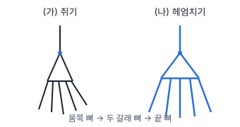
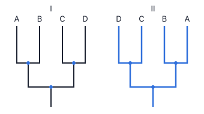

# 생명과학 8장 웹과제 예상 v2 문제해설

왼쪽 목차로 문항을 고르고, 오른쪽 문제를 보며 해설을 따라가요.

문제의 첫 줄부터 검산까지 설명해요.

**목차**

- [문항별 설명](#problems)
  - [P1. [기출 예상] 두 집단의 종 구분](#p1)
  - [P2. [기출 예상] 하이에나 두 집단](#p2)
  - [P3. [기출 변형] 두 집단 사이의 장벽](#p3)
  - [P4. [기출 변형] 분류 체계의 변화](#p4)
  - [P5. [기출 변형] 식물 집단의 염색체 세트](#p5)
  - [P6. [예상] 종을 가르는 기준의 범위](#p6)
  - [P7. [예상] 두 실험의 차단 단계](#p7)
  - [P8. [예상] 같은 지역의 두 숙주](#p8)
  - [P9. [예상] 몸 구조를 만드는 신호](#p9)
  - [P10. [예상] 두 시점의 서식지](#p10)
  - [P11. [예상] 한 시료의 탄소 시계](#p11)
  - [P12. [예상] 두 앞다리의 비교 단위](#p12)
  - [P13. [예상] 멸종 뒤 열린 생태적 자리](#p13)
  - [P14. [예상] 두 학명의 같은 부분과 다른 부분](#p14)
  - [P15. [예상] 두 계통수의 관계](#p15)

## 문항별 설명

### P1. [기출 예상] 두 집단의 종 구분

기출 8강 3 예상 · [연습형 문제 보기](../%EB%B3%B5%EC%8A%B5%EB%AC%B8%EC%A0%9C_8%EC%9E%A5_%EC%9B%B9%EA%B3%BC%EC%A0%9C%EC%98%88%EC%83%81_v2.html#p1) · [시험형 문제 보기](../%EB%B3%B5%EC%8A%B5%EB%AC%B8%EC%A0%9C_8%EC%9E%A5_%EC%9B%B9%EA%B3%BC%EC%A0%9C%EC%98%88%EC%83%81_%EC%8B%9C%ED%97%98%ED%98%95_v2.html#p1)

생물의 두 집단이 별개의 생물학적 종들로 간주되려면, 이들에 대한 설명으로 맞는 것은?

- A. 공통조상이 달라야 한다
- B. 서로 생식적으로 격리되어야 한다
- C. 외형적으로 서로 매우 달라야 한다
- D. 보기 모두 맞다
- E. 생존 가능한 자손을 생산할 수 없어야 한다

원문·출처 정보 보기

기출 8강 합본 3번을 보기 순서만 바꿔 실은 예상 문제예요. PDF 1쪽.

#### 문제에서 무엇을 묻나요?

두 집단을 별개의 생물학적 종으로 가르는 데 꼭 필요한 조건을 고르는 문제예요. 생김새나 공통조상보다 생식 결과를 보아야 해요.

#### 이 문제를 봤을 때 떠올릴 개념과 공식

생물학적 종 개념에서는 자연 상태에서 교배해 생식력 있는 자손을 낳을 수 있는지 확인해요. 서로 교배하지 못하거나 낳은 잡종이 불임이면 생식적 격리가 있어 별개의 종이에요. 살아 있는 자손의 탄생과 그 자손의 생식력은 다른 조건이에요.

관련 정리노트: [생물학적 종 개념과 불임 잡종](../../../%EB%B3%B5%EC%8A%B5%EB%85%B8%ED%8A%B8/1029/%EC%A0%95%EB%A6%AC%EB%85%B8%ED%8A%B8_1029_Microevolution_and_Speciation.html#s2-species)

#### 왜 이렇게 푸는지 함께 따라가요

A. ‘공통조상이 달라야 한다’는 필수 조건이라는 주장은 틀려요. 별개 종도 과거로 거슬러 올라가면 공통조상을 가질 수 있고, 현재의 생식적 격리를 이 문장만으로 판별할 수 없어요.

B. ‘서로 생식적으로 격리되어야 한다’는 맞아요. 두 집단 사이에 생식력 있는 자손으로 이어지는 유전자 교류가 막혀야 별개의 생물학적 종으로 구분해요.

C. ‘외형적으로 서로 매우 달라야 한다’는 틀려요. 닮은 집단도 교배가 막히면 별개 종일 수 있고, 달라 보이는 집단도 생식력 있는 자손을 낳으면 같은 종일 수 있어요.

D. ‘보기 모두 맞다’는 틀려요. 이 보기는 A·B·C·E를 모두 확인한 뒤 판단해야 하며, A와 C가 필수 조건이 아니므로 성립하지 않아요.

E. ‘생존 가능한 자손을 생산할 수 없어야 한다’는 필요조건으로서 틀려요. 말과 당나귀처럼 살아 있는 잡종을 낳아도 잡종이 불임이면 생식적 격리가 있어요.

따라서 답은 B예요.

#### 완성 답과 검산

답 B. 살아 있지만 불임인 잡종을 반례로 넣으면 E가 탈락해요. A와 C도 생식력을 검사하지 않으므로, 별개의 종에 필요한 생식적 격리만 남아요.

**페이지 요약**

별개 생물학적 종의 기준은 자연 상태의 생식적 격리예요. 살아 있는 불임 잡종은 가능하므로 E는 필요조건이 아니에요. 답 B.

---

### P2. [기출 예상] 하이에나 두 집단

기출 8강 25 예상 · [연습형 문제 보기](../%EB%B3%B5%EC%8A%B5%EB%AC%B8%EC%A0%9C_8%EC%9E%A5_%EC%9B%B9%EA%B3%BC%EC%A0%9C%EC%98%88%EC%83%81_v2.html#p2) · [시험형 문제 보기](../%EB%B3%B5%EC%8A%B5%EB%AC%B8%EC%A0%9C_8%EC%9E%A5_%EC%9B%B9%EA%B3%BC%EC%A0%9C%EC%98%88%EC%83%81_%EC%8B%9C%ED%97%98%ED%98%95_v2.html#p2)

하이에나의 두 집단이 서로 다른 아종 일 때 다음 중 그 두 집단에 대한 설명으로 옳은 것은 무엇인가?

- A. 두 집단의 진화계통수는 다르다
- B. 두 집단의 표현형은 같다
- C. 그들은 섭식이 다르다
- D. 생식력 있는 자손을 생산할 수 있다
- E. 그들의 교배 행동은 완전히 다르다

원문·출처 정보 보기

기출 8강 합본 25번을 보기 순서만 바꿔 실은 예상 문제예요. PDF 4쪽.

#### 문제에서 무엇을 묻나요?

서로 다른 아종으로 불리는 하이에나 두 집단에 대해, 아종이라는 정보만으로 말할 수 있는 것을 고르는 문제예요.

#### 이 문제를 봤을 때 떠올릴 개념과 공식

아종은 별개의 종이 아니라 같은 종 안의 지역적 변이예요. 지리적으로 떨어져 표현형이 달라질 수 있지만, 두 무리가 만나면 교배해 생식력 있는 자손을 낳을 수 있어요. 보기를 볼 때 ‘그럴 수도 있음’과 ‘아종이라는 조건에서 따라나옴’을 구별해요.

관련 정리노트: [아종과 생물학적 종 개념](../../../%EB%B3%B5%EC%8A%B5%EB%85%B8%ED%8A%B8/1029/%EC%A0%95%EB%A6%AC%EB%85%B8%ED%8A%B8_1029_Microevolution_and_Speciation.html#s2-species)

#### 왜 이렇게 푸는지 함께 따라가요

A. ‘두 집단의 진화계통수는 다르다’는 아종이라는 정보에서 따라오지 않아요. 같은 종 안의 두 지역 집단이므로 별도의 진화사를 가진 종이라고 단정할 수 없어요.

B. ‘두 집단의 표현형은 같다’는 틀려요. 아종이라는 구분은 오히려 지역에 따른 표현형 변이와 연결돼요.

C. ‘그들은 섭식이 다르다’는 가능할 수 있는 개별 특성이지만, 아종이라는 조건만으로 먹이 차이를 추론할 수 없으므로 답으로 부적합해요.

D. ‘생식력 있는 자손을 생산할 수 있다’는 맞아요. 같은 종 안의 두 아종이므로 서로 만나 교배하면 생식력이 있는 자손을 남길 수 있어요.

E. ‘그들의 교배 행동은 완전히 다르다’는 조건에서 따라오지 않아요. 교배 행동의 차이가 교배 자체를 막는다면 아종보다 생식적으로 격리된 집단을 의심해야 해요.

따라서 답은 D예요.

#### 완성 답과 검산

답 D. 아종을 ‘같은 종 안의 지역 집단’으로 바꿔 읽으면 생식력 있는 자손이라는 D는 따라오지만, 먹이·표현형의 동일성·교배 행동의 완전한 차이는 정해지지 않아요.

**페이지 요약**

아종은 같은 종의 지역적 변이예요. 만나서 생식력 있는 자손을 남길 수 있다는 D가 조건에서 따라와요.

---

### P3. [기출 변형] 두 집단 사이의 장벽

기출 8강 14 예상 · [연습형 문제 보기](../%EB%B3%B5%EC%8A%B5%EB%AC%B8%EC%A0%9C_8%EC%9E%A5_%EC%9B%B9%EA%B3%BC%EC%A0%9C%EC%98%88%EC%83%81_v2.html#p3) · [시험형 문제 보기](../%EB%B3%B5%EC%8A%B5%EB%AC%B8%EC%A0%9C_8%EC%9E%A5_%EC%9B%B9%EA%B3%BC%EC%A0%9C%EC%98%88%EC%83%81_%EC%8B%9C%ED%97%98%ED%98%95_v2.html#p3)

다음 중 접합전 격리기구의 예는?

- A. 두 개구리 종의 정자와 난자가 만나도 표면 단백질이 맞지 않아 수정되지 않는다
- B. 두 종의 잡종 배아가 발생 도중 죽는다
- C. 두 종의 잡종이 성체까지 살지만 정상 배우자를 만들지 못한다
- D. 첫 세대 잡종은 번식하지만 다음 세대 잡종의 생존력이 떨어진다
- E. 서로 다른 두 종의 수정란이 만들어지지만 배아가 분만 전에 죽는다

원문·출처 정보 보기

기출 8강 합본 14번의 발문을 사용하고 보기를 새로 쓴 예상 문제예요. PDF 2쪽.

#### 문제에서 무엇을 묻나요?

다섯 사례 가운데 접합 전 장벽에 해당하는 것을 고르는 문제예요. 수정란이 생겼는지 먼저 보아요.

#### 이 문제를 봤을 때 떠올릴 개념과 공식

접합 전 장벽은 만나기·교미·배우자 융합의 어느 단계에서든 수정란이 생기기 전에 막히는 일이에요. 정자와 난자의 표면 단백질이 맞지 않아 수정되지 않으면 배우자 격리예요. 수정란이 생긴 뒤 배아가 죽거나 잡종의 번식에 문제가 생기면 접합 후 장벽이에요.

관련 정리노트: [접합 전 장벽과 배우자 격리](../../../%EB%B3%B5%EC%8A%B5%EB%85%B8%ED%8A%B8/1029/%EC%A0%95%EB%A6%AC%EB%85%B8%ED%8A%B8_1029_Microevolution_and_Speciation.html#s2-prezygotic), [접합 후 장벽](../../../%EB%B3%B5%EC%8A%B5%EB%85%B8%ED%8A%B8/1029/%EC%A0%95%EB%A6%AC%EB%85%B8%ED%8A%B8_1029_Microevolution_and_Speciation.html#s2-postzygotic)

#### 왜 이렇게 푸는지 함께 따라가요

A. 두 개구리 종의 정자와 난자가 만나도 표면 단백질이 맞지 않아 수정되지 않아요. 수정란이 생기기 전의 배우자 격리이므로 이 사례에 적합해요.

B. 잡종 배아가 발생 도중 죽는다면 수정란은 이미 만들어졌어요. 잡종 생존불능에 해당하는 접합 후 장벽이므로 부적합해요.

C. 잡종이 성체까지 살지만 정상 배우자를 만들지 못하는 것은 잡종 불임이에요. 잡종이 태어난 뒤의 문제이므로 접합 전 사례로는 부적합해요.

D. 첫 세대 잡종이 번식했지만 다음 세대 잡종의 생존력이 떨어지는 것은 잡종 붕괴예요. 수정과 번식이 이미 일어난 뒤의 문제이므로 부적합해요.

E. 수정란이 만들어진 뒤 배아가 분만 전에 죽으므로 접합 후의 잡종 생존불능이에요. 수정 전의 장벽으로는 부적합해요.

따라서 답은 A예요.

#### 완성 답과 검산

답 A. 각 사례를 ‘수정란이 생겼는가’로 다시 나누면 A만 ‘아니요’이고 B·C·D·E는 수정 이후의 결과를 말해요.

**페이지 요약**

접합 전 장벽은 수정란이 생기기 전에 작용해요. 표면 단백질 불일치로 수정이 안 되는 A가 답이에요.

---

### P4. [기출 변형] 분류 체계의 변화

기출 8강 15 예상 · [연습형 문제 보기](../%EB%B3%B5%EC%8A%B5%EB%AC%B8%EC%A0%9C_8%EC%9E%A5_%EC%9B%B9%EA%B3%BC%EC%A0%9C%EC%98%88%EC%83%81_v2.html#p4) · [시험형 문제 보기](../%EB%B3%B5%EC%8A%B5%EB%AC%B8%EC%A0%9C_8%EC%9E%A5_%EC%9B%B9%EA%B3%BC%EC%A0%9C%EC%98%88%EC%83%81_%EC%8B%9C%ED%97%98%ED%98%95_v2.html#p4)

현재의 생물 분류 체계는 만약 ________ 하면 바뀔 가능성이 있다. 비교적 짧은 시간 내에 가능할거라고 생각되 는 가장 합리적인 주장은?

- A. 한 개체가 성장하면서 몸의 크기가 달라지면
- B. 연구자의 취향에 따라 모든 분류군의 이름을 바꾸면
- C. 한 지역에서 한 개체가 죽어 그 집단의 수가 줄면
- D. 한 종의 개체가 다른 계절에 먹이를 바꾸면
- E. 새 유전자 자료가 기존에 멀다고 여겼던 두 분류군의 공통조상이 더 최근임을 보여 주면

원문·출처 정보 보기

기출 8강 합본 15번의 발문을 사용하고 보기를 새로 쓴 예상 문제예요. PDF 2쪽.

#### 문제에서 무엇을 묻나요?

비교적 짧은 시간 안에 현재의 생물 분류 체계를 고칠 만한 새 근거를 고르는 문제예요.

#### 이 문제를 봤을 때 떠올릴 개념과 공식

분류 체계는 생물 사이의 진화적 관계를 반영하는 가설이에요. 새 형태·행동·분자 자료가 공통조상 관계에 관한 기존 해석을 바꾸면 분류도 수정될 수 있어요. 개체 하나의 변화나 이름만의 임의 변경은 그 관계를 바꾼 증거가 아니에요.

관련 정리노트: [계통수와 수정 가능한 분류 가설](../../../%EB%B3%B5%EC%8A%B5%EB%85%B8%ED%8A%B8/1103/%EC%A0%95%EB%A6%AC%EB%85%B8%ED%8A%B8_1103_Macroevolution_and_Taxonomy.html#s3-phylogeny)

#### 왜 이렇게 푸는지 함께 따라가요

A. 한 개체가 자라면서 몸이 커지는 것은 성장 변화예요. 분류군 사이의 공통조상에 관한 새 증거가 아니므로 체계 변경의 근거로 부적합해요.

B. 연구자의 취향에 따라 이름을 바꾸는 것은 명칭 변경일 뿐이에요. 진화 관계의 새로운 판정이 없으므로 이 문제의 분류 체계 수정 이유로 부적합해요.

C. 한 지역의 한 개체가 죽어 집단 수가 줄어도 두 분류군의 친연관계가 새롭게 밝혀진 것은 아니에요. 부적합해요.

D. 한 종의 개체가 계절마다 먹이를 바꾸는 것은 그 개체의 생활 변화예요. 분류군 사이의 계통 관계를 고칠 근거가 아니므로 부적합해요.

E. 새 유전자 자료가 두 분류군의 공통조상이 기존 추정보다 최근임을 보여 준다면, 기존 친연관계 가설을 다시 검토해야 해요. 이를 반영해 분류 체계가 바뀔 수 있으므로 적합해요.

따라서 답은 E예요.

#### 완성 답과 검산

답 E. 각 보기가 ‘분류군 사이의 진화 관계에 관한 새 자료인가’라는 질문에 답하는지 되짚으면 E만 그렇고 A·C·D는 개체 수준의 사건, B는 이름의 임의 변경이에요.

**페이지 요약**

새 자료가 분류군의 진화 관계를 바꾸면 분류도 수정될 수 있어요. 공통조상 관계를 바꾸는 유전자 자료인 E가 답이에요.

---

### P5. [기출 변형] 식물 집단의 염색체 세트

기출 8강 7 예상 · [연습형 문제 보기](../%EB%B3%B5%EC%8A%B5%EB%AC%B8%EC%A0%9C_8%EC%9E%A5_%EC%9B%B9%EA%B3%BC%EC%A0%9C%EC%98%88%EC%83%81_v2.html#p5) · [시험형 문제 보기](../%EB%B3%B5%EC%8A%B5%EB%AC%B8%EC%A0%9C_8%EC%9E%A5_%EC%9B%B9%EA%B3%BC%EC%A0%9C%EC%98%88%EC%83%81_%EC%8B%9C%ED%97%98%ED%98%95_v2.html#p5)

배수성이 어떤 방식으로 생식적 격리를 야기하는가?

- A. 배수체의 꽃이 피는 시기가 원래 집단과 반드시 달라져 서로 만나지 못한다
- B. 배수체가 다른 서식지로 옮겨 가야만 두 집단의 교배가 막힌다
- C. 4n과 2n 식물의 배우자가 결합해 생긴 3n 자손은 염색체 세트의 짝이 정상적으로 맞지 않아 생식력이 낮다
- D. 4n 식물은 2n 식물과 같은 염색체 수의 배우자를 만들어서 교배만으로 격리된다
- E. 배수체는 먹이 선호가 달라져야 원래 집단과 생식적으로 격리된다

원문·출처 정보 보기

기출 8강 합본 7번의 발문을 사용하고 보기를 새로 쓴 예상 문제예요. PDF 1쪽.

#### 문제에서 무엇을 묻나요?

배수성이 원래 집단과의 생식적 격리를 만드는 과정을 고르는 문제예요. 부모와 자손의 염색체 세트 수를 연결해요.

#### 이 문제를 봤을 때 떠올릴 개념과 공식

배수성은 염색체 세트 전체가 늘어난 상태예요. 원래 2n 식물은 n 배우자를, 4n 식물은 2n 배우자를 만들어요. 두 배우자가 만나면 3n 자손이 되며, 이 자손은 감수분열에서 염색체 세트의 짝이 정상적으로 맞지 않아 정상 배우자를 거의 만들지 못해요. 따라서 원래 집단과 생식력 있는 자손을 이어 가지 못해요.

관련 정리노트: [배수성과 3n 자손의 감수분열](../../../%EB%B3%B5%EC%8A%B5%EB%85%B8%ED%8A%B8/1029/%EC%A0%95%EB%A6%AC%EB%85%B8%ED%8A%B8_1029_Microevolution_and_Speciation.html#s3-polyploidy)

#### 왜 이렇게 푸는지 함께 따라가요

A. 꽃 피는 시기가 ‘반드시’ 달라져야 한다는 주장은 틀려요. 같은 때 피어 교배하더라도 염색체 세트 수 차이 때문에 생식적 격리가 생길 수 있어요.

B. 다른 서식지로 ‘옮겨 가야만’ 한다는 주장은 틀려요. 배수성은 같은 지역의 식물에서도 생길 수 있어 지리적 분리가 필요하지 않아요.

C. 4n의 2n 배우자와 2n의 n 배우자가 결합하면 3n 자손이 돼요. 세 세트가 감수분열 때 정상적으로 짝을 이루기 어려워 정상 배우자를 거의 만들지 못하므로 적합해요.

D. 두 식물이 ‘같은 염색체 수의 배우자’를 만든다는 부분이 틀려요. 4n은 2n 배우자를, 원래 2n은 n 배우자를 만들어요. 교배가 전혀 안 되는 것만이 격리도 아니에요.

E. 먹이 선호가 달라져야 한다는 주장은 틀려요. 이 사례의 직접 원인은 배우자와 자손의 염색체 세트 수 차이예요.

따라서 답은 C예요.

#### 완성 답과 검산

답 C. 배우자 수를 따로 더해도 2n+n=3n이에요. 4n끼리는 2n+2n=4n 자손을 만들 수 있어, 원래 2n 집단과의 교배 결과가 왜 다른지 확인돼요.

**페이지 요약**

4n×2n은 3n 자손을 낳고, 이 자손은 감수분열에서 세트의 짝이 맞지 않아 생식력이 낮아요. 답 C.

---

### P6. [예상] 종을 가르는 기준의 범위

예상 8장 6 · [연습형 문제 보기](../%EB%B3%B5%EC%8A%B5%EB%AC%B8%EC%A0%9C_8%EC%9E%A5_%EC%9B%B9%EA%B3%BC%EC%A0%9C%EC%98%88%EC%83%81_v2.html#p6) · [시험형 문제 보기](../%EB%B3%B5%EC%8A%B5%EB%AC%B8%EC%A0%9C_8%EC%9E%A5_%EC%9B%B9%EA%B3%BC%EC%A0%9C%EC%98%88%EC%83%81_%EC%8B%9C%ED%97%98%ED%98%95_v2.html#p6)

생물학적 종 개념을 적용하는 방법에 관한 설명으로 옳지 않은 것은?

- A. 자연 상태에서 서로 교배해 생식력 있는 자손을 낳는지 살핀다.
- B. 세균처럼 무성생식하는 생물에는 교배 여부를 기준으로 삼기 어렵다.
- C. 화석만 남은 멸종 생물도 두 집단을 교배시켜 생식력을 확인할 수 있다.
- D. 살아 있는 잡종이 태어나도 그 잡종이 불임이면 부모 집단 사이에 생식적 격리가 있을 수 있다.
- E. 화석의 형태를 비교하는 일과 교배 가능성을 검사하는 일은 서로 다른 종 개념의 기준이다.

원문·출처 정보 보기

8장 종 개념의 적용 범위를 바탕으로 만든 예상 문제예요.

#### 문제에서 무엇을 묻나요?

생물학적 종 개념을 어디에 적용할 수 있는지 살피고, **옳지 않은 설명**을 골라요.

#### 이 문제를 봤을 때 떠올릴 개념과 공식

생물학적 종 개념의 판단 기준은 자연 상태의 교배와 생식력 있는 자손이에요. 따라서 교배하지 않는 무성생식 생물이나 살아 있는 교배 실험을 할 수 없는 화석에 이 기준을 직접 적용하기 어려워요. 화석의 형태 비교는 다른 종 개념의 자료가 될 수 있어요.

관련 정리노트: [생물학적 종 개념의 기준과 한계](../../../%EB%B3%B5%EC%8A%B5%EB%85%B8%ED%8A%B8/1029/%EC%A0%95%EB%A6%AC%EB%85%B8%ED%8A%B8_1029_Microevolution_and_Speciation.html#s2-species)

#### 왜 이렇게 푸는지 함께 따라가요

A. 자연 상태에서 교배하고 생식력 있는 자손을 남기는지 본다는 진술은 맞아요. 생물학적 종 개념의 직접 기준이므로 틀린 설명으로 고르지 않아요.

B. 세균처럼 무성생식하는 생물은 두 개체의 교배 여부를 시험할 수 없다는 진술이 맞아요. 이 개념의 적용 한계를 설명하므로 고르지 않아요.

C. 화석만 남은 멸종 생물 두 집단을 교배시켜 생식력을 확인할 수 있다는 진술은 틀려요. 살아 있는 개체가 없어 교배 실험을 할 수 없으므로 선택해요.

D. 살아 있는 잡종도 불임이면 부모 집단 사이에 생식적 격리가 있을 수 있다는 진술은 맞아요. 생존과 생식력은 다르므로 고르지 않아요.

E. 화석의 형태 비교와 교배 가능성 검사는 사용하는 기준이 서로 다르다는 진술이 맞아요. 앞은 형태학적, 뒤는 생물학적 종 개념에 연결되므로 고르지 않아요.

틀린 진술을 묻기 때문에 답은 C예요.

#### 완성 답과 검산

답 C. 교배 검사가 가능한 살아 있는 유성생식 생물과 검사가 불가능한 무성생식 생물·화석을 나누면 A·B·D·E는 각각 기준이나 한계를 올바르게 말하고, C만 불가능한 검사를 가능하다고 해요.

**페이지 요약**

생물학적 종 개념은 자연 상태의 교배와 자손의 생식력으로 판단해요. 화석을 교배시킬 수 있다는 C가 틀린 진술이에요.

---

### P7. [예상] 두 실험의 차단 단계

예상 8장 7 · [연습형 문제 보기](../%EB%B3%B5%EC%8A%B5%EB%AC%B8%EC%A0%9C_8%EC%9E%A5_%EC%9B%B9%EA%B3%BC%EC%A0%9C%EC%98%88%EC%83%81_v2.html#p7) · [시험형 문제 보기](../%EB%B3%B5%EC%8A%B5%EB%AC%B8%EC%A0%9C_8%EC%9E%A5_%EC%9B%B9%EA%B3%BC%EC%A0%9C%EC%98%88%EC%83%81_%EC%8B%9C%ED%97%98%ED%98%95_v2.html#p7)

서로 다른 두 집단을 짝지었을 때의 관찰이다. I과 II에 해당하는 격리의 이름을 순서대로 옳게 짝지은 것은?

| 관찰 | 만남과 교배 과정 | 수정란 |
|---|---|---|
| I | 서로 접근했으나 생식 기관의 구조가 맞지 않아 교미가 이루어지지 않음 | 형성되지 않음 |
| II | 방출된 정자와 난자가 만났으나 표면 단백질이 맞지 않아 융합하지 않음 | 형성되지 않음 |

- A. I 행동적 격리 · II 잡종 불임
- B. I 배우자 격리 · II 기계적 격리
- C. I 기계적 격리 · II 잡종 생존불능
- D. I 생태적 격리 · II 배우자 격리
- E. I 기계적 격리 · II 배우자 격리

원문·출처 정보 보기

8장 접합 전 장벽의 작용 단계를 바탕으로 만든 예상 문제예요.

#### 문제에서 무엇을 묻나요?

표의 I과 II에서 수정란이 생기기 전에 어느 단계가 막혔는지 읽고, 격리의 이름을 순서대로 고르는 문제예요.

#### 이 문제를 봤을 때 떠올릴 개념과 공식

생식 기관의 물리적 구조가 맞지 않아 교미하지 못하면 기계적 격리예요. 정자와 난자가 만났지만 표면 단백질이 맞지 않아 융합하지 못하면 배우자 격리예요. 둘 다 수정란 이전에 작용하지만 막히는 대상이 각각 몸의 구조와 배우자 인식으로 달라요.

관련 정리노트: [접합 전 장벽의 기계적·배우자 격리](../../../%EB%B3%B5%EC%8A%B5%EB%85%B8%ED%8A%B8/1029/%EC%A0%95%EB%A6%AC%EB%85%B8%ED%8A%B8_1029_Microevolution_and_Speciation.html#s2-prezygotic)

#### 왜 이렇게 푸는지 함께 따라가요

A. I을 행동적 격리라고 하면 틀려요. 구애 신호를 못 알아본 것이 아니라 생식 기관 구조가 맞지 않았어요. II도 수정란이 생기지 않았으므로 잡종 불임이 아니에요.

B. I을 배우자 격리라고 하면 틀려요. I은 배우자끼리 만나기 전 교미 자체가 구조 때문에 막혔어요. II는 구조 문제가 아니라 배우자 표면 단백질 문제이므로 기계적 격리도 아니에요.

C. I의 기계적 격리는 맞지만 II의 잡종 생존불능은 틀려요. II에서는 수정란과 잡종이 생기지 않았으므로 생존을 판단할 단계가 아니에요.

D. II의 배우자 격리는 맞지만 I의 생태적 격리는 틀려요. I의 두 집단은 서로 접근했으며 서식지 차이 대신 생식 기관의 구조가 교미를 막았어요.

E. I은 생식 기관 구조가 맞지 않아 기계적 격리, II는 정자·난자 표면 인식이 실패해 배우자 격리예요. 두 칸이 모두 표의 관찰과 맞아요.

따라서 답은 E예요.

#### 완성 답과 검산

답 E. 먼저 I=구조, II=배우자 표면으로 독립 판정하고 보기 조합에 대입하면 I과 II가 모두 맞는 것은 E뿐이에요.

**페이지 요약**

I은 생식 기관의 구조 불일치로 기계적 격리, II는 배우자 표면 인식 실패로 배우자 격리예요. 답 E.

---

### P8. [예상] 같은 지역의 두 숙주

예상 8장 8 · [연습형 문제 보기](../%EB%B3%B5%EC%8A%B5%EB%AC%B8%EC%A0%9C_8%EC%9E%A5_%EC%9B%B9%EA%B3%BC%EC%A0%9C%EC%98%88%EC%83%81_v2.html#p8) · [시험형 문제 보기](../%EB%B3%B5%EC%8A%B5%EB%AC%B8%EC%A0%9C_8%EC%9E%A5_%EC%9B%B9%EA%B3%BC%EC%A0%9C%EC%98%88%EC%83%81_%EC%8B%9C%ED%97%98%ED%98%95_v2.html#p8)

한 지역의 산사나무 열매에서 살며 교배하던 파리 중 일부가 그 지역에 새로 들어온 사과나무 열매로 옮겼다. 파리들은 자기가 이용하는 나무의 열매에서 주로 교배해 두 무리 사이의 교배가 줄었지만, 완전한 생식적 격리는 확인되지 않았다. 이 상황의 해석으로 가장 적절한 것은?

- A. 지리적 장벽 없이 숙주 선호가 갈라져 동소적 종분화가 진행 중일 수 있다.
- B. 서로 다른 나무를 이용하므로 두 무리는 이미 생식적으로 격리된 별개 종이다.
- C. 두 나무가 같은 지역에 있어 두 무리 사이의 교배 빈도는 줄어들 수 없다.
- D. 숙주 식물이 다르면 지리적으로 떨어진 개체군이므로 이소적 종분화이다.
- E. 숙주 이동만으로 두 무리의 자손이 불임이라는 사실이 확인된다.

원문·출처 정보 보기

8장 사과파리의 숙주 전환을 바탕으로 만든 예상 문제예요.

#### 문제에서 무엇을 묻나요?

파리 일부가 같은 지역의 다른 나무로 옮긴 뒤 두 무리의 교배가 줄었다는 자료를 읽어요. 종분화의 장소와 완료 여부를 함께 판단해요.

#### 이 문제를 봤을 때 떠올릴 개념과 공식

동소적 종분화는 산·바다 같은 지리적 장벽 없이 한 지역의 개체군 안에서 갈라지는 과정이에요. 숙주 나무에서 주로 교배하는 파리가 다른 나무를 선호하면 두 무리 사이의 교배와 유전자 흐름이 줄 수 있어요. 하지만 별개 종이라고 단정하려면 생식적 격리의 완성을 따로 확인해야 해요. 이 문항은 격리 장벽의 세부 종류를 정할 자료를 주지 않아요.

관련 정리노트: [사과파리의 숙주 분화와 진행 중인 동소적 종분화](../../../%EB%B3%B5%EC%8A%B5%EB%85%B8%ED%8A%B8/1029/%EC%A0%95%EB%A6%AC%EB%85%B8%ED%8A%B8_1029_Microevolution_and_Speciation.html#s3-sympatric)

#### 왜 이렇게 푸는지 함께 따라가요

A. 두 나무는 한 지역에 있고 파리는 자신이 이용하는 나무에서 주로 교배해요. 지리적 장벽 없이 숙주 선호에 따라 교배가 줄었고 완전한 격리는 미확인이라, 동소적 종분화가 진행 중일 수 있다는 해석이 적합해요.

B. 다른 나무를 이용한다는 사실만으로 이미 별개 종이라는 주장은 지나쳐요. 문제는 완전한 생식적 격리가 확인되지 않았다고 밝혔어요.

C. 같은 지역이라도 주로 각자 이용하는 나무에서 교배하면 무리 사이의 교배 빈도는 줄 수 있어요. 같은 지역이면 줄 수 없다는 주장은 틀려요.

D. 다른 숙주 나무는 같은 지역 안에 있어요. 산·바다 등으로 지역이 갈라진 상황이 아니므로 이소적 종분화라는 판정은 부적합해요.

E. 숙주 이동과 교배 빈도 감소는 자손의 생식력을 직접 보여 주지 않아요. 자손이 불임이라는 사실은 확인되지 않았어요.

따라서 답은 A예요.

#### 완성 답과 검산

답 A. 장소·교배 빈도·완료 여부를 따로 대조하면 ‘같은 지역’, ‘교배 감소’, ‘완전한 격리 미확인’이에요. A는 세 조건을 모두 지키고 B·C·D·E는 적어도 하나를 넘겨짚어요.

**페이지 요약**

같은 지역에서 숙주 선호에 따라 교배가 줄었지만 종분화 완료는 미확인이에요. 진행 중인 동소적 종분화라는 A가 답이에요.

---

### P9. [예상] 몸 구조를 만드는 신호

예상 8장 9 · [연습형 문제 보기](../%EB%B3%B5%EC%8A%B5%EB%AC%B8%EC%A0%9C_8%EC%9E%A5_%EC%9B%B9%EA%B3%BC%EC%A0%9C%EC%98%88%EC%83%81_v2.html#p9) · [시험형 문제 보기](../%EB%B3%B5%EC%8A%B5%EB%AC%B8%EC%A0%9C_8%EC%9E%A5_%EC%9B%B9%EA%B3%BC%EC%A0%9C%EC%98%88%EC%83%81_%EC%8B%9C%ED%97%98%ED%98%95_v2.html#p9)

발생 조절 유전자와 몸 구조의 관계에 관한 설명으로 옳지 않은 것은?

- A. 호미오 유전자는 배아의 몸 부위가 어떤 구조가 될지 정하는 데 관여한다.
- B. 호미오 유전자 자체가 팔다리의 물질적 재료로 바뀌어 구조를 직접 만든다.
- C. 호미오 유전자가 암호화한 전사인자는 다른 몸 형성 유전자의 발현을 조절할 수 있다.
- D. 표적 유전자가 작동하는 시기와 위치가 달라지면 형성되는 몸 구조도 달라질 수 있다.
- E. 발생 조절의 변화가 몸의 체형과 체제를 바꾸는 관계는 진화발달생물학의 연구 대상이다.

원문·출처 정보 보기

8장 발생 조절의 작용 순서를 바탕으로 만든 예상 문제예요.

#### 문제에서 무엇을 묻나요?

호미오 유전자가 몸 구조에 영향을 주는 경로를 확인하고, **옳지 않은 설명**을 골라요.

#### 이 문제를 봤을 때 떠올릴 개념과 공식

호미오 유전자는 몸 부위의 정체성을 정하는 데 관여하는 조절 유전자예요. 이 유전자가 암호화한 전사인자는 다른 몸 형성 유전자의 발현 시기와 위치를 조절해요. 따라서 ‘조절 유전자 → 조절 단백질 → 표적 유전자 발현 → 몸 구조’의 관계를 보아야 하며, 유전자 자체가 팔다리의 재료가 되는 것은 아니에요.

관련 정리노트: [호미오 유전자와 표적 유전자 발현](../../../%EB%B3%B5%EC%8A%B5%EB%85%B8%ED%8A%B8/1103/%EC%A0%95%EB%A6%AC%EB%85%B8%ED%8A%B8_1103_Macroevolution_and_Taxonomy.html#s3-evodevo)

#### 왜 이렇게 푸는지 함께 따라가요

A. 호미오 유전자가 배아 몸 부위의 구조 결정에 관여한다는 설명은 맞아요. 부위의 정체성을 조절하므로 틀린 설명으로 고르지 않아요.

B. 호미오 유전자 자체가 팔다리의 물질적 재료로 바뀐다는 설명은 틀려요. 이 유전자는 조절 단백질을 암호화하고, 그 단백질이 다른 유전자의 발현을 조절해 구조 형성에 영향을 주므로 선택해요.

C. 호미오 유전자가 암호화한 전사인자가 다른 몸 형성 유전자의 발현을 조절할 수 있다는 설명은 맞아요. 유전자와 표적 사이에 조절 단백질 단계가 들어가므로 고르지 않아요.

D. 표적 유전자가 작동하는 시기와 위치가 달라지면 형성 구조도 달라질 수 있다는 설명은 맞아요. 조절 신호가 구조 형성의 장소와 때를 바꾸므로 고르지 않아요.

E. 발생 조절 변화가 체형과 체제를 바꾸는 관계는 진화발달생물학이 연구한다는 설명은 맞아요. 분야의 연구 대상과 일치하므로 고르지 않아요.

틀린 진술을 묻기 때문에 답은 B예요.

#### 완성 답과 검산

답 B. A·C·D·E를 조절 경로에 각각 놓으면 부위 결정, 전사인자, 발현 시기·위치, 그 변화의 연구 분야로 연결돼요. B만 유전자를 구조의 직접 재료로 바꾸어 그 경로를 건너뛰어요.

**페이지 요약**

호미오 유전자는 전사인자를 거쳐 표적 유전자의 발현을 조절해요. 유전자 자체가 팔다리 재료가 된다는 B가 틀려요.

---

### P10. [예상] 두 시점의 서식지

예상 8장 10 · [연습형 문제 보기](../%EB%B3%B5%EC%8A%B5%EB%AC%B8%EC%A0%9C_8%EC%9E%A5_%EC%9B%B9%EA%B3%BC%EC%A0%9C%EC%98%88%EC%83%81_v2.html#p10) · [시험형 문제 보기](../%EB%B3%B5%EC%8A%B5%EB%AC%B8%EC%A0%9C_8%EC%9E%A5_%EC%9B%B9%EA%B3%BC%EC%A0%9C%EC%98%88%EC%83%81_%EC%8B%9C%ED%97%98%ED%98%95_v2.html#p10)

그림은 이동 능력이 낮은 육상 동물의 한 개체군이 살던 지역을 두 시점에 나타낸 것이다. 두 육지에는 각각 이 개체군의 후손이 남아 있다. 그림으로부터 할 수 있는 해석으로 가장 적절한 것은?

- A. 시점 1에 육지가 이어져 있었으므로 두 후손 집단은 이미 서로 다른 종이었다.
- B. 시점 2의 지형만으로 두 후손 집단 사이의 생식적 격리가 완성됐다고 확인할 수 있다.
- C. 시점 2에서도 육상 이동 경로가 이어져 있어 유전자 흐름이 줄 이유가 없다.
- D. 시점 2에는 두 집단 사이의 유전자 흐름이 줄거나 끊길 수 있지만, 종분화가 완성됐는지는 별도로 확인해야 한다.
- E. 시점 2의 바다는 후손 집단의 염색체 수를 즉시 바꾸므로 한 세대 안에 새 종을 만든다.

원문·출처 정보 보기

8장 대륙 이동과 이소적 종분화의 단계를 바탕으로 만든 예상 문제예요.

#### 문제에서 무엇을 묻나요?

이어져 있던 육지가 바다로 갈라진 두 시점을 비교해요. 육상 동물의 이동과 유전자 흐름에 미칠 영향은 말할 수 있지만, 두 후손 집단이 이미 별개 종인지는 따로 판단해야 해요.

#### 이 문제를 봤을 때 떠올릴 개념과 공식

지리적 장벽은 두 집단의 이동을 제한해 유전자 흐름을 줄일 수 있어요. 이동 능력이 낮은 육상 동물에게 새 바다는 그런 장벽이 될 수 있어요. 이소적 종분화는 지리적 분리에서 시작할 수 있지만, 완료를 판단하려면 이후 생식적 격리가 생겼는지 확인해야 해요.

관련 정리노트: [대륙 분리와 유전자 흐름](../../../%EB%B3%B5%EC%8A%B5%EB%85%B8%ED%8A%B8/1103/%EC%A0%95%EB%A6%AC%EB%85%B8%ED%8A%B8_1103_Macroevolution_and_Taxonomy.html#s1-plates), [이소적 종분화의 완료 조건](../../../%EB%B3%B5%EC%8A%B5%EB%85%B8%ED%8A%B8/1029/%EC%A0%95%EB%A6%AC%EB%85%B8%ED%8A%B8_1029_Microevolution_and_Speciation.html#s3-allopatric)

#### 왜 이렇게 푸는지 함께 따라가요

A. 시점 1에 육지가 이어져 있었다는 그림만으로 두 후손 집단이 이미 다른 종이었다고 할 수 없어요. 당시에는 이동 경로가 이어져 있었어요.

B. 시점 2의 바다 장벽은 지리적 분리를 보여 주지만, 두 집단을 다시 만나게 했을 때 생식력 있는 자손을 남기는지는 보여 주지 않아요. 종분화 완료를 단정하기에 부족해요.

C. 시점 2에는 육상 이동 경로가 바다로 끊겼어요. 이동 능력이 낮은 육상 동물이라면 유전자 흐름이 줄 이유가 충분하므로 틀려요.

D. 바다로 갈라진 뒤 두 집단 사이의 이동과 유전자 흐름이 줄거나 끊길 수 있어요. 다만 생식적 격리의 완성은 지형 그림만으로 확인되지 않아 별도로 검사해야 하므로 적합해요.

E. 바다가 생겼다는 지리적 변화가 곧바로 후손의 염색체 수를 바꾸는 것은 아니에요. 한 세대 만의 배수성 종분화와도 다른 과정이에요.

따라서 답은 D예요.

#### 완성 답과 검산

답 D. 그림으로 직접 확인되는 것은 시점 2의 육상 연결 단절이에요. 그 정보에서 유전자 흐름 감소 가능성까지는 말할 수 있지만, 교배와 자손의 생식력 자료가 없으므로 종분화 완료 여부는 남아요.

**페이지 요약**

바다는 육상 동물의 이동과 유전자 흐름을 막을 수 있어요. 생식적 격리의 완성은 그림만으로 확인할 수 없어요. 답 D.

---

### P11. [예상] 한 시료의 탄소 시계

예상 8장 11 · [연습형 문제 보기](../%EB%B3%B5%EC%8A%B5%EB%AC%B8%EC%A0%9C_8%EC%9E%A5_%EC%9B%B9%EA%B3%BC%EC%A0%9C%EC%98%88%EC%83%81_v2.html#p11) · [시험형 문제 보기](../%EB%B3%B5%EC%8A%B5%EB%AC%B8%EC%A0%9C_8%EC%9E%A5_%EC%9B%B9%EA%B3%BC%EC%A0%9C%EC%98%88%EC%83%81_%EC%8B%9C%ED%97%98%ED%98%95_v2.html#p11)

죽은 뒤 외부와 탄소를 교환하지 않은 생물 시료에서 C-14/C-12 비율이 생전 기준의 3.125%로 측정되었어요. C-14의 반감기가 5,730년이라면, 이 생물이 죽은 뒤 지난 시간은 얼마인가요?

- A. 11,460년
- B. 22,920년
- C. 28,650년
- D. 34,380년
- E. 17,190년

원문·출처 정보 보기

원문 기출이 아닌 새 예상 문제예요. 한 시료에 남은 탄소 비율을 경과 시간으로 바꾸는 연습이에요.

#### 무엇을 구하나요?

생전 C-14/C-12 비율을 100%로 놓을 때 남은 비율은 3.125%예요. 이 비율까지 줄어드는 데 몇 번의 반감기가 지났는지 세고, 한 번에 5,730년을 곱해요. 사후 탄소 교환이 없다는 조건을 사용해요.

#### 이 문제를 봤을 때 떠올릴 개념과 공식

반감기는 방사성 동위원소의 남은 양이 절반이 되는 데 걸리는 시간이에요. C-14/C-12 비율을 생전 기준과 비교하므로, 남은 비율은 반감기 한 번마다 이전 값의 절반이 돼요. 100%에서 출발해 3.125%가 될 때까지 절반으로 줄인 횟수를 확인해요.

관련 정리노트: [반감기와 방사성 연대측정](../../../%EB%B3%B5%EC%8A%B5%EB%85%B8%ED%8A%B8/1103/%EC%A0%95%EB%A6%AC%EB%85%B8%ED%8A%B8_1103_Macroevolution_and_Taxonomy.html#s0-dating)

#### 첫 줄을 써 봐요

100% → 50% → 25% → 12.5% → 6.25% → 3.125%로 남은 비율을 적어요.

#### 왜 이렇게 푸는지 함께 따라가요

이 수열은 다섯 번 절반으로 줄었으므로 경과 시간은 5 × 5,730 = 28,650년이에요.

A. 11,460년은 두 번의 반감기여서 25%가 남을 때예요. 측정값 3.125%와 달라 제외해요.

B. 22,920년은 네 번의 반감기여서 6.25%가 남을 때예요. 한 번 더 줄어야 하므로 제외해요.

C. 28,650년은 다섯 번의 반감기이고 3.125%가 남으므로 선택해요.

D. 34,380년은 여섯 번의 반감기여서 1.5625%가 남을 때예요. 측정값보다 적어 제외해요.

E. 17,190년은 세 번의 반감기여서 12.5%가 남을 때예요. 측정값보다 많아 제외해요.

따라서 답은 C, 28,650년이에요.

#### 완성 답과 검산

답 C. 거꾸로 계산하면 3.125% × 32 = 100%예요. 32는 2를 다섯 번 곱한 수이므로 다섯 반감기라는 계산과 맞아요.

**페이지 요약**

100%에서 3.125%까지 다섯 번 절반으로 줄어요. 5 × 5,730 = 28,650년, 답 C예요.

---

### P12. [예상] 두 앞다리의 비교 단위

예상 8장 12 · [연습형 문제 보기](../%EB%B3%B5%EC%8A%B5%EB%AC%B8%EC%A0%9C_8%EC%9E%A5_%EC%9B%B9%EA%B3%BC%EC%A0%9C%EC%98%88%EC%83%81_v2.html#p12) · [시험형 문제 보기](../%EB%B3%B5%EC%8A%B5%EB%AC%B8%EC%A0%9C_8%EC%9E%A5_%EC%9B%B9%EA%B3%BC%EC%A0%9C%EC%98%88%EC%83%81_%EC%8B%9C%ED%97%98%ED%98%95_v2.html#p12)

그림은 땅에서 물체를 쥐는 포유류 (가)와 물에서 헤엄치는 포유류 (나)의 앞다리뼈를 단순화한 것이에요. 조사 결과, 두 앞다리는 공통조상의 앞다리에서 이어졌어요. 그림의 뼈 배열과 기능을 함께 고려할 때 가장 적절한 설명은 무엇인가요?

- A. (나)는 몸쪽 뼈 하나가 끝 뼈 다섯 개에 바로 이어져 있어 (가)와 상사 구조예요.
- B. 두 앞다리 모두 중간 뼈가 두 갈래이므로 현재 기능도 둘 다 쥐기예요.
- C. (나)는 끝 뼈가 네 개이고 (가)는 다섯 개이므로 두 앞다리의 공통 기원은 부정돼요.
- D. (가)는 몸쪽 뼈가 두 개이고 (나)는 하나이므로 두 앞다리뼈는 서로 다른 기원이에요.
- E. 두 앞다리 모두 몸쪽 뼈 하나→중간 뼈 두 갈래→끝 뼈 다섯 개가 대응하므로, 기능이 달라도 상동 구조예요.

원문·출처 정보 보기

원문 기출이 아닌 새 예상 문제예요. 앞다리의 뼈 배열과 기능을 다른 비교 단위로 읽는 연습이에요.

#### 무엇을 비교하나요?

두 포유류 앞다리의 뼈 순서와 쓰임을 비교해요. 문제는 두 앞다리가 공통조상의 앞다리에서 이어졌다고 알려 줘요. 뼈의 기원과 현재 기능을 구별해 설명을 고르면 돼요.

#### 이 문제를 봤을 때 떠올릴 개념과 공식

상동성(homology)은 비교하는 구조가 공통조상에서 유래했다는 관계예요. 그림에서 (가)와 (나)는 몸쪽 뼈 하나 → 중간 뼈 두 갈래 → 끝 뼈 다섯 개의 배열이 대응해요. 기능이 달라도 이 구조의 공통 기원은 유지돼요. 상사성(analogy)은 비교하는 유사성이 독립적으로 생긴 경우에 해당해요.

관련 정리노트: [상동성과 상사성의 비교 단위](../../../%EB%B3%B5%EC%8A%B5%EB%85%B8%ED%8A%B8/1103/%EC%A0%95%EB%A6%AC%EB%85%B8%ED%8A%B8_1103_Macroevolution_and_Taxonomy.html#s1-convergence)

#### 왜 이렇게 푸는지 함께 따라가요

A. (나)의 몸쪽 뼈와 끝 뼈 사이에도 두 갈래 중간 뼈가 있어요. '바로 이어진다'는 그림 판독이 틀리고, 공통 기원이 주어져 상사라는 결론도 이 앞다리뼈에는 맞지 않아요.

B. 중간 뼈가 두 갈래인 것은 맞지만 그림의 기능 표기는 (가) 쥐기, (나) 헤엄치기예요. 뼈 배열의 대응으로 기능까지 같다고 할 수 없어 제외해요.

C. (나)의 끝 뼈를 세면 다섯 개예요. 길고 넓게 퍼진 모양을 뼈 개수가 네 개라는 뜻으로 읽을 수 없고, 문제에서 공통 기원도 주어져 있어 제외해요.

D. (가)의 몸쪽 뼈도 하나예요. (가)에 두 갈래인 부분은 중간 뼈이므로 '몸쪽 뼈 두 개'라는 주장이 그림과 달라요.

E. 두 그림 모두 뼈의 순서가 하나 → 둘 → 다섯으로 대응하고, 그 앞다리가 공통조상에서 이어졌어요. 쥐기와 헤엄치기라는 기능 차이가 있어도 상동 구조이므로 선택해요.

따라서 답은 E예요.

#### 완성 답과 검산

답 E. 기능 이름을 가리고 뼈 연결만 다시 따라가도 두 그림에서 하나 → 둘 → 다섯이 유지돼요. 여기에 주어진 공통 기원을 적용하면 구조를 상동으로 판정한 결과가 그대로예요.

**페이지 요약**

앞다리뼈의 배열이 하나 → 둘 → 다섯으로 대응하고 공통조상에서 유래했으므로, 기능이 달라도 상동이에요. 답 E예요.

---

### P13. [예상] 멸종 뒤 열린 생태적 자리

예상 8장 13 · [연습형 문제 보기](../%EB%B3%B5%EC%8A%B5%EB%AC%B8%EC%A0%9C_8%EC%9E%A5_%EC%9B%B9%EA%B3%BC%EC%A0%9C%EC%98%88%EC%83%81_v2.html#p13) · [시험형 문제 보기](../%EB%B3%B5%EC%8A%B5%EB%AC%B8%EC%A0%9C_8%EC%9E%A5_%EC%9B%B9%EA%B3%BC%EC%A0%9C%EC%98%88%EC%83%81_%EC%8B%9C%ED%97%98%ED%98%95_v2.html#p13)

큰 멸종으로 여러 생물군이 사라진 뒤, 살아남은 한 계열에서 여러 종이 갈라져 서로 다른 먹이와 서식지를 이용하게 되었어요. 이 과정에 대한 설명으로 옳지 **않은** 것은 무엇인가요?

- A. 큰 멸종이 일어나면 살아남은 모든 계열은 곧바로 여러 종으로 갈라져야 해요.
- B. 멸종 사건 자체는 그 시점의 생물다양성을 줄일 수 있어요.
- C. 사라진 생물들이 쓰던 자원과 서식지는 생존 계열에 새 기회를 줄 수 있어요.
- D. 공통조상에서 갈라진 여러 종이 서로 다른 생태적 지위를 차지하는 양상은 적응방산이에요.
- E. 멸종 뒤의 다양화가 확인되더라도 멸종과 종분화는 구별해서 설명해야 해요.

원문·출처 정보 보기

원문 기출이 아닌 새 예상 문제예요. 큰 멸종의 즉각적 손실과 이후 생존 계열의 다양화를 나누어 살펴요.

#### 무엇을 구하나요?

큰 멸종 뒤 살아남은 계열이 여러 종으로 갈라진 상황이에요. 질문은 **옳지 않은 설명**을 고르라고 해요. 멸종 당시의 손실과 이후의 다양화를 시간 순서로 나눠 보세요.

#### 이 문제를 봤을 때 떠올릴 개념과 공식

대멸종은 많은 생물군이 사라져 당시 생물다양성이 줄어드는 사건이에요. 이후 비어 있는 먹이·서식지 같은 생태적 지위는 생존 계열에 기회가 될 수 있어요. 한 조상 계열에서 여러 종이 갈라져 서로 다른 지위를 차지하는 양상은 적응방산(adaptive radiation)이에요. 기회가 생기는 것과 모든 계열에서 반드시 방산이 일어나는 것은 달라요.

관련 정리노트: [대멸종 뒤 적응방산](../../../%EB%B3%B5%EC%8A%B5%EB%85%B8%ED%8A%B8/1103/%EC%A0%95%EB%A6%AC%EB%85%B8%ED%8A%B8_1103_Macroevolution_and_Taxonomy.html#s2-radiation)

#### 왜 이렇게 푸는지 함께 따라가요

A. '살아남은 모든 계열이 곧바로 여러 종으로 갈라져야 한다'는 주장은 틀려요. 빈 생태적 자리는 방산의 기회이지만 각 생존 계열의 즉각적인 종분화를 보장하지 않으므로 선택해요.

B. 멸종 사건 자체가 여러 생물군을 없애면 그 시점의 다양성은 줄 수 있어요. 뒤의 다양화와 시점이 다르므로 맞는 설명이에요.

C. 사라진 생물들이 쓰던 자원과 서식지가 남으면 생존 계열이 이를 이용할 기회가 생길 수 있어요. 가능성을 말한 설명이라 맞아요.

D. 지문은 한 계열에서 갈라진 여러 종이 서로 다른 먹이와 서식지를 쓴다고 해요. 공통조상에서 갈라져 다른 지위를 차지하는 적응방산의 양상에 해당해요.

E. 기존 계열이 사라지는 멸종과 생존 계열에서 새 종이 생기는 종분화는 서로 다른 과정이에요. 둘을 구별하라는 설명은 맞아요.

따라서 옳지 않은 설명은 A예요.

#### 완성 답과 검산

답 A. 사건을 순서대로 적으면 '기존 생물군 손실 → 빈 생태적 자리 → 일부 생존 계열의 다양화 가능성'이에요. 이 순서는 B·C·D·E와 맞지만 A의 '모든 계열이 곧바로'라는 필연적 결과는 뒷받침하지 않아요.

**페이지 요약**

대멸종은 먼저 다양성을 줄이고, 이후 생존 계열의 방산에 기회를 줄 수 있어요. 모든 계열이 즉시 방산한다는 A가 옳지 않아요.

---

### P14. [예상] 두 학명의 같은 부분과 다른 부분

예상 8장 14 · [연습형 문제 보기](../%EB%B3%B5%EC%8A%B5%EB%AC%B8%EC%A0%9C_8%EC%9E%A5_%EC%9B%B9%EA%B3%BC%EC%A0%9C%EC%98%88%EC%83%81_v2.html#p14) · [시험형 문제 보기](../%EB%B3%B5%EC%8A%B5%EB%AC%B8%EC%A0%9C_8%EC%9E%A5_%EC%9B%B9%EA%B3%BC%EC%A0%9C%EC%98%88%EC%83%81_%EC%8B%9C%ED%97%98%ED%98%95_v2.html#p14)

표는 서로 다른 두 동물의 이명법 학명을 나타낸 것이에요. 표를 읽은 설명으로 옳지 **않은** 것은 무엇인가요?

| 동물 | 속명 | 종소명 | 전체 학명 |
|---|---|---|---|
| (가) | *Canis* | *lupus* | *Canis lupus* |
| (나) | *Canis* | *latrans* | *Canis latrans* |

- A. 두 동물의 속명은 같아요.
- B. 두 학명의 두 번째 단어는 서로 다른 종소명이에요.
- C. (가)의 전체 학명은 속명과 종소명을 함께 쓴 *Canis lupus*예요.
- D. 속명이 같으므로 두 학명은 같은 종을 가리켜요.
- E. 표에 적힌 두 이명은 속명의 첫 글자를 대문자로, 종소명은 소문자로 썼어요.

원문·출처 정보 보기

원문 기출이 아닌 새 예상 문제예요. 이명의 속명·종소명·전체 학명을 각각 비교해요.

#### 표에서 무엇을 읽나요?

(가)와 (나)의 학명에서 첫 단어와 둘째 단어를 각각 비교해요. 질문은 표를 읽은 설명 중 **옳지 않은 것**을 고르라고 해요.

#### 이 문제를 봤을 때 떠올릴 개념과 공식

이명법(binomial nomenclature)은 속명(genus)과 종소명(specific epithet) 두 부분을 합쳐 한 종의 학명을 만들어요. 표에서는 첫 단어 *Canis*가 속명이고, 둘째 단어 *lupus*와 *latrans*가 각각 종소명이에요. 같은 속인지를 볼 때는 첫 단어를, 같은 종인지를 볼 때는 전체 학명을 비교해요. 속명의 첫 글자는 대문자, 종소명은 소문자로 쓰고 전체 학명은 이탤릭체로 표시해요.

관련 정리노트: [이명법의 속명·종소명·전체 학명](../../../%EB%B3%B5%EC%8A%B5%EB%85%B8%ED%8A%B8/1103/%EC%A0%95%EB%A6%AC%EB%85%B8%ED%8A%B8_1103_Macroevolution_and_Taxonomy.html#s3-naming)

#### 왜 이렇게 푸는지 함께 따라가요

A. 표의 속명 칸에는 두 동물 모두 *Canis*라고 적혀 있어요. 첫 단어가 같으므로 맞는 설명이에요.

B. 두 번째 단어는 (가) *lupus*, (나) *latrans*예요. 서로 다른 종소명을 적었다는 설명은 맞아요.

C. (가)의 표에서 속명 *Canis*와 종소명 *lupus*를 합치면 전체 학명 *Canis lupus*예요. 맞는 설명이에요.

D. *Canis*는 같지만 두 번째 단어가 다르므로 전체 학명은 *Canis lupus*와 *Canis latrans*로 달라요. 같은 속이라는 사실만으로 같은 종이라고 한 이 설명이 틀려서 선택해요.

E. 표의 *Canis*는 첫 글자만 대문자이고 *lupus*와 *latrans*는 소문자예요. 표기 규칙을 정확히 읽은 설명이에요.

따라서 옳지 않은 설명은 D예요.

#### 완성 답과 검산

답 D. 표의 전체 학명 열을 직접 비교하면 두 이름의 첫 단어만 같고 둘째 단어는 달라요. 속명만 비교한 A와 전체 학명을 같다고 한 D를 구별하면 D만 표와 어긋나요.

**페이지 요약**

속명은 둘 다 *Canis*지만 전체 학명은 달라요. 같은 종이라고 한 D가 옳지 않아요.

---

### P15. [예상] 두 계통수의 관계

예상 8장 15 · [연습형 문제 보기](../%EB%B3%B5%EC%8A%B5%EB%AC%B8%EC%A0%9C_8%EC%9E%A5_%EC%9B%B9%EA%B3%BC%EC%A0%9C%EC%98%88%EC%83%81_v2.html#p15) · [시험형 문제 보기](../%EB%B3%B5%EC%8A%B5%EB%AC%B8%EC%A0%9C_8%EC%9E%A5_%EC%9B%B9%EA%B3%BC%EC%A0%9C%EC%98%88%EC%83%81_%EC%8B%9C%ED%97%98%ED%98%95_v2.html#p15)

그림 I과 II는 뿌리가 아래에 있는 네 생물 A~D의 계통수예요. 갈림점에서 가지를 돌려 끝의 좌우 순서만 바꿀 수 있을 때, 두 그림의 관계를 가장 정확하게 설명한 것은 무엇인가요?

- A. II에서는 D가 가장 왼쪽에 있으므로 D가 나머지 세 생물의 직접 조상이 되었어요.
- B. 두 그림 모두 A와 B, C와 D가 각각 가장 최근의 공통조상을 공유하므로 같은 분기 관계예요.
- C. I과 II의 끝 순서가 반대이므로 네 생물의 공통조상도 서로 달라요.
- D. II에서 A와 D가 양 끝에 놓였으므로 두 생물이 가장 가까운 관계예요.
- E. I의 A와 B는 가까운 관계지만 II에서는 A와 C가 가장 최근의 공통조상을 공유해요.

원문·출처 정보 보기

원문 기출이 아닌 새 예상 문제예요. 가지 회전 전후의 끝 순서와 갈림점 연결을 구별해요.

#### 그림에서 무엇을 비교하나요?

I과 II에서 A~D의 끝 순서는 달라요. 각 끝에서 가지를 아래로 따라가 어느 두 생물이 먼저 같은 갈림점에서 만나는지 비교해요.

#### 이 문제를 봤을 때 떠올릴 개념과 공식

계통수(phylogenetic tree)는 진화 관계를 가지와 갈림점으로 나타낸 가설이에요. 두 끝의 가지를 뿌리 쪽으로 거슬러 가 처음 만나는 갈림점이 두 생물의 가장 최근 공통조상을 나타내요. 가지를 갈림점에서 돌려 끝의 좌우 배치를 바꿔도 연결 관계가 그대로라면 같은 계통수예요. I과 II 모두 A·B가 먼저 만나고 C·D가 먼저 만나는지 확인해요.

관련 정리노트: [계통수의 갈림점과 최근 공통조상](../../../%EB%B3%B5%EC%8A%B5%EB%85%B8%ED%8A%B8/1103/%EC%A0%95%EB%A6%AC%EB%85%B8%ED%8A%B8_1103_Macroevolution_and_Taxonomy.html#s3-phylogeny)

#### 왜 이렇게 푸는지 함께 따라가요

A. II에서 D가 왼쪽 끝인 것은 그린 위치일 뿐이에요. D의 가지는 C와 갈림점에서 만나므로 D가 다른 세 생물의 직접 조상이라는 뜻이 아니에요.

B. I에서는 A·B와 C·D가 각각 한 갈림점에서 만나요. II에서는 좌우 순서가 뒤집혀 C·D와 A·B가 각각 한 갈림점에서 만나요. 두 쌍이 더 아래에서 합쳐지는 구조도 같으므로 선택해요.

C. 끝의 순서가 반대여도 두 그림 모두 네 가지가 아래의 같은 뿌리로 이어져요. 공통조상 관계가 바뀌었다는 근거가 없어 제외해요.

D. II의 양 끝에 놓인 A와 D는 바로 만나는 가지가 아니에요. A는 B와, D는 C와 먼저 만나므로 양 끝이라는 위치로 가까운 관계를 정할 수 없어요.

E. II에서 A의 가지를 아래로 따라가면 B의 가지와 먼저 만나요. C와는 A·B 가지가 C·D 가지와 만나는 더 아래 갈림점에서야 만나므로 제외해요.

따라서 답은 B예요.

#### 완성 답과 검산

답 B. 두 그림에서 가장 가까운 쌍을 각각 목록으로 적으면 I도 II도 {A,B}, {C,D}예요. 두 쌍이 합쳐지는 아래 갈림점도 같아서 끝의 좌우 순서만 바뀐 그림이라는 결론을 다시 확인할 수 있어요.

**페이지 요약**

끝 순서가 달라도 가장 최근 공통조상으로 묶이는 쌍은 {A,B}, {C,D}로 같아요. 답 B예요.

---

원 문제·정리노트·PDF는 보존해요.
