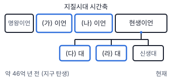
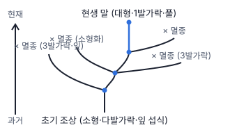
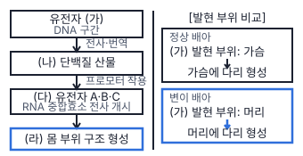

# 생명과학 8장 웹과제 예상 v3 문제해설

왼쪽 목차로 문항을 고르고, 오른쪽 문제를 보며 해설을 따라가요.

문제의 첫 줄부터 검산까지 설명해요.

**목차**

- [문항별 설명](#problems)
  - [P1. [기출 예상] 두 초파리가 같은 종인지 검증하기](#p1)
  - [P2. [기출 예상] 계통수 처음 갈라지는 줄기의 의미](#p2)
  - [P3. [기출 변형] 노새가 자손을 갖지 못하는 이유](#p3)
  - [P4. [기출 변형] 파나마 지협의 놀래기를 나눈 요인](#p4)
  - [P5. [기출 변형] 분류 체계의 계급 순서](#p5)
  - [P6. [예상] 식물 두 집단의 생식적 격리 단계](#p6)
  - [P7. [예상] 2n=12 식물에서 생긴 4n 배수체와 염색체 수](#p7)
  - [P8. [예상] 화석 시료에 남은 탄소 비율과 경과 시간](#p8)
  - [P9. [예상] 지질시대 시간축 도식과 큰 사건](#p9)
  - [P10. [예상] 수렴진화와 상동성·상사성의 비교 단위](#p10)
  - [P11. [예상] 말 계통의 분지형 진화와 경향](#p11)
  - [P12. [예상] 멸종의 규모와 변화의 시간 양상](#p12)
  - [P13. [예상] 배 발생 과정의 유전자 작용 단계](#p13)
  - [P14. [예상] 네 생물 무리의 계통과 분류](#p14)
  - [P15. [예상] 계통과 동정, 그리고 rRNA 유전자 비교](#p15)

## 문항별 설명

### P1. [기출 예상] 두 초파리가 같은 종인지 검증하기

기출 8강 5 예상 · [연습형 문제 보기](../%EB%B3%B5%EC%8A%B5%EB%AC%B8%EC%A0%9C_8%EC%9E%A5_%EC%9B%B9%EA%B3%BC%EC%A0%9C%EC%98%88%EC%83%81_v3.html#p1) · [시험형 문제 보기](../%EB%B3%B5%EC%8A%B5%EB%AC%B8%EC%A0%9C_8%EC%9E%A5_%EC%9B%B9%EA%B3%BC%EC%A0%9C%EC%98%88%EC%83%81_%EC%8B%9C%ED%97%98%ED%98%95_v3.html#p1)

만약 여러분이 암컷 초파리와 수컷 초파리를 가지고 있다면, 어떻게 그들이 같은 종이라는 가설을 가장 간단하게 검증할 수 있겠는가?

- A. 초파리들이 짝짓기 하는지, 그들의 자손 또한 짝짓기 할 수 있는지 확인한다
- B. 서로에게 구애행동을 하는지 확인한다
- C. 초파리들이 같은 수의 염색체를 갖고 있는지 확인한다
- D. 여러 먹이를 제공하고 같은 먹이를 선호하는지 확인한다
- E. 각 초파리의 아미노산 서열을 확인한다

원문·출처 정보 보기

기출 8강 합본 5번을 보기 순서만 바꿔 실은 예상 문제예요. PDF 1쪽.

#### 문제에서 무엇을 묻나요?

암컷 초파리와 수컷 초파리가 같은 종인지 가장 간단하게 검증하는 방법을 고르는 문제예요. 두 개체가 자연 상태에서 교배하여 생식력 있는 자손을 낳는지 확인해야 해요.

#### 이 문제를 봤을 때 떠올릴 개념과 공식

생물학적 종 개념(biological species concept)에서는 자연 상태에서 서로 교배해 생식력 있는 자손(viable, fertile offspring)을 낳을 수 있는 개체 무리를 같은 종으로 정의해요. 따라서 단순히 짝짓기 행동을 하는지뿐만 아니라, 태어난 자손이 다시 짝짓기하여 다음 세대를 낳을 수 있는 생식력을 갖추었는지까지 확인하는 것이 가장 직접적인 검증 기준이에요.

관련 정리노트: [종 개념과 아종](../../../%EB%B3%B5%EC%8A%B5%EB%85%B8%ED%8A%B8/1029/%EC%A0%95%EB%A6%AC%EB%85%B8%ED%8A%B8_1029_Microevolution_and_Speciation.html#s2-species)

#### 왜 이렇게 푸는지 함께 따라가요

A. 맞아요. 생물학적 종 개념의 핵심은 교배 가능성과 자손의 번식 능력이에요. 두 초파리가 짝짓기하는지 확인하고, 그들의 자손 또한 짝짓기할 수 있는지 검증하는 것이 가장 직접적이고 확실한 검증 방법이에요.

B. 틀려요. 서로에게 구애 행동을 하더라도 실제 교미가 성립하지 않거나, 교미하더라도 수정이 일어나지 않거나 불임 잡종이 태어날 수 있어 같은 종임을 확정하지 못해요.

C. 틀려요. 염색체 수가 같다고 해서 같은 종이라고 단정할 수 없어요. 서로 다른 종이라도 우연히 염색체 수가 같을 수 있고, 반대로 염색체 수가 같더라도 생식적으로 격리되어 있으면 별개의 종이에요.

D. 틀려요. 먹이 선호는 생태적 습성이나 서식 환경에 관한 정보일 뿐, 생물학적 종을 판별하는 직접 기준인 생식적 격리 여부를 검증하지 못해요.

E. 틀려요. 아미노산 서열이나 분자 계통 자료는 유전적 유사성을 추정하는 참고 자료가 될 수 있지만, 생물학적 종 개념의 직접적인 판정 기준은 교배와 생식력 있는 자손 생산 여부예요.

따라서 답은 A예요.

#### 완성 답과 검산

답 A. 생물학적 종 개념의 정의(상호 교배 가능 + 자손의 생식력)를 두 단계로 대조해요. 자손의 번식 능력까지 검증하는 A만 유일하게 종의 정의를 완전히 충족해요.

**페이지 요약**

생물학적 종은 서로 교배해 생식력 있는 자손을 낳는 집단이에요. 짝짓기 여부와 자손의 번식 능력을 함께 확인하는 A가 정답이에요.

---

### P2. [기출 예상] 계통수 처음 갈라지는 줄기의 의미

기출 8강 16 예상 · [연습형 문제 보기](../%EB%B3%B5%EC%8A%B5%EB%AC%B8%EC%A0%9C_8%EC%9E%A5_%EC%9B%B9%EA%B3%BC%EC%A0%9C%EC%98%88%EC%83%81_v3.html#p2) · [시험형 문제 보기](../%EB%B3%B5%EC%8A%B5%EB%AC%B8%EC%A0%9C_8%EC%9E%A5_%EC%9B%B9%EA%B3%BC%EC%A0%9C%EC%98%88%EC%83%81_%EC%8B%9C%ED%97%98%ED%98%95_v3.html#p2)

계통수에서 가장 처음 갈라지는 줄기가 나타내는 것은 무엇인가?

- A. 가장 복잡한 구조를 가진 구성원
- B. 계통에서 멸종된 구성원
- C. 주어진 계통수에서 모든 생물의 가장 초기의 공통조상
- D. 가장 많은 화석에서 발견된 생물
- E. 그 계통에서 가장 진화적인 구성원

원문·출처 정보 보기

기출 8강 합본 16번을 보기 순서만 바꿔 실은 예상 문제예요. PDF 2쪽.

#### 문제에서 무엇을 묻나요?

계통수(phylogenetic tree)에서 가장 처음에 갈라지는 줄기(뿌리, root)가 진화적으로 무엇을 뜻하는지 묻는 문제예요.

#### 이 문제를 봤을 때 떠올릴 개념과 공식

계통수는 생물 사이의 진화적 유연관계를 나무 모양으로 나타낸 가설이에요. 갈라지는 분기점(노드, node)은 공통조상을 나타내며, 나무의 맨 아래 또는 맨 왼쪽에 위치한 가장 처음 갈라지는 밑둥 줄기(뿌리)는 해당 계통수에 포함된 모든 생물 분류군이 공유하는 가장 초기의 공통조상(common ancestor)을 나타내요. 진화는 정해진 목적이나 우열이 있는 사다리가 아니므로, 뿌리가 복잡성이나 진화적 우열을 나타내지 않아요.

관련 정리노트: [계통수는 진화사의 가설을 그려요](../../../%EB%B3%B5%EC%8A%B5%EB%85%B8%ED%8A%B8/1103/%EC%A0%95%EB%A6%AC%EB%85%B8%ED%8A%B8_1103_Macroevolution_and_Taxonomy.html#s3-phylogeny)

#### 왜 이렇게 푸는지 함께 따라가요

A. 틀려요. 가지가 갈라지는 위치는 진화적 분기 순서와 공통조상을 나타낼 뿐, 구조의 복잡성을 뜻하지 않아요.

B. 틀려요. 뿌리는 모든 후손의 공통조상 집단을 가리키며, 멸종 여부와 무관하게 모든 구성원이 유래한 출발점을 의미해요.

C. 맞아요. 계통수의 뿌리(가장 처음 갈라지는 줄기)는 나무에 표시된 모든 생물이 공유하는 가장 초기의 공통조상을 뜻해요.

D. 틀려요. 화석 발견 빈도는 지질학적 보존 환경이나 생물의 단단한 골격 유무에 좌우되며, 계통수 뿌리의 정의가 아니에요.

E. 틀려요. 진화는 사다리식 진보가 아니므로 특정 생물을 ‘가장 진화적인 구성원’이라고 서열화하지 않아요.

따라서 답은 C예요.

#### 완성 답과 검산

답 C. 계통수의 분기점을 시간 순서대로 역추적하면, 모든 말단 가지가 모이는 단 하나의 첫 번째 줄기는 전체 생물의 공통조상이에요. 복잡성이나 진화적 우열이라는 오개념을 배제하면 C만 남아요.

**페이지 요약**

계통수의 가장 처음 갈라지는 줄기(뿌리)는 계통수 안 모든 생물이 공유하는 가장 초기의 공통조상을 나타내요. 답 C.

---

### P3. [기출 변형] 노새가 자손을 갖지 못하는 이유

기출 8강 26 예상 · [연습형 문제 보기](../%EB%B3%B5%EC%8A%B5%EB%AC%B8%EC%A0%9C_8%EC%9E%A5_%EC%9B%B9%EA%B3%BC%EC%A0%9C%EC%98%88%EC%83%81_v3.html#p3) · [시험형 문제 보기](../%EB%B3%B5%EC%8A%B5%EB%AC%B8%EC%A0%9C_8%EC%9E%A5_%EC%9B%B9%EA%B3%BC%EC%A0%9C%EC%98%88%EC%83%81_%EC%8B%9C%ED%97%98%ED%98%95_v3.html#p3)

노새가 자손을 갖지 못하는 이유는?

- A. 말과 당나귀의 유전자가 섞이면서 생식 기관 자체가 형성되지 않기 때문
- B. 두 부모 종의 염색체 수가 너무 많아 배 발생 도중에 치사하기 때문
- C. 1대 잡종은 번식하지만 2대 잡종부터 점차 생존력이 떨어져 대가 끊기기 때문
- D. 수정란이 만들어진 뒤 암컷 체내에서 착상하지 못하고 분만 전에 사망하기 때문
- E. 말과 당나귀에서 온 63개 염색체가 감수분열에서 정상적으로 짝을 맞추지 못해 생식세포 형성이 막히기 때문

원문·출처 정보 보기

기출 8강 합본 26번의 발문을 사용하고 보기를 새로 쓴 예상 문제예요. PDF 4쪽.

#### 문제에서 무엇을 묻나요?

암말과 수나귀 사이에서 태어난 잡종인 노새가 건강한 성체로 자라면서도 자손을 낳지 못하는 세포학적 원인을 고르는 문제예요.

#### 이 문제를 봤을 때 떠올릴 개념과 공식

접합 후 장벽(postzygotic barrier) 중 잡종 불임(reduced hybrid fertility)은 수정란이 정상적으로 발생하여 성체로 자라지만, 생식세포(정자나 난자)를 제대로 만들지 못해 번식하지 못하는 현상이에요. 노새의 체세포 염색체 수는 말의 배우자(n = 32)와 당나귀의 배우자(n = 31)가 합쳐진 63개(홀수)예요. 감수분열 1기 전기에는 상동염색체끼리 접합해 4분염색체를 형성해야 하는데, 서로 다른 두 종의 염색체들이 일대일로 온전히 짝을 짓지 못하므로 감수분열이 정상적으로 진행되지 않아 생식세포가 형성되지 않아요.

관련 정리노트: [접합 후 장벽: 잡종 생존불능·불임·붕괴](../../../%EB%B3%B5%EC%8A%B5%EB%85%B8%ED%8A%B8/1029/%EC%A0%95%EB%A6%AC%EB%85%B8%ED%8A%B8_1029_Microevolution_and_Speciation.html#s2-postzygotic)

#### 왜 이렇게 푸는지 함께 따라가요

A. 틀려요. 노새는 외형상 정상적인 암수 생식 기관을 갖추고 태어나며, 생식 기관 형성 자체가 결손된 것이 아니에요.

B. 틀려요. 노새는 배 발생을 무사히 마치고 성체로 튼튼하게 자라므로 배 발생 중 치사하는 것이 아니며, 염색체 수가 많아서 문제가 되는 것도 아니에요.

C. 틀려요. 1대 잡종은 번식하지만 다음 세대(2대 자손)에서 생존력이나 생식력이 떨어지는 것은 잡종 붕괴(hybrid breakdown)의 설명이에요. 노새는 1대 잡종 자체가 자손을 낳지 못해요.

D. 틀려요. 수정란이 분만 전에 사망하는 것은 잡종 생존불능(reduced hybrid viability)에 해당해요. 노새는 정상적으로 출산되어 건강하게 자라요.

E. 맞아요. 말(n = 32)과 당나귀(n = 31)에서 온 63개 염색체는 상동염색체 짝이 맞지 않아, 감수분열 전기에 4분염색체 형성이 막히고 정상적인 정자나 난자를 만들지 못해요.

따라서 답은 E예요.

#### 완성 답과 검산

답 E. 접합 후 장벽의 세 단계를 비교해요. 배아 치사는 잡종 생존불능(D), 2대 자손 쇠퇴는 잡종 붕괴(C), 1대 잡종 성체가 배우자를 못 만드는 것은 잡종 불임(E)이에요. 염색체 63개의 감수분열 짝 불일치라는 세포학적 기작과 정확히 일치해요.

**페이지 요약**

노새는 말(n=32)과 당나귀(n=31)의 63개 염색체가 감수분열에서 상동 짝을 맞추지 못해 생식세포를 만들지 못하는 잡종 불임이에요. 답 E.

---

### P4. [기출 변형] 파나마 지협의 놀래기를 나눈 요인

기출 8강 29 예상 · [연습형 문제 보기](../%EB%B3%B5%EC%8A%B5%EB%AC%B8%EC%A0%9C_8%EC%9E%A5_%EC%9B%B9%EA%B3%BC%EC%A0%9C%EC%98%88%EC%83%81_v3.html#p4) · [시험형 문제 보기](../%EB%B3%B5%EC%8A%B5%EB%AC%B8%EC%A0%9C_8%EC%9E%A5_%EC%9B%B9%EA%B3%BC%EC%A0%9C%EC%98%88%EC%83%81_%EC%8B%9C%ED%97%98%ED%98%95_v3.html#p4)

파나마 지협의 놀래기는 두 가지 구별되는 종으로 나타난다. 어떤 요인이 이 두 종을 나누었는가?

- A. 수심에 따른 빛의 세기 차이로 인해 시각적 구애 신호가 달라진 행동적 격리
- B. 지협이 솟아올라 태평양과 대서양 집단 사이의 유전자 흐름이 차단된 지리적 격리
- C. 같은 바다 안에서 산호초와 모래 바닥으로 선호 먹이가 나뉜 서식지 분화
- D. 태평양과 대서양의 산란 수온 차이로 번식 계절이 어긋난 시간적 격리
- E. 수컷의 체색 변이에 대해 암컷이 서로 다른 짝짓기 선호를 보인 성선택

원문·출처 정보 보기

기출 8강 합본 29번의 발문을 사용하고 보기를 새로 쓴 예상 문제예요. PDF 4쪽.

#### 문제에서 무엇을 묻나요?

파나마 지협 양쪽에 서식하는 놀래기가 태평양 종과 대서양 종으로 나뉘게 된 근본적인 진화 요인을 찾는 문제예요.

#### 이 문제를 봤을 때 떠올릴 개념과 공식

이소적 종분화(allopatric speciation)는 지리적 장벽에 의해 집단이 물리적으로 분리되어 집단 사이의 유전자 흐름(gene flow)이 차단되면서 시작돼요. 과거 하나로 연결되어 있던 바다가 지각 변동으로 파나마 지협이 솟아오르며 육지로 가로막혔고, 이 지리적 격리로 인해 분리된 놀래기 집단이 각자 독립적으로 돌연변이·자연선택·유전적 부동을 거쳐 생식적 격리가 완성된 별개의 종으로 진화했어요.

관련 정리노트: [이소적 종분화: 지리적 격리 뒤의 생식적 격리](../../../%EB%B3%B5%EC%8A%B5%EB%85%B8%ED%8A%B8/1029/%EC%A0%95%EB%A6%AC%EB%85%B8%ED%8A%B8_1029_Microevolution_and_Speciation.html#s3-allopatric)

#### 왜 이렇게 푸는지 함께 따라가요

A. 틀려요. 행동적 격리는 접합 전 장벽의 한 형태이지만, 파나마 놀래기 집단을 두 바다로 나눈 근본 원인은 물리적 육지 장벽이에요.

B. 맞아요. 과거 하나로 이어졌던 바다가 파나마 지협의 융기로 나뉘면서 태평양과 대서양 집단 사이의 유전자 흐름이 완전히 차단된 지리적 격리가 이소적 종분화의 출발점이에요.

C. 틀려요. 먹이 선호 차이에 따른 서식지 분화는 지리적 장벽이 없는 동소적 종분화에서 주로 나타나는 요인이에요.

D. 틀려요. 번식 계절의 차이는 시간적 격리에 해당하지만, 이 사례의 본질적인 분리 원인은 육지 형성에 의한 지리적 장벽이에요.

E. 틀려요. 성선택에 의한 교배 선호 분화는 동소적 종분화를 촉진하는 요인이며, 파나마 놀래기 두 종을 물리적으로 격리한 원인이 아니에요.

따라서 답은 B예요.

#### 완성 답과 검산

답 B. 파나마 지협은 지리학적으로 두 해양을 분리한 물리적 장벽이에요. 물리적 격리가 먼저 일어나 유전자 교류를 끊은 뒤 종분화가 일어나는 것은 이소적 종분화의 정의와 정확히 일치해요.

**페이지 요약**

파나마 지협의 융기로 바다가 나뉘어 태평양과 대서양 집단 사이 유전자 흐름이 차단된 지리적 격리가 종분화의 요인이에요. 답 B.

---

### P5. [기출 변형] 분류 체계의 계급 순서

기출 8강 34 예상 · [연습형 문제 보기](../%EB%B3%B5%EC%8A%B5%EB%AC%B8%EC%A0%9C_8%EC%9E%A5_%EC%9B%B9%EA%B3%BC%EC%A0%9C%EC%98%88%EC%83%81_v3.html#p5) · [시험형 문제 보기](../%EB%B3%B5%EC%8A%B5%EB%AC%B8%EC%A0%9C_8%EC%9E%A5_%EC%9B%B9%EA%B3%BC%EC%A0%9C%EC%98%88%EC%83%81_%EC%8B%9C%ED%97%98%ED%98%95_v3.html#p5)

다음 중 분류 체계를 큰 범위부터 작은 범위로 올바르게 나열한 것은?

- A. 종, 속, 과, 목
- B. 계, 영역, 문, 강
- C. 문, 강, 과, 목
- D. 역, 문, 목, 속
- E. 강, 문, 속, 종

원문·출처 정보 보기

기출 8강 합본 34번의 발문을 사용하고 보기를 새로 쓴 예상 문제예요. PDF 5쪽.

#### 문제에서 무엇을 묻나요?

생물 분류 체계의 여러 계급을 가장 넓은 범위인 **큰 범위(상위 계급)부터 좁은 범위(하위 계급)**로 올바르게 배열한 보기를 찾는 문제예요.

#### 이 문제를 봤을 때 떠올릴 개념과 공식

생물 분류 계급(taxonomic categories)은 가장 큰 범위부터 작은 범위 순서로 다음과 같이 배열돼요:

**역(영역, Domain) → 계(Kingdom) → 문(Phylum) → 강(Class) → 목(Order) → 과(Family) → 속(Genus) → 종(Species)**

중간 단계를 건너뛰고 추출하더라도, 앞에 나오는 계급이 뒤에 나오는 계급보다 항상 상위 계급이어야 올바른 나열이에요.

관련 정리노트: [종 이름은 두 단어이고 분류는 여러 층이에요](../../../%EB%B3%B5%EC%8A%B5%EB%85%B8%ED%8A%B8/1103/%EC%A0%95%EB%A6%AC%EB%85%B8%ED%8A%B8_1103_Macroevolution_and_Taxonomy.html#s3-naming)

#### 왜 이렇게 푸는지 함께 따라가요

A. 틀려요. 종, 속, 과, 목은 가장 작은 범위(종)부터 큰 범위(목)로 나아가는 순서이므로 역순이에요.

B. 틀려요. 영역(역)이 계보다 더 넓은 상위 계급이므로 계가 영역보다 앞에 올 수 없어요. 올바른 순서는 영역(역) → 계예요.

C. 틀려요. 목이 과보다 큰 상위 계급이므로(강 → 목 → 과), 과가 목보다 앞에 올 수 없어요.

D. 맞아요. 전체 순서인 ‘역 → 계 → 문 → 강 → 목 → 과 → 속 → 종’에서 계·강·과를 건너뛰고 역 → 문 → 목 → 속을 차례로 추출한 것이므로, 큰 범위부터 작은 범위의 순서 관계가 정확히 유지되었어요.

E. 틀려요. 문이 강보다 큰 상위 계급이므로(문 → 강), 강이 문보다 앞에 올 수 없어요.

따라서 답은 D예요.

#### 완성 답과 검산

답 D. 전체 8단계 서열(역 &gt; 계 &gt; 문 &gt; 강 &gt; 목 &gt; 과 &gt; 속 &gt; 종)의 대소 관계로 대조해요. A는 종 &lt; 속 &lt; 과 &lt; 목, B는 계 &lt; 영역, C는 과 &lt; 목, E는 강 &lt; 문으로 모순이 생기지만, D는 역 &gt; 문 &gt; 목 &gt; 속으로 모든 부등호가 성립해요.

**페이지 요약**

분류 계급은 큰 순서대로 역·계·문·강·목·과·속·종이에요. 중간을 건너뛰어도 대소 관계가 일치하는 것은 역 → 문 → 목 → 속인 D예요.

---

### P6. [예상] 식물 두 집단의 생식적 격리 단계

예상 8장 6 · [연습형 문제 보기](../%EB%B3%B5%EC%8A%B5%EB%AC%B8%EC%A0%9C_8%EC%9E%A5_%EC%9B%B9%EA%B3%BC%EC%A0%9C%EC%98%88%EC%83%81_v3.html#p6) · [시험형 문제 보기](../%EB%B3%B5%EC%8A%B5%EB%AC%B8%EC%A0%9C_8%EC%9E%A5_%EC%9B%B9%EA%B3%BC%EC%A0%9C%EC%98%88%EC%83%81_%EC%8B%9C%ED%97%98%ED%98%95_v3.html#p6)

표는 서로 다른 두 식물 집단 사이에서 교배나 번식이 차단되는 세 사례 (가)~(다)를 나타낸 것이에요. 이에 대한 옳은 설명은 무엇인가요?

| 사례 | 관찰된 번식 차단 현상 |
|---|---|
| (가) | 꽃 구조가 달라 한 종은 벌만, 다른 종은 벌새만 꽃가루를 옮겨 서로 다른 종으로 꽃가루가 전달되지 않는다. |
| (나) | 바람이나 곤충으로 꽃가루가 다른 종의 암술머리에 닿았으나, 난자가 다른 종의 꽃가루·정자를 인식하지 못해 수정이 이루어지지 않는다. |
| (다) | 수정이 일어나 1대 잡종 식물이 정상으로 자라 씨앗을 맺었으나, 2대 자손부터 생존력과 생식력이 급격히 떨어져 대가 끊긴다. |

- A. (가)는 꽃가루가 전달되지 않는 현상이므로 두 종의 개화 시기가 달라 교배가 차단되는 시간적 격리에 해당해요.
- B. (가)는 꽃 구조 차이에 따른 기계적 격리이고, (다)는 2대 자손 대에서 대가 끊기는 잡종 붕괴로 접합 후 장벽이에요.
- C. (나)는 다른 종의 꽃가루가 암술머리에 닿았으나 교배에 실패한 것이므로, 생식 기관 구조가 맞지 않는 기계적 격리에 해당해요.
- D. (다)는 1대 잡종 식물이 정상으로 자랐으므로, 노새처럼 1대 잡종 자체가 정자나 난자를 만들지 못하는 잡종 불임에 해당해요.
- E. (가)~(다)는 모두 꽃가루 수분이나 수정과 관련된 번식 차단이므로 수정란이 생기지 않는 접합 전 장벽에 속해요.

원문·출처 정보 보기

원문 기출이 아닌 새 예상 문제예요. 꽃가루가 관련된 여러 번식 차단 현상을 기계적 격리, 배우자 격리, 잡종 붕괴로 구별하고 접합 전과 접합 후 단계를 확인해요.

#### 문제에서 무엇을 묻나요?

표에 제시된 식물의 세 가지 번식 차단 사례 (가)~(다)를 읽고, 각각 어떤 생식적 격리 장벽(기계적 격리·배우자 격리·잡종 붕괴)에 해당하는지, 그리고 접합 전 장벽인지 접합 후 장벽인지 판별하는 문제예요.

#### 이 문제를 봤을 때 떠올릴 개념과 공식

생식적 격리는 수정란(접합자) 형성 이전인지 이후인지에 따라 나뉘어요:

1. **접합 전 장벽(prezygotic barrier)**: 수정란이 생기기 전에 교배나 수정이 차단돼요. 꽃이나 생식 기관의 구조적 차이로 꽃가루를 옮기는 매개 동물이 달라져 수분이 차단되면 **기계적 격리(mechanical isolation)**예요. 꽃가루가 암술머리에 닿았으나 난자가 꽃가루·정자를 인식하지 못해 수정이 일어나지 않으면 **배우자 격리(gametic isolation)**예요.

2. **접합 후 장벽(postzygotic barrier)**: 수정란이 형성되어 자란 뒤에 차단돼요. 1대 잡종 식물은 정상으로 자라 씨앗을 맺지만, 2대 자손부터 생존력과 생식력이 급격히 떨어져 대가 끊기면 **잡종 붕괴(hybrid breakdown)**예요.

관련 정리노트: [접합 전 장벽 다섯 가지](../../../%EB%B3%B5%EC%8A%B5%EB%85%B8%ED%8A%B8/1029/%EC%A0%95%EB%A6%AC%EB%85%B8%ED%8A%B8_1029_Microevolution_and_Speciation.html#s2-prezygotic), [접합 후 장벽: 잡종 생존불능·불임·붕괴](../../../%EB%B3%B5%EC%8A%B5%EB%85%B8%ED%8A%B8/1029/%EC%A0%95%EB%A6%AC%EB%85%B8%ED%8A%B8_1029_Microevolution_and_Speciation.html#s2-postzygotic)

#### 왜 이렇게 푸는지 함께 따라가요

A. 틀려요. (가)는 개화 시기가 달라서가 아니라 꽃의 구조적 차이로 인해 매개 동물이 달라져 꽃가루가 옮겨가지 못하는 기계적 격리예요. 개화 시기 차이는 시간적 격리에 해당해요.

B. 맞아요. (가)는 꽃 구조 차이에 따른 기계적 격리(접합 전 장벽)이고, (다)는 1대 잡종은 번식하지만 2대 자손 대에서 대가 끊기는 잡종 붕괴(접합 후 장벽)예요.

C. 틀려요. (나)는 다른 종의 꽃가루가 암술머리에 물리적으로 닿았으나 난자가 정자를 인식하지 못해 수정에 실패한 것이므로 배우자 격리예요. 구조 차이가 아니므로 기계적 격리가 아니에요.

D. 틀려요. 1대 잡종 자체가 정자나 난자를 만들지 못하는 것은 노새와 같은 잡종 불임이에요. (다)는 1대 잡종이 정상으로 씨앗을 맺고 2대 자손부터 쇠퇴하므로 잡종 붕괴예요.

E. 틀려요. (가)와 (나)는 수정란이 생기지 않는 접합 전 장벽이지만, (다)는 수정란이 생겨 1대 잡종이 자란 뒤 다음 세대에서 문제가 생기는 접합 후 장벽이에요.

따라서 답은 B예요.

#### 완성 답과 검산

답 B. 표의 세 사례를 독립적으로 분류하면 (가)는 구조 차이 = 기계적 격리, (나)는 수정 불인식 = 배우자 격리, (다)는 2대 쇠퇴 = 잡종 붕괴(접합 후 장벽)예요. 이 둘을 바르게 짝지은 보기는 B뿐이에요.

**페이지 요약**

(가)는 꽃 구조 차이에 따른 기계적 격리, (다)는 2대 자손이 쇠퇴하는 잡종 붕괴(접합 후 장벽)예요. 답 B.

---

### P7. [예상] 2n=12 식물에서 생긴 4n 배수체와 염색체 수

예상 8장 7 · [연습형 문제 보기](../%EB%B3%B5%EC%8A%B5%EB%AC%B8%EC%A0%9C_8%EC%9E%A5_%EC%9B%B9%EA%B3%BC%EC%A0%9C%EC%98%88%EC%83%81_v3.html#p7) · [시험형 문제 보기](../%EB%B3%B5%EC%8A%B5%EB%AC%B8%EC%A0%9C_8%EC%9E%A5_%EC%9B%B9%EA%B3%BC%EC%A0%9C%EC%98%88%EC%83%81_%EC%8B%9C%ED%97%98%ED%98%95_v3.html#p7)

체세포 염색체 수가 2n = 12 (n = 6)인 어떤 식물 집단에서, 한 개체가 DNA 복제 후 세포분열을 하지 않아 4n 배수체 개체가 되었어요. 이 4n 식물과 염색체 수 변화에 대한 설명으로 옳지 **않은** 것은 무엇인가요?

- A. 이 4n 식물의 체세포 염색체 수는 24개이고, 감수분열로 만드는 배우자의 염색체 수는 2n = 12개예요.
- B. 이 4n 식물과 원래 2n 식물이 교배해 생긴 3n 자손은 체세포 염색체 수가 18개이며, 감수분열에서 세 세트가 정상적으로 짝을 맞추지 못해 불임이 돼요.
- C. 4n 개체끼리 교배하면 2n = 12 배우자끼리 만나 4n = 24 자손을 낳으므로, 지리적 격리 없이도 한 세대 만에 원래 집단과 구별되는 종이 될 수 있어요.
- D. 4n 식물과 원래 2n 식물이 교배해 태어난 3n 자손은 체세포 염색체 수가 18개로 짝수이므로, 감수분열에서 모든 염색체가 9쌍의 4분염색체를 정상 형성해 생식력을 가져요.
- E. 염색체 세트 전체가 늘어난 3n, 4n과 같은 배수체는 일부 염색체의 수만 달라진 2n+1(다운 증후군 등)과 같은 이수체와 구별돼요.

원문·출처 정보 보기

원문 기출이 아닌 새 예상 문제예요. 2n=12에서 형성된 4n 배수체의 체세포·배우자 염색체 수와 3n 불임 자손의 원인을 계산하고, 배수체와 이수체를 구별해요.

#### 무엇을 구하나요?

체세포 염색체 수 2n = 12 (n = 6)인 식물에서 생긴 4n 배수체와 3n 잡종의 염색체 수 및 생식적 격리 특성 중 **옳지 않은 것**을 찾는 문제예요.

#### 이 문제를 봤을 때 떠올릴 개념과 공식

기본 염색체 세트 수가 n = 6일 때 체세포와 배우자의 염색체 수를 계산해요:

1. 원래 2n 식물의 체세포 염색체 수는 12개(2 × 6), 감수분열로 만든 배우자는 n = 6개예요.

2. 복제 후 분열하지 않아 생긴 4n 식물의 체세포 염색체 수는 24개(4 × 6), 감수분열로 만든 배우자는 2n = 12개예요.

3. 4n 배우자(12개)와 2n 배우자(6개)가 수정하면 3n = 18개 자손이 생겨요. 이때 총 염색체 수가 18개로 짝수여도 6종류의 염색체가 3개씩 존재하는 3n 상태이므로, 감수분열 1기 전기에 상동염색체 세 세트가 정상적인 짝(4분염색체)을 맞추지 못해 불임이 돼요.

4. 4n 개체끼리는 2n = 12 배우자끼리 만나 4n = 24 자손을 낳아 번식하므로, 지리적 격리 없이도 한 세대 만에 동소적 종분화가 일어나요.

5. 배수체(polyploid)는 염색체 세트 전체가 3n, 4n으로 통째로 늘어난 것이고, 이수체(aneuploid)는 2n+1(다운 증후군 등)처럼 특정 염색체 일부의 수만 달라진 상태예요.

관련 정리노트: [배수성: 한 세대 만의 종분화](../../../%EB%B3%B5%EC%8A%B5%EB%85%B8%ED%8A%B8/1029/%EC%A0%95%EB%A6%AC%EB%85%B8%ED%8A%B8_1029_Microevolution_and_Speciation.html#s3-polyploidy), [한 개의 오류와 세트 전체의 증가](../../../%EB%B3%B5%EC%8A%B5%EB%85%B8%ED%8A%B8/1001/%EC%A0%95%EB%A6%AC%EB%85%B8%ED%8A%B8_1001_Chromosome_Changes_and_DNA_Replication.html#s1-polyploidy)

#### 첫 줄을 써 봐요

n = 6을 바탕으로 4n 체세포(24개), 4n 배우자(12개), 3n 잡종(18개, 3세트)의 염색체 수를 각각 적어요.

#### 왜 이렇게 푸는지 함께 따라가요

A. 맞아요. n = 6이므로 4n 식물의 체세포 염색체 수는 4 × 6 = 24개이고, 감수분열로 염색체 수가 절반이 되어 배우자(생식세포)는 2n = 12개를 가져요.

B. 맞아요. 4n의 배우자(12개)와 2n의 배우자(6개)가 만나 생긴 3n 자손은 체세포 염색체 수가 18개예요. 6종류의 상동염색체가 각각 3개씩 존재하므로 감수분열에서 세 세트가 정상적으로 짝을 맞추지 못해 불임이 돼요.

C. 맞아요. 4n 개체끼리 교배하면 2n = 12 배우자끼리 만나 생식력 있는 4n = 24 자손을 낳으므로, 지리적 격리 없이도 한 세대 만에 원래 집단과 구별되는 종이 될 수 있어요.

D. 틀려요. 3n 자손의 체세포 염색체 수가 18개로 짝수여도 이는 ‘9쌍(2n = 18)’이 아니라 6종류의 염색체가 3개씩 존재하는 ‘3n = 18’ 상태예요. 세 세트의 상동염색체는 감수분열 전기에 정상적인 2개 짝(4분염색체)을 지을 수 없어 불임이 되므로, 생식력을 가진다는 설명은 거짓이에요.

E. 맞아요. 염색체 세트 전체가 통째로 늘어난 3n, 4n은 배수체이고, 21번 염색체처럼 특정 염색체 일부만 하나 더 있는 2n+1(다운 증후군 등)은 이수체로 명확히 구별돼요.

따라서 옳지 않은 것을 고르는 답은 D예요.

#### 완성 답과 검산

답 D. 씨 없는 수박(3n)의 원리를 떠올려요. 3n 개체는 염색체 수가 짝수든 홀수든 관계없이 모든 염색체가 세 벌씩 존재하므로 감수분열에서 균등 분리가 불가능해 반드시 불임이 돼요. 따라서 4분염색체를 정상 형성해 생식력을 가진다는 진술은 거짓이에요.

**페이지 요약**

3n 잡종은 염색체 수가 18개로 짝수여도 세 세트가 존재해 감수분열에서 짝을 맞추지 못해 불임이 돼요. 옳지 않은 것은 D예요.

---

### P8. [예상] 화석 시료에 남은 탄소 비율과 경과 시간

예상 8장 8 · [연습형 문제 보기](../%EB%B3%B5%EC%8A%B5%EB%AC%B8%EC%A0%9C_8%EC%9E%A5_%EC%9B%B9%EA%B3%BC%EC%A0%9C%EC%98%88%EC%83%81_v3.html#p8) · [시험형 문제 보기](../%EB%B3%B5%EC%8A%B5%EB%AC%B8%EC%A0%9C_8%EC%9E%A5_%EC%9B%B9%EA%B3%BC%EC%A0%9C%EC%98%88%EC%83%81_%EC%8B%9C%ED%97%98%ED%98%95_v3.html#p8)

죽은 뒤 외부와 탄소 교환이 없었던 어떤 유기물 화석 시료에서 현재 남은 C-14의 비율이 생전 기준의 25%로 측정되었어요. C-14의 반감기가 5,730년일 때, 지금으로부터 5,730년이 더 지난 시점에 이 시료에 남아 있을 C-14의 비율과, 그 시점까지 생물이 죽은 뒤 총 경과한 시간을 바르게 짝지은 것은 무엇인가요?

- A. 남은 비율: 12.5% · 총 경과 시간: 17,190년
- B. 남은 비율: 0% · 총 경과 시간: 17,190년
- C. 남은 비율: 12.5% · 총 경과 시간: 11,460년
- D. 남은 비율: 6.25% · 총 경과 시간: 17,190년
- E. 남은 비율: 6.25% · 총 경과 시간: 22,920년

원문·출처 정보 보기

원문 기출이 아닌 새 예상 문제예요. 현재 남은 비율(25%)에서 반감기가 한 번 더 지날 때 남은 비율의 절반(12.5%)이 남는 원리와 누적 경과 시간(3반감기 = 17,190년)을 계산해요.

#### 무엇을 구하나요?

현재 남은 C-14 비율이 25%인 화석 시료에서, 반감기 1번(5,730년)이 더 지난 시점에 남아 있을 C-14 비율과, 생물이 죽은 시점부터 계산한 총 경과 시간을 구하는 문제예요.

#### 이 문제를 봤을 때 떠올릴 개념과 공식

반감기(half-life)는 방사성 동위원소의 양이 절반으로 줄어드는 데 걸리는 시간이에요:

1. 생전 기준 100%에서 출발하여, 1번 지나면 50%, 2번 지나면 25%가 돼요.

2. 현재 25%는 반감기가 2번 지난 시점이며, 경과 시간은 2 × 5,730 = 11,460년이에요.

3. 여기서 5,730년(1반감기)이 더 지나면, 남은 비율은 현재 값의 절반인 25% ÷ 2 = 12.5%가 돼요. 처음 양을 기준으로 25%를 빼서 0%가 되는 것이 아니에요.

4. 그 시점까지 생물이 죽은 뒤 총 경과한 시간은 3번의 반감기이므로 3 × 5,730 = 17,190년이에요.

관련 정리노트: [화석의 나이는 무엇을 재서 알아낼까요?](../../../%EB%B3%B5%EC%8A%B5%EB%85%B8%ED%8A%B8/1103/%EC%A0%95%EB%A6%AC%EB%85%B8%ED%8A%B8_1103_Macroevolution_and_Taxonomy.html#s0-dating)

#### 첫 줄을 써 봐요

100% (죽음) → 50% (1반감기, 5,730년) → 25% (2반감기, 11,460년, 현재) → 12.5% (3반감기, 17,190년, 미래 시점)로 단계별 반감기와 누적 시간을 적어요.

#### 왜 이렇게 푸는지 함께 따라가요

현재 남은 C-14가 25%이므로 반감기가 2번 지난 시점(11,460년)이에요. 5,730년(반감기 1번)이 더 지나면 총 3번의 반감기(17,190년)가 흐르고, 비율은 25%의 절반인 12.5%가 남아요.

A. 맞아요. 남은 비율은 12.5%이고, 총 경과 시간은 3 × 5,730 = 17,190년으로 두 수치가 모두 정확해요.

B. 틀려요. 반감기마다 처음 기준의 25%씩 일정하게 빠진다고 잘못 생각해 25% − 25% = 0%로 오산한 결과예요. 반감기는 현재 남은 양의 절반이 남으므로 12.5%예요.

C. 틀려요. 남은 비율 12.5%는 맞지만, 11,460년은 현재 시점(2반감기)까지 경과한 시간이에요. 5,730년이 더 흐른 시점의 총 시간은 17,190년이어야 해요.

D. 틀려요. 총 시간 17,190년은 맞지만, 6.25%는 반감기가 총 4번(22,920년) 지났을 때의 비율이에요.

E. 틀려요. 남은 비율 6.25%와 총 시간 22,920년은 지금으로부터 5,730년이 아니라 11,460년(반감기 2번)이 더 지난 시점의 값이에요.

따라서 답은 A예요.

#### 완성 답과 검산

답 A. 거꾸로 검산해요. 12.5%는 1/8에 해당하고, 1/8은 1/2을 세 번 곱한 값이므로 정확히 3번의 반감기예요. 3 × 5,730 = 17,190년이므로 남은 비율과 총 경과 시간이 서로 일치해요.

**페이지 요약**

현재 25%(2반감기)에서 1반감기가 더 지나면 남은 양의 절반인 12.5%가 남고, 총 경과 시간은 3 × 5,730 = 17,190년이에요. 답 A.

---

### P9. [예상] 지질시대 시간축 도식과 큰 사건

예상 8장 9 · [연습형 문제 보기](../%EB%B3%B5%EC%8A%B5%EB%AC%B8%EC%A0%9C_8%EC%9E%A5_%EC%9B%B9%EA%B3%BC%EC%A0%9C%EC%98%88%EC%83%81_v3.html#p9) · [시험형 문제 보기](../%EB%B3%B5%EC%8A%B5%EB%AC%B8%EC%A0%9C_8%EC%9E%A5_%EC%9B%B9%EA%B3%BC%EC%A0%9C%EC%98%88%EC%83%81_%EC%8B%9C%ED%97%98%ED%98%95_v3.html#p9)

그림은 약 46억 년 전 지구 탄생부터 현재까지의 지질시대 구분을 나타낸 시간축 도식이에요. 도식의 구간 (가)~(라)에 대한 설명으로 옳은 것은 무엇인가요?

- A. (가) 이언에는 남세균의 광합성으로 대기 중에 산소가 급격히 축적되며 최초의 진핵생물이 출현했어요.
- B. (나) 이언의 시작과 함께 캄브리아기 대폭발이 일어나 오늘날 존재하는 대다수 동물 문의 조상이 짧은 지질 시간에 다양해졌어요.
- C. (다) 대의 말기에는 거대 운석 충돌로 인한 대멸종이 일어나 공룡을 비롯한 많은 생물이 멸종했어요.
- D. 지구 역사상 최초의 원핵생물이 출현하여 생명의 역사가 시작된 시점은 (나) 이언이에요.
- E. (다) 대는 캄브리아기 대폭발로 시작해 페름기 말 대멸종으로 끝나며, (라) 대는 백악기 말 대멸종으로 끝나요.

원문·출처 정보 보기

원문 기출이 아닌 새 예상 문제예요. 지질시대 시간축 도식에서 4대 이언(명왕·시생·원생·현생)과 현생이언의 3대(고생대·중생대·신생대)의 선후관계를 판독하고, 각 구간의 대표 사건과 대멸종 경계를 확인해요.

#### 도식에서 무엇을 읽나요?

지구 탄생부터 현재까지의 지질시대 시간축 도식에서 이언과 대의 순서 및 경계 사건을 읽고, 옳은 설명을 골라요.

#### 이 문제를 봤을 때 떠올릴 개념과 공식

지질시대는 명왕이언, 시생이언(최초의 원핵생물과 광합성 남세균), 원생이언(산소 축적과 최초의 진핵생물), 현생이언의 4대 이언(Eon)으로 나뉘어요. 현생이언은 다시 고생대, 중생대, 신생대의 3대(Era)로 구분해요. 고생대는 캄브리아기 대폭발로 열리고 시베리아 화산 활동에 따른 페름기 말 대멸종으로 끝나며, 중생대는 소행성 충돌에 따른 백악기 말 대멸종으로 끝나요.

관련 정리노트: [지구 역사는 큰 사건의 순서로 기억해요](../../../%EB%B3%B5%EC%8A%B5%EB%85%B8%ED%8A%B8/1103/%EC%A0%95%EB%A6%AC%EB%85%B8%ED%8A%B8_1103_Macroevolution_and_Taxonomy.html#s0-geologic), [배경멸종과 대멸종은 규모와 속도가 달라요](../../../%EB%B3%B5%EC%8A%B5%EB%85%B8%ED%8A%B8/1103/%EC%A0%95%EB%A6%AC%EB%85%B8%ED%8A%B8_1103_Macroevolution_and_Taxonomy.html#s2-extinction)

#### 왜 이렇게 푸는지 함께 따라가요

A. 틀려요. 도식에서 명왕이언 다음인 (가)는 시생이언이에요. 남세균 광합성에 따른 산소 축적과 최초 진핵생물의 출현은 (나) 원생이언의 사건이에요.

B. 틀려요. 동물 문의 조상이 급격히 다양해진 캄브리아기 대폭발은 (나) 원생이언이 아니라 현생이언의 첫 시기인 (다) 고생대의 시작을 알리는 사건이에요.

C. 틀려요. 거대 소행성 충돌로 공룡을 비롯한 생물이 멸종한 사건은 (다) 고생대 말기가 아니라 (라) 중생대 말기의 백악기 말 대멸종이에요. (다) 고생대 말기의 경계는 페름기 말 대멸종이에요.

D. 틀려요. 지구 역사상 최초의 원핵생물이 출현한 시점은 (나) 원생이언이 아니라 명왕이언 직후인 (가) 시생이언이에요.

E. 맞아요. 도식의 (다)는 고생대, (라)는 중생대예요. 고생대는 캄브리아기 대폭발로 시작해 페름기 말 대멸종으로 끝나고, 중생대는 백악기 말 대멸종으로 끝나므로 도식의 구분 기준과 완벽히 일치해요.

따라서 답은 E예요.

#### 완성 답과 검산

답 E. 도식의 네 기호에 명칭을 대입하면 (가)=시생이언, (나)=원생이언, (다)=고생대, (라)=중생대예요. 고생대의 양쪽 경계(캄브리아기 대폭발~페름기 말 대멸종)와 중생대의 끝(백악기 말 대멸종)을 대조하면 오직 E만 역사적 사건과 일치해요.

**페이지 요약**

(다) 고생대는 캄브리아기 대폭발로 시작해 페름기 말 대멸종으로 끝나고, (라) 중생대는 백악기 말 대멸종으로 닫혀요. 답 E예요.

---

### P10. [예상] 수렴진화와 상동성·상사성의 비교 단위

예상 8장 10 · [연습형 문제 보기](../%EB%B3%B5%EC%8A%B5%EB%AC%B8%EC%A0%9C_8%EC%9E%A5_%EC%9B%B9%EA%B3%BC%EC%A0%9C%EC%98%88%EC%83%81_v3.html#p10) · [시험형 문제 보기](../%EB%B3%B5%EC%8A%B5%EB%AC%B8%EC%A0%9C_8%EC%9E%A5_%EC%9B%B9%EA%B3%BC%EC%A0%9C%EC%98%88%EC%83%81_%EC%8B%9C%ED%97%98%ED%98%95_v3.html#p10)

수렴진화, 상사성, 상동성 및 진화적 비교 단위에 대한 설명으로 옳지 **않은** 것은 무엇인가요?

- A. 상어(어류), 펭귄(조류), 돌고래(포유류)처럼 계통적으로 먼 생물이 비슷한 물 환경에서 모두 유선형 체형을 갖추게 된 것은 수렴진화의 예예요.
- B. 수렴진화는 서로 먼 계열이 비슷한 환경에서 독립적으로 비슷한 적응을 이루는 '진화 과정'이고, 상사성은 그렇게 형성된 형질의 '유사성의 성격'을 뜻해요.
- C. 독수리와 박쥐는 앞다리뼈의 상대적 배열이 공통조상에서 유래했으므로, 두 동물의 비행용 날개라는 기능적 적응까지도 각 계열의 독립적 진화가 아니라 공통조상에서 물려받은 상동 형질로만 설명해야 해요.
- D. 두 생물의 특정 형질이 상동인지 판단할 때는 단순히 먼 공통조상을 공유하는지가 아니라, '비교하는 바로 그 형질'이 공통조상에서 유래했는지를 확인해야 해요.
- E. 서로 먼 식물 계열인 선인장과 대극이 건조한 사막 환경에서 각각 독립적으로 다육질 줄기를 갖추게 된 것은 수렴진화로 형성된 상사성의 예예요.

원문·출처 정보 보기

원문 기출이 아닌 새 예상 문제예요. 수렴진화(과정)와 상사성(성격)을 구별하고, 독수리와 박쥐의 앞다리뼈(상동)와 비행 날개 적응(상사)처럼 비교 단위에 따라 상동과 상사가 나뉨을 확인해요.

#### 문제에서 무엇을 묻나요?

수렴진화, 상사성, 상동성 및 진화적 비교 단위에 대한 설명 중 **옳지 않은 것**을 골라요.

#### 이 문제를 봤을 때 떠올릴 개념과 공식

상동성(homology)은 비교하는 형질이 공통조상에서 물려받은 것일 때 성립하고, 상사성(analogy)은 계통적으로 먼 생물이 비슷한 환경에서 독립적으로 비슷한 적응을 이루었을 때 성립해요. 수렴진화(convergent evolution)는 그러한 독립적 적응이 일어나는 ‘진화 과정’이며 상사성은 그 결과 나타난 ‘형질 유사성의 성격’이에요. 특히 두 생물을 비교할 때는 막연히 생물 전체를 보지 않고 ‘비교하는 바로 그 형질 단위’가 공통조상 유래인지(상동) 독립 적응인지(상사)를 명확히 구분해야 해요.

관련 정리노트: [같이 닮은 이유가 같지는 않아요](../../../%EB%B3%B5%EC%8A%B5%EB%85%B8%ED%8A%B8/1103/%EC%A0%95%EB%A6%AC%EB%85%B8%ED%8A%B8_1103_Macroevolution_and_Taxonomy.html#s1-convergence)

#### 왜 이렇게 푸는지 함께 따라가요

A. 맞아요. 상어(어류), 펭귄(조류), 돌고래(포유류)는 서로 다른 척추동물 무리이지만, 물속을 유영하는 환경에 적응해 독립적으로 유선형 체형을 갖춘 전형적인 수렴진화 사례예요.

B. 맞아요. 수렴진화는 비슷한 환경에 맞추어 독립적으로 적응해 가는 진화적 과정을 가리키고, 상사성은 그 과정으로 빚어진 형질의 기능적 유사성을 뜻하므로 개념의 성격 구분이 옳아요.

C. 틀려요. 독수리와 박쥐의 앞다리뼈 골격 배열은 사지류 공통조상에서 물려받은 상동 구조예요. 하지만 날아서 이동하는 ‘비행용 날개’라는 기능적 적응은 각 계열에서 독립적으로 진화한 상사 형질이에요. 따라서 비교 형질 단위에 따라 상동과 상사를 엄밀히 나누어 설명해야 하며, 날개 적응까지 상동으로만 설명해야 한다는 주장은 잘못되었어요.

D. 맞아요. 생명의 역사에서 모든 생물은 거슬러 올라가면 먼 공통조상을 공유하므로, 상동성을 따질 때는 ‘비교 대상인 그 특정 형질’이 공통조상에 이미 존재하여 물려받은 것인지를 보아야 해요.

E. 맞아요. 선인장과 대극은 계통적으로 멀지만 건조한 사막 환경에 적응하며 독립적으로 수분을 저장하는 다육질 줄기를 발달시켰으므로 수렴진화에 의한 상사성의 올바른 예예요.

따라서 옳지 않은 설명인 답은 C예요.

#### 완성 답과 검산

답 C. 형질 단위를 ‘앞다리뼈 골격(해부 구조)’과 ‘비행 날개(기능 적응)’로 쪼개어 보면, 뼈는 상동이지만 날개 기능은 독립 획득된 상사예요. C만 이 두 층위를 혼동하여 날개 기능까지 상동으로 단정하므로 제거할 오답이에요.

**페이지 요약**

독수리와 박쥐의 앞다리뼈 배치는 상동이지만 비행 날개 적응은 각자 진화한 상사예요. 이를 상동으로만 설명해야 한다는 C가 틀려요.

---

### P11. [예상] 말 계통의 분지형 진화와 경향

예상 8장 11 · [연습형 문제 보기](../%EB%B3%B5%EC%8A%B5%EB%AC%B8%EC%A0%9C_8%EC%9E%A5_%EC%9B%B9%EA%B3%BC%EC%A0%9C%EC%98%88%EC%83%81_v3.html#p11) · [시험형 문제 보기](../%EB%B3%B5%EC%8A%B5%EB%AC%B8%EC%A0%9C_8%EC%9E%A5_%EC%9B%B9%EA%B3%BC%EC%A0%9C%EC%98%88%EC%83%81_%EC%8B%9C%ED%97%98%ED%98%95_v3.html#p11)

그림은 화석 기록을 바탕으로 말(*Equus*) 계통의 진화 양상을 단순화하여 나타낸 모식도예요. 이 도식과 대진화의 경향에 대한 설명으로 옳은 것은 무엇인가요?

- A. 화석 기록은 여러 갈래의 분지와 멸종을 보여 주므로, 현생 말 계열의 몸집 증가와 발가락 수 감소를 모든 계열에 작용한 필연적 일직선 방향으로 볼 수 없어요.
- B. 진화에는 몸집을 키우고 복잡성을 높이도록 미리 정해진 내재적 추진력이 항상 작용해요.
- C. 멸종한 가지들(×)은 환경에 적응하지 못해 도태된 예외일 뿐이므로 대진화 경향을 분석할 때 고려할 필요가 없어요.
- D. 생물의 진화에서 형태적 복잡성과 몸집의 증가는 어떤 환경에서도 예외 없이 관찰되는 보편 법칙이에요.
- E. 초기 조상 계열에서 현생 말에 이르는 동안 가지 갈림(종분화) 없이 단 하나의 계열만 일직선으로 이어져 왔어요.

원문·출처 정보 보기

원문 기출이 아닌 새 예상 문제예요. 현생 말 한 계열의 경향을 전체 진화의 필연적 일직선 방향이나 보편 법칙으로 일반화하는 혼동을 다뤄요.

#### 도식에서 무엇을 읽나요?

화석 기록을 바탕으로 그린 말 계통의 분지형 진화 모식도를 보고, 대진화의 경향에 대한 옳은 설명을 골라요.

#### 이 문제를 봤을 때 떠올릴 개념과 공식

말(*Equus*)의 화석 기록은 과거 사다리처럼 일직선으로 진행한 것이 아니라, 수많은 종분화 가지와 멸종을 거친 덤불 모양(분지형 진화)을 보여 줘요. 현생 말 한 계열만 보면 몸집이 커지고 발가락이 1개로 줄어든 것처럼 보이지만, 멸종한 가지 중에는 몸집이 작아지거나 3발가락을 유지한 채 잎을 먹던 계열도 여럿 있었어요. 진화는 정해진 목표나 내재적 추진력을 향해 일직선으로 나아가는 과정이 아니에요.

관련 정리노트: [진화는 정해진 목표를 향해 가지 않아요](../../../%EB%B3%B5%EC%8A%B5%EB%85%B8%ED%8A%B8/1103/%EC%A0%95%EB%A6%AC%EB%85%B8%ED%8A%B8_1103_Macroevolution_and_Taxonomy.html#s2-trends)

#### 왜 이렇게 푸는지 함께 따라가요

A. 맞아요. 모식도에는 초기 조상에서 갈라진 여러 멸종 가지(×)가 나타나 있으며, 크기와 발가락 수가 다양했어요. 따라서 현재 살아남은 말 한 계열의 변화를 모든 계열이 따라가야 했던 필연적 일직선 방향으로 볼 수 없어요.

B. 틀려요. 진화에는 복잡성이나 몸집을 키우도록 미리 설계된 추진력이나 목적이 없어요. 생존과 번식은 주어진 환경과 유전적 변이의 상호작용에 따를 뿐이에요.

C. 틀려요. 멸종한 가지들은 진화가 일직선 사다리가 아닌 분지형 덤불 구조였음을 입증하는 핵심 자료예요. 대진화의 전체 경향을 바르게 평가하려면 멸종한 가지들도 반드시 함께 분석해야 해요.

D. 틀려요. 몸집 증가나 구조 복잡화는 일부 환경에서 나타난 경향일 뿐 보편 법칙이 아니에요. 서식 환경에 따라 오히려 몸집이 작아지거나 기생 생활로 구조가 단순해지는 진화도 흔해요.

E. 틀려요. 도식에서 보듯 초기 조상에서 수많은 분기점(원형 점)을 거치며 종분화가 일어났고 여러 갈래가 멸종했으므로, 단 하나의 계열만 일직선으로 이어진 것이 아니에요.

따라서 답은 A예요.

#### 완성 답과 검산

답 A. 분지형 도식의 특징인 ‘다수의 갈림점(종분화)’과 ‘멸종 가지(소형화·3발가락 등 다양한 적응)’를 확인해요. 현생 말 한 계열의 경향을 목적론적 직선 진화로 보지 않는 A만 진화생물학적 사실과 일치해요.

**페이지 요약**

말의 진화는 여러 가지가 갈라지고 멸종한 덤불형 분지 역사예요. 현생 말 한 계열의 경향을 필연적 일직선 방향으로 볼 수 없다는 A가 정답이에요.

---

### P12. [예상] 멸종의 규모와 변화의 시간 양상

예상 8장 12 · [연습형 문제 보기](../%EB%B3%B5%EC%8A%B5%EB%AC%B8%EC%A0%9C_8%EC%9E%A5_%EC%9B%B9%EA%B3%BC%EC%A0%9C%EC%98%88%EC%83%81_v3.html#p12) · [시험형 문제 보기](../%EB%B3%B5%EC%8A%B5%EB%AC%B8%EC%A0%9C_8%EC%9E%A5_%EC%9B%B9%EA%B3%BC%EC%A0%9C%EC%98%88%EC%83%81_%EC%8B%9C%ED%97%98%ED%98%95_v3.html#p12)

생물의 멸종과 진화적 변화의 시간 양상에 대한 설명으로 옳지 **않은** 것은 무엇인가요?

- A. 배경멸종은 평상시에도 낮은 비율로 종이 사라지는 것이고, 대멸종은 비교적 짧은 지질 시간에 배경멸종률을 크게 넘는 많은 종이 사라지는 사건이에요.
- B. 페름기 말 대멸종은 시베리아의 대규모 화산 활동으로 방출된 온실가스와 이에 따른 온난화, 해양 환경 악화 경로와 연결돼요.
- C. 백악기 말 경계 지층의 이리듐 농축과 멕시코 유카탄반도의 칙술루브 충돌구는 대규모 소행성 충돌 가설을 뒷받침하는 관찰 증거예요.
- D. 점진주의는 작은 형태 변화가 긴 시간에 걸쳐 서서히 누적되는 양상이고, 단속평형은 긴 형태적 정체와 종분화에 연결된 지질학적으로 짧은 변화 구간이 번갈아 나타나는 양상이에요.
- E. 단속평형에서 변화 구간이 급격하다는 것은 지질학적 시간이 아니라 한 세대 안에서 개체 하나가 하룻밤 사이에 다른 종으로 변신한다는 뜻이며, 형태가 안정적으로 보이는 정체기에는 유전적 변화가 완전히 멈춰요.

원문·출처 정보 보기

원문 기출이 아닌 새 예상 문제예요. 대멸종의 원인·증거 및 단속평형에서 말하는 지질학적 시간의 의미와 개체의 순간적 변신 혼동을 점검해요.

#### 문제에서 무엇을 묻나요?

배경멸종과 대멸종의 원인·증거, 그리고 진화 속도 양상(점진주의와 단속평형)에 관한 설명 중 **옳지 않은 것**을 골라요.

#### 이 문제를 봤을 때 떠올릴 개념과 공식

배경멸종은 평상시 생태적 요인으로 서서히 일어나는 낮은 비율의 멸종이고, 대멸종은 짧은 지질 시간에 전 지구적으로 수많은 종이 급격히 사라지는 사건이에요. 페름기 말 대멸종은 시베리아 화산 폭발에 따른 온난화와 산소 결핍 등이, 백악기 말 대멸종은 소행성 충돌(이리듐 농축층과 칙술루브 충돌구)이 주요 원인으로 꼽혀요. 진화 속도에서 점진주의는 오랜 시간에 걸친 완만한 형태 누적이고, 단속평형은 긴 형태적 정체기 사이에 ‘지질학적으로 짧은 시간(수만 년 단위)’의 급격한 종분화가 일어나는 양상이에요.

관련 정리노트: [배경멸종과 대멸종은 규모와 속도가 달라요](../../../%EB%B3%B5%EC%8A%B5%EB%85%B8%ED%8A%B8/1103/%EC%A0%95%EB%A6%AC%EB%85%B8%ED%8A%B8_1103_Macroevolution_and_Taxonomy.html#s2-extinction), [점진주의와 단속평형은 변화의 시간 양상이에요](../../../%EB%B3%B5%EC%8A%B5%EB%85%B8%ED%8A%B8/1103/%EC%A0%95%EB%A6%AC%EB%85%B8%ED%8A%B8_1103_Macroevolution_and_Taxonomy.html#s2-tempo)

#### 왜 이렇게 푸는지 함께 따라가요

A. 맞아요. 배경멸종은 지질시대 전반에 걸쳐 평상시 수준으로 일어나는 종 소멸이고, 대멸종은 짧은 지질 기간에 배경멸종률을 크게 웃돌며 종 다양성이 급감하는 사건이에요.

B. 맞아요. 페름기 말 대멸종은 대규모 시베리아 트랩 화산 분출로 이산화탄소 등 온실가스가 대량 방출되어 지구 온난화와 해양 무산소화가 일어나 초래된 대재앙이에요.

C. 맞아요. 백악기-고진기 경계 지층의 비정상적인 이리듐 농축과 멕시코 유카탄반도에서 발견된 칙술루브 충돌구는 거대 소행성 충돌 가설을 증명하는 강력한 지질학적 증거예요.

D. 맞아요. 점진주의는 긴 세월에 걸쳐 형태 변화가 천천히 누적되는 모델이고, 단속평형은 대부분의 기간 동안 형태 변화가 거의 없는 정체기를 보이다가 종분화 시점에 지질학적으로 짧은 기간 급격한 변화를 겪는 모델이에요.

E. 틀려요. 단속평형에서 말하는 ‘급격한 변화’는 수억 년의 지질학적 시간 척도와 대비했을 때 수천~수만 년 정도로 짧다는 뜻이지, 한 개체가 하룻밤 사이에 변신한다는 뜻이 아니에요. 또한 화석상 형태가 안정적으로 보이는 정체기에도 유전체 수준의 돌연변이나 유전적 부동 등 유전적 변화는 계속 일어나요.

따라서 옳지 않은 설명인 답은 E예요.

#### 완성 답과 검산

답 E. 단속평형의 시간 척도는 ‘지질학적 시간(수천~수만 년)’이며 개체 단위의 급변이 아닌 집단 단위의 종분화예요. 또한 정체기에도 중립 진화 등 유전적 변화는 멈추지 않으므로 E가 명백한 오류예요.

**페이지 요약**

단속평형의 짧은 변화는 지질학적 시간 기준이며 개체의 순간 변신이 아니에요. 형태 정체기에도 유전적 변화는 지속되므로 E가 틀려요.

---

### P13. [예상] 배 발생 과정의 유전자 작용 단계

예상 8장 13 · [연습형 문제 보기](../%EB%B3%B5%EC%8A%B5%EB%AC%B8%EC%A0%9C_8%EC%9E%A5_%EC%9B%B9%EA%B3%BC%EC%A0%9C%EC%98%88%EC%83%81_v3.html#p13) · [시험형 문제 보기](../%EB%B3%B5%EC%8A%B5%EB%AC%B8%EC%A0%9C_8%EC%9E%A5_%EC%9B%B9%EA%B3%BC%EC%A0%9C%EC%98%88%EC%83%81_%EC%8B%9C%ED%97%98%ED%98%95_v3.html#p13)

그림은 진화발달생물학(evo-devo)에서 다루는 유전자 (가)의 작용 경로와 발현 부위 변화에 따른 결과를 나타낸 모식도예요. 이 도식에 대한 설명으로 옳은 것은 무엇인가요?

- A. 호미오 유전자에 해당하는 (가) 자체가 팔다리나 손가락을 이루는 직접적인 몸 재료가 돼요.
- B. (나)는 전사인자로 작동하여 (다) 표적 유전자들의 발현 시기와 위치를 지휘하며, (가)의 발현 위치가 바뀌면 구조가 만들어지는 자리도 달라질 수 있어요.
- C. 세포 안에 있는 모든 종류의 전사인자는 예외 없이 호미오 유전자 (가)에서만 만들어져요.
- D. (나)는 RNA 중합효소 없이 혼자서 프로모터에서 전사를 수행해 mRNA를 직접 합성해요.
- E. 배 발생 과정에서 (가)의 발현 위치가 달라져도 만들어지는 몸의 체형과 구조에는 변화가 없어요.

원문·출처 정보 보기

원문 기출이 아닌 새 예상 문제예요. 호미오 유전자가 직접 몸의 재료가 된다는 오해를 바로잡고, 전사인자를 통한 표적 유전자 발현 지휘 단계를 점검해요.

#### 도식에서 무엇을 읽나요?

진화발달생물학(evo-devo) 모식도에서 유전자 (가), 단백질 산물 (나), 표적 유전자 (다)의 작용 단계와 발현 부위 변화 결과를 읽고, 옳은 설명을 골라요.

#### 이 문제를 봤을 때 떠올릴 개념과 공식

호미오 유전자(homeotic gene)와 같은 발생 조절 유전자는 몸의 구조물을 직접 만드는 건축 자재가 아니라, 다른 유전자들의 발현을 지휘하는 관리자 역할을 해요. 조절 유전자 (가)가 전사·번역되어 만들어진 단백질 산물 (나)는 전사인자(transcription factor)로서 표적 유전자 (다)의 프로모터나 조절 부위에 결합하여 전사를 촉진하거나 억제해요. 따라서 (가)의 발현 시기나 위치가 바뀌면 표적 유전자들이 엉뚱한 부위에서 켜져 머리에 다리가 형성되는 등 큰 체형 변화(신체 축과 구조 재배치)를 일으킬 수 있어요.

관련 정리노트: [몸을 만드는 유전자를 지휘하는 유전자](../../../%EB%B3%B5%EC%8A%B5%EB%85%B8%ED%8A%B8/1103/%EC%A0%95%EB%A6%AC%EB%85%B8%ED%8A%B8_1103_Macroevolution_and_Taxonomy.html#s3-evodevo)

#### 왜 이렇게 푸는지 함께 따라가요

A. 틀려요. 유전자 (가)는 발생 과정을 통제하는 조절 유전자일 뿐, 유전자 자체가 팔다리나 손가락을 이루는 물리적 몸 재료(단백질 구조물 등)가 되는 것은 아니에요.

B. 맞아요. 산물 (나)는 전사인자로 작동해 표적 유전자 (다)의 발현 시기와 위치를 지휘해요. 오른쪽 도식처럼 (가)의 발현 부위가 가슴에서 머리로 바뀌면 머리 부위에서 다리 형성 표적 유전자들이 작동해 머리에 다리가 생겨요.

C. 틀려요. 호미오 유전자의 산물이 전사인자에 속하는 것은 맞지만, 생명체 내에는 대사 조절, 신호 전달 등 수많은 다른 종류의 전사인자들이 존재하므로 모든 전사인자가 호미오 유전자에서만 만들어지는 것은 아니에요.

D. 틀려요. 전사인자인 (나)는 RNA 중합효소가 프로모터에 잘 결합하도록 돕거나 조절하는 단백질이지, 스스로 중합효소 활성을 띠고 mRNA를 합성하는 효소가 아니에요.

E. 틀려요. 도식 오른쪽의 변이 배아에서 보듯 발생 조절 유전자 (가)의 발현 위치가 가슴에서 머리로 달라지면, 다리 구조가 머리에 형성되는 등 신체 구조와 체형에 극적인 변화가 생겨요.

따라서 답은 B예요.

#### 완성 답과 검산

답 B. 조절 경로를 ‘조절 유전자 (가) → 전사인자 단백질 (나) → 표적 유전자 (다) 프로모터 조절 → 신체 구조 형성 (라)’ 순서로 대응해요. (가)의 발현 위치 이동이 표적 발현 위치를 바꾸어 구조 형성 자리를 바꾼다는 B만 도식의 전 과정을 정확히 반영해요.

**페이지 요약**

호미오 유전자의 산물은 전사인자로서 표적 유전자들의 발현 시기와 위치를 지휘해요. 발현 위치가 바뀌면 구조 형성 자리도 달라진다는 B가 정답이에요.

---

### P14. [예상] 네 생물 무리의 계통과 분류

예상 8장 14 · [연습형 문제 보기](../%EB%B3%B5%EC%8A%B5%EB%AC%B8%EC%A0%9C_8%EC%9E%A5_%EC%9B%B9%EA%B3%BC%EC%A0%9C%EC%98%88%EC%83%81_v3.html#p14) · [시험형 문제 보기](../%EB%B3%B5%EC%8A%B5%EB%AC%B8%EC%A0%9C_8%EC%9E%A5_%EC%9B%B9%EA%B3%BC%EC%A0%9C%EC%98%88%EC%83%81_%EC%8B%9C%ED%97%98%ED%98%95_v3.html#p14)

표는 서로 다른 네 생물 무리 (가)~(라)의 구분과 주요 특징을 정리한 것이에요. 수업의 3역 체계와 분자 계통 자료에 근거할 때, 표에 대한 설명으로 옳은 것은 무엇인가요?

| 생물 무리 | 원핵·진핵 구분 | 수업에서 다룬 특징 및 분류 |
|---|---|---|
| (가) | 원핵생물 | 물에서 전자를 얻는 산소 발생 광합성을 수행하는 남세균 |
| (나) | 원핵생물 | 우즈(Woese)의 rRNA 염기서열 비교를 통해 세균역 및 진핵생물역과 구별된 고세균 |
| (다) | 진핵생물 | 진핵생물역 안의 4계 체계에서 균계에 속하는 균류 |
| (라) | 진핵생물 | 진핵생물역 안의 4계 체계에서 동물계에 속하는 동물 |

- A. (가) 남세균과 (나) 고세균은 모두 원핵생물이므로 3역 체계에서 같은 세균역에 속해요.
- B. (나) 고세균은 세균역의 다른 이름일 뿐이며 진핵생물역의 원생생물계 안에 포함돼요.
- C. 분자 자료에 근거할 때 (다) 균류는 식물보다 (라) 동물과 더 가까운 관계이며, (가)와 (나)는 서로 다른 역(영역)에 속해요.
- D. (다) 균류와 (라) 동물은 모두 세균역에 속하며, 분자 자료에 근거할 때 (다)는 (라)보다 남세균에 더 가까워요.
- E. (가) 남세균은 진핵생물역의 식물계에 속하며 현생이언의 신생대에 처음 등장했어요.

원문·출처 정보 보기

원문 기출이 아닌 새 예상 문제예요. 세균역(남세균)·고세균역·진핵생물역의 3역 구별과, 분자 자료에 따른 균류와 동물의 친연 관계를 표로 점검해요.

#### 표에서 무엇을 읽나요?

네 생물 무리 (가)~(라)의 원핵·진핵 구분과 특징을 읽고, 3역 분류 체계 및 분자 계통 관계에 부합하는 옳은 설명을 골라요.

#### 이 문제를 봤을 때 떠올릴 개념과 공식

우즈(Woese)의 rRNA 서열 비교에 기반한 3역 체계에서는 생물을 세균역(Bacteria), 고세균역(Archaea), 진핵생물역(Eukarya)의 세 영역으로 분류해요. (가) 남세균은 세균역의 원핵생물이고, (나) 고세균은 세균역과 구별되는 고세균역의 원핵생물이에요. (다) 균류와 (라) 동물은 모두 진핵생물역에 속해요. 특히 분자 계통학적 자료에 따르면 균류는 광합성을 하는 식물보다 종속영양을 하는 동물과 더 가까운 관계(후편모생물군)를 형성해요.

관련 정리노트: [종 이름은 두 단어이고 분류는 여러 층이에요](../../../%EB%B3%B5%EC%8A%B5%EB%85%B8%ED%8A%B8/1103/%EC%A0%95%EB%A6%AC%EB%85%B8%ED%8A%B8_1103_Macroevolution_and_Taxonomy.html#s3-naming), [rRNA 서열은 생물을 비교하는 공통 표지예요](../../../%EB%B3%B5%EC%8A%B5%EB%85%B8%ED%8A%B8/1103/%EC%A0%95%EB%A6%AC%EB%85%B8%ED%8A%B8_1103_Macroevolution_and_Taxonomy.html#s3-rrna)

#### 왜 이렇게 푸는지 함께 따라가요

A. 틀려요. (가) 남세균과 (나) 고세균은 세포에 핵막이 없는 원핵생물이지만, rRNA 염기서열과 세포막 지질 등 근본적인 분자 차이로 인해 각각 세균역과 고세균역이라는 서로 다른 영역에 속해요.

B. 틀려요. 고세균은 세균역의 다른 이름이 아니며, 진핵생물역의 원생생물계에 포함되지도 않아요. 세균역, 진핵생물역과 대등한 독립된 역(고세균역)이에요.

C. 맞아요. 분자 계통 자료에 따르면 (다) 균류는 식물보다 (라) 동물과 더 가까운 유전적 친연 관계를 가져요. 또한 (가) 남세균은 세균역, (나) 고세균은 고세균역으로 서로 다른 역에 속하므로 진술의 두 부분이 모두 옳아요.

D. 틀려요. (다) 균류와 (라) 동물은 세균역이 아니라 핵과 세포소기관을 가진 진핵생물역에 속해요. 따라서 둘은 세균역의 남세균보다 서로 훨씬 더 가까워요.

E. 틀려요. (가) 남세균은 진핵생물도 식물계도 아니며, 세균역에 속하는 원핵생물이에요. 또한 신생대가 아니라 아득한 시생이언에 처음 등장해 산소 발생 광합성을 시작했어요.

따라서 답은 C예요.

#### 완성 답과 검산

답 C. 네 생물군의 3역 배치를 확인해요. (가)=세균역, (나)=고세균역, (다)=진핵생물역(균계), (라)=진핵생물역(동물계)이에요. (가)와 (나)가 서로 다른 역이고, 진핵생물 안에서 균류가 식물보다 동물과 가깝다는 C만 참이에요.

**페이지 요약**

남세균(세균역)과 고세균(고세균역)은 별개의 역이고, 진핵생물인 균류는 식물보다 동물과 계통상 더 가까워요. 답 C예요.

---

### P15. [예상] 계통과 동정, 그리고 rRNA 유전자 비교

예상 8장 15 · [연습형 문제 보기](../%EB%B3%B5%EC%8A%B5%EB%AC%B8%EC%A0%9C_8%EC%9E%A5_%EC%9B%B9%EA%B3%BC%EC%A0%9C%EC%98%88%EC%83%81_v3.html#p15) · [시험형 문제 보기](../%EB%B3%B5%EC%8A%B5%EB%AC%B8%EC%A0%9C_8%EC%9E%A5_%EC%9B%B9%EA%B3%BC%EC%A0%9C%EC%98%88%EC%83%81_%EC%8B%9C%ED%97%98%ED%98%95_v3.html#p15)

생물의 계통, 분류, 동정 및 rRNA 유전자를 활용한 분자 비교에 대한 설명으로 옳지 **않은** 것은 무엇인가요?

- A. 계통(phylogeny)은 생물군의 진화 역사이고, 분류학(taxonomy)은 생물을 동정하고 이름 붙이며 분류상의 위치에 배열하는 분야예요.
- B. 동정(identification)은 어떤 생물 표본이나 시료가 기존에 알려진 어느 생물에 해당하는지 확인하는 과정이에요.
- C. rRNA는 리보솜을 구성하는 RNA이고, 실제 비교를 위해 PCR로 증폭하고 염기서열을 읽는 대상은 그 정보를 암호화한 rRNA 유전자 DNA 구간이에요.
- D. PCR은 시료의 종 이름과 외부 형태를 기계가 직접 측정해 주는 단계이므로, rRNA 유전자를 증폭하기만 하면 염기서열의 일치·차이를 비교하지 않아도 어떤 종인지 항상 확정할 수 있어요.
- E. 계통수는 진화 역사에 대한 가설이므로 형태·행동·분자 자료 등 새로운 진화 정보가 쌓이면 분류 체계도 수정될 수 있어요.

원문·출처 정보 보기

원문 기출이 아닌 새 예상 문제예요. PCR의 기능(재료 증폭 vs 서열 판독·종 확정)에 대한 오해와, rRNA(RNA) 대 rRNA 유전자(DNA)의 물질 단위 구별을 점검해요.

#### 문제에서 무엇을 묻나요?

생물의 계통, 분류, 동정 및 rRNA 유전자를 활용한 분자 비교 방법에 대한 설명 중 **옳지 않은 것**을 골라요.

#### 이 문제를 봤을 때 떠올릴 개념과 공식

계통(phylogeny)은 생물 집단의 진화 역사이고, 분류학(taxonomy)은 생물을 동정(identification, 미지의 표본이 기존 어느 종에 속하는지 확인)하고 이름을 붙여 체계에 배치하는 학문이에요. 분자 계통학에서 rRNA는 리보솜을 이루는 RNA 분자이고, 실험실에서 PCR로 증폭하여 비교하는 대상은 이를 암호화한 ‘rRNA 유전자 DNA 구간’이에요. PCR(중합효소 연쇄 반응)은 분석할 DNA의 양을 기하급수적으로 늘려 주는 재료 증폭 도구일 뿐이며, 종의 형태나 이름을 직접 읽어 주지 않아요. 증폭된 DNA 산물의 염기서열을 해독하고 기존 데이터베이스의 서열과 일치·차이를 대조해야 비로소 종을 동정할 수 있어요.

관련 정리노트: [계통수는 진화사의 가설을 그려요](../../../%EB%B3%B5%EC%8A%B5%EB%85%B8%ED%8A%B8/1103/%EC%A0%95%EB%A6%AC%EB%85%B8%ED%8A%B8_1103_Macroevolution_and_Taxonomy.html#s3-phylogeny), [rRNA 서열은 생물을 비교하는 공통 표지예요](../../../%EB%B3%B5%EC%8A%B5%EB%85%B8%ED%8A%B8/1103/%EC%A0%95%EB%A6%AC%EB%85%B8%ED%8A%B8_1103_Macroevolution_and_Taxonomy.html#s3-rrna)

#### 왜 이렇게 푸는지 함께 따라가요

A. 맞아요. 계통은 생물들이 진화해 온 역사 그 자체를 뜻하고, 분류학은 생물을 동정하고 학명을 붙이며 계통에 따라 체계화하는 학문 분야를 뜻해요.

B. 맞아요. 동정은 신분증을 확인하듯 야외나 실험실에서 발견한 생물 표본이 이미 알려진 생물 중 어느 분류군에 속하는지 확인하고 판별하는 과정이에요.

C. 맞아요. rRNA는 세포 내 리보솜을 구성하는 RNA 물질이고, 실험실에서 PCR로 복제하여 증폭하고 서열을 분석하는 실제 물리적 대상은 염색체 DNA 상의 rRNA 유전자 구간이에요.

D. 틀려요. PCR은 분석에 필요한 DNA 양을 늘려 주는 증폭 기술일 뿐이며, 기계가 생물의 외형을 측정하거나 종 이름을 직접 알려 주지 않아요. PCR로 늘린 DNA 구간의 염기서열을 직접 읽고, 알려진 생물들의 염기서열과 비교하여 일치율과 차이점을 분석해야만 어떤 종인지 추정하고 판정할 수 있어요.

E. 맞아요. 계통수는 현재 확보된 증거를 바탕으로 세운 과학적 가설이에요. 따라서 화석, 비교해부학, 분자 서열 등 새로운 데이터가 발견되면 언제든 계통 관계 해석과 분류 체계가 수정될 수 있어요.

따라서 옳지 않은 설명인 답은 D예요.

#### 완성 답과 검산

답 D. PCR의 기능(DNA 증폭)과 서열 분석의 기능(염기 판독 및 대조를 통한 동정)을 구별해요. 증폭만으로 서열 대조 없이 종이 확정된다는 D는 기술의 원리와 동정 과정을 왜곡한 오답이에요.

**페이지 요약**

PCR은 DNA 재료를 증폭할 뿐 종 이름을 직접 알려 주지 않아요. 염기서열을 읽고 대조해야 종을 확정할 수 있으므로 D가 틀려요.

---

원 문제·정리노트·PDF는 보존해요.
