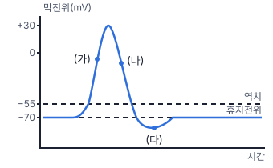
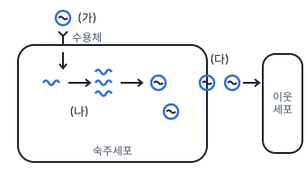
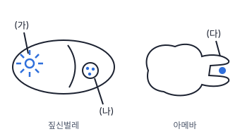
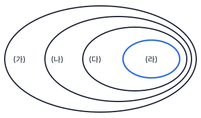

# 생명과학 9장 웹과제 예상 v1 문제해설

왼쪽 목차로 문항을 고르고, 오른쪽 문제를 보며 해설을 따라가요.

문제의 첫 줄부터 검산까지 설명해요.

**목차**

- [문항별 설명](#problems)
  - [P1. [기출 예상] 높은 염분의 물 속에 사는 생물](#p1)
  - [P2. [기출 예상] 균류와 식물의 상호작용](#p2)
  - [P3. [기출 변형] 동물의 일반적인 특성](#p3)
  - [P4. [기출 변형] 겉씨식물에 대한 설명](#p4)
  - [P5. [기출 변형] 원핵생물과 진핵생물의 차이점](#p5)
  - [P6. [예상] 생명 기원 연구의 단계 정리](#p6)
  - [P7. [예상] 배양 조건에 따른 세균의 형태 변화](#p7)
  - [P8. [예상] 원핵생물 (가)~(라)의 관찰 특징 표](#p8)
  - [P9. [예상] 벌이 다녀간 뒤 속씨식물에서 일어나는 일](#p9)
  - [P10. [예상] 바이러스 증식 도식과 (다) 단계를 막는 약물](#p10)
  - [P11. [예상] 짚신벌레와 아메바 도식의 세 구조](#p11)
  - [P12. [예상] 관다발·종자·씨방 유무로 나눈 네 식물군](#p12)
  - [P13. [예상] 죽은 나무의 버섯과 빵 반죽의 효모 관찰](#p13)
  - [P14. [예상] 네 동물 무리의 포함 관계 도식](#p14)
  - [P15. [예상] 가상의 영장류 화석 세 개의 형태 자료](#p15)

## 문항별 설명

### P1. [기출 예상] 높은 염분의 물 속에 사는 생물

기출 9강 3 예상 · [연습형 문제 보기](../%EB%B3%B5%EC%8A%B5%EB%AC%B8%EC%A0%9C_9%EC%9E%A5_%EC%9B%B9%EA%B3%BC%EC%A0%9C%EC%98%88%EC%83%81_v1.html#p1) · [시험형 문제 보기](../%EB%B3%B5%EC%8A%B5%EB%AC%B8%EC%A0%9C_9%EC%9E%A5_%EC%9B%B9%EA%B3%BC%EC%A0%9C%EC%98%88%EC%83%81_%EC%8B%9C%ED%97%98%ED%98%95_v1.html#p1)

어떤 생물이 높은 염분의 물 속에서 살 수 있다고 기록되어 있다. 이 생물은 다음 중 어느 범주에 속할 가능성이 가장 높은가?

- A. 바이러스
- B. 동물계
- C. 고세균영역
- D. 원생생물계
- E. 균류

원문·출처 정보 보기

기출 9강 합본 3번을 원문 보기 순서 그대로 실은 예상 문제예요. PDF 1쪽.

#### 문제에서 무엇을 묻나요?

높은 염분의 물 속에서 사는 생물이 다섯 범주 중 어디에 속할 **가능성이 가장 높은지** 고르는 문제예요. 사는 곳 하나로 분류를 확정하라는 뜻이 아니라, 가장 유력한 후보 범주를 찾으라는 뜻이에요.

#### 이 문제를 봤을 때 떠올릴 개념과 공식

‘높은 염분’이라는 단서에서 호염성(halophile)을 떠올려요. 호염성은 짠 환경을 좋아하는 성질이고, 극호염(extreme halophile)은 매우 짠 환경을 좋아하는 성질이에요. 이런 무리가 있는 범주가 고세균영역(Archaea)이에요. 고세균은 핵막으로 둘러싸인 핵이 없는 원핵생물이며, 온천·열수구·염호 같은 극한 환경에서 발견되는 무리로 소개돼요.

판단 기준은 두 가지예요. 첫째, 그 범주가 스스로 살아가는 세포로 된 생물의 범주인지 확인해요. 바이러스는 세포가 아니라 살아 있는 세포에 감염해야 증식하는 입자예요. 둘째, 매우 짠 환경을 좋아하는 무리가 그 범주의 대표 특징으로 알려져 있는지 확인해요. 다만 염호의 고세균은 대표 사례일 뿐 모든 고세균이 극한 환경에서만 사는 것은 아니고, 다른 범주에도 짠 물에 사는 종이 있을 수 있어요. 그래서 ‘가장 가능성이 높은’ 범주를 고르는 거예요.

관련 정리노트: [고세균과 극호염](../../../%EB%B3%B5%EC%8A%B5%EB%85%B8%ED%8A%B8/1105/%EC%A0%95%EB%A6%AC%EB%85%B8%ED%8A%B8_1105_Origin_of_Life_and_Prokaryotes.html#s2-archaea), [바이러스는 세포가 아닌 입자](../../../%EB%B3%B5%EC%8A%B5%EB%85%B8%ED%8A%B8/1105/%EC%A0%95%EB%A6%AC%EB%85%B8%ED%8A%B8_1105_Origin_of_Life_and_Prokaryotes.html#s3-structure)

#### 왜 이렇게 푸는지 함께 따라가요

A. 바이러스는 답으로 부적합해요. 첫째 기준에서 탈락해요. 바이러스는 스스로 에너지를 만드는 대사계도 리보솜도 없어서 살아 있는 세포에 감염해야만 증식하는 입자예요. 물 속에서 스스로 살아가는 생물의 범주가 아니에요.

B. 동물계는 가장 유력한 후보가 아니에요. 동물은 진핵 다세포 생물이고, 바닷물에 사는 동물이 있더라도 매우 짠 환경을 좋아하는 성질이 동물계의 대표 특징으로 소개되지는 않았어요. 둘째 기준을 충족하지 못해요.

C. 고세균영역은 답으로 적합해요. 세포로 된 원핵생물이라 첫째 기준을 충족하고, 매우 짠 환경을 좋아하는 극호염 무리가 있고 염호가 대표 서식지로 소개되어 둘째 기준도 충족해요.

D. 원생생물계는 가장 유력한 후보가 아니에요. 원생생물은 주로 물이나 습한 곳에 사는 다양한 진핵생물이지만, ‘물에 산다’는 것만으로는 ‘매우 짠 물’과 연결되지 않아요. 극호염이 이 범주의 대표 특징으로 소개되지 않았어요.

E. 균류는 가장 유력한 후보가 아니에요. 균류는 죽은 유기물을 분해하는 진핵 종속영양 생물로 소개됐고, 높은 염분 환경이 대표 특징으로 소개되지 않았어요.

두 기준을 모두 충족하는 범주는 C 하나예요. 따라서 답은 C, 고세균영역이에요.

#### 완성 답과 검산

답 C. 3영역 체계로 다시 나눠 봐요. 동물계·원생생물계·균류는 모두 진핵생물영역 안의 계이고, 바이러스는 어느 영역에도 속하지 않는 입자예요. 보기 중 원핵생물 영역은 C뿐이고, 염호 같은 극한 환경의 대표 생물로 소개된 것도 고세균이라 같은 답이 나와요. 이 카드는 원문 기출과 보기 순서가 같고, 원문 인쇄 답도 같은 보기(③ 고세균영역)예요.

**페이지 요약**

#### 기준

세포로 된 생물 범주인지, 매우 짠 환경을 좋아하는 극호염 무리가 대표 특징인지 확인해요.

#### 결론

바이러스는 비세포 입자, 동물·원생생물·균류는 진핵 계예요. 극호염 무리가 있는 고세균영역 C가 답이에요.

---

### P2. [기출 예상] 균류와 식물의 상호작용

기출 9강 25 예상 · [연습형 문제 보기](../%EB%B3%B5%EC%8A%B5%EB%AC%B8%EC%A0%9C_9%EC%9E%A5_%EC%9B%B9%EA%B3%BC%EC%A0%9C%EC%98%88%EC%83%81_v1.html#p2) · [시험형 문제 보기](../%EB%B3%B5%EC%8A%B5%EB%AC%B8%EC%A0%9C_9%EC%9E%A5_%EC%9B%B9%EA%B3%BC%EC%A0%9C%EC%98%88%EC%83%81_%EC%8B%9C%ED%97%98%ED%98%95_v1.html#p2)

균근은 식물과 공생하는 균류이다. 다음 중 균류와 식물의 상호작용에 가장 적합한 특징들은 무엇인가?

- A. 균류는 식물에 산소를 제공한다. 식물은 균류에게 탄소를 제공한다.
- B. 균류는 식물에게 탄수화물을 제공한다. 식물은 균류에게 인을 제공한다.
- C. 균류는 토양의 세균을 제거한다. 식물은 균류에게 물을 제공한다.
- D. 균류는 식물에 이산화탄소를 제공한다. 식물은 포식자로부터 균류를 보호한다.
- E. 균류는 식물에게 토양 영양분을 제공한다. 식물은 균류에게 먹이를 제공한다.

원문·출처 정보 보기

기출 9강 합본 25번을 보기 순서만 바꿔 실은 예상 문제예요. PDF 3쪽.

#### 문제에서 무엇을 묻나요?

균근에서 균류와 식물이 서로에게 무엇을 주는지 고르는 문제예요. 보기마다 ‘균류 → 식물’과 ‘식물 → 균류’ 두 문장이 있으니, **두 방향이 모두 맞는** 보기를 찾아야 해요.

#### 이 문제를 봤을 때 떠올릴 개념과 공식

‘균근’이라는 말에서 균류와 식물 뿌리의 공생인 균근(mycorrhiza)을 떠올려요. 식물은 광합성으로 만든 탄수화물 같은 유기물을 균류에 줘요. 균류는 광합성을 하지 못하는 종속영양 생물이라 이 유기물이 필요해요. 대신 균류는 실 모양의 균사(hypha)를 흙 속 작은 틈까지 뻗어 뿌리의 흡수 범위를 넓히고, 물과 무기이온, 특히 인(P)을 식물이 얻도록 도와요.

판단 기준은 각 문장의 ‘주는 쪽 → 받는 쪽 → 물질’이 이 교환과 맞는지예요. 식물 → 균류는 광합성 유기물, 균류 → 식물은 물·무기양분이어야 해요. 한 보기의 두 문장 중 하나라도 방향이나 물질이 다르면 그 보기는 고르지 않아요. 세균 제거나 포식자 방어처럼 물질 교환이 아닌 이익은 균근의 교환으로 소개되지 않았어요.

관련 정리노트: [균근에서 주고받는 물질의 방향](../../../%EB%B3%B5%EC%8A%B5%EB%85%B8%ED%8A%B8/1110/%EC%A0%95%EB%A6%AC%EB%85%B8%ED%8A%B8_1110_Protists_Plants_Fungi_and_Animals.html#s2-symbiosis), [균류의 종속영양](../../../%EB%B3%B5%EC%8A%B5%EB%85%B8%ED%8A%B8/1110/%EC%A0%95%EB%A6%AC%EB%85%B8%ED%8A%B8_1110_Protists_Plants_Fungi_and_Animals.html#s2-feeding)

#### 왜 이렇게 푸는지 함께 따라가요

A. 부적합해요. 뒤 문장 ‘식물 → 균류: 탄소’는 광합성으로 만든 유기 탄소를 준다는 뜻이라 맞아요. 하지만 앞 문장 ‘균류 → 식물: 산소’는 기준과 달라요. 균류는 광합성을 하지 않으니 산소를 만들어 주는 쪽이 아니고, 균근에서 균류가 주는 것은 물·무기양분이에요.

B. 부적합해요. 두 문장이 모두 거꾸로예요. 탄수화물은 광합성을 하는 식물이 만들어 균류에 주고, 인은 흙에 있는 무기양분이라 균사의 도움으로 식물 쪽으로 가요. 이 보기는 두 화살표를 모두 뒤집었어요.

C. 부적합해요. ‘균류가 토양의 세균을 제거한다’는 균근의 물질 교환이 아니에요. ‘식물 → 균류: 물’도 방향이 반대예요. 물은 균사가 흙에서 흡수 범위를 넓혀 식물에게 가는 쪽이에요.

D. 부적합해요. 균근에서 균류가 식물에 주는 물질로 소개된 것은 이산화탄소가 아니라 물·무기양분이에요. ‘식물이 포식자로부터 균류를 보호한다’도 물질 교환이 아니에요. 두 문장 모두 기준에 맞지 않아요.

E. 적합해요. ‘균류 → 식물: 토양 영양분’은 균사가 흙에서 얻도록 돕는 물·인 같은 무기양분과 맞아요. ‘식물 → 균류: 먹이’는 광합성으로 만든 탄수화물 같은 유기물과 맞아요. 두 방향이 모두 기준과 일치해요.

두 문장이 모두 맞는 보기는 E 하나예요. 따라서 답은 E예요.

#### 완성 답과 검산

답 E. 물질이 어디서 만들어지는지로 거꾸로 확인해요. 탄수화물은 광합성을 하는 식물에서만 출발할 수 있고, 인과 물은 흙에 있으니 흙에 퍼진 균사 쪽에서 출발해요. 이 두 화살표를 모두 담은 보기는 E뿐이에요. 원문 기출에서 같은 문장의 보기는 ④였고 인쇄 답도 ④예요. 이 카드는 보기 문장은 같고 순서만 달라요.

**페이지 요약**

#### 기준

식물 → 균류는 광합성 유기물, 균류 → 식물은 물·인 같은 무기양분이에요. 한 보기의 두 문장이 모두 맞아야 해요.

#### 결론

B는 두 방향이 모두 거꾸로이고, A·C·D는 교환이 아닌 물질이나 이익이 섞였어요. 답 E.

---

### P3. [기출 변형] 동물의 일반적인 특성

기출 9강 6 예상 · [연습형 문제 보기](../%EB%B3%B5%EC%8A%B5%EB%AC%B8%EC%A0%9C_9%EC%9E%A5_%EC%9B%B9%EA%B3%BC%EC%A0%9C%EC%98%88%EC%83%81_v1.html#p3) · [시험형 문제 보기](../%EB%B3%B5%EC%8A%B5%EB%AC%B8%EC%A0%9C_9%EC%9E%A5_%EC%9B%B9%EA%B3%BC%EC%A0%9C%EC%98%88%EC%83%81_%EC%8B%9C%ED%97%98%ED%98%95_v1.html#p3)

동물의 일반적인 특성으로 잘못된 것은?

- A. 동물 세포는 키틴으로 이루어진 세포벽으로 둘러싸여 있다
- B. 동물은 다른 생물이 만든 유기물을 이용하는 종속영양생물이다
- C. 대부분의 동물은 먹이를 몸 안으로 들인 뒤 소화한다
- D. 대부분의 동물은 방사대칭이나 좌우대칭인 몸을 가진다
- E. 동물계는 원생생물·식물·균류와 함께 진핵생물에 속한다

원문·출처 정보 보기

기출 9강 합본 6번의 발문을 사용하고 보기를 새로 써서 정답을 바꾼 예상 문제예요. PDF 1쪽. 다루는 혼동: 균류·식물의 특징을 동물의 공통 형질과 섞는 것.

#### 문제에서 무엇을 묻나요?

동물의 일반적인 특성 다섯 가지 중 **잘못된 것**을 고르는 부정형 문제예요. 진술마다 참·거짓을 먼저 판정하고, 거짓인 진술을 골라요.

#### 이 문제를 봤을 때 떠올릴 개념과 공식

‘동물의 일반적인 특성’에서 동물의 공통 형질 목록을 떠올려요. 동물은 다세포 진핵생물이고, 세포에 세포벽(cell wall)이 없으며, 다른 생물이 만든 유기물을 이용하는 종속영양 생물(heterotroph)이에요. 먹이를 몸 안으로 들인 뒤 소화하고, 대부분은 방사대칭이나 좌우대칭이에요. 해면동물처럼 대칭면이 없는 예외가 있어서 대칭성은 ‘대부분’으로만 말할 수 있어요.

판단 기준은 두 가지예요. 첫째, 진술의 특징이 동물의 것인지, 아니면 이웃한 진핵 집단의 것인지 확인해요. 세포벽이 있다면 균류는 키틴(chitin), 식물은 셀룰로오스가 대표 성분이에요. 먹는 방식도 균류는 효소를 몸 밖으로 내보내 분해한 뒤 흡수하고, 동물은 먹은 뒤 몸 안에서 소화해요. 둘째, ‘대부분’ 같은 범위 표현이 실제 예외와 맞는지 확인해요.

관련 정리노트: [동물의 공통 형질과 대칭](../../../%EB%B3%B5%EC%8A%B5%EB%85%B8%ED%8A%B8/1110/%EC%A0%95%EB%A6%AC%EB%85%B8%ED%8A%B8_1110_Protists_Plants_Fungi_and_Animals.html#s3-animal), [균류 세포벽의 키틴](../../../%EB%B3%B5%EC%8A%B5%EB%85%B8%ED%8A%B8/1110/%EC%A0%95%EB%A6%AC%EB%85%B8%ED%8A%B8_1110_Protists_Plants_Fungi_and_Animals.html#s2-structure), [균류와 동물의 먹는 방식 차이](../../../%EB%B3%B5%EC%8A%B5%EB%85%B8%ED%8A%B8/1110/%EC%A0%95%EB%A6%AC%EB%85%B8%ED%8A%B8_1110_Protists_Plants_Fungi_and_Animals.html#s2-feeding)

#### 왜 이렇게 푸는지 함께 따라가요

A. 거짓이에요. ‘동물 세포에는 세포벽이 없다’는 공통 형질과 정면으로 어긋나요. 키틴 세포벽은 균류 세포벽의 대표 특징이에요. 첫째 기준에서 균류의 특징을 동물에 붙인 진술로 판정되므로, 잘못된 것으로 골라요.

B. 참이에요. 동물은 스스로 유기물을 만들지 않고 다른 생물이 만든 유기물을 이용해요. 동물의 공통 형질인 종속영양과 일치해요.

C. 참이에요. 동물은 먹이를 몸 안으로 들인 뒤 소화해요. 몸 밖에서 먼저 분해하고 흡수하는 균류와 순서·장소가 달라요. ‘대부분’이라는 범위도 넘치지 않아요.

D. 참이에요. 말미잘 같은 방사대칭과 사람 같은 좌우대칭이 동물의 대부분이고, 해면동물은 비대칭 예외예요. ‘모든’이 아니라 ‘대부분’이라고 했으니 둘째 기준에 맞아요.

E. 참이에요. 전통적인 원생생물계·식물계·균류계·동물계는 모두 핵막으로 둘러싸인 핵이 있는 진핵생물에 속해요.

B~E는 동물의 실제 특징과 맞고, A만 거짓이에요. 부정형이므로 답은 A예요.

#### 완성 답과 검산

답 A. 세포벽만 기준으로 세 집단을 다시 나눠 봐요. 식물은 셀룰로오스 세포벽, 균류는 키틴 세포벽, 동물은 세포벽이 없어요. A는 균류 칸의 특징을 동물 칸에 옮겨 놓은 것이에요. 나머지 넷은 동물의 정의 목록인 종속영양, 몸 안 소화, 대부분 대칭, 진핵생물과 하나씩 대응해요. 거짓이 하나뿐이라 부정형 답도 하나로 정해져요.

#### 헷갈리기 쉬운 점

이 카드는 원문 기출과 발문만 같고 보기는 새로 쓴 변형이에요. 원문의 인쇄 답이었던 ‘모든 동물은 유성생식을 한다’는 이 카드에 없어요. 그 원문 보기는 ‘유성생식만 한다’와 ‘유성생식도 가능하다’를 구별하지 않은 표현 한계가 있었어요. 해면동물의 무성생식은 ‘유성생식만 한다’는 뜻일 때만 반례가 돼요. 이 카드는 세포벽 유무 하나로 거짓이 정해져 그런 표현 문제가 없어요. 원문 그대로 나오면 출제 의도상 그 보기를 고르되, ‘유성생식만 한다’로 읽었을 때 틀린 문장이라는 점을 기억해요.

**페이지 요약**

#### 기준

동물은 세포벽이 없는 다세포 진핵 종속영양 생물이에요. 키틴 세포벽은 균류, 셀룰로오스 세포벽은 식물의 특징이에요.

#### 결론

균류의 키틴 세포벽을 동물에 붙인 A만 거짓이에요. 답 A. 원문의 유성생식 보기와 그 표현 한계는 이 변형 카드에 해당하지 않아요.

---

### P4. [기출 변형] 겉씨식물에 대한 설명

기출 9강 27 예상 · [연습형 문제 보기](../%EB%B3%B5%EC%8A%B5%EB%AC%B8%EC%A0%9C_9%EC%9E%A5_%EC%9B%B9%EA%B3%BC%EC%A0%9C%EC%98%88%EC%83%81_v1.html#p4) · [시험형 문제 보기](../%EB%B3%B5%EC%8A%B5%EB%AC%B8%EC%A0%9C_9%EC%9E%A5_%EC%9B%B9%EA%B3%BC%EC%A0%9C%EC%98%88%EC%83%81_%EC%8B%9C%ED%97%98%ED%98%95_v1.html#p4)

겉씨식물에 대한 설명으로 옳은 것은?

- A. 겉씨식물은 꽃이 피고, 수정 뒤 씨방이 자라 열매가 된다.
- B. 겉씨식물은 종자를 만들지 않고 포자로만 번식한다.
- C. 겉씨식물에서는 꽃가루가 암쪽 솔방울에 닿는 순간 수정이 끝난다.
- D. 겉씨식물의 밑씨는 씨방에 싸여 있지 않고 드러나 있다.
- E. 겉씨식물의 꽃가루는 물속을 헤엄쳐서만 암쪽 생식 구조에 도달할 수 있다.

원문·출처 정보 보기

기출 9강 합본 27번의 발문을 사용하고 보기를 새로 써서 정답을 바꾼 예상 문제예요. PDF 3쪽. 다루는 혼동: 겉씨식물과 속씨식물의 생식 구조, 수분과 수정의 단계.

#### 문제에서 무엇을 묻나요?

겉씨식물에 대한 설명 중 **옳은 것** 하나를 고르는 문제예요. 속씨식물의 특징이나 무종자 식물의 특징이 섞인 보기, 수분과 수정을 섞은 보기를 가려내야 해요.

#### 이 문제를 봤을 때 떠올릴 개념과 공식

‘겉씨식물’에서 종자식물의 두 무리인 겉씨식물(gymnosperms)과 속씨식물(angiosperms)을 떠올려요. 둘 다 꽃가루(pollen)와 밑씨(ovule)를 만들고, 수정 뒤 밑씨가 종자(seed)로 자라요. 두 무리를 가르는 기준은 밑씨가 씨방(ovary)에 싸여 있는지예요. 겉씨식물은 밑씨가 씨방 없이 드러나 있고, 소나무의 솔방울 같은 생식 구조를 가지며 꽃·열매가 없어요. 속씨식물은 꽃의 씨방 안에 밑씨가 있고, 씨방이 열매가 돼요. 종자 없이 포자로 번식하는 것은 선태류와 양치류예요.

단계 구별도 필요해요. 수분(pollination)은 꽃가루가 암쪽 생식 구조로 옮겨지는 일이에요. 겉씨식물에서는 주로 바람이 옮기고 자유로운 물이 꼭 필요하지 않아요. 수정(fertilization)은 그 뒤 정자 세포가 난세포와 결합하는 일이에요.

판단 기준은 두 가지예요. 보기의 구조(꽃·씨방·열매·종자·포자)가 겉씨식물에 실제로 있는지, 그리고 수분과 수정을 서로 다른 단계로 구별했는지 확인해요.

관련 정리노트: [겉씨·속씨와 수분·수정](../../../%EB%B3%B5%EC%8A%B5%EB%85%B8%ED%8A%B8/1110/%EC%A0%95%EB%A6%AC%EB%85%B8%ED%8A%B8_1110_Protists_Plants_Fungi_and_Animals.html#s1-seed), [포자로 번식하는 선태류·양치류](../../../%EB%B3%B5%EC%8A%B5%EB%85%B8%ED%8A%B8/1110/%EC%A0%95%EB%A6%AC%EB%85%B8%ED%8A%B8_1110_Protists_Plants_Fungi_and_Animals.html#s1-land)

#### 왜 이렇게 푸는지 함께 따라가요

A. 틀려요. 꽃이 피고 씨방이 자라 열매가 되는 것은 속씨식물의 특징이에요. 겉씨식물은 밑씨를 감싸는 씨방이 없으니 씨방이 자란 열매도 생기지 않아요. 첫째 기준에서 속씨식물의 구조를 겉씨식물에 붙인 진술이에요.

B. 틀려요. 겉씨식물은 종자식물이라 수정 뒤 밑씨가 종자로 자라요. 종자 없이 포자로 번식하는 것은 선태류와 양치류예요. (보충, 수업에서 다루지 않음) 겉씨식물의 포자체도 포자를 만들지만, 그 포자는 생식 구조 안에 머물러요. 따라서 이 보기가 틀린 이유는 ‘포자를 만든다’가 아니라 ‘종자를 만들지 않고 포자로만 번식한다’는 부분이에요.

C. 틀려요. 꽃가루가 암쪽 솔방울에 닿는 것은 수분이에요. 수정은 그 뒤 정자 세포가 난세포와 결합해야 일어나요. 둘째 기준에서 도착과 결합을 같은 단계로 합친 진술이에요.

D. 옳아요. 밑씨가 씨방에 싸여 있지 않고 드러나 있다는 것이 겉씨식물을 속씨식물과 가르는 기준 그 자체예요. ‘겉씨’라는 이름도 씨가 겉으로 드러난다는 뜻이에요.

E. 틀려요. 겉씨식물의 꽃가루는 주로 바람에 실려 암쪽 솔방울로 옮겨지고, 이 이동에 자유로운 물이 꼭 필요하지 않아요. 물 없이 꽃가루를 옮길 수 있다는 점이 오히려 육상 생활에 중요한 적응이에요. ‘물속을 헤엄쳐서만’이라는 부분이 기준과 어긋나요.

두 기준에 모두 맞는 진술은 D 하나예요. 따라서 답은 D예요.

#### 완성 답과 검산

답 D. 겉씨·속씨·무종자 식물을 표로 다시 대조해요. 밑씨 위치는 겉씨가 씨방 밖, 속씨가 씨방 안이에요. 꽃·열매는 겉씨에 없고 속씨에 있으며, 종자는 둘 다 있어요. 종자 없이 포자로 번식하는 것은 선태류·양치류예요. 겉씨식물 칸에 맞는 진술은 D뿐이에요. A는 속씨식물 칸, B는 무종자 식물 칸의 특징이에요. C는 수분과 수정을 합쳤고 E는 물이 꼭 필요하다고 해서 단계 설명과 어긋나요.

**페이지 요약**

#### 기준

겉씨식물은 종자식물이지만 밑씨가 씨방 없이 드러나 있고 꽃·열매가 없어요. 수분(도착)과 수정(결합)은 다른 단계예요.

#### 결론

A는 속씨, B는 무종자 식물의 특징이에요. C는 단계를 합쳤고, E는 바람 수분과 어긋나요. 답 D.

---

### P5. [기출 변형] 원핵생물과 진핵생물의 차이점

기출 9강 18 예상 · [연습형 문제 보기](../%EB%B3%B5%EC%8A%B5%EB%AC%B8%EC%A0%9C_9%EC%9E%A5_%EC%9B%B9%EA%B3%BC%EC%A0%9C%EC%98%88%EC%83%81_v1.html#p5) · [시험형 문제 보기](../%EB%B3%B5%EC%8A%B5%EB%AC%B8%EC%A0%9C_9%EC%9E%A5_%EC%9B%B9%EA%B3%BC%EC%A0%9C%EC%98%88%EC%83%81_%EC%8B%9C%ED%97%98%ED%98%95_v1.html#p5)

원핵생물과 진핵생물의 차이점은 무엇인가?

- A. 효모처럼 하나의 세포로 사는 생물은 모두 원핵생물이다.
- B. 원핵세포에는 소포체·골지체 같은 막성 소기관이 없지만 진핵세포에는 있다.
- C. 원핵세포에는 세포막이 없어 세포 안팎을 나누는 경계가 없다.
- D. 원핵생물은 리보솜이 없어 다른 세포의 리보솜을 빌려 단백질을 만든다.
- E. 원핵세포의 DNA는 핵막 안에 들어 있고, 진핵세포의 DNA는 핵막 없이 세포질에 있다.

원문·출처 정보 보기

기출 9강 합본 18번의 발문을 사용하고 보기를 새로 써서 정답을 바꾼 예상 문제예요. PDF 2쪽. 다루는 혼동: 핵이 없다는 것을 세포막·리보솜·DNA까지 없다는 뜻으로 넓히거나, 단세포 여부로 원핵·진핵을 가르는 것.

#### 문제에서 무엇을 묻나요?

원핵생물과 진핵생물의 차이를 바르게 비교한 진술 하나를 고르는 문제예요. 보기마다 ‘무엇이 어느 쪽에 있고 없는지’와 그 방향이 사실과 맞는지 확인해요.

#### 이 문제를 봤을 때 떠올릴 개념과 공식

‘원핵·진핵의 차이’에서 세포 안 구조의 비교를 떠올려요. 원핵생물(prokaryote)은 핵막으로 둘러싸인 핵이 없어서, DNA가 핵양체(nucleoid)라는 영역에 모여 있어요. 그래도 세포 안팎을 나누는 세포막(원형질막), 유전정보를 담은 DNA, 단백질을 만드는 리보솜(ribosome)은 원핵세포에도 있어요. 반면 미토콘드리아·엽록체·소포체·골지체 같은 막성 소기관은 없어요. 진핵세포는 핵막으로 DNA를 세포질과 분리하고, 이런 막성 소기관을 가져요.

판단 기준은 세 가지예요. 첫째, 두 무리를 가르는 기준은 핵막과 막성 소기관의 유무예요. 단세포인지 다세포인지는 기준이 아니에요. 진핵생물에도 단세포가 있기 때문이에요. 둘째, 원핵세포에도 있는 공통 장비인 세포막·DNA·리보솜을 없다고 하지 않았는지 확인해요. 셋째, 원핵과 진핵의 방향이 뒤바뀌지 않았는지 확인해요.

관련 정리노트: [원핵세포의 필수 장비와 막성 소기관](../../../%EB%B3%B5%EC%8A%B5%EB%85%B8%ED%8A%B8/1105/%EC%A0%95%EB%A6%AC%EB%85%B8%ED%8A%B8_1105_Origin_of_Life_and_Prokaryotes.html#s2-structure), [원핵·진핵 분류 경계와 효모](../../../%EB%B3%B5%EC%8A%B5%EB%85%B8%ED%8A%B8/1105/%EC%A0%95%EB%A6%AC%EB%85%B8%ED%8A%B8_1105_Origin_of_Life_and_Prokaryotes.html#s2-archaea)

#### 왜 이렇게 푸는지 함께 따라가요

A. 틀려요. 효모는 단세포 균류이고, 핵막으로 둘러싸인 핵이 있는 진핵생물이에요. 첫째 기준에서 단세포인지 여부는 원핵·진핵을 가르는 기준이 아니므로, ‘하나의 세포로 살면 모두 원핵생물’이라는 일반화는 성립하지 않아요.

B. 맞아요. 소포체·골지체 같은 막성 소기관이 원핵세포에는 없고 진핵세포에는 있다는 비교예요. 첫째 기준인 막성 소기관 유무를 올바른 방향으로 적었어요.

C. 틀려요. 원핵세포도 세포막(원형질막)으로 둘러싸여 세포 안팎이 나뉘어요. 둘째 기준에서 공통 장비인 세포막을 없다고 한 진술이에요.

D. 틀려요. 원핵세포에도 단백질을 합성하는 리보솜이 있어요. 숙주세포의 리보솜을 빌려 단백질을 만드는 것은 세포가 아닌 입자인 바이러스예요. 둘째 기준에서 공통 장비인 리보솜을 없다고 한 진술이에요.

E. 틀려요. 핵막의 위치가 뒤바뀌었어요. 원핵세포는 핵막 없이 DNA가 핵양체에 모여 있고, 진핵세포의 DNA가 핵막으로 둘러싸인 핵 안에 있어요. 셋째 기준에서 방향이 반대예요.

세 기준을 모두 통과하는 진술은 B 하나예요. 따라서 답은 B예요.

#### 완성 답과 검산

답 B. 구조를 ‘두 세포에 모두 있는 것’과 ‘진핵세포에만 있는 것’으로 나눠 다시 세어 봐요. 세포막·DNA·리보솜은 두 쪽에 모두 있으니 이것이 없다고 한 C·D는 탈락이에요. 핵막과 막성 소기관은 진핵세포에만 있으니, 이 방향을 지킨 B는 남고 거꾸로 적은 E는 탈락이에요. A는 이 표에 없는 단세포 여부를 기준으로 삼았고, 진핵 단세포인 효모가 반례예요.

**페이지 요약**

#### 기준

원핵·진핵은 핵막과 막성 소기관의 유무로 갈라요. 세포막·DNA·리보솜은 원핵세포에도 있어요.

#### 결론

A는 단세포 기준 오류(효모는 진핵), C·D는 공통 장비를 없앴고, E는 방향이 반대예요. 답 B.

---

### P6. [예상] 생명 기원 연구의 단계 정리

예상 9장 6 · [연습형 문제 보기](../%EB%B3%B5%EC%8A%B5%EB%AC%B8%EC%A0%9C_9%EC%9E%A5_%EC%9B%B9%EA%B3%BC%EC%A0%9C%EC%98%88%EC%83%81_v1.html#p6) · [시험형 문제 보기](../%EB%B3%B5%EC%8A%B5%EB%AC%B8%EC%A0%9C_9%EC%9E%A5_%EC%9B%B9%EA%B3%BC%EC%A0%9C%EC%98%88%EC%83%81_%EC%8B%9C%ED%97%98%ED%98%95_v1.html#p6)

한 학생이 생명의 기원을 설명하는 실험과 가설을 단계별로 정리했어요. 정리한 내용으로 옳지 않은 것은 무엇인가요?

- A. 밀러-유레이 실험에서는 수소·메탄·암모니아·수증기에 전기 방전을 가하며 순환·냉각한 뒤, 모은 용액에서 아미노산 같은 간단한 유기물을 검출했어요.
- B. 밀러-유레이 실험은 생물 없이도 막으로 둘러싸여 스스로 복제하는 원시세포가 만들어질 수 있음을 확인했어요.
- C. 아미노산이 이어져 폴리펩티드가 되는 것처럼, 작은 유기분자를 거대분자로 잇는 일은 작은 분자를 합성하는 일과 다른 단계예요.
- D. 물속의 인지질은 이중층으로 자가 조립해 닫힌 소낭을 이룰 수 있지만, 그 성질만으로 내부 유전정보의 복제가 보장되지는 않아요.
- E. 분자를 막 안에 모은 원시세포가 생긴 뒤에도, 유전물질을 복제하고 분열해 세대를 이어 갈 체계가 더해져야 세포의 출현을 설명할 수 있어요.

원문·출처 정보 보기

원문 기출이 아닌 새 예상 문제예요. 다루는 혼동: 밀러-유레이 실험이 보여 준 작은 유기물 합성을 살아 있는 세포의 생성으로 넓혀 읽는 것, 그리고 거대분자 조립·막 구획화·유전정보 복제를 한 단계로 묶는 것이에요.

#### 무엇을 구하나요?

생명의 기원을 단계별로 정리한 다섯 진술 가운데 **옳지 않은 것**을 골라요. 각 진술이 어느 단계를 말하는지, 그 실험이나 성질이 실제로 보여 준 것보다 크게 말하지 않는지를 확인해요.

#### 이 문제를 봤을 때 떠올릴 개념과 공식

‘밀러-유레이(Miller–Urey) 실험’, ‘거대분자’, ‘인지질 이중층’, ‘원시세포’, ‘복제’가 함께 나오면 생명 기원의 네 과제를 순서대로 떠올려요. ① 간단한 유기물 형성 → ② 거대분자(macromolecule) 조립 → ③ 막 안의 구획화, 곧 원시세포(protocell) → ④ 유전물질을 복제하고 분열해 세대를 잇는 세포의 출현이에요.

판단 기준 1은 **진술의 실험·성질이 몇 번 단계까지 보여 주는지**예요. 밀러-유레이 실험은 수소·메탄·암모니아·수증기에 전기 방전(번개를 흉내 낸 에너지)을 가하며 순환·냉각한 뒤, 모은 용액을 분석해 아미노산 같은 간단한 유기물을 검출했어요. 그래서 이 실험이 지지하는 것은 ①단계, 생물 없이 간단한 유기물이 생길 수 있다는 가능성까지예요. 관련 정리노트: [실험에서 나온 것은 생명이 아니라 유기물](../../../%EB%B3%B5%EC%8A%B5%EB%85%B8%ED%8A%B8/1105/%EC%A0%95%EB%A6%AC%EB%85%B8%ED%8A%B8_1105_Origin_of_Life_and_Prokaryotes.html#s0-miller)

판단 기준 2는 **앞 단계의 성공을 다음 단계의 완성으로 넓히지 않았는지**예요. 아미노산이 있어도 폴리펩티드가 저절로 생긴 것은 아니고, 인지질이 이중층 소낭으로 자가 조립해도 그 안의 유전정보 복제가 보장되지는 않아요. 관련 정리노트: [작은 분자에서 막으로 둘러싸인 공간으로](../../../%EB%B3%B5%EC%8A%B5%EB%85%B8%ED%8A%B8/1105/%EC%A0%95%EB%A6%AC%EB%85%B8%ED%8A%B8_1105_Origin_of_Life_and_Prokaryotes.html#s0-protocell)

#### 왜 이렇게 푸는지 함께 따라가요

A. 맞아요. 넣은 기체(수소·메탄·암모니아·수증기), 에너지(전기 방전), 조작(순환·냉각), 측정(모은 용액에서 아미노산 검출)이 실험 내용과 같아요. 결론도 ‘간단한 유기물’로 ①단계 범위 안에 머물러 기준 1을 지켜요.

B. 틀려요. ‘막으로 둘러싸여 스스로 복제하는 원시세포’는 ③·④단계의 결과예요. 실험이 확인한 것은 ①단계의 간단한 유기물 합성까지이므로, 실험 결과를 두 단계 넘어 넓힌 진술이에요(기준 1).

C. 맞아요. 작은 분자인 아미노산이 있다는 것과 그것이 이어진 폴리펩티드가 있다는 것은 다른 성과예요. ①과 ②를 서로 다른 단계로 구별했으므로 기준 2와 맞아요.

D. 맞아요. 인지질은 물과 어울리는 머리를 물 쪽에, 물을 피하는 꼬리를 서로 마주 보게 하여 이중층으로 자가 조립하고 닫힌 소낭을 이룰 수 있어요(③). 뒷부분도 이 성질이 ④의 복제까지 보장하지 않는다고 말해 기준 2를 지켜요.

E. 맞아요. 원시세포(③)는 분자를 막 안에 가둔 모형이고, 세포의 출현을 설명하려면 유전물질을 복제하고 분열해 세대를 잇는 체계(④)가 더해져야 한다는 진술이에요. ③과 ④를 구별했으므로 맞아요.

따라서 옳지 않은 것을 고르는 이 문제의 답은 B예요.

#### 완성 답과 검산

답 B. 맞는 진술이 A·C·D·E 넷, 틀린 진술이 B 하나라서 ‘옳지 않은 것 하나’와 개수가 맞아요. 교과서도 이 실험의 결과를 장치를 가동한 뒤 모은 용액에서 아미노산 등 유기화합물이 발견된 것까지로 적고, 원시세포의 형성은 거대분자 조립과 지질 이중층 소낭 형성이라는 별도의 과정으로 설명해요.

**페이지 요약**

#### 판단 기준

기원의 네 단계(유기물 형성 → 거대분자 조립 → 막 구획화 → 복제) 중 진술의 실험·성질이 어디까지 보여 주는지 확인해요.

#### 결론

밀러-유레이 실험은 간단한 유기물 합성까지만 보였으므로, 스스로 복제하는 원시세포를 확인했다는 B가 옳지 않아요.

---

### P7. [예상] 배양 조건에 따른 세균의 형태 변화

예상 9장 7 · [연습형 문제 보기](../%EB%B3%B5%EC%8A%B5%EB%AC%B8%EC%A0%9C_9%EC%9E%A5_%EC%9B%B9%EA%B3%BC%EC%A0%9C%EC%98%88%EC%83%81_v1.html#p7) · [시험형 문제 보기](../%EB%B3%B5%EC%8A%B5%EB%AC%B8%EC%A0%9C_9%EC%9E%A5_%EC%9B%B9%EA%B3%BC%EC%A0%9C%EC%98%88%EC%83%81_%EC%8B%9C%ED%97%98%ED%98%95_v1.html#p7)

일부 세균이 건조한 환경을 거친 뒤 배양 조건이 좋아졌을 때의 모습을 순서대로 그렸어요. 그림의 (가)~(다)에 대한 설명으로 옳은 것은 무엇인가요?

- A. (가)가 건조 중에 형성된 내생포자이고, (다)는 배양 조건이 회복된 뒤 자란 세균이에요.
- B. (나)에서 (다)로 바뀌는 과정에서 세균 한 개체가 분열해 두 개체가 돼요.
- C. (다)는 건조를 견디는 형태이므로, 온도와 처리 시간에 관계없이 모든 열 멸균 조건을 견뎌요.
- D. (다)는 불리한 조건을 버티는 휴면 형태이고, 조건이 좋아지면 다시 성장하고 분열해 (가)처럼 개체 수가 늘어날 수 있어요.
- E. (나)에서 (다)로 바뀌면 유전물질을 잃으므로, 조건이 좋아져도 (다)에서 다시 세균이 자랄 수 없어요.

원문·출처 정보 보기

9장 수업에서 다룬 세균의 내생포자와 환경 변화에 근거한 새 예상 문제예요.

#### 무엇을 구하나요?

건조 전, 건조 중, 배양 조건이 회복된 뒤의 그림을 보고, 각 단계에서 세균이 어떻게 버티고 다시 자라는지 옳게 설명한 보기를 골라요.

#### 이 문제를 봤을 때 떠올릴 개념과 공식

건조가 시작된 뒤 세균의 형태가 달라지면 **내생포자**를 떠올려요. 내생포자는 일부 세균이 불리한 환경에서 유전물질을 보호하는 휴면 형태예요. 열과 건조에 강하며, 적합한 환경으로 돌아오면 세균이 다시 자랄 수 있어요. [내생포자 형성과 조건 회복](../../../%EB%B3%B5%EC%8A%B5%EB%85%B8%ED%8A%B8/1105/%EC%A0%95%EB%A6%AC%EB%85%B8%ED%8A%B8_1105_Origin_of_Life_and_Prokaryotes.html#s2-groups)

각 글자 위의 **환경 조건**을 읽어 언제 휴면 형태가 생기는지 확인해요. 그다음 **구조의 수**를 비교해 한 세균이 형태만 바꿨는지, 회복 뒤 분열해 세균 수가 늘었는지 판단해요.

#### 왜 이렇게 푸는지 함께 따라가요

A. 틀려요. 건조 중에 나타난 두꺼운 테두리의 타원 (다)가 내생포자예요. 조건이 회복된 뒤 자란 막대 모양 세균 두 개는 (가)에 있어요.

B. 틀려요. (나)에는 세균 한 개, (다)에는 그 세균이 만든 내생포자 한 개가 보여요. 이 구간에서 세균 수가 두 개로 늘지는 않아요.

C. 틀려요. (다)가 건조에 강하다는 관찰로 모든 열 멸균 조건에서도 살아남는다고 결론 내릴 수 없어요. 온도와 처리 시간에 따라 생존 여부가 달라져요.

D. 맞아요. (다)는 건조 중에 생긴 휴면 형태예요. 배양 조건이 회복되면 내생포자에서 세균이 다시 자라고, 분열하면 (가)처럼 개체 수가 늘어요.

E. 틀려요. 내생포자에 보호되어 남은 유전물질을 바탕으로 세균은 조건이 좋아졌을 때 다시 자랄 수 있어요. 그림의 (다) 다음에 (가)가 나타나는 것과도 맞아요.

#### 완성 답과 검산

정답은 D예요. 개체 수가 처음 늘어나는 지점에서 거꾸로 확인해요. 가운데까지는 구조가 하나씩이고 오른쪽 (가)에서 처음 두 세포가 보여요. 따라서 (나)에서 (다)로 갈 때 이미 분열했다는 B를 제외할 수 있고, 회복 이후에 개체 수가 늘어난다는 D가 남아요.

**페이지 요약**

#### 판단 기준

그림에서 환경 조건, 구조의 형태, 개체 수를 순서대로 봐요.

#### 결론

정답 D. 건조 중 (다)의 내생포자로 버티고, 회복 뒤 (가)에서 성장·분열해 세균 수가 늘어요.

---

### P8. [예상] 원핵생물 (가)~(라)의 관찰 특징 표

예상 9장 8 · [연습형 문제 보기](../%EB%B3%B5%EC%8A%B5%EB%AC%B8%EC%A0%9C_9%EC%9E%A5_%EC%9B%B9%EA%B3%BC%EC%A0%9C%EC%98%88%EC%83%81_v1.html#p8) · [시험형 문제 보기](../%EB%B3%B5%EC%8A%B5%EB%AC%B8%EC%A0%9C_9%EC%9E%A5_%EC%9B%B9%EA%B3%BC%EC%A0%9C%EC%98%88%EC%83%81_%EC%8B%9C%ED%97%98%ED%98%95_v1.html#p8)

표는 서로 다른 원핵생물 (가)~(라)에서 관찰한 특징을 나타낸 것이에요. 이에 대한 설명으로 옳은 것은 무엇인가요?

| 생물 | 관찰한 특징 |
|---|---|
| (가) | 빛을 흡수해 이용하고, CO₂를 고정해 유기물을 만들며, 이 과정에서 물을 분해해 산소를 내놓는다. |
| (나) | 빛을 흡수해 이용하지만, 몸을 만드는 탄소는 주변의 유기물에서 얻는다. |
| (다) | 빛 없이 무기 화학물질을 산화해 에너지를 얻고, CO₂를 고정해 유기물을 만든다. |
| (라) | 주변의 유기물을 분해해 에너지와 탄소를 모두 얻는다. |

- A. (가)와 (다)는 CO₂에서 탄소를 얻는 독립영양생물이고, (가)가 내놓는 산소는 물이 분해되면서 나와요.
- B. (가)와 (나)는 모두 빛에서 에너지를 얻으므로 둘 다 광독립영양생물이에요.
- C. (다)는 CO₂를 고정해 유기물을 만들므로 에너지원도 빛이며, (가)와 같은 광독립영양생물이에요.
- D. (가)는 광독립영양생물이며, (가)가 내놓는 산소는 고정한 CO₂에서 떨어져 나온 것이에요.
- E. (나)와 (라)는 모두 유기물에서 탄소를 얻으므로 둘 다 화학종속영양생물이에요.

원문·출처 정보 보기

원문 기출이 아닌 새 예상 문제예요. 2장 광합성(물의 광분해)과 섞은 문항이에요. 다루는 혼동: 에너지원(빛·화학물질)과 탄소원(CO₂·유기물)이라는 두 기준을 하나로 섞는 것, 그리고 산소 발생 광합성에서 나오는 산소의 출처를 CO₂로 착각하는 것이에요.

#### 무엇을 구하나요?

표에 적힌 원핵생물 (가)~(라)의 관찰 특징으로 각 생물의 영양 유형을 정하고, (가)가 내놓는 산소가 어디서 오는지까지 맞게 말한 **옳은 것**을 골라요. 9장의 원핵생물 영양 분류에 2장 광합성의 물의 광분해를 섞은 문항이에요.

#### 이 문제를 봤을 때 떠올릴 개념과 공식

‘빛을 흡수해 이용’, ‘무기 화학물질을 산화’, ‘CO₂를 고정’, ‘유기물에서 탄소’라는 표현이 섞여 나오면 영양 유형의 두 축을 떠올려요. 두 축은 서로 다른 질문이라 **한 칸씩 따로 판정한 뒤 이름을 조합해요.**

기준 1, **에너지원**: 빛이면 광(photo-), 화학물질의 산화면 화학(chemo-)이에요.

기준 2, **탄소원**: CO₂에서 탄소를 얻어 유기물을 만들면 독립영양(autotroph), 유기물에서 탄소를 얻으면 종속영양(heterotroph)이에요. ‘CO₂를 쓴다’는 탄소원만, ‘빛을 쓴다’는 에너지원만 알려 주므로 한 축의 정보로 다른 축을 정하지 않아요. 관련 정리노트: [에너지원과 탄소원은 서로 다른 질문](../../../%EB%B3%B5%EC%8A%B5%EB%85%B8%ED%8A%B8/1105/%EC%A0%95%EB%A6%AC%EB%85%B8%ED%8A%B8_1105_Origin_of_Life_and_Prokaryotes.html#s2-nutrition)

기준 3, **산소발생형 광합성의 산소 출처**: 명반응에서 광계 2의 반응 중심이 잃은 전자를 물에서 빼 와 채우고, 전자를 내준 물이 분해되며 산소가 나와요($\mathrm{H_2O \rightarrow 2H^+ + 2e^- + \tfrac{1}{2}O_2}$). CO₂는 캘빈 회로에서 고정되어 유기물의 탄소가 되고 산소의 출처가 아니에요. 관련 정리노트: [남세균이 물을 쓰자 산소가 생겼어요](../../../%EB%B3%B5%EC%8A%B5%EB%85%B8%ED%8A%B8/1105/%EC%A0%95%EB%A6%AC%EB%85%B8%ED%8A%B8_1105_Origin_of_Life_and_Prokaryotes.html#s1-oxygen), [광계와 물의 광분해](../../../%EB%B3%B5%EC%8A%B5%EB%85%B8%ED%8A%B8/0915/%EC%A0%95%EB%A6%AC%EB%85%B8%ED%8A%B8_0915_Cellular_Respiration_and_Photosynthesis.html#s3-photosystem)

#### 첫 줄을 써 봐요

보기를 읽기 전에 표의 네 생물을 두 축으로 먼저 분류해요.

| 생물 | 에너지원(기준 1) | 탄소원(기준 2) | 영양 유형 |
|---|---|---|---|
| (가) | 빛 | CO₂ | 광독립영양 |
| (나) | 빛 | 유기물 | 광종속영양 |
| (다) | 무기 화학물질의 산화 | CO₂ | 화학독립영양 |
| (라) | 유기물의 분해(화학반응) | 유기물 | 화학종속영양 |

#### 왜 이렇게 푸는지 함께 따라가요

A. 맞아요. 탄소원 칸에서 (가)와 (다)는 모두 CO₂를 고정하므로 둘 다 독립영양이에요(기준 2). 에너지원은 빛과 무기 화학물질로 다르지만, 이 진술은 탄소원만 묶었으므로 문제가 없어요. 뒷부분도 (가)가 물을 분해해 산소를 내놓는다는 표의 관찰, 산소가 물에서 나온다는 기준 3과 맞아요.

B. 틀려요. (가)와 (나)가 모두 빛에서 에너지를 얻는다는 앞부분은 맞아요(기준 1). 하지만 ‘광독립영양’은 탄소원까지 정해야 붙는 이름이에요. (나)는 탄소를 유기물에서 얻으므로 광종속영양이에요(기준 2).

C. 틀려요. (다)가 CO₂를 고정한다는 것은 독립영양이라는 탄소원 정보일 뿐이에요. 에너지는 ‘빛 없이 무기 화학물질을 산화’해 얻으므로 화학이에요(기준 1). (다)는 화학독립영양이고 (가)와 같은 광독립영양이 아니에요.

D. 틀려요. (가)가 광독립영양이라는 앞부분은 맞지만, 산소의 출처를 고정한 CO₂라고 했어요. 산소는 명반응에서 물이 전자를 내주며 분해될 때 나오고, CO₂는 캘빈 회로에서 유기물의 탄소가 돼요(기준 3).

E. 틀려요. (나)와 (라)는 탄소원이 모두 유기물이라 둘 다 종속영양인 것은 맞아요(기준 2). 그러나 에너지원이 (나)는 빛, (라)는 유기물의 분해로 달라요(기준 1). (나)는 광종속영양이고, (라)만 화학종속영양이에요.

따라서 옳은 것은 A예요.

#### 완성 답과 검산

답 A. 네 생물에 네 유형이 겹치지 않고 하나씩 대응하는지 다시 세어 보면 광독립 (가), 광종속 (나), 화학독립 (다), 화학종속 (라)예요. B·C·E는 이 대응에서 한 축을 바꿔 불렀고, D는 대응은 맞지만 산소의 출처를 바꿨어요. 산소 출처는 물의 광분해 식에서 O₂의 원천이 H₂O이고 CO₂가 등장하지 않는다는 것으로 다시 확인돼요.

**페이지 요약**

#### 판단 기준

에너지원(빛 = 광, 화학물질 산화 = 화학)과 탄소원(CO₂ = 독립, 유기물 = 종속)을 따로 판정하고, 산소발생형 광합성의 산소는 물에서 나와요.

#### 결론

(가)·(다)를 CO₂를 쓰는 독립영양으로 묶고 (가)의 산소를 물에서 나온다고 한 A가 옳아요.

---

### P9. [예상] 벌이 다녀간 뒤 속씨식물에서 일어나는 일

예상 9장 9 · [연습형 문제 보기](../%EB%B3%B5%EC%8A%B5%EB%AC%B8%EC%A0%9C_9%EC%9E%A5_%EC%9B%B9%EA%B3%BC%EC%A0%9C%EC%98%88%EC%83%81_v1.html#p9) · [시험형 문제 보기](../%EB%B3%B5%EC%8A%B5%EB%AC%B8%EC%A0%9C_9%EC%9E%A5_%EC%9B%B9%EA%B3%BC%EC%A0%9C%EC%98%88%EC%83%81_%EC%8B%9C%ED%97%98%ED%98%95_v1.html#p9)

어떤 속씨식물의 꽃에 벌이 찾아와 꿀을 먹고 다른 꽃으로 날아갔고, 시간이 지나 이 식물에 씨가 든 열매가 맺혔어요. 이 과정에 대한 설명으로 옳지 않은 것은 무엇인가요?

- A. 벌의 몸에 묻은 꽃가루가 같은 종의 다른 꽃 암술머리로 옮겨지는 일은 수분(꽃가루받이)이에요.
- B. 꽃가루가 암술머리에 닿은 것만으로는 수정이 끝나지 않았고, 꽃가루관을 따라 이동한 정자 세포가 난세포와 결합해야 수정이에요.
- C. 수정란은 배로 자라고, 배를 품은 밑씨는 배·영양조직·종피를 갖춘 종자로 발달해요.
- D. 꽃과 방문 동물처럼 밀접하게 상호작용하는 두 계통이 여러 세대에 걸쳐 서로의 선택압이 되며 진화하는 양상을 공진화라고 해요.
- E. 수정이 끝나면 씨방이 종자로, 밑씨가 열매로 발달해 씨를 보호하고 퍼뜨리는 것을 도와요.

원문·출처 정보 보기

원문 기출이 아닌 새 예상 문제예요. 다루는 혼동: 꽃가루의 이동(수분)과 정자·난세포의 결합(수정)을 같은 사건으로 보는 것, 수정란→배·밑씨→종자·씨방→열매의 대응을 뒤바꾸는 것, 공진화를 의도적인 변화로 보는 것이에요.

#### 무엇을 구하나요?

벌이 꽃을 다녀간 뒤 씨가 든 열매가 맺히기까지의 과정에 대한 진술 가운데 **옳지 않은 것**을 골라요. 각 진술이 어떤 사건(수분·수정)이나 어떤 대응(무엇이 무엇으로 자라는지)을 말하는지 확인해요.

#### 이 문제를 봤을 때 떠올릴 개념과 공식

‘꽃가루가 암술머리로’, ‘정자 세포가 난세포와 결합’, ‘종자’, ‘열매’, ‘공진화’가 한 문제에 나오면 속씨식물(angiosperms)의 생식 과정과 꽃–매개 동물의 관계를 떠올려요. 판단 기준은 세 가지예요.

기준 1, **사건을 구별해요.** 수분(pollination, 꽃가루받이)은 꽃가루가 암쪽 생식 구조로 옮겨지는 일이고, 속씨식물에서는 바람이나 동물이 꽃가루를 암술머리에 옮겨요. 수정(fertilization)은 그 뒤 꽃가루관을 따라 이동한 정자 세포가 밑씨 안의 난세포와 결합하는 일이에요. 수분이 먼저이고, 수분만으로 수정이 끝나지 않아요.

기준 2, **수정 뒤 구조의 대응을 확인해요.** 수정란 → 배(embryo), 밑씨(ovule) → 종자(seed; 배·영양조직·종피를 포함), 밑씨를 감싼 씨방(ovary) → 열매(fruit)예요. 열매는 종자를 보호하고 퍼뜨리는 것을 도와요. 관련 정리노트: [꽃가루·밑씨·씨방은 서로 다른 단계](../../../%EB%B3%B5%EC%8A%B5%EB%85%B8%ED%8A%B8/1110/%EC%A0%95%EB%A6%AC%EB%85%B8%ED%8A%B8_1110_Protists_Plants_Fungi_and_Animals.html#s1-seed)

기준 3, **공진화(coevolution)의 정의를 확인해요.** 밀접하게 상호작용하는 두 계통에서 한쪽의 변화가 상대의 선택압이 되고 상대의 변화도 다시 영향을 주며 여러 세대에 걸쳐 진화하는 양상이에요. 꽃이나 동물이 의도적으로 바꾸는 과정이 아니에요. 관련 정리노트: [꽃과 동물이 서로에게 미친 진화적 영향](../../../%EB%B3%B5%EC%8A%B5%EB%85%B8%ED%8A%B8/1110/%EC%A0%95%EB%A6%AC%EB%85%B8%ED%8A%B8_1110_Protists_Plants_Fungi_and_Animals.html#s1-coevolution)

#### 왜 이렇게 푸는지 함께 따라가요

A. 맞아요. 벌의 몸에 묻은 꽃가루가 같은 종 다른 꽃의 암술머리로 옮겨지는 것은 꽃가루가 암쪽 구조로 이동하는 일이므로 수분의 정의에 해당해요(기준 1).

B. 맞아요. 암술머리에 닿은 것은 수분까지이고, 꽃가루관을 따라 이동한 정자 세포가 난세포와 결합해야 수정이라는 진술이에요. 두 사건을 순서대로 구별했으므로 기준 1과 맞아요.

C. 맞아요. 수정란 → 배, 배를 품은 밑씨 → 배·영양조직·종피를 갖춘 종자라는 대응이 기준 2와 같아요.

D. 맞아요. 꽃과 방문 동물처럼 밀접한 두 계통이 여러 세대에 걸쳐 서로의 선택압이 되며 진화한다는 설명은 기준 3의 정의와 같고, 의도나 즉각적인 변화를 말하지 않아요.

E. 틀려요. 기준 2의 대응이 뒤바뀌었어요. 종자가 되는 것은 밑씨, 열매가 되는 것은 밑씨를 감싼 씨방이에요. ‘씨를 보호하고 퍼뜨리는 것을 돕는다’는 열매의 역할 설명은 맞지만, 그 열매가 밑씨에서 생긴다고 한 부분이 틀렸어요.

따라서 옳지 않은 것을 고르는 이 문제의 답은 E예요.

#### 완성 답과 검산

답 E. 포함 관계로 다시 확인해요. 씨방 안에 밑씨가 있고 밑씨 안에 난세포가 있으므로, 수정 뒤에도 같은 순서로 열매 안에 종자, 종자 안에 배가 들어 있어요. E처럼 씨방이 종자, 밑씨가 열매가 되면 종자가 열매를 감싸는 거꾸로 된 관계가 되어 성립하지 않아요. A~D는 모두 맞으므로 옳지 않은 것은 E 하나예요.

**페이지 요약**

#### 판단 기준

수분(꽃가루 이동)과 수정(정자 세포·난세포 결합)을 구별하고, 수정란 → 배, 밑씨 → 종자, 씨방 → 열매의 대응을 확인해요.

#### 결론

씨방이 종자, 밑씨가 열매가 된다고 대응을 뒤바꾼 E가 옳지 않아요.

---

### P10. [예상] 바이러스 증식 도식과 (다) 단계를 막는 약물

예상 9장 10 · [연습형 문제 보기](../%EB%B3%B5%EC%8A%B5%EB%AC%B8%EC%A0%9C_9%EC%9E%A5_%EC%9B%B9%EA%B3%BC%EC%A0%9C%EC%98%88%EC%83%81_v1.html#p10) · [시험형 문제 보기](../%EB%B3%B5%EC%8A%B5%EB%AC%B8%EC%A0%9C_9%EC%9E%A5_%EC%9B%B9%EA%B3%BC%EC%A0%9C%EC%98%88%EC%83%81_%EC%8B%9C%ED%97%98%ED%98%95_v1.html#p10)

그림은 어떤 바이러스가 숙주세포에서 증식하는 과정을 단계 (가)~(다)로 나타낸 것이에요. 이 바이러스에 이미 감염된 세포 배양에 (다) 단계만 선택적으로 막는 약물을 넣었을 때, 예상되는 결과로 옳은 것은 무엇인가요?

- A. 이미 감염된 세포 안에서 바이러스 유전체가 늘어나는 (나) 단계가 곧바로 멈춰요.
- B. 약물이 세포 안의 바이러스 유전체를 직접 잘라 없애므로, 감염된 세포 안에 바이러스 핵산이 남지 않아요.
- C. 이미 감염된 세포 안의 유전체 복제는 곧바로 멈추지 않지만, 새로 만들어진 입자가 세포에서 떨어져 나와 이웃 세포로 퍼지는 일은 줄어들어요.
- D. 세 단계는 이어져 있으므로 (다)를 막으면 (가)도 함께 막혀, 바이러스가 수용체에 결합해 세포 안으로 들어가는 일 자체가 일어나지 않아요.
- E. 이 약물은 세균을 표적으로 하는 항생제와 작용 대상이 같으므로, 항생제를 대신 넣어도 같은 결과가 나와요.

원문·출처 정보 보기

원문 기출이 아닌 새 예상 문제예요. 다루는 혼동: 바이러스 증식의 침입·유전체 복제·방출 가운데 한 단계를 막은 결과를 다른 단계까지 막은 것으로 넓혀 읽는 것, 그리고 항바이러스제와 항생제의 표적을 같게 보는 것이에요.

#### 무엇을 구하나요?

이미 바이러스에 감염된 세포 배양에 (다) 단계**만** 선택적으로 막는 약물을 넣었을 때, 예상되는 결과로 **옳은 것**을 골라요. 막힌 단계와 막히지 않은 단계를 구별해 결과가 어디까지 미치는지 정하는 문제예요.

#### 이 문제를 봤을 때 떠올릴 개념과 공식

‘숙주세포에서 증식하는 과정’과 ‘한 단계만 막는 약물’이 함께 나오면 바이러스 증식의 세 단계, 곧 침입(수용체 결합과 진입) → 유전체 복제 → 새 입자의 방출과 항바이러스제의 표적을 떠올려요. 판단 기준은 세 가지예요.

기준 1, **막은 단계의 효과 범위**: 세 단계는 이어져 있지만 같은 사건이 아니에요. 한 단계를 막으면 그 단계와, 그 단계가 있어야 일어나는 다음 결과만 줄어들어요. 방출만 막으면 이미 감염된 세포 안의 복제는 계속될 수 있지만, 새 입자가 세포에서 떨어져 나와 다른 세포로 퍼지는 일은 줄어들 수 있어요.

기준 2, **방해와 제거의 구별**: 약이 증식의 한 단계를 방해한다는 것은 바이러스 유전체를 직접 잘라 없앤다는 뜻이 아니에요.

기준 3, **약의 표적**: 항생제는 세균을 표적으로 하므로 바이러스 자체의 증식을 억제하는 약으로 쓰이지 않아요. 바이러스의 특정 단계를 방해하는 것은 항바이러스제예요. 예를 들어 자나미비르(zanamivir)는 인플루엔자 바이러스의 뉴라미니다아제(neuraminidase)를 억제해 새 입자의 방출을 막아요. 관련 정리노트: [침입·복제·방출의 서로 다른 표적](../../../%EB%B3%B5%EC%8A%B5%EB%85%B8%ED%8A%B8/1105/%EC%A0%95%EB%A6%AC%EB%85%B8%ED%8A%B8_1105_Origin_of_Life_and_Prokaryotes.html#s3-infection)

#### 첫 줄을 써 봐요

도식에서 각 단계가 세포의 어디에서 무엇을 하는지 먼저 읽어요.

- (가): 세포 밖의 바이러스 입자가 세포 표면의 수용체에 붙어 세포 안으로 들어가는 화살표 → 침입이에요.
- (나): 세포 안에서 바이러스 유전체(물결선) 하나가 여러 개로 늘어나는 부분 → 유전체 복제예요.
- (다): 세포 안에서 만들어진 새 입자가 세포 표면을 지나 이웃 세포 쪽으로 나가는 화살표 → 방출이에요.

이미 감염된 세포이므로 (가)는 약물을 넣기 전에 일어났고, 약물이 막는 것은 (다)뿐이에요.

#### 왜 이렇게 푸는지 함께 따라가요

A. 틀려요. (다)는 방출이고 (나)는 그보다 앞선 세포 안의 유전체 복제예요. 약물은 (다)만 막으므로, (나)가 곧바로 멈춘다는 결론은 막은 단계의 효과를 앞 단계까지 넓힌 것이에요(기준 1).

B. 틀려요. 이 약물이 하는 일은 방출 단계를 방해하는 것뿐이에요. 유전체를 직접 잘라 없애는 것은 다른 작용이고(기준 2), (나)가 막히지 않았으므로 감염된 세포 안에는 바이러스 핵산이 계속 있어요(기준 1).

C. 맞아요. (가)는 이미 일어났고 (나)는 막히지 않았으므로 세포 안의 복제는 곧바로 멈추지 않아요. 막힌 (다) 때문에 새 입자가 세포에서 떨어져 나오지 못하므로 이웃 세포로 퍼지는 일은 줄어들어요. 효과를 막은 단계와 그 다음 결과에만 맞게 말했어요(기준 1).

D. 틀려요. 세 단계가 이어져 있다는 앞부분은 맞지만 같은 사건은 아니에요. (다)만 막는 약물은 수용체 결합과 진입인 (가)를 막지 않아요(기준 1). 이웃 세포의 새 감염이 줄어드는 것은 나오는 입자가 줄어서이지, 바이러스가 수용체에 붙어 들어가는 일 자체가 막혀서가 아니에요.

E. 틀려요. 항생제는 세균을 표적으로 하는 약이라 바이러스의 방출 단계를 막지 못해요. 이 약물처럼 바이러스 증식의 한 단계를 방해하는 것은 항바이러스제이므로, 두 약의 작용 대상은 같지 않아요(기준 3).

따라서 옳은 것은 C예요.

#### 완성 답과 검산

답 C. 단계마다 ‘막혔는가’를 다시 매겨요. (가)는 이미 일어났고 막히지 않음, (나)는 막히지 않음, (다)만 막힘이에요. 그러면 결과는 ‘세포 안 복제는 계속, 이웃 세포로의 확산은 감소’ 두 가지이고, 이 둘을 모두 맞게 말한 보기는 C 하나예요. 수업에서 든 자나미비르도 뉴라미니다아제를 억제해 방출을 막는 약으로, 효과가 새 입자의 확산에 미친다는 같은 결과 범위예요.

**페이지 요약**

#### 판단 기준

도식에서 (가) 침입, (나) 유전체 복제, (다) 방출을 읽고, 막은 단계의 효과를 그 단계와 다음 결과에만 적용해요.

#### 결론

방출만 막으면 세포 안 복제는 계속되지만 이웃 세포로의 확산은 줄어들어요. 답은 C예요.

---

### P11. [예상] 짚신벌레와 아메바 도식의 세 구조

예상 9장 11 · [연습형 문제 보기](../%EB%B3%B5%EC%8A%B5%EB%AC%B8%EC%A0%9C_9%EC%9E%A5_%EC%9B%B9%EA%B3%BC%EC%A0%9C%EC%98%88%EC%83%81_v1.html#p11) · [시험형 문제 보기](../%EB%B3%B5%EC%8A%B5%EB%AC%B8%EC%A0%9C_9%EC%9E%A5_%EC%9B%B9%EA%B3%BC%EC%A0%9C%EC%98%88%EC%83%81_%EC%8B%9C%ED%97%98%ED%98%95_v1.html#p11)

그림은 담수에 사는 짚신벌레(왼쪽)와 아메바(오른쪽)를 단순하게 나타낸 도식이에요. (나)는 먹이 알갱이를 막으로 둘러싼 주머니이고, (가)는 (나)와 다른 주머니예요. (가)~(다)에 대한 설명으로 옳은 것은 무엇인가요?

- A. (가)는 삼투로 들어온 여분의 물을 모아 세포 밖으로 내보내고, (나)는 막으로 둘러싸인 먹이를 소화해요.
- B. (가)는 막으로 둘러싸인 먹이를 소화하고, (나)는 삼투로 들어온 여분의 물을 모아 세포 밖으로 내보내요.
- C. (다)는 위장처럼 먹이를 소화하는 주머니로, 몸을 움직이는 일과는 관계가 없어요.
- D. (다)는 몸 일부를 뻗은 구조로 이동에만 쓰이고, 먹이를 둘러싸 섭취하는 데에는 쓰이지 않아요.
- E. (가)와 (나)는 같은 일을 하는 주머니로, 둘 다 세포 밖으로 물을 내보내는 일을 함께 맡아요.

원문·출처 정보 보기

원문 기출이 아닌 새 예상 문제예요. 다루는 혼동: 수축포(여분의 물 배출)·식포(먹이 소화)·위족(이동·먹이 포획)의 기능을 서로 바꾸거나, 이름의 '위'를 위장으로 읽는 오해예요. 근거 토픽은 원생생물의 다양성과 세포 구조예요.

#### 도식에서 무엇을 읽나요?

담수 짚신벌레 안의 두 주머니 (가)·(나)와 아메바의 뻗은 부분 (다)가 각각 무엇인지 먼저 정하고, 그 구조가 하는 일을 맞게 짝지은 설명 하나를 골라요.

읽는 순서는 발문의 조건 → 짚신벌레 그림 → 아메바 그림이에요. 발문이 (나)를 “먹이 알갱이를 막으로 둘러싼 주머니”로, (가)를 “(나)와 다른 주머니”로 정해 주므로 이 조건이 가장 확실한 단서예요.

#### 이 문제를 봤을 때 떠올릴 개념과 공식

‘담수’, ‘짚신벌레의 두 주머니’, ‘아메바가 몸 일부를 뻗음’이라는 단서에서 원생생물의 세 구조를 떠올려요.

- **수축포(contractile vacuole)**: 담수에서는 세포 안이 바깥 물보다 진해서 물이 삼투로 계속 들어와요. 수축포는 이 여분의 물을 모아 세포 밖으로 내보내요.
- **식포(food vacuole)**: 먹이를 막으로 둘러싸 만든 주머니로, 그 안에서 먹이를 소화해요.
- **위족(pseudopodium)**: ‘가짜 발’이라는 뜻으로 몸 일부를 발처럼 뻗은 것이에요. 이동하는 데도, 먹이를 둘러싸 섭취하는 데도 쓰여요. 이름의 ‘위’는 위장(stomach)이 아니에요.

판단 기준은 **각 기호가 어떤 구조인지 정한 뒤, 선지가 그 구조에 붙인 일(물 배출·소화·이동과 섭식)이 맞는지**예요. 세 구조는 같은 뜻의 ‘주머니’가 아니라 서로 다른 일을 맡는다는 점이 기준의 핵심이에요.

관련 정리노트: [수축포·식포·위족의 서로 다른 일](../../../%EB%B3%B5%EC%8A%B5%EB%85%B8%ED%8A%B8/1110/%EC%A0%95%EB%A6%AC%EB%85%B8%ED%8A%B8_1110_Protists_Plants_Fungi_and_Animals.html#s0-diversity)

#### 종이에 쓸 첫 줄

“(나) = 먹이를 싼 주머니 = 식포 → 소화, (가) = 담수 짚신벌레의 다른 주머니 = 수축포 → 물 배출, (다) = 아메바가 뻗어 알갱이를 감쌈 = 위족 → 이동·섭식”이라고 써요. (다)는 그림에서 바깥 알갱이를 두 갈래로 감싸고 있으니 섭식에도 쓰인다는 것까지 함께 적어 둬요.

#### 왜 이렇게 푸는지 함께 따라가요

A. 맞아요. (가)를 수축포로 보면 ‘삼투로 들어온 여분의 물을 모아 내보낸다’는 수축포의 일과 일치하고, (나)를 식포로 보면 ‘막으로 둘러싸인 먹이를 소화한다’는 식포의 일과 일치해요. 두 짝이 모두 맞아요.

B. 틀려요. 이 선지는 (가)에 소화를, (나)에 물 배출을 붙였어요. 그런데 발문이 먹이를 막으로 둘러싼 주머니라고 정한 것은 (나)이므로 소화는 (나)의 일이고, 물 배출은 남은 주머니 (가)의 일이에요. 두 기능을 서로 바꿨어요.

C. 틀려요. (다)는 아메바가 몸 일부를 뻗은 위족이에요. 이름의 ‘위’를 위장으로 읽은 선지로, 소화는 식포에서 일어나요. 또 위족은 이동에 쓰이므로 ‘움직이는 일과 관계없다’도 맞지 않아요.

D. 틀려요. 위족이 이동에 쓰이는 것은 맞지만 ‘이동에만’ 쓰인다는 부분이 틀렸어요. 그림의 (다)는 바깥 알갱이를 두 갈래로 둘러싸고 있어, 먹이를 둘러싸 섭취하는 일에도 쓰인다는 것을 보여 줘요.

E. 틀려요. (가)는 물 조절, (나)는 소화를 맡아 하는 일이 달라요. 생김새가 둘 다 주머니라고 해서 같은 일을 하는 것은 아니며, (나)는 물을 내보내는 구조가 아니에요.

따라서 답은 **A**예요.

#### 완성 답과 검산

답 A. 기능에서 구조로 거꾸로 짝지어 확인해요. ‘물 배출’에 해당하는 구조는 수축포 (가) 하나, ‘먹이 소화’는 식포 (나) 하나, ‘이동과 먹이 둘러싸기’는 위족 (다) 하나예요. 이 세 짝을 모두 어기지 않는 선지는 A뿐이고, B·E는 (가)·(나)의 짝을, C·D는 (다)의 짝을 어겨요.

**페이지 요약**

#### 판단 기준

(나) 먹이를 싼 주머니 = 식포(소화), (가) 다른 주머니 = 수축포(삼투로 들어온 물 배출), (다) 뻗은 몸 = 위족(이동 + 먹이 둘러싸기).

#### 결론

세 짝을 모두 맞게 붙인 A가 답이에요. B는 기능 교환, C는 위족을 위장으로 오해, D는 섭식 누락, E는 두 주머니를 같은 일로 본 오답이에요.

---

### P12. [예상] 관다발·종자·씨방 유무로 나눈 네 식물군

예상 9장 12 · [연습형 문제 보기](../%EB%B3%B5%EC%8A%B5%EB%AC%B8%EC%A0%9C_9%EC%9E%A5_%EC%9B%B9%EA%B3%BC%EC%A0%9C%EC%98%88%EC%83%81_v1.html#p12) · [시험형 문제 보기](../%EB%B3%B5%EC%8A%B5%EB%AC%B8%EC%A0%9C_9%EC%9E%A5_%EC%9B%B9%EA%B3%BC%EC%A0%9C%EC%98%88%EC%83%81_%EC%8B%9C%ED%97%98%ED%98%95_v1.html#p12)

표는 네 육상식물군 (가)~(라)에서 세 가지 구조의 유무를 나타낸 것이에요(O: 있음, X: 없음). (가)~(라)는 선태류, 양치류, 겉씨식물, 속씨식물을 순서 없이 나타낸 것이에요. 이에 대한 설명으로 옳은 것은 무엇인가요?

| 식물군 | 관다발 | 종자 | 밑씨를 감싸는 씨방 |
|---|---|---|---|
| (가) | O | O | X |
| (나) | X | X | X |
| (다) | O | O | O |
| (라) | O | X | X |

- A. (나)는 관다발이 없어 대체로 작고 습한 곳에서 자라며, 미역·다시마도 이 식물군에 속해요.
- B. (가)는 밑씨가 씨방에 싸여 있지 않으므로, 수정이 일어나도 종자가 만들어지지 않아요.
- C. (다)는 밑씨가 씨방 안에 있으며, 수정 뒤 밑씨는 열매로, 씨방은 종자로 발달해요.
- D. (라)는 관다발을 가지며, 그 안의 물관은 광합성 산물을, 체관은 물과 무기 양분을 운반해요.
- E. (나)와 (라)는 모두 포자로 번식하며, 두 식물군을 가르는 기준은 관다발 유무예요.

원문·출처 정보 보기

원문 기출이 아닌 새 예상 문제예요. 다루는 혼동: 선태류(관다발 없음)·양치류(관다발 있음, 종자 없음)·겉씨식물(종자 있음, 씨방 없음)·속씨식물(씨방·꽃·열매)의 경계와, 밑씨→종자·씨방→열매, 물관·체관의 운반 물질을 뒤바꾸는 오해예요. 근거 토픽은 식물의 육상 적응과 종자식물의 번식이에요.

#### 표에서 무엇을 읽나요?

관다발·종자·씨방의 O/X로 (가)~(라)가 선태류·양치류·겉씨식물·속씨식물 중 무엇인지 먼저 정하고, 그 식물군에 대한 설명이 처음부터 끝까지 맞는 선지 하나를 골라요.

표는 왼쪽 열부터, 곧 관다발 → 종자 → 씨방 순서로 읽어요. 앞 열에서 갈라진 무리 안에서만 다음 열을 비교하면 네 군이 한 번씩 갈려요.

#### 이 문제를 봤을 때 떠올릴 개념과 공식

‘관다발’, ‘종자’, ‘밑씨를 감싸는 씨방’이 나란히 있으면 육상식물을 가르는 세 기준을 차례로 떠올려요.

- **관다발(vascular tissue) 유무**: 선태류(bryophytes)에는 없고 양치류(ferns)부터 있어요. 관다발이 없으면 물질을 멀리 보내기 어려워 대체로 작고 습한 곳에서 자라요. 관다발 안의 물관(xylem)은 물과 무기 양분을, 체관(phloem)은 광합성 산물을 운반해요.
- **종자(seed) 유무**: 선태류·양치류는 종자 없이 포자로 번식하고, 겉씨식물(gymnosperms)·속씨식물(angiosperms)은 종자를 만들어요. 수정 뒤 밑씨(ovule)가 발달한 것이 종자예요.
- **씨방(ovary) 유무**: 겉씨식물은 밑씨가 씨방에 싸이지 않고 드러나 있고, 속씨식물은 밑씨가 씨방 안에 있어요. 수정 뒤 속씨식물의 씨방은 열매(fruit)가 돼요.

판단 기준은 두 가지예요. 첫째, **표의 O/X로 정한 식물군과 선지가 말한 특징이 맞는지**, 둘째, **‘밑씨→종자, 씨방→열매’와 ‘물관=물·무기 양분, 체관=광합성 산물’처럼 짝이 정해진 대응을 뒤바꾸지 않았는지** 확인해요. 또 미역·다시마 같은 조류는 광합성을 해도 육상식물이 아니라는 경계도 함께 봐요.

관련 정리노트: [관다발 유무로 가르는 선태류와 양치류](../../../%EB%B3%B5%EC%8A%B5%EB%85%B8%ED%8A%B8/1110/%EC%A0%95%EB%A6%AC%EB%85%B8%ED%8A%B8_1110_Protists_Plants_Fungi_and_Animals.html#s1-land), [밑씨·씨방이 종자·열매가 되는 과정](../../../%EB%B3%B5%EC%8A%B5%EB%85%B8%ED%8A%B8/1110/%EC%A0%95%EB%A6%AC%EB%85%B8%ED%8A%B8_1110_Protists_Plants_Fungi_and_Animals.html#s1-seed)

#### 종이에 쓸 첫 줄

“관다발 X → (나) 선태류. 관다발 O 중 종자 X → (라) 양치류. 종자 O 중 씨방 X → (가) 겉씨식물, 씨방 O → (다) 속씨식물.”이라고 써요.

#### 왜 이렇게 푸는지 함께 따라가요

A. 틀려요. 앞부분 ‘(나)는 관다발이 없어 대체로 작고 습한 곳에서 자란다’는 선태류에 맞아요. 하지만 미역·다시마는 갈조류로, 광합성은 해도 육상식물과 구별되는 조류(원생생물)예요. 따라서 선태류에 속한다는 뒷부분이 틀렸어요.

B. 틀려요. (가) 겉씨식물의 밑씨가 씨방에 싸여 있지 않은 것은 맞아요. 그러나 종자는 수정 뒤 밑씨가 발달해 생기는 것이라 씨방이 없어도 만들어져요. 표의 (가) 종자 칸도 O예요.

C. 틀려요. (다) 속씨식물의 밑씨가 씨방 안에 있는 것은 맞아요. 하지만 수정 뒤 밑씨는 종자로, 씨방은 열매로 발달해요. 선지는 이 두 대응을 서로 바꿨어요.

D. 틀려요. (라) 양치류가 관다발을 갖는 것은 맞아요. 하지만 물관은 물과 무기 양분을, 체관은 광합성 산물을 운반해요. 선지는 두 운반 물질을 서로 바꿨어요.

E. 맞아요. (나) 선태류와 (라) 양치류는 표에서 둘 다 종자가 X라 포자로 번식해요. 두 행이 다른 칸은 관다발 하나뿐이므로, 둘을 가르는 기준은 관다발 유무예요.

따라서 답은 **E**예요.

#### 완성 답과 검산

답 E. 기준을 진화 순서로 다시 놓아 확인해요. 선태류 →(관다발 획득)→ 양치류 같은 무종자 관다발식물 →(종자 획득)→ 겉씨식물 →(씨방·꽃·열매)→ 속씨식물이에요. 이 순서에서 선태류와 양치류 사이에는 관다발 하나만 끼어 있고, 두 군은 아직 종자 획득 이전이라 포자로 번식하므로 E와 맞아요. 나머지 A~D는 모두 앞부분의 식물군 판정은 맞고 뒷부분에서 조류 포함, 종자 형성, 종자·열매 대응, 물관·체관 대응을 어겼어요.

**페이지 요약**

#### 표 판독

(나) 선태류, (라) 양치류, (가) 겉씨식물, (다) 속씨식물 — 관다발 → 종자 → 씨방 순서로 갈라요.

#### 결론

선태류·양치류는 둘 다 포자로 번식하고 관다발 유무로 갈린다는 E가 답이에요. A는 조류를 식물로, B는 종자 형성을, C는 밑씨·씨방 대응을, D는 물관·체관 대응을 틀렸어요.

---

### P13. [예상] 죽은 나무의 버섯과 빵 반죽의 효모 관찰

예상 9장 13 · [연습형 문제 보기](../%EB%B3%B5%EC%8A%B5%EB%AC%B8%EC%A0%9C_9%EC%9E%A5_%EC%9B%B9%EA%B3%BC%EC%A0%9C%EC%98%88%EC%83%81_v1.html#p13) · [시험형 문제 보기](../%EB%B3%B5%EC%8A%B5%EB%AC%B8%EC%A0%9C_9%EC%9E%A5_%EC%9B%B9%EA%B3%BC%EC%A0%9C%EC%98%88%EC%83%81_%EC%8B%9C%ED%97%98%ED%98%95_v1.html#p13)

숲에서 쓰러져 죽은 나무에 버섯이 돋아 있었고, 나무 속을 쪼개 보니 가는 실이 넓게 퍼져 있었어요. 같은 날 빵 반죽에 넣는 효모도 현미경으로 관찰했어요. 이 균류들에 대한 설명으로 옳은 것만을 있는 대로 고른 것은 무엇인가요?

- ㄱ. 나무 속에 퍼진 가는 실 하나하나는 균사이고, 이것들이 모인 덩어리가 균사체예요. 효모처럼 단세포로 사는 균류도 있어요.
- ㄴ. 버섯을 만드는 이 균류는 광합성으로 유기물을 만들지 않는 종속영양 생물이며, 세포벽의 대표 성분은 키틴이에요.
- ㄷ. 버섯을 만드는 이 균류는 동물처럼 나무 조각을 몸 안으로 들여온 뒤 몸 안에서 소화해 영양을 얻어요.

- A. ㄱ
- B. ㄱ, ㄴ
- C. ㄱ, ㄷ
- D. ㄴ, ㄷ
- E. ㄱ, ㄴ, ㄷ

원문·출처 정보 보기

원문 기출이 아닌 새 예상 문제예요. 다루는 혼동: 균류의 몸(균사·균사체, 단세포 효모), 세포벽 성분(키틴), 먹이를 얻는 방식(몸 밖 소화 뒤 흡수)을 동물의 섭식 뒤 몸 안 소화와 바꿔 읽는 오해예요. 근거 토픽은 균류의 구조와 영양 방식이에요.

#### 문제에서 무엇을 묻나요?

죽은 나무의 버섯과 그 속에 퍼진 실, 빵 반죽의 효모를 보고 균류에 대한 진술 ㄱ~ㄷ을 하나씩 맞아요/틀려요로 판정한 뒤, 맞는 진술만 모은 조합을 골라요.

#### 이 문제를 봤을 때 떠올릴 개념과 공식

‘가는 실이 넓게 퍼짐’, ‘효모’, ‘나무 조각을 먹는 방식’이라는 단서에서 균류의 몸 구조와 먹이를 얻는 방식을 떠올려요.

- **몸의 구조**: 다세포 균류의 몸은 실 모양의 균사(hypha)로 이루어지고, 여러 균사가 이어진 덩어리가 균사체(mycelium)예요. 눈에 보이는 버섯은 몸의 일부인 생식 구조예요. 효모(yeast)는 단세포 균류라서 균류가 모두 다세포는 아니에요. 세포벽의 대표 성분은 키틴(chitin)이에요.
- **먹이를 얻는 방식**: 균류는 광합성으로 유기물을 만들지 않는 종속영양 생물이에요. 큰 유기물은 세포막을 바로 통과하기 어려우므로, 효소를 몸 밖으로 분비해 작은 분자로 분해한 뒤(세포외 소화) 흡수해요. 동물은 먹이를 몸 안으로 들인 뒤 소화해요.

판단 기준은 진술마다 **무엇을 말하는지(몸 구조인지, 세포벽 성분인지, 소화의 장소와 순서인지)를 가른 뒤 균류의 해당 특징과 맞는지**예요. 특히 소화는 ‘어디서(몸 밖/몸 안)’와 ‘무엇이 먼저인지(분해 뒤 흡수/섭식 뒤 소화)’를 확인해요.

관련 정리노트: [균사·균사체·효모와 키틴 세포벽](../../../%EB%B3%B5%EC%8A%B5%EB%85%B8%ED%8A%B8/1110/%EC%A0%95%EB%A6%AC%EB%85%B8%ED%8A%B8_1110_Protists_Plants_Fungi_and_Animals.html#s2-structure), [몸 밖에서 분해한 뒤 흡수하는 균류](../../../%EB%B3%B5%EC%8A%B5%EB%85%B8%ED%8A%B8/1110/%EC%A0%95%EB%A6%AC%EB%85%B8%ED%8A%B8_1110_Protists_Plants_Fungi_and_Animals.html#s2-feeding)

#### 왜 이렇게 푸는지 함께 따라가요

ㄱ. 맞아요. 나무 속의 가는 실 하나하나가 균사이고, 균사가 모인 덩어리가 균사체라는 몸 구조 설명이 정확해요. 효모처럼 단세포로 사는 균류가 있다는 뒷부분도 맞아요.

ㄴ. 맞아요. 버섯을 만드는 균류는 광합성을 하지 않고 다른 생물이 만든 유기물(여기서는 죽은 나무)을 이용하는 종속영양 생물이에요. 세포벽의 대표 성분이 키틴이라는 것도 균류의 특징과 맞아요.

ㄷ. 틀려요. 이 진술은 나무 조각을 몸 안으로 들인 뒤 몸 안에서 소화한다고 했어요. 하지만 균류는 효소를 몸 밖으로 내보내 나무의 큰 유기물을 먼저 작게 분해하고, 그 작은 분자를 흡수해요. ‘섭식 뒤 몸 안 소화’는 동물의 방식이라 장소와 순서가 모두 바뀌었어요.

맞는 진술은 ㄱ과 ㄴ이에요. 이제 조합을 대조해요.

A. 틀려요. ㄱ만 골라 맞는 진술 ㄴ이 빠졌어요.

B. 맞아요. 맞는 진술 ㄱ, ㄴ을 모두 담고 틀린 진술 ㄷ은 넣지 않았어요.

C. 틀려요. 틀린 진술 ㄷ이 들어 있고 맞는 진술 ㄴ이 빠졌어요.

D. 틀려요. 틀린 진술 ㄷ이 들어 있고 맞는 진술 ㄱ이 빠졌어요.

E. 틀려요. 틀린 진술 ㄷ까지 포함했어요.

따라서 답은 **B**예요.

#### 완성 답과 검산

답 B. ㄷ이 틀렸다는 판정 하나만으로 ㄷ을 포함한 C·D·E가 한꺼번에 빠지고, 남은 A·B 가운데 ㄴ(키틴·종속영양)까지 맞으므로 B만 남아요. 교과서도 균류를 단세포(효모)이거나 균사·균사체로 된 다세포이며, 키틴 세포벽을 갖고 세포외 소화와 흡수로 영양을 얻는 종속영양 생물로 설명해 ㄱ·ㄴ 참, ㄷ 거짓 판정과 일치해요.

**페이지 요약**

#### 진술 판정

ㄱ 맞음(균사·균사체, 단세포 효모), ㄴ 맞음(종속영양, 키틴 세포벽), ㄷ 틀림(균류는 몸 밖에서 분해한 뒤 흡수).

#### 결론

맞는 진술 ㄱ, ㄴ만 고른 B가 답이에요.

---

### P14. [예상] 네 동물 무리의 포함 관계 도식

예상 9장 14 · [연습형 문제 보기](../%EB%B3%B5%EC%8A%B5%EB%AC%B8%EC%A0%9C_9%EC%9E%A5_%EC%9B%B9%EA%B3%BC%EC%A0%9C%EC%98%88%EC%83%81_v1.html#p14) · [시험형 문제 보기](../%EB%B3%B5%EC%8A%B5%EB%AC%B8%EC%A0%9C_9%EC%9E%A5_%EC%9B%B9%EA%B3%BC%EC%A0%9C%EC%98%88%EC%83%81_%EC%8B%9C%ED%97%98%ED%98%95_v1.html#p14)

그림은 척추동물, 양막류, 척삭동물, 사지류 네 무리의 포함 관계를 나타낸 도식이고, (가)~(라)는 각각 이 네 무리 중 하나예요. 이에 대한 설명으로 옳지 않은 것은 무엇인가요?

- A. 사람은 배아 때 척삭을 가지므로 (가)에 속하고, 새끼에게 젖을 먹이는 포유류로서 (라)에도 속해요.
- B. (가)에 속하는 생물이 모두 (나)에 속하는 것은 아니에요. 척삭은 있어도 척추가 없는 무리가 있기 때문이에요.
- C. 양서류는 (다)에 속하지만 (라)에는 속하지 않으며, 수중 환경에 의존하는 생식이 흔해요.
- D. (다)에 속하는 무리는 모두 배를 감싸는 배외막이 있는 알 구조를 가져, 물 밖에서 배가 발생할 수 있어요.
- E. 조류는 진화 계통상 파충류 쪽에 속하는 (라)의 무리이고, 알을 낳는 단공류도 (라)에 속해요.

원문·출처 정보 보기

원문 기출이 아닌 새 예상 문제예요. 다루는 혼동: 척삭동물과 척추동물의 포함 방향, 네 다리(사지류)와 배외막이 있는 알(양막류)이 서로 다른 기준이라는 점, 조류·포유류(단공류 포함)의 소속이에요. 근거 토픽은 척삭동물의 분류와 양막류의 육상 생식 적응이에요.

#### 도식에서 무엇을 읽나요?

네 타원이 차례로 안쪽에 들어간 포함 관계 도식이에요. 바깥 타원일수록 넓은 무리, 안쪽 타원일수록 좁은 무리이므로 (가)~(라)에 척삭동물·척추동물·사지류·양막류를 넓은 순서대로 붙인 뒤, 각 선지의 생물·특징이 그 영역과 맞는지 봐요.

이 문제는 **옳지 않은 것**을 고르는 부정형이에요. 내용이 틀린 진술 하나를 찾아요.

#### 이 문제를 봤을 때 떠올릴 개념과 공식

‘척추동물, 양막류, 척삭동물, 사지류’와 겹친 타원이 나오면 어떤 무리가 어떤 무리를 포함하는지와, 각 무리를 정의하는 특징이 무엇인지를 떠올려요.

- **척삭동물(chordates)**: 생애 적어도 한 단계에서 유연한 지지 기둥인 척삭을 가져요. 사람도 배아 때 척삭이 있어요. 척삭만 있고 척추가 없는 무척추 척삭동물도 있어요.
- **척추동물(vertebrates)**: 척삭동물 가운데 척추(등뼈)가 있는 무리예요. 척추동물 ⊂ 척삭동물이고, 역은 성립하지 않아요.
- **사지류(tetrapods)**: 척추동물 가운데 네 다리가 나타난 계통으로, 양서류와 양막류를 포함해요.
- **양막류(amniotes)**: 파충류·조류·포유류가 속하며, 배를 감싸는 배외막이 있는 알 구조(양막란)를 가져 배가 물 밖에서 발생할 수 있어요. 조류는 진화 계통상 파충류 쪽에 속하고, 알을 낳는 단공류도 젖을 먹이는 포유류예요.

판단 기준은 **‘네 다리가 있다(사지류)’와 ‘배외막이 있는 알 구조가 있다(양막류)’가 서로 다른 기준**이라는 점이에요. 어떤 특징을 한 무리 ‘모두’에게 붙이는 선지는, 그 무리 안에 그 특징이 없는 하위 무리가 있는지 확인해요.

관련 정리노트: [척삭동물 ⊃ 척추동물 ⊃ 사지류의 포함 관계](../../../%EB%B3%B5%EC%8A%B5%EB%85%B8%ED%8A%B8/1110/%EC%A0%95%EB%A6%AC%EB%85%B8%ED%8A%B8_1110_Protists_Plants_Fungi_and_Animals.html#s3-chordate), [양막류의 배외막과 양서류의 차이](../../../%EB%B3%B5%EC%8A%B5%EB%85%B8%ED%8A%B8/1110/%EC%A0%95%EB%A6%AC%EB%85%B8%ED%8A%B8_1110_Protists_Plants_Fungi_and_Animals.html#s3-amniote)

#### 종이에 쓸 첫 줄

“가장 바깥 (가) = 척삭동물 ⊃ (나) = 척추동물 ⊃ (다) = 사지류 ⊃ 가장 안쪽 (라) = 양막류. (다)에는 있고 (라)에는 없는 무리 = 양서류.”라고 써요.

#### 왜 이렇게 푸는지 함께 따라가요

A. 맞는 진술이에요. 사람은 배아 때 척삭을 가지므로 척삭동물 (가)에 속하고, 젖을 먹이는 포유류는 양막류이므로 (라)에도 속해요. (라)는 (가) 안에 있으니 두 영역에 함께 속하는 것도 도식과 맞아요. 옳지 않은 것을 묻는 질문의 답이 아니에요.

B. 맞는 진술이에요. (나) 척추동물은 (가) 척삭동물의 일부예요. 척삭은 있어도 척추가 없는 무척추 척삭동물이 (가)에만 있고 (나)에는 없으므로 ‘(가)에 속하는 생물이 모두 (나)에 속하는 것은 아니다’가 성립해요.

C. 맞는 진술이에요. 양서류는 네 다리가 있어 (다) 사지류에 속하지만 배외막이 있는 알 구조가 없어 (라) 양막류에는 속하지 않아요. 그래서 수중 환경에 의존하는 생식이 흔해요.

D. 옳지 않은 진술이에요. 이 선지는 (다) 사지류 ‘모두’가 배외막이 있는 알 구조를 가진다고 했어요. 하지만 그 구조는 (라) 양막류의 특징이고, (다) 안에서 (라) 바깥에 있는 양서류는 이 구조가 없어요. 네 다리가 있다는 기준과 배가 물 밖에서 발생할 수 있다는 기준을 같은 것으로 본 오류예요.

E. 맞는 진술이에요. 조류는 진화 계통상 파충류 쪽의 양막류라 (라)에 속해요. 알을 낳는 단공류도 젖을 먹이는 포유류이므로 (라)에 속해요. 알을 낳는지 새끼를 낳는지는 포유류·양막류 판정 기준이 아니에요.

내용이 틀린 진술은 D 하나이므로, 옳지 않은 것을 고르는 이 문제의 답은 **D**예요.

#### 완성 답과 검산

답 D. 대표 생물을 영역에 하나씩 놓아 확인해요. 무척추 척삭동물은 (가)에만, 어류는 (나)까지, 양서류는 (다)까지, 사람·새·오리너구리는 가장 안쪽 (라)까지 들어가요. (다)에는 있지만 (라)에는 없는 양서류가 실제로 존재하므로 ‘(다) 모두가 배외막 알 구조를 가진다’는 D만 반례가 생기고, A·B·C·E는 이 배치와 어긋나지 않아요.

**페이지 요약**

#### 도식 판독

바깥부터 (가) 척삭동물 ⊃ (나) 척추동물 ⊃ (다) 사지류 ⊃ (라) 양막류.

#### 결론

배외막 알 구조는 (라) 양막류의 특징이고 (다) 안의 양서류에는 없으므로, (다) 모두에 붙인 D가 옳지 않은 진술이자 답이에요.

---

### P15. [예상] 가상의 영장류 화석 세 개의 형태 자료

예상 9장 15 · [연습형 문제 보기](../%EB%B3%B5%EC%8A%B5%EB%AC%B8%EC%A0%9C_9%EC%9E%A5_%EC%9B%B9%EA%B3%BC%EC%A0%9C%EC%98%88%EC%83%81_v1.html#p15) · [시험형 문제 보기](../%EB%B3%B5%EC%8A%B5%EB%AC%B8%EC%A0%9C_9%EC%9E%A5_%EC%9B%B9%EA%B3%BC%EC%A0%9C%EC%98%88%EC%83%81_%EC%8B%9C%ED%97%98%ED%98%95_v1.html#p15)

표는 가상의 영장류 화석 (가)~(다)에서 관찰한 형태 자료예요. 뇌 용적은 두개골로 추정해 현대인과 비교한 상대 표현으로 적었어요. 이 자료의 해석으로 옳은 것은 무엇인가요?

| 화석 | 허벅지뼈(넓적다리뼈)의 방향 | 엄지와 다른 손가락 | 뇌 용적 |
|---|---|---|---|
| (가) | 엉덩이에서 무릎 쪽으로 기울어, 무릎이 몸의 중심 아래에 놓임 | 마주 봄 | 현대인보다 훨씬 작음 |
| (나) | 엉덩이에서 기울지 않고 곧게 내려가, 무릎이 몸의 중심 아래로 모이지 않음 | 마주 봄 | 현대인보다 훨씬 작음 |
| (다) | (가)와 같이 기울어, 무릎이 몸의 중심 아래에 놓임 | 마주 봄 | 현대인에 가까움 |

- A. 세 화석 모두 엄지가 다른 손가락과 마주 보므로, 세 화석을 모두 사람류로 판정할 수 있어요.
- B. (가)와 (나)는 뇌 용적이 현대인보다 훨씬 작으므로, 두 화석 모두 두 발로 걷지 않았다고 판정할 수 있어요.
- C. (가)는 두 발로 체중을 지지하는 보행의 단서와 현대인보다 훨씬 작은 뇌를 함께 보여 주므로, 두발보행이 뇌 확대보다 먼저 나타났다는 해석을 지지해요.
- D. 두발보행의 단서가 뇌가 큰 (다)에서만 나타나므로, 뇌가 커진 뒤에야 직립할 수 있었다는 해석을 지지해요.
- E. (가)와 (다)는 허벅지뼈 방향이 같으므로, (가)를 (다)를 포함한 모든 인류의 확인된 직접 조상으로 결론 내릴 수 있어요.

원문·출처 정보 보기

원문 기출이 아닌 새 예상 문제예요. 다루는 혼동: 마주 보는 엄지(영장류가 넓게 공유하는 특징)와 습관적 두발보행(사람류 판별 기준)의 구분, 작은 뇌를 네 발 보행의 증거로 읽거나 뇌 확대가 먼저라고 보는 오해, 닮은 형태로 직접 조상을 단정하는 오해예요. 근거 토픽은 사람류의 구별 기준과 화석 증거 해석이에요. 표의 화석은 실제 표본이 아닌 가상 자료예요.

#### 표에서 무엇을 읽나요?

가상의 영장류 화석 (가)~(다)에서 허벅지뼈 방향, 엄지, 뇌 용적을 비교한 표예요. 실제 표본이 아니라 해석 연습을 위해 만든 자료예요. 이 자료로 끌어낼 수 있는 해석 하나를 골라요.

표는 열마다 따로 읽어요. 허벅지뼈 열로 두발보행의 단서가 있는지, 엄지 열로 영장류 공통 특징을 확인하고, 뇌 용적 열로 뇌 확대 정도를 판단한 뒤, 한 화석 안에서 두 열의 조합을 봐요.

#### 이 문제를 봤을 때 떠올릴 개념과 공식

‘허벅지뼈 방향’, ‘마주 보는 엄지’, ‘뇌 용적’이 함께 나오면 사람류(호미닌, hominins)의 판별 기준과 화석 증거를 읽는 방법을 떠올려요.

- **판별 기준의 크기**: 엄지가 다른 손가락과 마주 보는 것은 원숭이·유인원·사람이 넓게 공유하는 영장류(primates)의 특징이에요. 사람류를 다른 유인원과 구별하는 주요 기준은 습관적인 두발보행(직립보행)이에요.
- **뼈에서 행동 추론하기**: 허벅지뼈가 엉덩이에서 무릎 쪽으로 기울어 무릎이 몸의 중심 아래에 놓이면, 두 발로 체중을 지지한 보행의 단서가 돼요. 보행은 다리뼈로, 뇌 확대는 두개골로 따로 판단하므로 작은 뇌가 곧 네 발 보행의 증거는 아니에요.
- **순서 해석**: 한 화석에서 두발보행 단서와 작은 뇌가 함께 나타나면 큰 뇌가 먼저 필요했다는 설명이 약해져요. 수업에서 다룬 루시(*Australopithecus afarensis*)가 이런 조합이었어요. 화석들 사이에서 형질이 나타난 순서까지 확인하려면 상대 연대와 계통 관계도 살펴야 해요.

판단 기준은 **선지가 어느 열(형질)을 근거로 무엇을 결론 내리는지 확인하고, 그 열이 그 결론을 판정할 수 있는 기준인지, 표의 실제 값과 맞는지**예요.

관련 정리노트: [마주 보는 엄지와 두발보행은 다른 기준](../../../%EB%B3%B5%EC%8A%B5%EB%85%B8%ED%8A%B8/1110/%EC%A0%95%EB%A6%AC%EB%85%B8%ED%8A%B8_1110_Protists_Plants_Fungi_and_Animals.html#s4-primate), [허벅지뼈와 두개골로 순서 추론하기](../../../%EB%B3%B5%EC%8A%B5%EB%85%B8%ED%8A%B8/1110/%EC%A0%95%EB%A6%AC%EB%85%B8%ED%8A%B8_1110_Protists_Plants_Fungi_and_Animals.html#s4-fossil)

#### 종이에 쓸 첫 줄

“두발보행 단서: (가) O, (나) X, (다) O / 뇌: (가) 작음, (나) 작음, (다) 큼 / 엄지: 셋 다 마주 봄 → 판별에 쓰지 않음.”이라고 써요.

#### 왜 이렇게 푸는지 함께 따라가요

A. 틀려요. 이 선지는 엄지 열만 보고 셋 다 사람류라고 결론 내렸어요. 마주 보는 엄지는 영장류가 넓게 공유하는 특징이라 사람류 판별 기준이 될 수 없어요. 판별 기준인 두발보행의 단서를 보면 (나)는 허벅지뼈가 곧게 내려가 그 단서가 없어요.

B. 틀려요. 이 선지는 뇌 용적 열로 보행 여부를 판정했어요. 보행은 다리뼈로 판단해야 하고, (가)는 뇌가 작아도 허벅지뼈가 기울어 무릎이 몸의 중심 아래에 놓인 두발보행의 단서를 보여요. 따라서 ‘두 화석 모두 두 발로 걷지 않았다’는 결론은 (가)에서 틀려요.

C. 맞아요. (가) 한 화석 안에서 허벅지뼈 열은 두발보행의 단서를, 뇌 용적 열은 현대인보다 훨씬 작은 뇌를 보여 줘요. 두 형질의 공존은 큰 뇌가 두발보행의 전제였다는 설명과 맞지 않으므로 수업에서 다룬 보행 우선 해석을 뒷받침해요. 표에는 상대 연대와 계통 관계가 없어 그 순서까지 확정할 수 없어요.

D. 틀려요. 이 선지는 두발보행 단서가 뇌가 큰 (다)에서만 나타난다고 읽었어요. 하지만 표에서 뇌가 훨씬 작은 (가)도 (다)와 같은 허벅지뼈 방향을 보여요. 그러니 뇌가 커진 뒤에야 직립할 수 있었다는 해석은 자료와 맞지 않아요.

E. 틀려요. (가)와 (다)의 허벅지뼈 방향이 같다는 관찰은 맞지만, 형태 하나를 공유한다는 것만으로 (가)를 모든 인류의 ‘확인된 직접 조상’으로 결론 내릴 수는 없어요. 닮은 형질은 두 화석을 비교하는 단서일 뿐 조상-자손 관계를 확정하지 않아요. 실제 루시도 모든 인류의 확인된 직접 조상으로 단정하지 않아요.

따라서 답은 **C**예요.

#### 완성 답과 검산

답 C. 큰 뇌를 보행의 전제로 가정해 확인해요. 만약 뇌가 먼저 커져야 직립할 수 있었다면, 두발보행 단서가 있는 화석은 모두 큰 뇌를 가져야 해요. 그런데 (가)는 두발보행 단서가 있으면서 뇌가 훨씬 작아 이 가정의 반례가 돼요. 따라서 보행 우선 해석을 지지하는 C가 가장 적절해요. 이 자료에서 확실히 읽을 수 있는 것은 작은 뇌와 두발보행 단서의 공존이에요. 나머지 A·B·E는 각각 영장류 공통 형질, 다른 부위의 자료, 닮음만으로 결론을 내려 판정 기준을 잘못 골랐어요.

**페이지 요약**

#### 판단 기준

사람류 판별은 엄지가 아니라 두발보행(허벅지뼈 방향), 뇌 확대는 두개골로 따로 판단해요.

#### 결론

(가)의 작은 뇌와 두발보행 단서가 보행 우선 해석을 뒷받침해요. 출현 순서를 확정할 연대·계통 자료는 없으므로 지지의 범위에서 C를 골라요.

---

원 문제·정리노트·PDF는 보존해요.
