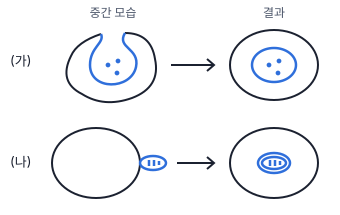
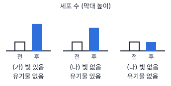

# 생명과학 9장 웹과제 예상 v2 문제해설

왼쪽 목차로 문항을 고르고, 오른쪽 문제를 보며 해설을 따라가요.

문제의 첫 줄부터 검산까지 설명해요.

**목차**

- [문항별 설명](#problems)
  - [P1. [기출 예상] 속씨식물과 동물 매개자](#p1)
  - [P2. [기출 예상] 균류의 먹이 획득](#p2)
  - [P3. [기출 변형] 바이러스의 구조와 증식](#p3)
  - [P4. [기출 변형] 척추동물의 분류와 형질](#p4)
  - [P5. [기출 변형] 세포의 기본 구조 비교](#p5)
  - [P6. [예상] 세포 내부 구조가 생기는 두 경로](#p6)
  - [P7. [예상] RNA X를 넣은 두 실험](#p7)
  - [P8. [예상] 두 세균 배양액의 독성 성분](#p8)
  - [P9. [예상] 세 배양 조건에서의 세포 수 변화](#p9)
  - [P10. [예상] 네 수조의 물고기 생존율](#p10)
  - [P11. [예상] 건조한 날의 잎](#p11)
  - [P12. [예상] 바위 표면의 시료](#p12)
  - [P13. [예상] 세 동물의 몸 모식도](#p13)
  - [P14. [예상] 새와 포유류의 배아 관찰](#p14)
  - [P15. [예상] 두 지역에서 모은 자료](#p15)

## 문항별 설명

### P1. [기출 예상] 속씨식물과 동물 매개자

기출 9강 8 예상 · [연습형 문제 보기](../%EB%B3%B5%EC%8A%B5%EB%AC%B8%EC%A0%9C_9%EC%9E%A5_%EC%9B%B9%EA%B3%BC%EC%A0%9C%EC%98%88%EC%83%81_v2.html#p1) · [시험형 문제 보기](../%EB%B3%B5%EC%8A%B5%EB%AC%B8%EC%A0%9C_9%EC%9E%A5_%EC%9B%B9%EA%B3%BC%EC%A0%9C%EC%98%88%EC%83%81_%EC%8B%9C%ED%97%98%ED%98%95_v2.html#p1)

속씨식물은 _______ 의 진화로 동물 꽃가루 매개자들과 공진화 할 수 있었다.

- A. 큐티클
- B. 엽록체
- C. 기공
- D. 꽃
- E. 관다발

원문·출처 정보 보기

기출 9강 합본 8번을 보기 순서만 바꿔 실은 예상 문제예요. PDF 1–2쪽.

#### 문제가 무엇을 묻는지 읽어요

속씨식물의 여러 구조 중에서 동물이 방문해 꽃가루를 옮기는 과정에 직접 관여한 구조를 골라요.

#### 이 문제를 봤을 때 떠올릴 개념과 공식

‘동물 꽃가루 매개자’는 몸에 묻은 꽃가루를 식물의 꽃가루받이 과정에서 옮기는 동물이에요. 공진화(coevolution)는 두 생물 집단에서 한쪽의 변화가 상대에게 선택압으로 작용하고, 상대의 변화도 다시 영향을 주는 과정이에요.

판단 기준은 해당 구조의 특징이 동물의 방문이나 접촉을 바꾸고, 그 방문이 식물의 꽃가루 전달에 이어지는가예요. [꽃과 동물 매개자의 공진화](../../../%EB%B3%B5%EC%8A%B5%EB%85%B8%ED%8A%B8/1110/%EC%A0%95%EB%A6%AC%EB%85%B8%ED%8A%B8_1110_Protists_Plants_Fungi_and_Animals.html#s1-coevolution)와 [육상식물 구조별 기능](../../../%EB%B3%B5%EC%8A%B5%EB%85%B8%ED%8A%B8/1110/%EC%A0%95%EB%A6%AC%EB%85%B8%ED%8A%B8_1110_Protists_Plants_Fungi_and_Animals.html#s1-land)을 연결해요.

#### 왜 이렇게 푸는지 함께 따라가요

A. 큐티클은 식물의 겉면을 덮어 물이 증발하는 것을 줄여요. 이 보호층의 기능은 방문 동물에 꽃가루를 묻히거나 전달받는 과정과 다르므로 제외해요.

B. 엽록체는 세포 안에서 빛 에너지를 이용해 유기물을 만드는 곳이에요. 이 소기관이 맡는 광합성은 동물이 꽃가루를 옮기는 상호작용을 설명하지 못해요.

C. 기공은 잎에서 이산화탄소와 수증기가 드나드는 작은 구멍이에요. 기공이 열리고 닫히는 것은 기체 교환의 조절이므로 동물 매개와 직접 연결되지 않아요.

D. 꽃의 색과 향은 동물이 찾아올 가능성을 바꾸고, 꽃의 모양은 동물 몸이 꽃가루에 닿는 위치를 바꿔요. 꽃가루를 효과적으로 옮기는 동물과 잘 맞는 꽃을 피운 식물은 번식에 유리할 수 있으므로 꽃이 이 상호작용의 중심이에요.

E. 관다발의 물관은 물과 무기 양분을, 체관은 당 같은 광합성 산물을 옮겨요. 관다발은 식물 몸속의 수송 통로이므로 동물이 꽃가루를 옮길 때 직접 접촉하는 구조와 달라요.

따라서 답은 D, 꽃이에요.

#### 완성 답과 검산

벌새의 긴 부리가 좁고 긴 꽃통에 들어가는 사례를 대조해요. 꽃의 형태는 꿀에 접근하는 새에게 영향을 주고, 새가 꽃을 방문할 때 꽃가루를 옮길 수 있어요. 이 사례에서 새가 직접 접촉하는 식물의 번식 구조를 짚어도 D예요.

**페이지 요약**

동물의 방문과 꽃가루 전달이 맞물리는 번식 구조를 골라요. 답은 D, 꽃이에요.

---

### P2. [기출 예상] 균류의 먹이 획득

기출 9강 16 예상 · [연습형 문제 보기](../%EB%B3%B5%EC%8A%B5%EB%AC%B8%EC%A0%9C_9%EC%9E%A5_%EC%9B%B9%EA%B3%BC%EC%A0%9C%EC%98%88%EC%83%81_v2.html#p2) · [시험형 문제 보기](../%EB%B3%B5%EC%8A%B5%EB%AC%B8%EC%A0%9C_9%EC%9E%A5_%EC%9B%B9%EA%B3%BC%EC%A0%9C%EC%98%88%EC%83%81_%EC%8B%9C%ED%97%98%ED%98%95_v2.html#p2)

균류의 먹이 획득 방법은?

- A. 주변으로부터 세균을 여과한다
- B. 먹이 위에 성장하며 분해하는 화합물을 분비한다
- C. 태양 빛의 도움으로 자신의 음식을 만든다
- D. 포자형성
- E. 다른 생물을 쫓아가서 포획한다

원문·출처 정보 보기

기출 9강 합본 16번을 보기 순서만 바꿔 실은 예상 문제예요. PDF 2쪽.

#### 문제가 무엇을 묻는지 읽어요

균류가 주변의 먹이에서 자기 세포에 필요한 영양분을 어떻게 얻는지 골라요.

#### 이 문제를 봤을 때 떠올릴 개념과 공식

‘먹이 획득’에서 종속영양과 세포외 소화(extracellular digestion)를 떠올려요. 종속영양 생물인 균류는 다른 생물이 만든 유기물을 이용해요. 먹이의 큰 분자는 세포막을 그대로 통과하기 어려워서 균류가 먼저 효소를 내보내 세포 밖에서 작은 분자로 분해해요.

판단 기준은 유기물이 어디서 분해되고 어떤 형태로 세포에 들어오는가예요. [균류의 세포외 소화와 흡수](../../../%EB%B3%B5%EC%8A%B5%EB%85%B8%ED%8A%B8/1110/%EC%A0%95%EB%A6%AC%EB%85%B8%ED%8A%B8_1110_Protists_Plants_Fungi_and_Animals.html#s2-feeding)를 연결해요.

#### 왜 이렇게 푸는지 함께 따라가요

A. 세균을 여과한다는 말은 물에서 세균 같은 먹이 입자를 걸러 낸다는 뜻이에요. 해면동물의 깃세포에서 볼 수 있는 방식이고, 균류는 먹이가 분해되어 생긴 작은 분자를 흡수하므로 제외해요.

B. 먹이 위에 자라며 분해 물질을 분비한다는 설명에서 그 물질이 소화 효소예요. 효소가 먹이의 큰 유기물을 세포 밖에서 잘게 나누고, 그 결과 생긴 작은 분자를 균류가 흡수하므로 적합해요.

C. 태양 빛으로 유기물을 만드는 과정은 광합성이에요. 균류는 이미 있는 유기물에서 영양을 얻으므로 빛을 이용한 유기물 합성은 제외해요.

D. 포자형성은 흩어져 새 개체를 만들 수 있는 포자를 만드는 일이에요. 번식에 해당하므로 먹이의 유기물을 흡수하는 방법으로는 적합하지 않아요.

E. 다른 생물을 쫓아가 포획한다는 설명은 먹이 개체를 붙잡는 행동을 가리켜요. 균류의 일반적인 먹이 획득을 설명하려면 먹이의 유기물을 분해하고 그 산물을 흡수하는 과정이 들어가야 하므로 제외해요.

따라서 답은 B예요.

#### 완성 답과 검산

죽은 나무에서 자라는 균류를 예로 들어 영양분이 들어오는 마지막 단계부터 거슬러 봐요. 세포막을 건너려면 나무의 큰 유기물이 먼저 작은 분자로 바뀌어야 해요. 이때 세포 밖에서 작용하는 물질을 공급하는 선택지는 B예요.

**페이지 요약**

균류는 효소를 먹이 쪽으로 분비해 큰 유기물을 분해하고 작은 분자를 흡수해요. 답은 B예요.

---

### P3. [기출 변형] 바이러스의 구조와 증식

기출 9강 1 예상 · [연습형 문제 보기](../%EB%B3%B5%EC%8A%B5%EB%AC%B8%EC%A0%9C_9%EC%9E%A5_%EC%9B%B9%EA%B3%BC%EC%A0%9C%EC%98%88%EC%83%81_v2.html#p3) · [시험형 문제 보기](../%EB%B3%B5%EC%8A%B5%EB%AC%B8%EC%A0%9C_9%EC%9E%A5_%EC%9B%B9%EA%B3%BC%EC%A0%9C%EC%98%88%EC%83%81_%EC%8B%9C%ED%97%98%ED%98%95_v2.html#p3)

바이러스(virus)에 대한 설명 중 옳지 않은 것은?

- A. 바이러스는 숙주세포의 리보솜 없이도 자신의 단백질을 합성한다.
- B. 캡시드는 바이러스 유전체를 감싸는 단백질 껍질이다.
- C. 바이러스 유전체는 종류에 따라 DNA 또는 RNA로 이루어진다.
- D. 일부 바이러스는 캡시드 바깥에 지질 외피를 가진다.
- E. 세균을 숙주로 삼는 바이러스도 있다.

원문·출처 정보 보기

기출 9강 합본 1번의 발문에 정답을 바꾼 생성 변형이에요. PDF 1쪽. 캡시드와 지질 외피를 구별하고, 단백질 합성에 어떤 장치가 필요한지 확인해요.

#### 문제가 무엇을 묻는지 읽어요

바이러스 입자에 들어 있는 구조와 바이러스가 증식에 이용하는 장치를 구별해 **옳지 않은 설명**을 골라요.

#### 이 문제를 봤을 때 떠올릴 개념과 공식

유전체는 유전정보를 저장하는 핵산이에요. 캡시드(capsid)는 그 유전체를 감싸는 단백질 껍질이에요. 지질 외피(envelope)는 일부 바이러스에서 캡시드 바깥을 감싸는 막이에요.

단백질 합성에는 유전정보를 읽어 아미노산을 잇는 리보솜이 필요해요. 구조에 관한 보기는 재료와 위치를 확인하고, 단백질 합성에 관한 보기는 리보솜을 누가 제공하는지 확인해요. [바이러스 입자의 구조와 숙주 의존](../../../%EB%B3%B5%EC%8A%B5%EB%85%B8%ED%8A%B8/1105/%EC%A0%95%EB%A6%AC%EB%85%B8%ED%8A%B8_1105_Origin_of_Life_and_Prokaryotes.html#s3-structure)을 연결해요.

#### 왜 이렇게 푸는지 함께 따라가요

A. 틀려요. 바이러스는 자체 리보솜이 없어요. 바이러스 유전자가 단백질의 정보를 제공해도 실제 아미노산을 연결하는 장치는 숙주세포의 리보솜이에요.

B. 맞아요. 단백질이 모여 유전체를 둘러싼 껍질이 캡시드예요. 재료가 단백질이고, 감싸는 대상이 바이러스의 유전체라는 설명이 맞아요.

C. 맞아요. 유전정보를 담은 핵산은 바이러스의 종류에 따라 DNA일 수도 RNA일 수도 있어요. 보기의 ‘또는’은 종류마다 유전체의 핵산 유형이 달라진다는 뜻이에요.

D. 맞아요. 외피가 있는 바이러스에서는 지질막이 캡시드 바깥에 놓여요. 보기의 ‘일부’는 이런 막을 가진 종류로 범위를 정확하게 제한해요.

E. 맞아요. 숙주는 바이러스가 감염시키고 증식에 이용하는 세포를 뜻해요. 세균을 감염시키는 박테리오파지가 있으므로 세균도 바이러스의 숙주가 될 수 있어요.

질문은 옳지 않은 설명을 요구하므로 답은 A예요.

#### 완성 답과 검산

새 캡시드가 만들어지는 순서로 확인해요. 바이러스 유전체가 캡시드 단백질의 정보를 제공하고, 감염된 숙주세포가 그 정보를 읽어 단백질을 만들면 새 입자가 조립돼요. 단백질을 만드는 단계에 숙주가 필요하므로 A의 독자 합성 주장은 성립하지 않아요.

**페이지 요약**

캡시드는 단백질 껍질이고 지질 외피는 일부에만 있어요. 단백질 합성은 숙주 리보솜에 의존하므로 틀린 설명은 A예요.

---

### P4. [기출 변형] 척추동물의 분류와 형질

기출 9강 19 예상 · [연습형 문제 보기](../%EB%B3%B5%EC%8A%B5%EB%AC%B8%EC%A0%9C_9%EC%9E%A5_%EC%9B%B9%EA%B3%BC%EC%A0%9C%EC%98%88%EC%83%81_v2.html#p4) · [시험형 문제 보기](../%EB%B3%B5%EC%8A%B5%EB%AC%B8%EC%A0%9C_9%EC%9E%A5_%EC%9B%B9%EA%B3%BC%EC%A0%9C%EC%98%88%EC%83%81_%EC%8B%9C%ED%97%98%ED%98%95_v2.html#p4)

척추동물 아문에 대한 설명으로 잘못된 것은?

- A. 척추동물은 척삭동물문에 속한다.
- B. 사람은 배아 시기에 척삭을 형성한다.
- C. 턱은 모든 척추동물이 공유하는 형질이다.
- D. 양서류는 척추동물 중 사지류에 속한다.
- E. 척추동물의 내부골격은 근육을 지지하는 역할을 한다.

원문·출처 정보 보기

기출 9강 합본 19번의 발문에 정답을 바꾼 생성 변형이에요. PDF 3쪽. 어떤 형질이 어느 분류 범위에 속하는지 확인해요.

#### 문제가 무엇을 묻는지 읽어요

척추동물이 속한 분류 범위와 그 안에서 나뉘는 갈래를 확인해 **잘못된 설명**을 골라요.

#### 이 문제를 봤을 때 떠올릴 개념과 공식

척삭(notochord)은 몸의 축을 지지하는 유연한 구조이고, 척삭동물은 생애의 적어도 한 시기에 이를 가져요. 척추동물은 척삭동물문 안의 한 갈래예요. 척추동물 안에는 턱이 없는 무악류와 턱이 있는 유악동물이 있어요.

판단 기준은 어떤 갈래에 속한다는 말인지, 어느 범위의 동물이 해당 형질을 공유한다는 말인지예요. 특히 ‘모든’이라는 진술은 그 범위에 속하면서 해당 형질이 없는 사례가 하나라도 있으면 틀려요. [척삭동물과 척추동물의 포함 관계](../../../%EB%B3%B5%EC%8A%B5%EB%85%B8%ED%8A%B8/1110/%EC%A0%95%EB%A6%AC%EB%85%B8%ED%8A%B8_1110_Protists_Plants_Fungi_and_Animals.html#s3-chordate)를 연결해요.

#### 왜 이렇게 푸는지 함께 따라가요

A. 맞아요. 척삭동물문은 척추동물 아문을 포함하는 상위 범위예요. 따라서 척추동물이 척삭동물문에 속한다는 방향이 맞아요.

B. 맞아요. 척삭이 있는 시기가 생애 전체일 필요는 없어요. 사람은 배아 시기에 유연한 척삭이 생기므로 보기가 가리키는 시기가 맞아요.

C. 틀려요. 칠성장어는 척추동물 범위에 들어가면서 턱이 없는 무악류예요. 이 반례 때문에 턱을 척추동물 전체가 공유한다고 할 수 없어요.

D. 맞아요. 사지류는 척추동물 안에서 양서류와 양막류를 포함하는 갈래예요. 따라서 양서류가 그 안에 속해요.

E. 맞아요. 내부골격은 몸 안에서 근육이 붙고 힘을 전달할 수 있도록 받쳐 줘요. 정리노트에서는 이 기능을 교재 보충으로 다뤄요.

질문은 잘못된 설명을 요구하므로 답은 C예요.

#### 완성 답과 검산

계통도에서 척추동물 가지를 먼저 찾고 그 안에서 턱의 출현 위치를 따라가요. 턱은 척추동물 전체가 갈라지는 지점보다 뒤인 유악동물 가지에 놓여요. 따라서 척추동물 전체에 턱을 배정한 C의 범위가 너무 넓어요.

**페이지 요약**

턱은 유악동물의 형질이에요. 무악류도 척추동물이므로 틀린 설명은 C예요.

---

### P5. [기출 변형] 세포의 기본 구조 비교

기출 9강 23 예상 · [연습형 문제 보기](../%EB%B3%B5%EC%8A%B5%EB%AC%B8%EC%A0%9C_9%EC%9E%A5_%EC%9B%B9%EA%B3%BC%EC%A0%9C%EC%98%88%EC%83%81_v2.html#p5) · [시험형 문제 보기](../%EB%B3%B5%EC%8A%B5%EB%AC%B8%EC%A0%9C_9%EC%9E%A5_%EC%9B%B9%EA%B3%BC%EC%A0%9C%EC%98%88%EC%83%81_%EC%8B%9C%ED%97%98%ED%98%95_v2.html#p5)

아래 그룹 중에서, 다른 그룹들과 비교하여 가장 다른 그룹은 무엇인가?

핵막으로 둘러싸인 핵이 있는지 기준으로 비교해요.

- A. 프로테오박테리아
- B. 남세균
- C. 나선균
- D. 클라미디아
- E. 짚신벌레

원문·출처 정보 보기

기출 9강 합본 23번의 발문에 정답을 바꾼 생성 변형이에요. PDF 3쪽. 원래 질문 아래에 핵막으로 둘러싸인 핵의 유무를 비교 기준으로 밝혔어요.

#### 문제가 무엇을 묻는지 읽어요

다섯 생물 무리를 핵막으로 둘러싸인 핵이 있는지에 따라 나누고, 나머지 넷과 다른 쪽에 놓이는 하나를 찾아요.

#### 이 문제를 봤을 때 떠올릴 개념과 공식

핵막(nuclear envelope)은 진핵세포에서 유전체가 든 핵을 세포질과 나누는 경계예요. 세균도 DNA가 있지만, DNA가 모이는 핵양체(nucleoid)에는 핵막이 없어요. 세포가 하나인 생물 중에도 핵을 가진 진핵생물이 있으므로 세포 수는 이 문제의 판별 기준이 될 수 없어요.

[세균 무리와 대표 사례](../../../%EB%B3%B5%EC%8A%B5%EB%85%B8%ED%8A%B8/1105/%EC%A0%95%EB%A6%AC%EB%85%B8%ED%8A%B8_1105_Origin_of_Life_and_Prokaryotes.html#s2-groups)와 [짚신벌레를 포함한 원생생물의 특징](../../../%EB%B3%B5%EC%8A%B5%EB%85%B8%ED%8A%B8/1110/%EC%A0%95%EB%A6%AC%EB%85%B8%ED%8A%B8_1110_Protists_Plants_Fungi_and_Animals.html#s0-diversity)을 대조해요.

#### 왜 이렇게 푸는지 함께 따라가요

A. 프로테오박테리아는 대장균을 포함하는 세균 무리예요. 세포의 DNA는 핵막으로 싸인 핵에 들어 있지 않으므로 ‘핵막으로 둘러싸인 핵 없음’에 놓아요.

B. 남세균은 광합성을 하는 세균이에요. 광합성은 영양을 얻는 방식이고, 이 문항의 구조 기준으로는 다른 세균과 같이 핵막으로 둘러싸인 핵이 없어요.

C. 나선균은 수업에서 매독을 일으키는 세균을 사례로 든 무리예요. 나선형은 몸 모양의 특징이고, 세포 구조를 기준으로 보면 핵막이 없어요.

D. 클라미디아는 숙주세포 안에서 증식하는 세균이에요. 비교 대상은 숙주가 아니라 클라미디아 자체의 세포이므로 ‘핵막으로 둘러싸인 핵 없음’에 놓아요.

E. 짚신벌레는 세포 하나로 살면서도 핵막에 싸인 핵이 있는 진핵 원생생물이에요. 다섯 보기 중 유일하게 ‘핵막으로 둘러싸인 핵 있음’에 놓여요.

따라서 답은 E, 짚신벌레예요.

#### 완성 답과 검산

세포 구조 그림에서 DNA가 놓인 자리를 대조해요. 원핵세포의 핵양체는 막으로 둘러싸인 방처럼 그려지지 않지만, 짚신벌레 그림에는 대핵과 소핵이 구별되어 있어요. 세균 무리의 이름 대신 유전물질을 담는 구조를 봐도 E가 달라요.

**페이지 요약**

세균 네 무리에는 핵막으로 둘러싸인 핵이 없어요. 단세포인 짚신벌레에는 핵이 있어 답은 E예요.

---

### P6. [예상] 세포 내부 구조가 생기는 두 경로

예상 9장 6 · [연습형 문제 보기](../%EB%B3%B5%EC%8A%B5%EB%AC%B8%EC%A0%9C_9%EC%9E%A5_%EC%9B%B9%EA%B3%BC%EC%A0%9C%EC%98%88%EC%83%81_v2.html#p6) · [시험형 문제 보기](../%EB%B3%B5%EC%8A%B5%EB%AC%B8%EC%A0%9C_9%EC%9E%A5_%EC%9B%B9%EA%B3%BC%EC%A0%9C%EC%98%88%EC%83%81_%EC%8B%9C%ED%97%98%ED%98%95_v2.html#p6)

그림은 초기 진핵세포의 내부 구조가 생긴 두 경로를 나타낸 모형이에요. 경로 (가)와 (나)를 그 결과로 생긴 구조 및 관찰 증거와 연결한 설명으로 옳은 것은 무엇인가요?

- A. 핵막 형성은 (나)로, 미토콘드리아의 기원은 (가)로 설명해요. 미토콘드리아의 자체 환형 DNA는 (가)를 지지해요.
- B. 핵막 형성은 (가)로, 미토콘드리아의 기원은 (나)로 설명해요. 미토콘드리아의 리보솜은 세균의 것보다 숙주 세포질의 것과 더 비슷할 것으로 예상해요.
- C. 핵막 형성은 (가)로, 미토콘드리아의 기원은 (나)로 설명해요. 미토콘드리아의 자체 환형 DNA와 세균을 닮은 리보솜은 (나)를 지지해요.
- D. 핵막과 미토콘드리아의 기원은 모두 (나)로 설명해요. 두 구조 모두 막이 있다는 사실이 (나)를 지지해요.
- E. 핵막과 미토콘드리아의 기원은 모두 (가)로 설명해요. 미토콘드리아의 세균을 닮은 리보솜은 (가)를 지지해요.

원문·출처 정보 보기

두 진핵세포 내부 구조의 기원을 비교하는 새 예상 문제예요.

#### 무엇을 구하나요?

두 줄에서 오른쪽의 구조가 왼쪽의 어디서 왔는지 찾아요. 그 경로를 핵막과 미토콘드리아에 짝지은 뒤, 미토콘드리아의 DNA와 리보솜이 어느 경로를 뒷받침하는지 판단해요.

#### 이 문제를 봤을 때 떠올릴 개념과 공식

세포막이 안쪽으로 접히는 **막 함입**은 원래 있던 막에서 핵막 같은 내부막이 생기는 경로예요. **세포내공생(endosymbiosis)**은 별개의 세균이 다른 세포 안에 들어와 살아가는 관계예요. 그 세균이 진화해 미토콘드리아가 됐다면, 소기관 안에서 세균과 닮은 자체 유전물질과 단백질 합성 장치를 찾을 수 있어요.

그림에서 접힌 선이 큰 세포의 바깥 경계에 이어지는지, 안으로 들어간 작은 타원이 원래 바깥에 따로 있었는지 확인해요. 막은 두 경로 모두에서 생길 수 있어요. 자체 환형 DNA와 세균과 닮은 리보솜을 함께 보면 별개 세포에서 왔다는 설명을 뒷받침할 수 있어요. [막 함입과 세포내공생의 증거](../../../%EB%B3%B5%EC%8A%B5%EB%85%B8%ED%8A%B8/1105/%EC%A0%95%EB%A6%AC%EB%85%B8%ED%8A%B8_1105_Origin_of_Life_and_Prokaryotes.html#s1-endosymbiosis)에서 두 경로를 대조할 수 있어요.

#### 왜 이렇게 푸는지 함께 따라가요

A. 틀려요. (가)에서 접힌 선은 바깥 경계와 이어지므로 핵막을 설명해요. (나)의 작은 타원은 처음에 별개였으므로 미토콘드리아의 기원에 맞고, 미토콘드리아 자체의 환형 DNA도 (나)를 지지해요.

B. 틀려요. 핵막은 (가), 미토콘드리아는 (나)라는 대응은 맞아요. (나)의 출발점이 세균이라면 미토콘드리아의 리보솜이 숙주 세포질의 것보다 세균의 것과 더 닮으리라고 예상해요.

C. 맞아요. (가)의 접히는 막은 핵막 형성으로, (나)의 안으로 들어간 별개 세포는 미토콘드리아의 기원으로 연결돼요. 미토콘드리아가 별도의 환형 DNA와 세균을 닮은 리보솜을 지닌다는 관찰은 (나)에 맞아요.

D. 틀려요. (가)의 오른쪽에도 내부막이 생겼어요. 두 구조에 막이 있다는 사실만으로 (나)를 고를 수 없고, 핵막 형성에는 원래 막이 접히는 (가)가 대응해요.

E. 틀려요. (가)에서는 숙주의 막이 접혀요. 세균과 닮은 리보솜은 밖에서 들어온 별개 세포의 특징이 남았다는 (나)의 설명과 들어맞아요.

두 구조의 기원과 증거를 모두 바르게 연결한 답은 C예요.

#### 완성 답과 검산

답 C예요. 그림을 덮고 증거에서 거꾸로 출발해 봐요. 미토콘드리아에 핵의 유전체와 별도로 환형 DNA가 있고 리보솜도 세균과 닮았으므로, 미토콘드리아에는 독자적인 유전·단백질 합성 장치를 갖췄던 별개 세포를 출발점으로 놓아요. 이 조건을 충족하는 줄은 바깥에 작은 세포가 있는 (나)예요.

**페이지 요약**

#### 판단 기준

기존 막이 접히는 (가)는 핵막, 별도 세포가 들어오는 (나)는 미토콘드리아에 연결돼요. 미토콘드리아의 자체 환형 DNA와 세균형 리보솜은 (나)를 지지해요. 답은 C예요.

---

### P7. [예상] RNA X를 넣은 두 실험

예상 9장 7 · [연습형 문제 보기](../%EB%B3%B5%EC%8A%B5%EB%AC%B8%EC%A0%9C_9%EC%9E%A5_%EC%9B%B9%EA%B3%BC%EC%A0%9C%EC%98%88%EC%83%81_v2.html#p7) · [시험형 문제 보기](../%EB%B3%B5%EC%8A%B5%EB%AC%B8%EC%A0%9C_9%EC%9E%A5_%EC%9B%B9%EA%B3%BC%EC%A0%9C%EC%98%88%EC%83%81_%EC%8B%9C%ED%97%98%ED%98%95_v2.html#p7)

연구팀은 정제한 RNA X로 두 실험을 했어요. 실험 1에서는 짧은 RNA 조각의 서열을 읽었어요. X′는 X의 일부 염기만 바꾼 RNA이고, 두 조건에는 같은 단백질 효소를 넣었어요. 실험 2에서는 다른 두 조각이 이어지는 초기 속도를 비교했어요. 이때는 단백질이 없는 재료만 사용했고, X의 첨가 여부 외에는 두 조각의 양과 반응 환경을 같게 유지했어요. 표에서 이끌어 낼 수 있는 결론으로 가장 적절한 것은 무엇인가요?

| 실험 | 넣은 RNA | 관찰 결과 |
|---|---|---|
| 1 | X | X의 일부에 상보적인 짧은 조각이 생김 |
| 1 | X′ | 같은 위치에서 X′에 상보적인 짧은 조각이 생김 |
| 2 | X | 결합 속도가 높음. 회수한 X의 양과 서열은 처음과 같음 |
| 2 | 없음 | 결합 속도가 낮음 |

- A. 실험 1의 결과는 단백질 효소의 서열이 만들어진 조각의 염기서열을 정한다는 뜻이에요.
- B. 실험 2의 결과는 X가 두 조각에 직접 이어져 생성물의 일부로 소모된다는 뜻이에요.
- C. 실험 1만으로 X가 주형 역할과 촉매 역할을 모두 한다고 결론 내릴 수 있어요.
- D. 두 실험을 합치면 X가 외부 효소 없이 자기 전체 서열을 복제할 수 있다는 결론을 내릴 수 있어요.
- E. 실험 1은 X가 서열 정보를 담아 주형이 될 수 있음을, 실험 2는 X가 리보자임으로 작용할 수 있음을 보여 줘요.

원문·출처 정보 보기

같은 RNA가 관여하는 두 가상 실험을 비교하는 새 예상 문제예요.

#### 무엇을 구하나요?

실험 1에서는 어떤 서열의 RNA 조각이 생겼는지, 실험 2에서는 두 조각이 얼마나 빨리 이어졌는지 봐요. 각 실험이 RNA X의 어떤 역할을 보여 주는지 골라요.

#### 이 문제를 봤을 때 떠올릴 개념과 공식

**주형(template)**은 새 가닥을 만드는 데 쓰이는 서열의 본보기예요. 상보적이라는 말은 RNA 염기가 A와 U, G와 C처럼 짝을 이룬다는 뜻이에요. 효소를 그대로 두고 X의 염기를 바꾼 X′를 넣었을 때, 새 조각의 염기가 그에 맞춰 바뀌는지 확인해요.

**촉매(catalyst)**는 반응 속도를 높이고 반응 전체에서 소모되지 않는 물질이에요. 촉매 역할을 하는 RNA를 **리보자임(ribozyme)**이라고 해요. 단백질이 없는 실험 2에서는 X의 유무만 다른 조건에서 초기 속도를 비교하고, 반응 뒤 X가 남아 있는지 확인해요. [RNA 우선 가설과 리보자임](../../../%EB%B3%B5%EC%8A%B5%EB%85%B8%ED%8A%B8/1105/%EC%A0%95%EB%A6%AC%EB%85%B8%ED%8A%B8_1105_Origin_of_Life_and_Prokaryotes.html#s0-rna)에서 두 기능을 살펴볼 수 있어요.

#### 왜 이렇게 푸는지 함께 따라가요

A. 틀려요. 단백질 효소는 두 조건에서 같아요. X를 X′로 바꿨을 때 생성 조각의 염기서열이 X′에 맞춰 달라졌으므로 서열의 본보기는 RNA예요.

B. 틀려요. X가 이어진 조각의 일부로 소모됐다면 처음 형태로 회수한 X의 양이 줄어요. 실험 2에서는 회수한 X의 양과 서열이 그대로였어요.

C. 틀려요. 실험 1은 같은 단백질 효소를 넣고 생성물의 서열을 읽어요. X가 들어가 반응이 빨라지는지는 이 대조로 확인할 수 없어요.

D. 틀려요. 실험 1에서 나온 것은 외부 효소를 사용해 만든 짧은 상보적 조각이에요. 실험 2의 생성물은 별도의 두 조각을 이은 결과예요. X 전체의 서열을 외부 효소 없이 복제했다는 관찰은 없어요.

E. 맞아요. 실험 1에서 X의 서열을 따라 상보적인 조각이 생기므로 X가 주형이 될 수 있어요. 실험 2에서 X를 넣으면 단백질 없이도 두 조각이 빨리 이어지고 X는 소모되지 않으므로, X가 리보자임으로 작용할 수 있어요.

두 실험이 확인한 역할을 각각 짚은 답은 E예요.

#### 완성 답과 검산

답 E예요. 자기 복제를 주장하려면 적어도 X의 전체 서열에 해당하는 새 RNA가 생겼는지와 외부 효소에 의존하는지를 확인해야 해요. 첫 실험의 짧은 조각과 두 번째 실험의 결합 속도에는 그 증거가 없어요. 결과의 범위를 주형과 촉매로 한정하는 E가 자료와 맞아요.

**페이지 요약**

#### 판단 기준

생성 조각의 서열이 X를 따라 바뀌면 주형 역할을, X를 넣어 반응이 빨라지고 X가 그대로 남으면 촉매 역할을 확인해요. 답은 E예요.

---

### P8. [예상] 두 세균 배양액의 독성 성분

예상 9장 8 · [연습형 문제 보기](../%EB%B3%B5%EC%8A%B5%EB%AC%B8%EC%A0%9C_9%EC%9E%A5_%EC%9B%B9%EA%B3%BC%EC%A0%9C%EC%98%88%EC%83%81_v2.html#p8) · [시험형 문제 보기](../%EB%B3%B5%EC%8A%B5%EB%AC%B8%EC%A0%9C_9%EC%9E%A5_%EC%9B%B9%EA%B3%BC%EC%A0%9C%EC%98%88%EC%83%81_%EC%8B%9C%ED%97%98%ED%98%95_v2.html#p8)

세균 (가)는 살아서 자라는 동안 배양액에 독성 단백질 X를 분비했어요. 세균 (나)에서는 세포가 터진 뒤 외막에서 유래한 독성 지질다당류 Y가 배양액에 늘어났어요. 이 관찰을 설명한 내용으로 옳지 않은 것은 무엇인가요?

- A. X는 세균이 밖으로 분비한 독성 단백질이므로 외독소예요.
- B. Y는 세균 외막을 이루던 성분이므로 내독소예요.
- C. 두 물질이 배양액에서 검출되어도 세균 밖으로 나온 과정은 서로 달라요.
- D. (가)가 X를 분비했다는 사실을 근거로, (가)는 항생제에 내성이 있다고 판정할 수 있어요.
- E. 배양액에 이미 분비된 X가 없어졌는지는 (가)가 죽었다는 사실만으로 판단할 수 없어요.

원문·출처 정보 보기

세균 독소의 성분과 방출 경로를 비교하는 새 예상 문제예요.

#### 무엇을 구하나요?

X는 살아 있는 세균이 분비한 단백질이고 Y는 세균이 터진 뒤 배양액에 늘어난 외막 성분이에요. 각 관찰이 뒷받침하는 내용을 따져 **옳지 않은 설명**을 골라요.

#### 이 문제를 봤을 때 떠올릴 개념과 공식

독소 이름을 고를 때는 배양액에서 검출되기 전의 위치와 성분을 봐요. **외독소(exotoxin)**는 세균이 밖으로 내보내는 독성 단백질이에요. **내독소(endotoxin)**는 일부 세균의 외막을 이루는 지질다당류(LPS)예요. 이 물질은 세포가 터지는 용균 때 밖으로 나올 수 있어요.

**항생제 내성**은 세균이 항생제의 작용을 견디는 성질이므로, 약물에 노출된 세균이 생존하거나 증식하는지를 봐야 해요. 이미 밖으로 나온 독소가 남았는지는 배양액의 독소 양을, 독성이 유지되는지는 독소의 활성을 따로 확인해요. [외독소·내독소와 항생제 내성](../../../%EB%B3%B5%EC%8A%B5%EB%85%B8%ED%8A%B8/1105/%EC%A0%95%EB%A6%AC%EB%85%B8%ED%8A%B8_1105_Origin_of_Life_and_Prokaryotes.html#s2-toxins)을 참고할 수 있어요.

#### 왜 이렇게 푸는지 함께 따라가요

A. 맞아요. X는 살아 있는 (가)가 배양액에 분비한 독성 단백질이라 외독소예요.

B. 맞아요. Y는 (나)의 외막을 구성하던 독성 지질다당류라 내독소에 해당해요.

C. 맞아요. X는 세균이 자라면서 분비했고 Y는 세포가 터지면서 외막에서 풀려 나왔어요. 발견 장소는 같지만 나온 경로가 달라요.

D. 틀려요. X의 분비를 관찰한 것으로는 (가)가 항생제의 작용을 견디는지 알 수 없어요. 그 성질을 판정하려면 항생제에 노출시킨 뒤 세균의 생존이나 생장을 확인해야 해요.

E. 맞아요. 이미 분비된 X는 (가)의 바깥에 있으므로 세균이 죽은 뒤에도 배양액에 남을 수 있어요. X가 없어졌는지는 별도의 관찰이 필요해요.

옳지 않은 설명을 고르므로 답은 D예요.

#### 완성 답과 검산

답 D예요. 똑같이 X를 분비하는 두 균주가 항생제에 서로 다르게 반응한다고 가정해도 문제의 관찰과 양립해요. 분비 관찰만으로 어느 쪽인지 정할 수 없으므로 D의 추론이 성립하지 않아요.

**페이지 요약**

#### 판단 기준

분비된 독성 단백질 X는 외독소, 외막 지질다당류 Y는 내독소예요. X 분비로 항생제 내성을 판정한 D가 옳지 않아요.

---

### P9. [예상] 세 배양 조건에서의 세포 수 변화

예상 9장 9 · [연습형 문제 보기](../%EB%B3%B5%EC%8A%B5%EB%AC%B8%EC%A0%9C_9%EC%9E%A5_%EC%9B%B9%EA%B3%BC%EC%A0%9C%EC%98%88%EC%83%81_v2.html#p9) · [시험형 문제 보기](../%EB%B3%B5%EC%8A%B5%EB%AC%B8%EC%A0%9C_9%EC%9E%A5_%EC%9B%B9%EA%B3%BC%EC%A0%9C%EC%98%88%EC%83%81_%EC%8B%9C%ED%97%98%ED%98%95_v2.html#p9)

같은 유글레나를 같은 수만큼 세 배양액에 나누어 넣었어요. 배양액에는 물·무기염류·이산화탄소가 들어 있고, 외부 유기물로 쓸 수 있는 물질은 그림에 표시한 경우에만 추가했어요. 그림은 빛과 외부 유기물을 달리하고 다른 조건은 같게 둔 가상의 실험 결과예요. 그림을 바르게 해석한 것은 무엇인가요?

*유기물의 유무는 배양액에 유기물을 추가했는지를 뜻해요.*

- A. (가)와 (다)를 비교하면 빛이 있는 조건에서도 세포 수가 늘어나려면 외부 유기물을 더해야 한다는 걸 알 수 있어요.
- B. (가)와 (다)의 차이는 광합성을, (나)와 (다)의 차이는 어둠 속에서 외부 유기물을 이용하는 방식을 뒷받침해요.
- C. (가)와 (나)에서 세포 수가 모두 늘었으므로 두 배양액에서 공통으로 광합성이 일어났어요.
- D. (나)와 (다)의 차이를 보면 어둠만으로도 외부 유기물 없이 세포 수가 늘 수 있어요.
- E. 빛과 외부 유기물이 한 배양액에 함께 있어야 세포 수가 늘어요.

원문·출처 정보 보기

9장 수업에서 다룬 원생생물의 영양 방식을 가상의 배양 결과에 적용하는 새 예상 문제예요.

#### 무엇을 구하나요?

배양 전후 막대 높이를 읽고, 빛과 외부 유기물이 각각 있을 때 유글레나가 어떻게 영양을 얻는지 판단해요.

#### 이 문제를 봤을 때 떠올릴 개념과 공식

**한 조건만 달라지는 두 배양액을 비교해요.** 광합성에는 빛이 필요하고, 빛이 없는 조건에서 외부 유기물을 추가해 세포 수가 늘었다면 외부 유기물 이용을 뒷받침해요. 유글레나처럼 조건에 따라 두 방식을 쓸 수 있는 것을 혼합영양이라고 해요. [정리노트의 원생생물 영양 방식](../../../%EB%B3%B5%EC%8A%B5%EB%85%B8%ED%8A%B8/1110/%EC%A0%95%EB%A6%AC%EB%85%B8%ED%8A%B8_1110_Protists_Plants_Fungi_and_Animals.html#s0-diversity)에서 확인해요.

#### 왜 이렇게 푸는지 함께 따라가요

A. 틀려요. (가)에서는 외부 유기물을 더하지 않았고 빛은 있었어요. 후 막대가 전 막대보다 높으므로 이 조건에서 외부 유기물이 필수였다는 설명은 맞지 않아요.

B. 맞아요. (가)와 (다)는 외부 유기물이 없고 빛만 달라요. (가)에서만 세포 수가 늘어 광합성 해석을 뒷받침해요. (나)와 (다)는 둘 다 어둡고 외부 유기물만 달라요. (나)에서만 세포 수가 늘어 어둠에서 외부 유기물을 이용한다는 해석을 뒷받침해요.

C. 틀려요. (나)에서는 빛이 없어요. 같은 세포 수 증가라도 (나)는 외부 유기물 이용으로 설명할 수 있어요.

D. 틀려요. 외부 유기물이 없는 어둠 조건은 (다)예요. (다)의 막대 높이는 배양 전후 같아요.

E. 틀려요. (가)는 빛만 있고 (나)는 외부 유기물만 있어요. 두 조건에서 모두 세포 수가 늘었어요.

#### 완성 답과 검산

답 B. 빛도 외부 유기물도 없는 (다)를 기준으로 보면, 빛을 더한 (가)와 유기물을 더한 (나)에서 각각 증가해요. 세포 수만 관찰했으므로 각 영양 방식이 관찰과 맞는다고 판단할 수 있어요.

**페이지 요약**

#### 판단 기준

두 조건이 모두 빠진 (다)를 기준으로, 한 조건만 달라지는 배양액을 비교해요.

#### 결론

(가)는 광합성을, (나)는 외부 유기물 이용을 뒷받침해요. 답은 B예요.

---

### P10. [예상] 네 수조의 물고기 생존율

예상 9장 10 · [연습형 문제 보기](../%EB%B3%B5%EC%8A%B5%EB%AC%B8%EC%A0%9C_9%EC%9E%A5_%EC%9B%B9%EA%B3%BC%EC%A0%9C%EC%98%88%EC%83%81_v2.html#p10) · [시험형 문제 보기](../%EB%B3%B5%EC%8A%B5%EB%AC%B8%EC%A0%9C_9%EC%9E%A5_%EC%9B%B9%EA%B3%BC%EC%A0%9C%EC%98%88%EC%83%81_%EC%8B%9C%ED%97%98%ED%98%95_v2.html#p10)

와편모조류가 크게 늘어난 만에서 물고기가 죽었어요. 연구팀은 같은 종의 물고기를 네 수조에 같은 수로 무작위 배정하고, 용존 산소와 독소 X가 생존율에 미치는 영향을 알아봤어요. X는 만에서 번성한 와편모조류가 만든 것으로 확인됐어요. 산소를 보충한 조건은 실험 내내 같은 정상 산소 농도로, 보충하지 않은 조건은 같은 낮은 산소 농도로 유지했어요. X가 있는 조건의 X 농도는 서로 같고, 수온과 염분 등 나머지 조건도 같아요. 표에서 이끌어 낼 수 있는 결론으로 가장 적절한 것은 무엇인가요?

| 수조 | 산소 보충 | 독소 X | 생존율 |
|---|---|---|---|
| (가) | 없음 | 있음 | 20% |
| (나) | 있음 | 있음 | 60% |
| (다) | 없음 | 없음 | 55% |
| (라) | 있음 | 없음 | 95% |

- A. (가)와 (나)는 낮은 산소의 영향을, (나)와 (라)는 X의 영향을 보여 줘요. 두 요인 모두 생존율을 낮출 수 있어요.
- B. (가)와 (나)는 낮은 산소의 영향을 보여 줘요. 산소가 정상인 (나)와 (라)의 차이로는 X의 영향을 판단할 수 없어요.
- C. (나)와 (라)는 X의 영향을 보여 줘요. 두 수조에 모두 산소를 보충했으므로 실험 결과 전체에서 낮은 산소의 영향은 확인할 수 없어요.
- D. (가)와 (라)의 생존율 차이는 두 수조를 비교하는 것만으로 X의 영향에 해당하는 차이라고 볼 수 있어요.
- E. (나)와 (다)의 생존율이 비슷하므로 두 수조를 비교하면 산소 보충과 X가 각각 생존율에 거의 영향을 주지 않았다고 볼 수 있어요.

원문·출처 정보 보기

와편모조류가 번성한 뒤의 피해를 대조 실험으로 해석하는 새 예상 문제예요.

#### 무엇을 구하나요?

가상 실험의 네 수조에서 용존 산소와 독소 X의 유무를 조합했어요. 물고기 생존율에 낮은 산소와 독소가 각각 영향을 주는지 판단해요.

#### 이 문제를 봤을 때 떠올릴 개념과 공식

와편모조류가 크게 번성하면 일부 종의 독소가 동물에게 직접 해를 줄 수 있어요. 번성한 생물의 호흡과 사체가 분해되는 과정은 물에 녹은 산소인 **용존 산소**를 줄여 물고기의 호흡을 어렵게 할 수 있어요. [와편모조류 번성과 적조 피해](../../../%EB%B3%B5%EC%8A%B5%EB%85%B8%ED%8A%B8/1110/%EC%A0%95%EB%A6%AC%EB%85%B8%ED%8A%B8_1110_Protists_Plants_Fungi_and_Animals.html#s0-algae)에서 두 경로를 확인할 수 있어요.

한 요인의 영향을 보려면 그 요인만 다른 두 수조를 비교해요. 산소를 볼 때는 X의 유무와 농도가 같은 쌍을 찾고, X를 볼 때는 실험 동안 산소 농도가 같은 쌍을 찾아요. 생존율이 높은 쪽을 확인하면 영향의 방향도 읽을 수 있어요.

#### 왜 이렇게 푸는지 함께 따라가요

A. 맞아요. (가)와 (나)는 X의 농도가 같고 산소만 달라요. 산소 보충으로 생존율이 20%에서 60%로 높아졌어요. (나)와 (라)는 산소가 같은 정상 농도예요. X가 있을 때 생존율은 60%, 없을 때는 95%였어요. 낮은 산소와 X는 각각 생존율을 낮출 수 있어요.

B. 틀려요. (가)와 (나)가 낮은 산소의 영향을 보여 준다는 앞부분은 맞아요. (나)와 (라)에서는 정상 산소를 같은 수준으로 유지했으므로 생존율 차이를 X의 유무에 연결할 수 있어요.

C. 틀려요. (나)와 (라)로 X의 영향을 읽는 것은 맞아요. 낮은 산소의 영향은 두 수조에 모두 X가 있고 산소만 다른 (가)와 (나)에서 확인할 수 있어요.

D. 틀려요. (가)는 낮은 산소에 X가 있고 (라)는 정상 산소에 X가 없어요. 두 요인이 함께 바뀌었으므로 20%와 95%의 차이 중 얼마가 X의 영향인지는 이 비교로 가를 수 없어요.

E. 틀려요. (나)의 60%와 (다)의 55%는 비슷하지만, (나)는 산소가 정상이고 X가 있으며 (다)는 산소가 낮고 X가 없어요. 한쪽에는 산소 보충이, 다른 쪽에는 X가 없다는 점이 각각 생존에 유리해 두 요인의 영향을 따로 읽을 수 없어요.

한 번에 한 요인씩 비교한 답은 A예요.

#### 완성 답과 검산

답 A예요. A에 쓰이지 않은 짝으로도 확인해요. X가 없는 (다)와 (라)에서는 낮은 산소에서 55%, 정상 산소에서 95%가 생존했어요. 산소가 낮은 (가)와 (다)에서는 X가 있을 때 20%, 없을 때 55%가 생존했어요. 조건을 바꾸어 비교해도 낮은 산소와 X가 각각 생존율을 낮추는 방향은 같아요.

**페이지 요약**

#### 판단 기준

X를 같게 두면 산소의 영향, 산소를 같게 두면 X의 영향을 읽을 수 있어요. 두 요인 모두 생존율을 낮췄어요. 답은 A예요.

---

### P11. [예상] 건조한 날의 잎

예상 9장 11 · [연습형 문제 보기](../%EB%B3%B5%EC%8A%B5%EB%AC%B8%EC%A0%9C_9%EC%9E%A5_%EC%9B%B9%EA%B3%BC%EC%A0%9C%EC%98%88%EC%83%81_v2.html#p11) · [시험형 문제 보기](../%EB%B3%B5%EC%8A%B5%EB%AC%B8%EC%A0%9C_9%EC%9E%A5_%EC%9B%B9%EA%B3%BC%EC%A0%9C%EC%98%88%EC%83%81_%EC%8B%9C%ED%97%98%ED%98%95_v2.html#p11)

건조한 공기에 노출된 관다발식물에서 기공이 닫혔어요. 기공이 닫히기 전후에 잎 안팎의 수증기 농도 차와 이산화탄소 농도 차가 각각 일정하다고 가정해요. 이 식물에 대한 설명으로 **옳지 않은** 것은 무엇인가요?

- A. 잎 표면의 왁스성 큐티클은 표면을 통한 물 손실을 줄여요.
- B. 기공이 닫히면 기공을 통해 빠져나가는 수증기 양이 줄어요.
- C. 물관은 뿌리에서 흡수한 물과 무기 양분을 잎으로 옮겨요.
- D. 체관은 잎에서 만든 당을 뿌리 등 다른 조직으로 옮겨요.
- E. 기공이 닫히면 기공을 통해 잎으로 들어오는 이산화탄소 양이 늘어요.

원문·출처 정보 보기

1110 정리노트의 잎 표면과 관다발을 다룬 새 예상 문제예요.

#### 문제를 이렇게 읽어요

잎의 겉을 덮는 구조와 잎 안에서 물질을 옮기는 구조를 구별해요. 기공이 닫힐 때는 잎 안팎의 농도 차가 기체마다 그대로라고 두고, 설명 중 **옳지 않은 것**을 골라요.

#### 이 문제를 봤을 때 떠올릴 개념과 공식

큐티클(cuticle)은 잎 표면을 덮는 왁스성 층이에요. 기공(stoma)은 잎 안팎을 잇는 구멍으로, 수증기가 나가고 이산화탄소가 들어오는 통로예요. 잎 안팎의 농도 차를 일정하게 유지한 채 구멍만 좁히면, 같은 시간에 그 구멍을 통과하는 양은 두 기체 모두 줄어요.

관다발의 물관(xylem)은 물과 무기 양분을 운반해요. 체관(phloem)은 광합성으로 만든 당을 당이 쓰이거나 저장되는 곳으로 운반해요. [육상식물의 큐티클·기공·관다발](../../../%EB%B3%B5%EC%8A%B5%EB%85%B8%ED%8A%B8/1110/%EC%A0%95%EB%A6%AC%EB%85%B8%ED%8A%B8_1110_Protists_Plants_Fungi_and_Animals.html#s1-land)

#### 왜 이렇게 푸는지 함께 따라가요

A. 맞아요. 왁스성 큐티클이 잎 표면을 덮으면 잎의 물이 그 표면을 지나 바깥으로 빠져나가기 어려워요.

B. 맞아요. 수증기의 농도 차가 그대로일 때 기공이 닫히면 바깥으로 빠져나갈 통로가 좁아져 수증기 유출량이 줄어요.

C. 맞아요. 뿌리에서 잎까지 옮기는 물과 무기 양분은 물관을 따라 이동해요.

D. 맞아요. 잎이 광합성으로 만든 당은 체관을 따라 당을 소비하거나 저장하는 뿌리 등의 조직으로 이동해요.

E. 틀려요. 이산화탄소의 농도 차도 그대로예요. 기공이 닫혀 통로가 좁아지면 잎으로 들어오는 이산화탄소 양이 줄어요.

**답은 E예요.** 옳지 않은 진술을 고르는 문제예요.

#### 완성 답과 검산

기공을 다시 열었다고 생각해 봐요. 각 기체의 농도 차가 그대로라면 통로가 넓어져 수증기 유출과 이산화탄소 유입이 함께 늘어요. 따라서 닫는 경우에 이산화탄소 유입이 늘어난다는 E는 방향을 뒤집었어요.

**페이지 요약**

#### 기공과 수송 조직

농도 차가 일정할 때 기공을 닫으면 수증기 유출과 이산화탄소 유입이 함께 줄어요. 물관은 물·무기 양분, 체관은 당을 옮겨요. 답은 E예요.

---

### P12. [예상] 바위 표면의 시료

예상 9장 12 · [연습형 문제 보기](../%EB%B3%B5%EC%8A%B5%EB%AC%B8%EC%A0%9C_9%EC%9E%A5_%EC%9B%B9%EA%B3%BC%EC%A0%9C%EC%98%88%EC%83%81_v2.html#p12) · [시험형 문제 보기](../%EB%B3%B5%EC%8A%B5%EB%AC%B8%EC%A0%9C_9%EC%9E%A5_%EC%9B%B9%EA%B3%BC%EC%A0%9C%EC%98%88%EC%83%81_%EC%8B%9C%ED%97%98%ED%98%95_v2.html#p12)

바위에 붙어 자라는 시료를 현미경으로 관찰했어요. 균류의 균사 사이에 광합성하는 남세균이 함께 살고 있었어요. 이 시료에 대한 설명으로 옳은 것만 고르면 무엇인가요?

- ㄱ. 이 시료처럼 균류와 남세균이 이루는 공생체도 지의류에 해당해요.
- ㄴ. 균류가 광합성으로 만든 유기물을 남세균에 공급해요.
- ㄷ. 이 공생체는 바위의 풍화를 통해 토양 형성에 기여할 수 있어요.

- A. ㄱ
- B. ㄴ
- C. ㄱ, ㄷ
- D. ㄴ, ㄷ
- E. ㄱ, ㄴ, ㄷ

원문·출처 정보 보기

1110 정리노트의 균류와 광합성 생물의 공생을 다룬 새 예상 문제예요.

#### 문제를 이렇게 읽어요

시료에서 확인한 두 생물이 어떤 공생체를 이루는지, 누가 유기물을 만드는지, 바위에 어떤 영향을 줄 수 있는지 차례로 살펴봐요.

#### 이 문제를 봤을 때 떠올릴 개념과 공식

‘균사 사이에 광합성하는 남세균’에서 지의류(lichen)를 떠올려요. 지의류에서 균류와 함께 사는 광합성 생물에는 남세균과 녹조류가 있어요. 광합성 생물이 유기물을 만들고, 균류는 물과 무기 양분을 얻도록 도와요.

풍화는 바위가 잘게 부서지거나 성분이 변하는 과정이에요. 바위 표면에 자리 잡은 지의류는 풍화를 도와 토양이 형성되는 데 기여할 수 있어요. [지의류의 공생 상대와 자원 교환](../../../%EB%B3%B5%EC%8A%B5%EB%85%B8%ED%8A%B8/1110/%EC%A0%95%EB%A6%AC%EB%85%B8%ED%8A%B8_1110_Protists_Plants_Fungi_and_Animals.html#s2-symbiosis)

#### 왜 이렇게 푸는지 함께 따라가요

ㄱ. 맞아요. 남세균은 지의류에서 균류와 함께 살 수 있는 광합성 생물이에요. 바위 시료에서 관찰한 조합이 이 기준에 들어맞아요.

ㄴ. 틀려요. 시료에서 광합성해 유기물을 만드는 생물은 남세균이에요. 만들어진 유기물은 균류도 이용해요.

ㄷ. 맞아요. 지의류가 바위의 풍화를 도우면 바위 입자가 토양 형성의 재료가 될 수 있어요.

A. 틀려요. 공생체를 바르게 분류한 ㄱ은 들어 있지만, 풍화에 기여할 수 있다는 ㄷ도 골라야 해요.

B. 틀려요. ㄴ은 광합성의 주체를 균류로 바꿔 썼어요.

C. 맞아요. 균류와 남세균의 공생이라는 ㄱ과, 바위 풍화에 기여할 수 있다는 ㄷ을 모두 담고 있어요.

D. 틀려요. 풍화에 관한 ㄷ은 옳지만 유기물 공급 방향을 뒤집은 ㄴ이 들어 있어요.

E. 틀려요. 옳은 ㄱ과 ㄷ에 유기물 공급 방향이 틀린 ㄴ까지 포함했어요.

**답은 C, ㄱ과 ㄷ이에요.**

#### 완성 답과 검산

발문이 광합성의 주체를 남세균이라고 밝혀 줘요. 이 단서로 ㄴ이 들어간 B·D·E를 지우면 A와 C가 남아요. 지의류의 바위 풍화 작용까지 포함하는 C를 골라요.

**페이지 요약**

#### 공생 상대와 바위의 변화

지의류의 남세균이 유기물을 만들어요. 지의류는 바위 풍화를 도울 수 있어요. 답은 C, ㄱ과 ㄷ이에요.

---

### P13. [예상] 세 동물의 몸 모식도

예상 9장 13 · [연습형 문제 보기](../%EB%B3%B5%EC%8A%B5%EB%AC%B8%EC%A0%9C_9%EC%9E%A5_%EC%9B%B9%EA%B3%BC%EC%A0%9C%EC%98%88%EC%83%81_v2.html#p13) · [시험형 문제 보기](../%EB%B3%B5%EC%8A%B5%EB%AC%B8%EC%A0%9C_9%EC%9E%A5_%EC%9B%B9%EA%B3%BC%EC%A0%9C%EC%98%88%EC%83%81_%EC%8B%9C%ED%97%98%ED%98%95_v2.html#p13)

그림은 동물의 몸을 평면에 나타낸 모식도예요. 윤곽과 내부 표시가 모두 거울상으로 포개지는 선을 기준으로, (가)~(다)의 대칭 유형을 바르게 연결한 것은 무엇인가요?

- A. (가) 좌우대칭, (나) 비대칭, (다) 방사대칭
- B. (가) 비대칭, (나) 좌우대칭, (다) 방사대칭
- C. (가) 비대칭, (나) 방사대칭, (다) 좌우대칭
- D. (가) 방사대칭, (나) 좌우대칭, (다) 비대칭
- E. (가) 방사대칭, (나) 비대칭, (다) 좌우대칭

원문·출처 정보 보기

1110 정리노트의 동물 몸 대칭을 새 모식도로 판별하는 예상 문제예요.

#### 문제를 이렇게 읽어요

세 그림을 각각 반으로 접는다고 생각해요. 바깥 윤곽과 안쪽 표시를 동시에 포갤 수 있는 선의 개수로 대칭 유형을 골라요.

#### 이 문제를 봤을 때 떠올릴 개념과 공식

대칭선을 사이에 둔 두 점이 거울상으로 포개지려면 크기와 모양이 같고 선에서 떨어진 거리도 같아야 해요. 선 위의 점은 접어도 제자리에 있어요. 이 조건을 윤곽과 점 모두에 적용해요.

이 모식도에서 그런 선이 없으면 비대칭(asymmetry), 하나면 좌우대칭(bilateral symmetry), 중심을 지나는 여러 선이 있으면 방사대칭(radial symmetry)이에요. [동물 몸의 대칭과 대칭면](../../../%EB%B3%B5%EC%8A%B5%EB%85%B8%ED%8A%B8/1110/%EC%A0%95%EB%A6%AC%EB%85%B8%ED%8A%B8_1110_Protists_Plants_Fungi_and_Animals.html#s3-animal)

#### 왜 이렇게 푸는지 함께 따라가요

A. 틀려요. (나)의 위 꼭짓점과 아래쪽 중앙을 잇는 세로선을 따라 접으면 두 점과 윤곽이 포개져요. 대칭선이 있으므로 비대칭이라는 연결이 틀려요.

B. 맞아요. (가)의 크기가 서로 다른 세 점은 서로 짝지을 수 없고 한 직선 위에 놓여 있지도 않아요. (나)는 세로선 하나를 기준으로 포개져요. (다)는 가운데 점을 지나는 가로선과 세로선 양쪽에서 윤곽과 점이 포개져요.

C. 틀려요. (나)에서 가로로 접으면 뾰족한 위쪽과 둥근 아래쪽이 겹치지 않아요. 가운데 세로선만 성립하므로 (나)는 좌우대칭이에요.

D. 틀려요. (다)는 가운데 점을 지나는 가로선으로 접어도 위아래 돌기가 겹쳐요. 대칭선이 있으므로 비대칭일 수 없어요.

E. 틀려요. (가)의 세 점을 모두 제자리에 둘 수 있는 선이 없어요. 중심을 지나는 여러 대칭선이 필요하다는 방사대칭의 기준을 충족하지 않아요.

**답은 B예요.** 순서대로 비대칭, 좌우대칭, 방사대칭이에요.

#### 완성 답과 검산

윤곽을 잠시 가리고 (나)의 두 점만 보면, 대칭선 후보는 두 점을 지나는 가로선과 두 점 사이를 가르는 세로선이에요. 윤곽까지 다시 보면 가로선은 탈락해요. (나)를 좌우대칭으로 둔 B와 D 중에서, 대칭선이 없는 (가)를 비대칭으로 둔 B가 남아요.

**페이지 요약**

#### 윤곽과 점이 함께 포개지는 선

(가)는 0개, (나)는 1개, (다)는 여러 개예요. 비대칭·좌우대칭·방사대칭 순서인 B가 답이에요.

---

### P14. [예상] 새와 포유류의 배아 관찰

예상 9장 14 · [연습형 문제 보기](../%EB%B3%B5%EC%8A%B5%EB%AC%B8%EC%A0%9C_9%EC%9E%A5_%EC%9B%B9%EA%B3%BC%EC%A0%9C%EC%98%88%EC%83%81_v2.html#p14) · [시험형 문제 보기](../%EB%B3%B5%EC%8A%B5%EB%AC%B8%EC%A0%9C_9%EC%9E%A5_%EC%9B%B9%EA%B3%BC%EC%A0%9C%EC%98%88%EC%83%81_%EC%8B%9C%ED%97%98%ED%98%95_v2.html#p14)

닭의 배아는 껍데기가 있는 알 안에서 자라고, 개의 배아는 단단한 난각 없이 어미의 자궁 안에서 자라요. 두 배아 모두 액체가 든 주머니에 둘러싸여 있었어요. 두 배아에서 공통으로 볼 수 있는 이 주머니의 경계와 기능을 바르게 설명한 것은 무엇인가요?

- A. 양막이 배아를 둘러싸고, 그 안의 액체가 배아 주변을 촉촉하게 유지해요.
- B. 양막이 배아에게 영양을 전달하는 난황낭 역할을 해요.
- C. 난황낭이 배아 주위의 액체 공간을 감싸 수분 손실을 줄여요.
- D. 양막이 배아의 배설물을 모아 두는 요막 역할을 해요.
- E. 장막이 배아를 바로 감싸 배아 주위의 액체 공간을 만들어요.

원문·출처 정보 보기

1110 정리노트의 양막과 배외막의 기능을 다룬 새 예상 문제예요.

#### 문제를 이렇게 읽어요

닭과 개의 배아는 서로 다른 곳에서 자라지만, 둘 다 액체가 든 주머니에 둘러싸여 있어요. 두 경우 모두에서 그 액체를 둘러싼 막과 액체가 하는 일을 찾아요.

#### 이 문제를 봤을 때 떠올릴 개념과 공식

배아 주변에 자리 잡아 발생을 돕는 막을 배외막이라고 해요. ‘배아를 둘러싼 액체’는 양막(amnion)을 찾는 단서예요. 양막 안의 액체 덕분에 배아가 촉촉한 환경에서 자랄 수 있어요.

알의 배외막에서 난황낭(yolk sac)은 영양 전달에 관여하고, 요막(allantois)은 배설물 저장에 관여해요. 장막(chorion)은 바깥쪽에서 기체 교환을 도와요. 막이 있는 위치와 맡는 기능을 함께 대조해요. [양막과 다른 배외막의 위치·기능](../../../%EB%B3%B5%EC%8A%B5%EB%85%B8%ED%8A%B8/1110/%EC%A0%95%EB%A6%AC%EB%85%B8%ED%8A%B8_1110_Protists_Plants_Fungi_and_Animals.html#s3-amniote)

#### 왜 이렇게 푸는지 함께 따라가요

A. 맞아요. 알 안에서 자라는 닭의 배아와 자궁에서 자라는 개의 배아 모두 주변의 액체 공간을 양막이 둘러싸요. 그 안의 액체가 배아 주변을 촉촉하게 유지해요.

B. 틀려요. 영양 전달이라는 기능은 난황낭에 해당해요. 양막이 맡는 일은 액체가 들어 있는 배아 주변 공간을 감싸는 일이에요.

C. 틀려요. 난황낭은 알의 난황 쪽에서 영양을 전달해요. 배아 주변의 액체 공간을 두르는 위치에는 양막이 있어요.

D. 틀려요. 닭의 알에서 배설물을 모아 두는 배외막은 요막이에요. 양막 내부의 액체는 배아가 자라는 촉촉한 환경을 유지해요.

E. 틀려요. 장막은 알의 바깥쪽에 놓여 기체 교환을 도와요. 발문에서 찾는 경계는 배아 가까이에서 액체 공간을 둘러싼 양막이에요.

**답은 A, 양막과 그 안의 액체예요.**

#### 완성 답과 검산

정리노트의 알 그림에서 껍데기 쪽부터 살펴봐요. 바깥쪽 장막을 지나면 배아 주위의 액체 공간을 감싸는 양막이 보여요. 개의 배아도 단단한 난각 없이 같은 종류의 액체 주머니에 둘러싸여 있으므로 두 사례 모두 A와 맞아요.

**페이지 요약**

#### 액체 주머니의 경계

양막이 배아 주변의 액체 공간을 감싸 촉촉한 환경을 유지해요. 답은 A예요.

---

### P15. [예상] 두 지역에서 모은 자료

예상 9장 15 · [연습형 문제 보기](../%EB%B3%B5%EC%8A%B5%EB%AC%B8%EC%A0%9C_9%EC%9E%A5_%EC%9B%B9%EA%B3%BC%EC%A0%9C%EC%98%88%EC%83%81_v2.html#p15) · [시험형 문제 보기](../%EB%B3%B5%EC%8A%B5%EB%AC%B8%EC%A0%9C_9%EC%9E%A5_%EC%9B%B9%EA%B3%BC%EC%A0%9C%EC%98%88%EC%83%81_%EC%8B%9C%ED%97%98%ED%98%95_v2.html#p15)

연구팀이 두 지역 (가)와 (나)에서 발견된 호모 사피엔스 화석과 두 지역 현대인 집단의 DNA를 비교했어요. 표의 세 결과를 함께 설명하는 해석으로 가장 적절한 것은 무엇인가요?

| 비교 항목 | 관찰 결과 |
|---|---|
| 가장 오래된 호모 사피엔스 화석 | (가)의 화석이 (나)의 화석보다 오래됐어요. |
| 현대인 집단 내부의 DNA 다양성 | 같은 기준으로 비교했을 때 (가)의 집단이 (나)의 집단보다 높았어요. |
| 네안데르탈인 고대 DNA와의 비교 | (나)의 현대인 DNA에서 네안데르탈인과 공유하는 구간이, 공통 조상만 가정했을 때의 예상보다 더 자주 나타났어요. |

- A. 화석은 (나)에서의 기원을, 다양성은 (가)에서의 기원을 뒷받침하고, 고대 DNA 비교는 (나) 집단 계통에 네안데르탈인 DNA가 유입됐음을 뒷받침해요.
- B. 화석과 다양성은 (가)에서의 주된 기원을 뒷받침하고, 고대 DNA 비교는 공통 조상만으로 (나)의 DNA를 충분히 설명할 수 있음을 보여 줘요.
- C. 화석과 다양성은 (가)에서의 주된 기원을 뒷받침하고, 고대 DNA 비교는 (가) 집단 계통에 네안데르탈인 DNA가 유입됐음을 뒷받침해요.
- D. 화석과 다양성은 (가)에서의 주된 기원을 뒷받침하고, 고대 DNA 비교는 (나) 집단 계통에 네안데르탈인 DNA가 유입됐음을 뒷받침해요.
- E. 화석은 (가)에서의 기원을, 다양성은 (나)에서의 기원을 뒷받침하고, 고대 DNA 비교는 (나) 집단 계통에 네안데르탈인 DNA가 유입됐음을 뒷받침해요.

원문·출처 정보 보기

1110 정리노트에 나온 현대인 기원의 근거를 두 지역의 자료로 구성한 새 예상 문제예요.

#### 문제를 이렇게 읽어요

가상 자료의 첫 두 줄로 호모 사피엔스의 주된 기원을, 셋째 줄로 이동한 뒤 다른 인류 계통의 DNA가 섞였을 가능성을 살펴봐요. 세 줄을 함께 설명하는 보기를 찾아요.

#### 이 문제를 봤을 때 떠올릴 개념과 공식

더 오래된 호모 사피엔스 화석은 해당 지역에 호모 사피엔스가 이른 시기부터 살았다는 증거예요. 원래 집단의 일부가 다른 지역으로 이동하면 새 집단은 원래 집단이 가진 DNA 변이 중 일부를 가지고 출발할 수 있어요. 그래서 오래된 화석과 높은 **집단 내부의** DNA 다양성이 한 지역에 함께 나타나면 그곳에서의 주된 기원을 뒷받침해요.

네안데르탈인과 공통 조상이 있으면 두 계통의 DNA에 공유 구간이 있을 수 있어요. 표는 그 모형이 예상하는 수준을 기준으로 삼아요. 공유 구간이 그보다 더 자주 나타나면 교배를 통한 유전자 유입(gene flow)을 뒷받침해요. [현대인의 주된 기원과 고대 DNA 비교](../../../%EB%B3%B5%EC%8A%B5%EB%85%B8%ED%8A%B8/1110/%EC%A0%95%EB%A6%AC%EB%85%B8%ED%8A%B8_1110_Protists_Plants_Fungi_and_Animals.html#s4-origin)

#### 왜 이렇게 푸는지 함께 따라가요

A. 틀려요. (나)의 화석이 주된 기원을 뒷받침한다고 했지만, 첫 줄에서 가장 오래된 화석을 비교하면 (가)의 화석이 더 오래됐어요.

B. 틀려요. (나)의 공유 구간은 공통 조상만 가정한 모형이 예상한 수준을 넘어섰어요. 이 차이는 이후 유전자 유입을 고려할 근거예요.

C. 틀려요. 셋째 줄에서 네안데르탈인과의 공유 구간이 예상보다 더 자주 나타났다고 보고한 집단은 (나)예요. 이 줄이 유입을 뒷받침하는 쪽은 (나)의 계통이에요.

D. 맞아요. 더 오래된 화석과 더 높은 집단 내 다양성이 함께 나타난 (가)가 주된 기원으로 지지돼요. (나)의 초과 공유는 그곳으로 퍼진 일부 계통에 네안데르탈인 DNA가 나중에 유입됐다는 설명과 맞아요.

E. 틀려요. 두 번째 줄은 비교 기준을 맞췄을 때 (가)의 집단 안에서 DNA 다양성이 더 높았다고 해요. 화석과 다양성이 모두 (가)를 가리켜요.

**답은 D예요.** 주된 기원과 이후 유전자 유입을 함께 설명해요.

#### 완성 답과 검산

시간 순서를 만들어 거꾸로 확인해 봐요. (가)에 먼저 살던 집단의 일부가 (나)로 퍼지고, 그 계통에 이후 네안데르탈인의 DNA가 들어오는 순서라면 오래된 화석과 높은 다양성은 (가)에, 예상보다 잦은 공유는 (나)에 나타날 수 있어요. D의 해석은 세 관찰을 함께 설명해요.

**페이지 요약**

#### 기원의 근거와 유입의 근거

화석과 집단 내 다양성은 (가)에서의 주된 기원, 고대 DNA 비교는 (나) 계통으로의 이후 유입을 뒷받침해요. 답은 D예요.

---

원 문제·정리노트·PDF는 보존해요.
