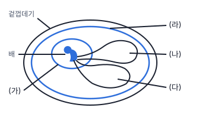
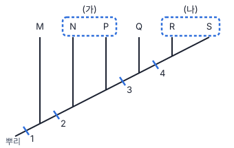
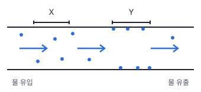

# 생명과학 9장 웹과제 예상 v3 문제해설

왼쪽 목차로 문항을 고르고, 오른쪽 문제를 보며 해설을 따라가요.

문제의 첫 줄부터 검산까지 설명해요.

**목차**

- [문항별 설명](#problems)
  - [P1. [기출 예상] 척추동물의 육상 생식 적응 군](#p1)
  - [P2. [기출 예상] 사람류와 유인원을 가르는 주요 적응](#p2)
  - [P3. [기출 변형] 균류와 동물의 공통 특징](#p3)
  - [P4. [기출 변형] 속씨식물의 번식 구조와 특징](#p4)
  - [P5. [기출 변형] 현대종 계통수의 분류 경계](#p5)
  - [P6. [예상] 세균 독소와 약물 처리 결과 해석](#p6)
  - [P7. [예상] 육상 척추동물 알의 배외막 구조](#p7)
  - [P8. [예상] 세 병원체의 구조와 증식 조건 판별](#p8)
  - [P9. [예상] 원생생물의 다양성과 물속 공생](#p9)
  - [P10. [예상] 척삭동물 분기도와 분류 묶음 해석](#p10)
  - [P11. [예상] 속씨식물의 꽃 특징과 매개자 상호작용](#p11)
  - [P12. [예상] 균류의 영양 획득과 생태계 역할](#p12)
  - [P13. [예상] 초기 세포 모형과 역할 분화 조건](#p13)
  - [P14. [예상] 해면동물 몸속 두 구간의 관찰](#p14)
  - [P15. [예상] 고세균의 대사와 진핵세포와의 경계](#p15)

## 문항별 설명

### P1. [기출 예상] 척추동물의 육상 생식 적응 군

기출 9강 17 예상 · [연습형 문제 보기](../%EB%B3%B5%EC%8A%B5%EB%AC%B8%EC%A0%9C_9%EC%9E%A5_%EC%9B%B9%EA%B3%BC%EC%A0%9C%EC%98%88%EC%83%81_v3.html#p1) · [시험형 문제 보기](../%EB%B3%B5%EC%8A%B5%EB%AC%B8%EC%A0%9C_9%EC%9E%A5_%EC%9B%B9%EA%B3%BC%EC%A0%9C%EC%98%88%EC%83%81_%EC%8B%9C%ED%97%98%ED%98%95_v3.html#p1)

보기의 척추동물 군 중에서 최초로 육상에서 생식하도록 적응한 군은?

- A. 어룡류
- B. 무악류
- C. 사지류
- D. 유악동물
- E. 양막류

원문·출처 정보 보기

기출 9강 합본 17번을 보기 순서만 바꿔 실은 예상 문제예요. PDF 2쪽.

#### 문제가 무엇을 묻는지 읽어요

제시된 다섯 척추동물 군 가운데 물 밖의 건조한 육상 환경에서도 **생식**할 수 있도록 최초로 적응한 군을 골라요. 단순히 육지로 올라왔거나 다리가 있다는 조건과 구별해 읽어요.

#### 이 문제를 봤을 때 떠올릴 개념과 공식

‘최초로 육상에서 생식하도록 적응한 척추동물 군’이라는 단서에서 건조한 땅 위에서 발생 중인 배를 보호하는 구조를 떠올려요. 양서류는 네 다리를 가진 사지류이지만 알과 번식 과정에서 물이나 습한 환경에 의존하는 경우가 많아요. 반면 **양막류(amniotes)**는 양막(amnion)을 비롯한 배외막(extraembryonic membranes)이 배를 둘러싸 보호하는 양막란(amniotic egg)과 물이 잘 통과하지 않는 피부를 갖추어 육상 생식에 처음으로 본격 적응했어요.

판단 기준은 해당 무리에 **물속이나 습한 환경에 의존해 번식하는 수생·양서 계통이 포함되는지**, 그리고 **배를 건조에서 보호하는 양막란 적응이 나타난 분기인지**예요.

관련 정리노트: [양막류와 육상 생식 적응](../../../%EB%B3%B5%EC%8A%B5%EB%85%B8%ED%8A%B8/1110/%EC%A0%95%EB%A6%AC%EB%85%B8%ED%8A%B8_1110_Protists_Plants_Fungi_and_Animals.html#s3-amniote), [척삭동물과 척추동물의 포함 관계](../../../%EB%B3%B5%EC%8A%B5%EB%85%B8%ED%8A%B8/1110/%EC%A0%95%EB%A6%AC%EB%85%B8%ED%8A%B8_1110_Protists_Plants_Fungi_and_Animals.html#s3-chordate)

#### 왜 이렇게 푸는지 함께 따라가요

A. 어룡류는 양막류 안에서 나중에 수중 생활로 이어진 멸종 해양 파충류 계통이므로, 척추동물 가운데 최초로 육상 생식에 적응한 큰 무리로 적합하지 않아요.

B. 무악류는 먹장어와 칠성장어처럼 턱이 없는 수생 척추동물 계통이므로 육상 생식 적응 무리에 해당하지 않아요.

C. 사지류는 네 다리를 가진 척추동물 무리이지만, 번식할 때 물이나 습한 환경에 의존하는 양서류도 함께 포함되므로 최초로 육상 생식에 적응한 군으로 적합하지 않아요.

D. 유악동물은 턱이 있는 척추동물 전체를 가리키므로, 물속에서 번식하는 유악어류까지 포함해 육상 생식 적응 군으로 적합하지 않아요.

E. 양막류는 파충류·조류·포유류가 속하는 무리로, 배를 감싸 수분 환경을 유지하고 보호하는 양막과 배외막을 갖추어 척추동물 중 최초로 육상 생식에 본격 적응한 군에 해당해요.

따라서 답은 E, 양막류예요.

#### 완성 답과 검산

답 E. 척추동물의 포함 범위를 좁혀 보면 척추동물(무악류 포함) → 유악동물(유악어류 포함) → 사지류(양서류 포함) → 양막류 순서예요. 양막류 이전 단계인 무악류·유악동물·사지류에는 모두 수중 번식에 의존하는 무리가 남아 있고, 어룡류는 해양 파충류 계통이라서 물 밖 생식 적응이 처음 성립한 분기인 E만 조건을 만족해요.

#### 헷갈리기 쉬운 점

네 다리가 생긴 ‘사지류(tetrapods)’를 곧바로 육상 생식 적응과 같다고 생각하기 쉬워요. 하지만 사지류 안에는 알이 물속이나 습한 곳에 있어야 하는 양서류가 포함되어 있어, 건조한 육상에서도 배가 발생할 수 있게 된 최초의 군을 물을 때는 ‘양막류’를 골라야 해요.

**페이지 요약**

#### 판단 기준

수생·양서 번식 의존 무리가 빠지고 양막란의 배외막으로 건조에서 배를 보호하는 분기를 찾아요.

#### 결론

무악류·유악동물·사지류에는 수중 번식 계통이 포함되고 어룡류는 해양 파충류 계통이에요. 답은 E, 양막류예요.

---

### P2. [기출 예상] 사람류와 유인원을 가르는 주요 적응

기출 9강 26 예상 · [연습형 문제 보기](../%EB%B3%B5%EC%8A%B5%EB%AC%B8%EC%A0%9C_9%EC%9E%A5_%EC%9B%B9%EA%B3%BC%EC%A0%9C%EC%98%88%EC%83%81_v3.html#p2) · [시험형 문제 보기](../%EB%B3%B5%EC%8A%B5%EB%AC%B8%EC%A0%9C_9%EC%9E%A5_%EC%9B%B9%EA%B3%BC%EC%A0%9C%EC%98%88%EC%83%81_%EC%8B%9C%ED%97%98%ED%98%95_v3.html#p2)

사람류는 현대인과 우리의 조상을 포함한다. 사람류를 유인원과 구별 짓게 하는 주요 적응으로 옳은 것은?

- A. 마주보는 엄지손가락
- B. 유연한 엉덩이와 어깨 관절
- C. 직립자세와 두 발 걷기
- D. 뛰어난 학습능력
- E. 무리를 지어 사회생활

원문·출처 정보 보기

기출 9강 합본 26번을 보기 순서만 바꿔 실은 예상 문제예요. PDF 3쪽.

#### 문제가 무엇을 묻는지 읽어요

현대인과 인류 쪽 조상을 포함하는 **사람류(호미닌, hominins)**를 다른 유인원(apes)과 구별 짓게 하는 대표적인 적응을 골라요.

#### 이 문제를 봤을 때 떠올릴 개념과 공식

‘사람류를 유인원과 구별 짓는 주요 적응’이라는 질문에서 영장류 전체가 공유하는 형질과 사람류 분기에서 두드러진 기준을 나누어 떠올려요. 원숭이·유인원·사람을 모두 포함하는 **영장류(primates)**는 물건을 잡는 데 유리한 마주 보는 엄지손가락, 유연한 어깨와 엉덩이 관절, 큰 뇌에 바탕을 둔 학습능력, 무리를 짓는 사회생활을 널리 공유해요.

반면 침팬지 계통과 갈라진 뒤의 **사람류**를 다른 유인원과 가르는 핵심 판별 기준은 일시적으로 두 발로 서는 수준이 아니라 습관적인 **직립자세와 두 발 걷기(직립보행, bipedalism)**예요. 판단 기준은 각 특징이 **다른 영장류·유인원에도 널리 공유되는가**, 아니면 **사람류를 유인원과 가르는 주요 적응인가**예요.

관련 정리노트: [마주 보는 엄지와 두 발 걷기는 다른 기준](../../../%EB%B3%B5%EC%8A%B5%EB%85%B8%ED%8A%B8/1110/%EC%A0%95%EB%A6%AC%EB%85%B8%ED%8A%B8_1110_Protists_Plants_Fungi_and_Animals.html#s4-primate), [루시 화석과 두발보행의 순서](../../../%EB%B3%B5%EC%8A%B5%EB%85%B8%ED%8A%B8/1110/%EC%A0%95%EB%A6%AC%EB%85%B8%ED%8A%B8_1110_Protists_Plants_Fungi_and_Animals.html#s4-fossil)

#### 왜 이렇게 푸는지 함께 따라가요

A. 마주보는 엄지손가락은 원숭이와 다른 유인원 등 영장류가 폭넓게 공유해 물건을 잡는 데 쓰는 특징이므로 사람류만의 구별 기준이 아니에요.

B. 유연한 엉덩이와 어깨 관절도 여러 영장류에 공통으로 나타나는 공유 형질이므로 사람류를 유인원과 가르는 주요 적응으로 적합하지 않아요.

C. 직립자세와 두 발 걷기는 침팬지 계통과 갈라진 뒤 사람류에서 발달한 습관적 직립보행에 해당하므로, 사람류를 유인원과 구별 짓는 주요 적응으로 적합해요.

D. 뛰어난 학습능력은 유인원을 비롯한 여러 영장류가 함께 보이는 특징이에요. 또한 초기 사람류 화석에서는 큰 뇌의 확대보다 두 발 걷기가 먼저 나타났다는 근거가 확인돼요.

E. 무리를 지어 사회생활을 하는 습성 역시 다른 유인원과 원숭이 등 많은 영장류가 공통으로 보이므로 사람류만의 구별 기준이 아니에요.

따라서 답은 C, 직립자세와 두 발 걷기예요.

#### 완성 답과 검산

답 C. 영장류 공통 형질에 속하는 네 보기(마주보는 엄지손가락, 유연한 관절, 학습능력, 사회생활)를 지우면 사람류 분기의 대표 기준인 직립보행만 남아요. 오스트랄로피테쿠스 아파렌시스(루시) 화석에서 작은 뇌 용적과 함께 몸의 중심 아래로 모인 대퇴골과 두 발 발자국이 확인된다는 점도 두 발 걷기가 사람류의 핵심 조기 적응이라는 판정과 일치해요.

**페이지 요약**

#### 판단 기준

영장류·유인원 공유 형질(잡는 손, 관절, 학습능력, 사회생활)과 사람류 분기 기준(습관적 직립보행)을 구별해요.

#### 결론

A·B·D·E는 여러 영장류가 공유하는 특징이에요. 답은 C, 직립자세와 두 발 걷기예요.

---

### P3. [기출 변형] 균류와 동물의 공통 특징

기출 9강 22 예상 · [연습형 문제 보기](../%EB%B3%B5%EC%8A%B5%EB%AC%B8%EC%A0%9C_9%EC%9E%A5_%EC%9B%B9%EA%B3%BC%EC%A0%9C%EC%98%88%EC%83%81_v3.html#p3) · [시험형 문제 보기](../%EB%B3%B5%EC%8A%B5%EB%AC%B8%EC%A0%9C_9%EC%9E%A5_%EC%9B%B9%EA%B3%BC%EC%A0%9C%EC%98%88%EC%83%81_%EC%8B%9C%ED%97%98%ED%98%95_v3.html#p3)

균류와 동물의 공통점은 무엇인가?

- A. 둘 다 모든 종이 균사로 이루어진 다세포 구조를 지닌다.
- B. 둘 다 핵막을 가진 진핵생물이며 다른 생물이 만든 유기물을 이용하는 종속영양 생물이다.
- C. 둘 다 세포 표면에 키틴 성분의 단단한 세포벽을 가진다.
- D. 둘 다 먹이를 먼저 몸 안으로 삼킨 뒤 소화 기관에서 분해한다.
- E. 둘 다 빛에너지를 이용해 이산화탄소로부터 스스로 유기물을 합성한다.

원문·출처 정보 보기

기출 9강 합본 22번 발문에 정답을 바꾼 쌍둥이 변형 문제예요.

#### 문제가 무엇을 묻는지 읽어요

**균류(fungi)**와 **동물(animals)**이 공통으로 가지는 세포 구조와 영양 방식을 다섯 선지 중에서 골라요.

#### 이 문제를 봤을 때 떠올릴 개념과 공식

균류와 동물을 비교할 때는 먼저 **영역·세포 구조**와 **영양 방식(독립영양 vs 종속영양)**, 그리고 **세포벽·소화 순서**를 확인해요. 균류와 동물은 모두 진핵생물영역(Eukarya)에 속해 핵막으로 둘러싸인 핵을 가지고, 스스로 광합성하지 않고 다른 생물이 만든 유기물을 이용하는 **종속영양(heterotroph)** 생물이에요.

반면 차이점도 뚜렷해요. 균류는 키틴(chitin) 성분 세포벽을 가지고 소화 효소를 몸 밖으로 분비해 유기물을 자른 뒤 흡수(세포외 소화)하며, 다세포 균류는 실 모양 균사(hypha)를 이루지만 효모(yeast) 같은 단세포 종도 있어요. 동물은 모두 다세포이고 세포벽이 없으며, 균사를 만들지 않고 대개 먹이를 몸 안으로 삼킨 뒤 소화 기관에서 분해해요.

판단 기준은 진술의 모든 조건이 **균류 전체와 동물 전체에 공통으로 성립하는지**예요.

관련 정리노트: [균류의 종속영양과 세포외 소화](../../../%EB%B3%B5%EC%8A%B5%EB%85%B8%ED%8A%B8/1110/%EC%A0%95%EB%A6%AC%EB%85%B8%ED%8A%B8_1110_Protists_Plants_Fungi_and_Animals.html#s2-feeding), [균류 세포벽·균사와 효모](../../../%EB%B3%B5%EC%8A%B5%EB%85%B8%ED%8A%B8/1110/%EC%A0%95%EB%A6%AC%EB%85%B8%ED%8A%B8_1110_Protists_Plants_Fungi_and_Animals.html#s2-structure), [동물의 공통 형질](../../../%EB%B3%B5%EC%8A%B5%EB%85%B8%ED%8A%B8/1110/%EC%A0%95%EB%A6%AC%EB%85%B8%ED%8A%B8_1110_Protists_Plants_Fungi_and_Animals.html#s3-animal)

#### 왜 이렇게 푸는지 함께 따라가요

A. 틀려요. 동물은 균사를 만들지 않으며, 균류에도 효모처럼 단세포로 사는 종이 있어 둘 다 모든 종이 균사로 이루어진 다세포 구조라고 할 수 없어요.

B. 맞아요. 균류와 동물은 모두 진핵생물영역에 속해 핵막으로 둘러싸인 핵을 가지며, 스스로 유기물을 합성하지 못하고 다른 생물이 만든 유기물을 얻어 쓰는 종속영양 생물이에요.

C. 틀려요. 키틴 성분의 세포벽은 균류 세포의 특징이고, 동물의 세포에는 세포벽이 없어요.

D. 틀려요. 먹이를 몸 안으로 먼저 삼켜 소화 기관에서 분해하는 것은 동물의 방식이고, 균류는 세포 밖으로 소화 효소를 분비해 유기물을 분해한 뒤 작은 분자를 흡수해요.

E. 틀려요. 빛에너지와 이산화탄소로 스스로 유기물을 합성하는 것은 식물·조류·남세균 같은 광합성(광독립영양) 생물이며, 균류와 동물은 모두 광합성을 하지 않아요.

따라서 답은 B예요.

#### 완성 답과 검산

답 B. 두 무리의 특징을 항목별로 대조하면 진핵생물 여부(둘 다 해당)와 종속영양 여부(둘 다 해당)는 일치하지만, 세포벽(균류 키틴 vs 동물 없음), 다세포성·균사(균류 효모 예외·균사 보유 vs 동물 전종 다세포·균사 없음), 소화 장소(균류 세포 밖 vs 동물 몸 안)는 모두 달라요. 오답 넷(A·C·D·E)이 이 차이점과 광합성 오개념으로 소거되므로 B가 맞아요.

**페이지 요약**

#### 판단 기준

균류·동물 공통점(핵막 있는 진핵생물 + 종속영양)과 차이점(세포벽, 균사·단세포 예외, 소화 순서)을 나눠 봐요.

#### 결론

A·C·D는 한쪽에만 해당하거나 단세포 예외를 놓쳤고 E는 광합성 생물의 특징이에요. 답은 B예요.

---

### P4. [기출 변형] 속씨식물의 번식 구조와 특징

기출 9강 7 예상 · [연습형 문제 보기](../%EB%B3%B5%EC%8A%B5%EB%AC%B8%EC%A0%9C_9%EC%9E%A5_%EC%9B%B9%EA%B3%BC%EC%A0%9C%EC%98%88%EC%83%81_v3.html#p4) · [시험형 문제 보기](../%EB%B3%B5%EC%8A%B5%EB%AC%B8%EC%A0%9C_9%EC%9E%A5_%EC%9B%B9%EA%B3%BC%EC%A0%9C%EC%98%88%EC%83%81_%EC%8B%9C%ED%97%98%ED%98%95_v3.html#p4)

다음 속씨식물에 관한 설명 중 잘못된 설명은?

- A. 밑씨가 씨방에 싸이지 않은 채 겉으로 드러나 있다.
- B. 꽃이 있고 수정 뒤에는 씨방이 열매로 발달한다.
- C. 바람이나 동물이 꽃가루를 암술머리로 옮기는 수분이 일어난다.
- D. 수정 뒤 밑씨는 배와 영양조직, 종피를 갖춘 종자로 발달한다.
- E. 물관과 체관으로 이루어진 관다발 조직을 가지고 있다.

원문·출처 정보 보기

기출 9강 합본 7번의 발문에 정답을 바꾼 생성 변형이에요. PDF 1쪽. 원문 정답이던 초기 화석 진술 대신 밑씨의 위치로 겉씨식물과 속씨식물을 가르게 했어요.

#### 문제가 무엇을 묻는지 읽어요

속씨식물(현화식물, angiosperms)의 번식 구조와 조직 특징에 관한 다섯 설명 가운데 **잘못된 설명**을 골라요. 부정형 질문이므로 내용상 옳은 설명은 빼고 거짓인 설명 하나를 답으로 선택해요.

#### 이 문제를 봤을 때 떠올릴 개념과 공식

‘속씨식물’이라는 단서에서 종자식물(겉씨식물과 속씨식물)의 공통점과 둘을 가르는 기준을 함께 떠올려요. 겉씨식물(gymnosperms)과 속씨식물은 모두 물관과 체관으로 이루어진 **관다발 조직**을 가지며, 꽃가루(pollen)의 이동으로 **수분(pollination)**이 일어나고 수정 뒤 **밑씨(ovule)**가 배·영양조직·종피(seed coat)를 갖춘 **종자(seed)**로 발달해요.

두 무리를 가르는 핵심 기준은 **꽃·씨방·열매의 유무와 밑씨의 위치**예요. 겉씨식물은 밑씨가 씨방에 싸이지 않고 드러나 있으며 꽃과 열매가 없지만, 속씨식물은 꽃을 피우고 **밑씨가 씨방(ovary) 안에 들어 있어** 수정 뒤 씨방이 열매(fruit)로 발달해요.

관련 정리노트: [꽃가루·밑씨·씨방과 속씨·겉씨 구별](../../../%EB%B3%B5%EC%8A%B5%EB%85%B8%ED%8A%B8/1110/%EC%A0%95%EB%A6%AC%EB%85%B8%ED%8A%B8_1110_Protists_Plants_Fungi_and_Animals.html#s1-seed), [관다발 조직의 구성과 식물군 구분](../../../%EB%B3%B5%EC%8A%B5%EB%85%B8%ED%8A%B8/1110/%EC%A0%95%EB%A6%AC%EB%85%B8%ED%8A%B8_1110_Protists_Plants_Fungi_and_Animals.html#s1-land)

#### 왜 이렇게 푸는지 함께 따라가요

A. 내용상 틀려요. 밑씨가 씨방에 싸이지 않고 겉으로 드러나 있는 것은 겉씨식물의 특징이에요. 속씨식물은 밑씨가 꽃의 씨방 안에 싸여 있어요. 잘못된 설명을 고르는 문제이므로 답으로 선택해요.

B. 내용상 맞아요. 속씨식물은 꽃을 가지며, 수정이 일어난 뒤 밑씨를 감싸고 있던 씨방이 열매로 발달해 종자를 보호하고 산포를 도와요. 옳은 진술이므로 답으로 선택하지 않아요.

C. 내용상 맞아요. 속씨식물에서는 바람이나 곤충·새·박쥐 같은 동물이 꽃가루를 암술머리로 옮기는 수분이 일어나요. 옳은 진술이므로 답으로 선택하지 않아요.

D. 내용상 맞아요. 수정란이 배로 자라면서 밑씨는 배와 영양조직, 단단한 종피를 포함한 종자로 발달해요. 옳은 진술이므로 답으로 선택하지 않아요.

E. 내용상 맞아요. 속씨식물은 양치류·겉씨식물과 마찬가지로 물과 무기 양분을 나르는 물관과 광합성 산물을 나르는 체관으로 이루어진 관다발 조직을 가지고 있어요. 옳은 진술이므로 답으로 선택하지 않아요.

따라서 답은 A예요.

#### 완성 답과 검산

답 A. 다섯 진술의 참·거짓을 세어 보면 B, C, D, E의 4개는 속씨식물의 성질과 일치하는 참 진술이고, A 1개만 겉씨식물의 특징을 속씨식물에 잘못 붙인 거짓 진술이에요. 속씨식물의 ‘속씨’라는 이름 자체가 밑씨가 씨방 속에 들어 있다는 뜻과 맞닿아 있으므로 A만 틀렸음을 다시 확인할 수 있어요.

**페이지 요약**

#### 판단 기준

밑씨가 씨방 안에 있으면 속씨식물, 씨방 없이 드러나 있으면 겉씨식물이에요.

#### 결론

B~E 4개는 속씨식물에 대한 옳은 설명이고 A 1개만 겉씨식물 특징이라 틀렸어요. 답은 A예요.

---

### P5. [기출 변형] 현대종 계통수의 분류 경계

기출 9강 9 예상 · [연습형 문제 보기](../%EB%B3%B5%EC%8A%B5%EB%AC%B8%EC%A0%9C_9%EC%9E%A5_%EC%9B%B9%EA%B3%BC%EC%A0%9C%EC%98%88%EC%83%81_v3.html#p5) · [시험형 문제 보기](../%EB%B3%B5%EC%8A%B5%EB%AC%B8%EC%A0%9C_9%EC%9E%A5_%EC%9B%B9%EA%B3%BC%EC%A0%9C%EC%98%88%EC%83%81_%EC%8B%9C%ED%97%98%ED%98%95_v3.html#p5)

염기서열 연구를 기반으로 한 현대종들의 계통수를 비교한 결과는?

- A. 균류는 분자 계통수에서 동물보다 육상식물과 더 가까운 계통이다.
- B. 원생생물은 단세포 종속영양 생물만으로 이루어진 하나의 단일한 자연 계통군이다.
- C. 고세균은 진핵생물과 일부 분자 기작을 공유하므로 진핵생물영역에 속한다.
- D. 세균영역과 고세균영역은 모두 핵막이 없는 원핵생물이지만 분자 서열에 따라 서로 다른 영역으로 구별된다.
- E. 현생 계통에서 깃편모충류는 육상식물과 가장 가깝고, 녹조류는 동물과 가장 가깝다.

원문·출처 정보 보기

기출 9강 합본 9번의 발문에 정답을 바꾼 생성 변형이에요. PDF 2쪽. 원문 정답이던 ‘모두 옳다’ 대신 3영역·균류·원생생물·가까운 현생 계통 경계를 직접 판별하게 했어요.

#### 문제가 무엇을 묻는지 읽어요

염기서열 비교에 바탕을 둔 현대 생물의 계통수와 분류 경계를 바르게 설명한 선지 하나를 골라요.

#### 이 문제를 봤을 때 떠올릴 개념과 공식

‘염기서열 연구를 기반으로 한 현대종들의 계통수’라는 단서에서 **3영역 분류(세균·고세균·진핵생물)**와 **진핵생물 내부의 계통 관계**를 떠올려요.

첫째, rRNA 염기서열 비교를 통해 생물은 세균영역(Bacteria)·고세균영역(Archaea)·진핵생물영역(Eukarya)으로 나뉘어요. 세균과 고세균은 모두 핵막으로 둘러싸인 핵이 없는 **원핵생물**이지만, 분자 서열과 막·세포벽 성분이 달라 서로 다른 두 영역으로 구별해요. 고세균은 단백질 합성 등 일부 분자 기작이 진핵생물과 닮았어도 핵막이 없는 원핵생물이며 진핵생물영역에 속하지 않아요.

둘째, 분자 계통수에서 **균류는 육상식물보다 동물과 더 가깝고**, 현생 계통 가운데 **녹조류는 육상식물과**, **깃편모충류(choanoflagellates)는 동물과** 가까워요. 한편 **원생생물**은 동물·육상식물·균류 이외의 다양한 진핵생물을 묶은 범주이므로 하나의 단일한 자연 계통군이 아니며, 단세포뿐 아니라 다세포 해조류와 광합성·혼합영양 생물도 포함해요.

관련 정리노트: [3영역과 진핵생물 4계 정리](../../../%EB%B3%B5%EC%8A%B5%EB%85%B8%ED%8A%B8/1110/%EC%A0%95%EB%A6%AC%EB%85%B8%ED%8A%B8_1110_Protists_Plants_Fungi_and_Animals.html#s0-recap), [녹조류·깃편모충류의 가까운 계통](../../../%EB%B3%B5%EC%8A%B5%EB%85%B8%ED%8A%B8/1110/%EC%A0%95%EB%A6%AC%EB%85%B8%ED%8A%B8_1110_Protists_Plants_Fungi_and_Animals.html#s0-algae), [고세균의 원핵 경계와 3영역](../../../%EB%B3%B5%EC%8A%B5%EB%85%B8%ED%8A%B8/1105/%EC%A0%95%EB%A6%AC%EB%85%B8%ED%8A%B8_1105_Origin_of_Life_and_Prokaryotes.html#s2-archaea), [rRNA 서열 비교와 균류-동물 근연성](../../../%EB%B3%B5%EC%8A%B5%EB%85%B8%ED%8A%B8/1103/%EC%A0%95%EB%A6%AC%EB%85%B8%ED%8A%B8_1103_Macroevolution_and_Taxonomy.html#s3-rrna)

#### 왜 이렇게 푸는지 함께 따라가요

A. 틀려요. rRNA 등 염기서열 비교를 바탕으로 한 분자 계통수에서 균류는 육상식물보다 동물과 더 가까운 계통이에요.

B. 틀려요. 원생생물은 동물·육상식물·균류에 속하지 않는 다양한 진핵생물을 묶어 부르는 이름이라 하나의 단일한 자연 계통군이 아니에요. 또한 미역·다시마·김 같은 다세포 해조류와 광합성·혼합영양 생물도 포함되므로 단세포 종속영양 생물만으로 이루어져 있지 않아요.

C. 틀려요. 고세균은 단백질 합성 같은 일부 분자 기작에서 진핵생물과 유사한 점을 보이지만, 핵막으로 둘러싸인 핵이 없는 원핵생물이며 진핵생물영역이 아니라 독립된 고세균영역에 속해요.

D. 맞아요. 세균영역과 고세균영역은 모두 핵막이 없는 원핵생물 세포이지만, rRNA 염기서열을 비롯한 분자 서열 차이에 근거해 서로 다른 영역으로 구별돼요.

E. 틀려요. 가까운 현생 계통의 짝이 반대로 바뀌었어요. 깃편모충류는 해면동물의 깃세포와 닮고 DNA 서열도 동물과 가까운 계통이고, 녹조류는 육상식물과 가장 가까운 계통이에요.

따라서 답은 D예요.

#### 완성 답과 검산

답 D. 네 가지 분류·계통 기준(① 원핵생물 내 세균·고세균 두 영역 구분, ② 균류–동물 근연성, ③ 깃편모충류–동물 / 녹조류–육상식물 근연성, ④ 원생생물의 비단일계통·다양성)에 선지를 하나씩 대조하면 A·B·C·E는 각각 거짓 진술로 소거되고, 두 원핵생물 영역의 구별을 정확히 서술한 D만 남아요.

#### 헷갈리기 쉬운 점

고세균이 일부 분자 기작에서 진핵생물과 닮았다는 설명 때문에 고세균을 진핵생물영역에 넣거나(C), 버섯이 땅에서 자라고 움직이지 않아 균류를 식물 쪽에 더 가깝다고 생각하기 쉬워요(A). 영역은 핵막 유무와 분자 서열로, 균류·동물의 친척 관계는 rRNA 등 분자 계통수로 확인해야 해요.

**페이지 요약**

#### 판단 기준

세균·고세균은 모두 원핵생물이지만 분자 서열로 다른 영역이고, 진핵생물에서는 균류–동물, 깃편모충류–동물, 녹조류–육상식물이 가까워요.

#### 결론

A·B·C·E는 각각 계통 근연성·원생생물 다양성·고세균 영역 경계를 잘못 서술했어요. 답은 D예요.

---

### P6. [예상] 세균 독소와 약물 처리 결과 해석

예상 9장 6 · [연습형 문제 보기](../%EB%B3%B5%EC%8A%B5%EB%AC%B8%EC%A0%9C_9%EC%9E%A5_%EC%9B%B9%EA%B3%BC%EC%A0%9C%EC%98%88%EC%83%81_v3.html#p6) · [시험형 문제 보기](../%EB%B3%B5%EC%8A%B5%EB%AC%B8%EC%A0%9C_9%EC%9E%A5_%EC%9B%B9%EA%B3%BC%EC%A0%9C%EC%98%88%EC%83%81_%EC%8B%9C%ED%97%98%ED%98%95_v3.html#p6)

연구팀은 서로 다른 세균 균주 X, Y, Z를 대상으로 독성과 약물 처리 반응을 조사하여 표와 같은 결과를 얻었어요. 이에 대한 해석으로 가장 옳은 것은 무엇인가요?

| 실험 | 대상 균주 | 처리 조건 및 관찰 결과 |
|---|---|---|
| 실험 1 | 균주 X | 살아 있는 세균이 배양 중 세포 밖으로 단백질 성분의 독소를 분비해요. |
| 실험 1 | 균주 Y | 100°C로 가열해 세균이 사멸·용균된 뒤에도 외막의 지질다당류(LPS) 성분 때문에 독성 반응이 유지돼요. |
| 실험 2 | 균주 Z | 집단에 항생제 M을 처리하자 대부분 죽고, 처리 전부터 있던 소수의 내성 개체가 살아남아 증식하면서 세대마다 내성 개체 비율이 높아졌어요. |

- A. 균주 X의 단백질 독소는 내독소이고 균주 Y의 지질다당류는 외독소이며, 세균이 사멸하면 독소의 작용도 함께 사라져요.
- B. 균주 Y의 지질다당류는 내독소이지만, 100°C 가열로 세균이 사멸하는 순간 지질다당류도 완전히 제거되어 독성 반응이 유지될 수 없어요.
- C. 균주 Y에서 용균 때 방출되어 독성을 나타낸 외막 지질다당류는 내독소이며, 균주 Z의 내성 비율 증가는 기존에 있던 내성 변이 개체가 자연선택된 결과예요.
- D. 균주 X의 단백질 독소는 외독소이지만, 균주 Z의 변화는 항생제 M을 견디기 위해 세균이 처리 직후 의도적으로 내성 돌연변이를 만들어 낸 결과예요.
- E. 균주 Z처럼 내성 비율이 높아진 집단을 치료할 때는 원인 세균의 종류와 약에 대한 반응을 확인할 필요 없이 항생제 M의 투약량만 계속 늘려야 해요.

원문·출처 정보 보기

세균 독소의 구분과 항생제 내성의 자연선택 및 약물 선택 기준을 묻는 새 예상 문제예요.

#### 무엇을 구하나요?

표에 제시된 균주 X, Y, Z의 실험 결과를 읽고, 세균 독소의 종류와 가열 사멸 뒤 독성 유지 여부, 항생제 내성이 늘어나는 과정을 가장 옳게 해석한 보기를 찾아요.

#### 이 문제를 봤을 때 떠올릴 개념과 공식

세균 독소는 기원과 성질을 함께 확인해야 해요. 살아 있는 세균이 세포 밖으로 분비하는 독성 단백질은 **외독소(exotoxin)**이고, 일부 세균의 외막을 이루는 **지질다당류(LPS, lipopolysaccharide)** 성분은 **내독소(endotoxin)**예요. 내독소는 세포 안에 숨겨 두었다가 분비하는 독소가 아니라 외막 성분 자체여서, 세균이 죽어 용균될 때 방출될 수 있어요. 또한 세균을 가열해 죽이는 일과 이미 존재하거나 방출된 독소를 없애는 일은 서로 다른 문제예요.

**항생제 내성(antibiotic resistance)**은 집단 안에 미리 존재하던 내성 변이 개체가 항생제라는 선택압 아래 상대적으로 더 많이 살아남아 증식하면서 비율이 높아지는 **자연선택(natural selection)**의 결과예요. 세균이 약을 이겨 내려고 필요에 맞춰 의도적으로 돌연변이를 만들어 내는 과정이 아니에요. 치료할 때는 원인 세균의 종류와 약에 대한 반응을 확인해 알맞은 약을 선택해야 해요. [독소와 항생제 내성은 다른 문제](../../../%EB%B3%B5%EC%8A%B5%EB%85%B8%ED%8A%B8/1105/%EC%A0%95%EB%A6%AC%EB%85%B8%ED%8A%B8_1105_Origin_of_Life_and_Prokaryotes.html#s2-toxins)에서 두 개념의 구별 기준을 확인할 수 있어요.

#### 왜 이렇게 푸는지 함께 따라가요

A. 틀려요. 살아 있는 균주 X가 세포 밖으로 분비하는 단백질 독소는 외독소이고, 균주 Y의 외막 지질다당류는 내독소이므로 두 이름이 뒤바뀌었어요. 세균이 죽더라도 이미 만들어진 외독소나 용균 때 방출되는 내독소 성분의 독성은 남을 수 있어요.

B. 틀려요. 균주 Y의 지질다당류를 내독소로 본 앞부분은 맞지만, 100°C 가열로 세균을 사멸·용균시킨다고 해서 지질다당류 성분의 독성까지 완전히 제거되는 것은 아니에요. 표에서도 균주 Y는 사멸·용균된 뒤에도 독성 반응이 유지되었어요.

C. 맞아요. 균주 Y에서 용균 때 방출되어 독성을 나타낸 외막 지질다당류(LPS) 성분은 내독소의 정의에 정확히 맞고, 균주 Z에서 처리 전부터 있던 소수의 내성 개체가 살아남아 증식해 세대마다 비율이 높아진 것은 기존 변이의 자연선택 결과예요.

D. 틀려요. 균주 X의 분비 단백질 독소가 외독소라는 점은 맞지만, 표의 실험 2는 처리 전부터 이미 내성 개체가 소수 존재했다고 알려 줘요. 세균이 항생제 M을 견디기 위해 처리 직후 의도적으로 내성 돌연변이를 만들어 낸 것이 아니에요.

E. 틀려요. 내성 비율이 높아진 집단을 치료할 때는 원인 세균의 종류와 약에 대한 반응을 확인해 맞는 약물을 골라야 해요. 확인 없이 이미 내성 세균이 살아남은 항생제 M의 투약량만 계속 늘리는 것은 올바른 판단 기준이 아니에요.

따라서 답은 C예요.

#### 완성 답과 검산

답 C예요. 소거로 확인하면 A(외독소·내독소 뒤바뀜 및 사멸 시 독성 소멸 단정), B(표의 독성 유지 결과와 모순), D(기존 변이 선택을 의도적 돌연변이로 서술), E(원인 세균·반응 확인 생략) 네 선지가 모두 근거에 어긋나요. 실험 1(용균 뒤 남은 외막 LPS = 내독소)과 실험 2(기존 내성 개체의 생존·증식 = 자연선택)를 모두 바르게 연결한 선지는 C 하나뿐이에요.

**페이지 요약**

#### 판단 기준

분비 단백질은 외독소, 외막 LPS 성분은 내독소이며 가열 사멸과 독소 제거는 달라요. 항생제 내성은 기존 변이의 자연선택이고, 치료는 원인 세균과 약 반응을 확인해 선택해요.

#### 결론

균주 Y의 내독소와 균주 Z의 자연선택을 바르게 짝지은 답은 C예요.

---

### P7. [예상] 육상 척추동물 알의 배외막 구조

예상 9장 7 · [연습형 문제 보기](../%EB%B3%B5%EC%8A%B5%EB%AC%B8%EC%A0%9C_9%EC%9E%A5_%EC%9B%B9%EA%B3%BC%EC%A0%9C%EC%98%88%EC%83%81_v3.html#p7) · [시험형 문제 보기](../%EB%B3%B5%EC%8A%B5%EB%AC%B8%EC%A0%9C_9%EC%9E%A5_%EC%9B%B9%EA%B3%BC%EC%A0%9C%EC%98%88%EC%83%81_%EC%8B%9C%ED%97%98%ED%98%95_v3.html#p7)

그림은 육상 척추동물의 알에서 배가 발생할 때 나타나는 배외막 구조를 나타낸 모식도예요. (가)~(라)와 이를 갖는 생물 무리에 대한 설명으로 옳은 것은 무엇인가요?

- A. (가)는 배의 배설물을 저장하고 기체 교환에 관여하는 요막이고, (나)는 배를 직접 감싸 수분 환경을 유지하는 양막이에요.
- B. (가)는 배를 직접 감싸 건조를 막고 수분 환경을 유지하는 양막이며, (라)는 바깥쪽에서 기체 교환을 돕는 장막이에요.
- C. (다)는 가장 바깥쪽에서 기체 교환을 돕는 장막이고, (라)는 발생 중인 배에 영양을 저장하고 전달하는 난황낭이에요.
- D. 파충류와 조류만 (가)~(라)의 배외막을 갖는 양막류에 속하고, 포유류는 알을 낳지 않으므로 양막류에 포함되지 않아요.
- E. 사지류는 모두 (가)~(라)와 같은 배외막이 있는 알을 낳으므로, 양서류도 양막류와 마찬가지로 물 밖 건조한 곳에서 알을 낳아 발생해요.

원문·출처 정보 보기

양막란 네 배외막의 위치·역할과 양막류 포함 범위를 묻는 새 예상 문제예요.

#### 무엇을 구하나요?

육상 척추동물 알의 단면 모식도에서 (가)~(라)에 해당하는 배외막의 이름과 기능을 찾고, 이 배외막을 갖는 양막류의 포함 범위까지 바르게 짝지은 보기를 고르는 문제예요.

#### 이 문제를 봤을 때 떠올릴 개념과 공식

육상에서 배가 마르지 않고 발생하려면 **양막란(amniotic egg)**의 네 배외막 위치를 먼저 구별해야 해요. 배를 바로 둘러싸 보호하고 수분 환경을 유지하는 가장 안쪽 막이 **양막(amnion)**이고, 겉껍데기 바로 안쪽에서 알 전체를 둘러싸 기체 교환을 돕는 가장 바깥 막이 **장막(chorion)**이에요. 배와 연결된 두 주머니 가운데 배의 배설물을 저장하고 기체 교환에 관여하는 쪽(그림의 오른쪽 위)이 **요막(allantois)**, 발생 중인 배에 영양을 저장·전달하는 아래쪽 주머니가 **난황낭(yolk sac)**이에요.

생물 무리의 범위도 함께 확인해요. **양막류(amniotes)**에는 파충류·조류뿐 아니라 **포유류**도 포함돼요. 알을 낳는 단공류뿐 아니라 유대류·태반류도 배 발생 과정에서 배외막을 갖추고 있어요. 반면 양서류는 네 다리를 가진 **사지류(tetrapods)**이지만 양막류에는 속하지 않아 물이나 습한 환경에 의존해 생식해요. [몸과 배를 건조에서 보호해요](../../../%EB%B3%B5%EC%8A%B5%EB%85%B8%ED%8A%B8/1110/%EC%A0%95%EB%A6%AC%EB%85%B8%ED%8A%B8_1110_Protists_Plants_Fungi_and_Animals.html#s3-amniote)에서 네 배외막의 위치와 양막류 범위를 대조할 수 있어요.

#### 왜 이렇게 푸는지 함께 따라가요

A. 틀려요. (가)는 배를 직접 감싸고 있는 가장 안쪽 막이므로 양막이고, 배와 연결되어 오른쪽 위로 뻗은 주머니 (나)가 배설물을 저장하고 기체 교환에 관여하는 요막이에요. 두 막의 이름과 기능이 뒤바뀌었어요.

B. 맞아요. 그림에서 배를 직접 감싸 수분 환경을 유지하고 건조를 막는 안쪽 막 (가)는 양막이고, 겉껍데기 바로 안쪽에서 전체를 둘러싸 기체 교환을 돕는 가장 바깥 막 (라)는 장막이에요.

C. 틀려요. 아래쪽 주머니 (다)는 발생 중인 배에 영양을 저장하고 전달하는 난황낭이고, 가장 바깥쪽에서 기체 교환을 돕는 막은 (라) 장막이에요. (다)와 (라)의 설명이 서로 바뀌었어요.

D. 틀려요. 파충류와 조류뿐 아니라 포유류도 배외막을 갖는 양막류에 속해요. 포유류 가운데 단공류는 알을 낳고, 유대류·태반류도 태아 발생 중 배외막을 가지므로 알을 낳지 않는다는 이유로 양막류에서 제외할 수 없어요.

E. 틀려요. 양서류는 사지류에 포함되지만 양막류에는 속하지 않아요. 따라서 양막란의 배외막을 갖추지 못해 물이나 습한 환경에 의존해 알을 낳고 발생해요.

따라서 답은 B예요.

#### 완성 답과 검산

답 B예요. 그림의 안쪽에서 바깥쪽·연결 부위로 네 막을 거꾸로 확인하면 (가) 양막, (나) 요막, (다) 난황낭, (라) 장막이 돼요. 따라서 (가)=양막·(라)=장막을 짝지은 B만 위치·기능이 모두 맞고, A와 C는 두 막을 뒤바꾸었으며 D와 E는 포유류 포함 여부와 양서류 제외 경계를 잘못 설명했어요.

**페이지 요약**

#### 판단 기준

(가) 양막(배 직접 보호)·(나) 요막(배설·기체 교환)·(다) 난황낭(영양 공급)·(라) 장막(가장 바깥 기체 교환)으로 짝짓고, 양막류에는 파충류·조류·포유류가 포함되며 양서류는 제외돼요.

#### 결론

(가) 양막과 (라) 장막의 위치·기능을 바르게 연결한 답은 B예요.

---

### P8. [예상] 세 병원체의 구조와 증식 조건 판별

예상 9장 8 · [연습형 문제 보기](../%EB%B3%B5%EC%8A%B5%EB%AC%B8%EC%A0%9C_9%EC%9E%A5_%EC%9B%B9%EA%B3%BC%EC%A0%9C%EC%98%88%EC%83%81_v3.html#p8) · [시험형 문제 보기](../%EB%B3%B5%EC%8A%B5%EB%AC%B8%EC%A0%9C_9%EC%9E%A5_%EC%9B%B9%EA%B3%BC%EC%A0%9C%EC%98%88%EC%83%81_%EC%8B%9C%ED%97%98%ED%98%95_v3.html#p8)

표는 병원체 (가)~(다)의 구조와 증식 특성을 비교한 자료예요. 이 자료와 수업 내용을 바탕으로 (가)~(다)를 해석한 설명으로 가장 옳은 것은 무엇인가요?

| 특성 | (가) | (나) | (다) |
|---|---|---|---|
| 자체 리보솜 보유 | 있음 | 있음 | 없음 |
| 무세포 영양배지 단독 증식 | 가능함 | 불가능함(숙주 세포 안에서만 증식) | 불가능함(숙주 세포 안에서만 증식) |
| 구조 및 항생제 억제 반응 | 세포 구조(세포벽 포함), 항생제에 의해 증식 억제됨 | 세포 구조 있음, 항생제에 의해 증식 억제됨 | 단백질 캡시드와 숙주 유래 지질막, 항생제에 억제되지 않음 |
| 유전체와 복제 교정 특성 | 이중가닥 환형 DNA, 복제 교정 기능 있음 | 이중가닥 환형 DNA, 복제 교정 기능 있음 | 단일가닥 RNA, 복제 교정 기능이 제한적임 |

- A. (나)는 (다)와 마찬가지로 무세포 배지에서 혼자 증식하지 못하고 숙주 세포 안에서만 증식하므로, (나)와 (다)는 모두 바이러스에 속해요.
- B. (다)는 유전체와 바깥 지질막을 갖춘 독립적인 대사계이므로, 항생제를 충분히 투여하면 펩티도글리칸 세포벽 합성이 막혀 증식이 억제돼요.
- C. (다)의 숙주 유래 지질막은 모든 바이러스가 공통으로 가지는 구조이며, 안쪽의 단백질 캡시드와 같은 단백질 재료로 이루어져 있어요.
- D. (다)는 (가)·(나)보다 구조가 단순하고 복제 중 변이가 빠르게 축적되므로, 세포 구조를 갖춘 세균보다 지구상에 먼저 출현한 최초의 생명체라고 볼 수 있어요.
- E. (나)는 세포 안에서만 증식하지만 자체 리보솜과 세포 구조를 갖춘 세균이어서 항생제 표적이 될 수 있고, (다)는 복제 교정이 제한적이라 표면 단백질 변이가 쉽게 축적될 수 있어요.

원문·출처 정보 보기

숙주 의존성과 리보솜·유전체·항생제 반응 조합으로 세포 내 기생 세균과 외피 보유 RNA 바이러스를 구별하는 새 예상 문제예요.

#### 무엇을 구하나요?

병원체 (가)~(다)의 리보솜 유무, 무세포 배지 증식 가능성, 세포 구조·항생제 반응, 유전체·교정 특성 표를 읽고 각 병원체의 정체와 성질을 가장 옳게 해석한 보기를 찾아요.

#### 이 문제를 봤을 때 떠올릴 개념과 공식

‘숙주 세포 안에서만 증식한다’는 조건 하나만으로 모두 바이러스라고 묶으면 안 돼요. 세균과 바이러스를 가를 때는 **자체 리보솜과 세포 구조 유무, 항생제 억제 반응**을 함께 확인해요. 클라미디아 같은 **세포 내 기생 세균**은 숙주 세포 밖의 무세포 영양배지에서는 혼자 증식하지 못하지만, 자체 리보솜과 세포 구조, 환형 DNA를 가진 세균이므로 항생제에 의해 증식이 억제될 수 있어요.

반면 **바이러스(virus)**는 자체 리보솜, 독립적인 에너지 대사계, 세균의 펩티도글리칸 세포벽이 없는 비세포성 입자라서 항생제가 직접 표적으로 삼지 못해요. 기본 구조는 핵산 유전체와 단백질 **캡시드(capsid)**이며, 일부 바이러스만 바깥에 숙주 세포막에서 유래한 **지질 외피(envelope)**를 가져요. 많은 **RNA 바이러스**는 복제 교정(proofreading) 기능이 제한적이어서 돌연변이가 남기 쉽고 표면 단백질이 달라질 수 있어요. 또한 단백질 합성에 숙주 세포의 리보솜을 이용해야 하므로 구조가 단순하다는 이유만으로 세포보다 먼저 출현한 최초 생명체로 단정할 수 없어요. [세균의 여러 무리와 오래 버티는 형태](../../../%EB%B3%B5%EC%8A%B5%EB%85%B8%ED%8A%B8/1105/%EC%A0%95%EB%A6%AC%EB%85%B8%ED%8A%B8_1105_Origin_of_Life_and_Prokaryotes.html#s2-groups), [유전물질을 감싼 입자](../../../%EB%B3%B5%EC%8A%B5%EB%85%B8%ED%8A%B8/1105/%EC%A0%95%EB%A6%AC%EB%85%B8%ED%8A%B8_1105_Origin_of_Life_and_Prokaryotes.html#s3-structure), [빠른 변이와 숙주 의존성](../../../%EB%B3%B5%EC%8A%B5%EB%85%B8%ED%8A%B8/1105/%EC%A0%95%EB%A6%AC%EB%85%B8%ED%8A%B8_1105_Origin_of_Life_and_Prokaryotes.html#s3-evolution)에서 세균과 바이러스의 경계를 확인할 수 있어요.

#### 왜 이렇게 푸는지 함께 따라가요

A. 틀려요. (나)는 무세포 배지에서 혼자 증식하지 못하고 숙주 세포 안에서만 증식하지만, 표에서 자체 리보솜과 세포 구조, 이중가닥 환형 DNA를 갖추고 항생제에 의해 증식이 억제돼요. 따라서 (나)는 바이러스가 아니라 클라미디아 같은 세포 내 기생 세균이에요.

B. 틀려요. (다)는 자체 리보솜과 세포 구조가 없는 외피 보유 RNA 바이러스예요. 유전체와 숙주 유래 지질막이 있다고 해서 독립적인 대사계를 갖춘 것은 아니며, 세균의 펩티도글리칸 세포벽도 없어요. 표에서도 (다)는 항생제에 억제되지 않았어요.

C. 틀려요. 숙주 세포막에서 유래한 지질 외피는 모든 바이러스가 공통으로 가지는 구조가 아니라 일부 바이러스에만 있어요. 또한 지질막은 지질 성분이므로 안쪽의 단백질 캡시드와 같은 단백질 재료로 이루어져 있지 않아요.

D. 틀려요. (다)는 자체 리보솜이 없어 단백질 합성과 증식에 숙주 세포의 장치를 이용해야 해요. 세포보다 구조가 단순하고 변이가 빠르게 축적된다는 사실만으로 세포 구조를 갖춘 세균보다 지구상에 먼저 출현한 최초의 생명체라고 볼 수 없어요.

E. 맞아요. (나)는 세포 내 기생을 하지만 자체 리보솜과 세포 구조를 갖춘 세균이어서 항생제 표적이 될 수 있고, (다)는 복제 교정이 제한적인 단일가닥 RNA 바이러스이므로 복제 중 오류가 남아 표면 단백질 변이가 쉽게 축적될 수 있어요.

따라서 답은 E예요.

#### 완성 답과 검산

답 E예요. 표의 네 특성 조합으로 세 병원체를 먼저 분류하면 (가)=독립 증식 세균, (나)=세포 내 기생 세균(리보솜·세포 구조·항생제 억제·환형 DNA 일치), (다)=숙주 유래 지질 외피를 가진 단일가닥 RNA 바이러스(리보솜 없음·항생제 비억제)예요. 이 분류를 대입하면 (나)를 바이러스로 묶은 A, (다)에 대사계·세포벽을 붙인 B, 지질 외피를 전체 공통·단백질 재료로 본 C, 단순함으로 기원 선후를 단정한 D가 모두 소거되고 E만 남아요.

**페이지 요약**

#### 판단 기준

숙주 의존성만이 아니라 리보솜·세포 구조·항생제 반응으로 세균과 바이러스를 갈라요. (나)는 세포 내 기생 세균, (다)는 지질 외피와 교정이 제한적인 RNA 유전체를 가진 바이러스예요.

#### 결론

(나)의 세균 특성과 (다)의 RNA 변이 특성을 바르게 연결한 답은 E예요.

---

### P9. [예상] 원생생물의 다양성과 물속 공생

예상 9장 9 · [연습형 문제 보기](../%EB%B3%B5%EC%8A%B5%EB%AC%B8%EC%A0%9C_9%EC%9E%A5_%EC%9B%B9%EA%B3%BC%EC%A0%9C%EC%98%88%EC%83%81_v3.html#p9) · [시험형 문제 보기](../%EB%B3%B5%EC%8A%B5%EB%AC%B8%EC%A0%9C_9%EC%9E%A5_%EC%9B%B9%EA%B3%BC%EC%A0%9C%EC%98%88%EC%83%81_%EC%8B%9C%ED%97%98%ED%98%95_v3.html#p9)

원생생물의 다양성과 물속 생산자·공생 관계에 대한 설명으로 옳지 않은 것은 무엇인가요?

- A. 유글레나는 빛이 있는 등 조건에 따라 광합성을 하거나 외부 유기물을 이용하는 혼합영양을 할 수 있어요.
- B. 홍조류는 김이 속하는 생물 분류군이고, 적조는 일부 와편모조류 등이 크게 늘어나 물이 붉게 보이는 현상이에요.
- C. 산호는 동물이며, 높은 수온 등으로 산호 안에 살던 광합성 공생 조류가 빠져나가거나 색소가 줄면 산호가 희게 보이는 백화가 일어나요.
- D. 현생 깃편모충류는 해면동물의 깃세포와 모양이 닮고 DNA 서열도 동물과 가까우므로, 모든 현생 동물의 확정된 직접 조상이에요.
- E. 미역과 다시마는 다세포 갈조류이며, 이 수업의 분류에서는 꽃이나 종자를 만드는 육상식물이 아니라 원생생물에 포함해요.

원문·출처 정보 보기

원생생물의 영양 방식, 조류 분류군과 적조 현상의 구별, 산호 백화, 깃편모충류의 계통 해석을 묻는 새 예상 문제예요.

#### 무엇을 구하나요?

원생생물의 영양 방식, 조류 분류군과 적조 현상, 산호 백화, 깃편모충류의 계통 해석에 대한 다섯 설명 가운데 **옳지 않은 것** 하나를 골라요.

#### 이 문제를 봤을 때 떠올릴 개념과 공식

원생생물(protists)은 동물·육상식물·균류 이외의 다양한 진핵생물을 묶은 범주로, 영양 방식과 몸 구성이 다양해요. **유글레나**는 조건에 따라 광합성과 외부 유기물 이용을 모두 하는 **혼합영양(mixotrophy)**을 할 수 있고, 미역·다시마(갈조류)와 김(홍조류) 같은 다세포 해조류도 광합성은 하지만 꽃·종자를 만드는 육상식물이 아니라 원생생물에 포함해요. 이때 **홍조류**는 김이 속하는 생물 분류군이고, **적조(red tide)**는 일부 와편모조류 등이 크게 늘어나 물이 붉게 보이는 현상이라 생물군과 현상을 구별해요.

공생과 계통 해석 경계도 확인해요. **산호**는 동물이며, 높은 수온 등으로 내부의 광합성 공생 조류가 빠져나가거나 색소가 줄면 희게 보이는 **백화**가 일어나요. **깃편모충류(choanoflagellates)**는 해면동물의 깃세포와 모양이 닮고 DNA 서열도 동물과 가까운 **현생 단세포 계통**이지만, 현재 살아 있는 생물을 곧바로 모든 동물의 **확정된 직접 조상**이라고 단정하지는 않아요. [한 가지 모습으로 묶을 수 없는 원생생물](../../../%EB%B3%B5%EC%8A%B5%EB%85%B8%ED%8A%B8/1110/%EC%A0%95%EB%A6%AC%EB%85%B8%ED%8A%B8_1110_Protists_Plants_Fungi_and_Animals.html#s0-diversity)과 [물속 생산자와 가까운 친척](../../../%EB%B3%B5%EC%8A%B5%EB%85%B8%ED%8A%B8/1110/%EC%A0%95%EB%A6%AC%EB%85%B8%ED%8A%B8_1110_Protists_Plants_Fungi_and_Animals.html#s0-algae)에서 각 기준을 확인할 수 있어요.

#### 왜 이렇게 푸는지 함께 따라가요

A. 내용상 참이에요. 유글레나는 빛이 있는 등 조건에 따라 광합성을 하거나 외부 유기물을 이용하는 혼합영양 원생생물이에요. 옳은 진술이므로 옳지 않은 것을 고르는 답이 아니에요.

B. 내용상 참이에요. 홍조류는 김이 속하는 생물 분류군이고, 적조는 일부 와편모조류 등이 지나치게 번성해 물이 붉게 보이는 현상으로 서로 다른 단위예요. 옳은 진술이므로 답이 아니에요.

C. 내용상 참이에요. 산호는 동물이며, 그 안에서 살아가는 별개 생물인 광합성 공생 조류가 높은 수온 등으로 빠져나가거나 색소가 줄면 산호가 희게 보이는 백화가 일어나요. 옳은 진술이므로 답이 아니에요.

D. 내용상 거짓이에요. 현생 깃편모충류가 해면동물의 깃세포와 모양이 닮고 DNA 서열도 동물과 가깝다는 앞부분은 맞지만, 그렇다고 해서 현재 살아 있는 깃편모충류를 모든 현생 동물의 확정된 직접 조상이라고 단정하지는 않아요. 옳지 않은 설명을 찾는 질문이므로 이 선지를 답으로 선택해요.

E. 내용상 참이에요. 미역과 다시마는 다세포 갈조류이며, 이 수업의 전통적 분류에서는 광합성을 하더라도 꽃이나 종자를 만드는 육상식물이 아니라 원생생물에 포함해요. 옳은 진술이므로 답이 아니에요.

따라서 답은 D예요.

#### 완성 답과 검산

답 D예요. 다섯 선지의 참·거짓 개수를 세어 보면 A(혼합영양 유글레나), B(홍조류 분류군 vs 적조 현상), C(산호 동물의 공생 조류 이탈 백화), E(다세포 갈조류의 원생생물 포함) 4개는 모두 정리노트의 분류·공생 기준과 일치하는 참 진술이고, D 1개만 ‘가까운 현생 계통’을 ‘확정된 직접 조상’으로 잘못 단정한 거짓 진술이에요.

**페이지 요약**

#### 판단 기준

부정형 문항이므로 거짓인 진술을 골라요. 가까운 현생 계통(깃편모충류)은 공통 조상을 공유하는 친척 계통이지, 현생 동물의 확정된 직접 조상이 아니에요.

#### 결론

참 진술 A·B·C·E를 제외하면 유일하게 틀린 답은 D예요.

---

### P10. [예상] 척삭동물 분기도와 분류 묶음 해석

예상 9장 10 · [연습형 문제 보기](../%EB%B3%B5%EC%8A%B5%EB%AC%B8%EC%A0%9C_9%EC%9E%A5_%EC%9B%B9%EA%B3%BC%EC%A0%9C%EC%98%88%EC%83%81_v3.html#p10) · [시험형 문제 보기](../%EB%B3%B5%EC%8A%B5%EB%AC%B8%EC%A0%9C_9%EC%9E%A5_%EC%9B%B9%EA%B3%BC%EC%A0%9C%EC%98%88%EC%83%81_%EC%8B%9C%ED%97%98%ED%98%95_v3.html#p10)

그림은 척삭동물 M~S의 진화 관계를 나타낸 분기도예요. 지점 1~4는 각각 척삭, 네 다리, 양막란, 척추 중 하나가 나타나는 위치를 표시한 것이고(순서 무관), M~S는 무척추 척삭동물, 무악류, 턱 있는 어류, 양서류, 파충류·조류, 포유류에 차례로 대응해요. 분기도에 대한 해석으로 옳은 것은 무엇인가요?

- A. 지점 2는 척추, 지점 4는 양막란이 나타난 위치에 해당하며, 묶음 (가)는 측계통, 묶음 (나)는 단계통이고 R과 S는 Q보다 더 최근의 공통 조상을 공유해요.
- B. 지점 1은 척추가, 지점 2는 척삭이 나타난 위치이므로 M을 포함한 M~S 모두 뼈로 이루어진 척추를 공유해요.
- C. 묶음 (가)는 N과 P를 함께 묶은 단계통이고, 묶음 (나)는 Q를 뺐으므로 공통 조상의 후손 일부를 제외한 측계통이에요.
- D. M은 분기도의 가장 왼쪽에, Q는 R·S보다 아래쪽에 위치하므로 현생 M은 N의 직접 조상이고 Q는 R보다 S에 더 가까운 친척이에요.
- E. 지점 3은 양막란, 지점 4는 네 다리가 나타난 위치이므로 Q도 양막란을 통해 물 밖에서 배를 보호해요.

원문·출처 정보 보기

척삭동물 분기도의 형질 위상, 측계통과 단계통 구분, 공통조상 근연성(1103 장섞기)을 함께 묻는 새 예상 문제예요.

#### 무엇을 구하나요?

척삭동물 분기도에서 형질 지점 1~4의 의미를 찾고, 점선 묶음 (가)·(나)가 단계통인지 측계통인지, 그리고 가지 Q·R·S 사이의 공통 조상 근연성을 바르게 해석한 보기를 고르는 문제예요.

#### 이 문제를 봤을 때 떠올릴 개념과 공식

척삭동물의 포함 관계와 파생 형질 순서를 먼저 짚어요. **척삭(notochord)**은 유연한 지지 기둥으로 무척추 척삭동물부터 포유류까지 척삭동물 전체가 생애 어느 단계에 갖는 형질이에요. **척추(vertebrae)**는 뼈 등으로 이루어진 등뼈로, 무악류부터 포유류까지의 척추동물만 공유하고 무척추 척삭동물에는 없어요. **네 다리**는 사지류(양서류·양막류)에서 나타나며, **양막란(amniotic egg)**은 건조에서 배를 보호하는 배외막 구조로 파충류·조류와 포유류인 양막류만 공유하고 양서류에는 없어요.

분기도의 묶음과 근연성도 정확히 읽어야 해요. 공통 조상과 그 조상의 **모든 후손**을 빠짐없이 포함하면 **단계통(monophyletic)**이고, 공통 조상의 후손 가운데 일부를 제외하면 **측계통(paraphyletic)**이에요. 분기도에서 두 생물이 얼마나 가까운지는 왼쪽·아래 같은 배열 위치가 아니라, 두 가지를 뿌리 쪽으로 거슬러 올라가 처음 만나는 **가장 최근 공통 조상**의 위치로 판단해요. 현재 살아 있는 가지가 왼쪽에 있다고 해서 다른 현생 생물의 직접 조상이 되는 것은 아니에요. [척삭동물 안에 척추동물이 있어요](../../../%EB%B3%B5%EC%8A%B5%EB%85%B8%ED%8A%B8/1110/%EC%A0%95%EB%A6%AC%EB%85%B8%ED%8A%B8_1110_Protists_Plants_Fungi_and_Animals.html#s3-chordate), [몸과 배를 건조에서 보호해요](../../../%EB%B3%B5%EC%8A%B5%EB%85%B8%ED%8A%B8/1110/%EC%A0%95%EB%A6%AC%EB%85%B8%ED%8A%B8_1110_Protists_Plants_Fungi_and_Animals.html#s3-amniote), [계통수는 진화사의 가설을 그려요](../../../%EB%B3%B5%EC%8A%B5%EB%85%B8%ED%8A%B8/1103/%EC%A0%95%EB%A6%AC%EB%85%B8%ED%8A%B8_1103_Macroevolution_and_Taxonomy.html#s3-phylogeny)에서 세 기준을 연결해 확인할 수 있어요.

#### 첫 단계: 가지와 지점의 포함 범위 읽기

발문의 차례대로 가지를 대응시키면 M 무척추 척삭동물, N 무악류, P 턱 있는 어류, Q 양서류, R 파충류·조류, S 포유류예요. 분기도의 선을 따라가면 지점 1은 M~S 전체, 지점 2는 N~S, 지점 3은 Q~S, 지점 4는 R·S가 공유하는 형질 자리예요.

#### 왜 이렇게 푸는지 함께 따라가요

A. 맞아요. M~S 모두가 공유하는 지점 1은 척삭, N~S가 공유하는 지점 2는 척추, Q~S가 공유하는 지점 3은 네 다리, R·S만 공유하는 지점 4는 양막란이에요. 묶음 (가)는 N·P의 공통 조상에서 갈라진 후손 중 사지류(Q·R·S)를 빼고 어류만 묶었으므로 측계통이고, 묶음 (나)는 R·S의 가장 최근 공통 조상과 모든 후손 R·S를 담아 단계통이에요. 분기점 상 R과 S는 Q와 공유하는 조상보다 더 위쪽(더 최근)의 공통 조상을 공유해요.

B. 틀려요. 지점 1이 척삭이고 지점 2가 척추이므로 순서가 뒤바뀌었어요. 무척추 척삭동물 M은 지점 1의 척삭은 갖지만 지점 2 이후에 나타나는 척추(뼈로 이루어진 등뼈)는 공유하지 않아요.

C. 틀려요. 묶음 (가)는 N과 P의 공통 조상에서 갈라져 나온 후손 Q·R·S를 제외했으므로 측계통이에요. 반면 묶음 (나)는 지점 4 이후의 공통 조상과 그 모든 후손(R·S)을 빠짐없이 포함하므로 단계통이에요(Q는 R·S만의 공통 조상보다 먼저 갈라진 가지예요).

D. 틀려요. 분기도의 가지 끝에 놓인 M, N, Q, R, S는 모두 현생 계통이므로, M이 가장 왼쪽에 있다고 해서 N의 직접 조상이 되지 않아요. 또한 Q의 가지는 R과 S가 공통 조상에서 갈라지기 전에 분기했으므로, Q는 R과 S에 똑같은 공통 조상을 공유하며 R보다 S에 더 가까운 친척이 아니에요.

E. 틀려요. 지점 3은 양서류 Q와 양막류 R·S가 함께 갖는 네 다리이고, 지점 4가 양막란이에요. 양서류 Q는 네 다리를 가진 사지류이지만 양막란을 갖는 양막류에는 속하지 않아 주로 물이나 습한 환경에 의존해 생식해요.

따라서 답은 A예요.

#### 완성 답과 검산

답 A예요. 형질 포함 범위를 반대로 확인하면 척삭(6개 군) ⊃ 척추(5개 군) ⊃ 네 다리(3개 군) ⊃ 양막란(2개 군) 순서이므로 지점 1·2·3·4가 차례로 대응해요. 묶음 (가)는 N·P만 담아 후손 Q·R·S가 빠진 측계통, 묶음 (나)는 R·S와 그 직전 공통 조상만 담은 단계통, 근연성은 공통 조상이 더 최근인 R–S 쪽이 Q와의 관계보다 가깝다는 세 결론이 모두 일치해요.

**페이지 요약**

#### 판단 기준

포함 범위는 척삭(지점 1) ⊃ 척추(지점 2) ⊃ 네 다리(지점 3) ⊃ 양막란(지점 4)이에요. 후손 일부를 뺀 (가)는 측계통, 모든 후손을 담은 (나)는 단계통이며, 근연성은 가장 최근 공통 조상으로 읽어요.

#### 결론

형질 위치, 측계통·단계통, 공통 조상 근연성을 모두 바르게 해석한 답은 A예요.

---

### P11. [예상] 속씨식물의 꽃 특징과 매개자 상호작용

예상 9장 11 · [연습형 문제 보기](../%EB%B3%B5%EC%8A%B5%EB%AC%B8%EC%A0%9C_9%EC%9E%A5_%EC%9B%B9%EA%B3%BC%EC%A0%9C%EC%98%88%EC%83%81_v3.html#p11) · [시험형 문제 보기](../%EB%B3%B5%EC%8A%B5%EB%AC%B8%EC%A0%9C_9%EC%9E%A5_%EC%9B%B9%EA%B3%BC%EC%A0%9C%EC%98%88%EC%83%81_%EC%8B%9C%ED%97%98%ED%98%95_v3.html#p11)

표는 속씨식물 네 종 (가)~(라)에서 관찰한 꽃의 특징과 꽃가루 이동 방식을 정리한 자료예요. 표의 내용과 속씨식물의 번식·공진화에 대한 설명으로 **옳지 않은** 것은 무엇인가요?

| 식물 종 | 꽃의 특징 | 꽃가루 이동 방식 |
|---|---|---|
| (가) | 작고 향과 꿀이 없음 | 바람 매개 |
| (나) | 자외선 무늬와 꿀이 있음 | 벌 매개 |
| (다) | 선명한 붉은색이며 향이 거의 없음 | 벌새 매개 |
| (라) | 밤에 열리고 강한 향이 남 | 박쥐 매개 |

- A. (가)는 바람으로 꽃가루가 옮겨지는 풍매화에 해당하고, (나)는 곤충이 꽃가루받이를 돕는 충매화에 해당해요.
- B. (다)와 (라)도 동물이 꽃가루를 옮기지만, 동물매개 꽃가루받이를 모두 충매화로만 한정해 부르지는 않아요.
- C. (나)~(라)와 매개자 사이의 공진화는 서로의 변화가 상대의 선택압이 되어 여러 세대에 걸쳐 누적되는 과정이지, 의도적으로 상대에 맞춰 변신하는 과정이 아니에요.
- D. (가)~(라)에서 꽃가루가 암술머리로 옮겨지는 수분과, 수정 뒤 완성된 종자가 퍼지는 산포는 운반 대상과 시점이 서로 달라요.
- E. (나)와 (다)를 찾는 동물의 활동 시간이나 방문 선호만 달라도 두 식물 종은 생식 구조의 물리적 형태 차이로 꽃가루 수용이 막히는 기계적 격리 상태에 있다고 확정할 수 있어요.

원문·출처 정보 보기

1110 정리노트의 꽃 특징·매개자 공진화와 기계적 격리 경계를 다룬 새 예상 문제예요.

#### 문제가 무엇을 묻는지 읽어요

표에 나온 속씨식물 네 종 (가)~(라)의 꽃 특징과 꽃가루 이동 방식을 확인하고, 수분·공진화·생식 격리에 관한 설명 중 **옳지 않은 것**을 골라요.

#### 이 문제를 봤을 때 떠올릴 개념과 공식

표에 바람·벌·벌새·박쥐처럼 서로 다른 매개자와 꽃의 특징이 짝지어져 있어요. 보기마다 묻는 개념이 다르므로 세 가지 기준을 나누어 확인해요.

첫째, **매개자 구분 기준**이에요. 바람으로 꽃가루가 옮겨지면 풍매화, 곤충이 꽃가루받이를 도우면 충매화예요. 박쥐나 벌새처럼 곤충이 아닌 동물도 매개자가 될 수 있으므로, 동물매개 꽃가루받이를 모두 충매화로만 한정하지 않아요.

둘째, **공진화(coevolution)와 단계 구분**이에요. 공진화는 밀접하게 상호작용하는 두 계통에서 한쪽의 유전적 변화가 상대의 선택압이 되고, 상대의 변화도 다시 영향을 주며 여러 세대에 걸쳐 진화하는 양상이지 의도적으로 상대에 맞춰 변신하는 과정이 아니에요. 또 꽃가루가 암술머리로 옮겨지는 **수분(pollination)**과 수정 뒤 완성된 종자가 퍼지는 **종자 산포**는 운반 대상과 시점이 달라요.

셋째, **기계적 격리(mechanical isolation) 기준**이에요. 기계적 격리는 두 식물 종·계통 사이에서 생식 구조나 매개자와의 물리적 형태 차이 때문에 꽃가루 전달·수용이 물리적으로 막혀 유전자 흐름이 차단되는 수정 전 격리예요. 색·향에 따른 방문 선호나 활동 시간 차이만으로는 기계적 격리를 확정할 수 없어요.

관련 정리노트: [꽃과 동물의 공진화와 기계적 격리의 경계](../../../%EB%B3%B5%EC%8A%B5%EB%85%B8%ED%8A%B8/1110/%EC%A0%95%EB%A6%AC%EB%85%B8%ED%8A%B8_1110_Protists_Plants_Fungi_and_Animals.html#s1-coevolution), [수분과 종자 산포의 단계 차이](../../../%EB%B3%B5%EC%8A%B5%EB%85%B8%ED%8A%B8/1110/%EC%A0%95%EB%A6%AC%EB%85%B8%ED%8A%B8_1110_Protists_Plants_Fungi_and_Animals.html#s1-seed)

#### 왜 이렇게 푸는지 함께 따라가요

A. 내용상 맞아요(선택 안 함). 표에서 (가)는 향과 꿀 없이 바람 매개이므로 풍매화에 해당하고, (나)는 곤충인 벌이 매개하므로 충매화에 해당해요.

B. 내용상 맞아요(선택 안 함). 표에서 (다)의 매개자는 조류인 벌새, (라)의 매개자는 포유류인 박쥐예요. 둘 다 동물이 꽃가루를 옮기지만 곤충 매개가 아니므로, 동물매개 꽃가루받이를 모두 충매화로만 한정해 부르지 않는다는 설명이 기준과 맞아요.

C. 내용상 맞아요(선택 안 함). (나)~(라)와 매개자의 공진화는 한쪽 특성의 변화가 상대의 생존·번식에 선택압으로 작용해 여러 세대에 걸쳐 진화하는 과정이지, 필요를 느껴 의도적으로 상대에 맞춰 변하는 과정이 아니에요.

D. 내용상 맞아요(선택 안 함). (가)~(라) 표의 꽃가루 이동은 암술머리로 꽃가루가 옮겨지는 수분 단계이고, 종자 산포는 수정 이후 완성된 종자가 퍼지는 단계예요. 운반 대상(꽃가루 vs 종자)과 시점(수정 전 vs 수정 후)이 모두 달라요.

E. 내용상 틀려요(정답 선택). (나)의 벌과 (다)의 벌새는 방문 선호나 활동 양상이 다를 수 있어요. 그러나 기계적 격리는 생식 구조나 매개자와의 물리적 형태 차이 때문에 꽃가루 전달·수용이 물리적으로 막힐 때 성립하므로, 방문 선호나 활동 시간 차이만으로는 두 식물 종이 기계적 격리 상태에 있다고 확정할 수 없어요.

질문은 옳지 않은 설명을 고르라고 했으므로, 옳은 A~D를 제외하고 틀린 진술 E를 골라야 해요. 따라서 답은 E예요.

#### 완성 답과 검산

다섯 보기의 참·거짓 개수를 세면 A·B·C·D 네 개가 참이고 E 하나만 거짓이에요. 표에 제시된 (나)(자외선 무늬·꿀/벌)와 (다)(붉은색·향 거의 없음/벌새)의 정보도 감각 신호와 방문자 차이를 보여 줄 뿐 꽃의 생식 구조와 매개자 몸의 물리적 불일치 증거가 없으므로 E가 틀림을 재확인할 수 있어요.

#### 헷갈리기 쉬운 곳

매개자가 달라 방문 빈도가 줄 수 있다는 점과 ‘생식 구조의 물리적 형태 차이로 꽃가루 수용이 막히는 기계적 격리’를 같은 뜻으로 묶기 쉬워요. 감각 신호·활동 시간 차이와 물리적 형태 불일치는 서로 다른 기준이에요.

**페이지 요약**

#### 판단 기준

바람 매개는 풍매화, 곤충 매개는 충매화이며 벌새·박쥐도 동물 매개자예요. 공진화는 의도적 변신이 아닌 상호 선택압의 누적, 수분과 산포는 운반 대상·시점이 달라요. 기계적 격리는 방문 선호나 시간 차이가 아니라 물리적 형태 차이로 꽃가루 전달·수용이 막혀야 해요.

#### 결론

A~D는 모두 옳고, 방문 선호·활동 시간 차이만으로 기계적 격리를 확정한 E만 틀렸어요. 답은 E예요.

---

### P12. [예상] 균류의 영양 획득과 생태계 역할

예상 9장 12 · [연습형 문제 보기](../%EB%B3%B5%EC%8A%B5%EB%AC%B8%EC%A0%9C_9%EC%9E%A5_%EC%9B%B9%EA%B3%BC%EC%A0%9C%EC%98%88%EC%83%81_v3.html#p12) · [시험형 문제 보기](../%EB%B3%B5%EC%8A%B5%EB%AC%B8%EC%A0%9C_9%EC%9E%A5_%EC%9B%B9%EA%B3%BC%EC%A0%9C%EC%98%88%EC%83%81_%EC%8B%9C%ED%97%98%ED%98%95_v3.html#p12)

균류의 영양 방식과 생태계 역할·공생에 대한 설명으로 **옳지 않은** 것은 무엇인가요?

- A. 균류는 스스로 광합성하지 않는 종속영양 생물이며, 효소를 몸 밖으로 분비해 큰 유기물을 자른 뒤 작은 분자를 흡수해요.
- B. 균류와 세균은 죽은 생물의 유기물을 분해해 탄소를 이산화탄소 등으로 되돌려 식물이 다시 이용할 수 있게 하는 탄소 순환에 기여해요.
- C. 균류가 살아 있는 숙주에서 양분을 얻는 방식은 부생이고, 죽은 유기물을 분해해 양분을 얻는 방식은 기생이에요.
- D. 지의류는 균류와 남세균 또는 녹조류의 공생체로, 척박한 바위의 토양 형성에 기여하고 공기 오염에 민감한 종류는 대기 상태의 지표가 돼요.
- E. 균근에서 균류는 균사를 뻗어 식물이 물과 인 같은 무기양분을 얻도록 돕고, 식물은 광합성으로 만든 탄수화물을 균류에 공급해요.

원문·출처 정보 보기

1110 정리노트의 균류 영양 방식·분해자 역할·공생을 다룬 새 예상 문제예요.

#### 문제가 무엇을 묻는지 읽어요

균류의 영양 획득 방식, 분해자로서의 탄소 순환 역할, 지의류와 균근의 공생 특징을 확인해 **옳지 않은 설명**을 골라요.

#### 이 문제를 봤을 때 떠올릴 개념과 공식

균류의 먹이 활동과 생태계 역할을 판단할 때는 세 가지 기준을 차례로 확인해요.

첫째, **영양 획득 방식과 대상 구분**이에요. 균류는 스스로 광합성하지 않는 종속영양 생물이며, 소화 효소를 세포 밖으로 분비해 큰 유기물을 자른 뒤 작은 분자를 흡수하는 **세포외 소화**를 해요. 이때 양분을 얻는 대상이 **살아 있는 숙주**면 **기생**, **죽은 유기물**을 분해해 얻으면 **부생**으로 구별해요.

둘째, **분해자와 탄소 순환**이에요. 균류와 세균은 죽은 생물의 유기물을 분해해 탄소를 이산화탄소 등으로 되돌려 식물이 다시 광합성에 이용할 수 있게 해요.

셋째, **공생 상대와 교환 물질**이에요. **지의류**는 균류와 광합성 생물(남세균 또는 녹조류)의 공생체로 척박한 바위의 토양 형성과 대기 상태 지표에 연결돼요. **균근**은 균류와 식물 뿌리의 공생으로, 균류가 물과 인 같은 무기양분 흡수를 돕고 식물이 광합성으로 만든 탄수화물을 균류에 공급해요.

관련 정리노트: [균류의 세포외 소화와 기생·부생 구분](../../../%EB%B3%B5%EC%8A%B5%EB%85%B8%ED%8A%B8/1110/%EC%A0%95%EB%A6%AC%EB%85%B8%ED%8A%B8_1110_Protists_Plants_Fungi_and_Animals.html#s2-feeding), [지의류와 균근의 공생 상대와 교환 방향](../../../%EB%B3%B5%EC%8A%B5%EB%85%B8%ED%8A%B8/1110/%EC%A0%95%EB%A6%AC%EB%85%B8%ED%8A%B8_1110_Protists_Plants_Fungi_and_Animals.html#s2-symbiosis)

#### 왜 이렇게 푸는지 함께 따라가요

A. 내용상 맞아요(선택 안 함). 균류는 광합성하지 않는 종속영양 생물이고, 큰 유기물을 그대로 삼키지 않고 몸 밖으로 효소를 분비해 자른 뒤 작은 분자를 흡수하는 세포외 소화·흡수 기준에 맞아요.

B. 내용상 맞아요(선택 안 함). 분해자인 균류와 세균이 죽은 생물의 유기물을 분해하면 탄소가 이산화탄소 등으로 되돌아가 식물이 다시 이용할 수 있으므로 탄소 순환에 기여한다는 설명이 맞아요.

C. 내용상 틀려요(정답 선택). 양분을 얻는 대상이 서로 뒤바뀌었어요. 살아 있는 숙주에서 양분을 얻는 방식이 기생이고, 죽은 유기물을 분해해 양분을 얻는 방식이 부생이에요.

D. 내용상 맞아요(선택 안 함). 지의류는 균류와 남세균 또는 녹조류의 공생체이며, 척박한 바위를 풍화해 토양 형성에 기여하고 공기 오염에 민감한 종류는 대기 상태의 지표가 된다는 기준과 일치해요.

E. 내용상 맞아요(선택 안 함). 균근에서 균류는 균사를 뻗어 식물 뿌리가 물과 인 같은 무기양분을 얻도록 돕고, 식물은 광합성으로 만든 탄수화물을 균류에 제공하므로 교환 상대와 물질 이동 방향이 모두 맞아요.

질문은 옳지 않은 설명을 고르라고 했으므로, 옳은 A·B·D·E를 제외하고 기생과 부생을 뒤바꾼 C를 골라야 해요. 따라서 답은 C예요.

#### 완성 답과 검산

다섯 보기의 참·거짓을 다시 세면 A·B·D·E 네 개가 참이고 C 하나만 거짓이에요. ‘기생(寄生)’은 살아 있는 숙주에 기대어 사는 것, ‘부생(腐生)’은 썩은(죽은) 유기물을 분해해 사는 것이라는 낱말 뜻으로 거꾸로 대조해도 C의 짝이 반대로 적혔음이 바로 확인돼요.

**페이지 요약**

#### 판단 기준

균류는 세포외 소화 후 흡수하는 종속영양 생물이며, 살아 있는 숙주에서 얻으면 기생, 죽은 유기물을 분해하면 부생이에요. 지의류는 균류+남세균/녹조류, 균근은 균류(물·인 지원)↔식물 뿌리(탄수화물 공급) 공생이에요.

#### 결론

A·B·D·E는 모두 옳고, 기생과 부생의 대상을 뒤바꾼 C만 틀렸어요. 답은 C예요.

---

### P13. [예상] 초기 세포 모형과 역할 분화 조건

예상 9장 13 · [연습형 문제 보기](../%EB%B3%B5%EC%8A%B5%EB%AC%B8%EC%A0%9C_9%EC%9E%A5_%EC%9B%B9%EA%B3%BC%EC%A0%9C%EC%98%88%EC%83%81_v3.html#p13) · [시험형 문제 보기](../%EB%B3%B5%EC%8A%B5%EB%AC%B8%EC%A0%9C_9%EC%9E%A5_%EC%9B%B9%EA%B3%BC%EC%A0%9C%EC%98%88%EC%83%81_%EC%8B%9C%ED%97%98%ED%98%95_v3.html#p13)

초기 세포 모형과 다세포 체계의 발달에 대한 설명으로 옳은 것만 고르면 무엇인가요?

- ㄱ. 물속에서 인지질 이중층이 자가 조립해 닫힌 소낭을 만들어 내부에 물질을 가둘 수 있더라도, 그 자체로 유전정보 복제와 세포 분열을 수행하는 살아 있는 세포가 완성된 것은 아니에요.
- ㄴ. 초기 RNA가 서열 정보 저장과 반응 촉매를 함께 맡을 수 있다는 점이 단백질 효소 시작 문제를 완화하며, 이런 촉매 기능을 가진 RNA를 리보자임이라고 불러요.
- ㄷ. 같은 모양의 세포들이 뚜렷한 역할 분담 없이 수만 늘어나 모여 있는 단순 군체 상태에서도, 세포 특수화와 협력이 핵심인 다세포 체계의 분화 조건을 이미 충족해요.

- A. ㄱ
- B. ㄷ
- C. ㄱ, ㄷ
- D. ㄱ, ㄴ
- E. ㄱ, ㄴ, ㄷ

원문·출처 정보 보기

1105 정리노트의 원시세포·리보자임·군체와 다세포 분화를 다룬 새 예상 문제예요.

#### 문제가 무엇을 묻는지 읽어요

초기 세포 모형과 다세포 체계의 발달에 대한 세 진술 ㄱ, ㄴ, ㄷ이 맞는지 각각 판정한 뒤, **옳은 것만 묶은 조합**을 골라요.

#### 이 문제를 봤을 때 떠올릴 개념과 공식

이 문제는 단순한 재료 모임에서 살아 있는 세포와 다세포 체계로 넘어가는 세 단계의 판단 기준을 차례로 물어요.

첫째, **원시세포(protocell)의 막 구획화와 세포 완성 기준**이에요. 물속에서 인지질은 이중층으로 자가 조립해 닫힌 소낭을 만들고 내부에 물질을 가둘 수 있어요. 그러나 안팎의 경계가 생겼다는 것만으로 살아 있는 세포가 완성되지는 않으며, 내부의 **유전정보 복제와 세포 분열** 체계가 더해져야 해요.

둘째, **리보자임(ribozyme)과 시작 문제**예요. 현재 세포에서는 단백질 효소를 만들 유전정보와 그 정보를 작동시킬 단백질 효소가 서로 필요한 듯한 시작 문제가 있어요. 초기 RNA가 서열 정보 저장과 반응 촉매를 함께 맡을 수 있다는 점이 이 문제를 완화하며, 촉매 기능을 가진 RNA를 리보자임이라고 해요.

셋째, **단순 군체와 다세포 분화 기준**이에요. 같은 종의 비슷한 세포들이 뚜렷한 역할 분담 없이 수만 늘어나 모여 있는 단순 군체 모형과 달리, 다세포 체계의 분화(differentiation)는 세포가 **구조와 기능에서 특수화**되어 서로 다른 역할을 나누고 협력할 때 성립해요.

관련 정리노트: [원시세포의 막 구획화와 세포 완성 조건](../../../%EB%B3%B5%EC%8A%B5%EB%85%B8%ED%8A%B8/1105/%EC%A0%95%EB%A6%AC%EB%85%B8%ED%8A%B8_1105_Origin_of_Life_and_Prokaryotes.html#s0-protocell), [정보 저장과 촉매를 겸하는 리보자임](../../../%EB%B3%B5%EC%8A%B5%EB%85%B8%ED%8A%B8/1105/%EC%A0%95%EB%A6%AC%EB%85%B8%ED%8A%B8_1105_Origin_of_Life_and_Prokaryotes.html#s0-rna), [단순 군체와 다세포 분화의 구별 기준](../../../%EB%B3%B5%EC%8A%B5%EB%85%B8%ED%8A%B8/1105/%EC%A0%95%EB%A6%AC%EB%85%B8%ED%8A%B8_1105_Origin_of_Life_and_Prokaryotes.html#s1-multicell)

#### 왜 이렇게 푸는지 함께 따라가요

ㄱ. 맞아요. 인지질 이중층이 자가 조립해 닫힌 소낭을 만들면 안과 밖을 나누어 물질을 모을 수 있지만, 그 자체로 유전정보 복제와 세포 분열을 수행하는 살아 있는 세포가 완성된 것은 아니므로 기준과 일치해요.

ㄴ. 맞아요. 촉매 기능을 가진 RNA를 리보자임이라고 부르며, RNA가 서열 정보 저장과 화학 반응 촉매를 함께 맡을 수 있다는 점이 처음부터 단백질 효소 체계가 완성되어 있어야 하는 시작 문제를 완화하므로 옳은 진술이에요.

ㄷ. 틀려요. 다세포 체계의 분화 조건은 구성 세포들이 구조와 기능에서 특수화되어 역할을 나누고 협력하는 것이에요. 같은 모양의 세포가 뚜렷한 역할 분담 없이 수만 늘어난 단순 군체 상태만으로는 분화 조건을 충족하지 못해요.

A. 틀려요. 참인 진술 ㄱ은 들었지만, 마찬가지로 참인 진술 ㄴ이 빠져 있어요.

B. 틀려요. 단순한 세포 수 증가를 다세포 분화와 혼동한 거짓 진술 ㄷ만 골랐어요.

C. 틀려요. 참인 ㄱ은 있지만 거짓인 ㄷ이 포함되었고 참인 ㄴ이 빠져 있어요.

D. 맞아요. 개별 판정에서 참으로 확인한 ㄱ과 ㄴ만 정확히 묶은 조합이에요.

E. 틀려요. 참인 ㄱ·ㄴ에 거짓 진술 ㄷ까지 함께 포함돼 있어요.

옳은 진술은 ㄱ과 ㄴ뿐이므로 이를 묶은 D가 맞아요. 따라서 답은 D예요.

#### 완성 답과 검산

각 단계에서 ‘더 필요한 조건’이 무엇인지 거꾸로 대조해요. 막 소낭(ㄱ)에는 복제·분열이 더 필요하므로 미완성이라는 진술이 참이고, 촉매 RNA(ㄴ)는 단백질 효소 이전의 연결고리를 주므로 참이며, 단순 군체(ㄷ)에는 기능 특수화가 빠져 있으므로 ‘이미 충족한다’는 진술이 거짓이에요. (참, 참, 거짓) 조합에 맞는 보기는 D 하나예요.

#### 헷갈리기 쉬운 곳

‘모든 효소는 단백질이다’라는 고정관념 때문에 ㄴ의 리보자임을 틀렸다고 보거나, ‘세포가 여러 개 모였다’는 점만 보고 ㄷ의 단순 군체를 다세포 분화와 같다고 오해하기 쉬워요. 촉매 RNA라는 예외(리보자임)와 ‘세포 수 증가 ≠ 역할 특수화’를 따로 확인해요.

**페이지 요약**

#### 판단 기준

막 구획화만으로 유전정보 복제·분열을 수행하는 세포가 완성되지 않으며(ㄱ 참), 촉매 RNA인 리보자임이 단백질 효소 시작 문제를 완화해요(ㄴ 참). 역할 분담 없이 수만 늘어난 단순 군체는 특수화·협력인 다세포 분화와 달라요(ㄷ 거짓).

#### 결론

옳은 진술은 ㄱ, ㄴ이므로 조합 보기 D가 답이에요.

---

### P14. [예상] 해면동물 몸속 두 구간의 관찰

예상 9장 14 · [연습형 문제 보기](../%EB%B3%B5%EC%8A%B5%EB%AC%B8%EC%A0%9C_9%EC%9E%A5_%EC%9B%B9%EA%B3%BC%EC%A0%9C%EC%98%88%EC%83%81_v3.html#p14) · [시험형 문제 보기](../%EB%B3%B5%EC%8A%B5%EB%AC%B8%EC%A0%9C_9%EC%9E%A5_%EC%9B%B9%EA%B3%BC%EC%A0%9C%EC%98%88%EC%83%81_%EC%8B%9C%ED%97%98%ED%98%95_v3.html#p14)

해면동물의 몸속 물길에서 먹이 입자(점)를 관찰했어요. 화살표는 물이 흐르는 방향이에요. 그림의 X, Y 구간과 먹이 입자에 대한 설명으로 가장 적절한 것은 무엇인가요?

- A. Y에는 물의 흐름을 만들고 먹이 입자를 걸러 내는 깃세포가 있을 가능성이 커요.
- B. X에는 먹이 입자를 걸러 내는 깃세포가 있고, Y에서는 걸러진 입자가 모두 다시 물로 풀려나요.
- C. Y의 깃세포는 먹이 입자를 몸 밖으로 내보내므로 Y를 지난 물에 입자가 더 많아져요.
- D. 해면동물은 Y에서 먹이 입자를 직접 만들고, 들어오는 물에서는 먹이를 얻지 않아요.
- E. 해면동물의 섭식은 물이 멈춘 구간에서만 일어나므로 그림에는 섭식 구간이 없어요.

원문·출처 정보 보기

11월 10일 9장 수업의 해면동물과 깃세포를 바탕으로 만든 새 예상 문제예요.

#### 문제가 무엇을 묻는지 읽어요

먹이 입자가 물에 실려 X와 Y를 차례로 지나가요. 물속과 벽에 보이는 점을 비교해서 어느 구간에서 먹이를 걸렀는지 찾아요.

#### 이 문제를 봤을 때 떠올릴 개념과 공식

해면동물의 **깃세포(choanocyte)**는 물의 흐름을 만들고 물에 실려 온 먹이 입자를 걸러요. 벽에 입자가 붙고 그곳을 지난 물에서 입자가 줄어드는 구간을 찾으면, 어디에서 먹이를 붙잡았는지 판단할 수 있어요.

[해면동물의 깃세포와 먹이 포획](../../../%EB%B3%B5%EC%8A%B5%EB%85%B8%ED%8A%B8/1110/%EC%A0%95%EB%A6%AC%EB%85%B8%ED%8A%B8_1110_Protists_Plants_Fungi_and_Animals.html#s3-animal)

#### 왜 이렇게 푸는지 함께 따라가요

A. 맞아요. X를 지난 물에는 먹이 입자가 여러 개 남아 있어요. Y의 벽에는 점이 붙어 있고 그곳을 지난 물의 점은 하나뿐이므로, Y에 물을 흐르게 하고 입자를 걸러 내는 깃세포가 있을 가능성이 커요.

B. 틀려요. X를 지난 물에는 여러 입자가 계속 떠 있어요. 벽에 입자가 붙는 곳은 Y이며, Y를 지난 물에서는 떠 있는 입자가 줄어요. Y에서 입자가 모두 풀려났다는 해석과 맞지 않아요.

C. 틀려요. Y에서 입자를 물로 내보낸다면 Y를 지난 물에 점이 늘어야 해요. 그림에서는 오히려 줄어요.

D. 틀려요. Y에 닿기 전부터 유입수에 먹이 입자가 있어요. Y의 벽에 붙은 점과 물속에서 줄어든 점은 해면동물이 밖에서 들어온 먹이를 걸렀다는 해석을 뒷받침해요.

E. 틀려요. 깃세포는 흐르는 물에서 먹이를 걸러요. Y의 벽에 붙은 입자와 해당 구간을 지난 물의 변화는 물이 흐르는 중에도 먹이를 얻는다는 단서예요.

따라서 답은 **A**예요.

#### 완성 답과 검산

답은 **A**예요. 유출구에서 물의 흐름을 거슬러 올라가 봐요. 입자가 적은 물을 만나기 직전에 벽에 붙은 입자가 모여 있는 구간은 Y예요. 두 관찰을 함께 설명하는 보기는 A뿐이에요.

**페이지 요약**

#### 판단 기준

벽에 입자가 붙고 그 구간을 지난 물에서 입자가 줄면 먹이가 걸러졌다는 단서예요.

#### 결론

Y에서 깃세포가 먹이를 걸러 냈다고 해석하는 A가 답이에요.

---

### P15. [예상] 고세균의 대사와 진핵세포와의 경계

예상 9장 15 · [연습형 문제 보기](../%EB%B3%B5%EC%8A%B5%EB%AC%B8%EC%A0%9C_9%EC%9E%A5_%EC%9B%B9%EA%B3%BC%EC%A0%9C%EC%98%88%EC%83%81_v3.html#p15) · [시험형 문제 보기](../%EB%B3%B5%EC%8A%B5%EB%AC%B8%EC%A0%9C_9%EC%9E%A5_%EC%9B%B9%EA%B3%BC%EC%A0%9C%EC%98%88%EC%83%81_%EC%8B%9C%ED%97%98%ED%98%95_v3.html#p15)

고세균의 대사·서식·분자 특징과 아스가르드 고세균에 대한 설명으로 가장 옳은 것은 무엇인가요?

- A. 메탄생성균은 산소가 풍부한 물속에 살면서 포도당에서 전자를 얻어 산소에 전달해 메탄을 만드는 세균영역의 생물이에요.
- B. 메탄생성균은 산소가 없는 환경에서 수소가 전자를 주고 이산화탄소가 전자를 받아 온실가스인 메탄을 만드는 고세균이며, 일부 고세균은 단백질 합성 같은 분자 기작이 진핵생물과 유사해도 핵막이 없는 원핵생물이에요.
- C. 고세균은 세균과 같은 전형적인 펩티도글리칸 세포벽을 가지며, 예외 없이 모든 고세균이 매우 뜨겁거나 매우 짠 극한 환경에서만 살아가요.
- D. 아스가르드 고세균은 세포 안에 핵처럼 보이는 구조가 관찰되므로, rRNA 비교와 무관하게 핵막을 가진 진핵세포로 분류해요.
- E. 극호열 고세균은 높은 온도에서 살아가지만 유전물질 복제 효소가 열에 쉽게 망가지므로, 일부 호열성 고세균의 DNA 중합효소는 PCR 같은 연구에 쓸 수 없어요.

원문·출처 정보 보기

1105 정리노트의 고세균 대사·서식·분자 특징과 아스가르드 고세균의 경계를 다룬 새 예상 문제예요.

#### 문제가 무엇을 묻는지 읽어요

고세균(Archaea)의 영역 구분과 세포벽·서식지, 메탄생성균의 대사 조건, 아스가르드 고세균의 원핵·진핵 경계, 내열성 효소 활용을 점검해 **가장 옳은 설명**을 골라요.

#### 이 문제를 봤을 때 떠올릴 개념과 공식

‘고세균의 대사·서식·분자 특징’과 ‘아스가르드 고세균’ 단서를 세 가지 판단 기준으로 나누어 봐요.

첫째, **3영역 구분과 원핵·진핵 경계**예요. 고세균은 rRNA 염기서열 차이를 근거로 세균·진핵생물과 구별된 별도 영역의 생물이에요. 단백질 합성 등 일부 분자 기작이 세균보다 진핵생물과 닮았지만, **핵막으로 둘러싸인 핵이 없는 원핵생물**이에요. 아스가르드(Asgard) 고세균도 진핵생물과의 가까운 관계를 연구하는 데 중요하지만, 세포 안에 핵처럼 보이는 구조가 있다고 해서 진핵세포로 분류하지는 않아요.

둘째, **메탄생성균(methanogen)의 대사**예요. 메탄생성균은 산소가 **없는** 늪이나 동물의 장 등에 사는 **고세균**이에요. 수업에서 다룬 경로에서는 수소가 전자를 주고 이산화탄소가 전자를 받아(H₂ → CO₂) 온실가스인 메탄을 만들어요.

셋째, **세포벽·서식지·내열성 효소**예요. 고세균의 막 지질과 세포벽은 세균의 전형적인 **펩티도글리칸** 세포벽과 달라요. 극호열·극호염 고세균이 대표 사례이기는 하지만 모든 고세균이 극한 환경에서만 사는 것은 아니에요. 또한 일부 호열성 고세균의 열에 안정한 DNA 중합효소는 높은 온도를 거치는 PCR 연구에 활용돼요.

관련 정리노트: [고세균의 영역 경계, 메탄생성균, 아스가르드 고세균](../../../%EB%B3%B5%EC%8A%B5%EB%85%B8%ED%8A%B8/1105/%EC%A0%95%EB%A6%AC%EB%85%B8%ED%8A%B8_1105_Origin_of_Life_and_Prokaryotes.html#s2-archaea)

#### 왜 이렇게 푸는지 함께 따라가요

A. 틀려요. 세 가지가 어긋나요. 메탄생성균은 세균영역이 아니라 고세균영역에 속하고, 산소가 풍부한 곳이 아니라 산소가 없는 환경에 살아요. 수업의 메탄 생성 예에서는 수소(H₂)가 전자를 주고 이산화탄소(CO₂)가 전자를 받아요.

B. 맞아요(정답 선택). 무산소 환경의 메탄생성 고세균에서 수업의 H₂ → CO₂ 메탄 생성 경로가 성립한다는 점과, 일부 고세균이 단백질 합성 같은 분자 기작은 진핵생물과 유사해도 핵막이 없는 원핵생물이라는 경계가 모두 기준과 일치해요.

C. 틀려요. 고세균의 막 지질과 세포벽은 세균의 전형적인 펩티도글리칸 벽과 달라요. 또 온천·염호 같은 극한 환경 사례가 대표적일 뿐, 늪이나 동물의 장에 사는 메탄생성균처럼 모든 고세균이 극한 환경에서만 사는 것은 아니에요.

D. 틀려요. 아스가르드 고세균은 진핵생물 기원 연구와 연결되지만, rRNA 비교와 핵막 유무 기준을 두고 핵처럼 보이는 모습만으로 핵막을 가진 진핵세포라고 분류하지는 않아요.

E. 틀려요. 호열성 고세균의 복제 효소는 높은 온도를 견딜 수 있으며, 실제로 일부 호열성 고세균에서 얻은 열에 안정한 DNA 중합효소는 PCR 같은 연구에 활용돼요.

질문은 가장 옳은 설명을 요구하므로 B가 맞아요. 따라서 답은 B예요.

#### 완성 답과 검산

고세균이 세균·진핵생물과 각각 갈리는 경계를 거꾸로 짚어 봐요. 고세균은 세균과 달리 펩티도글리칸 벽이 없고 rRNA가 달라 별도 영역이며(C·A 반증), 진핵생물과 달리 핵막이 없어 아스가르드 무리도 원핵생물에 머물러요(D 반증). 고온 환경에 적응한 호열성 고세균의 내열성 DNA 중합효소가 PCR에 쓰인다는 사실(E 반증)까지 대조하면 수업에서 다룬 메탄 생성 경로와 원핵 분류 기준에 모두 맞는 보기는 B예요.

**페이지 요약**

#### 판단 기준

고세균은 rRNA로 구별되는 별도 영역의 원핵생물(핵막 없음, 펩티도글리칸 벽 아님)이며 모두가 극한 환경에만 살지는 않아요. 수업에서 다룬 메탄 생성 경로는 무산소에서 H₂→CO₂로 전자가 전달되는 경우예요. 일부 호열성 고세균의 내열성 DNA 중합효소는 PCR에 쓰여요.

#### 결론

수업에서 다룬 대사 경로와 고세균의 원핵 분류에 맞는 B가 답이에요.

---

원 문제·정리노트·PDF는 보존해요.
